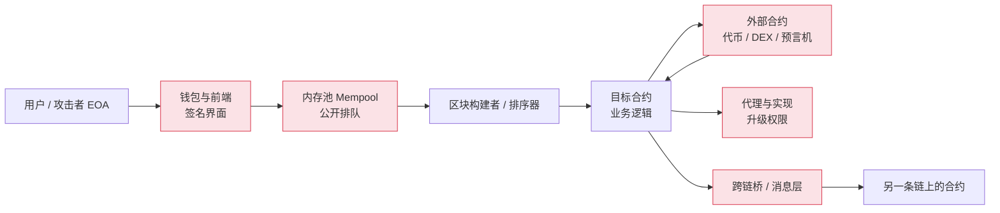
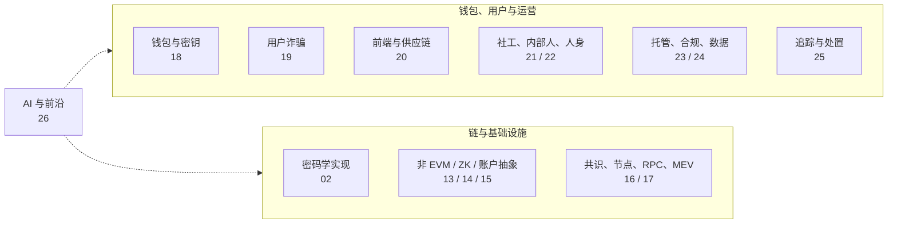
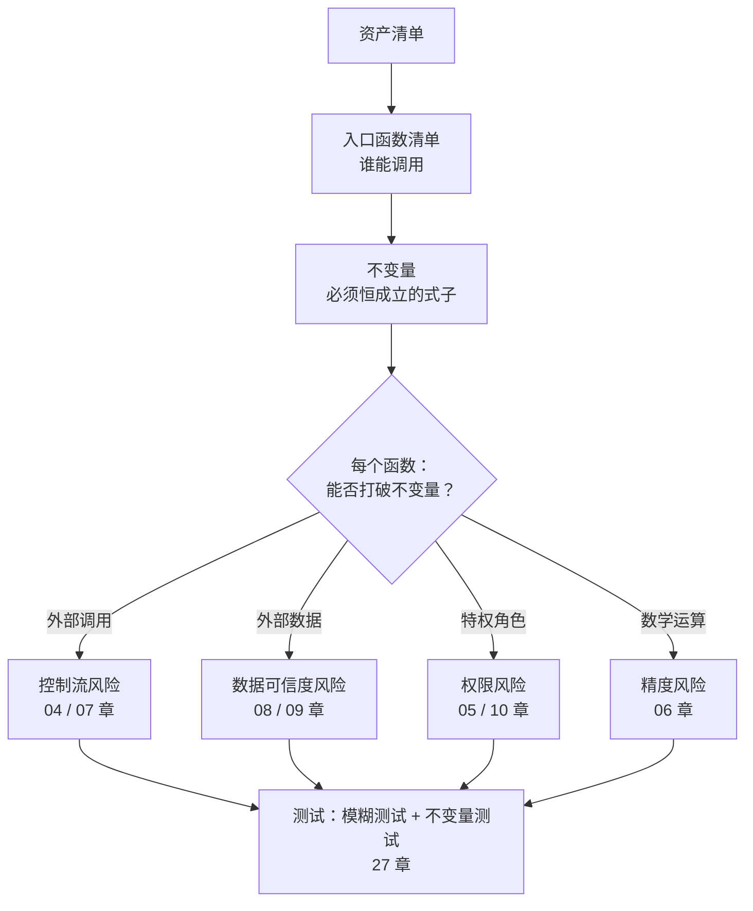

# 01 合约安全全景：为什么代码就是金库

> 学习目标：读完本章，你能——
> 1. 说清智能合约安全和传统 Web2 安全的三个根本区别。
> 2. 画出一张合约攻击面地图，并把常见漏洞归入六大类。
> 3. 用"攻击者能控制什么"的方法，为任意合约建立威胁模型。
>
> 前置章节：无（本章是系列入口）。建议先读过《CEX 交易所学习手册》01 章，理解"托管"的含义。
> 交互实验：[incident-explorer.html](interactive/incident-explorer.html)

---

## 开场：一笔"日常签名"，15 亿美元

2025 年 2 月，Bybit 的多签签名人签了一笔看起来正常的交易。Safe{Wallet} 前端已被篡改，这笔交易替换了多签实现合约。约 15 亿美元被转走。复盘见[资损 101](https://claude.ai/artifact/1a5Nx6xTVLuJdCB8Esf2xj#c-bybit)。

🤔 先猜再看：这起事故里，Safe 多签合约的代码有没有被利用的漏洞？事故属于第 3.2 节六大类的哪一类？

公开分析没有指向 Safe 合约的代码漏洞。合约忠实执行了签名人签下的交易。事故属于第 ⑥ 类"系统与运营"：前端和签名界面失守。所以本手册不只讲合约代码。

---

## 1. 一句话理解

**智能合约是一段公开的、不可撤回的、直接控制资金的代码。任何人都可以用任意参数、任意顺序调用它。**

智能合约（Smart Contract）：部署在区块链上、按代码自动执行的程序。它可以持有资产，也可以转出资产。

> 🎯 打个比方：智能合约像一台**放在广场中央的自动售货机**。
>
> - 机器里装着真金白银（合约余额）。
> - 机器的电路图贴在外壳上，任何人都能看（代码公开、字节码公开）。
> - 全世界的人都可以 7×24 小时来投币、按按钮、拍打机器（任何人可调用任何 public/external 函数）。
> - 机器一旦装好，就不能打开维修（不可变）。如果留了维修门（升级代理），维修门的钥匙本身就成了攻击目标。
> - 机器吐错了钱，没有客服可以追回（交易不可逆）。
>
> 比喻的局限：真实的售货机一次只服务一个人。合约在一笔交易里可以被**同一个人反复调用、嵌套调用**，还可以和其他几十台"售货机"组合使用（可组合性）。这正是很多漏洞的来源。

---

## 2. 和 Web2 安全有什么不同

| 维度 | Web2 后端 | CEX（中心化交易所） | 智能合约 |
|---|---|---|---|
| 代码是否公开 | 通常不公开 | 不公开 | 字节码一定公开，源码通常公开 |
| 谁能调用 | 经过鉴权的用户 | 经过 KYC 的用户 | **任何地址、任何合约** |
| 出错后能否回滚 | 可以改数据库 | 可以改内部账本 | 交易不可逆，只能靠升级或社会共识 |
| 修复速度 | 分钟级热修复 | 分钟级 | 需要升级权限；没有权限就不能修 |
| 攻击成本 | 需要绕过防火墙等 | 需要盗号或攻破内部系统 | 只需要一笔交易的 gas，闪电贷还能免费借到本金 |
| 失败后果 | 数据泄露 | 交易所赔付（如 SAFU） | 资金直接被转走，通常无赔付 |

**读表要点：**

- 合约没有"边界防火墙"。public 函数就是对全世界开放的 API。
- 合约的攻击者不需要本金。闪电贷（Flash Loan）可以在一笔交易内借出上亿美元（见 [08 章](08-oracle-flashloan.md)）。
- 合约的修复能力和攻击面是一回事：能升级，就意味着升级密钥可能被盗（见 [10 章](10-upgradeable-proxy.md)）。

> ⚠️ 警告：CEX 的用户资产最终也依赖合约安全。交易所的冷钱包可能是多签合约（例如 Safe）。开场的 Bybit 事故就是一例，详见 [28 章](28-incident-casebook.md)。

---

## 3. 攻击面地图

### 3.1 一笔交易会经过哪些环节

**读图要点：**

- 红色节点是"信任边界"。数据和控制权在这里跨越，漏洞最集中。
- 从"外部合约"指回"目标合约"的箭头表示**回调**：外部合约可以在你的函数执行中途调回来。重入就发生在这里（[04 章](04-reentrancy.md)）。
- 内存池和区块构建者决定交易**顺序**。顺序可以被利用（[09 章](09-mev-signatures.md)）。
- 局限：这张图没有画链本身的共识层和节点。链被攻破（例如 51% 攻击）或你读到的节点数据有误时，合约代码正确也没用（[16 章](16-consensus-chain-security.md)、[17 章](17-node-rpc-infrastructure.md)）。

### 3.2 漏洞六大类

| 类别 | 一句话 | 典型漏洞 | 章节 |
|---|---|---|---|
| ① 控制流 | 外部调用让攻击者"插队"执行 | 重入、只读重入、回调 | [04](04-reentrancy.md)、[07](07-external-calls-tokens.md) |
| ② 权限 | 不该调用的人调用了 | 缺少修饰器、`tx.origin`、未初始化、私钥泄露 | [05](05-access-control.md)、[10](10-upgradeable-proxy.md) |
| ③ 数学 | 数字算错了 | 溢出、精度损失、舍入方向、金库通胀 | [06](06-arithmetic-precision.md) |
| ④ 数据可信度 | 合约相信了可被操纵的数据 | 现货价预言机、闪电贷、签名重放 | [08](08-oracle-flashloan.md)、[09](09-mev-signatures.md) |
| ⑤ 经济设计 | 代码按规格执行，但规格本身可被套利 | 治理攻击、清算漏洞、坏账 | [11](11-defi-economic-security.md) |
| ⑥ 系统与运营 | 代码之外的环节失守 | 跨链验证、多签私钥、前端篡改、社工、编译器 bug | [12](12-cross-chain-bridges.md)、[18](18-wallet-key-management.md)–[25](25-fund-tracing-response.md)、[27](27-audit-testing-workflow.md) |

> 💡 注意：真实事故通常是**多类叠加**。例如 2023 年 Euler 事故 = 业务逻辑缺陷（⑤）+ 闪电贷放大（④）。审计时不能只按清单逐项打勾。

### 3.3 合约之外的攻击面

第 ⑥ 类在近年损失中占比最大。本手册把它拆成链与基础设施、钱包与运营两部分：

**读图要点：**

- 左边是"链本身和你读链的方式"，右边是"人、设备和流程"。
- 社工常常是入口，私钥或前端是落点。所以 18、20、21 章要一起读。
- 局限：AI 同时出现在攻防两边，它不是独立的攻击面，而是放大器，见 [26 章](26-ai-web3-security.md)。

---

## 4. 威胁建模：攻击者能控制什么

威胁建模（Threat Modeling）：在写代码前，列出攻击者能控制的输入、能触发的路径、想得到的结果。

### 4.1 攻击者的能力清单

对任意一个合约，默认攻击者**能**做到以下事情：

1. 用任意参数调用任意 `public` / `external` 函数。
2. 部署自己的合约，让你的合约调用它（恶意代币、恶意回调）。
3. 在一笔交易内借到巨额资金（闪电贷）。
4. 看到内存池中的待确认交易，并在它前后插入自己的交易。
5. 直接向你的合约转入代币或 ETH，不经过你的函数（"捐赠"）。
6. 读取你合约的全部存储，包括 `private` 变量。
7. 在另一条链或另一个合约上重放你签过的消息。

攻击者**通常不能**做到：

1. 伪造他人的 ECDSA 签名（除非私钥泄露或签名验证写错）。
2. 修改已经确认的区块（除非链的共识被攻破）。
3. 让 `msg.sender` 变成别人（除非你的代码用了 `tx.origin` 或错误的 meta-tx 逻辑）。

🤔 先猜再看：合约把管理员密码存在 `private` 变量里。按第 4.1 节的能力清单，攻击者能读到它吗？

能。第 6 条写明：攻击者能读取合约的全部存储。`private` 只限制其他合约调用这个变量，不隐藏链上数据。

### 4.2 建模步骤

1. 列出合约持有的资产。例如：用户存入的 USDT、协议手续费。
2. 列出每个改变资产的函数。标注谁可以调用。
3. 写出不变量（Invariant）：在任何操作之后都必须成立的式子。例如"合约 USDT 余额 ≥ 所有用户存款之和"。
4. 对每个函数问：攻击者控制哪些输入？函数里有哪些外部调用？外部调用之前状态是否已更新？
5. 对每个外部数据问：价格、余额、签名从哪里来？一笔交易内能否被操纵？
6. 对每个特权角色问：私钥在谁手里？被盗后最大损失是多少？有没有时间锁？

**读图要点：**

- 不变量是整个安全工作的锚点。所有测试最终都在验证不变量。
- 四个分支对应四类最常见的根因。每一类都有专门章节。
- 局限：威胁建模依赖人的想象力。经济攻击（⑤类）常常超出单个合约的边界，需要把整个协议和外部市场一起建模。

---

## 5. 损失的规模与趋势

以下数字来自公开报道和安全公司年度统计，金额为事发时美元估值约数：

| 年份 | 代表事件 | 约损失 | 类别 |
|---|---|---|---|
| 2016 | The DAO（以太坊） | 约 6,000 万美元 | 重入 |
| 2017 | Parity 多签库被自毁 | 约 51 万 ETH 被永久冻结 | 初始化 / 权限 |
| 2021 | Poly Network（多链） | 约 6.1 亿美元（后归还） | 跨链验证 |
| 2022 | Ronin Bridge | 约 6.2 亿美元 | 验证者私钥 |
| 2022 | BNB Chain Token Hub | 增发 200 万 BNB（约 5.7 亿美元），约 1 亿多美元被转出 | 跨链证明验证 |
| 2023 | Euler Finance | 约 1.97 亿美元（大部分归还） | 业务逻辑 |
| 2024 | DMM Bitcoin | 约 3.05 亿美元 | 社工（假招聘）→ 供应商终端 |
| 2025 | Bybit（Safe 多签） | 约 15 亿美元 | 前端与签名界面 |
| 2025 | Coinbase 客服外包 | 约 6.9 万用户数据；预估成本 1.8–4 亿美元 | 内部人 / 数据泄露 |
| 2025 | Balancer V2 | 约 9,480 万美元（项目方，早期报道约 1.28 亿） | 舍入误差 |
| 2026 | Drift（Solana） | 约 2.85 亿美元 | 社工 → 预签名的多签审批 |
| 2026 | KelpDAO rsETH | 约 2.92 亿美元 | 单一跨链验证者（DVN）失守 |
| 2026 | Liquid 侧链 | 约 3.19 亿美元（约 85% 被归还） | 验证软件缺陷，凭空铸出 L-BTC |
| 2026 | Bitget 热钱包 | 约 3.875 亿美元 | 第三方安全产品零日 → 伪造提现指令 |
| 2026 | **Binance 热钱包** | **约 63.4 亿美元（项目方口径，史上最大）** | 员工终端 → 部署令牌 → 签名服务 → EIP-7702 委托 |

**读表要点：**

- 早期事故集中在**代码漏洞**（重入、溢出）。编译器和库成熟后，这类漏洞减少。
- 近年最大损失转向**跨链桥**和**运营安全**（私钥、多签、前端、社工、内部人）。代码审计覆盖不到这些环节，见第六篇 18–25 章。2026 年 10 月 Binance 一起事件的损失，超过此前任何单起事故的 4 倍（见 [23 章](23-custody-exchange-ops.md) 5.2 节）。
- 数学精度类漏洞没有消失。2025 年 Balancer 事故说明，成熟协议也会在舍入方向上出错。

全部案例的筛选和对比，打开 [incident-explorer.html](interactive/incident-explorer.html)。

> 🧪 动手验证：打开[事故浏览器](interactive/incident-explorer.html)，先看"按类别的损失"，再把排序切到"按损失"。记录前 5 起事故各属于六大类的哪一类。

完整复盘：[Coincheck](https://claude.ai/artifact/1a5Nx6xTVLuJdCB8Esf2xj#c-coincheck)、[Poly Network](https://claude.ai/artifact/1a5Nx6xTVLuJdCB8Esf2xj#c-poly)、[Ronin](https://claude.ai/artifact/1a5Nx6xTVLuJdCB8Esf2xj#c-ronin)、[Wormhole](https://claude.ai/artifact/1a5Nx6xTVLuJdCB8Esf2xj#c-wormhole)、[Nomad](https://claude.ai/artifact/1a5Nx6xTVLuJdCB8Esf2xj#c-nomad)、[Euler](https://claude.ai/artifact/1a5Nx6xTVLuJdCB8Esf2xj#c-euler)、[DMM Bitcoin](https://claude.ai/artifact/1a5Nx6xTVLuJdCB8Esf2xj#c-dmm)、[WazirX](https://claude.ai/artifact/1a5Nx6xTVLuJdCB8Esf2xj#c-wazirx)、[Bybit](https://claude.ai/artifact/1a5Nx6xTVLuJdCB8Esf2xj#c-bybit)、[Binance](https://claude.ai/artifact/1a5Nx6xTVLuJdCB8Esf2xj#c-binance)。

---

## 6. 以太坊与三条链的扩展视角

本手册的扩展案例以以太坊主网为参照，再延伸到三条链。它们代表四种不同的执行环境：

| 链 | 类型 | 和以太坊的关系 | 学习重点 | 专题 |
|---|---|---|---|---|
| 以太坊主网 | L1，EVM 原件，PoS 共识 | 参照环境 | 绝大多数漏洞模式的首发地：重入、舍入、预言机、回调授权、升级与应急权限、签名界面 | [C00](chains/C00-ethereum.md) |
| BNB Chain（BSC） | 独立 L1，EVM 兼容，PoSA 共识 | 字节码兼容，参数不同 | 分叉项目改参数出错、低流动性预言机、跨链桥 | [C01](chains/C01-bnb-chain.md) |
| TRON | 独立 L1，TVM（EVM 的变体） | Solidity 可编译，但部分操作码语义不同 | USDT 返回值、能量模型、账户权限、地址格式 | [C02](chains/C02-tron.md) |
| Mantle | 以太坊 L2（OP Stack 系） | 继承以太坊安全，但原生 gas 代币是 MNT | `msg.value` 是 MNT、L2 信任假设、升级多签、提款延迟 | [C03](chains/C03-mantle.md) |

> 💡 注意："EVM 兼容"不等于"行为一致"。把以太坊上审计过的合约原样部署到另一条链，审计结论不能直接复用。三个专题各有一份"迁移检查清单"。

### 6.1 这本手册的形状

| 部分 | 内容 | 入口 | 适合谁 |
|---|---|---|---|
| 第一至八篇 | 全景、合约代码、DeFi、非 EVM、链与基础设施、钱包与运营、AI、工程与复盘 | [README](README.md)、本章 | 所有读者 |
| 链专题 | 以太坊、BNB Chain、TRON、Mantle 的差异和案例 | [C00](chains/C00-ethereum.md) | 部署或接入这些链的人 |
| 评估篇 | 方法、定级、报告、尽调、复现、应急 | [A01](assessment/A01-methodology.md)–[A11](assessment/A11-blockchain-system-testing.md)，模板 [T01](templates/T01-intake-checklist.md)–[T07](templates/T07-staff-anti-social-engineering.md) | 要做评估并交付结论的人 |
| Web3 安全训练营 | 从零基础走到能独立交付审计报告：主线 8 个阶段（整装待发、初窥门径、小试牛刀、渐入佳境、独当一面、庖丁解牛、追本溯源、登堂入室），链下赛道 L1 守好家门、L2 固若金汤；每个阶段有导读，列出要掌握的主题 | [B00 路线](bootcamp/B00-roadmap.md)–[B78 附录](bootcamp/B78-glossary-resources.md) | 准备做智能合约审计的人，包括没写过合约的新手 |
| 2026 专题 | 2026 年的签名路径与签名服务架构 | [29](29-signing-path-2026.md) | 负责签名系统、托管和钱包的人 |

**读表要点：**

- 训练营是动手主线，不重复主线的漏洞原理。它在需要时链回本手册的章节，例如 03、04–09、A02。
- 主线章节的检查项带固定编号，例如 `REN-2`。编号可以直接写进 [T03 报告模板](templates/T03-finding-report.md)，定级规则见 [A02](assessment/A02-risk-rating-reporting.md)。
- 局限：手册只教授权场景下的审计和防御。未经授权测试线上系统是违法行为。

---

## 7. 术语表

| 术语 | 英文 | 定义 |
|---|---|---|
| 智能合约 | Smart Contract | 部署在链上、自动执行、可持有资产的程序 |
| 外部账户 | EOA, Externally Owned Account | 由私钥控制的账户，可以发起交易 |
| 不变量 | Invariant | 任何操作后都必须成立的条件 |
| 威胁模型 | Threat Model | 对攻击者能力、目标和攻击路径的结构化描述 |
| 可组合性 | Composability | 合约可以自由调用其他合约，像积木一样拼装 |
| 闪电贷 | Flash Loan | 同一笔交易内借出并归还的无抵押贷款 |
| 内存池 | Mempool | 节点中等待打包的公开交易队列 |
| 信任边界 | Trust Boundary | 数据或控制权从可信方进入不可信方的位置 |

---

> 🪞 反思：挑一个你正在使用或开发的系统，按第 4.2 节过一遍。
> 1. 它持有的最大一笔资产是什么？
> 2. 谁能在一笔交易内改变这笔资产？这个"谁"受什么限制？
> 3. 如果明天出事，最可能的入口在代码里，还是在代码之外？

## 8. 思考题

1. 一个合约把所有关键变量都声明为 `private`。这能防止攻击者读取这些值吗？为什么？
2. 为你熟悉的一个 DeFi 协议（例如借贷协议）写出 3 个不变量。
3. 打开 [incident-explorer.html](interactive/incident-explorer.html)，按类别统计损失。哪一类损失最大？它是"代码漏洞"还是"代码之外"的问题？

下一章：[02 密码学基础与实现风险](02-cryptography-randomness.md) —— 私钥从哪里来。
