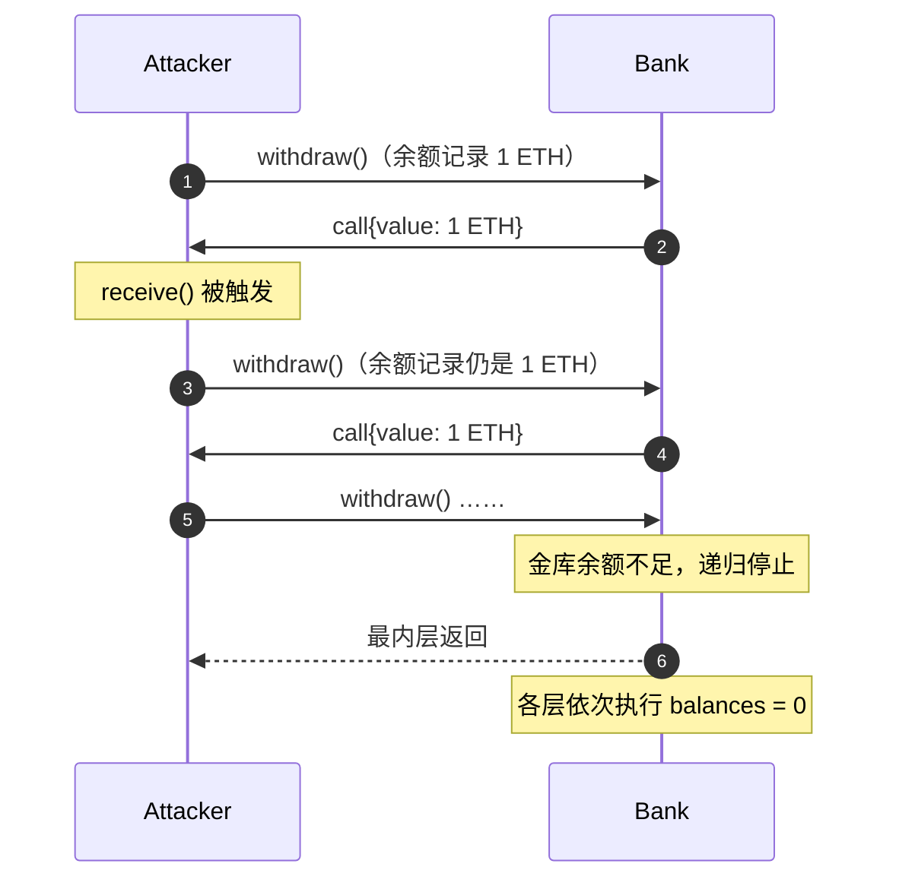
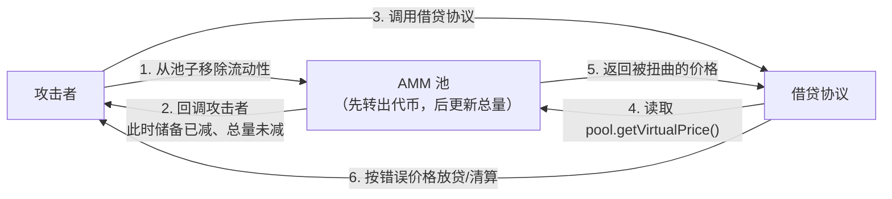

# 04 重入攻击：在你记账之前再取一次钱

> 学习目标：读完本章，你能——
> 1. 用调用栈图解释单函数重入、跨函数重入、跨合约重入和只读重入。
> 2. 写出符合 CEI 模式的提款函数，并说明重入锁的适用边界。
> 3. 在代码审查中找出所有"把控制权交出去"的位置。
>
> 前置章节：[03 EVM 与 Solidity 安全基础](03-evm-solidity-basics.md)
> 交互实验：[reentrancy-lab.html](interactive/reentrancy-lab.html) ｜ 示例合约：[practice-example-code/01-Reentrancy.sol](../practice-example-code/01-Reentrancy.sol)

---

## 开场：一行代码的顺序值多少钱

2016 年 6 月，攻击者从 The DAO 提走约 360 万 ETH（事发时约 6,000 万美元）。合约没有被破解。合约只是把两行代码的顺序写反了。

下面两行来自同一个提款函数。先想一想，再展开。

<details class="predict"><summary>🤔 先猜再看：Bank 持有 10 ETH，你的余额是 1 ETH。你调用一次 withdraw()，最多能取走多少？</summary>

如果 Bank 先转账、后清零，并且你是一个合约，你最多能取走全部 10 ETH。你的 `receive()` 在每次收款时再次调用 `withdraw()`。余额清零发生在所有嵌套调用返回之后。下面的 3.1 节逐步解释。

</details>

---

## 1. 一句话理解

**合约在更新自己的账本之前，把控制权交给了外部地址；外部地址趁账本还是旧的，再次调用合约。**

重入（Reentrancy）：一个函数执行尚未结束时，被外部调用再次进入。

> 🎯 打个比方：你去银行取 100 元。柜员先把现金递给你，然后才去改账本。
> 你接过现金的瞬间，你的同伴在旁边窗口说"他要再取 100 元"。柜员查账本——账本上余额还是 100——于是又给了一次。
> 只要柜员一直"先给钱、后改账"，你们就能一直取，直到金库空了。
>
> 比喻的局限：现实中柜员是两个人，可以并行。EVM 是单线程的：重入不是"并发"，而是**嵌套**——第二次取款完整地发生在第一次取款的中间。

---

## 2. 威胁模型：攻击者控制了什么

重入的前提只有两个：

1. 合约在函数中途发起**外部调用**，被调用方受攻击者控制。
2. 外部调用发生时，合约的**状态尚未更新**到最终值。

会把控制权交给外部的操作：

| 操作 | 为什么会交出控制权 |
|---|---|
| `addr.call{value: x}("")` | 接收方是合约时，执行它的 `receive` / `fallback` |
| `IERC20(token).transfer(...)` | 代币合约由攻击者部署时，代码任意 |
| ERC-777 `send` / `transfer` | 触发接收方的 `tokensReceived` 钩子 |
| ERC-721 / ERC-1155 `safeTransferFrom`、`_safeMint` | 触发接收方的 `onERC721Received` / `onERC1155Received` |
| 闪电贷回调 `onFlashLoan` | 设计上就是把控制权交给借款人 |
| 调用任意用户提供的地址 | 包括路由器、钩子、预言机 |

> 💡 注意：TRON 上用系统交易 `TransferContract` 转 TRX，**不会**执行接收合约的 fallback；用 `TriggerSmartContract` 附带 `callValue` 才会执行（TRON 官方开发文档）。Mantle 上 ETH 以 ERC-20 形式（BVM_ETH）存在，转 ETH 不触发 `receive`，但转原生币 MNT 会触发。同一份代码，在三条链上的回调入口不一样。

---

## 3. 漏洞机制

### 3.1 单函数重入

```solidity
// ❌ 漏洞：先转账，后记账
function withdraw() external {
    uint256 amt = balances[msg.sender];   // 读取余额：此刻仍是旧值
    require(amt > 0, "no balance");
    (bool ok, ) = msg.sender.call{value: amt}("");   // ① 交出控制权
    require(ok, "send failed");
    balances[msg.sender] = 0;                         // ② 太晚了
}
```

攻击合约：

```solidity
contract Attacker {
    IBank bank;
    receive() external payable {   // 收到 ETH 时自动执行，这里就是重入入口
        if (address(bank).balance >= 1 ether) {   // 银行还有钱就继续取
            bank.withdraw();          // 在 ② 之前再次进入
        }
    }
}
```



> 🧪 动手验证：打开[重入攻击单步模拟器](interactive/reentrancy-lab.html)，选择单函数重入，单步执行到第二次 `withdraw()`。记录此时 `balances[攻击者]` 的值，再切换到 CEI 版本比较。

**读图要点：**

- 每一层 `withdraw` 都读到了旧余额 1 ETH。账本清零发生在**所有层返回之后**。
- 递归深度受 gas 和调用深度（1024）限制。攻击者会一次取尽量大的金额，减少层数。
- 局限：如果 Bank 先清零再转账（CEI），第二层读到 0，攻击直接失败。

### 3.2 跨函数重入

攻击者不回到 `withdraw`，而是进入**另一个共享同一状态的函数**：

```solidity
function transfer(address to, uint256 amt) external {   // 没有加锁
    // 回调期间余额尚未清零，检查照样通过
    require(balances[msg.sender] >= amt);
    balances[msg.sender] -= amt;
    balances[to] += amt;   // 把"已提走"的余额转给同伙，之后再提一次
}
```

<details class="predict"><summary>🤔 先猜再看：withdraw() 已经加了 nonReentrant，transfer() 没有加。攻击者还能利用回调吗？</summary>

能。锁只拦截进入被锁函数的调用。`transfer()` 没有检查这把锁，并且它读取的余额还没有清零。

</details>

在 `receive()` 里，攻击者调用 `transfer(同伙, 1 ether)`。此时 `balances[攻击者]` 还没清零，余额被转给同伙。外层 `withdraw` 返回后才清零——但钱已经同时"转走"和"提走"了。

> ⚠️ 警告：只给 `withdraw` 加 `nonReentrant` 不够。所有读写同一状态的函数都要加同一把锁，或者全部遵循 CEI。

### 3.3 跨合约重入

协议由多个合约组成，它们共享状态（例如金库合约和份额代币合约）。合约 A 的锁挡不住对合约 B 的调用。B 在此刻读到的是 A 尚未更新的状态。

### 3.4 只读重入

只读重入（Read-only Reentrancy）：攻击者在回调中**不修改**目标合约，而是让**第三方协议**调用目标合约的 `view` 函数，读到中间状态。



**读图要点：**

- 池子自己的状态最终是对的。出错的是**在中间时刻读数据的第三方**。
- 池子的 `view` 函数通常没有加锁，所以 `nonReentrant` 挡不住。
- 防御方在第三方：读取外部价格前，检查对方的重入锁状态（部分池子提供此接口），或改用不受单笔交易影响的价格源（[08 章](08-oracle-flashloan.md)）。

---

## 4. 防御方法

### 4.1 CEI 模式（首选）

CEI（Checks-Effects-Interactions）：函数按"检查 → 修改状态 → 外部交互"的顺序编写。

```solidity
// ✅ 修复：CEI
function withdraw() external {
    uint256 amt = balances[msg.sender];          // Checks
    require(amt > 0, "no balance");
    // 先清零：重入时读到 0，require 回滚
    balances[msg.sender] = 0;                    // Effects
    // 交出控制权放在最后，此时账本已一致
    (bool ok, ) = msg.sender.call{value: amt}(""); // Interactions
    require(ok, "send failed");
}
```

### 4.2 重入锁（第二道防线）

```solidity
// ✅ 修复：OpenZeppelin ReentrancyGuard（或 0.8.24+ 的瞬态存储版本）
// 锁：执行期间再次进入任一 nonReentrant 函数都会回滚
function withdraw() external nonReentrant { ... }
```

| 方案 | 优点 | 局限 |
|---|---|---|
| CEI | 零开销，从根本上消除中间状态 | 复杂函数里难以做到"所有交互都在最后" |
| `nonReentrant`（存储锁） | 简单，覆盖整个函数 | 只保护加了锁的函数；不防只读重入；跨合约要共享锁 |
| 瞬态存储锁（`transient`） | gas 更低 | 目标链必须支持 EIP-1153（部署前确认，见 [C02](chains/C02-tron.md)） |
| 拉取式支付（Pull Payment） | 用户自己来取，合约不主动推送 | 体验差一步 |

### 4.3 纵深防御

1. 把 CEI 当作默认写法。
2. 对所有修改共享状态的外部入口加同一把锁。
3. 不在 `view` 函数中暴露"中间态"可读的关键价格；如果必须暴露，提供锁状态查询。
4. 用不变量测试验证"合约余额 ≥ Σ 用户余额"在任何调用序列后都成立（[27 章](27-audit-testing-workflow.md)）。

### 4.4 用代码验证修复

示例合约 [01-Reentrancy.sol](../practice-example-code/01-Reentrancy.sol) 同时包含漏洞版和修复版。Foundry 靶场 `practice-example-code/foundry/test/Reentrancy.t.sol` 按固定顺序验证：

1. PoC 测试在漏洞版上提走金库资金。
2. 同一个 PoC 在修复版上回滚。
3. 模糊测试验证：任意金额下，修复版上的攻击都回滚，受害者资金不变；漏洞版在任意倍数下都被提空。

```bash
# 只跑重入示例的测试，-vv 打印失败断言
cd practice-example-code/foundry && forge test --match-path test/Reentrancy.t.sol -vv
```

> 💡 注意：修复验证需要"修复前失败、修复后通过"两个结果。只跑通修复版，不能证明测试真的覆盖了漏洞（[A08](assessment/A08-reproduce-attacks.md)）。

---

## 5. 真实案例

### 5.1 The DAO（2016 年 6 月，以太坊）

- 攻击者利用 `splitDAO` 先转账、后更新余额的顺序，递归提取资金。
- 约 360 万 ETH（事发时约 6,000 万美元）被转入子 DAO。
- 以太坊社区通过硬分叉回滚，反对者继续维护原链，形成以太坊经典（ETC）。
- 教训：重入在以太坊早期就被发现，但"先给钱、后记账"至今仍反复出现。

### 5.2 Curve / Vyper 编译器重入（2023 年 7 月，以太坊）

- 合约源码写了 `@nonreentrant`，但 Vyper 0.2.15、0.2.16、0.3.0 生成的锁不正确，不同函数使用了不同的锁槽。
- 攻击者对使用原生 ETH 的池子发起跨函数重入，损失约 7,000 万美元（多方公开复盘）。
- 教训：**源码正确不等于字节码正确**。审计范围要包括编译器版本，关键协议要做字节码层面的测试。

### 5.3 BNB Chain 扩展：分叉项目的"回调入口"

BNB Chain 上大量项目分叉自以太坊协议。常见模式是：原协议只接受白名单代币，分叉项目放开为"任意代币可上架"，但没有给存款函数加锁。攻击者上架一个自己部署的代币，在 `transferFrom` 里回调存款函数，同一笔资产被记账两次。详细机制和检查清单见 [C01 BNB Chain 专题](chains/C01-bnb-chain.md)。

> 💡 注意："允许任意代币"就等于"允许任意回调"。上架流程本身是安全边界。

### 5.4 以太坊扩展：Fei Rari 与 Penpie

- **Fei Rari（2022 年 4 月，约 8,000 万美元）**：分叉自 Compound 的借贷池在 `borrow` 中先用 `call` 发送 ETH，后写入借款记录。攻击者在回调里调用没有被锁覆盖的 `exitMarket()`，取回了全部抵押品。这是 3.2 节"跨函数重入"的真实版本。
- **Penpie（2024 年 9 月，约 2,700 万美元）**：攻击者无许可创建 Pendle 市场，市场使用恶意代币；Penpie 的批量领取奖励函数没有重入锁，攻击者在回调中存入资产，把存款"变成"奖励。

两起事故的根因代码和攻击路径图见 [C00 以太坊案例深潜](chains/C00-ethereum.md) 4.1、4.2 节。

### 5.5 钩子重入与只读重入的真实案例

- **imBTC / Lendf.Me（2020 年 4 月，以太坊）**：imBTC 是 ERC-777 代币，转账时会回调持有人注册的钩子。攻击者先重入 Uniswap V1 的 ETH-imBTC 池。约一天后，攻击者在 Lendf.Me 存款的回调中提走先前的存款。存款函数返回时用旧值写回余额，抵押记录因此虚高。攻击者随后借走约 2,500 万美元（事发时估值）的资产。The Block 报道资金后来已归还。来源：[The Block](https://www.theblock.co/news/defi/2020-04-21-ethereum-token-standard-open-finance-exploits-62568)、[SlowMist](https://slowmist.medium.com/slowmist-details-of-lendf-me-reentrancy-attack-3e168ab5f2b1)。
- **dForce（2023 年 2 月，Arbitrum、Optimism）**：Curve 池在 `remove_liquidity` 的回调期间，`get_virtual_price()` 返回中间状态的值。dForce 用这个值给 LP 抵押品定价。损失约 360 万美元（事发时估值）。这是 3.4 节"只读重入"的真实版本。来源：[The Block](https://www.theblock.co/post/210518/dforce-protocol-drained-of-3-6-million-in-reentrancy-attack)、[CertiK](https://www.certik.com/blog/curve-conundrum-the-dforce-attack-via-a-read-only-reentrancy-vector-exploit)。
- 教训：代币标准和第三方的 `view` 函数，都在你的调用路径上。接入前要逐一确认它们何时交出控制权。

---

## 6. 审计检查点

- [ ] **REN-1** 列出所有外部调用（包括代币转账、NFT 安全转账、回调、低级 call）。
- [ ] **REN-2** 每个外部调用之前，所有相关状态都已更新到最终值？
- [ ] **REN-3** 所有读写同一状态的入口，是否共享同一把锁？
- [ ] **REN-4** 是否有 `view` 函数在交互期间返回中间状态，并被其他协议用作价格？
- [ ] **REN-5** 协议是否支持 ERC-777 或带钩子的代币？如果不支持，是否显式拒绝？
- [ ] **REN-6** 编译器版本是否有已知的重入锁 bug？
- [ ] **REN-7** 部署链上，原生币转账是否触发 fallback？（TRON、Mantle 与以太坊不同）

**把检查结果写进报告：**

| 检查项 | 发现时的证据 | 常见定级（用 [A02](assessment/A02-risk-rating-reporting.md) 复核） | 练习位置 |
|---|---|---|---|
| REN-2、REN-3 | 调用图 + 能提走资金的 PoC | Critical / High | [B25 MiniLend](bootcamp/B25-capstone-minilend.md) |
| REN-4 | 第三方读取路径 + 中间状态的价格差 | 取决于下游敞口 | [B39 Lido 集成](bootcamp/B39-case-lido.md) |
| REN-5 | 代币白名单 + 钩子调用路径 | High / Medium | [B41 ERC-4626](bootcamp/B41-case-erc4626.md) |
| REN-6、REN-7 | 编译器版本、目标链的转账语义 | 取决于资金路径 | [C02 TRON](chains/C02-tron.md) |

发现按 [T03 报告模板](templates/T03-finding-report.md) 记录。

### 6.1 漏洞分类坐标

审计报告常引用 SWC 编号。[SWC Registry](https://swcregistry.io/) 自 2020 年后没有全面更新，官方声明不再积极维护。编号仍可用于沟通。较新的分类见 [OWASP Smart Contract Top 10](https://owasp.org/www-project-smart-contract-top-10/)。

| 漏洞 | SWC | 本手册章节 |
|---|---|---|
| 重入 | SWC-107 | [04](04-reentrancy.md) |
| 未检查外部调用返回值 | SWC-104 | [07](07-external-calls-tokens.md) |
| 失败调用导致 DoS / 区块 Gas 上限 DoS | SWC-113 / SWC-128 | [07](07-external-calls-tokens.md) |
| 意外的 ETH 余额 | SWC-132 | [03](03-evm-solidity-basics.md)、[07](07-external-calls-tokens.md) |
| 默认可见性 | SWC-100 | [05](05-access-control.md) |
| 未保护的提款 / `selfdestruct` | SWC-105 / SWC-106 | [05](05-access-control.md) |
| 委托调用到不可信合约 | SWC-112 | [05](05-access-control.md) |
| `tx.origin` 鉴权 | SWC-115 | [05](05-access-control.md) |
| 整数溢出 | SWC-101 | [06](06-arithmetic-precision.md) |
| 弱随机数 / 区块值当时间 | SWC-120 / SWC-116 | [08](08-oracle-flashloan.md) |
| 交易顺序依赖 | SWC-114 | [09](09-mev-signatures.md) |
| 签名重放 / 可塑性 | SWC-121 / SWC-117 | [09](09-mev-signatures.md) |

按攻击向量整理的公开清单：[kadenzipfel/smart-contract-vulnerabilities](https://github.com/kadenzipfel/smart-contract-vulnerabilities)、[SCSFG 智能合约安全指南](https://scsfg.io/)。

---

## 7. 用户侧防护

普通用户看不到合约代码，但可以通过几个公开信号降低风险。

1. 存款前查看协议是否有公开审计报告，审计范围是否覆盖你要用的合约。
2. 新上线、TVL 快速增长、没有审计的金库，只放可以承受损失的金额。
3. 协议宣布暂停或发现漏洞时，先停止存入；按官方渠道的指引操作，不点社交媒体里的"紧急提款"链接。
4. 不要把资产集中在一个协议里；同一个团队的多个产品可能共用同一份有漏洞的代码。
5. 关注协议是否有漏洞赏金计划。没有赏金的项目，漏洞更可能被攻击者先发现。

---

## 8. 术语表

| 术语 | 英文 | 定义 |
|---|---|---|
| 重入 | Reentrancy | 函数执行尚未结束时被再次进入 |
| CEI 模式 | Checks-Effects-Interactions | 先检查、再改状态、最后外部交互 |
| 重入锁 | Reentrancy Guard / Mutex | 函数执行期间拒绝再次进入的标志位 |
| 只读重入 | Read-only Reentrancy | 第三方在中间时刻读取目标合约的 `view` 函数 |
| 钩子 | Hook | 代币标准中，转账时自动调用接收方的函数 |
| 拉取式支付 | Pull Payment | 合约只记账，由收款人主动提取 |

---

> 🪞 反思：打开你最近写过或读过的一个合约，找到第一个把控制权交出去的位置。
> 1. 那一刻，哪些状态还没有更新？
> 2. 如果攻击者此时回调另一个函数，会读到什么？
> 3. 你靠什么确认这件事不会发生：代码顺序、锁，还是"应该不会"？

## 9. 思考题

1. 打开 [reentrancy-lab.html](interactive/reentrancy-lab.html)，选择"nonReentrant 锁"，再选择"跨函数重入"变体。攻击成功了吗？为什么？
2. 一个 NFT 合约在 `mint()` 中先调用 `_safeMint`，再执行 `totalMinted++`，并用 `totalMinted` 限制最大供应量。攻击者能多铸造吗？
3. 如果一个合约的所有外部函数都加了 `nonReentrant`，它还会受到只读重入的影响吗？受影响的是谁？

下一章：[05 访问控制与权限](05-access-control.md) —— 不该调用的人调用了。
