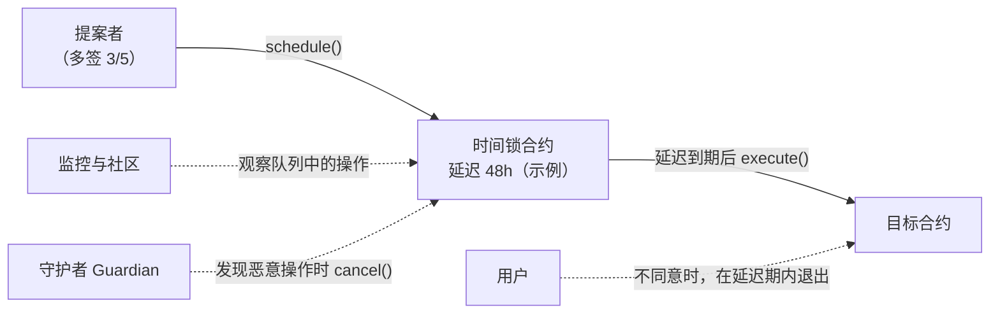
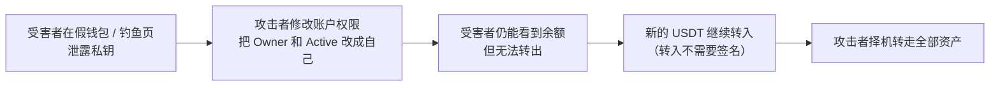

# 05 访问控制与权限：谁有权按这个按钮

> 学习目标：读完本章，你能——
> 1. 列出 6 种常见的访问控制缺陷，并为每种写出修复代码。
> 2. 设计一套"最小权限 + 多签 + 时间锁"的特权角色方案。
> 3. 区分合约层权限和账户层权限（以 TRON 账户权限为例）。
>
> 前置章节：[03 EVM 与 Solidity 安全基础](03-evm-solidity-basics.md)
> 交互实验：[storage-proxy-lab.html](interactive/storage-proxy-lab.html) ｜ 示例合约：[practice-example-code/02-AccessControl.sol](../practice-example-code/02-AccessControl.sol)

> 最后核对：2026-11-09

---

## 开场：一个没人初始化的库合约

2017 年 11 月，一名用户初始化了 Parity 多签钱包共用的库合约，并调用 `kill` 销毁了它。依赖这个库的钱包失去了代码逻辑，约 51 万 ETH 被冻结（[Parity 复盘](https://medium.com/paritytech/a-postmortem-on-the-parity-multi-sig-library-self-destruct-63daca3a4cf7)、[IBTimes](https://www.ibtimes.co.uk/ethereum-wallet-firm-was-warned-about-critical-bug-that-left-162m-frozen-time-1647654)）。这名用户没有破解任何密码。他只调用了一个没有权限检查的函数。

<details class="predict"><summary>🤔 先猜再看：库合约部署后没有调用过 initWallet。任何人调用库的 initWallet(自己)，会成为谁的 owner？</summary>

会成为库合约自己的 owner。`initWallet` 写入库合约自己的存储。如果库里的 `kill` 只检查 owner，这个调用者就可以销毁库合约。6.1 节说明两次事故的区别。

</details>

---

## 1. 一句话理解

**合约的每个状态修改函数都必须回答一个问题：谁可以调用我？如果答案是"任何人"，就必须证明任何人调用都安全。**

访问控制（Access Control）：限制特定函数只能由特定地址或角色调用的机制。

> 🎯 打个比方：合约像一栋写字楼。
>
> - `public` 函数是大堂的门：谁都能进。
> - `onlyOwner` 函数是机房的门：要刷卡。
> - **漏洞 1**：机房门忘了装刷卡器（缺少修饰器）。
> - **漏洞 2**：刷卡器只检查"刷卡的人是不是从总裁办公室出来的"，而不检查刷卡的人是谁（`tx.origin`）。
> - **漏洞 3**：大楼刚建好时，第一个走进物业办公室并宣布"我是物业经理"的人，就成了物业经理（未初始化）。
> - **漏洞 4**：总裁的门卡一直放在前台抽屉里（私钥管理）。
>
> 比喻的局限：写字楼可以换锁。合约如果没有升级能力，"锁"一旦装错就永远是错的。

---

## 2. 威胁模型

| 攻击者身份 | 能力 | 典型攻击 |
|---|---|---|
| 任意外部地址 | 调用所有 `public` / `external` 函数 | 调用未保护的 `mint`、`setOwner`、`initialize` |
| 恶意合约 | 在 owner 交互时插入调用 | 利用 `tx.origin` 冒充 owner |
| 被钓鱼的特权用户 | 签下自己看不懂的交易 | 前端篡改、盲签（[Bybit 2025](https://claude.ai/artifact/1a5Nx6xTVLuJdCB8Esf2xj#c-bybit)） |
| 获得私钥的攻击者 | 完全等同于特权角色 | 跨链桥验证者私钥泄露（[Ronin 2022](https://claude.ai/artifact/1a5Nx6xTVLuJdCB8Esf2xj#c-ronin)） |
| 内部人员 | 合法持有特权 | 跑路、恶意升级 |

---

## 3. 六种常见缺陷

### 3.1 缺少权限检查

```solidity
// ❌ 漏洞：任何人都能增发
// external 且无修饰符：任何地址都能调用
function mint(address to, uint256 amt) external {
    _mint(to, amt);
}
// ✅ 修复
// 只有持 MINTER_ROLE 的地址能通过
function mint(address to, uint256 amt) external onlyRole(MINTER_ROLE) {
    _mint(to, amt);
}
```

> 💡 注意：Solidity 0.5 之前，函数默认可见性是 `public`。旧合约忘写可见性，就等于把内部函数暴露给所有人。

### 3.2 用 `tx.origin` 做鉴权

```solidity
// ❌ 漏洞
// tx.origin 是最初签名的 EOA，钓鱼合约可借用户身份通过
require(tx.origin == owner);
// ✅ 修复
require(msg.sender == owner);   // msg.sender 是直接调用者，中间合约无法冒充
```

<details class="predict"><summary>🤔 先猜再看：owner 调用了攻击者的合约，攻击者的合约再调用你的 require(tx.origin == owner) 函数。检查会通过吗？</summary>

会通过。`tx.origin` 是交易的发起账户，这里是 owner。`msg.sender` 才是直接调用方，这里是攻击者的合约。

</details>

攻击路径：owner 调用攻击者的合约（例如领取空投）→ 攻击者合约调用你的合约 → `tx.origin` 仍是 owner → 检查通过。

### 3.3 未保护的初始化函数

可升级合约和克隆合约用 `initialize()` 代替构造函数。如果初始化函数没有被调用，或者可以被重复调用，任何人都能成为 owner。

```solidity
// ❌ 漏洞：任何人都可以调用，且可以重复调用
// 无调用者限制，也无"已初始化"标记
function initialize(address _owner) external {
    owner = _owner;   // 抢先调用者成为 owner；重复调用可覆盖
}
// ✅ 修复：OpenZeppelin Initializable
// initializer 只允许执行一次
function initialize(address _owner) external initializer {
    owner = _owner;
}
// ✅ 同时在实现合约的构造函数中锁死实现合约本身
// 防止攻击者直接初始化实现合约并接管
constructor() { _disableInitializers(); }
```

> 🧪 动手验证：打开[存储与代理实验](interactive/storage-proxy-lab.html)，在第 1 节选择"朴素代理"，点击"攻击者调用 initialize(0xBAD…)"。记录 slot 0 的解释如何变化。

### 3.4 任意外部调用 / 任意 delegatecall

```solidity
// ❌ 漏洞：用户可以让合约以自己的身份调用任何地址
function execute(address target, bytes calldata data) external {
    // target 与 data 全由调用者控制：可转走本合约持有的代币或授权
    target.call(data);
}
```

<details class="predict"><summary>🤔 先猜再看：一个合约持有受害者对某代币的授权，并公开了上面的 execute()。攻击者不知道受害者的私钥，能转走受害者的代币吗？</summary>

能。攻击者让这个合约调用 `token.transferFrom(受害者, 攻击者, 金额)`。代币合约看到的调用方是被授权的合约，所以额度检查通过。

</details>

如果这个合约持有代币授权（allowance），攻击者可以构造 `data = transferFrom(受害者, 攻击者, 金额)`。如果这里是 `delegatecall`，攻击者的代码会直接改写本合约存储。

> 🧪 动手验证：打开[存储与代理实验](interactive/storage-proxy-lab.html)，在第 2 节切换"A 使用 call"和"A 使用 delegatecall"。记录"读写的存储"和"A 的 slot 0"的变化。

### 3.5 单步所有权转移

```solidity
// ❌ 风险：输错地址，权限永久丢失
// 一步生效，没有确认新地址可用
function transferOwnership(address newOwner) external onlyOwner { owner = newOwner; }
// ✅ 修复：两步转移（Ownable2Step）——新 owner 必须主动 acceptOwnership()
```

### 3.6 签名鉴权写错

用签名代替 `msg.sender` 鉴权时，`ecrecover` 对无效签名返回 `address(0)`。如果被比较的签名者变量未设置（默认 0），检查会通过。签名的完整陷阱见 [09 章](09-mev-signatures.md)。

> 💡 注意：另外三个容易漏掉的判断：
>
> - `extcodesize(msg.sender) == 0` 不能证明调用者是 EOA。合约在构造函数中发起调用时，代码长度为 0。
> - `renounceOwnership` 之后，owner 权限不可恢复。调用前要确认没有函数还依赖 owner。
> - Solidity 0.4 时期，构造函数与合约同名。合约改名后，旧的"构造函数"变成公共函数，任何人都能调用。

---

## 4. 防御方法：特权角色设计

### 4.1 最小权限

把一个 `owner` 拆成多个角色，每个角色只做一件事：

| 角色 | 能做什么 | 建议持有者 | 建议延迟 |
|---|---|---|---|
| `UPGRADER` | 升级实现合约 | 多签 + 时间锁 | 48 小时以上（示例） |
| `PARAM_ADMIN` | 调整费率、抵押率 | 多签 + 时间锁 | 24 小时（示例） |
| `PAUSER` | 紧急暂停 | 小型多签或监控机器人 | 无延迟 |
| `MINTER` | 增发 | 只授予特定合约 | — |

> 💡 注意：暂停权限要"快"，升级权限要"慢"。暂停只能止损，不能转走资金；升级可以做任何事。

### 4.2 多签 + 时间锁



**读图要点：**

- 时间锁给用户一个"退出窗口"。恶意升级被公开排队后，用户有时间撤资。
- 守护者可以取消操作，但不能发起操作。权限是不对称的。
- 局限：如果多签的签名人被同时钓鱼（例如前端被篡改），多签只能防"单个私钥被盗"，不能防"所有人看到同一个假界面"。

> 🧪 动手验证：打开[多签交易签前复核面板](interactive/audit-safetx.html)，把 operation 改成 `1 · DELEGATECALL`。记录 safeTxHash 是否变化，以及面板给出的风险标记。

### 4.3 L2 视角：Mantle 的升级权限

L2 的桥合约持有用户全部跨链资产。谁能升级桥，谁就能决定这些资产的去向。根据 L2BEAT 截至 2026 年 11 月的页面，Mantle 的安全多签（6/14）可以无延迟升级 L1 上的桥。这是信任假设，不是代码漏洞。细节见 [C03](chains/C03-mantle.md) 2.2、4.3 节。

### 4.4 用代码验证修复

示例合约 [02-AccessControl.sol](../practice-example-code/02-AccessControl.sol) 同时包含 `VulnerableWallet` 和 `SafeWallet`。Foundry 靶场 `practice-example-code/foundry/test/AccessControl.t.sol` 用于对照这两个版本。

```bash
# 运行访问控制示例的测试
cd practice-example-code/foundry && forge test --match-path test/AccessControl.t.sol -vv  # 从 web3-security-handbook/ 出发
```

> 💡 注意：修复验证需要两个结果：漏洞版上攻击成功，修复版上攻击失败（[A08](assessment/A08-reproduce-attacks.md)）。

---

## 5. 账户层权限：TRON 的案例

以太坊的 EOA 只有一把私钥。TRON 账户原生支持**多重权限**（TRON 官方文档与安全公司公开资料）：

| 权限 | 作用 |
|---|---|
| Owner | 最高权限，可以修改其他权限，包括增删签名人 |
| Active | 日常操作：转账、质押、调用合约；可以有多个，每个可以限定允许的操作类型 |
| Witness | 超级代表（出块节点）相关操作 |

每个权限有一组地址、每个地址有权重、权限有阈值。权重之和达到阈值，操作才执行。

**"多签诈骗"的攻击路径：**



**读图要点：**

- 攻击者不立即转走资产。账户看起来正常，受害者还会继续往里转钱。
- 这类骗局常见于 OTC 交易：骗子提供一个"有余额但转不出来"的账户私钥，诱导对方支付"手续费"。
- 防御：定期检查账户权限配置；只从官方渠道下载钱包；不要导入别人提供的私钥。
- 对合约开发者的含义：TRON 上"一个地址 = 一把私钥"不成立。收到一个地址时，不能假设它由单一私钥控制。

> 🧪 动手验证：打开[链迁移风险检查器](interactive/chain-porting-lab.html)，点击"清空"，只勾选"特权角色是一个普通地址"。分别选择 TRON 和 Mantle，记录两条链的严重度和修复建议。

---

## 6. 真实案例

### 6.1 Parity 多签钱包（2017 年，以太坊）

- **7 月**：钱包合约把未匹配的调用 `delegatecall` 给库合约。库里的 `initWallet` 没有保护。攻击者通过钱包调用 `initWallet`，把自己设为 owner，转走约 153,037 ETH（约 3,000 万美元）。
- **11 月**：修复后的新库合约没有初始化，被人接管后自毁（见本章开场）。约 51 万 ETH 被永久冻结。
- 教训：实现合约（库）本身也需要初始化或在构造函数中锁死。

### 6.2 Ronin Bridge（2022 年 3 月）

- 跨链桥 9 个验证者中 5 个签名即可放行。攻击者控制了 5 把私钥，其中一把来自早已不需要、却没有撤销的授权。教训：特权清单要定期审计，阈值要和私钥的独立性匹配。完整分析见 [12 章](12-cross-chain-bridges.md) 4.1 节。

### 6.3 BNB Chain Token Hub（2022 年 10 月）

- 攻击者支付 100 BNB 注册为跨链中继者（Relayer），再利用证明验证缺陷伪造消息，凭空铸造 200 万 BNB。
- 修复硬分叉（Moran）把中继者改为白名单。
- 教训：注册中继者"只要付押金就行"是一个权限决策。详见 [C01](chains/C01-bnb-chain.md)。

---

## 7. 审计检查点

- [ ] **ACC-1** 每个修改状态的外部函数，都有明确的权限检查或"任何人可调用"的安全论证。
- [ ] **ACC-2** 没有任何地方用 `tx.origin` 做鉴权。
- [ ] **ACC-3** 初始化函数有 `initializer` 修饰；实现合约构造函数调用了 `_disableInitializers()`。
- [ ] **ACC-4** 不存在用户可控的任意 `call` / `delegatecall` 目标。
- [ ] **ACC-5** 所有权转移是两步式。
- [ ] **ACC-6** 没有用 `extcodesize` 或 `tx.origin == msg.sender` 判断调用者是 EOA。
- [ ] **ACC-7** 特权角色已拆分；升级和参数修改经过时间锁。
- [ ] **ACC-8** 特权私钥的持有者、存放方式、阈值已文档化，并有撤销流程。
- [ ] **ACC-9** 部署链的账户模型是否与以太坊一致？（TRON 账户可多权限）

**把检查结果写进报告：**

| 检查项 | 发现时的证据 | 常见定级（用 [A02](assessment/A02-risk-rating-reporting.md) 复核） | 练习位置 |
|---|---|---|---|
| ACC-1、ACC-3 | 未受保护的入口 + 夺权或增发 PoC | Critical / High | [B25 MiniLend](bootcamp/B25-capstone-minilend.md)、[存储与代理实验](interactive/storage-proxy-lab.html) |
| ACC-2、ACC-6 | 调用路径 + 冒充调用方的 PoC | High / Medium | [B25 MiniLend](bootcamp/B25-capstone-minilend.md) |
| ACC-4 | 用户可控目标 + 被盗用的授权或存储写入 | Critical / High | [B40 Safe](bootcamp/B40-case-safe.md)、[存储与代理实验](interactive/storage-proxy-lab.html) |
| ACC-5 | 单步转移的代码位置 | Medium / Low | [B25 MiniLend](bootcamp/B25-capstone-minilend.md) |
| ACC-7、ACC-8 | 角色矩阵、时间锁配置、私钥持有记录 | 取决于角色权限 | [B40 Safe](bootcamp/B40-case-safe.md)、[多签复核面板](interactive/audit-safetx.html) |
| ACC-9 | 账户权限配置截图或链上记录 | 取决于资金路径 | [C02 TRON](chains/C02-tron.md)、[链迁移风险检查器](interactive/chain-porting-lab.html) |

发现按 [T03 报告模板](templates/T03-finding-report.md) 记录。 评估交易所合约时用 [A03](assessment/A03-exchange-contracts-wallets.md)，评估运营和私钥时用 [A06](assessment/A06-operational-key-security.md)。

---

## 8. 用户侧防护

普通用户看不到合约代码，但可以通过几个公开信号降低风险。

1. 存款前查看协议的管理员权限：谁能升级、谁能暂停、谁能动用资金。L2BEAT、DeFiSafety 等网站会列出这些信息。
2. 管理员是单个地址（EOA）而不是多签加时间锁，就是高风险信号。
3. 有时间锁的协议，在它公布升级后、生效前，你有时间撤出。关注协议的治理和升级公告。
4. 在 TRON 上，如果你的账户权限被修改（例如 owner 权限被加上陌生地址），立即用剩余权限转移资产，并检查是否签过权限修改交易。
5. 不给任何人你的私钥或助记词，也不签"修改账户权限"的交易。

---

## 9. 术语表

| 术语 | 英文 | 定义 |
|---|---|---|
| 访问控制 | Access Control | 限制谁能调用特定函数的机制 |
| 修饰器 | Modifier | Solidity 中在函数执行前后插入检查的语法 |
| 初始化函数 | Initializer | 可升级合约中替代构造函数的一次性函数 |
| 多签 | Multisig | 需要 M 个签名人中至少 N 个签名才能执行的账户 |
| 时间锁 | Timelock | 操作公开排队一段时间后才能执行的合约 |
| 守护者 | Guardian | 只能暂停或取消、不能发起操作的紧急角色 |
| 账户权限 | Account Permission | TRON 账户原生的多权限、多签名配置 |

---

> 🪞 反思：打开你负责的一个系统，列出能改变资金去向的全部权限。
> 1. 哪个权限由单个人或单把私钥持有？
> 2. 如果这个权限今天被盗，从发生到你发现要多久？
> 3. 你上一次撤销不再需要的权限是什么时候？

## 10. 思考题

1. 一个协议的 `PAUSER` 角色可以暂停提款，但没有时间锁。这个设计合理吗？如果 `PAUSER` 私钥被盗，最坏情况是什么？
2. Parity 第二次事故中，库合约被自毁。在 EIP-6780 之后，同样的操作还会冻结资金吗？
3. 你在 TRON 上收到一个地址，想把它设为合约的 `owner`。你需要额外确认什么？

下一章：[06 算术与精度](06-arithmetic-precision.md) —— 数字算错了。
