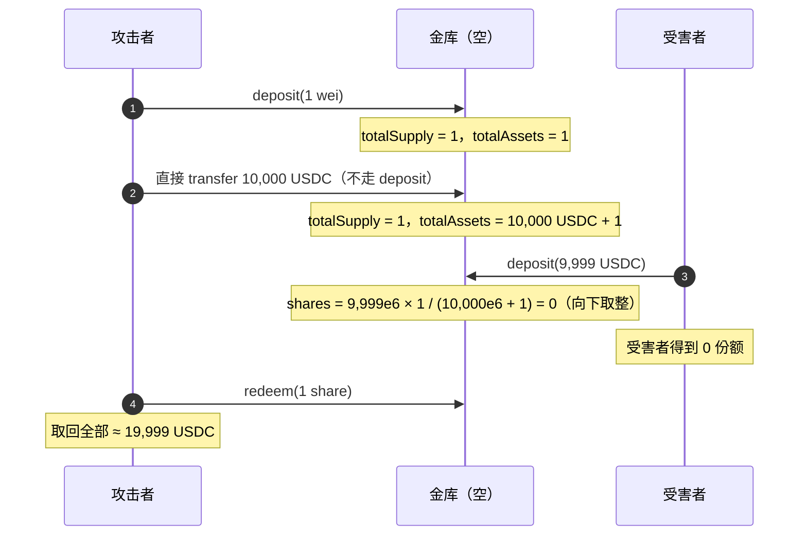

# 06 算术与精度：差一个 wei，丢一个金库

> 学习目标：读完本章，你能——
> 1. 识别溢出、截断、除法顺序、舍入方向、精度单位不一致五类数学缺陷。
> 2. 解释 ERC-4626 金库首存者通胀攻击，并说出两种防御方式。
> 3. 对任意"份额 ↔ 资产"换算，判断它该向上还是向下取整。
>
> 前置章节：[03 EVM 与 Solidity 安全基础](03-evm-solidity-basics.md)
> 交互实验：[vault-inflation-lab.html](interactive/vault-inflation-lab.html) ｜ 示例合约：[practice-example-code/03-VaultInflation.sol](../practice-example-code/03-VaultInflation.sol)

> 最后核对：2026-11-09

---

## 开场：一次只错一点点

2025 年 11 月，攻击者利用 Balancer V2 稳定池的取整错误取走资金。官方复盘估算用户资金被盗约 9,480 万美元（[Balancer 复盘](https://medium.com/balancer-protocol/nov-3-exploit-post-mortem-51dcbeb6b020)）。单次交换的误差很小。攻击者在一笔批量交换中累积了这些误差。

<details class="predict"><summary>🤔 先猜再看：金库每份额价值 1.5 个最小资产单位（示例）。mint(1 份额) 错误地向下取整收款。重复 1,000 次，调用者大约多得多少价值？</summary>

大约 500 个资产单位。每次只付 1 个单位，却拿到价值约 1.5 个单位的份额。差额来自其他持有人。第 3 节给出四个函数的取整方向。

</details>

---

## 1. 一句话理解

**EVM 只有整数。每一次除法都会丢掉余数；丢掉的余数归谁，决定了谁能从协议里慢慢"抠"出钱。**

> 🎯 打个比方：一家披萨店按"块"卖披萨，一张披萨切 8 块。
>
> - 你付 1/3 张的钱，店员必须决定给你 2 块还是 3 块（舍入方向）。
> - 如果店员总是往多了给，聪明的顾客就反复买 1/3 张，每次多拿一点。
> - 如果第一个顾客买下整张披萨只切成 1 块，然后往盒子里偷偷塞进 100 张披萨，下一个顾客付了 99 张的钱，却因为"1 块披萨价值 101 张"而一块也分不到（金库通胀攻击）。
>
> 比喻的局限：披萨店会被投诉。合约里，每次多拿 1 wei 的操作可以在一笔交易里重复几千次。

---

## 2. 五类数学缺陷

| # | 缺陷 | 例子 | 后果 |
|---|---|---|---|
| ① | 溢出 / 下溢 | 0.8 之前的 `a * b`；0.8 之后的 `unchecked { }` | 余额回绕成极大值或 0 |
| ② | 类型截断 | `uint128(x)`、`int256` 转 `uint256` | 静默丢掉高位 |
| ③ | 先除后乘 | `a / b * c` | 精度损失被放大 c 倍 |
| ④ | 舍入方向错误 | 存款时份额向上取整 | 每次操作都向用户泄漏 1 单位 |
| ⑤ | 单位不一致 | 6 位精度的 USDT 当作 18 位计算 | 价格偏差 10^12 倍 |

### 2.1 溢出：BEC batchOverflow（2018 年 4 月，以太坊）

<details class="predict"><summary>🤔 先猜再看：uint256 没有溢出检查。2 × 2^255 的结果是多少？</summary>

结果是 0。真实结果是 2^256，超出 `uint256` 上限后回绕为 0。下面的 `require` 因此比较的是 0。

</details>

```solidity
// ❌ 漏洞（Solidity 0.4，无溢出检查）
// 攻击者传 2 个接收者，_value = 2^255
function batchTransfer(address[] _receivers, uint256 _value) public {
    uint cnt = _receivers.length;
    uint256 amount = uint256(cnt) * _value;     // 2 * 2^255 = 2^256 → 回绕为 0
    // 0 ≤ 任何余额，通过
    require(_value > 0 && balances[msg.sender] >= amount);
    // 扣减 0，发送者余额不变
    balances[msg.sender] = balances[msg.sender].sub(amount);
    for (uint i = 0; i < cnt; i++) {
        // 每人收到 2^255
        balances[_receivers[i]] = balances[_receivers[i]].add(_value);
    }
}
```

攻击者用 2 个接收地址和 `_value = 2^255`，凭空铸出天量代币。多家交易所暂停 BEC 充提（公开报道）。

> 💡 注意：Solidity 0.8 默认检查溢出。但 `unchecked` 块、内联汇编、类型转换仍会静默回绕。审计时要逐一检查这三处。

> 💡 注意：移位运算也不检查溢出。`x << n` 溢出时直接丢掉高位，0.8 的默认检查不覆盖它。Move 上的同类错误见 [13 章](13-non-evm-ecosystems.md) 5.3 节的 Cetus 事故。

> 🧪 动手验证：打开[整数溢出与精度实验](interactive/audit-overflow.html)，选择位宽 32、运算 `*`，输入 a = 2147483648、b = 2。依次切换三种模式，记录结果是回绕还是回滚。

### 2.2 先除后乘

```solidity
// ❌ 精度损失：利率 5%，本金 19
uint256 interest = principal / 100 * rateBps / 100;  // 19/100 = 0 → 利息 0
// ✅ 先乘后除
// 19*500/10000 = 0（仍为 0，但误差不再被放大）
uint256 interest = principal * rateBps / 10_000;
// ✅ 更好：使用 mulDiv（OpenZeppelin Math.mulDiv），中间结果 512 位，不溢出，可指定舍入方向
// 显式向下取整，方向对协议有利
uint256 interest = Math.mulDiv(principal, rateBps, 10_000, Math.Rounding.Floor);
```

> 🧪 动手验证：打开[整数溢出与精度实验](interactive/audit-overflow.html)，在下半部分保持 amount = 7、numerator = 3、denominator = 5。记录两种顺序的结果和差值。

### 2.3 单位不一致：三条链上的 USDT

同一个"USDT"，在不同链上的精度不同（以链上合约的 `decimals()` 为准）：

| 链 | 代币 | `decimals()` |
|---|---|---|
| 以太坊 | Tether USD | 6 |
| BNB Chain | Binance-Peg BSC-USD | 18 |
| TRON | Tether USD (TRC-20) | 6 |

> ⚠️ 警告：把以太坊上的价格计算代码原样部署到 BNB Chain，如果写死了 `1e6`，USDT 金额会被放大 10^12 倍。**永远从合约读取 `decimals()`，不要写死。**跨链桥两端精度不同时，要在桥合约里显式换算，并处理换算后的余数。

---

## 3. 舍入方向：永远对协议有利

规则只有一条：**舍入的余数归协议，不归调用者。**

| 操作 | 用户给出 | 用户得到 | 取整方向 | 理由 |
|---|---|---|---|---|
| `deposit(assets)` | 资产 | 份额 | 向下 | 少给份额 |
| `mint(shares)` | 资产（计算所需） | 份额 | 向上 | 多收资产 |
| `withdraw(assets)` | 份额（计算所需） | 资产 | 向上 | 多扣份额 |
| `redeem(shares)` | 份额 | 资产 | 向下 | 少给资产 |

如果方向反了，攻击者可以做"往返套利"：反复 `mint` 1 份额再 `redeem`，每次净赚 1 单位舍入误差。单次很小，但在没有手续费的场景下可以循环上千次。

> 🧪 动手验证：打开[取整方向判定器](interactive/audit-rounding.html)，选择 `mint(1 份额)`，先选"向下"，再选"向上"。记录两次的用户净收益。

### 3.1 案例：Balancer V2（2025 年 11 月，多链）

- 公开分析（Check Point Research、Verichains 等安全公司）指出：Composable Stable Pool 的 `batchSwap` 中存在舍入误差。
- 攻击者在一笔批量交换中串联大量小额交换，让每一步的舍入都朝对自己有利的方向累积，操纵池子不变量和 BPT（池子份额）价格。
- [Balancer 官方复盘](https://medium.com/balancer-protocol/nov-3-exploit-post-mortem-51dcbeb6b020)把根因定位在稳定池 exact-out 交换路径的取整错误，并估算用户资金被盗约 9,480 万美元（事发时估值）。该数字只覆盖 Balancer 部署的池子。
- 早期分析（[Check Point Research](https://research.checkpoint.com/2025/how-an-attacker-drained-128m-from-balancer-through-rounding-error-exploitation/)）的数字是约 1.28 亿美元。引用时要写明口径。事故涉及多条链上的部署。
- 教训：舍入误差在**单步**测试中可以忽略，在**可批量、可循环**的路径中会被放大。要对"重复 N 次同一操作"做模糊测试（[27 章](27-audit-testing-workflow.md)）。

### 3.2 案例：KyberSwap Elastic（2023 年 11 月，以太坊等多链）

- 2023 年 11 月，KyberSwap Elastic 的 `estimateIncrementalLiquidity` 把应向上取整的 `deltaL` 写成了向下取整。池子误判价格没有跨越 tick，同一段流动性被计算两次。[官方复盘](https://blog.kyberswap.com/post-mortem-kyberswap-elastic-exploit/)称受影响资产约 5,620 万美元。攻击路径和根因见 [C00](chains/C00-ethereum.md) 4.4 节。

> 💡 注意：**代码与注释不一致**时，要把它当作漏洞线索，而不是文档瑕疵。

---

## 4. ERC-4626 金库通胀攻击

ERC-4626：代币化金库的标准接口。用户存入资产（assets），获得份额（shares）。

```
shares = assets × totalSupply / totalAssets      （向下取整）
```

`totalAssets` 通常是 `asset.balanceOf(address(this))`——任何人都可以通过直接转账来增加它。

### 4.1 攻击步骤

<details class="predict"><summary>🤔 先猜再看：空金库中，攻击者存入 1 wei 得到 1 份额，再直接转入 10,000 USDC。受害者存入 9,999 USDC，会得到多少份额？</summary>

0 份额。`9,999e6 × 1 / (10,000e6 + 1)` 小于 1，向下取整为 0。受害者的资产留在金库里，归唯一的份额持有人。

</details>



**读图要点：**

- 攻击者的 1 份额代表了金库全部资产。受害者的存款被"捐赠"给了这 1 份额。
- 攻击者通常抢跑受害者的第一笔存款交易（[09 章](09-mev-signatures.md)）。
- 攻击成本是捐赠额。只要受害者存款接近捐赠额，攻击就有利可图。
- 局限：这个攻击只在金库**几乎为空**时有效。金库规模越大，攻击成本越高。

### 4.2 防御

| 方案 | 做法 | 效果 |
|---|---|---|
| 虚拟份额与偏移（OpenZeppelin ≥ 4.9） | `shares = assets × (totalSupply + 10^offset) / (totalAssets + 1)` | 攻击者需要捐赠 10^offset 倍的资金才能造成同样损失 |
| 初始存款销毁 | 部署时存入一笔资金，并把份额发给死地址 | 金库永远不为空 |
| 内部记账 | 用状态变量记录 `totalAssets`，不读 `balanceOf` | 捐赠不改变份额价格 |
| 最小份额检查 | `require(shares > 0)`；用户侧设置 `minSharesOut` | 受害者交易回滚，而不是得到 0 |

> 🧪 动手验证：打开[金库通胀攻击实验](interactive/vault-inflation-lab.html)，保持"朴素金库"、捐赠额 10,000、受害者存款 9,900，记录受害者份额。再切换到"虚拟份额 + 偏移"，把 `decimalsOffset` 从 0 拖到 6，记录攻击者利润的变化。

> 💡 注意：Uniswap V2 也用了类似思路：首次添加流动性时，永久锁定 `MINIMUM_LIQUIDITY = 1000` 份 LP 代币。

### 4.3 用代码验证修复

示例合约 [03-VaultInflation.sol](../practice-example-code/03-VaultInflation.sol) 同时包含 `NaiveVault` 和 `OffsetVault`。Foundry 靶场 `practice-example-code/foundry/test/VaultInflation.t.sol` 用于对照这两个版本。

```bash
# 运行金库通胀攻击示例的测试
cd practice-example-code/foundry && forge test --match-path test/VaultInflation.t.sol -vv  # 从 web3-security-101/ 出发
```

> 💡 注意：修复验证需要两个结果：漏洞版上受害者损失资产，修复版上攻击无利可图（[A08](assessment/A08-reproduce-attacks.md)）。

---

## 5. 扩展案例：BNB Chain 上的 Uranium Finance（2021 年 4 月）

Uranium Finance 分叉自 Uniswap V2。开发者把手续费从 0.3% 改成 0.16%（公开分析报告），在 `swap()` 的余额检查中修改了一处常数，但漏改了另一处：

```solidity
// Uniswap V2 原版：两处都是 1000
// 左侧放大 1000 倍后扣 0.3% 手续费
uint balance0Adjusted = balance0.mul(1000).sub(amount0In.mul(3));
// 右侧按 1000² 放大，两侧量纲一致
require(balance0Adjusted.mul(balance1Adjusted) >= uint(_reserve0).mul(_reserve1).mul(1000**2));

// ❌ Uranium：调整项放大到 10000，右侧仍是 1000**2
// 左侧放大 10000 倍
uint balance0Adjusted = balance0.mul(10000).sub(amount0In.mul(16));
// 根因：右侧仍是 1000²，k 检查放宽 100 倍
require(balance0Adjusted.mul(balance1Adjusted) >= uint(_reserve0).mul(_reserve1).mul(1000**2));
// ✅ 修复：右侧应为 .mul(10000**2)
```

左边被放大了 100 倍（10000² / 1000²），右边没有。不变量 `x × y ≥ k` 退化成 `x × y ≥ k / 100`。攻击者只投入极少量代币，就能换出池子约 99% 的储备。损失约 5,000 万美元（公开报道）。

> ⚠️ 警告：分叉项目的修改往往只有几行，审计却容易被跳过——"这是 Uniswap 的代码，已经审计过了"。**修改过的分叉代码等于新代码。**更多 BNB Chain 分叉项目案例见 [C01](chains/C01-bnb-chain.md)。

---

## 6. 审计检查点

- [ ] **ARI-1** 所有 `unchecked` 块都有不会溢出的证明。
- [ ] **ARI-2** 所有向下类型转换都用了 `SafeCast`。
- [ ] **ARI-3** 所有左移运算和内联汇编中的算术，都有溢出检查或不会溢出的证明。
- [ ] **ARI-4** 乘除混合运算都是先乘后除，或使用 `mulDiv`。
- [ ] **ARI-5** 每个份额 ↔ 资产换算的舍入方向都对协议有利。
- [ ] **ARI-6** 金库首存者攻击已防御（虚拟份额、死份额或内部记账）。
- [ ] **ARI-7** 不写死代币精度；跨链换算处理了余数。
- [ ] **ARI-8** 分叉代码中修改过的常数，所有使用位置都已同步。
- [ ] **ARI-9** 模糊测试覆盖"同一操作重复 N 次"的路径。

**把检查结果写进报告：**

| 检查项 | 发现时的证据 | 常见定级（用 [A02](assessment/A02-risk-rating-reporting.md) 复核） | 练习位置 |
|---|---|---|---|
| ARI-1、ARI-2、ARI-3 | 触发回绕或截断的输入 + 受影响的余额 | Critical / High | [整数溢出实验](interactive/audit-overflow.html) |
| ARI-4 | 两种运算顺序的数值对比 | Medium / Low，累积后可升高 | [整数溢出实验](interactive/audit-overflow.html) |
| ARI-5、ARI-9 | 重复 N 次的 PoC 或模糊测试反例 | High / Medium | [B41 ERC-4626](bootcamp/B41-case-erc4626.md)、[取整方向判定器](interactive/audit-rounding.html) |
| ARI-6 | 首存者攻击 PoC + 攻击成本 | High / Medium | [B41 ERC-4626](bootcamp/B41-case-erc4626.md)、[金库通胀实验](interactive/vault-inflation-lab.html) |
| ARI-7 | 写死精度的代码位置 + 目标链的 `decimals()` | 取决于资金路径 | [C01 BNB Chain](chains/C01-bnb-chain.md)、[链迁移风险检查器](interactive/chain-porting-lab.html) |
| ARI-8 | 与上游的差异 + 未同步的常数位置 | Critical / High | [B36 Uniswap V2](bootcamp/B36-case-uniswap-v2.md) |

发现按 [T03 报告模板](templates/T03-finding-report.md) 记录。 评估 DeFi 协议时用 [A04](assessment/A04-defi-protocol-review.md)。

---

## 7. 用户侧防护

普通用户看不到合约代码，但可以通过几个公开信号降低风险。

1. 存入 ERC-4626 金库或新的收益产品时，避免成为第一个存款人；看金库是否已有一定规模的存款。
2. 存入后立即检查你拿到的份额是否与预期一致；份额为 0 或明显偏少，立刻停止。
3. 跨链转账时核对代币精度：同一个代币在不同链上的小数位可能不同（例如 BSC 上的 USDT 是 18 位）。
4. 收益率异常高、计算方式不透明的产品，先用小额试。
5. 不要依赖前端显示的数字做大额决策；必要时在区块浏览器核对合约返回值。

---

## 8. 术语表

| 术语 | 英文 | 定义 |
|---|---|---|
| 溢出 | Overflow | 运算结果超过类型上限后回绕 |
| 截断 | Truncation | 类型转换时丢掉高位 |
| 舍入方向 | Rounding Direction | 除法余数归属的选择（向上 / 向下） |
| 份额 | Shares | 代表对金库资产按比例所有权的代币 |
| 通胀攻击 | Inflation Attack | 通过捐赠抬高份额价格，使后来者得到 0 份额 |
| 虚拟份额 | Virtual Shares | 计算时额外加入的不存在的份额，用于抵抗通胀攻击 |
| 精度 | Decimals | 代币最小单位与显示单位之间的 10 的幂次 |

---

> 🪞 反思：找到你的系统里一处除法或金额换算。
> 1. 余数归谁？这个选择写在哪里？
> 2. 同一操作重复 1,000 次后，误差流向谁？
> 3. 你用什么测试证明了这个结论？

## 9. 思考题

1. 打开 [vault-inflation-lab.html](interactive/vault-inflation-lab.html)。偏移为 0 时，受害者存入 5,000 USDC，攻击者至少要捐赠多少才能让受害者得到 0 份额？偏移改为 3 呢？
2. 一个借贷协议计算利息时，对借款人的应还金额向下取整。攻击者可以怎样利用？
3. 你要把一个以太坊上的 USDT 收益协议部署到 BNB Chain。列出至少 2 处需要修改的数学相关代码。

下一章：[07 外部调用与代币兼容性](07-external-calls-tokens.md) —— 你调用的那个合约，未必按你想的方式工作。
