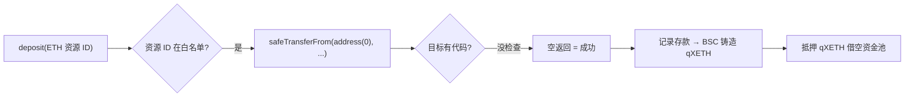

# 07 外部调用与代币兼容性：对方未必按标准出牌

> 学习目标：读完本章，你能——
> 1. 说出低级调用的 4 个陷阱，包括"调用无代码地址也返回成功"。
> 2. 列出 8 类非标准代币行为，并给出兼容方案。
> 3. 识别由外部调用引起的拒绝服务（DoS）。
>
> 前置章节：[04 重入攻击](04-reentrancy.md)
> 交互实验：[chain-porting-lab.html](interactive/chain-porting-lab.html) ｜ 示例合约：[examples/05-SafeTokenOps.sol](../examples/05-SafeTokenOps.sol)

> 最后核对：2026-11-09

---

## 开场：没有收到钱，却记了一笔存款

2022 年 1 月，Qubit 跨链桥在以太坊一侧没有收到对应的 ETH，BNB Chain 一侧却铸造了代表 ETH 的 qXETH。公开报道的损失约 8,000 万美元（[Qubit 事故报告](https://medium.com/@QubitFin/protocol-exploit-report-305c34540fa3)、[CoinDesk](https://www.coindesk.com/markets/2022/01/28/defi-protocol-qubit-finance-exploited-for-80m/)）。桥相信了一次外部调用的结果。

<details class="predict"><summary>🤔 先猜再看：合约用低级 call 调用一个没有代码的地址。call 返回 true 还是 false？</summary>

返回 `true`，返回数据为空。EVM 不会因为目标没有代码而让 `call` 失败。如果代码把"成功且无返回数据"当作转账成功，就会记下一笔没有发生的转账。2.1 节说明 Qubit 事故的路径。

</details>

---

## 1. 一句话理解

**每一个外部调用都是一次"把命运交给别人"。对方可能失败、可能撒谎、可能拖延、可能根本不存在。**

> 🎯 打个比方：你让快递员把包裹送到某个地址，然后在登记簿上写"已送达"。
>
> - 快递员没回话（返回值没检查），你就当作送到了。
> - 地址是一块空地（目标地址没有代码），快递员说"送到了"——因为空地不会拒收。
> - 收件人收件时扣下 10% 当"小费"（转账收税代币），你的登记簿上却写着全额。
> - 收件人故意拒收（回滚），而你要把 100 个包裹按顺序送完，第 1 个被拒，后面 99 个都送不出去（DoS）。
>
> 比喻的局限：快递员只会出一种错。外部合约可以**同时**撒谎、回调、耗尽 gas。

---

## 2. 低级调用的四个陷阱

| # | 陷阱 | 说明 | 修复 |
|---|---|---|---|
| ① | 不检查返回值 | `addr.call(...)` 失败只返回 `false` | `(bool ok, ) = ...; require(ok);` |
| ② | 目标地址没有代码 | 对无代码地址 `call` 返回 `true`，返回数据为空 | 调用前检查 `addr.code.length > 0` |
| ③ | 返回数据炸弹 | 对方返回超大数据，复制到内存耗尽 gas | 限制复制长度（如 ExcessivelySafeCall） |
| ④ | gas 不足型失败 | 调用方故意给刚好不够的 gas，让内部调用失败而外层继续 | 检查 `gasleft()`；关键调用失败时整体回滚 |

### 2.1 案例：Qubit Finance 跨链桥（2022 年 1 月，以太坊 → BNB Chain）

Qubit 的桥把以太坊上的存款映射为 BNB Chain 上的 qXETH，再用作借贷抵押品。SlowMist 公开分析的根因：

1. 桥为原生 ETH 配置的代币地址是 `address(0)`。ETH 存款本应走 `depositETH()`，它会检查 `msg.value`。
2. 攻击者调用普通的 `deposit()`，传入 ETH 对应的资源 ID。白名单检查通过。
3. `deposit()` 对 `tokenAddress = address(0)` 执行 `safeTransferFrom`。
4. `address(0)` 没有代码。低级调用返回成功、返回数据为空。旧版的安全转账库把"空返回"当作成功（为了兼容不返回值的 USDT）。
5. 桥记录了一笔"ETH 存款"。BNB Chain 一侧铸造了大量 qXETH。攻击者用它借空了借贷池，损失约 8,000 万美元。



**读图要点：**

- 每一步单独看都"合理"。漏洞来自组合：零地址 + 兼容性妥协 + 缺少原生币检查。
- OpenZeppelin 的 `SafeERC20` 现在会在返回数据为空时检查目标是否有代码。
- 教训：白名单只告诉你"这个 ID 被允许"，不告诉你"这个 ID 对应什么类型的资产"。

---

## 3. 非标准代币：八种行为

ERC-20 标准只规定了接口，没有规定行为。真实世界的代币五花八门：

| # | 行为 | 代表 | 风险 | 兼容方案 |
|---|---|---|---|---|
| 1 | `transfer` 不返回值 | 以太坊 USDT、BNB | 按接口解码返回值时回滚 | `SafeERC20` |
| 2 | **`transfer` 成功却返回 `false`** | **TRON 上的 USDT** | `SafeERC20` 判定失败，交易回滚 | 用余额差判断（见 3.1） |
| 3 | 转账收税（Fee-on-transfer） | 部分 BSC 社区代币 | 记账金额 > 实收金额，协议资不抵债 | 记账用余额差 `after - before` |
| 4 | 余额自动变化（Rebasing） | stETH、AMPL | 缓存的余额失效 | 用份额记账（如 wstETH） |
| 5 | 黑名单 / 冻结 | USDT、USDC | 某地址被冻结，整个批量操作失败 | 拉取式支付；单笔失败不影响全局 |
| 6 | 可暂停 | 多数中心化稳定币 | 清算或提款暂停 | 风险披露；设计降级路径 |
| 7 | 转账钩子 | ERC-777、ERC-1363 | 重入 | CEI + 重入锁（[04 章](04-reentrancy.md)） |
| 8 | 可升级 | USDT、USDC 等 | 代币行为未来可能改变 | 监控升级事件 |

### 3.1 TRON USDT：成功却返回 false

OpenZeppelin 在 2026 年公开的一份 [Across 协议 TRON 审计](https://openzeppelin.com/news/across-tron-spokepoolperiphery-diff-audit)中写道：TRON 上部署的 USDT 合约，`transfer` 在**转账成功时也返回 `false`**。

后果是：用 `SafeERC20.safeTransfer` 推送 USDT 的代码，在 TRON 上一律回滚。修复是转账后检查接收方余额增量，不读返回值。拉取方向（`transferFrom`）不受影响。这个方案假设没有转账手续费；Tether 保留了开启手续费的能力。完整分析见 [C02](chains/C02-tron.md) 4.1 节。

```solidity
// ✅ 以余额差判断转账结果（适用于 TRON USDT 推送场景）
function _pushUSDT(IERC20 token, address to, uint256 amt) internal {
    uint256 before = token.balanceOf(to);   // 记录转账前余额
    // 忽略返回值：TRON USDT 成功时也返回 false
    // 低级 call：只关心是否回滚，不信返回值
    (bool ok, ) = address(token).call(abi.encodeCall(IERC20.transfer, (to, amt)));
    require(ok, "call reverted");
    // 以接收方余额增量证明转账到账
    require(token.balanceOf(to) - before == amt, "transfer not credited");
}
```

> 🧪 动手验证：打开[链迁移风险检查器](interactive/chain-porting-lab.html)，点击"清空"，只勾选"用 SafeERC20.safeTransfer 推送 USDT"。分别选择 BNB Chain 和 TRON，记录风险列表的差异和修复建议。

### 3.2 收税代币的记账方式

```solidity
// ❌ 按参数记账
// 收费代币实际到账少于 amount
token.safeTransferFrom(msg.sender, address(this), amount);
deposits[msg.sender] += amount;   // 账面高于实收，差额由其他用户承担
// ✅ 按实收记账（注意：要配合重入锁，防止 transferFrom 中的回调扭曲余额差）
uint256 before = token.balanceOf(address(this));
token.safeTransferFrom(msg.sender, address(this), amount);
uint256 received = token.balanceOf(address(this)) - before;
deposits[msg.sender] += received;   // 只记实际增量
```

### 3.3 其他 ERC 标准的审计要点

| 标准 | 用途 | 审计要点 |
|---|---|---|
| ERC-165 | 接口探测 | `supportsInterface` 返回 true，不等于真的实现了接口。不要靠它做权限判断 |
| ERC-173 | 合约所有权 | 一步转移可能转给错误地址（[05 章](05-access-control.md) 3.5 节）；`renounceOwnership` 后不可恢复 |
| ERC-191 | 签名数据格式 | 前缀 `0x19` 防止签名被当作交易使用。version `0x01` 是 EIP-712，`0x45` 是 `personal_sign` |
| ERC-721 | NFT | `approve` 授权单个 NFT，`setApprovalForAll` 授权全部。回调重入见 [04 章](04-reentrancy.md) |
| ERC-1155 | 多代币 | 单笔和批量都有接收回调；批量接口要校验 `ids` 与 `amounts` 长度一致 |
| ERC-1167 | 最小代理 | 克隆后要在同一笔交易里初始化；所有克隆共享实现合约的缺陷（[10 章](10-upgradeable-proxy.md)） |

> 💡 注意：第 3 节只列出八种常见行为。失败时返回 `false` 而不回滚的代币、多入口代币等，见 [d-xo/weird-erc20](https://github.com/d-xo/weird-erc20) 的清单。没有一个库能防住所有怪代币。审计时先问项目方：支持哪些代币？

---

## 4. 外部调用导致的拒绝服务

拒绝服务（DoS, Denial of Service）：攻击者让合约的某个功能永久或长期无法使用。

<details class="predict"><summary>🤔 先猜再看：拍卖合约在新出价时，把上一位出价者的资金直接退回。上一位出价者是一个 receive() 总是回滚的合约。新出价能成功吗？</summary>

不能。退款失败让整笔新出价回滚。这个合约会一直保持最高出价者的位置。修复方法是拉取式支付。

</details>

| 模式 | 例子 | 修复 |
|---|---|---|
| 推送支付中某个接收方回滚 | 拍卖退款给上一个出价者，对方合约 `receive()` 总是回滚，新出价永远失败 | 拉取式支付 |
| 无界循环 | 遍历所有用户发奖励，用户数增长后超过区块 gas 上限 | 分页处理；累计奖励因子（如 MasterChef 的 accRewardPerShare） |
| 黑名单地址卡住批量操作 | 批量分发 USDT，其中一个地址被冻结 | 逐个 `try/catch`，失败记账待领取 |
| 依赖强制余额等式 | `require(balance == recorded)`，被人强制转入 1 wei | 用 `>=`，或不依赖实际余额 |
| TRON：能量 / CPU 时间耗尽 | 单笔 TVM 执行超过 80 毫秒 CPU 时间，返回 `OUT_OF_TIME` | 控制单笔计算量；不在一笔交易里遍历大数组 |

> 💡 注意：攻击者有三种方式把 ETH 强制转给没有 `receive()` 的合约：`selfdestruct(target)`（Cancun 之后仍会转出余额）、把目标设为出块奖励接收地址、在合约部署前向它的预测地址转账。

> ⚠️ 警告：以太坊上的 Akutars NFT（2022 年 4 月）同时有两个出口缺陷：推送退款可被一个拒收合约卡死；项目方提款的条件比较了错误的变量，永远不成立。11,539.5 ETH 被永久锁定。见 [C00](chains/C00-ethereum.md) 4.3 节。

> 💡 注意：TRON 的执行限制不只是"能量（Energy）"。TRON 官方文档说明，每次 TVM 执行有 80 毫秒 CPU 时间上限。在以太坊上 gas 足够的循环，在 TRON 上可能因超时失败。详见 [C02](chains/C02-tron.md)。

---

## 5. 授权（Approve）相关风险

<details class="predict"><summary>🤔 先猜再看：Alice 已授权 Bob 100 枚代币，现在发交易改成 50 枚。Bob 能抢先打包自己的交易。Bob 最多能拿走多少枚？</summary>

150 枚。Bob 先花掉旧额度 100 枚。Alice 的 `approve(50)` 执行后，Bob 再花 50 枚。

</details>

1. **无限授权**：用户给协议 `approve(type(uint256).max)`。协议被攻破后，攻击者可以转走用户钱包里的全部该代币——即使用户没有存进协议。
2. **授权钓鱼**：钓鱼网站诱导用户签 `approve` 或 `permit`（链下签名授权）。TRON 上的 USDT 授权钓鱼和以太坊上的 `permit` 钓鱼原理相同。
3. **任意调用 + 授权**：路由合约持有用户授权，又允许用户指定任意调用目标（[05 章](05-access-control.md) 3.4 节）。攻击者让路由合约调用 `token.transferFrom(受害者, 攻击者, 金额)`。
4. **approve 竞态**：改额度时，被授权方可以先花掉旧额度，再花新额度（见本节开头的预测题）。

缓解 approve 竞态的做法：

- 先 `approve(0)`，确认旧额度有没有被花掉，再设新值。
- 用 `SafeERC20.safeDecreaseAllowance` 相对减少额度。如果额度已被抢先花掉，交易回滚。
- 前端只授权所需数额。

> 💡 注意：`SafeERC20.forceApprove` 解决的是 USDT 类代币要求先归零的兼容问题，不解决竞态。

> 🧪 动手验证：打开 [approve 竞态时间线](interactive/audit-approve.html)，连续点击"下一步"到结束，记录"Bob 已拿走"。勾选"使用 decreaseAllowance(50) 代替 approve(50)"，重新执行，比较结果。

> ⚠️ 警告：持有用户授权的合约（路由器、聚合器）必须**禁止**用户指定任意调用目标和任意 calldata。这是聚合器被盗的最常见根因之一。

案例：Sushi RouteProcessor2（2023 年 4 月，约 330 万美元）。路由里的池子地址由用户填写；攻击者填入自己的"池子"，在回调中把任意授权用户设为付款人。回调校验只检查"是不是刚才调用的地址"，没有检查"是不是真实池子"。见 [C00](chains/C00-ethereum.md) 4.7 节与 [examples/08-RouterCallback.sol](../examples/08-RouterCallback.sol)。

### 5.1 用代码验证修复

示例合约 [05-SafeTokenOps.sol](../examples/05-SafeTokenOps.sol) 演示无代码检查、可选返回值和余额差校验。[08-RouterCallback.sol](../examples/08-RouterCallback.sol) 同时包含 `VulnerableRouter` 和 `SafeRouter`。对应的 Foundry 靶场是 `examples/foundry/test/SafeTokenOps.t.sol` 和 `examples/foundry/test/RouterCallback.t.sol`。

```bash
# 代币返回值与收费代币示例
cd examples/foundry && forge test --match-path test/SafeTokenOps.t.sol -vv
# 路由回调授权滥用示例
cd examples/foundry && forge test --match-path test/RouterCallback.t.sol -vv
```

> 💡 注意：修复验证需要两个结果：漏洞版上攻击成功，修复版上攻击失败（[A08](assessment/A08-reproduce-attacks.md)）。

---

## 6. 审计检查点

- [ ] **EXT-1** 所有低级 `call` 都检查了返回值。
- [ ] **EXT-2** 调用目标可能是零地址或无代码地址时，已显式检查。
- [ ] **EXT-3** 代币操作使用 `SafeERC20`；部署到 TRON 时，USDT 推送单独处理。
- [ ] **EXT-4** 支持任意代币时，按实收金额记账；不支持的类型（收税、变基）显式拒绝。
- [ ] **EXT-5** 批量转账和退款使用拉取模式，或单笔失败不影响整体。
- [ ] **EXT-6** 没有依赖用户规模增长的无界循环。
- [ ] **EXT-7** 持有授权的合约不允许任意 calldata。
- [ ] **EXT-8** 修改授权额度的流程处理了 approve 竞态。
- [ ] **EXT-9** 代币精度从合约读取（[06 章](06-arithmetic-precision.md)）。

**把检查结果写进报告：**

| 检查项 | 发现时的证据 | 常见定级（用 [A02](assessment/A02-risk-rating-reporting.md) 复核） | 练习位置 |
|---|---|---|---|
| EXT-1、EXT-2 | 未检查的调用位置 + 虚假入账的 PoC | Critical / High | [B25 MiniLend](bootcamp/B25-capstone-minilend.md) |
| EXT-3、EXT-9 | 目标链的代币行为 + 回滚或错账的路径 | High / Medium | [C02 TRON](chains/C02-tron.md)、[链迁移风险检查器](interactive/chain-porting-lab.html) |
| EXT-4 | 账本与实收金额的差额 | High / Medium | [B39 Lido 集成](bootcamp/B39-case-lido.md)、[份额与余额换算器](interactive/audit-steth.html) |
| EXT-5、EXT-6 | 卡死入口的 PoC 或 gas 增长测试 | Medium，资金被锁时升高 | [B25 MiniLend](bootcamp/B25-capstone-minilend.md) |
| EXT-7 | 用户可控的目标和 calldata + 被盗用的授权 | Critical / High | [C00 以太坊案例](chains/C00-ethereum.md) 4.7 节 |
| EXT-8 | 改额度流程 + 抢跑时间线 | Low / Medium | [approve 竞态时间线](interactive/audit-approve.html) |

发现按 [T03 报告模板](templates/T03-finding-report.md) 记录。 评估交易所合约时用 [A03](assessment/A03-exchange-contracts-wallets.md)，评估代币上架时用 [A05](assessment/A05-listing-due-diligence.md)。

---

## 7. 用户侧防护

普通用户看不到合约代码，但可以通过几个公开信号降低风险。

1. 只授权你需要的数额，不给无限授权；用完后撤销。
2. 定期在授权管理工具中检查并撤销不再使用的授权。
3. 收到陌生代币不要交互：不要尝试卖出或"领取"，它可能是钓鱼合约。
4. 转入有转账税、可变基（rebase）或黑名单功能的代币前，确认目标协议支持这类代币。
5. 在 TRON 上转 USDT 时，确认交易状态是"成功"，不只是"已广播"。

---

## 8. 术语表

| 术语 | 英文 | 定义 |
|---|---|---|
| 低级调用 | Low-level call | `address.call` / `delegatecall` / `staticcall`，失败不自动回滚 |
| 收税代币 | Fee-on-transfer Token | 转账时扣除一部分作为手续费的代币 |
| 变基代币 | Rebasing Token | 持有者余额按规则自动增减的代币 |
| 拒绝服务 | DoS | 让合约功能无法使用的攻击 |
| 拉取式支付 | Pull Payment | 只记账，由收款人主动提取 |
| 授权 | Allowance / Approve | 允许另一个地址代为转出自己代币的额度 |

---

> 🪞 反思：选一个你的系统依赖的外部合约或代币。
> 1. 如果它回滚、返回假值或没有代码，你的系统会怎样？
> 2. 哪个用户能让这个失败发生？
> 3. 失败后，其他用户还能取回资金吗？

## 9. 思考题

1. 一个收益协议在以太坊上运行良好，部署到 TRON 后所有提款都失败了，但存款正常。最可能的原因是什么？
2. 一个协议按 `amount` 参数记账，并接受一个 2% 转账税的代币。存入 100 枚、再取出 100 枚，会发生什么？如果所有用户都这样做呢？
3. 打开 [chain-porting-lab.html](interactive/chain-porting-lab.html)，选择"TRON"并勾选"使用 SafeERC20 推送 USDT"。实验页给出了什么风险？

下一章：[08 预言机与闪电贷](08-oracle-flashloan.md) —— 合约相信了一个一笔交易就能改写的价格。
