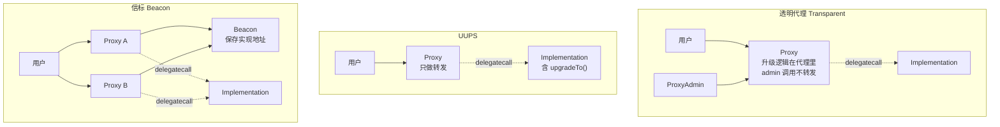
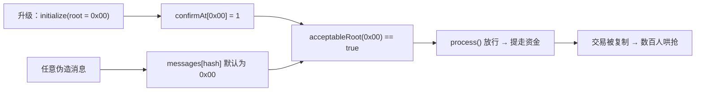

# 10 可升级合约与代理：维修门的两面

> 学习目标：读完本章，你能——
> 1. 画出透明代理、UUPS、信标代理的调用关系，说出各自的权限位置。
> 2. 识别存储冲突、初始化缺失、选择器冲突三类代理漏洞。
> 3. 制定一份安全升级的操作流程。
>
> 前置章节：[03 EVM 与 Solidity 安全基础](03-evm-solidity-basics.md)、[05 访问控制与权限](05-access-control.md)
> 交互实验：[storage-proxy-lab.html](interactive/storage-proxy-lab.html) ｜ 示例合约：[examples/07-ProxyStorage.sol](../examples/07-ProxyStorage.sol)

> 最后核对：2026-11-09

---

## 开场：一次初始化，任何人都能提款

2022 年 8 月 1 日，Nomad 跨链桥被提走约 1.9 亿美元（事发时估值）。此前的一次升级把可信根初始化成了 `0x00`。第一笔攻击成功后，其他地址复制交易，只替换收款地址。来源：[Immunefi](https://immunefi.com/blog/bug-fix-reviews/hack-analysis-nomad-bridge-august-2022/)、[The Block](https://www.theblock.co/post/160851/nomads-190-million-bridge-exploit-drew-hacking-feeding-frenzy-of-300-addresses)。完整复盘：[资损 101](https://claude.ai/artifact/1a5Nx6xTVLuJdCB8Esf2xj#c-nomad)。

<details class="predict"><summary>🤔 先猜再看：合约用 `confirmAt[root]` 判断根是否可信。未证明的消息在 `messages` 映射里的默认值是 `0x00`。升级把 `confirmAt[0x00]` 写成 1。一条从未证明的消息能通过校验吗？</summary>

能。消息查到的根是默认值 `0x00`，而 `0x00` 已经被标记为可信。升级代码可以没有错，错的是升级时传入的参数。第 4 节画出完整路径。

</details>

---

## 1. 一句话理解

**代理合约保存数据和资金，实现合约提供代码。升级 = 换掉代理指向的实现。谁能换实现，谁就拥有全部资金。**

代理合约（Proxy）：把所有调用通过 `delegatecall` 转发给实现合约的合约。

> 🎯 打个比方：代理合约是一个**保险柜**，实现合约是保险柜的**操作手册**。
>
> - 柜员每次都按手册操作柜子（delegatecall：用手册，改柜子）。
> - 升级 = 换一本新手册。
> - 如果新手册把"第 3 格放现金"改成了"第 3 格放钥匙"，柜员会把现金当钥匙用（存储冲突）。
> - 如果新手册的第一页写着"第一个读到这页的人是柜子主人"，而没人先读过它（未初始化），路人就能成为主人。
> - 如果有人偷换了手册（升级权限被盗），柜子里的东西就归他了。
>
> 比喻的局限：真实保险柜换手册需要时间。如果没有时间锁，链上换实现只需一笔交易。

---

## 2. 三种代理模式



**读图要点：**

- 透明代理：升级函数在代理里。管理员调用代理时不转发，避免和实现合约函数冲突。
- UUPS：升级函数在实现合约里。如果新实现忘了包含 `upgradeTo`，合约就再也不能升级。
- 信标代理：一次升级影响所有代理。适合大量相同合约（例如每个用户一个金库）。
- 局限：三种模式都依赖 `delegatecall`，都有存储冲突风险。

> 🧪 动手验证：打开[存储布局与 delegatecall 实验](interactive/storage-proxy-lab.html)，在第 2 节切换到"A 使用 delegatecall"。记录 A 的 slot 0、B 的 slot 0 和 `msg.sender` 的值，再切回"A 使用 call"比较。

| 模式 | 升级权限在哪 | 主要风险 |
|---|---|---|
| 透明代理 | 代理的 admin 槽 | admin 私钥 |
| UUPS | 实现合约的 `_authorizeUpgrade` | 新实现遗漏升级函数；实现合约未初始化 |
| 信标 | 信标合约的 owner | 一次升级影响全部实例 |
| 钻石（EIP-2535） | `diamondCut` 的权限 | 多个 facet 共享存储，冲突面最大 |
| 最小代理（ERC-1167） | 不可升级，只是低成本复制 | 克隆没有在同一笔交易里初始化，会被抢先初始化；所有克隆共享实现合约的缺陷 |

---

## 3. 三类代理漏洞

### 3.1 存储冲突

**类型 A：代理自己的变量和实现的变量撞槽。**

```solidity
// ❌ 朴素代理：把 implementation 放在 slot 0
contract NaiveProxy {
    address implementation;   // slot 0
    // delegatecall 用代理的存储执行实现合约代码
    fallback() external payable { /* delegatecall implementation */ }
}
contract Impl {
    address owner;            // slot 0 —— 写 owner 就是写 implementation
}
```

修复：使用 EIP-1967 定义的固定伪随机槽位存放实现地址和管理员地址。

> 💡 注意：EIP-1967 的槽位取 `keccak256(...) - 1`。减 1 让该槽位没有已知的哈希原像，映射和动态数组的派生位置无法指向它。

> 🧪 动手验证：在[存储布局与 delegatecall 实验](interactive/storage-proxy-lab.html)第 1 节点"❌ 朴素代理：implementation 在 slot 0"，再点"攻击者调用 initialize(0xBAD…)"。记录 slot 0 的新含义。

**类型 B：升级前后的布局不一致。**

<details class="predict"><summary>🤔 先猜再看：V1 的 slot 0 是 `address owner`，slot 1 是 `uint256 totalDeposits`。V2 在最前面插入 `uint256 feeBps`。升级后调用 `owner()`，返回什么？</summary>

返回旧 `totalDeposits` 的低 20 字节，当作一个地址。V2 的 `owner` 移到了 slot 1，而 slot 1 里存的还是 V1 的 `totalDeposits`。

</details>

| V1 | V2（❌ 在前面插入 `uint256 feeBps`） | V2（✅ 末尾追加） |
|---|---|---|
| slot 0: `owner` | slot 0: `feeBps` ← 读到的是旧 owner 地址，被当作一个巨大的整数 | slot 0: `owner` |
| slot 1: `totalDeposits` | slot 1: `owner` ← 读到的是旧 totalDeposits 的低 20 字节 | slot 1: `totalDeposits` |
| slot 2: `balances` | slot 2: `totalDeposits` ← 读到映射占位槽，恒为 0 | slot 2: `balances` |
| slot 3: `initialized` | slot 3: `balances` ← 映射基址改变，所有余额"消失" | slot 3: `initialized` + `paused`（打包） |

> 💡 注意：如果插入的是一个 `bool`，它会和后面的 `address owner` 打包进同一个槽，错位方式完全不同（owner 的字节被平移 1 字节）。不要靠肉眼数槽位，用 `forge inspect` 或 solc 的 `storageLayout` 输出确认。

修复规则：

1. 只在末尾追加变量。
2. 不删除、不重排、不改类型。
3. 父合约预留 `uint256[50] __gap;`，或使用 ERC-7201 命名空间存储（OpenZeppelin 5.x）。
4. 用工具比对新旧布局（例如 OpenZeppelin Upgrades 插件的 `validateUpgrade`、`forge inspect ... storage-layout`）。

> 🧪 动手验证：在[存储布局与 delegatecall 实验](interactive/storage-proxy-lab.html)第 1 节点"❌ 在最前面插入 uint256"，记录 owner 行和 slot 4 行的读数。再点"❌ 在最前面插入 bool（打包错位）"，比较 owner 的错位方式。

### 3.2 初始化缺失

<details class="predict"><summary>🤔 先猜再看：代理已经完成初始化，但实现合约的构造函数没有调用 `_disableInitializers()`。攻击者能直接调用实现合约的 `initialize` 吗？</summary>

能。代理的初始化写在代理的存储里，实现合约自己的存储仍是未初始化状态。攻击者可以成为实现合约的 owner。后果取决于实现合约有没有 `delegatecall` 或自毁路径。

</details>

| 情况 | 后果 | 修复 |
|---|---|---|
| 部署代理后没有在同一笔交易里调用 `initialize` | 攻击者抢跑调用，成为 owner | 部署与初始化原子化（构造函数传入初始化 calldata） |
| `initialize` 可以重复调用 | 任何人重置 owner | `initializer` 修饰器 |
| 实现合约本身没有初始化 | 攻击者成为实现合约的 owner；如果实现有 `delegatecall` 或自毁逻辑，可以破坏所有代理 | 实现合约构造函数调用 `_disableInitializers()` |
| V2 新增的初始化逻辑用了 `initializer` | 已初始化过，V2 初始化永远不能执行 | 使用 `reinitializer(2)` |
| 父合约的 `__X_init` 没有调用 | 父合约的变量保持默认值（例如 owner 为零地址） | 逐个父合约核对初始化调用 |
| V2 的 `reinitializer(2)` 函数没有权限控制 | 其他人可抢先执行升级初始化 | 用 `upgradeToAndCall` 在同一笔交易完成，或加权限 |

> 💡 注意：2021 年 9 月，OpenZeppelin 披露其 UUPS 实现（4.1.0–4.3.1）存在问题：未初始化的实现合约可被任何人接管，并通过升级函数中的 `delegatecall` 执行 `selfdestruct`，使所有指向它的代理失效。修复版本为 4.3.2（OpenZeppelin 安全公告）。这和 2017 年 Parity 第二次事故是同一类问题。

### 3.3 选择器冲突

代理自己的函数和实现的函数如果有相同的 4 字节选择器，调用会被代理截获，不会转发。透明代理通过"管理员不转发、其他人只转发"来避免这个问题。钻石代理需要在 `diamondCut` 时检查冲突。

例如，`burn(uint256)` 和 `collate_propagate_storage(bytes16)` 的选择器都是 `0x42966c68`（可用 `cast sig` 验证）。编译器会拒绝同一合约内的选择器冲突，但不检查代理与实现之间的冲突。部署前要用工具比对两者的选择器。

> 🧪 动手验证：打开[选择器与槽位计算器](interactive/audit-abi.html)，依次点 `burn(uint256)` 和 `collate_propagate_storage(bytes16)` 两个按钮。记录两次得到的选择器。

---

## 4. 案例：Nomad Bridge（2022 年 8 月）

- Nomad 在一次升级中调用初始化函数，把"可信消息根"设成了 `0x00`（公开复盘）。
- 合约逻辑中，未经证明的消息默认对应的根也是 `0x00`。于是**任何**消息都被视为"已证明"。
- 第一笔攻击成功后，数百个地址复制交易、只换收款地址（见本章开场）。
- 教训：
  1. 升级时的初始化参数和代码一样需要审计。
  2. "零值"不能有业务含义。默认值和合法值必须可区分。
  3. 升级后要跑回归测试，覆盖"未授权消息必须被拒绝"这一条。

> 🧪 动手验证：打开[Merkle 证明验证与验证者门限评估](interactive/audit-merkle.html)，保持"桥合约配置的可信根"为全零，记录 lint 结果。再改成任意非零值，记录结果的变化。



### 4.1 对照案例：Compound 提案 62（2021 年 9 月）

升级后的奖励逻辑有误，部分用户可超额领取 COMP（最坏情况约 28 万枚，约 8,000 万美元）。协议没有可以停止 COMP 分发的紧急开关，任何修复都要走约 7 天的治理流程（The Block 报道）。教训：**时间锁挡住恶意升级，也挡住了紧急修复**。暂停权和升级权要分开设计。见 [C00](chains/C00-ethereum.md) 4.8 节。

---

## 5. 链视角：谁能升级"链本身"

可升级的不只是 DeFi 合约。

| 链 | 可升级的关键组件 | 由谁升级（截至 2026 年公开资料） |
|---|---|---|
| BNB Chain | 系统合约（跨链、质押、治理）和共识规则 | 硬分叉。2022 年 Token Hub 事故后，Moran 硬分叉修复了验证缺陷并把中继者改为白名单（[C01](chains/C01-bnb-chain.md)） |
| TRON | 网络参数和 TVM 功能开关（如 EIP 兼容操作码） | 超级代表投票通过提案（[C02](chains/C02-tron.md)） |
| Mantle | L1 上的桥、输出预言机、门户合约 | L2BEAT 页面：`MantleSecurityMultisig`（6/14）可无延迟升级；`MantleEngineeringMultisig`（3/7）可暂停提款（[C03](chains/C03-mantle.md)） |

> ⚠️ 警告：在 L2 上部署的协议，其安全上限是 L2 本身的升级权限。如果 L2 的桥可以被无延迟升级，协议再安全，资产也可能在 L1 端被转走。

---

## 6. 安全升级流程

1. 编写新实现。只追加变量。
2. 用工具比对存储布局，输出差异报告。
3. 在主网分叉环境中执行升级，跑全部回归测试和不变量测试。
4. 审计新实现和**升级交易本身**（包括初始化参数）。
5. 通过时间锁排队。公开升级内容。
6. 在延迟期内，监控和社区复核。
7. 执行升级。立刻跑部署后验证脚本（读关键变量、做小额端到端操作）。
8. 保留回滚方案：如果新实现有问题，能否升级回旧实现？旧实现与新布局是否兼容？

### 6.1 用代码验证修复

示例合约 [07-ProxyStorage.sol](../examples/07-ProxyStorage.sol) 包含朴素代理、EIP-1967 代理、错误的 `BankV2Broken` 和正确的 `BankV2Good`。Foundry 靶场 `examples/foundry/test/ProxyStorage.t.sol` 对比这些布局。

```bash
# 运行代理存储冲突示例的测试
cd examples/foundry && forge test --match-path test/ProxyStorage.t.sol -vv
```

> 💡 注意：修复验证需要"修复前失败、修复后通过"两个结果（[A08](assessment/A08-reproduce-attacks.md)）。

---

## 7. 审计检查点

- [ ] **UPG-1** 代理使用 EIP-1967 槽位；没有自定义变量放在低位槽。
- [ ] **UPG-2** 新旧实现存储布局已用工具比对。
- [ ] **UPG-3** 实现合约构造函数调用 `_disableInitializers()`。
- [ ] **UPG-4** 代理部署与初始化在同一笔交易完成。
- [ ] **UPG-5** UUPS 新实现包含升级函数，且权限正确。
- [ ] **UPG-6** 实现合约中没有 `selfdestruct` 或用户可控的 `delegatecall`。
- [ ] **UPG-7** 新实现中的 `immutable` 值已确认（它随实现合约变化）。
- [ ] **UPG-8** 升级权限经过多签和时间锁。
- [ ] **UPG-9** 初始化参数中没有"零值具有业务含义"的情况。
- [ ] **UPG-10** 对部署所在 L2 的升级信任假设做了披露。

**把检查结果写进报告：**

| 检查项 | 发现时的证据 | 常见定级（用 [A02](assessment/A02-risk-rating-reporting.md) 复核） | 练习位置 |
|---|---|---|---|
| UPG-1、UPG-2 | `forge inspect` 的新旧布局差异 | Critical / High | [存储布局与 delegatecall 实验](interactive/storage-proxy-lab.html) |
| UPG-3、UPG-4 | 抢先初始化的 PoC 或部署交易记录 | Critical / High | [B25 MiniLend](bootcamp/B25-capstone-minilend.md) |
| UPG-5、UPG-6 | 升级函数的权限测试；`delegatecall` 与自毁路径清单 | Critical / High | [B40 Safe](bootcamp/B40-case-safe.md) |
| UPG-7 | `immutable` 新旧值对比 | 取决于该值的用途 | [B38 Aave V3](bootcamp/B38-case-aave-v3.md) |
| UPG-8 | 升级权限持有人、多签门限、时间锁延迟 | High / Medium | [C03 Mantle](chains/C03-mantle.md) |
| UPG-9 | 初始化 calldata 解码 + 零值分析 | Critical / High | [Merkle 证明验证与验证者门限评估](interactive/audit-merkle.html) |
| UPG-10 | L2 升级权限的披露记录 | Medium / Low | [C03 Mantle](chains/C03-mantle.md) |

发现按 [T03 报告模板](templates/T03-finding-report.md) 记录。DeFi 协议的升级权限按 [A04](assessment/A04-defi-protocol-review.md) 评估。交易所合约按 [A03](assessment/A03-exchange-contracts-wallets.md) 评估。

---

## 8. 用户侧防护

普通用户看不到合约代码，但可以通过几个公开信号降低风险。

1. 存款前查看协议是否可升级、由谁升级、是否有时间锁。
2. 可以无延迟升级的协议，等于你把资金交给了升级权限的持有人。
3. 协议公布升级时，阅读升级说明；看不懂或说明含糊时，可以先撤出。
4. 关注升级后的异常公告；Nomad 一类事故中，越早撤出损失越小。
5. 对同一协议在不同链上的部署，分别核对它们的升级权限。

---

## 9. 术语表

| 术语 | 英文 | 定义 |
|---|---|---|
| 代理合约 | Proxy | 保存状态并把调用委托给实现合约的合约 |
| 实现合约 | Implementation / Logic | 提供代码逻辑的合约 |
| 透明代理 | Transparent Proxy | 升级逻辑在代理中，按调用者区分是否转发 |
| UUPS | Universal Upgradeable Proxy Standard | 升级逻辑在实现合约中的代理模式 |
| 信标代理 | Beacon Proxy | 多个代理共享一个保存实现地址的信标 |
| 存储冲突 | Storage Collision | 两份代码对同一槽位有不同解释 |
| 存储间隙 | Storage Gap | 预留的空槽位，供父合约未来追加变量 |

---

> 🪞 反思：打开你维护或依赖的一个可升级合约。
> 1. 谁能换实现？这个人或多签能在多长时间内完成？
> 2. 上一次升级时，谁检查了初始化参数？
> 3. 如果新实现有问题，你能在多长时间内回滚？

## 10. 思考题

1. 一个 UUPS 合约升级到 V2 后，V2 的 `_authorizeUpgrade` 被写成了空函数。会发生什么？
2. 打开 [storage-proxy-lab.html](interactive/storage-proxy-lab.html)，选择"朴素代理"，点击"攻击者调用 initialize"。之后代理还能正常工作吗？
3. 为什么说"升级交易本身需要审计"？举一个只有代码正确、但升级交易出错的例子。

下一章：[11 DeFi 经济安全](11-defi-economic-security.md) —— 代码按规格执行，规格本身却可以被套利。
