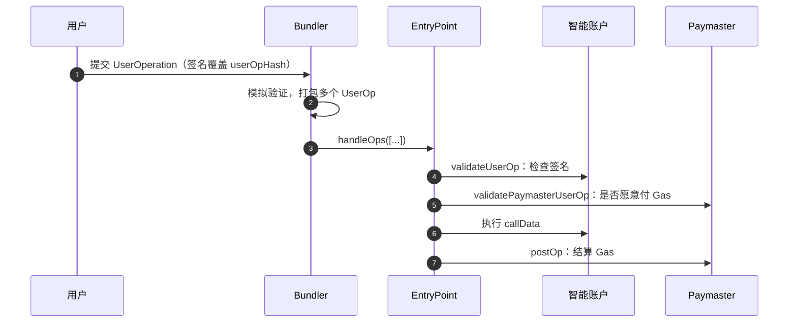

# 15 账户抽象与新钱包范式：账户变成了合约

> 学习目标：读完本章，你能——
> 1. 画出 ERC-4337 的 UserOperation 流程，标出 bundler、EntryPoint、paymaster 的信任边界。
> 2. 解释 EIP-7702 委托带来的新攻击面，以及"EOA 不再是 EOA"对旧代码的影响。
> 3. 评估 Passkey、Session Key、意图 / Solver、Permit2 各自的授权风险。
>
> 前置章节：[09 MEV 与签名安全](09-mev-signatures.md)、[19 用户侧诈骗](19-user-scams.md)
> 交互实验：[phishing-signature-lab.html](interactive/phishing-signature-lab.html)（第 4 题 Permit2、第 5 题 7702）、[signature-replay-lab.html](interactive/signature-replay-lab.html)
>
> 最后核对：2026-11-09

---

## 开场：服务关了，委托还在

2026 年 10 月，攻击者通过 Binance 的内部签名服务，给一个以太坊热钱包设置了 EIP-7702 委托。复盘见[资损 101](https://claude.ai/artifact/1a5Nx6xTVLuJdCB8Esf2xj#c-binance) 和 5.6 节。

🤔 先猜再看：Binance 关闭提现服务后，这个委托会自动失效吗？

不会。委托是写在地址上的链上状态。它要靠一笔新的授权清零。5.6 节记录，委托在约 3 小时 50 分后才被清零。

---

## 1. 一句话理解

**在旧模型里，签名的意思是"转这笔钱"。在账户抽象之后，签名的意思是"允许这段代码替我做事"。签名的含义变大了，签错一次的后果也变大了。**

账户抽象（Account Abstraction）：让账户的验证和执行逻辑由合约代码决定，而不是由协议写死"一把私钥签一笔交易"。

> 🎯 打个比方：以前你去银行，每笔转账都要本人签字。现在你可以签一份"授权书"：允许助理每天替你付 100 元以内的账单，或者允许某个系统按你的意图帮你换汇。授权书让生活方便很多。但如果你签的是一份"允许持有人处理我全部财产"的授权书，后果比签错一笔转账严重得多。
>
> 比喻的局限：纸质授权书需要公证，可以去银行撤销。链上的委托签名立刻生效，有时还在多条链上同时生效。

---

## 2. 威胁模型：谁在新流程里

| 角色 | 它做什么 | 攻击者控制它之后 |
|---|---|---|
| 智能账户（Smart Account） | 自定义签名验证和执行逻辑 | 账户实现有漏洞：任何人都能执行或锁死账户 |
| Bundler | 把用户操作打包成链上交易 | 审查、重排、篡改不受签名保护的字段 |
| EntryPoint | 统一的入口合约，先验证再执行 | 极少可控；但其编码和哈希规则决定了什么受签名保护 |
| Paymaster | 替用户付 Gas | 签名可被抢跑或重放；被耗尽押金 |
| 7702 委托合约 | EOA 执行它的代码 | 恶意或有漏洞的委托合约可以转走全部资产 |
| Session Key | 限定范围的临时签名密钥 | 范围过大或密钥泄露 |
| Solver / Resolver | 替用户找成交路径 | 授权过大、结算合约被利用 |

---

## 3. 攻击路径

### 3.1 ERC-4337：验证与执行分离

**读图要点：**

- 第 1 步的签名覆盖 `userOpHash`。哈希的编码规则决定了哪些字段受保护。2023 年披露的打包漏洞中，同一个 UserOp 可以得到不同哈希，不同 UserOp 也可以得到同一哈希（见 5.1 节）。
- 第 4 步只检查签名。如果账户实现的验证逻辑有漏洞，第 6 步会执行攻击者的调用。
- Paymaster 的签名是另一套签名，也要覆盖 chainId、nonce 和有效期，否则会被重放或抢跑。
- 局限：图里只画了一个 UserOp。批量打包时，一个 UserOp 的执行可能影响同一批里其他 UserOp 的验证。

### 3.2 EIP-7702：EOA 运行合约代码

EIP-7702（2025 年 5 月 Pectra 升级上线）允许普通地址签一个授权元组 `[chain_id, address, nonce]`，把自己的代码设为"指向 `address` 的委托"。

| 风险 | 机制 | 防御 |
|---|---|---|
| 委托给恶意合约 | 委托合约的代码可以转走全部资产 | 钱包只允许委托给自己审计过的实现；不接受网站发起的委托请求 |
| `chain_id = 0` | 授权在所有 EVM 链上都有效 | 钱包默认拒绝 `chain_id = 0` |
| 对合法委托发恶意批量调用 | 委托合约合法，但用户签了一个"批量执行"，内容是转走资产 | 批量调用逐项解码显示 |
| 初始化抢跑 | 委托时不运行初始化代码，攻击者抢先调用初始化函数 | 初始化数据由 EOA 私钥签名 |
| 存储冲突 | 更换委托合约时，旧存储保留，新合约读到错误数据 | 使用命名空间存储（ERC-7201） |
| 旧代码的假设被打破 | `tx.origin == msg.sender` 不再能证明"调用者是 EOA" | 不再用它做"禁止合约调用"的检查 |
| 授权元组被回放（Glamsterdam 重定价后需复查） | 委托交易耗尽 gas 时委托回滚，交易仍然上链，已签的委托可被他人再次使用（[INV-8](https://github.com/ethereum/glamsterdam-gas-invariants)） | 把初始化函数绑定到签名；交易后检查账户代码 |

🤔 先猜再看：用户签了一份 `chain_id = 0` 的 7702 授权。这份授权在哪些链上有效？

在所有支持 EIP-7702 的 EVM 链上都有效，前提是该链上这个地址的 nonce 匹配。所以钱包默认拒绝 `chain_id = 0`。

> 🧪 动手验证：打开[钓鱼签名识别](interactive/phishing-signature-lab.html)第 5 题，从"钱包原始显示"切到"解码视图"。记录委托目标地址出现在哪一个字段。

> ⚠️ 警告：EIP-7702 原文写明，应用不应该请求用户签署委托授权，因为没有安全的界面能做到这一点。网站弹出"升级为智能账户"的 7702 授权请求，默认拒绝。

### 3.3 Passkey 与社交恢复

- Passkey（WebAuthn / FIDO2）：用设备的安全芯片保存 P-256 私钥，用指纹或面容解锁。它能抵抗钓鱼网站窃取密码。以太坊在 2025 年 12 月的 Fusaka 升级中加入了 P-256 验签预编译（EIP-7951），很多 L2 更早已经支持（RIP-7212）。
- Passkey **不能**防御恶意前端或恶意浏览器扩展：它们可以在用户解锁后，请求签署攻击者构造的操作。
- 同步型 Passkey 的安全性，等于云账户恢复流程的安全性。
- 社交恢复：由若干守护人共同恢复账户。守护人之间不独立，或守护人账号被盗，恢复机制就成了攻击入口。

### 3.4 Session Key

Session Key：主密钥授权的一把临时密钥，只能在限定范围内签名，用于游戏、高频交易等场景。

| 范围维度 | 示例 |
|---|---|
| 合约 | 只能调用某个游戏合约 |
| 函数 | 只能调用 `play()` |
| 额度 | 累计最多 0.1 ETH（注意是**累计**，不是单笔） |
| 有效期 | 24 小时后失效 |

### 3.5 意图与 Solver

意图（Intent）：用户只说"我要用 1 ETH 换至少 3,000 USDC"，由 Solver（求解器）或 Resolver 找路径并成交。

- 用户的风险：签名的意图条件写得太宽（最小成交量过低、期限过长）。
- 协议的风险：Solver 和结算合约之间的授权与信任关系，就是协议的攻击面（见 5.4 节）。

### 3.6 Permit2：一次授权，长期签名

Permit2 是 Uniswap 部署的统一授权合约，有两种模式：带额度和过期时间的 AllowanceTransfer，以及一次性的 SignatureTransfer。用户只要曾经把某个代币无限授权给 Permit2，之后签一个链下签名就能转走该代币。钓鱼利用方式见 [19 章](19-user-scams.md)。

---

## 4. 防御方法

| 对象 | 措施 |
|---|---|
| 智能账户实现 | 审计验证逻辑；管理操作（增删 owner）防跨链重放；防止删除最后一个 owner |
| Paymaster | 签名覆盖 chainId、nonce、有效期、完整的 UserOp 内容 |
| 钱包 | 7702 只委托给钱包自己审计过的实现；拒绝 `chain_id = 0`；批量调用逐项解码 |
| 合约开发者 | 不再用 `tx.origin == msg.sender` 判断"调用者是 EOA"；对 7702 账户的重入保持警惕 |
| Session Key | 每个用户独立生成；限定合约、函数、累计额度、有效期；提供查看和撤销入口 |
| 意图协议 | Solver 授权最小化；弃用的结算合约强制下线；Solver 有保证金和罚没 |
| 交易所 | 充值识别兼容合约账户和 7702 账户（来源地址可能有代码）；提币到合约账户时检查能否接收 |

---

## 5. 真实案例

> 💡 注意：以下每个案例只写摘要和教训。金额为事发时美元估值。

### 5.1 ERC-4337 实现与审计发现（2023–2024）

- **UserOperation 打包漏洞（2023 年 3 月）**：EntryPoint 的打包函数直接读取 calldata 里动态字段的偏移量且不校验，导致哈希不唯一。恶意 bundler 可以篡改事件内容，示例 paymaster 的签名在签署后内容可被修改。EntryPoint 已修复，无已知损失。来源：[Alchemy 披露](https://www.alchemy.com/blog/erc-4337-useroperation-packing-vulnerability)。
- **Coinbase Smart Wallet 审计（2024 年 3 月）**：删除 owner 的操作可以跨链重放；由于各链同一位置上的 owner 可能不同，可能误删，甚至永久锁死账户。修复后改为传入 owner 地址并校验。来源：[Code4rena 报告](https://code4rena.com/reports/2024-03-coinbase)。
- **Biconomy 审计（2023 年）**：智能账户实现合约可被销毁；session key 模块的额度只限制单笔，不限制累计。来源：[Code4rena 报告](https://code4rena.com/reports/2023-01-biconomy)、[Zellic 报告](https://reports.zellic.io/publications/biconomy-smart-account/findings/medium-erc20sessionvalidationmodule-session-key-maxamount-parameter-is-not-stateful)。
- 教训：哈希和签名必须覆盖规范化编码和 chainId；多链账户的管理操作要防重放。

### 5.2 EIP-7702 上线后的钓鱼（2025 年）

- Pectra 于 2025 年 5 月 7 日上线主网。Wintermute 统计显示，绝大部分 7702 委托指向同一类复制粘贴的扫币合约，用于自动扫走私钥已泄露地址收到的 ETH。来源：[Cointelegraph（引用 Wintermute）](https://cointelegraph.com/news/wintermute-crimeenjoyor-flags-malicious-ethereum-contracts)。
- 2025 年 5 月，一名用户在钱包中批准了一个批量执行，委托合约本身是合法的，但批量内容转走了代币，约 14.6 万美元（GoPlus 归因于 Inferno Drainer）。来源：[GoPlus](https://goplussecurity.medium.com/understanding-eip-7702-phishing-attacks-a-comprehensive-guide-to-protection-strategies-for-wallets-8e8372e3d5ea)、[The Block](https://www.theblock.co/post/356481)。
- 2025 年 8 月，ScamSniffer 记录到两起利用 7702 批量执行的大额钓鱼，约 100 万和 154 万美元（见 [19 章](19-user-scams.md) 5.3 节）。
- 教训：主要风险不在"恶意委托合约"，而在"对合法委托合约发出的恶意批量调用"。钱包必须逐项解码批量内容。
- 规范来源：[EIP-7702](https://eips.ethereum.org/EIPS/eip-7702)、[Pectra 主网公告](https://blog.ethereum.org/2025/04/23/pectra-mainnet)

### 5.3 Session Key 共用一把：Cardex（2025 年 2 月，Abstract L2）

- 链游 Cardex 让所有用户共用同一个 session signer，它的私钥暴露在前端代码里。攻击者用它替用户买入游戏份额，再转走卖出。约 9,000 个钱包受影响，约 40 万美元。
- 因为 session 权限只限于游戏合约，用户的 ERC-20 和 NFT 没有受影响。这一点说明范围限制起了作用。
- 教训：Session Key 必须按用户生成，私钥不能出现在前端；范围限制要做到合约、函数、累计额度和有效期四个维度。
- 来源：[The Block](https://www.theblock.co/news/ecosystems/2025-02-19-cardex-exploit-compromised-400000-worth-of-ether-across-9000-wallets-abstract-341694)、[Decrypt](https://decrypt.co/306608/cardex-game-exploit-drains-abstract-wallets)

### 5.4 意图协议的结算边界（2023、2025 年）

- **CoW Swap（2023 年 2 月）**：一个新加入的 Solver 把结算合约里的 DAI 无限授权给一个有漏洞的合约，攻击者借此取走结算合约约一周累积的手续费，约 16.6 万美元。CoW DAO 罚没了该 Solver 的保证金赔偿损失。来源：[CoW 事后报告](https://cow.fi/learn/cow-swap-solver-exploit-post-mortem)、[CIP-22](https://forum.cow.fi/t/cip-22-slashing-of-the-barter-solver-responsible-for-a-hack-causing-cow-dao-a-loss-of-1-week-fee-accrual/1440)。
- **1inch Fusion v1（2025 年 3 月）**：受害的是仍在使用 2023 年已弃用的 Fusion v1 结算合约的第三方 Resolver。攻击者构造异常的 calldata 长度字段，伪造订单数据；Resolver 只凭"调用者是结算合约"就信任转发的数据。约 500 万美元，经谈判大部分退回。来源：[1inch 公告](https://blog.1inch.com/vulnerability-discovered-in-resolver-contract/)、[BlockSec](https://blocksec.com/blog/1inch-incident-from-calldata-corruption-to-forged-settlement-binary-exploitation-goes-on-chain)。
- 教训：Solver 的授权和信任边界就是协议的攻击面。弃用的合约必须强制下线，不能依赖"别人不再用它"。

### 5.5 Permit2 钓鱼（2024 年 10 月）

- 一名 PEPE 持有者签了 Permit2 钓鱼签名，损失约 140 万美元。没有发现 Permit2 合约本身被攻破的事件；风险来自用户对 Permit2 的无限授权加上链下签名。
- 教训：钱包应把 Permit2 签名当作和授权交易同等级别的操作来解析和告警。
- 来源：[Decrypt](https://decrypt.co/286076/pepe-uniswap-permit2-phishing-attack)、[Uniswap Permit2 文档](https://developers.uniswap.org/docs/protocols/permit2/overview)

### 5.6 EIP-7702 进入机构热钱包的攻击路径（2026 年 10 月，Binance）

- 攻击者控制 Binance 内部签名服务后，给一个以太坊热钱包设置了 EIP-7702 委托，目标是攻击者的合约。关闭提现服务后，委托仍然有效，约 3 小时 50 分后才被清零。完整时间线见 [23 章 5.2 节](23-custody-exchange-ops.md)；"50 个连续 nonce 授权"的两种说法见 [29 章 4.8 节](29-signing-path-2026.md)。
- 教训：
  - 委托是持久的链上状态，停掉链下服务不能撤销它。
  - 托管方的签名策略必须识别 type 4 交易和授权元组。不需要 7702 的热钱包应一律拒签。
  - 监控要覆盖自有地址的代码变化。出现 `0xef0100` 前缀就立即告警。

---

## 6. 审计检查点

**智能账户与 4337：**

- [ ] **AAW-1** `validateUserOp` 的签名覆盖完整的 userOpHash，包括 chainId 和 EntryPoint 地址。
- [ ] **AAW-2** 增删 owner、修改恢复设置等管理操作不能跨链重放；不能删除最后一个 owner。
- [ ] **AAW-3** Paymaster 签名覆盖 chainId、nonce、有效期和 UserOp 内容。
- [ ] **AAW-4** 账户实现合约不能被初始化或销毁。

**7702：**

- [ ] **AAW-5** 委托合约使用命名空间存储；初始化数据由 EOA 签名。
- [ ] **AAW-6** 合约代码没有依赖 `tx.origin == msg.sender` 判断 EOA。
- [ ] **AAW-7** 钱包拒绝 `chain_id = 0` 和非白名单的委托地址。
- [ ] **AAW-8** 托管签名服务默认拒签 7702 授权；自有地址的代码变化有实时告警。
- [ ] **AAW-9** MPC / 多签钱包的委托清零流程已写成预案并演练。

**Session Key 与意图：**

- [ ] **AAW-10** Session Key 按用户生成，限定合约、函数、累计额度、有效期，并可撤销。
- [ ] **AAW-11** Solver / Resolver 的授权最小化；弃用的结算合约已停用。

**把检查结果写进报告：**

| 检查项 | 发现时的证据 | 常见定级（用 [A02](assessment/A02-risk-rating-reporting.md) 复核） | 练习位置 |
|---|---|---|---|
| AAW-1 至 AAW-3 | 未被签名覆盖的字段、跨链重放的 PoC | Critical / High | [签名实验](interactive/signature-replay-lab.html) |
| AAW-4 | 实现合约的初始化或销毁路径 | Critical | [10 章](10-upgradeable-proxy.md) |
| AAW-5 至 AAW-7 | 委托存储布局、`tx.origin` 代码位置、钱包策略 | High | [钓鱼实验](interactive/phishing-signature-lab.html) |
| AAW-8、AAW-9 | 签名服务策略、撤销演练记录 | Critical | [B40 Safe](bootcamp/B40-case-safe.md)、[A06](assessment/A06-operational-key-security.md) |
| AAW-10、AAW-11 | Session 范围、Solver 授权列表 | High / Medium | [A04](assessment/A04-defi-protocol-review.md) |

发现按 [T03 报告模板](templates/T03-finding-report.md) 记录。

---

## 7. 用户侧防护

1. 网站请求你签署"升级为智能账户"的 7702 授权时，拒绝。正规钱包会在钱包内部完成升级。
2. 批量交易要逐项看清楚每一步。看不懂其中任何一步，就不签。
3. 链游、交易机器人请求的 Session Key，确认有效期和额度上限，用完后撤销。
4. 签意图订单时，检查最小成交量和过期时间。
5. 检查并撤销对 Permit2 的旧授权和子授权。
6. 使用 Passkey 钱包时，同样要警惕恶意网站和浏览器扩展：Passkey 保护的是登录，不是签名内容。

---

## 8. 术语表

| 术语 | 英文 | 定义 |
|---|---|---|
| 账户抽象 | Account Abstraction | 由合约代码决定账户的验证和执行逻辑 |
| 用户操作 | UserOperation | ERC-4337 中用户提交的操作对象 |
| 打包者 | Bundler | 把多个 UserOperation 打包上链的角色 |
| 入口合约 | EntryPoint | ERC-4337 中统一验证和执行的合约 |
| Gas 代付方 | Paymaster | 替用户支付 Gas 的合约 |
| 委托 | EIP-7702 Delegation | 普通地址执行指定合约代码的授权 |
| 通行密钥 | Passkey | 基于 WebAuthn 的设备私钥凭证 |
| 社交恢复 | Social Recovery | 由守护人共同恢复账户访问权的机制 |
| 会话密钥 | Session Key | 范围受限的临时签名密钥 |
| 意图 | Intent | 用户只声明目标、由第三方找执行路径的订单 |
| 求解器 | Solver / Resolver | 为意图寻找成交路径并结算的角色 |

---

> 🪞 反思：打开你的钱包，看一眼"授权"和"已连接"。
> 1. 有多少授权你已经想不起来是做什么的？
> 2. 你的账户现在有委托代码吗？你用什么确认？
> 3. 如果一个网站请你"升级为智能账户"，你靠什么判断它是否可信？

## 9. 思考题

1. 一个合约用 `require(tx.origin == msg.sender)` 禁止合约调用。7702 上线后，这个检查还有效吗？攻击者能做什么？
2. 一个链游给每个用户发一把 Session Key，有效期 30 天，额度"每笔不超过 0.1 ETH"。这个设计有什么问题？
3. 打开 [phishing-signature-lab.html](interactive/phishing-signature-lab.html) 第 5 题。如果委托合约是钱包官方的合法实现，攻击者还能怎样转走资产？

下一章：[16 共识层与链级安全](16-consensus-chain-security.md) —— 当链本身出问题。
