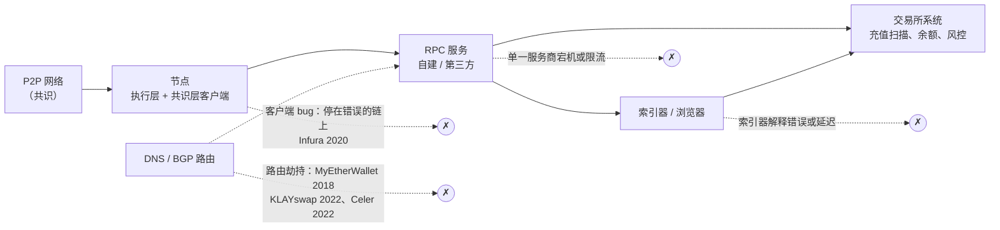
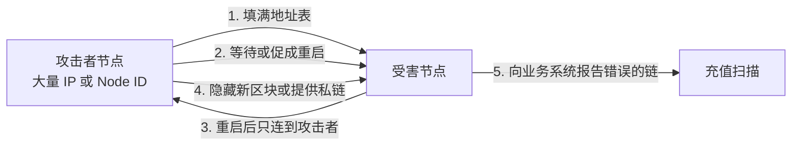
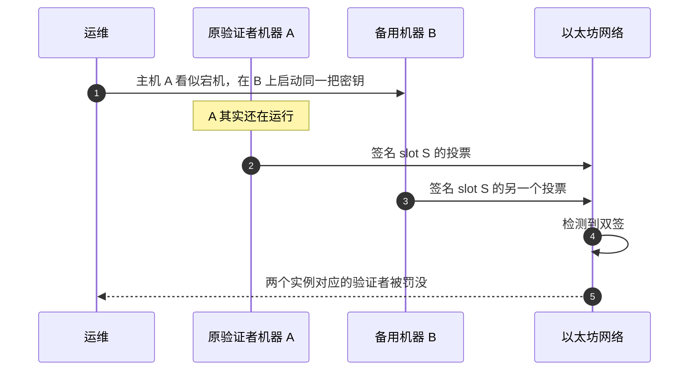
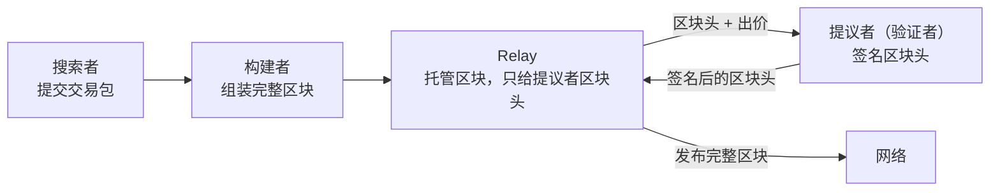

# 17 节点、RPC 与验证者基础设施：你读到的是谁的链，谁在签名出块

> 学习目标：读完本章，你能——
> 1. 识别"你看到的链上数据"在 RPC、索引器、浏览器、网络路由各层可能被篡改或延迟的位置。
> 2. 识别 P2P 层的日蚀、节点 DoS、DNS 种子和 BGP 攻击，并为节点做加固。
> 3. 评估验证者运营的密钥、罚没（slashing）和客户端风险。
> 4. 说出 MEV relay 与区块构建者的信任假设，以及它们的集中度。
>
> 前置章节：[16 共识层与链级安全](16-consensus-chain-security.md)
> 相关：[20 前端、DNS 与供应链](20-frontend-dns-supply-chain.md)、[23 托管与充提安全](23-custody-exchange-ops.md)、[09 MEV 与签名安全](09-mev-signatures.md)
> 交互实验：[rpc-quorum-lab.html](interactive/rpc-quorum-lab.html)

> 最后核对：2026-11-10

---

## 开场：节点只对你说谎

2026 年 4 月，攻击者替换了 LayerZero 验证者使用的两个 RPC 节点的程序。节点只对验证者返回伪造数据，对其他 IP 返回真实数据。攻击者再用 DDoS 打掉干净的 RPC，系统自动切换到被污染的节点。损失约 2.9 亿美元。

🤔 先猜再看：监控系统也查询了这两个节点，结果一切正常。它能发现这次攻击吗？

不能。节点按来源 IP 区别对待，监控看到的是真实数据。要发现这种攻击，需要把验证者实际收到的结果和不同运营方的数据源比对。

---

## 1. 一句话理解

**你的系统从来没有直接读过"链"。它读的是某个节点、某个 RPC 服务、某个索引器告诉它的链。那个节点落后了、出错了、被劫持了，你的充值、余额和风控就全部建立在错误的数据上。**

**验证者最大的风险来自自己的运维：同一把密钥在两处签名，就会被罚没。MEV 基础设施的风险来自可信中间人：提议者看不到区块内容就签名，它信任 relay 发布完整区块并付款。**

RPC（Remote Procedure Call）节点：对外提供读取链上数据、广播交易接口的节点。
索引器（Indexer）：把链上数据整理成便于查询的数据库的服务，例如区块浏览器背后的系统。

> 🎯 打个比方：你通过一扇窗户看街上的车流来决定什么时候过马路。窗户可能是一块屏幕，屏幕可能延迟了 10 秒，也可能有人在播放录像。你看到的"街道"，只是屏幕告诉你的街道。
>
> 比喻的局限：真实的马路你可以换一扇窗户再看一眼。很多系统只接了一个 RPC 服务，从来没有"第二扇窗户"。

> 🎯 打个比方：一枚公章同一时刻只能放在一个抽屉里。两个办公室各放一枚同样的公章，同一份合同就可能盖出两个版本，公章会被收回。
>
> 比喻的局限：公章被滥用时，会有人追查原因。协议不问原因，只要检测到双签就罚没。

---

## 2. 威胁模型：数据从链到你的系统，以及谁信任谁

### 2.1 数据从链到你的系统

**读图要点：**

- 每一层都可能给出错误的数据：节点停在一条错误的分叉上，RPC 服务宕机，索引器延迟，网络路由被劫持后连到了攻击者的服务器。
- 交易所的充值扫描通常只连一个 RPC。这一个点出错，入账就出错。
- 局限：图里没有画"写入方向"。广播交易时，RPC 也可以选择不广播、延迟广播，或者把交易卖给 MEV 搜索者。

| 层 | 攻击者或故障能造成什么 | 典型原因 |
|---|---|---|
| 节点客户端 | 返回错误分叉上的数据 | 客户端版本过旧，遇到已修复的共识 bug |
| RPC 服务 | 宕机、限流、返回过期数据 | 单一服务商故障；负载过高 |
| 网络路由（BGP / DNS） | 把流量导向攻击者的服务器 | 路由劫持；DNS 劫持 |
| 前端引用的脚本或配置 | 下发错误的合约地址或恶意脚本 | 被劫持的 CDN 或 SDK 域名，见 [20 章](20-frontend-dns-supply-chain.md) |
| 索引器 | 余额或历史解释错误 | 版本不一致；元协议规则分歧，见 [13 章](13-non-evm-ecosystems.md) |

### 2.2 验证者与 MEV：谁信任谁

| 角色 | 信任什么 | 信任失效时的后果 |
|---|---|---|
| 验证者运维 | 故障切换流程和防罚没数据 | 同一把密钥双签，验证者被罚没并强制退出 |
| 提议者 | relay 会发布完整区块并付款 | 错过这个 slot，收不到出价 |
| 构建者 | relay 在提议者签名前不泄露区块内容 | 交易包被拆开（2023 年 relay 漏洞） |
| 交易所和用户 | 少数构建者和 relay 不审查交易 | 区块内容由少数几家决定；受制裁地址的交易可能被审查 |

- 前两行的风险来自自己的流程和所选的 relay。后两行的风险来自 relay 和构建者的集中度，见 §5.6。
- 节点和 RPC 的数据可信度见 §2.1 和 §3.1–3.3。

---

## 3. 攻击路径

### 3.1 节点与 RPC：数据可信度

1. 交易所只连接一个第三方 RPC。
2. 该服务商的节点运行旧版客户端，遇到一个上游已修复的共识 bug，停在了一条少数派分叉上。
3. 交易所的充值扫描读到的是这条分叉上的数据：有的交易不存在，有的余额不对。
4. 交易所按错误数据入账或放行提币。

> 🧪 动手验证：打开[RPC 多源仲裁实验](interactive/rpc-quorum-lab.html)，场景选“同一上游被污染”，法定数 k 设为 2，取消“结果冲突时暂停”。记录结论和“最少运营方数”。再勾选回来，比较结果。

### 3.2 路由劫持

BGP 劫持：攻击者通过错误的路由宣告，让互联网把发往某个 IP 段的流量送到自己的服务器。DNS 解析服务、SDK 下载域名、API 域名都可能被劫持。

1. 攻击者宣告目标 DNS 服务器或 CDN 的 IP 段。
2. 部分用户的请求被送到攻击者的服务器。
3. 攻击者返回钓鱼页面、恶意 JS，或错误的合约地址。

### 3.3 P2P 与网络层攻击

P2P 网络（Peer-to-Peer Network）：节点之间直接交换区块和交易的网络。3.1 节讲的是"你问节点，节点答错"。本节讲的是"节点自己看到的网络被人操纵"。

#### 3.3.1 日蚀攻击（Eclipse Attack）

日蚀攻击：攻击者占满受害节点的全部对等连接，让它只看到攻击者提供的区块和交易。

**读图要点：**

- 第 3 步最关键：节点重启时，会从地址表重新选择对等节点。
- 受害节点的同步状态看起来正常，它只是落后或者在错误的分支上。
- 局限：受害节点如果有一条不受攻击者控制的连接，就能发现更高的链。

| 研究 | 结论 | 后续修复 |
|---|---|---|
| Heilman 等（比特币，USENIX Security 2015） | 控制 32 个不同 /24 段（8,192 个地址）或 4,600 台僵尸主机的攻击者，能以至少 85% 的概率日蚀受害节点；在真实节点上的测试中 400 台已足够 | 论文的第 1、2、6 项对策进入 bitcoind 0.10.1 |
| Marcus、Heilman、Goldberg（以太坊，2018） | 两台主机、各一个 IP 就能日蚀节点。Geth 1.8 之前，同一 IP 可以运行不限数量的 Node ID | Geth 1.8.0（2018 年 2 月 14 日）把同一 /24 的节点限制为每个桶 2 个、全表 10 个；论文说明这不是作者建议的一对一映射 |

比特币后续增加了锚点连接、ASMap 和反馈探测连接。锚点连接把 2 个仅中继区块的出站连接写入 `anchors.dat`，重启时优先恢复。来源：[Bitcoin Optech](https://bitcoinops.org/en/topics/eclipse-attacks/)、[Heilman 论文](https://www.usenix.org/system/files/conference/usenixsecurity15/sec15-paper-heilman.pdf)、[Marcus 论文](https://www.cs.bu.edu/~goldbe/projects/eclipseEth.pdf)。

🤔 先猜再看：你的节点有 50 个对等连接，同步高度和监控都正常。这能证明它没有被日蚀吗？

不能。对等节点数只说明有连接，不说明连接来自独立的运营方。日蚀中的节点同样显示有连接、有新块。要把节点的链头和不同网络、不同运营方的数据源比对。

#### 3.3.2 节点 DoS 与内存池洪泛

- **协议层资源错价**：2016 年的上海攻击反复调用定价过低的状态读取操作码。节点处理区块明显变慢。EIP-150 随后把 `EXTCODESIZE` 的 gas 从 20 提高到 700。来源：[EIP-150](https://eips.ethereum.org/EIPS/eip-150)、[以太坊基金会](https://blog.ethereum.org/2021/05/18/eth-state-problems)。
- **内存池洪泛（Mempool Flooding）**：攻击者用低成本交易占满节点的待打包队列，正常交易被挤出。DETER 研究（CCS 2021）在所有已知的以太坊客户端中发现了这类缺陷。来源：[DETER 论文](https://tristartom.github.io/docs/ccs21.pdf)。
- **畸形消息**：一条构造的 P2P 消息能让节点崩溃或耗尽内存。见下表。

| 客户端 | 编号 | 影响 | 修复版本 |
|---|---|---|---|
| Geth | CVE-2024-32972 | P2P 消息造成内存耗尽 | 1.13.15 |
| Geth | CVE-2025-24883 | 握手阶段的构造消息造成崩溃 | 1.14.13 |
| Geth | CVE-2026-26314 | 构造消息造成节点崩溃或关闭 | 1.16.9 |
| Besu | GHSA-xw6x-9526-6w9r | DiscV4 UDP 发现协议被远程 DoS | 26.8.0 |

来源：[GHSA-4xc9-8hmq-j652](https://github.com/advisories/GHSA-4xc9-8hmq-j652)、[CVE-2025-24883](https://db.gcve.eu/vuln/ghsa-q26p-9cq4-7fc2)、[CVE-2026-26314](https://db.gcve.eu/vuln/ghsa-2gjw-fg97-vg3r)、[Besu 公告](https://github.com/hyperledger/besu/security/advisories/GHSA-xw6x-9526-6w9r)。

> 💡 注意：节点崩溃不只是"服务不可用"。如果切换逻辑把流量转到更差的备用节点，DoS 就成为数据污染的前置步骤。KelpDAO 事件正是这样，见 5.2.1 节。

#### 3.3.3 DNS 种子与启动节点投毒

新节点用 DNS 种子（DNS Seed）或启动节点（Bootnode）获取最初的对等节点。这一步被污染，节点从第一条连接起就在攻击者的网络里。

- Heilman 指出，单个被攻破的种子能返回数千个攻击者地址。比特币核心后来限制了单个种子接受的地址数（[Bitcoin Core #29850](https://bitcoinops.org/en/topics/eclipse-attacks/)）。
- 以太坊的 EIP-1459 把节点列表放进 DNS TXT 记录，并用一个根签名认证。Geth 通过 `--discovery.dns` 使用这类列表。来源：[EIP-1459](https://eips.ethereum.org/EIPS/eip-1459)、[Geth 文档](https://geth.ethereum.org/docs/developers/dns-discovery-setup)。
- 本书未查到公开归因于 DNS 种子投毒、造成资金损失的案例。

#### 3.3.4 BGP 路由攻击

路由劫持的基本步骤和前端案例见 3.2 节和 5.2 节。P2P 层还有两项研究：

- Apostolaki 等：劫持不到 100 个 IP 前缀，就能隔离最多 47% 的比特币算力（[arXiv 1605.07524](https://arxiv.org/abs/1605.07524)）。
- Erebus（IEEE S&P 2020）：攻击者不修改路由。它利用自己位于路径中间的位置，逐步影响受害节点的对等选择。控制面监控看不到这种攻击。来源：[NUS 介绍](https://comp.nus.edu.sg/features/2019-kang-min-suk)。

### 3.4 验证者运营与罚没

罚没（Slashing）：PoS 验证者违反协议（例如对同一个位置签两个不同的区块或投票），被扣除部分质押并强制退出。

**读图要点：**

- 几乎所有公开的罚没事件，都是故障切换或迁移时，同一把密钥在两处同时签名。
- 第 1 步是运维决策，不是攻击。所以防线在流程：迁移前导出防罚没数据，确认旧实例已停止，等待至少 2 个 epoch。
- 局限：图里只有两台机器。使用远程签名器时，多个验证者客户端共用一个签名器，签名器本身的防罚没数据库就是关键。

🤔 先猜再看：A 还在运行。运维在 B 上启动同一把密钥，并开启了分身检测。B 会双签吗？

正常情况下不会。分身检测让 B 先观察约 2 个 epoch，看到同一验证者的活动后退出。但它是最后一道防线：如果 A 在观察期内恰好没有活动，或者 B 没有开启检测，就挡不住。

### 3.5 MEV-Boost、relay 与构建者

2023 年 4 月，一个恶意提议者先签了一个无效的区块头，从 relay 拿到了完整区块内容，拆开三明治机器人的交易包获利约 2,000 万美元（§5.5）。

🤔 先猜再看：提议者为什么能在签名前看不到区块内容，签名后却拿到全部内容？

在 MEV-Boost 里，relay 只给提议者区块头。提议者签名后，relay 返回区块体。旧代码只要提议者签了区块头就返回区块体，即使这个区块头无效。修复后，relay 改为先广播区块，再把区块交给提议者。

**读图要点：**

- 提议者看不到区块内容就签名。它信任 relay 会发布完整区块并付款。
- 构建者信任 relay 在提议者签名前不泄露区块内容。2023 年的 relay 漏洞就是这一步失效（见 §5.5）。
- relay 和构建者高度集中。少数几家决定了以太坊大部分区块里有哪些交易，也决定了是否审查受制裁地址的交易。
- 以太坊计划在协议内实现提议者与构建者分离（ePBS，EIP-7732），减少对 relay 的依赖。截至 2026 年 11 月，它所在的 Glamsterdam 升级没有主网日期，见 [16 章](16-consensus-chain-security.md) 5.7 节。

🤔 先猜再看：relay 在提议者签名后不发布完整区块。提议者的结果是什么？

提议者错过这个 slot，收不到出价。它已经对区块头签名，也不能再为这个 slot 签另一个区块，否则会被罚没。这就是提议者必须信任 relay 的原因。

---

## 4. 防御方法

### 4.1 交易所的节点与数据策略

| 措施 | 做法 |
|---|---|
| 多源校验 | 充值扫描至少使用两个独立来源：自建节点 + 第三方 RPC，或两家第三方；结果不一致时暂停入账 |
| 不降级 | 节点超时后，法定数不自动下降；达不到法定数就暂停，并人工确认 |
| 客户端多样性 | 自建节点在执行层和共识层选用少数派客户端；或运行两种客户端互相校验 |
| 及时升级 | 订阅客户端安全公告；硬分叉前完成升级并在测试网验证 |
| 健康检查 | 监控节点同步高度、与公共来源的高度差、对等节点数；落后时自动切换 |
| 网络安全 | 关键域名使用 DNSSEC 和 RPKI；API 使用 TLS 证书固定或校验 |
| 广播 | 敏感交易通过私有通道广播，减少被抢跑 |

> 🧪 动手验证：在 [RPC 多源仲裁实验](interactive/rpc-quorum-lab.html)选择 Kelp 式场景，默认设置下记录结论。再把“节点无响应时”改为“不降级”，把 k 设为 3，记录结论和“最少运营方数”。

### 4.2 节点加固清单

| 项目 | 做法 | 依据 |
|---|---|---|
| RPC 暴露 | HTTP / WS RPC 只绑定内网或回环地址；对外必须经过认证网关，并限制方法集 | 2018 年 8545 端口盗币（5.3 节） |
| Engine API | 8551 端口只对共识客户端开放，并使用 JWT；不与公共 JSON-RPC 共用端口 | [Engine API 规范](https://github.com/ethereum/execution-apis/blob/main/src/engine/authentication.md) |
| JWT 密钥 | 文件权限只允许节点进程读取；日志不打印密钥；轮换有记录 | Besu 2026 年公告（5.3 节） |
| 端口与防火墙 | 入站只放行 P2P 端口（执行层默认 30303 TCP 和 UDP；共识层按客户端文档）；默认拒绝其他入站 | [Nethermind 安全文档](https://docs.nethermind.io/fundamentals/security) |
| 出站控制 | 节点机器的出站按需放行；发现异常连接告警 | KelpDAO（5.2.1 节） |
| 密钥分离 | RPC 节点不存放提币私钥或验证者私钥；验证者密钥放进远程签名器 | §4.3 |
| 补丁管理 | 订阅客户端安全公告；高危 P2P 漏洞设定升级时限 | 3.3.2 节 |
| 客户端多样性 | 关键业务至少运行两种客户端，比对链头和关键查询结果 | [16 章](16-consensus-chain-security.md) |
| 对等连接多样性 | 配置不同网络、不同运营方的固定对等节点；使用 ASMap 或同类机制 | 3.3.1 节 |
| 进程隔离 | 节点进程使用专用低权限账户；磁盘、内存超阈值告警 | 业界通用做法 |

> ⚠️ 警告：不要把"机器在内网"当作认证。攻击者进入内网后，未认证的 RPC 和 Engine API 就是下一跳。

### 4.3 验证者运营

1. 同一把验证者密钥在任何时刻只在一处可以签名。
2. 迁移前导出 EIP-3076 防罚没数据并导入新实例，确认旧实例已停止，再等待至少 2 个 epoch。
3. 使用远程签名器（如 Web3Signer）时，防罚没数据库共享并加锁。
4. 开启分身检测（Doppelganger Detection）作为最后一道防线。它会在启动后观察约 2 个 epoch，发现重复就退出。
5. 故障切换不自动化。启动备用实例必须人工确认原实例已停止。
6. relay 列表明确写入策略：使用哪些 relay、是否使用合规 relay，并定期复核。

### 4.4 验证者的网络隔离

| 项目 | 做法 | 依据 |
|---|---|---|
| 哨兵节点 | 验证者不暴露公网 IP，只连接自己的哨兵节点；关闭验证者的节点发现；不向外传播验证者 ID | [CometBFT 文档](https://docs.cosmos.network/cometbft/next/docs/core/Validators) |

> 💡 注意：哨兵节点架构来自 CometBFT 生态。以太坊验证者可以用类似的分层隔离，但要按所用客户端的文档配置。

---

## 5. 真实案例

> 💡 注意：以下每个案例只写摘要和教训。金额为事发时美元估值。

### 5.1 Infura 停在错误的分叉上（2020 年 11 月，以太坊）

- Infura 的节点运行旧版 Geth，遇到一个上游已经修复的共识 bug，停在了一条少数派分叉上。
- 依赖 Infura 的 MetaMask 等服务受影响；Binance、Bithumb 等交易所暂停了 ETH 和 ERC-20 提币。
- 教训：不能只依赖单一 RPC 服务商；客户端要及时升级。
- 来源：[The Block](https://www.theblock.co/post/84232/ethereum-infrastructure-provider-infura-is-down)、[rekt.news](https://rekt.news/infura-issue-of-consensus)

### 5.2 网络路由劫持（2018–2022）

| 时间 | 目标 | 手法 | 损失（约） | 来源 |
|---|---|---|---|---|
| 2018-04 | MyEtherWallet | BGP 劫持 Amazon Route 53 的 IP 段，DNS 被指向钓鱼站 | 15 万美元 | [The Register](https://www.theregister.com/2018/04/24/myetherwallet_dns_hijack/) |
| 2022-02 | KLAYswap | BGP 劫持 Kakao SDK 的下载域名，下发恶意 JS | 190 万美元 | [S2W 事后分析](https://medium.com/s2wblog/post-mortem-of-klayswap-incident-through-bgp-hijacking-en-3ed7e33de600) |
| 2022-08 | Celer cBridge | BGP 劫持为前端提供合约地址的子域 | 24 万美元 | [Coinbase 分析](https://www.coinbase.com/blog/celer-bridge-incident-analysis)、[Kentik](https://www.kentik.com/blog/bgp-hijacks-targeting-cryptocurrency-services/) |

- 教训：DNS 和 SDK 域名受网络层攻击影响。前端加载外部脚本要有完整性校验，见 [20 章](20-frontend-dns-supply-chain.md)。

### 5.2.1 RPC 节点被替换：KelpDAO（2026 年 4 月）

- LayerZero 称，攻击者控制了其 DVN 使用的两个 RPC 节点，并替换了 op-geth 程序，使验证者接受一条不存在的跨链消息。损失约 2.92 亿美元（媒体统计，LayerZero 声明写约 2.9 亿美元）。来源：[LayerZero 声明](https://layerzero.network/blog/kelpdao-incident-statement)。详见 [12 章](12-cross-chain-bridges.md) 4.6 节。
- 节点只向 DVN 返回伪造数据，向其他 IP（包括 LayerZero 的 Scan 服务）返回真实数据。攻击者随后 DDoS 未被攻破的外部 RPC，迫使系统切换到被污染的节点。节点设计为攻击后自毁。
- 这条路径配合了 KelpDAO 的 1-of-1 DVN 配置。责任归属有争议，见 [12 章 4.6 节](12-cross-chain-bridges.md)。
- 教训：资金决策不能只依赖一组同源 RPC。关键数据要由不同运营方的节点交叉核对。

### 5.3 节点配置与 P2P 层案例

- **开放的 8545 端口（2018 年）**：360 Netlab 发现，一个团伙扫描暴露 JSON-RPC 的以太坊节点，累计盗走 38,642 ETH，超过 2,000 万美元（事发时估值）。Geth 默认只监听本地，损失来自节点运营者主动开放接口。来源：[BleepingComputer](https://www.bleepingcomputer.com/news/security/hackers-stole-over-20-million-from-misconfigured-ethereum-clients)。
- **Besu 的 JWT 漏洞（2026 年 9 月公告）**：一项是算法混淆：配置公钥文件时，攻击者能用 HMAC 伪造令牌。另一项是临时密钥文件写入失败时，Engine API 的 JWT 密钥进入日志。两项都在 26.8.1 修复。来源：[GHSA-jxwx-rxf9-pg2g](https://github.com/hyperledger/besu/security/advisories/GHSA-jxwx-rxf9-pg2g)、[GHSA-f429-4669-7rpx](https://github.com/hyperledger/besu/security/advisories/GHSA-f429-4669-7rpx)。
- **Krypton（2016 年）**：攻击者把 51% 算力和对节点的 DDoS 结合使用，见 [16 章](16-consensus-chain-security.md) 3.5 节。
- **Solana 交易洪泛（2021、2022 年）**：交易和请求洪泛让全网停止出块，见 [16 章](16-consensus-chain-security.md) 5.2 节。
- 教训：节点层的事故多数来自配置和补丁，不是密码学失败。日蚀攻击在公开资料中多是研究成果，本书未查到造成资金损失、并公开归因于日蚀的案例，但它的防线和 RPC 多源校验相同。

### 5.4 验证者罚没（2021–2025，以太坊）

- **2021 年 2 月**：一家质押服务商在重启操作中出错，75 个验证者重复签名，全部被罚没，约 18 ETH。来源：[The Block](https://www.theblock.co/post/93730/eth2-validators-slashed-staked-bug)。
- **2023 年 10 月**：Lido 的一家节点运营商在数据中心故障后签名器配置出错，20 个验证者被罚没，运营商赔付了损失。来源：[Lido 事后报告](https://blog.lido.fi/post-mortem-launchnodes-slashing-incident/)。
- **2025 年 9 月**：SSV 网络上一个集群在例行维护中双签，39 个验证者被罚没。SSV 称自身基础设施没有出现双签。来源：[SSV 事后报告](https://ssv.network/blog/slashing-post-mortem-september-2025)。
- 教训：罚没几乎都来自故障切换或迁移。流程比工具更重要。远程签名和分身检测的配置见 [Web3Signer 文档](https://docs.web3signer.consensys.io/concepts/slashing-protection)、[Teku 文档](https://docs.teku.consensys.io/how-to/prevent-slashing/detect-doppelgangers)。

### 5.5 MEV-Boost relay 漏洞（2023 年 4 月，以太坊）

- 一个恶意提议者先签了一个无效的区块头，从 relay 拿到了完整区块内容，拆开三明治机器人的交易包获利约 2,000 万美元。
- 漏洞在开源的 relay 代码里：只要提议者签了区块头，relay 就返回区块体。修复后，relay 改为先广播区块，再把区块交给提议者。
- 两名嫌疑人 2024 年被美国检方起诉；2025 年 11 月因陪审团意见不一致宣布审判无效。截至 2026 年 3 月仍待重审，之后的进展本书未查到。
- 教训：MEV 基础设施是可信中间人。验证者要评估自己使用的 relay 的安全和运营方。
- 来源：[Flashbots 事后报告](https://collective.flashbots.net/t/post-mortem-april-3rd-2023-mev-boost-relay-incident-and-related-timing-issue/1540)、[The Block（审判无效）](https://www.theblock.co/post/378101/massive-overstep-mistrial-declared-for-mev-brothers-accused-of-25-million-fraud-on-ethereum)

### 5.6 构建者与 relay 的集中度（2026 年 11 月快照）

| 指标 | 数值 | 来源 |
|---|---|---|
| 前两大构建者的区块份额（近 24 小时） | 约 74%（最大一家约一半） | [relayscan.io](https://www.relayscan.io/) |
| 审查型（OFAC 合规）relay 的交付份额 | 约 17% | [mevwatch.info](https://www.mevwatch.info/) |
| ePBS（EIP-7732） | 已被定为 Glamsterdam 升级的主要特性；Sepolia 已激活，Hoodi 推迟且无新日期，主网时间未定（2026 年 11 月 9 日核对） | [ethereum.org](https://ethereum.org/roadmap/glamsterdam/)、[以太坊基金会](https://blog.ethereum.org/2026/10/22/glamsterdam-hoodi-delay) |

- 💡 这些数据是 2026 年 11 月 8 日的单日快照，波动很大，只用于说明集中程度。
- 教训：区块内容由少数几家决定。交易所做质押时，要明确 relay 白名单和合规策略。

---

## 6. 评估检查点

- [ ] **NOD-1** 充值扫描至少使用两个独立数据来源；不一致时暂停入账。
- [ ] **NOD-2** 自建节点的客户端选择考虑了主网份额；硬分叉前已升级。
- [ ] **NOD-3** 节点健康监控覆盖同步高度、与公共来源的高度差、对等节点数。
- [ ] **NOD-4** 关键域名启用 DNSSEC；IP 段有 RPKI；有路由劫持监控。
- [ ] **NOD-9** 节点超时或切换时，法定数不自动下降；数据源按运营方统计独立性。
- [ ] **NOD-10** 节点的对等连接来自不同网络和运营方；有固定对等节点；链头与外部来源持续比对。
- [ ] **NOD-11** HTTP / WS RPC 不直接暴露公网；对外访问有认证、方法白名单和限速。
- [ ] **NOD-12** Engine API 只在内网或回环地址开放，启用 JWT；密钥文件权限最小，不进日志。
- [ ] **NOD-13** 防火墙默认拒绝入站，只放行清单内的 P2P 端口；出站有控制和告警。
- [ ] **NOD-14** RPC 节点不存放提币私钥和验证者私钥；节点进程使用专用低权限账户。
- [ ] **NOD-15** 高危 P2P 漏洞有升级时限；有内存池和节点资源告警。
- [ ] **NOD-16** 启动节点和 DNS 种子列表可追溯、有变更审批；新节点首次同步后与外部来源比对。
- [ ] **NOD-5** 验证者密钥同一时刻只在一处可签名；迁移流程包含防罚没数据迁移和等待期。
- [ ] **NOD-6** 远程签名器的防罚没数据库共享并加锁；分身检测已开启。
- [ ] **NOD-7** 故障切换需要人工确认原实例已停止。
- [ ] **NOD-8** relay 列表和合规策略已写入文档，并定期复核。
- [ ] **NOD-17** 验证者不暴露公网 IP；使用哨兵节点或同等隔离；验证者 ID 不被传播。

**把检查结果写进报告：**

| 检查项 | 发现时的证据 | 常见定级（用 [A02](assessment/A02-risk-rating-reporting.md) 复核） | 练习位置 |
|---|---|---|---|
| NOD-1、NOD-9 | 数据源清单（按运营方）；故障切换配置；伪造数据演练结果 | Critical / High（影响入账或桥放行时） | [RPC 多源仲裁实验](interactive/rpc-quorum-lab.html) |
| NOD-2、NOD-3 | 客户端版本、高度差告警、硬分叉升级记录 | Medium | [16 章](16-consensus-chain-security.md)、[C00 以太坊](chains/C00-ethereum.md) |
| NOD-4 | DNSSEC、RPKI 状态；路由告警配置 | Medium / High | [20 章](20-frontend-dns-supply-chain.md) |
| NOD-10、NOD-16 | 对等节点的网络分布；链头比对告警；启动列表变更记录 | High（节点用于入账时） | [RPC 多源仲裁实验](interactive/rpc-quorum-lab.html) |
| NOD-11、NOD-12、NOD-13 | 外部端口扫描结果；RPC 与 Engine API 配置；JWT 文件权限；防火墙规则 | Critical / High（可远程调用时） | [A06 运营与密钥安全](assessment/A06-operational-key-security.md) |
| NOD-14 | 节点机器的密钥清单和进程权限 | Critical（发现提币私钥时） | [A06](assessment/A06-operational-key-security.md) |
| NOD-15 | 客户端版本与公告的比对；资源告警样例 | High / Medium | [T06](templates/T06-ops-security-self-check.md) |
| NOD-5、NOD-6、NOD-7 | 迁移记录、防罚没数据、分身检测配置、切换审批 | High（可造成罚没） | [A06 运营与密钥安全](assessment/A06-operational-key-security.md) |
| NOD-8 | relay 白名单及复核记录 | 取决于质押规模 | [A03](assessment/A03-exchange-contracts-wallets.md) |
| NOD-17 | 验证者网络拓扑；节点发现配置 | Medium / High | [A06](assessment/A06-operational-key-security.md) |

发现按 [T03 报告模板](templates/T03-finding-report.md) 记录。

---

## 7. 用户侧防护

1. 钱包默认的 RPC 是第三方服务。余额显示异常时，换一个 RPC 或区块浏览器交叉确认。
2. 自定义 RPC 只添加官方文档中列出的地址。恶意 RPC 可以返回假余额、假交易状态。
3. 使用质押服务时，了解服务商的罚没赔付政策。
4. 大额交易可以使用私有交易通道，减少被三明治攻击，见 [09 章](09-mev-signatures.md)。

---

## 8. 术语表

| 术语 | 英文 | 定义 |
|---|---|---|
| RPC 节点 | RPC Node | 对外提供链上数据读取和交易广播接口的节点 |
| 索引器 | Indexer | 把链上数据整理成可查询数据库的服务 |
| BGP 劫持 | BGP Hijacking | 通过错误的路由宣告劫持网络流量 |
| 日蚀攻击 | Eclipse Attack | 占满受害节点的全部对等连接 |
| 内存池洪泛 | Mempool Flooding | 用低成本交易占满节点的待打包队列 |
| 启动节点 | Bootnode | 新节点用来发现对等节点的入口节点 |
| DNS 种子 | DNS Seed | 用 DNS 返回初始对等节点地址的服务 |
| Engine API | Engine API | 以太坊共识客户端调用执行客户端的认证接口 |
| 罚没 | Slashing | PoS 验证者违规时被扣除质押并强制退出 |
| 双签 | Double Signing | 同一把密钥对同一位置签署两个不同的消息 |
| 防罚没数据 | Slashing Protection (EIP-3076) | 记录已签名位置、防止重复签名的数据 |
| 远程签名器 | Remote Signer | 把验证者签名与客户端分离的服务 |
| 分身检测 | Doppelganger Detection | 启动时检测同一密钥是否已在别处运行 |
| 构建者 | Builder | 组装完整区块并竞价的角色 |
| Relay | Relay | 在构建者和提议者之间托管区块的中间人 |
| 提议者与构建者分离 | PBS / ePBS | 把选择交易和提议区块分给不同角色的设计 |
| 哨兵节点 | Sentry Node | 代替验证者连接公网的前置节点 |

---

> 🪞 反思：画出你的系统判断一笔充值或跨链消息时读取的全部数据源。
> 1. 去掉重复的运营方后，还剩几个独立来源？
> 2. 主节点超时后，系统自动做什么？法定数变了吗？
> 3. 如果节点只对你的出口 IP 说谎，你从哪里发现？
> 4. 如果你的团队运行验证者或使用质押服务：备用实例今天能被谁启动？relay 列表写在哪里、上次复核是什么时候？验证者机器的公网 IP 有没有暴露？

## 9. 思考题

1. 你的交易所充值扫描只连一家第三方 RPC。列出三种它可能给你错误数据的情况，以及每种情况下你的系统会发生什么。
2. KelpDAO 事件中，被替换的节点只对 DVN 返回伪造数据，攻击者还 DDoS 了干净的外部 RPC。按 4.1 节的表格，哪两项措施能挡住这条路径？各挡住哪一步？
3. 运维在凌晨发现一台验证者主机失去响应。按本章第 4.3 节，他在启动备用实例前必须确认哪三件事？
4. 如果某个 relay 拒绝转发包含受制裁地址的交易，这对普通用户和交易所各有什么影响？

下一章：[18 钱包与密钥管理](18-wallet-key-management.md) —— 钥匙放在哪里。
