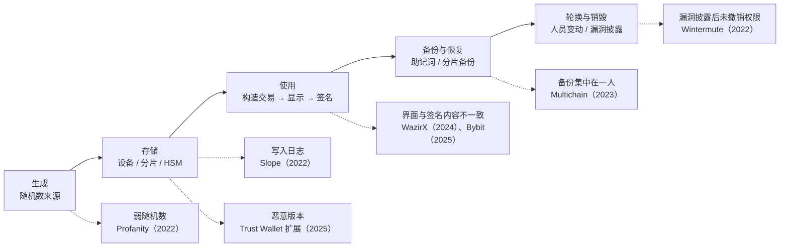
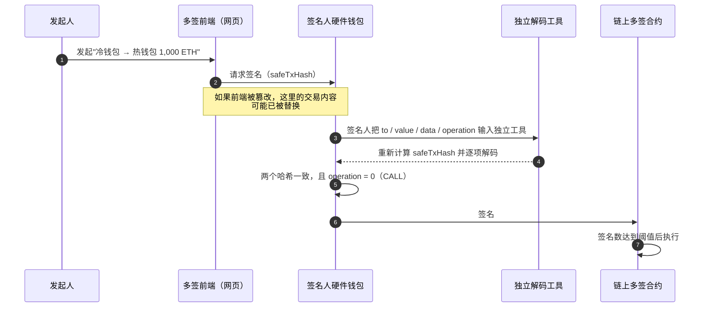
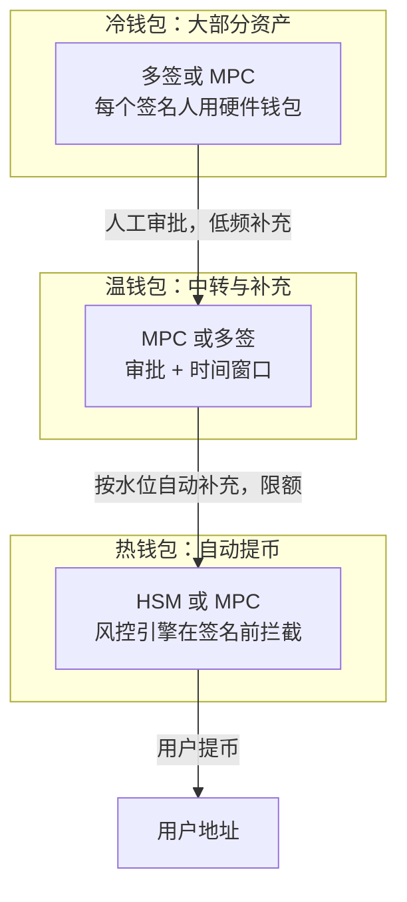

# 18 钱包与密钥管理：钥匙放在哪里

> 学习目标：读完本章，你能——
> 1. 比较助记词、硬件钱包、多签、MPC、HSM 五种密钥方案的安全边界与运营成本。
> 2. 为一家交易所设计热 / 温 / 冷三层的密钥方案和签名审批流程。
> 3. 列出密钥生命周期（生成、存储、使用、备份、轮换、销毁）每一步的检查项。
>
> 前置章节：[02 密码学基础与实现风险](02-cryptography-randomness.md)、[09 MEV 与签名安全](09-mev-signatures.md)
> 交互实验：[wallet-scheme-lab.html](interactive/wallet-scheme-lab.html)、[phishing-signature-lab.html](interactive/phishing-signature-lab.html)、[multisig-review-lab.html](interactive/multisig-review-lab.html)

> 最后核对：2026-11-09
---

## 开场：钥匙都在，钱没了

2024 年 7 月，WazirX 的 4-of-6 Safe 多签钱包损失约 2.3 亿美元。公开材料没有说任何一把私钥被导出。签名人按流程签了名。

🤔 先猜再看：6 把私钥都保存在硬件钱包里，没有一把泄露。攻击者还能转走多签里的资金吗？

能。多签只保证"足够多的人同意了某个哈希"。如果签名人看到的内容和实际签名的内容不同，每把钥匙都会正常工作。3.3 节解释防线在哪里。[29 章](29-signing-path-2026.md)把这一模式扩展到六起事件。

---

## 1. 一句话理解

**私钥就是资产。谁能让私钥签一笔交易，谁就拥有这笔资产。所以密钥方案的强度，取决于最容易被攻破的那个环节：一台设备、一行日志、一个签名人的眼睛。**

私钥（Private Key）：一个 256 位的随机数，用来对交易签名。
助记词（Mnemonic / Seed Phrase）：用 12 或 24 个单词表示的私钥种子（BIP-39），可以推导出一组私钥。

> 🎯 打个比方：私钥是保险柜的钥匙，而且这把钥匙可以无限复制。
>
> - 助记词钱包：钥匙放在你口袋里。口袋被掏，柜子就空了。
> - 硬件钱包：钥匙焊死在一个盒子里。盒子只盖章，不交出钥匙。但盖章前，你要看清盖的是什么。
> - 多签：柜子有 3 把锁，要 2 把同时打开。锁的主人如果住在一起、看同一块屏幕，3 把锁就退化成 1 把。
> - MPC：一把钥匙被切成 3 片，分给 3 个人。开柜时 3 片不拼回去，而是各自计算后合成签名。
> - HSM：钥匙锁在银行金库里，金库只按指令盖章，不判断指令对不对。
>
> 比喻的局限：真实世界的钥匙被复制会留下痕迹。私钥被复制不留任何痕迹，你只会在资产被转走时才知道。

---

## 2. 威胁模型：攻击者能控制什么

| 攻击者能控制的东西 | 典型手法 | 对应方案的弱点 |
|---|---|---|
| 生成私钥的随机数 | 弱随机数、可预测种子 | 所有方案（生成阶段） |
| 存放私钥的设备 | 恶意软件、恶意浏览器扩展、被盗手机 | 软件钱包 |
| 日志、崩溃上报、云备份 | 助记词被写入日志或同步到云端 | 软件钱包 |
| 钱包软件的发布链路 | 恶意版本上架应用商店 | 软件钱包、扩展钱包 |
| 签名人看到的界面 | 前端被篡改，界面与签名内容不一致 | 硬件钱包、多签、MPC |
| 签名人本人 | 社工、胁迫、内部人 | 所有方案 |
| 签名服务的调用权 | 攻破调用 HSM 或 MPC 的服务器 | HSM、MPC |

> 💡 注意：多数大额事故不是"私钥被数学破解"，而是私钥在生成、存储或使用的某一步被拿到，或者签名人被骗着签了攻击者的交易。

---

## 3. 攻击路径

### 3.1 五种方案对比

| 方案 | 私钥在哪里 | 单点失陷 | 盲签风险 | 链上可验证阈值 | 适合场景 |
|---|---|---|---|---|---|
| 助记词软件钱包 | 手机、电脑、浏览器扩展 | 是 | 高 | 否 | 日常小额 |
| 硬件钱包 | 独立芯片，不离开设备 | 设备 + 助记词备份 | 中（取决于屏幕能否解析交易） | 否 | 个人大额、多签签名人 |
| 多签（如 Safe） | 多个独立私钥 + 链上合约 | 否（如果签名人独立） | 中（共用前端是新单点） | 是 | 项目方金库、交易所冷钱包 |
| MPC 门限签名 | 多个分片，任何时候都不拼成完整私钥 | 否（如果分片独立） | 中 | 否（链上只看到一个地址） | 交易所热 / 温钱包、托管机构 |
| HSM | 硬件安全模块，私钥不可导出 | 签名服务 | 高（HSM 不判断交易内容） | 否 | 交易所热钱包 |

> 💡 注意：MPC（Multi-Party Computation，多方计算）门限签名：多个参与方各持一个密钥分片，合作产生一个普通签名，完整私钥从不出现。HSM（Hardware Security Module，硬件安全模块）：专用硬件，在内部生成和保存私钥，只对外提供签名接口。

> 🧪 动手验证：打开[钱包方案对比器](interactive/wallet-scheme-lab.html)，选择"交易所冷钱包"，再选择"交易所热钱包"。记录两次的第一名和红线检查结果。

### 3.2 密钥生命周期与攻击点

**读图要点：**

- 生命周期的每一步都有真实事故。只加固"存储"一步，不能防住其他五步。
- "使用"这一步最常被忽视：私钥安全地留在设备里，但设备签了攻击者构造的交易。
- 局限：图里没有画"人"。签名人被社工或胁迫，见 [21 章](21-social-engineering-insiders.md) 和 [22 章](22-physical-account-security.md)。

### 3.3 多签签名：签名人看到的是什么

**读图要点：**

- 第 2 步是信任边界。签名人如果只看网页显示，网页被篡改就会签错交易。
- 第 3–5 步是防线：用另一台设备、另一套代码重新计算哈希，并在硬件钱包屏幕上核对关键字段。
- `operation = 1`（DELEGATECALL）意味着让多签合约执行外部代码，例行转账不应出现。
- 局限：如果所有签名人用同一个"独立工具"，这个工具就成了新的单点。

> 🧪 动手验证：打开[多签签前复核](interactive/multisig-review-lab.html)，在 #43 和 #44 分别点击"运行独立解码"。记录两笔的 `operation` 和模拟结果，说明为什么 #44 可以批准。

---

## 4. 防御方法

### 4.1 按生命周期分层

| 阶段 | 必须做 | 不要做 |
|---|---|---|
| 生成 | 在可信硬件内生成；使用经过审计的随机数来源；记录生成仪式 | 用靶号（vanity）生成器生成资金地址；在联网电脑上生成冷钱包 |
| 存储 | 私钥或分片放在硬件钱包、HSM 或独立的 MPC 节点；分片在不同组织、地域、云账户 | 把助记词放进截图、云笔记、聊天记录；让日志 SDK 采集输入框 |
| 使用 | 硬件屏幕上可读地显示交易内容（清晰签名）；独立解码；带外确认 | 签看不懂的哈希；只看网页显示 |
| 备份与恢复 | 备份与主密钥分开保管；定期演练恢复；恢复需要多人 | 备份集中在一个人或一个账户 |
| 轮换与销毁 | 人员离职、漏洞披露、设备丢失后立即轮换并撤销链上权限 | 只把余额转走，不撤销旧地址的管理员权限 |

### 4.2 交易所的三层钱包

**读图要点：**

- 热钱包余额只占总资产的一小部分（比例由交易所自己定，常见做法是按日提币量设水位）。热钱包失守，损失有上限。
- 冷钱包到温钱包、温钱包到热钱包，每一跳都要有限额和审批。
- 热钱包的安全不在于"HSM 不可导出"，而在于签名请求进入 HSM 前的风控引擎：白名单、限额、速率、异常检测。参考架构见 [29 章](29-signing-path-2026.md) 第 4 节。

🤔 先猜再看：HSM 的私钥不可导出。攻击者控制了调用 HSM 的服务器。HSM 会拒绝攻击者的请求吗？

不会。HSM 只保证私钥不出设备，不判断交易内容。它按收到的指令盖章。所以策略检查要放在 HSM 之前，并且按待签的原始字节判断。

- 详细的托管和提币风控见 [23 章](23-custody-exchange-ops.md) 和《CEX 交易所学习手册》。

### 4.3 签名审批流程

1. 发起人在系统中提交交易，写明用途。
2. 系统自动检查：目标地址在白名单内、数额在限额内、`operation` 为 CALL。
3. 每个签名人在**自己的**设备上独立解码交易并重新计算哈希。
4. 大额交易通过带外渠道（电话、当面）确认发起人身份。
5. 签名人在硬件钱包屏幕上核对关键字段后签名。
6. 执行后，监控系统比对链上结果与审批记录。

> ⚠️ 警告：签名人之间不能共用同一台电脑、同一个浏览器、同一个前端。共用即单点。

---

## 5. 真实案例

> 💡 注意：以下每个案例只写摘要和教训。完整复盘见《[Web3 行业安全资损 101](../web3-loss-101/index.html)》。金额为事发时美元估值。

### 5.1 Slope 钱包：助记词写进了日志（2022 年 8 月，Solana）

- Slope 移动端把助记词以明文发送到它自托管的 Sentry 日志服务器，没有配置敏感字段脱敏。
- Solana 官方通报：约 9,231 个钱包受影响，损失约 410 万美元。部分用户在其他钱包里复用了同一组助记词，也被波及。
- OtterSec 和 Zellic 独立调查，指向日志配置错误。Sentry 称自身产品没有被攻破。
- 教训：日志、崩溃上报、遥测是密钥的泄露通道。客户端必须在采集端屏蔽密钥材料。
- 来源：[Solana 官方通报](https://solana.com/news/8-2-2022-application-wallet-incident)、[Sentry 声明](https://blog.sentry.io/slope-wallet-solana-hack)、[The Register](https://www.theregister.com/2022/08/04/solana_wallet_slope/)

### 5.2 Profanity 弱随机数 → Wintermute（2022 年 9 月，以太坊）

- Profanity 是一个靶号地址生成器。它的随机种子只有 32 位，约 43 亿种（CVE-2022-40769），私钥可以被 GPU 反推。1inch 在 2022 年 9 月公开了这个问题。
- Wintermute 把靶号地址用作金库管理员。披露后，它转走了这个地址里的 ETH，但没有撤销它的管理员权限。约 5 天后，金库被盗约 1.6 亿美元。
- 教训：漏洞披露后，要轮换密钥**并**撤销该地址在所有合约中的权限。转走余额不等于消除风险。
- 来源：[1inch 披露](https://blog.1inch.com/a-vulnerability-disclosed-in-profanity-an-ethereum-vanity-address-tool)、[SlowMist 分析](https://slowmist.medium.com/the-real-cause-of-the-wintermute-exploit-10da7e404b3b)、[资损 101](../web3-loss-101/index.html#c-wintermute)

### 5.3 Multichain：名义上的 MPC（2023 年 7 月，多链）

- 2023 年 7 月，Multichain 的 MPC 地址出现异常转出，约 1.26 亿美元（各报道在 1.25–1.3 亿美元之间）。
- 项目方 7 月 14 日声明：CEO 于 5 月被警方带走；全部 MPC 节点服务器运行在 CEO 的个人云账户上，团队无法登录。团队随后停止运营。
- 外界对"外部攻击"还是"内部转移"有争议，没有官方定性。
- 教训：MPC 的安全前提是分片**独立**。分片服务器在同一个人、同一个云账户下，门限只是名义上的。
- 来源：[Blockworks](https://blockworks.co/news/multichain-founder-family-arrested)、[Cointelegraph](https://cointelegraph.com/news/multichain-stops-operations-over-lack-of-funds)、[资损 101](../web3-loss-101/index.html#c-multichain)

### 5.4 WazirX：签名人看到的和签下的不一样（2024 年 7 月，以太坊）

- WazirX 的冷钱包是 4-of-6 Safe 多签，WazirX 持 5 把，Liminal 持 1 把；执行需要 3 个 WazirX 签名和 Liminal 签名（[Halborn](https://www.halborn.com/blog/post/explained-the-wazirx-hack-july-2024)）。
- 签名人在 Liminal 界面上看到的交易内容，与实际签名的内容不一致。实际签下的是一次合约升级，钱包控制权被转走，损失约 2.3 亿美元。攻击者把钱包切换到恶意合约，绕过了多签和白名单。恶意合约提前 8 天部署（[Halborn](https://www.halborn.com/blog/post/explained-the-wazirx-hack-july-2024)）。
- WazirX 称问题来自 Liminal 界面显示的数据与实际内容不一致。Liminal 称自身基础设施未被攻破，并称受害方的 3 台机器注入了恶意载荷（[CoinDesk](https://coindesk.com/business/2024/07/19/wazirx-liminal-custody-blame-each-other-as-230m-crypto-exploit-leaves-customers-stranded)）。未见解决这一争议的最终独立报告。2025 年 1 月，美日韩联合声明中，美国和韩国把此案归因于朝鲜。
- 新加坡高等法院 2025 年 10 月批准了修改后的重组方案。
- 教训：不能信任签名界面。硬件钱包必须能独立解析交易内容，签名人必须核对 `to`、`operation` 和 `data`。
- 来源：[日本外务省联合声明 PDF](https://www.mofa.go.jp/mofaj/files/100779646.pdf)、[CryptoSlate](https://cryptoslate.com/wazirx-finds-no-evidence-of-compromised-devices-blames-liminal-security/)、[Decrypt（重组方案获批）](https://decrypt.co/344084/)、[资损 101](https://claude.ai/artifact/1a5Nx6xTVLuJdCB8Esf2xj#c-wazirx)

### 5.5 Trust Wallet 浏览器扩展：发布凭证被盗（2025 年 12 月，多链）

- 2025 年 12 月 24 日，一个恶意的 v2.68 版本绕过正常发版流程，上架 Chrome 商店。注入代码导出扩展内所有钱包的助记词。
- 项目方称：攻击者通过泄露的 GitHub secrets 拿到源码和 Chrome 商店 API Key；项目方高度确信此事与 2025 年 11 月的 Sha1-Hulud npm 供应链事件有关。
- 2,520 个地址被盗，约 850 万美元。项目方全额赔付，发布 v2.69 修复。移动端不受影响。
- 教训：扩展钱包的发布凭证和 CI 密钥本身就是资金级资产。供应链细节见 [20 章](20-frontend-dns-supply-chain.md)。
- 来源：[Trust Wallet 公告](https://trustwallet.com/blog/announcements/trust-wallet-browser-extension-v268-incident-community-update)、[The Hacker News](https://thehackernews.com/2025/12/trust-wallet-chrome-extension-bug.html)、[Verichains](https://blog.verichains.io/p/trust-wallet-browser-extension-breach)

### 5.6 两个"根因不明"与"争议"案例

- **Atomic Wallet（2023 年 6 月）**：大量用户钱包被盗，Elliptic 估计逾 1 亿美元，并依据洗钱路径归因于 Lazarus。项目方从未公开技术根因。教训：用户无法评估一个不公开根因的钱包。来源：[Cointelegraph（转述 Elliptic）](https://cointelegraph.com/news/atomic-wallet-hackers-ofac-sanctioned-garantex-elliptic)、[Decrypt](https://decrypt.co/145765/)。
- **Ledger Recover（2023 年 5 月）**：可选的付费服务，把加密的助记词分成 3 片交给 3 家机构保管。批评者认为它违背了"私钥永不离开设备"的承诺，并带来被传唤调取的风险。Ledger 称没有后门，并承诺开源。没有出现已确认的攻破事件。教训：备份和恢复功能会扩大密钥的信任边界。来源：[Ledger CEO 声明](https://www.ledger.com/blog/ledger-recover-a-message-from-pascal-gauthier-chairman-ceo-at-ledger)、[Blockworks](https://blockworks.co/news/ledger-responds-recover-reactions)。

> 💡 注意：Bybit（2025 年 2 月）和 Radiant Capital（2024 年 10 月）也是多签签名人签错交易，但根因分别在前端和签名人终端。见 [20 章](20-frontend-dns-supply-chain.md) 和 [21 章](21-social-engineering-insiders.md)。把这些事件放进同一张图的分析见 [29 章](29-signing-path-2026.md)。

---

## 6. 评估检查点

- [ ] **KEY-1** 资金地址不是靶号生成器生成的；生成过程有记录。
- [ ] **KEY-2** 冷钱包是多签或 MPC；单个人无法转出。
- [ ] **KEY-3** 签名人在组织、设备、网络、地域上独立；没有两个签名人共用一台电脑或一个云账户。
- [ ] **KEY-4** 每个签名人使用硬件钱包，并在硬件屏幕上核对 `to`、`value`、`operation`、`data`。
- [ ] **KEY-5** 有独立于主前端的交易解码和哈希核对工具。
- [ ] **KEY-6** 热钱包余额有上限；补充有限额和审批。
- [ ] **KEY-7** 签名服务前有独立风控引擎：白名单、限额、速率。
- [ ] **KEY-8** 客户端和服务端日志屏蔽密钥材料；有自动扫描。
- [ ] **KEY-9** 钱包发布凭证（应用商店 API Key、签名证书、CI secrets）由少数人持有，并开启多因素认证。
- [ ] **KEY-10** 人员离职或漏洞披露后，有密钥轮换和链上权限撤销流程，并留痕。
- [ ] **KEY-11** 备份恢复每年至少演练一次，且需要多人参与。

**把检查结果写进报告：**

| 检查项 | 发现时的证据 | 常见定级（用 [A02](assessment/A02-risk-rating-reporting.md) 复核） | 练习位置 |
|---|---|---|---|
| KEY-1 | 地址生成记录 | 严重 / 高 | [02 章](02-cryptography-randomness.md) |
| KEY-2、KEY-3 | 签名人清单、设备和云账户归属 | 严重 / 高 | [钱包方案对比器](interactive/wallet-scheme-lab.html) |
| KEY-4、KEY-5 | 一次真实签名的核对记录 | 严重 / 高 | [多签签前复核](interactive/multisig-review-lab.html)、[B40](bootcamp/B40-case-safe.md) |
| KEY-6、KEY-7 | 水位配置、风控规则、绕过路径测试 | 严重 / 高 | [29 章](29-signing-path-2026.md) SIG 清单 |
| KEY-8、KEY-9 | 日志扫描结果、发布凭证清单 | 高 / 中 | [20 章](20-frontend-dns-supply-chain.md) |
| KEY-10、KEY-11 | 轮换和恢复演练记录 | 高 / 中 | [A06](assessment/A06-operational-key-security.md)、[T06](templates/T06-ops-security-self-check.md) |

发现按 [T03 报告模板](templates/T03-finding-report.md) 记录。交易所对象的评估范围见 [A03](assessment/A03-exchange-contracts-wallets.md)。

---

## 7. 用户侧防护

1. 大额资产放在硬件钱包，日常小额放在另一个软件钱包。两个钱包用不同的助记词。
2. 助记词只写在纸或金属板上，离线保管。不拍照、不截屏、不存云笔记、不发给任何人。
3. 任何"客服"、网站、表单要你输入助记词，都是诈骗。
4. 只从官方渠道安装钱包。扩展钱包更新后出现异常提示，先停用再核实。
5. 不用靶号工具生成资金地址。
6. 硬件钱包屏幕显示"无法解析"或只显示哈希时，不签。
7. 定期在授权管理工具中撤销不用的授权，见 [19 章](19-user-scams.md)。

---

## 8. 术语表

| 术语 | 英文 | 定义 |
|---|---|---|
| 私钥 | Private Key | 用来对交易签名的 256 位随机数 |
| 助记词 | Mnemonic / Seed Phrase | 用 12 或 24 个单词表示的私钥种子 |
| 硬件钱包 | Hardware Wallet | 私钥存储在独立芯片内、不离开设备的钱包 |
| 多签 | Multisig | 需要 M 个签名中的 N 个才能执行交易的链上合约钱包 |
| MPC 门限签名 | MPC / TSS | 多方各持密钥分片，合作产生签名，完整私钥从不出现 |
| HSM | Hardware Security Module | 在内部生成和保存私钥、只提供签名接口的专用硬件 |
| 盲签 | Blind Signing | 签名人看不懂签名内容就签名 |
| 清晰签名 | Clear Signing | 设备把交易内容解析成人能读懂的字段后再签名 |
| 靶号地址 | Vanity Address | 首尾字符符合指定模式的地址 |
| 热 / 温 / 冷钱包 | Hot / Warm / Cold Wallet | 按联网程度和审批强度划分的钱包层级 |

---

> 🪞 反思：想一想你保管或负责的一把重要密钥。
> 1. 它最近一次签名时，你在屏幕上核对了哪些字段？
> 2. 谁能在不碰这把密钥的情况下，让它签一笔交易？
> 3. 这把密钥的持有人离职时，哪些链上权限要同时撤销？

## 9. 思考题

1. 一个 3-of-5 多签，5 个签名人都在同一个办公室、用同一个浏览器插件访问同一个多签前端。它的实际安全阈值是多少？怎么改？
2. MPC 钱包在链上只显示一个普通地址。作为上币尽调人员，你怎么验证项目方声称的"3-of-5 MPC"是真的？
3. 打开 [wallet-scheme-lab.html](interactive/wallet-scheme-lab.html)，选"交易所热钱包"，把"签名速度"权重调到 0。排名怎么变？这说明热钱包的选型约束来自哪里？

下一章：[19 用户侧诈骗](19-user-scams.md) —— 攻击者不偷钥匙，而是骗你自己签名。
