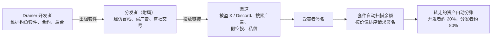
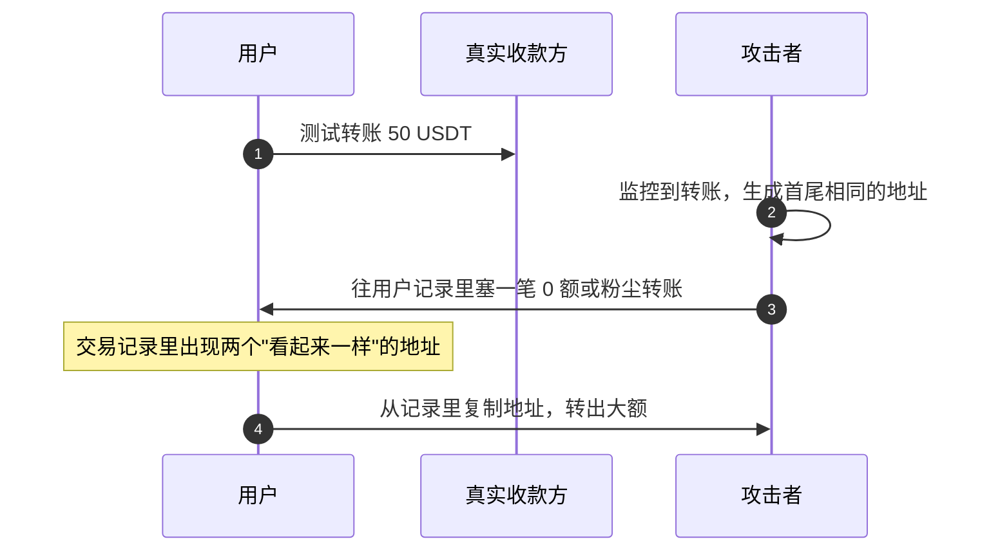

# 19 用户侧诈骗：不偷钥匙，骗你签名

> 学习目标：读完本章，你能——
> 1. 识别 approve、permit、setApprovalForAll、Permit2、7702 委托五类最常被滥用的签名。
> 2. 解释 Drainer 套件的分工（开发者、分发者、分成）和典型投放渠道。
> 3. 识别地址投毒，并用"代币骗局识别清单"判断一个代币是否为 Rug Pull 或貔貅盘。
>
> 前置章节：[09 MEV 与签名安全](09-mev-signatures.md)、[18 钱包与密钥管理](18-wallet-key-management.md)
> 交互实验：[phishing-signature-lab.html](interactive/phishing-signature-lab.html)、[address-poisoning-lab.html](interactive/address-poisoning-lab.html)

---

## 开场：测试转账成功之后

2025 年 12 月，一名用户先转了 50 USDT 测试地址，然后转出约 5,000 万美元。第二笔转到了攻击者的地址。

🤔 先猜再看：测试转账已经到账。用户从交易记录里复制同一个地址，转大额，安全吗？

不安全。攻击者在测试转账后发来粉尘转账，把相似地址写进记录。用户复制到的可能是投毒地址。5.4 节记录，本案从测试到转错约 26 分钟。

---

## 1. 一句话理解

**这类攻击不需要偷私钥。攻击者让用户自己签下一个授权，或者让用户自己把钱转到错误的地址。私钥完好无损，资产已经没了。**

钓鱼签名（Phishing Signature）：诱导用户签署一个把资产控制权交给攻击者的交易或链下消息。

> 🎯 打个比方：骗子不撬你家的门锁。他拿来一份"快递签收单"，请你签个字。签收单的背面印着"本人同意将房屋钥匙交给持单人"。你签的是真名，笔迹是真的，法律上也很难说你没同意。
>
> 比喻的局限：现实中你可以翻到背面看。钱包里的签名请求常常只显示一串十六进制数据，"背面"需要专门的解码工具才能看懂。

---

## 2. 威胁模型：攻击者能控制什么

| 攻击者能控制的东西 | 用户看到的 | 实际发生的 |
|---|---|---|
| 一个仿冒网站 | "领取空投""验证钱包""免费铸造" | 请求 approve / permit / setApprovalForAll |
| 一条链下签名的内容 | "不花 Gas，只是签个名" | 一张可以被攻击者提交上链的授权支票 |
| 用户的交易记录 | 熟悉的地址首尾 | 首尾相同、中间不同的投毒地址 |
| 一个代币合约 | 涨势很好的新币 | 只能买不能卖，或团队随时撤走流动性 |
| 社交账号、广告、搜索结果 | 官方账号发的链接 | 被盗账号或付费广告指向钓鱼站，见 [22 章](22-physical-account-security.md) |

> 💡 注意：攻击者控制不了用户的私钥，也控制不了链上合约的逻辑。所以这类攻击的每一步都需要用户的一个动作：点击、签名、复制、粘贴。每一个动作都是一个可以拦截的点。

---

## 3. 攻击路径

### 3.1 五类危险签名

| 签名类型 | 是否上链 | 授权了什么 | 攻击者之后做什么 |
|---|---|---|---|
| `approve(spender, amount)` | 是（花 Gas） | spender 可转走你最多 amount 个该代币 | 调用 `transferFrom` 转走 |
| `permit(...)`（EIP-2612） | 否（链下签名） | 同 approve，但由别人提交上链 | 自己提交 permit + `transferFrom` |
| `setApprovalForAll(operator, true)` | 是 | operator 可转走你在该 NFT 系列的**全部** NFT | 批量转走 |
| Permit2 `PermitBatch` | 否 | 通过 Permit2 合约批量授权多种代币 | 一次转走多种代币 |
| EIP-7702 委托 | 授权上链 | 你的地址执行委托合约的代码 | 合约代码直接转走全部资产 |

> ⚠️ 警告：链下签名最危险的地方是"不花 Gas、钱包里没有交易记录"。用户以为只是"登录"，实际签下了一张不可撤回的支票。

打开 [phishing-signature-lab.html](interactive/phishing-signature-lab.html)，逐个判断 10 个签名请求，再切换到解码视图看危险字段。

### 3.2 Drainer 即服务

**读图要点：**

- Drainer 即服务（Drainer-as-a-Service）：开发者把钓鱼工具当作产品出租，分发者负责引流。公开分析显示，Inferno、Angel 等套件的开发者抽成约 20%。
- 套件会读取受害者钱包里的资产，优先请求价值最高的授权。所以同一个钓鱼站，对不同用户弹出的签名请求不同。
- 局限：分成比例来自安全公司对公开套件的分析，各家套件不同，也会变化。

### 3.3 地址投毒

**读图要点：**

- 第 2 步的成本很低：匹配首尾 8 个十六进制字符，平均只要试 16⁸ ≈ 43 亿次。
- 第 3 步不需要用户的任何授权：ERC-20 的 `transferFrom` 转 0 个代币，或者攻击者自己部署的同名假代币，都能在用户的记录里留下一行。
- 测试转账不能防投毒。投毒常在测试之后几分钟内出现。
- 打开 [address-poisoning-lab.html](interactive/address-poisoning-lab.html) 体验完整过程。

### 3.4 代币骗局

| 类型 | 机制 | 识别信号 |
|---|---|---|
| Rug Pull（卷款） | 团队或部署者撤走流动性，或大量抛售 | 流动性未锁定；前几大地址持仓集中；团队匿名且无托管 |
| 貔貅盘（Honeypot） | 合约只允许买，不允许卖；或卖出税 100% | 没有成功卖出的记录；`transfer` 里有黑名单、白名单或可调税率 |
| 隐藏增发 | owner 可以无限铸造 | 有 `mint` 且没有放弃权限；代理合约可升级 |
| 内部人抛售 | 发行前分配给少数地址，上线后立刻卖出 | 上线前的大额转账；与名人推广时间吻合的卖出 |

---

🤔 先猜再看：示例：攻击者每秒生成 10⁹ 个地址，要让地址的前 6 位和后 4 位都与目标相同。平均要多久？

匹配 10 个十六进制字符，平均要试 16¹⁰ ≈ 1.1 × 10¹² 次，约 18 分钟。钱包只显示前后几位时，这点算力就能骗过肉眼。

> 🧪 动手验证：打开[地址投毒比对](interactive/address-poisoning-lab.html)第 3 节，把匹配字符数设为 10，速度选 10⁹ / 秒。记录平均耗时。再打开[钓鱼签名识别](interactive/phishing-signature-lab.html)，先按"钱包原始显示"判断，再切到"解码视图"，记录判断错的题目。

---

## 4. 防御方法

### 4.1 钱包与 DApp 层

1. 钱包把签名请求解码为可读字段：spender、数额、期限、委托合约。
2. 对无限授权、`setApprovalForAll`、Permit2 批量、7702 委托、`eth_sign` 原始哈希，默认强警告。
3. 交易模拟：签名前显示"签完后余额变化"。
4. 域名信誉：对新注册域名、仿冒域名直接拦截。
5. DApp 只请求精确数额的授权，用完即止。

### 4.2 交易所视角

| 场景 | 措施 |
|---|---|
| 提币地址 | 白名单；新增地址冷却期；与历史地址"首尾相同、中间不同"时强提示 |
| 交易记录展示 | 默认折叠零额转账和非白名单代币 |
| 充值入账 | 只认白名单代币合约地址，假 USDT 不入账，见 [23 章](23-custody-exchange-ops.md) |
| 上币 | 用 [A05 上币尽调](assessment/A05-listing-due-diligence.md) 排除貔貅盘和集中持仓 |
| 风控情报 | 把已知 Drainer 收款地址、投毒地址加入风控名单 |
| 用户教育 | 在提币页、空投活动页提示"官方从不要求签名领取" |

---

## 5. 真实案例

> 💡 注意：以下每个案例只写摘要和教训。完整复盘见《[Web3 行业安全资损 101](../web3-loss-101/index.html)》。金额为事发时美元估值。

### 5.1 三个 Drainer 套件（2022–2025）

- **Inferno Drainer**：开发者抽成 20%，分发者拿 80%。2023 年 11 月宣布关停，此前约 7,000 万美元（ScamSniffer 统计）。Check Point 2025 年 5 月发现它仍在运行：半年内从 3 万多名受害者盗走 900 万美元以上，通过 Discord 冒充 Collab.Land 引流。来源：[Group-IB](https://www.group-ib.com/blog/inferno-drainer/)、[Check Point](https://research.checkpoint.com/2025/inferno-drainer-reloaded-deep-dive-into-the-return-of-the-most-sophisticated-crypto-drainer/)。
- **Pink Drainer**：2024 年 5 月宣布"退休"，约 2.1 万名受害者、约 8,500 万美元（ScamSniffer 看板）。来源：[Cointelegraph](https://cointelegraph.com/news/pink-drainer-hacker-retirement-85m-theft)、[The Block](https://www.theblock.co/post/295041/pink-drainer-shutting-down)。
- **Angel Drainer**：抽成 20%，另收押金。截至 2024 年 2 月约 2,500 万美元。Blockaid 认为它与 2023 年 12 月 Ledger Connect Kit 事件有关（见 [20 章](20-frontend-dns-supply-chain.md)）。2024 年 7 月停止服务。来源：[Cointelegraph](https://cointelegraph.com/news/angel-drainer-reportedly-shuts-down-after-devs-identified)、[ForkLog](https://forklog.com/en/angel-drainer-ceases-operations-following-organisers-exposure/)。
- 教训："关停"不等于消失。套件、代码和分发网络会换名字回来。

### 5.2 两笔大额签名钓鱼（2024 年，以太坊）

- **2024 年 8 月，约 5,547 万美元 DAI**：受害者签名把 Maker 金库代理合约（DSProxy）的 owner 改成攻击者地址。约 20 分钟后，攻击者铸出 5,547 万枚 DAI。这一例不是 permit，而是改 owner。来源：[The Block](https://www.theblock.co/post/312326/hacking-55-million-dai-inferno-drainer)、[BlockSec](https://blocksec.com/blog/illicit-fund-flow-case-study-phishing)。
- **2024 年 9 月，约 3,243 万美元 spWETH**：受害者签了一个 permit 链下签名，攻击者凭它转走 12,083 枚 spWETH。来源：[The Block](https://www.theblock.co/post/318574/)、[BeInCrypto（引用 ScamSniffer）](https://beincrypto.com/32-million-crypto-wallet-phishing-scam/)。
- 教训：链下签名不上链也能转移资产。大额地址的签名必须在可信设备上逐字段解码。

### 5.3 EIP-7702 委托钓鱼（2025 年，以太坊）

- ScamSniffer 2025 年报：8 月有两起利用 7702 批量执行的大额案件，分别约 154 万和 100 万美元。
- Wintermute 统计显示，大部分 7702 委托指向同一类复制粘贴的扫币合约。
- 分歧：部分研究者认为这些案件的根因仍是私钥已泄露，7702 只是让攻击者能更快地批量转走。
- 教训：钱包应只允许委托给自己审计过的实现合约，并拒绝网站发起的委托请求。详见 [15 章](15-account-abstraction-wallets.md)。
- 来源：[ScamSniffer 2025 年报](https://drops.scamsniffer.io/scam-sniffer-2025-crypto-phishing-losses-fall-83-to-84-million/)、[The Block](https://www.theblock.co/post/356481/)。

### 5.4 地址投毒（2024–2025 年，以太坊）

- **2024 年 5 月，1,155 WBTC（约 6,800 万美元）**：受害者从记录里复制了投毒地址。经过链上喊话谈判，攻击者在约一周内退回了绝大部分资金。来源：[Cointelegraph](https://cointelegraph.com/news/wbtc-address-poisoner-was-exposed-through-digital-evidence)、[Unchained](https://unchainedcrypto.com/68-million-stolen-in-dust-attack-returned-to-victim/)。
- **2025 年 12 月，约 5,000 万美元 USDT**：受害者先转 50 USDT 测试。攻击者随即发来 0.005 USDT 粉尘转账。约 26 分钟后，受害者从记录里复制了投毒地址，转出 49,999,950 USDT。资金被换成 ETH 后进入 Tornado Cash。来源：[Cointelegraph](https://cointelegraph.com/news/address-poisoning-copy-paste-mistake-50m-usdt-loss)、[ForkLog](https://forklog.com/en/investor-loses-nearly-50-million-in-address-spoofing-attack/)。
- 教训：测试转账之后，仍然要从地址簿取地址，不能从交易记录复制。

### 5.5 钓鱼损失的整体趋势

| 年份 | 损失 | 受害者 | 来源 |
|---|---|---|---|
| 2024 | 约 4.94 亿美元 | 约 33.2 万 | [ScamSniffer 2024 年报](https://drops.scamsniffer.io/?p=971) |
| 2025 | 约 8,385 万美元 | 约 10.6 万 | [ScamSniffer 2025 年报](https://drops.scamsniffer.io/scam-sniffer-2025-crypto-phishing-losses-fall-83-to-84-million/) |

- 2024 年百万美元以上的大案中，permit 类占损失的 56.7%。
- 2025 年总额下降约 83%，但报告称攻击转向小额、高频。
- 💡 口径：ScamSniffer 只统计 EVM 链上的 Drainer 钓鱼，不含私钥泄露和交易所被盗。

### 5.6 代币骗局

- **SQUID（2021 年 11 月，BSC，约 338 万美元）**：合约限制持币者卖出。开发者在价格炒高后撤走流动性，价格几分钟内归零。它与同名剧集无关。来源：[CoinDesk](https://www.coindesk.com/markets/2021/11/01/squid-game-token-crashes-developers-say-theyve-left-the-project/)、[CoinMarketCap Academy](https://coinmarketcap.com/academy/article/i-lost-everything-how-squid-game-token-collapsed)。
- **LIBRA（2025 年 2 月，Solana）**：阿根廷总统发推推广后，价格暴涨后崩盘。Nansen 统计亏损钱包合计亏约 2.51 亿美元。美国法院曾冻结约 5,800 万美元 USDC，2025 年 8 月又解冻；阿根廷法院冻结了相关人员资产。案件实体结果尚无定论。来源：[Cointelegraph](https://cointelegraph.com/news/judge-unfreezes-over-57m-stablecoins-libra-token-scandal)、[The Defiant](https://thedefiant.io/news/regulation/argentine-judge-orders-id-freeze-of-25-libra-linked-crypto-wallets)。
- **貔貅盘批量部署**：CertiK 追踪到一个地址在 2023 年 8–10 月部署了 979 个貔貅盘代币，约每 30 分钟一个。来源：[CertiK](https://www.certik.com/blog/the-proliferation-of-honeypot-contracts-in-web3)、[SlowMist 貔貅盘指南](https://slowmist.medium.com/beginners-guide-to-web3-security-avoiding-honeypot-scams-edae476da896)。
- 教训：名人推广和涨幅不是安全信号。先看能否卖出、谁持有、谁能增发。

---

## 6. 评估检查点

**钱包或 DApp 产品：**

- [ ] **SCM-1** 签名请求解码为可读字段；无法解码时明确显示"无法解析"。
- [ ] **SCM-2** 无限授权、`setApprovalForAll`、Permit2 批量、7702 委托、`eth_sign` 有强警告或默认禁用。
- [ ] **SCM-3** 有交易模拟，显示签名后的余额变化。
- [ ] **SCM-4** 交易记录默认折叠零额转账和未知代币。
- [ ] **SCM-5** 有授权管理入口，用户可以一键撤销。

**交易所：**

- [ ] **SCM-6** 提币地址白名单与冷却期已上线。
- [ ] **SCM-7** 提币前比对历史地址，识别首尾相同、中间不同的地址。
- [ ] **SCM-8** 充值只认白名单代币合约地址。
- [ ] **SCM-9** 风控名单接入 Drainer 和投毒地址情报。
- [ ] **SCM-10** 上币流程检查卖出限制、持仓集中度、增发权限。

**把检查结果写进报告：**

| 检查项 | 发现时的证据 | 常见定级（用 [A02](assessment/A02-risk-rating-reporting.md) 复核） | 练习位置 |
|---|---|---|---|
| SCM-1 至 SCM-3 | 高危签名的截图和解码结果 | High | [钓鱼实验](interactive/phishing-signature-lab.html) |
| SCM-4、SCM-7 | 交易记录显示、提币比对规则 | High / Medium | [投毒实验](interactive/address-poisoning-lab.html) |
| SCM-5、SCM-6、SCM-9 | 白名单和情报接入的配置 | Medium | [A03](assessment/A03-exchange-contracts-wallets.md) |
| SCM-8 | 假币入账的测试结果 | Critical / High | [A03](assessment/A03-exchange-contracts-wallets.md) |
| SCM-10 | 上币尽调记录 | High / Medium | [A05](assessment/A05-listing-due-diligence.md)、[T05](templates/T05-listing-dd-questionnaire.md) |

发现按 [T03 报告模板](templates/T03-finding-report.md) 记录。

---

## 7. 用户侧防护

1. 官方从不要求你"签名领取空投"或"签名验证钱包"。
2. 签名前看三样：授权给谁、授权多少、到什么时候。看不懂就不签。
3. 链下签名同样危险。"不花 Gas"不等于"没有风险"。
4. 从地址簿或收款方的安全渠道取地址，不从交易记录复制。核对完整地址。
5. 大额资产和日常交互用不同的钱包。
6. 每月在授权管理工具里撤销不用的授权。
7. 买新币前，先确认它能被卖出，再看前十大持仓和增发权限。
8. 如果已经签了钓鱼签名：立刻撤销授权，把剩余资产转到新地址，然后按 [25 章](25-fund-tracing-response.md) 处理。

---

## 8. 术语表

| 术语 | 英文 | 定义 |
|---|---|---|
| 钓鱼签名 | Phishing Signature | 诱导用户签署把资产控制权交给攻击者的交易或消息 |
| 授权 | Approval / Allowance | 允许另一个地址转走你一定数量的代币 |
| Permit | EIP-2612 Permit | 用链下签名代替 approve 交易的授权方式 |
| Permit2 | Permit2 | Uniswap 部署的统一授权合约，支持批量和带期限的授权 |
| 7702 委托 | EIP-7702 Delegation | 让普通地址执行指定合约代码的授权 |
| Drainer 即服务 | Drainer-as-a-Service | 把钓鱼工具出租给分发者并按比例分成的模式 |
| 地址投毒 | Address Poisoning | 用首尾相同的地址污染用户交易记录 |
| 粉尘转账 | Dust Transfer | 极小金额的转账，用于在记录中留下痕迹 |
| 卷款 | Rug Pull | 项目方撤走流动性或抛售后消失 |
| 貔貅盘 | Honeypot Token | 只能买入不能卖出的代币 |

---

> 🪞 反思：回想你最近一次在钱包里点"确认"。
> 1. 你看懂了每个字段吗？
> 2. 收款地址是从哪里复制的？
> 3. 如果那次是骗局，你最晚能在哪一步发现？

## 9. 思考题

1. Permit 签名"不上链"，为什么还能转走资产？它和 approve 交易在被攻击后的处置上有什么区别？
2. 你是交易所提币风控的负责人。一个用户 5 分钟前向地址 A 提了 50 USDT，现在要向一个首尾 4 位都与 A 相同的地址 B 提 50 万 USDT。你的系统应该怎么处理？
3. 在 [phishing-signature-lab.html](interactive/phishing-signature-lab.html) 中，哪几个请求在"钱包原始显示"下根本无法判断？这对钱包产品设计意味着什么？

下一章：[20 前端、DNS 与供应链](20-frontend-dns-supply-chain.md) —— 合约没变，页面变了。
