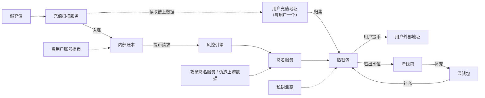
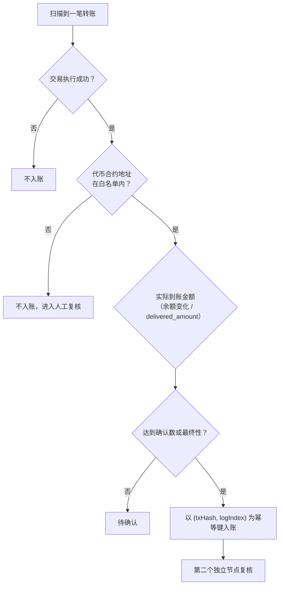
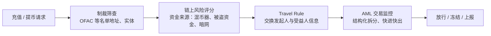
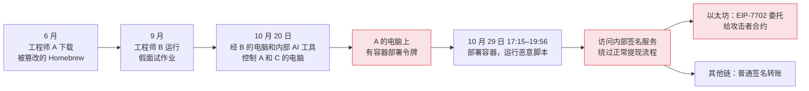

# 23 托管、充提与合规安全：保管者与检查站

> 学习目标：读完本章，你能——
> 1. 说出交易所托管体系（热 / 温 / 冷、归集、充提）的主要攻击面，并找到 CEX 手册对应章节。
> 2. 解释假充值的几种形态，以及充值确认的多源校验。
> 3. 说出制裁筛查、Travel Rule、AML 风控在安全体系中的位置。
> 4. 按 FATF 第 16 项建议和欧盟 TFR 判断 Travel Rule 的门槛。
> 5. 用 CUS-1 至 CUS-13 评估一家交易所的托管、充提和合规链路。
>
> 前置章节：[18 钱包与密钥管理](18-wallet-key-management.md)、[12 跨链桥安全](12-cross-chain-bridges.md)（第 5 节：交易所充值也是一座"桥"）、[25 资金追踪、冻结与事后处置](25-fund-tracing-response.md)
> 交互实验：[address-poisoning-lab.html](interactive/address-poisoning-lab.html)、[wallet-scheme-lab.html](interactive/wallet-scheme-lab.html)、[incident-response-sim.html](interactive/incident-response-sim.html)、[multisig-review-lab.html](interactive/multisig-review-lab.html)
> 姊妹手册：《[CEX 交易所学习手册](../CEX/README.md)》04 钱包与托管、05 账本、09 风控

> 最后核对：2026-11-09
---

## 开场：提现已经暂停，钱还在流出

2026 年 10 月 29 日，Binance 发现大额转账后暂停了提现。按项目方报告，暂停提现没有阻止全部未授权的资产转移。

🤔 先猜再看：交易所暂停了全部提现，也关闭了热钱包服务。以太坊热钱包上已有一个恶意的 EIP-7702 委托。新转入这个地址的资金安全吗？

不安全。委托写在账户的链上代码里，独立于链下服务。在新的授权覆盖或清零它之前，委托合约仍然可以被调用。5.2 节给出公开时间线，[29 章](29-signing-path-2026.md) 4.9 节给出撤销手册。

---

## 1. 一句话理解

**交易所同时扮演两个角色：它是用户资产的保管者，也是链上资金进出法币世界的检查站。保管者的失误让用户丢钱；检查站的失误让赃款洗白，并让交易所自己承担法律责任。**

托管（Custody）：替用户保管私钥和资产。
合规安全（Compliance Security）：制裁筛查、反洗钱、Travel Rule 等以法规为依据的控制。

> 🎯 打个比方：交易所像一座机场。金库（冷钱包）要防盗，登机口（提币）要验票，入境口（充值）要验真伪，安检（AML）要拦住违禁品，边检（制裁筛查）要拦住名单上的人。任何一个口失守，问题都会落到机场头上。
>
> 比喻的局限：机场的旅客走了就走了。链上的资金流向永久公开，监管和执法可以在几年后回头追查每一笔。

本章先讲保管者的一面：托管与充提（§3.1–3.3、§4.1、§5.1–5.2）。再讲检查站的一面：制裁筛查、AML、Travel Rule（§2.2、§3.4、§4.2、§5.3–5.4）。

---

## 2. 分工与威胁模型

### 2.1 与《CEX 交易所学习手册》的分工

| 主题 | 本手册 | CEX 手册 |
|---|---|---|
| 钱包分层、密钥方案 | 安全视角：攻击面与事故（本章、[18 章](18-wallet-key-management.md)） | 业务视角：04 钱包与托管 |
| 充值入账 | 假充值的攻击形态（本章第 3 节） | 05 账本：入账流程与对账 |
| 提币风控 | 攻击者如何绕过（本章第 3 节、[19 章](19-user-scams.md)） | 09 风控：规则引擎与审批 |
| 账户安全 | [22 章](22-physical-account-security.md)、[24 章](24-data-privacy.md) | 03 账户与身份安全 |
| 事故复盘 | [28 章](28-incident-casebook.md)、[25 章](25-fund-tracing-response.md) | 13 可靠性与安全事故 |

### 2.2 合规链路：攻击者能控制什么

2023 年 11 月，Binance 认罪并支付 43 亿美元；2025 年，KuCoin 和 OKX 也认罪无牌汇款（§5.4）。这些案件的代价不来自盗窃，而来自 KYC、AML、制裁筛查的缺失。

| 攻击者 | 能控制什么 | 目标 |
|---|---|---|
| 盗取资金的攻击者 | 被盗资金；混币器；新地址 | 把赃款充进交易所，再提走或换成其他资产 |
| 名单上的人或实体 | 新地址、新账户 | 绕过制裁筛查 |
| 洗钱者 | 拆分金额和进出时机 | 绕过 AML 交易监控 |

- 这些攻击者不需要攻破交易所的系统。他们只需要规则有漏洞。
- 例：2026 年 Binance 事件前一天，攻击者的操作钱包收到 3 笔 Tornado Cash 提款（TRM，见 §5.2）。
- 合规失守的后果有两处：赃款被洗白；交易所承担刑事责任（§5.4）。

---

## 3. 攻击路径

### 3.1 托管体系的攻击面

**读图要点：**

- 四类攻击分别打在四个点上：充值扫描（假充值）、账本（账号被盗）、签名服务（伪造请求）、热钱包（私钥泄露）。
- 签名服务只认"请求是否格式正确"。如果攻击者能伪造上游数据，签名服务会按正常流程签出攻击交易。2026 年 Bitget 和 Binance 事件都是这种形态（见 5.2 节，参考架构见 [29 章](29-signing-path-2026.md) 第 4 节）。
- 局限：图里没有画内部人。内部人可以同时出现在四个点上，见 [21 章](21-social-engineering-insiders.md)。

### 3.2 假充值

假充值（Fake Deposit / False Top-up）：交易所把失败的、伪造的、或实际到账金额不同的转账，记成用户的充值。

| 形态 | 链 | 原因 | 正确做法 |
|---|---|---|---|
| 交易失败但上链 | TRON、EOS、以太坊 | 只判断交易存在，不校验执行状态 | 校验回执状态为成功；EOS 校验不是 `hard_fail` 或延迟交易 |
| 无效交易被入账 | Omni-USDT | 不校验交易的 `valid` 字段 | 只入账 `valid = true` 的交易 |
| 部分支付 | XRP | 读取请求金额 `Amount`，而不是实际到账金额 | 按 `delivered_amount` 入账 |
| 假代币 | 所有支持代币的链 | 按代币名称或符号识别 | 按代币合约地址白名单识别 |
| 内部调用 / 事件伪造 | EVM | 只看 `Transfer` 事件，不看事件来自哪个合约 | 校验事件发出地址；以余额变化交叉核对 |
| 重组回滚 | 所有链 | 确认数不足就入账 | 等待最终性或足够确认数 |

> ⚠️ 警告：充值入账的原则是"以链上执行结果和实际到账金额为准"。只看"交易存在"或"请求金额"，就会产生假充值。

🤔 先猜再看：一笔 XRP 支付的 `Amount` 字段是 100 万 XRP，交易状态是成功。交易所能按 100 万 XRP 入账吗？

不能。部分支付时，实际到账金额可能远小于 `Amount`。交易所要按 `delivered_amount` 入账，同时检查目标地址和目标 Tag。

**读图要点：**

- 每一个判断框都对应上表的一类假充值。
- 最后一步"第二个独立节点复核"：充值扫描只依赖一个 RPC 节点时，节点被篡改或不同步也会造成错账，见 [17 章](17-node-rpc-infrastructure.md)。

### 3.3 提币侧的攻击

1. 攻击者盗取用户账号（钓鱼、SIM 劫持、会话劫持），提交提币。
2. 攻击者把用户的提币地址改成自己的地址（修改白名单、投毒地址）。
3. 攻击者攻破签名服务或其上游，绕过风控直接签名。

### 3.4 合规链路的失效路径

1. 地址或用户在制裁名单上，交易所没有筛查，或名单没有及时更新。交易所为名单上的人提供了服务。
2. 被盗资金经过混币器或若干跳转账后充值。链上风险评分依赖第三方数据，存在漏报。资金被放行。
3. 洗钱者把资金拆成多笔，或快进快出。AML 规则没有覆盖这些模式。
4. Travel Rule 按错误的门槛实施。例如欧盟服务商之间的转账不设最低门槛。系统按 1,000 欧元设计，小额转账就缺少发起人和受益人信息。
5. 执法或发行方的冻结请求没有人及时处理。被盗资金离开交易所，最后一次冻结机会消失。
6. 链上风险评分误报，又没有人工复核和申诉通道。正常用户的资金被错误冻结。

> 💡 注意：失效路径 1–5 让赃款通过检查站。路径 6 让检查站误伤正常用户。两类失效都要计入评估。

---

## 4. 防御方法

### 4.1 托管与充提

| 控制 | 做法 |
|---|---|
| 热钱包水位 | 余额上限按日提币量设定；超出部分自动归集到冷钱包 |
| 分链熔断 | 单链、单币种在短时间内异常流出时自动暂停该链提币 |
| 签名前风控 | 签名服务只接受风控引擎签发的请求；风控引擎与签名服务由不同团队维护 |
| 上游数据校验 | 签名服务独立校验交易目标地址、金额与账本记录，不只信任上游 |
| 提币白名单 | 新增地址冷却期；修改白名单需要二次验证 |
| 地址投毒识别 | 目标地址与用户历史地址首尾相同、中间不同时强提示 |
| 充值多源校验 | 两个独立节点；执行状态、合约地址、实际金额三项校验 |
| 对账 | 链上余额与账本余额按小时对账；差异超阈值自动告警 |

### 4.2 合规安全：制裁筛查、AML、Travel Rule

**读图要点：**

- 制裁筛查（Sanctions Screening）：检查地址和用户是否在制裁名单上，例如美国财政部 OFAC 的 SDN 名单。命中即拦截。
- 链上风险评分：检查资金在若干跳以内是否来自被盗资金、混币器或其他高风险来源。被盗资金进入交易所，是冻结追回的最后机会，见 [25 章](25-fund-tracing-response.md)。
- Travel Rule：虚拟资产服务商之间转账时，必须传递发起人和受益人的身份信息（FATF 第 16 项建议）。
- 局限：链上风险评分依赖第三方数据，存在误报和漏报。规则要有人工复核和申诉通道。

**Travel Rule 的门槛（截至 2026 年公开资料）：**

| 法规 | 门槛 | 要点 |
|---|---|---|
| FATF 第 16 项建议 | 各辖区自定，FATF 建议 1,000 美元 / 欧元 | 2025 年 6 月 FATF 修订第 16 项建议，更名为"支付透明度" |
| 欧盟 TFR（EU）2023/1113 | 服务商之间转账**不设最低门槛** | 2024 年 12 月 30 日起适用；与自托管钱包之间超过 1,000 欧元的转账，需核验钱包归属 |

- FATF 2026 年 7 月的定向更新显示：被调查的 109 个辖区中 91 个已立法，但已生效辖区中约 60% 没有监管或执法行动。
- 来源：[FATF R.16 修订](https://www.fatf-gafi.org/en/publications/Fatfrecommendations/update-Recommendation-16-payment-transparency-june-2025.html)、[荷兰央行 TFR 说明](https://www.dnb.nl/en/sector-information/open-book-supervision/open-book-supervision-themes/supervision-of-financial-crime-prevention-integrity-supervision/transfer-of-funds-regulation-tfr/)、[Regulation Tomorrow（FATF 2026 定向更新）](https://www.regulationtomorrow.com/2026/07/fatf-publishes-targeted-update-on-implementation-of-the-fatf-standards-on-virtual-assets-and-virtual-asset-service-providers/)

> 💡 注意：合规不是法务部门单独的事。制裁筛查和 AML 规则跑在充提链路上，和风控引擎是同一套系统。它们的规则被绕过，与提币风控被绕过一样，是安全事故。

---

## 5. 真实案例

> 💡 注意：以下每个案例只写摘要和教训。完整复盘见《[Web3 行业安全资损 101](../web3-loss-101/index.html)》。金额为事发时美元估值。

### 5.1 假充值的公开披露（2018–2024）

- **Omni-USDT（2018 年 6 月）**：SlowMist 预警部分交易所没有校验交易的 `valid` 字段，把无效交易也入了账。Omni 和 Tether 定性为交易所集成问题。来源：[SlowMist 假充值综述](https://slowmist.medium.com/how-does-the-false-top-up-attack-break-through-the-defense-of-the-exchange-d6e8ebb434f5)、[Cointelegraph](https://cointelegraph.com/news/recently-found-double-spending-vulnerability-is-not-tether-s-own-slowmist-confirms)。
- **EOS（2019 年 3 月）**：SlowMist 披露 `hard_fail` 状态和延迟交易手法：项目方只判断交易是否存在，没有校验执行状态。来源：[SlowMist](https://slowmist.medium.com/hard-fail-status-attack-for-eos-7cfa73ae7d4b)。
- **XRP 部分支付（2024 年 1 月）**：有人向 Bitfinex 发起名义金额约 150 亿美元的部分支付，实际到账约 0.001 美元。Bitfinex 按 `delivered_amount` 入账，攻击没有成功。来源：[XRPL 文档](https://xrpl.org/docs/concepts/payment-types/partial-payments/)、[Cointelegraph](https://cointelegraph.com/news/unknown-wallet-xrp-transfer-bitfinex-partial-payments-exploit)。
- 教训：每接入一条新链，都要按该链的交易模型重新设计入账校验，不能照搬以太坊的逻辑。TRON 上失败交易的处理见 [C02](chains/C02-tron.md)。

### 5.2 交易所热钱包被盗（2023–2026）

| 时间 | 交易所 | 金额（约） | 公开原因 | 归因 | 来源 |
|---|---|---|---|---|---|
| 2023-09 | CoinEx | 5,400 万美元 | 私钥泄露（项目方） | 链上分析指向 Lazarus（Elliptic 等） | [Elliptic](https://www.elliptic.co/blog/how-the-lazarus-group-is-stepping-up-crypto-hacks-and-changing-its-tactics)、[The Record](https://therecord.media/coinex-confirms-hack-after-31-million-allegedly-stolen) |
| 2024-09 | BingX | 4,300–4,700 万美元 | 未详细公开 | 无官方归因 | [The Block](https://www.theblock.co/post/317448/)、[Security Affairs](https://securityaffairs.com/168703/cyber-crime/hackers-stole-44m-from-bingx.html) |
| 2025-01 | Phemex | 约 7,000 万美元 | 未公开 | 业界怀疑 Lazarus；资金后来与 Bybit 被盗资金混同 | [The Block](https://www.theblock.co/post/336754/)、[Halborn](https://www.halborn.com/blog/post/explained-the-phemex-hack-january-2025) |
| 2026-09 | Bitget | 约 3.875 亿美元 | 攻击者利用第三方安全产品的零日漏洞拿到内部高权限凭证，向钱包后台插入伪造的提现指令；项目方称已排除私钥泄露 | CEO 称 IP 指向朝鲜团体，取证报告未确认；Elliptic 把它与 Binance 事件关联 | [BleepingComputer](https://bleepingcomputer.com/news/security/bitget-hacked-via-zero-day-in-third-party-security-products)、[Cointelegraph](https://cointelegraph.com/news/bitget-hack-zero-day-slowmist-investigation) |
| 2026-10 | Binance | 约 63.4 亿美元（项目方）；TRM 63.6 亿；Elliptic 64.3 亿 | 员工终端失陷 → 窃取部署令牌 → 访问内部签名服务 → EIP-7702 委托（详见下文） | FBI 归因于朝鲜 TraderTraitor；朝鲜官方否认 | [Binance 初步报告](https://www.linkedin.com/pulse/29-october-binance-security-incident-initial-findings-response-modgf/)、[TRM](https://www.trmlabs.com/resources/blog/north-korea-steals-usd-6-36-billion-from-binance-in-the-largest-hack-in-history)、[Elliptic](https://www.elliptic.co/insights/binance-largest-hack-in-history/) |
| 2026-11 | Mercado Bitcoin | 约 4,900 万美元（Chainalysis，早期报道 3,800–4,600 万） | 未公开；初步分析指向可授权交易的凭证失控 | 无官方归因 | [Cointelegraph](https://cointelegraph.com/news/mercado-bitcoin-hack)、[Bitcoin.com](https://news.bitcoin.com/mercado-bitcoin-vows-to-cover-customer-losses-after-massive-hack/) |

- Bitget 的数字：早期报道 3.516 亿美元，后续更新到约 3.875 亿美元；用户保护基金全额覆盖。受影响的安全产品没有公开名称。SlowMist 记录的最早恶意活动是 8 月 31 日，Bitget 和 Mandiant 把高权限访问定在 9 月 24 日，两种说法尚未统一。SlowMist 称定制工具伪造风控参数后构造提现请求，事后被删除；同时记录 2 笔伪造的 BTC 订单返回错误（[Cointelegraph](https://cointelegraph.com/news/bitget-hack-zero-day-slowmist-investigation)）。Mandiant 称，9 月 24 日攻击者获得两台第三方安全设备的特权访问，部署 Web Shell，再横向移动到生产钱包作业服务器（[BleepingComputer](https://bleepingcomputer.com/news/security/bitget-hacked-via-zero-day-in-third-party-security-products)）。
- Mercado Bitcoin 称只有热钱包受影响，损失由公司自有资金承担；约 1,100 万美元已被冻结。
- 截至 2026-11-09，以上三起事件都没有最终的第三方调查报告。
- 教训：
  - 早期链上估值普遍偏低，对外沟通不要过早给出最终数字。
  - 签名流程能被伪造的上游数据驱动时，冷热隔离和私钥保护都挡不住。签名服务必须独立校验请求。
  - 多链热钱包被批量清空时，需要分链熔断。

#### Binance 热钱包事件（2026 年 10 月 29 日）

这是有记录以来最大的加密资产盗窃案。下面的路径来自 Binance 11 月 3 日的初步报告。链上时间来自 TRM 和 Elliptic。完整复盘见[《Web3 行业安全资损 101》](https://claude.ai/artifact/1a5Nx6xTVLuJdCB8Esf2xj#c-binance)。

**读图要点：**

- 红色节点是决定性环节。开发终端上的长期部署令牌，把终端失陷变成了生产环境失陷。
- 6 月的事件已被发现并处置。报告没有确认 6 月到 10 月之间存在持续访问。
- Binance 称没有发现私钥泄露的证据。攻击者不需要私钥，它让签名服务代为签名。
- 局限：这是初步报告。告警时间、提现暂停的具体时间、内部 AI 工具被利用的机制、部署令牌的完整权限都没有公开。

| 时间（UTC） | 事件 | 来源 |
|---|---|---|
| 10-28 上午 | 操作钱包收到 3 笔 Tornado Cash 提款，开始准备 | TRM |
| 10-29 20:05–20:09 | 5 个 XRP Ledger 热钱包转出 2.3346 亿 XRP | Binance、TRM |
| 20:20 | 比特币热钱包转出 18,270 BTC；以太坊上的委托交易提交 | TRM |
| 约 20:23 | 委托生效约 3 分 24 秒后，攻击者清空以太坊热钱包（Elliptic 记录约 25.3 亿美元在 20:24 转出） | TRM、Elliptic |
| 21:01 / 21:04 | Tether 冻结 9.711 亿 USDT；Circle 冻结 8.23 亿 USDC | TRM |
| 23:56 | 最后一笔未授权转账完成 | Binance |
| 10-30 00:10 | Binance 把委托清零，恶意委托在链上存活约 3 小时 50 分 | Binance |
| 10-31 23:55 | FBI 归因于朝鲜 TraderTraitor | [FBI](https://www.fbi.gov/investigate/cyber/alerts/2026/north-korea-responsible-for-6-billion-binance-attack)、Elliptic |
| 11-01 06:00 | 提现开始分批恢复 | Elliptic |

- 影响范围：10 条链。约 37.9 亿美元在以太坊，约 14.7 亿美元在比特币，约 6.28 亿美元在 TRON（TRM 口径）。
- 冻结或拦截：约 28.5 亿美元（Binance 口径，待对账；Elliptic 也核实到 28.5 亿）。BTC、XRP、SOL 等原生资产无法由发行方冻结。
- 用户资产：Binance 称由自身承担损失，并称截至 10 月 31 日已补足 98% 的受影响代币。这是项目方自报。**补足不等于追回。**
> 🧪 动手验证：打开[热钱包应急演练](interactive/incident-response-sim.html)，先不勾选事前控制。第 ② 步选"暂停用户提现"，第 ③ 步选"再暂停一层提现，并关闭热钱包服务"。记录"⚠️ 委托有效"标记，再查看复盘页"公开时间线对比"中"委托清零"一行。

- 💡 两处说法不同：TRM 描述为 50 个 EIP-7702 授权，Binance 描述为 50 笔操纵 nonce 并设置委托的签名交易。金额也按估值时点和统计口径不同而有差异。
- 教训：
  - 开发终端不能持有可直达生产的长期凭证。部署令牌要短期、绑定设备，并要求第二人批准。
  - 签名服务要独立校验每个请求的来源，只为账本中存在的提现订单签名。策略要覆盖全部交易类型，包括 EIP-7702 授权。
  - 暂停提现不等于撤销权限。Binance 报告称，已设置的委托独立于提现系统继续有效。
  - MPC 钱包没有一把可以立刻发交易的单独私钥。紧急撤销流程要提前写好并演练。
  - 陌生代码只在一次性环境中运行。内部 AI 工具按有执行权限的系统来管理。
  - 这些教训对应的参考架构和 SIG 检查项见 [29 章](29-signing-path-2026.md) 第 4、6 节。

### 5.3 Tornado Cash：制裁、撤销与刑事案件（2022–2026）

| 时间 | 事件 |
|---|---|
| 2022-08 | 美国财政部 OFAC 制裁 Tornado Cash，称其协助洗钱，包括 Lazarus 从 Ronin 盗取的资金 |
| 2024-11 | 美国第五巡回上诉法院在 Van Loon 案中裁定：不可变智能合约不属于制裁法下的"财产" |
| 2025-03 | 财政部把 Tornado Cash 从制裁名单移除；联合创始人之一 Roman Semenov 个人仍在名单上 |
| 2025-08 | 开发者 Roman Storm 被陪审团裁定共谋经营无牌汇款业务罪名成立；洗钱和违反制裁两项未达成一致 |
| 2026-08 | 法官把未决罪名的重审推迟到 2027 年 4 月；尚未量刑 |
| 2024-05 起 | 另一名开发者 Alexey Pertsev 在荷兰被判 64 个月，正在上诉，2025 年起在电子监控下获释 |

- 来源：[美国财政部新闻稿](https://home.treasury.gov/news/press-releases/jy1087)、[Mayer Brown（第五巡回法院判决分析）](https://www.mayerbrown.com/en/insights/publications/2024/12/federal-appeals-court-tosses-ofac-sanctions-on-tornado-cash-and-limits-federal-governments-ability-to-police-crypto-transactions)、[Willkie（制裁撤销）](https://complianceconcourse.willkie.com/articles/united-states-removes-economic-sanctions-against-tornado-cash/)、[The Block（Storm 重审日期）](https://www.theblock.co/news/regulation/2026-08-26-tornado-cash-roman-storm-retrial-april-2027-412761)
- 教训：制裁撤销不等于风险消失。交易所对混币器来源的资金，仍要按风险评分和 AML 规则处理。

### 5.4 交易所 AML 执法（2023–2025）

| 时间 | 交易所 | 金额 | 要点 | 来源 |
|---|---|---|---|---|
| 2023-11 | Binance | 43 亿美元 | 认罪：违反银行保密法、无牌汇款、违反制裁法；创始人个人认罪并卸任 CEO | [美国司法部](https://www.justice.gov/criminal/case/united-states-v-changpeng-zhao) |
| 2025-01 | KuCoin | 2.97 亿美元以上 | 认罪无牌汇款；退出美国市场至少 2 年 | [美国司法部纽约南区](https://www.justice.gov/usao-sdny/pr/kucoin-pleads-guilty-unlicensed-money-transmission-charge-and-agrees-pay-penalties) |
| 2025-02 | OKX | 5.04 亿美元以上 | 认罪无牌汇款 | [美国司法部纽约南区](https://www.justice.gov/usao-sdny/pr/okx-pleads-guilty-violating-us-anti-money-laundering-laws-and-agrees-pay-penalties) |

- 教训：KYC、AML、制裁筛查的缺失，最终会以刑事责任的形式回到交易所。

---

## 6. 评估检查点

**托管与充提：**

- [ ] **CUS-1** 热钱包有余额上限和自动归集；有分链熔断。
- [ ] **CUS-2** 签名服务独立校验请求的目标地址和金额，不只信任上游系统。
- [ ] **CUS-3** 风控引擎与签名服务由不同团队维护，变更需要双人审批。
- [ ] **CUS-4** 每条链的入账逻辑校验执行状态、代币合约地址、实际到账金额、确认数。
- [ ] **CUS-5** XRP 按 `delivered_amount` 入账；EOS 排除 `hard_fail` 和延迟交易；Omni 校验 `valid`。
- [ ] **CUS-6** 充值扫描使用至少两个独立节点。
- [ ] **CUS-7** 链上余额与账本按小时对账。
- [ ] **CUS-8** 提币白名单有冷却期；修改需要二次验证。

**合规安全：**

- [ ] **CUS-9** 充提链路接入制裁名单筛查，名单每日更新。
- [ ] **CUS-10** 有链上风险评分，并有人工复核和申诉流程。
- [ ] **CUS-11** Travel Rule 按展业辖区的门槛实施；欧盟业务按无门槛设计。
- [ ] **CUS-12** AML 规则覆盖拆分、快进快出、与高风险地址的交互。
- [ ] **CUS-13** 收到执法冻结请求时，有 24 小时内响应的流程和值班人。

**把检查结果写进报告：**

| 检查项 | 发现时的证据 | 常见定级（用 [A02](assessment/A02-risk-rating-reporting.md) 复核） | 练习位置 |
|---|---|---|---|
| CUS-1 | 水位配置；熔断演练记录 | 高 | [热钱包应急演练](interactive/incident-response-sim.html) |
| CUS-2、CUS-3 | 绕过风控的测试请求；变更审批记录 | 严重 / 高 | [29 章](29-signing-path-2026.md) SIG-1 至 SIG-9 |
| CUS-4、CUS-5、CUS-6 | 每条链的入账逻辑；假充值测试 | 严重 / 高 | [C02 TRON](chains/C02-tron.md)、[A03](assessment/A03-exchange-contracts-wallets.md) |
| CUS-7、CUS-8 | 对账记录；白名单修改日志 | 高 / 中 | [地址投毒比对](interactive/address-poisoning-lab.html) |
| CUS-9、CUS-10、CUS-11、CUS-12 | 筛查日志；规则覆盖清单 | 高 / 中 | [A05](assessment/A05-listing-due-diligence.md) |
| CUS-13 | 冻结请求处理记录 | 高 / 中 | [25 章](25-fund-tracing-response.md)、[热钱包应急演练](interactive/incident-response-sim.html) |

发现按 [T03 报告模板](templates/T03-finding-report.md) 记录。

---

## 7. 用户侧防护

1. 充值前确认交易所支持的代币合约地址和网络。用错网络或假代币，交易所不会入账。
2. 开启提币白名单和新地址冷却期。
3. 提币地址从地址簿选择，不从交易记录复制。
4. 不要把来源不明的资金充入交易所账户。交易所可能冻结资金并要求说明来源。
5. 交易所要求你补充资金来源或 Travel Rule 信息时，从官方 App 内处理，不点邮件或短信里的链接。

---

## 8. 术语表

| 术语 | 英文 | 定义 |
|---|---|---|
| 托管 | Custody | 替用户保管私钥和资产 |
| 归集 | Sweeping | 把用户充值地址的资产集中到热钱包或冷钱包 |
| 水位 | Watermark | 热钱包允许的余额区间 |
| 假充值 | Fake Deposit / False Top-up | 交易所把失败、伪造或金额不符的转账记为充值 |
| 部分支付 | Partial Payment | XRP 中实际到账金额可能小于 `Amount` 字段的支付 |
| 制裁筛查 | Sanctions Screening | 检查地址和用户是否在制裁名单上 |
| 反洗钱 | AML | 识别和报告可疑资金流动的控制体系 |
| 分链熔断 | Per-chain Circuit Breaker | 单链异常流出时自动暂停该链提币 |
| 合规安全 | Compliance Security | 制裁筛查、反洗钱、Travel Rule 等以法规为依据的控制 |
| Travel Rule | Travel Rule | 服务商之间转账时传递发起人和受益人信息的规则 |
| 虚拟资产服务商 | VASP / CASP | 提供虚拟资产交易、托管、转账服务的机构 |

---

> 🪞 反思：想一想你所在的交易所或你使用的托管方。
> 1. 哪些路径能让一笔资金转出，却不经过提现接口？
> 2. 暂停提现之后，你要到哪里确认链上授权已经清除？
> 3. 第一份发行方冻结请求，今晚能在多少分钟内发出？
> 4. 制裁名单多久更新一次？更新之前放行的交易，谁来回查？链上风险评分误报时，用户从哪里申诉、谁来复核？

## 9. 思考题

1. 你的交易所要接入一条新的非 EVM 链。按本章 3.2 节的表格，你要先问清楚这条链的哪四个问题？
2. Bitget 2026 年事件的公开说明称"已排除私钥泄露"。那么热钱包的哪一层控制失效了？你会怎么设计签名服务的独立校验？
3. 一笔充值的资金 3 跳以前来自一起公开的被盗事件。你的系统应该放行、冻结还是人工复核？依据是什么？
4. 你的交易所在欧盟展业。一位用户向另一家服务商转出 500 欧元，另一位用户向自己的自托管钱包转出 2,000 欧元。按欧盟 TFR，这两笔转账分别要做什么？
5. Tornado Cash 已在 2025 年 3 月被移出制裁名单。一笔来自 Tornado Cash 的充值，你的系统能直接放行吗？

下一章：[24 数据与隐私](24-data-privacy.md) —— 泄露的数据会变成攻击。
