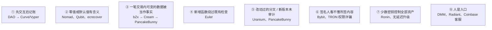

# 28 事故案例库：同样的错误，换个名字再来一次

> 学习目标：读完本章，你能——
> 1. 按"根因类别 + 链"检索 60 余起代表性事故（含链下、NFT 与 GameFi），并说出每起事故对应的防御章节。
> 2. 识别反复出现的 8 种事故模式。
> 3. 用统一模板写一份事故复盘。
>
> 前置章节：01–27 章
> 交互实验：[incident-explorer.html](interactive/incident-explorer.html)

---

## 1. 一句话理解

**大多数事故不是新漏洞，而是旧漏洞在新环境里复发：新链、新分叉、新版本、新的组合方式。**

> 🎯 打个比方：航空业把每一起事故都写成公开报告，所以今天的飞行员不会再犯 1970 年代的错误。
> 合约安全也有自己的"事故报告"——项目复盘、安全公司分析、链上数据。读事故报告，是成本最低的安全训练。
>
> 比喻的局限：航空事故调查由独立机构完成，结论有权威性。合约事故的复盘多数由项目方或安全公司发布，细节可能不完整，归因可能存在争议。本章只采用多方公开资料一致的事实。

---

## 2. 事故总表

金额为事发时美元估值约数；来源类型为项目方复盘、安全公司分析和主流媒体报道。

### 2.1 以太坊与多链

以太坊案例的根因代码与攻击路径深潜见 [C00 以太坊案例深潜](chains/C00-ethereum.md)。

| 时间 | 事故 | 链 | 约损失 | 根因类别 | 一句话根因 | 章节 |
|---|---|---|---|---|---|---|
| 2016-06 | The DAO | 以太坊 | 6,000 万美元 | 重入 | 先转账后更新余额 | [04](04-reentrancy.md) |
| 2017-07 | Parity 多签（一） | 以太坊 | 3,000 万美元 | 初始化 / 权限 | `initWallet` 可经 delegatecall 被任何人调用 | [05](05-access-control.md) |
| 2017-11 | Parity 多签（二） | 以太坊 | 约 51 万 ETH 冻结 | 初始化 / 权限 | 未初始化的库被接管并自毁 | [05](05-access-control.md)、[10](10-upgradeable-proxy.md) |
| 2018-04 | BEC batchOverflow | 以太坊 | 代币价值归零 | 算术 | `cnt * _value` 溢出 | [06](06-arithmetic-precision.md) |
| 2020-02 | bZx | 以太坊 | 约 95 万美元（两次） | 预言机操纵 | 单一 DEX 价格 | [08](08-oracle-flashloan.md) |
| 2020-10 | Harvest Finance | 以太坊 | 3,380 万美元（归还 250 万美元） | 预言机操纵 | 金库份额价格依赖 Curve 池内价格 | [08](08-oracle-flashloan.md)、[C00](chains/C00-ethereum.md) |
| 2021-08 | Poly Network | 多链 | 6.1 亿美元（已归还） | 跨链验证 | 跨链消息调用特权函数（选择器碰撞） | [12](12-cross-chain-bridges.md) |
| 2021-09 | Compound 提案 62 | 以太坊 | 最多约 28 万 COMP（约 8,000 万美元）面临错误发放 | 升级与应急权限 | 升级引入奖励 bug，无紧急开关，修复需 7 天治理 | [10](10-upgradeable-proxy.md)、[C00](chains/C00-ethereum.md) |
| 2021-10 | Cream Finance | 以太坊 | 1.3 亿美元 | 预言机操纵 | 份额价格可被捐赠抬高 | [08](08-oracle-flashloan.md) |
| 2022-02 | Wormhole | Solana ↔ 以太坊 | 3.2 亿美元 | 跨链验证 | 签名验证账户未校验 | [12](12-cross-chain-bridges.md) |
| 2022-04 | Beanstalk | 以太坊 | 1.8 亿美元 | 治理攻击 | 闪电贷投票 + 同交易执行 | [11](11-defi-economic-security.md) |
| 2022-04 | Inverse Finance | 以太坊 | 1,560 万美元 | 预言机操纵 | 自有资金持续操纵浅池 TWAP（非闪电贷） | [08](08-oracle-flashloan.md)、[C00](chains/C00-ethereum.md) |
| 2022-04 | Fei Rari | 以太坊 | 8,000 万美元 | 重入 | 先 call 发送 ETH 后记账；exitMarket 未被锁覆盖 | [04](04-reentrancy.md)、[C00](chains/C00-ethereum.md) |
| 2022-04 | Akutars NFT | 以太坊 | 11,539.5 ETH 永久锁定 | 外部调用 / 逻辑 | 推送退款可 DoS；提款条件比较了错误变量 | [07](07-external-calls-tokens.md)、[C00](chains/C00-ethereum.md) |
| 2022-08 | Nomad | 多链 | 1.9 亿美元 | 初始化 | 可信根被设为 0x00 | [10](10-upgradeable-proxy.md) |
| 2023-03 | Euler Finance | 以太坊 | 1.97 亿美元（大部分归还） | 业务逻辑 | 捐赠函数缺少健康检查 | [11](11-defi-economic-security.md) |
| 2023-04 | Sushi RouteProcessor2 | 以太坊等 14 条链 | 330 万美元 | 访问控制 / 外部调用 | 用户可控池子地址 + 回调付款人可伪造 | [07](07-external-calls-tokens.md)、[C00](chains/C00-ethereum.md) |
| 2023-07 | Curve / Vyper | 以太坊 | 7,000 万美元 | 编译器 | 编译器重入锁实现错误 | [04](04-reentrancy.md)、[27](27-audit-testing-workflow.md) |
| 2023-11 | KyberSwap Elastic | 以太坊等多链 | 约 5,620 万美元（受影响资产，官方口径） | 算术精度 | 舍入方向与注释相反，tick 跨越被误判 | [06](06-arithmetic-precision.md)、[C00](chains/C00-ethereum.md) |
| 2024-09 | Penpie | 以太坊 | 2,700 万美元 | 重入 | 无许可市场 + 领奖函数无锁 | [04](04-reentrancy.md)、[C00](chains/C00-ethereum.md) |
| 2025-11 | Balancer V2 | 多链 | 约 9,480 万美元（项目方；早期报道约 1.28 亿） | 算术精度 | batchSwap 舍入误差被累积 | [06](06-arithmetic-precision.md) |
| 2025 | EIP-7702 委托钓鱼 | 以太坊 | 单个钱包近 15 万美元（案例） | 前端与签名 | 诱导签署委托，清扫合约转走资产 | [09](09-mev-signatures.md)、[C00](chains/C00-ethereum.md) |

Ronin、WazirX、Bybit 的根因在链下，列在 2.5 节。

### 2.2 BNB Chain

| 时间 | 事故 | 约损失 | 根因类别 | 一句话根因 | 章节 |
|---|---|---|---|---|---|
| 2021-04 | Uranium Finance | 5,000 万美元 | 算术 | 分叉 Uniswap V2 改手续费时漏改常数，k 检查失效 | [06](06-arithmetic-precision.md)、[C01](chains/C01-bnb-chain.md) |
| 2021-05 | PancakeBunny | 4,500 万美元 | 预言机操纵 | 按池储备给 LP 定价并铸造奖励 | [08](08-oracle-flashloan.md)、[C01](chains/C01-bnb-chain.md) |
| 2021-05 | Venus（XVS） | 坏账 9,500 万美元以上 | 经济设计 | 低流动性治理代币作抵押 | [11](11-defi-economic-security.md)、[C01](chains/C01-bnb-chain.md) |
| 2022-01 | Qubit Bridge | 8,000 万美元 | 外部调用 / 跨链 | 对 address(0) 的 safeTransferFrom 返回成功 | [07](07-external-calls-tokens.md)、[C01](chains/C01-bnb-chain.md) |
| 2022-05 | Venus（LUNA） | 1,100 万美元 | 预言机 | 喂价触底熔断仍被使用 | [08](08-oracle-flashloan.md) |
| 2022-10 | BSC Token Hub | 增发 200 万 BNB（约 5.7 亿美元），1 亿多美元转出 | 跨链验证 | IAVL 证明验证缺陷 | [12](12-cross-chain-bridges.md)、[C01](chains/C01-bnb-chain.md) |

### 2.3 TRON

本手册收集的 TRON 案例集中在**账户层、集成层**，而不是单个协议的合约漏洞：

| 类型 | 事实来源 | 根因 | 章节 |
|---|---|---|---|
| 账户权限篡改（"多签诈骗"） | 慢雾、imToken、SafePal 等公开安全提示 | TRON 原生账户权限可被私钥持有者修改 | [05](05-access-control.md)、[C02](chains/C02-tron.md) |
| USDT 推送转账回滚 | OpenZeppelin 2026 年 TRON 部署审计 | TRON USDT `transfer` 成功也返回 false | [07](07-external-calls-tokens.md)、[C02](chains/C02-tron.md) |
| 失败交易被误认为到账 | 用户与交易所案例报道 | 只检查交易存在，不检查执行结果 | [12](12-cross-chain-bridges.md)、[C02](chains/C02-tron.md) |
| 授权钓鱼 / 地址投毒 | 多家钱包安全月报 | 诱导签名授权；伪造相似地址的转账记录 | [07](07-external-calls-tokens.md)、[C02](chains/C02-tron.md) |

### 2.4 Mantle

| 时间 | 事件 | 性质 | 要点 | 章节 |
|---|---|---|---|---|
| 2024-04 | Mantle op-geth 审计（OpenZeppelin） | 审计发现 | 3 个严重问题均已修复，包括一个可无限铸造 BVM_ETH 的余额检查缺陷 | [C03](chains/C03-mantle.md) |
| 2025-02 | mETH 协议追回 cmETH | 防御成功 | 8 小时提款延迟 + 暂停 → 追回 15,000 cmETH（约 4,300 万美元） | [11](11-defi-economic-security.md)、[C03](chains/C03-mantle.md) |
| 持续 | L2BEAT 风险评估 | 信任假设 | 无延迟升级、中心化排序器、可切换乐观模式 | [10](10-upgradeable-proxy.md)、[C03](chains/C03-mantle.md) |

> 💡 注意：没有出现在表里，不代表没有发生。本表只收录本手册能用公开资料核实的事件。

### 2.5 链下与运营事故

> 💡 注意：本表更新到 2026 年 11 月 9 日。最近几起事件仍在调查，金额和根因可能变化。

代码之外的事故。每一起的摘要、来源和教训在对应章节的"真实案例"中。

| 时间 | 事故 | 约损失 | 根因类别 | 一句话根因 | 章节 |
|---|---|---|---|---|---|
| 2021-12 | BadgerDAO | 1.2 亿美元 | 前端 / CDN | CDN 账号 API Key 被用于注入授权脚本 | [20](20-frontend-dns-supply-chain.md) |
| 2022-03 | Ronin | 6.2 亿美元 | 社工 → 验证者私钥 | 9 个验证者中 5 个被控制 | [12](12-cross-chain-bridges.md)、[05](05-access-control.md)、[21](21-social-engineering-insiders.md) |
| 2022-08 | Slope 钱包 | 410 万美元 | 密钥存储 | 助记词写入日志服务 | [18](18-wallet-key-management.md) |
| 2022-09 | Wintermute | 1.6 亿美元 | 密钥生成 | 靶号工具只有 32 位种子 | [02](02-cryptography-randomness.md)、[18](18-wallet-key-management.md) |
| 2022-11 | FTX 破产当天被盗 | 4 亿美元以上 | SIM 卡劫持 | 员工手机号被劫持（起诉书） | [22](22-physical-account-security.md) |
| 2023-07 | Multichain | 1.26 亿美元 | 密钥集中 | MPC 节点全部在 CEO 个人云账户 | [18](18-wallet-key-management.md) |
| 2023-12 | Ledger Connect Kit | 60 万美元 | npm 供应链 | 离职员工的 npm 权限未回收 | [20](20-frontend-dns-supply-chain.md) |
| 2024-05 | DMM Bitcoin | 3.05 亿美元 | 社工 → 供应商 | 假招聘测试题控制供应商员工终端 | [21](21-social-engineering-insiders.md) |
| 2024-07 | WazirX | 2.3 亿美元 | 签名界面 | 签名人看到的与签下的不一致 | [18](18-wallet-key-management.md)、[09](09-mev-signatures.md)、[C00](chains/C00-ethereum.md) |
| 2024-10 | Radiant Capital | 5,000 万美元 | 社工 → 签名终端 | 伪装成 PDF 的后门控制 3 名开发者设备 | [21](21-social-engineering-insiders.md) |
| 2025-02 | Bybit | 约 15 亿美元（FBI 口径） | 前端被精准篡改 | 多签前端 JS 只对目标地址生效，签名人盲签 delegatecall | [20](20-frontend-dns-supply-chain.md)、[09](09-mev-signatures.md)、[25](25-fund-tracing-response.md) |
| 2025-05 | Coinbase 客服 | 预估成本 1.8–4 亿美元 | 内部人 / 数据 | 外包客服被收买导出用户数据 | [21](21-social-engineering-insiders.md)、[24](24-data-privacy.md) |
| 2025-07 | CoinDCX | 4,400 万美元 | 社工 | "兼职"诱饵让员工在公司电脑上装恶意软件 | [21](21-social-engineering-insiders.md) |
| 2025-12 | Trust Wallet 扩展 | 850 万美元 | 发布凭证 | 泄露的 CI secrets 被用于发布恶意版本 | [18](18-wallet-key-management.md)、[20](20-frontend-dns-supply-chain.md) |
| 2025-12 | 地址投毒 | 5,000 万美元 USDT | 用户操作 | 测试转账后从记录复制了投毒地址 | [19](19-user-scams.md) |
| 2026-06 | SecondFi | 240 万美元 | 签名实现 | Ed25519 nonce 可由公开数据算出 | [02](02-cryptography-randomness.md) |
| 2026-04 | Drift（Solana） | 2.85 亿美元 | 社工 → 预签名 | 2-of-5 多签无时间锁，持久 nonce 让预签审批长期有效 | [13](13-non-evm-ecosystems.md)、[21](21-social-engineering-insiders.md) |
| 2026-04 | KelpDAO rsETH | 2.92 亿美元 | 跨链验证 / RPC | 单一 DVN 依赖的 RPC 节点被替换，伪造跨链消息 | [12](12-cross-chain-bridges.md)、[17](17-node-rpc-infrastructure.md) |
| 2026-09 | Liquid 侧链 | 3.19 亿美元（约 85% 归还） | 验证软件 | Elements 缺陷（第三方重建）让无担保 L-BTC 被提现 | [13](13-non-evm-ecosystems.md) |
| 2026-09 | Bitget | 约 3.875 亿美元 | 第三方零日 → 签名流程 | 安全产品零日泄露内部凭证，伪造提现指令 | [23](23-custody-exchange-ops.md) |
| 2026-10 | **Binance** | **约 63.4 亿美元** | 社工 → 部署令牌 → 签名服务 | 员工终端失陷后控制签名服务，以太坊热钱包被 EIP-7702 委托 | [23](23-custody-exchange-ops.md)、[15](15-account-abstraction-wallets.md)、[21](21-social-engineering-insiders.md)、[25](25-fund-tracing-response.md) |
| 2026-11 | Mercado Bitcoin | 约 4,900 万美元 | 未公开 | 多条链的热钱包被清空，原因未公布 | [23](23-custody-exchange-ops.md) |

### 2.6 NFT 与 GameFi

| 时间 | 事故 | 链 | 约损失 | 一句话根因 | 来源 | 章节 |
|---|---|---|---|---|---|---|
| 2022-02 | OpenSea 钓鱼 | 以太坊 | 170 万美元 | 合约迁移期间，钓鱼邮件骗取有效的旧挂单签名 | [Decrypt](https://decrypt.co/93371/opensea-ceo-devin-finzer-responds-1-7-million-phishing-attack)、[CertiK](https://www.certik.com/resources/blog/5MD9CAlW6KwmWHftgHedRR-opensea-phishing-incident-analysis) | [19](19-user-scams.md) |
| 2022-04 / 06 | BAYC Instagram、Discord | 以太坊 | 280 万美元 / 约 200 ETH | 官方社交账号被接管，发布假空投链接 | [The Block](https://www.theblock.co/post/143328/bored-ape-instagram-account-hacked-nfts-worth-2-8-million-stolen)、[TRM](https://www.trmlabs.com/post/bayc-instagram-hack-possible-nft-scam-as-a-service-operation) | [22](22-physical-account-security.md) |
| 2022-07 | Premint | 以太坊 | 约 40 万美元 | 网站被注入脚本，把 `setApprovalForAll` 伪装成"验证钱包" | [SlowMist](https://slowmist.medium.com/analysis-of-premint-malicious-code-injection-4051976fd201) | [20](20-frontend-dns-supply-chain.md) |
| 2023-12 | NFT Trader | 以太坊 | 约 300 万美元 | 已弃用旧合约的重入漏洞 + 用户从未撤销的授权 | [Halborn](https://www.halborn.com/blog/post/explained-the-nft-trader-hack-december-2023)、[Revoke.cash](https://revoke.cash/exploits/nfttrader) | [04](04-reentrancy.md)、[07](07-external-calls-tokens.md) |
| 2024-02 | PlayDapp | 以太坊 | 名义约 2.9 亿美元 | 泄露的部署者私钥添加新铸币者，增发约 17.9 亿 PLA | [The Block（引用 Elliptic）](https://www.theblock.co/post/277334/crypto-gaming-platform-playdapp-loses-290-million-worth-of-tokens-in-two-exploits-elliptic) | [05](05-access-control.md)、[18](18-wallet-key-management.md) |
| 2024-03 | Munchables | Blast | 约 6,250 万美元（已全部归还） | 内鬼开发者在可升级合约中预留余额操纵 | [Cointelegraph](https://cointelegraph.com/news/munchables-hacker-returns-ether-without-ransom)、[Blockworks](https://blockworks.co/news/blast-dapp-exploit-inside-job) | [10](10-upgradeable-proxy.md)、[21](21-social-engineering-insiders.md) |
| 2024-05 | Gala Games | 以太坊 | 套现约 2,200 万美元（已退回） | 有铸币权的管理员钱包增发 50 亿 GALA；黑名单冻结约 44 亿枚 | [Decrypt](https://decrypt.co/231698/gala-games-attacker-returns-ethereum-240-million-exploit) | [05](05-access-control.md) |
| 2025-02 | WEMIX Play Bridge | WEMIX | 约 610 万美元 | 认证密钥被盗；公司 4 天后才公告 | [Halborn](https://www.halborn.com/blog/post/explained-the-wemix-hack-march-2025)、[Cointelegraph](https://cointelegraph.com/news/wemix-ceo-denies-hack-coverup-wemix-token-falls-39-percent) | [12](12-cross-chain-bridges.md)、[25](25-fund-tracing-response.md) |

- 教训：NFT 和 GameFi 的大额损失多来自三处：社交账号与前端（用户被骗授权）、管理员与铸币权限（凭空增发）、内部人。交易所上币时要监控铸币者和 owner 变更，并能快速暂停充值。

---

## 3. 八种反复出现的模式



| 模式 | 识别信号 | 防御 |
|---|---|---|
| ① 先交互后记账 | 外部调用之后还有状态写入 | CEI + 共享重入锁 |
| ② 零值有含义 | `== 0`、`address(0)`、未初始化映射被当作合法值 | 零值一律视为无效；显式存在标记 |
| ③ 可变数据作事实 | `getReserves`、`balanceOf(this)`、份额价格用于定价 | 抗操纵预言机；内部记账 |
| ④ 新函数绕过检查 | 新增修改余额 / 债务的入口 | 统一的"操作后检查"钩子；不变量测试 |
| ⑤ 未审计的改动 | "只改了一行" | 改动即重审；差异审计 |
| ⑥ 盲签 | 签名界面只显示哈希或摘要 | 独立解码；硬件钱包核对；delegatecall 白名单 |
| ⑦ 密钥集中 | 少数签名人、无时间锁 | 提高阈值和独立性；时间锁；速率限制 |
| ⑧ 人是入口 | 招聘测试题、外部文件、会议软件、被收买的员工 | 签名与开发设备隔离；双人原则；离职回收；数据最小化（[21](21-social-engineering-insiders.md)、[T07](templates/T07-staff-anti-social-engineering.md)） |

---

## 4. 复盘模板

每次学习一起事故，按以下模板填写。模板也适用于你自己的项目事故。

```markdown
## 事故名称（年-月，链）

1. 一句话摘要：
2. 损失：金额（约，事发时估值）；是否追回
3. 时间线：
   - T0 漏洞引入（哪个版本 / 哪次升级）
   - T1 攻击交易
   - T2 发现与响应
4. 攻击路径：（sequenceDiagram）
5. 根因：
   - 直接原因（代码哪一行）
   - 根本原因（流程哪一环缺失）
6. 哪个关口本可以拦住它：（规格 / 静态分析 / 测试 / 审计 / 部署 / 监控）
7. 对应的不变量：（写出被打破的那个式子）
8. 防御清单：
9. 资料来源：
```

### 4.1 追踪最新事件

| 类型 | 资源 |
|---|---|
| 事件数据库 | [SlowMist Hacked](https://hacked.slowmist.io/)、[DeFiHackLabs](https://github.com/SunWeb3Sec/DeFiHackLabs)（含 Foundry 复现）、[Rekt News](https://rekt.news/) |
| 实时预警 | PeckShield、BlockSec Phalcon、CertiK Alert 的社交媒体账号 |

练习方法（示例节奏：每周一起）：

1. 从事件库选一起事故，只看交易哈希。
2. 用调用树工具分析根因（[A08](assessment/A08-reproduce-attacks.md) 第 2 节）。
3. 对照项目方或安全公司的复盘，找出你漏掉的步骤。

> 💡 注意：事件库是线索，不是事实来源。写入复盘的金额和根因，要回到一手资料核对。复现只在本地或分叉环境运行。

---

## 5. 术语表

| 术语 | 英文 | 定义 |
|---|---|---|
| 复盘 | Post-mortem | 事故后对原因、过程、改进措施的书面分析 |
| 根本原因 | Root Cause | 去掉它事故就不会发生的最深层原因 |
| 白帽救援 | Whitehat Rescue | 在攻击者之前把易受攻击的资金转移到安全地址 |
| 地址投毒 | Address Poisoning | 向受害者发送来自相似地址的小额转账，诱导其复制错误地址 |

---

## 6. 思考题

1. 从总表中选一起你不熟悉的事故，用第 4 节模板写一份复盘。
2. 打开 [incident-explorer.html](interactive/incident-explorer.html)，按年份排序。2016–2019、2020–2022、2023 年之后三个阶段，主导的根因类别有什么变化？
3. 八种模式中，哪一种最难被自动化工具发现？为什么？

继续阅读链专题：[C00 以太坊](chains/C00-ethereum.md) ｜ [C01 BNB Chain](chains/C01-bnb-chain.md) ｜ [C02 TRON](chains/C02-tron.md) ｜ [C03 Mantle](chains/C03-mantle.md)
