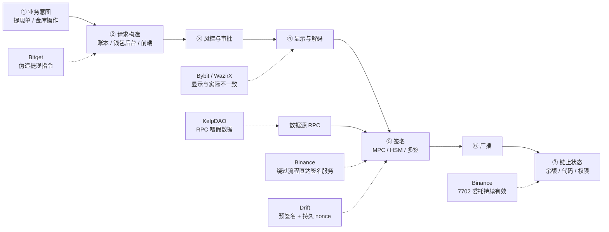
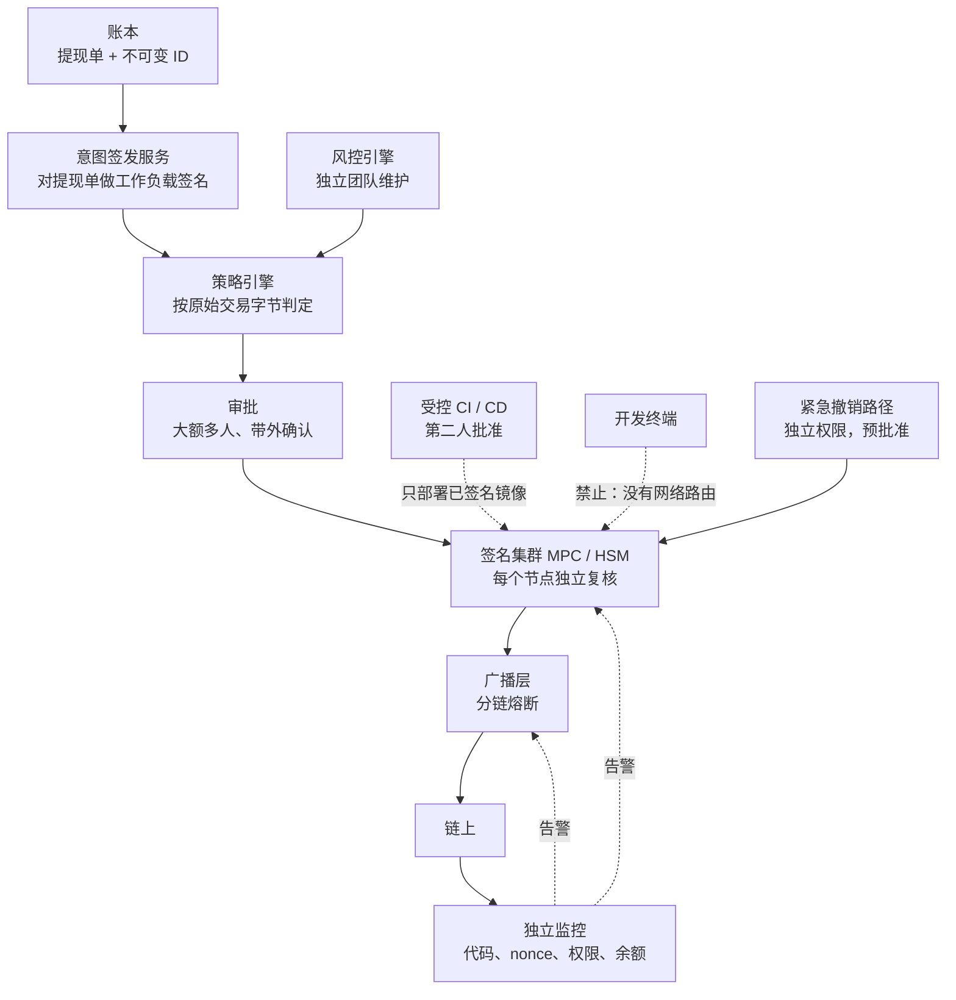

# 29 2026 专题：攻击者不再偷私钥，而是控制签名路径（含交易所签名服务参考架构）

> 学习目标：读完本章，你能——
> 1. 把 Binance、Bitget、Drift、KelpDAO、Bybit、WazirX 放进同一张签名路径图，指出每起事件打断了哪一段。
> 2. 区分每起事件中的项目方声明、第三方分析和未确认的部分。
> 3. 为交易所签名服务写出一份参考架构，覆盖请求来源、账本绑定、全交易类型策略、部署隔离、分链熔断、委托监控和紧急撤销。
> 4. 用 SIG 检查项评估一套真实的签名系统，并把结果写成报告。
>
> 前置章节：[18 钱包与密钥管理](18-wallet-key-management.md)、[20 前端、DNS 与供应链](20-frontend-dns-supply-chain.md)、[23 托管与充提安全](23-custody-exchange-ops.md)、[15 账户抽象与新型钱包](15-account-abstraction-wallets.md)
> 交互实验：[multisig-review-lab.html](interactive/multisig-review-lab.html)、[incident-response-sim.html](interactive/incident-response-sim.html)
> 最后核对：2026-11-09

---

## 开场：钥匙还在，钱没了

2026 年 10 月 29 日，Binance 的多条链热钱包被转走约 63.4 亿美元（项目方口径）。Binance 称没有发现私钥泄露的证据。攻击者访问了内部签名服务，让它代为签名。

先想一想下面的问题，再展开。

<details class="predict"><summary>🤔 先猜再看：一个热钱包使用 MPC，密钥分片从未离开节点。攻击者能转走里面的资金吗？</summary>

能。MPC 只保证完整私钥不出现。它不判断"这笔交易该不该签"。只要攻击者能向签名服务提交请求，并且请求通过校验，MPC 节点就会正常产生签名。

</details>

---

## 1. 一句话理解

**私钥保护回答"谁拿着钥匙"。签名路径回答"谁决定钥匙盖在什么文件上"。2024 年以来的大额事件，攻击者多数控制了后者。**

**签名服务的每一层都重新检查，不继承上一层的结论。策略读取原始待签字节。应急响应要覆盖已经上链的授权。**

签名路径（Signing Path）：一笔链上操作从业务意图到链上生效经过的全部环节。环节包括请求构造、审批、显示、签名、广播和链上状态。

> 🎯 打个比方：公司的公章锁在保险柜里，只有用印员能取。攻击者没有偷公章。攻击者伪造了审批单，放进用印员的待办箱。用印员按流程盖了章。
>
> 比喻的局限：伪造的合同可以由法院撤销。链上交易一旦确认，多数情况下无法撤销。

---

## 2. 威胁模型：攻击者能控制什么

| 攻击者控制的环节 | 攻击者得到什么 | 私钥需要泄露吗 |
|---|---|---|
| 员工终端、部署令牌 | 把恶意代码部署到生产环境 | 否 |
| 钱包后台、风控参数 | 伪造提现指令，通过校验 | 否 |
| 前端或签名界面 | 让签名人看到的内容与实际内容不同 | 否 |
| 签名人本人 | 诱导预先签署长期有效的交易 | 否 |
| 数据源（RPC） | 让验证者对不存在的事件签名 | 否 |
| 已经上链的授权 | 在链下服务关闭后继续转走资金 | 否 |

> 💡 注意：本章不说"私钥不重要"。[18 章](18-wallet-key-management.md)的密钥生命周期控制仍然必要。本章讨论的是，这些控制全部到位时，攻击者还能走哪条路。

第 4 节参考架构的防御层与这些环节对应：

| 攻击者控制的环节 | 对应的防御层 |
|---|---|
| 员工终端、部署令牌 | 4.4 部署与 CI 隔离、4.5 开发终端与测试端点隔离 |
| 钱包后台、风控参数 | 4.1 请求来源、4.2 账本绑定签名 |
| 前端或签名界面 | 4.3 策略引擎（Safe 多签） |
| 签名人本人 | 4.3 策略引擎（Solana 持久 nonce） |
| 数据源（RPC） | 4.6 数据源冗余 |
| 已经上链的授权 | 4.7 分链熔断、4.8 委托与代码变更监控、4.9 MPC 紧急撤销手册 |

---

## 3. 攻击路径

### 3.1 通用签名路径和六起事件的断点



**读图要点：**

- 数据从左向右走。每个箭头都是一次信任传递：下游相信上游已经做过检查。
- 六起事件打在不同位置，但结果相同：签名系统正常运行，产生了攻击者想要的签名。
- ⑦ 是新的战场。签名之后留下的链上状态，会在链下系统关闭后继续生效。
- 局限：图把每起事件简化到一个主要断点。真实入侵路径更长，见第 5 节。

### 3.2 对比表

| 事件 | 时间 / 金额（约，事发时估值） | 入口 | 被打断的环节 | 私钥状态（谁说的） | 持久化或延时手段 | 根因公开程度 |
|---|---|---|---|---|---|---|
| WazirX | 2024-07 / 2.3 亿美元（[CoinDesk](https://coindesk.com/business/2024/07/19/wazirx-liminal-custody-blame-each-other-as-230m-crypto-exploit-leaves-customers-stranded)、[Halborn](https://www.halborn.com/blog/post/explained-the-wazirx-hack-july-2024)） | 有争议 | ④ 显示 | 双方都称自身未被攻破 | 替换钱包逻辑合约 | 双方说法冲突，未见最终独立报告 |
| Bybit | 2025-02 / 约 15 亿美元（[FBI](https://www.ic3.gov/psa/2025/psa250226)） | 开发者电脑 → Safe 托管的 JS | ④ 显示 | 未泄露：签名人签了被替换的交易（[Sygnia / Verichains 转引](https://www.bleepingcomputer.com/news/security/lazarus-hacked-bybit-via-a-breached-safe-wallet-developer-machine/)） | DELEGATECALL 改写实现合约 | 多家报告一致，开发者电脑入口细节部分未公开 |
| Drift | 2026-04 / 2.85 亿美元（[Chainalysis](https://www.chainalysis.com/blog/lessons-from-the-drift-hack/)） | 长期社工 | ⑤ 签名人被诱导预签 | 项目方称助记词未泄露（[BleepingComputer 转述](https://www.bleepingcomputer.com/news/security/drift-loses-280-million-north-korean-hackers-seize-security-council-powers/)） | 持久 nonce | 依赖项目方调查，未见独立验证 |
| KelpDAO | 2026-04 / 2.92 亿美元（[Chainalysis](https://www.chainalysis.com/blog/kelpdao-bridge-exploit-april-2026/)） | DVN 依赖的 RPC 节点 | 数据源 → ⑤ | LayerZero 称 DVN 和密钥管理未被攻破（[声明](https://layerzero.network/blog/kelpdao-incident-statement)） | 对其他节点 DDoS，迫使故障转移 | 责任有争议，已进入诉讼 |
| Bitget | 2026-09 / 约 3.875 亿美元（[BleepingComputer](https://bleepingcomputer.com/news/security/bitget-hacked-via-zero-day-in-third-party-security-products)） | 第三方安全产品零日 | ② 请求构造 | 项目方称私钥和冷钱包未受影响（[Cointelegraph](https://cointelegraph.com/news/bitget-hack-zero-day-slowmist-investigation)） | 定制提现工具，事后删除 | 进度报告阶段，产品名未公开 |
| Binance | 2026-10 / 约 63.4 亿美元（[项目方](https://www.linkedin.com/pulse/29-october-binance-security-incident-initial-findings-response-modgf/)） | 员工终端 → 部署令牌 | ⑤、⑦ | 项目方称未发现私钥泄露 | EIP-7702 委托 | 初步报告，完整报告待发布 |

<details class="predict"><summary>🤔 先猜再看：表中哪一起事件，即使六台 MPC 节点和全部签名人都完全可信，也一样会发生？</summary>

KelpDAO。LayerZero 称 DVN 实例本身没有被攻破。验证者诚实地对假数据签名。这说明"签名者可信"不够，签名者看到的数据也必须可信。

</details>

### 3.3 三个共同点

1. **校验放在错误的位置。** 下游只检查请求格式，不检查请求背后是否有真实业务。
2. **关键输入只有一个来源。** 一块屏幕、一组 RPC、一个发布包、一条审批路径。
3. **响应只针对链下。** 关闭服务不能改变已经上链的状态。

---

## 4. 防御方法：交易所签名服务参考架构

3.3 节的三个共同点，分别对应三类防御：

1. 每一层都重新检查，不继承上一层的结论。策略引擎读取即将被签名的原始字节。
2. 关键输入要有多个独立来源。多个来源不一致时，拒绝签名。
3. 响应要覆盖链上状态。暂停提现不等于撤销权限。

下面的示例架构覆盖请求来源、账本绑定、全交易类型策略、部署隔离、数据源冗余、分链熔断、委托监控和 MPC 紧急撤销手册。

> 💡 注意：本节是**本手册的示例架构**，综合公开事件的教训和业界通用做法。Binance 的报告只提到正在审查"签名策略覆盖面"和"事件响应流程"，没有公布具体方案。



**读图要点：**

- 每一层都重新检查，不继承上一层的结论。
- 策略引擎读取**即将被签名的原始字节**，不读取上游写的描述。
- 开发终端到签名集群的虚线表示禁止的路径。这条网络路由不应该存在。
- 紧急撤销路径与日常路径分开。日常路径被切断时，它仍然可用。
- 局限：架构不能阻止全部内部人作恶。它把单人作恶变成需要多人共谋。

### 4.1 请求来源（Request Provenance）

1. 每个请求携带发起工作负载的身份，例如 mTLS 客户端证书或工作负载身份。
2. 意图签发服务对请求内容签名。签名范围包括链、目标地址、金额、资产和账本单号。
3. 签名节点验证来源签名。来源不在允许名单内时，节点拒绝。
4. 记录完整的请求链路：谁发起、哪个镜像、哪个节点、哪次审批。

> 🔎 对应事件：Binance 称攻击者通过"未授权的访问路径"进入内部签名服务（[项目方报告](https://www.linkedin.com/pulse/29-october-binance-security-incident-initial-findings-response-modgf/)）。

### 4.2 账本绑定签名（Ledger-bound Signing）

只为账本中存在、状态正确、金额一致的提现单签名。

```text
// ❌ 漏洞：只检查请求格式
if (req.isWellFormed() && req.apiKeyValid) sign(req.rawTx)

// ✅ 修复：从原始交易解析出事实，再和账本比对
tx = parse(req.rawTx)                       // 不读取 req.amount、req.to
order = ledger.getById(req.orderId)         // 账本由独立存储提供
require(order.status == "APPROVED" && !order.signed)
require(tx.chainId == order.chainId && tx.to == order.to && tx.amount == order.amount)
require(rateLimit(chain, asset).allow(tx.amount))
ledger.markSigned(order.id, hash(tx))       // 幂等：同一单号只能签一次
sign(req.rawTx)
```

> 🔎 对应事件：SlowMist 称 Bitget 的攻击者用定制工具伪造风控参数并构造提现请求。同一份报告记录，2 笔伪造的 BTC 订单返回了错误（[Cointelegraph](https://cointelegraph.com/news/bitget-hack-zero-day-slowmist-investigation)）。系统的部分校验起了作用，但没有覆盖全部路径。

> ⚠️ 警告：如果攻击者能同时写账本和请求，账本绑定也会失效。账本写入权限要与签名服务调用权限分开，并由实时对账发现差异。

### 4.3 策略引擎：覆盖全部交易类型

策略默认拒绝。任何没有明确规则的交易类型，一律不签。

| 交易或签名类型 | 风险 | 默认策略 |
|---|---|---|
| EVM 普通转账（type 0 / 2） | 目标或金额被替换 | 与账本绑定；代币按合约地址白名单 |
| EIP-7702 授权（type 4） | 账户代码被替换为委托，[持续生效直到被覆盖或清零](https://eips.ethereum.org/EIPS/eip-7702) | 热钱包一律拒签；拒绝 `chain_id = 0`；需要时单独审批，委托目标必须在白名单内 |
| `personal_sign`、`eth_sign`、EIP-712 | 可以授权转账或充当多签审批 | 只允许已知的域和类型；拒绝原始哈希 |
| Safe 多签 | `operation = 1` 可改写实现合约 | `operation = 0`；1 只能指向 MultiSendCallOnly；Guard 合约在链上再次拒绝 |
| Solana 普通交易 | 指令被隐藏在多指令交易中 | 解析每一条指令；拒绝未知 Program |
| Solana 持久 nonce | 交易首条指令是 `AdvanceNonceAccount` 时，[存储的 nonce 取代最近区块哈希](https://solana.com/docs/core/transactions/durable-nonces)，签名不会自然过期 | 热钱包拒绝；管理操作要求时间锁；nonce 账户的 authority 必须是自有地址 |
| Solana 权限指令 | `SetAuthority`、程序升级可转移控制权 | 只允许治理路径 |
| XRP | `SetRegularKey`、`SignerListSet` 可更换账户控制人 | 热钱包拒绝；只允许 Payment |
| TRON | `AccountPermissionUpdate` 可更换权限 | 热钱包拒绝 |
| BTC | PSBT 输出可被替换，找零地址可被替换 | 解析每个输出；找零地址按自有派生路径校验 |

> ⚠️ 警告：策略必须解析**原始待签字节**。规则写在"提现 API"上，等于只保护了一条路径。攻击者走另一条路径时，规则不存在。

> 💡 注意：Solana 基金会 2026 年 10 月的升级页面宣布，计划在替代方案就绪后约 6 个月移除持久 nonce，改用链上离线签名程序（[Solana 升级页](https://solana.com/upgrades/durable-nonce-deprecation)；截至 2026-11-09 该页面未给出确定的主网时间，本书仅经检索摘要确认，页面直连受限）。在正式移除前，策略仍要覆盖它。

<details class="predict"><summary>🤔 先猜再看：策略引擎拒绝全部 type 4 交易，攻击者还能设置 EIP-7702 委托吗？</summary>

如果策略覆盖的只是"交易类型"，还可以。授权元组是单独的一个签名，可以由别的地址放进自己的 type 4 交易中提交。策略必须同时拒绝**对授权元组格式的签名请求**，也就是拒绝任何以 `0x05` 开头、对 `rlp([chain_id, address, nonce])` 的签名。

</details>

### 4.4 部署与 CI 隔离

1. 部署令牌只存在于 CI，有效期按分钟计，绑定流水线和目标环境。
2. 生产部署需要第二人批准。批准人看到的是镜像摘要，不是分支名。
3. 签名节点只运行已签名的镜像，启动时校验。
4. 钱包团队的电脑上没有生产令牌。自动扫描开发终端中的令牌文件。

> 🔎 对应事件：Binance 称攻击者发现 Wallet DevOps 工程师 A 的电脑上有容器部署权限令牌，随后用窃取的凭证部署容器并运行脚本（[项目方报告](https://www.linkedin.com/pulse/29-october-binance-security-incident-initial-findings-response-modgf/)）。Safe 的初步报告称，攻击者通过恶意软件劫持了开发者的 AWS 会话令牌，绕过 12 小时的 MFA 重新认证（[CryptoSlate 转述](https://cryptoslate.com/safes-internal-investigation-reveals-developers-laptop-breach-led-to-bybit-hack/)）。

### 4.5 开发终端与测试端点隔离

1. 开发网络到生产签名网络没有路由。需要访问时，经堡垒机，并按操作审批。
2. 测试环境使用独立的密钥和独立的签名集群。
3. 外部代码、面试作业、试用工具只在一次性虚拟机中运行。
4. 内部 AI 工具按有执行权限的系统管理：最小权限、操作审计、禁止跨用户访问。

> 🔎 对应事件：Binance 称攻击者通过假面试作业控制了工程师 B 的电脑，并借助内部 AI 工具接触到另外两名工程师（[项目方报告](https://www.linkedin.com/pulse/29-october-binance-security-incident-initial-findings-response-modgf/)）。AI 工具被利用的具体机制没有公开。

### 4.6 数据源冗余

凡是"根据外部数据签名"的系统（桥验证者、充值入账、预言机），都要满足：

1. 至少两个独立运营方的数据源。
2. 多个数据源不一致时，拒绝签名，不做故障转移。
3. 监控从验证者本身的视角取数，不只从外部探针取数。

> 🔎 对应事件：LayerZero 称恶意 RPC 节点只对 DVN 返回伪造数据，对其他 IP 返回真实数据，并对未被攻破的 RPC 发起 DDoS，迫使 DVN 切换到恶意节点（[声明](https://layerzero.network/blog/kelpdao-incident-statement)）。

### 4.7 分链熔断

| 触发条件（示例） | 动作 | 恢复条件 |
|---|---|---|
| 单链单小时流出超过水位的 N 倍 | 该链停止广播 | 人工对账后恢复 |
| 账本无对应订单的链上流出 | 全链停止广播和归集 | 事故指挥官批准 |
| 同时 ≥ 2 条链异常 | 全部链熔断 | 事故指挥官批准 |
| 自有地址代码变化 | 全部链熔断；启动撤销流程 | 委托已清零 |

- 熔断放在广播层和签名层各一道。广播层拦截已签未发的交易。
- 熔断权限不依赖被攻击的系统，由独立通道触发。
- 业务恢复要逐链进行，每批次后对账。

### 4.8 委托与代码变更监控

| 监控对象 | 方法 | 告警条件 |
|---|---|---|
| EVM 自有地址的代码 | 每个区块查询 `eth_getCode` | 结果以 `0xef0100` 开头，或由空变为非空 |
| 账户 nonce | 比对链上 nonce 和签名服务记录 | 链上 nonce 增长超过已签名交易数 |
| Safe 实现合约 | 读取 slot 0 | 与登记值不同 |
| Solana | 监控 nonce 账户、Program 升级权限 | 新建的 nonce 账户 authority 涉及自有地址 |
| 其他链账户权限 | XRP 账户设置、TRON 权限 | 任何变化 |

监控系统要部署在独立账号和独立节点上。TRM 记录到，攻击者提交 50 个连续 nonce 的授权，确保其中一个在执行时匹配（[TRM](https://www.trmlabs.com/resources/blog/north-korea-steals-usd-6-36-billion-from-binance-in-the-largest-hack-in-history)）。Binance 的表述是 50 笔操纵 nonce 并设置委托的签名交易（[项目方报告](https://www.linkedin.com/pulse/29-october-binance-security-incident-initial-findings-response-modgf/)）。

### 4.9 MPC 紧急撤销手册

> ⚠️ 警告：**暂停提现不等于撤销权限。** Binance 报告称，已有的 7702 授权独立于提现系统运行；暂停提现和关闭热钱包服务没有自动使它们失效（[项目方报告](https://www.linkedin.com/pulse/29-october-binance-security-incident-initial-findings-response-modgf/)）。按公开时间，委托在链上存活约 3 小时 50 分（20:20 至次日 00:10 UTC）。

EIP-7702 的规则决定了撤销方式：提交一个新授权，`address` 为零地址，账户代码清空。授权中的 `nonce` 必须等于账户当前 nonce；如果账户自己发送这笔交易，发送者的 nonce 会先加一，授权 `nonce` 要用交易 nonce 加一（[EIP-7702](https://eips.ethereum.org/EIPS/eip-7702)）。

手册内容（示例）：

1. **切断日常路径。** 确认攻击者已无法提交新请求。先做这一步，否则撤销会被覆盖。
2. **启用撤销路径。** 这条路径有独立权限，只能签"清零授权"一种消息。
3. **确定 nonce。** 读取链上当前 nonce，再决定谁来支付 Gas。
4. **发起门限签名。** 指定节点运行手册，事故指挥官和第二审批人确认。
5. **提交并确认。** 查询 `eth_getCode`，结果为空才算完成。
6. **复查其他链。** 检查每条链的账户权限和 nonce 账户。
7. **记录全过程。** 保存签名记录，用于复盘和举证。

演练要求：每季度在测试网完整运行一次，记录用时。Binance 称 MPC 钱包"没有一把单独的私钥可以立刻撤销"，需要专门的流程（[项目方报告](https://www.linkedin.com/pulse/29-october-binance-security-incident-initial-findings-response-modgf/)）。TRM 的建议是准备经过测试、预先批准的撤销方法（[TRM](https://www.trmlabs.com/resources/blog/north-korea-steals-usd-6-36-billion-from-binance-in-the-largest-hack-in-history)）。

> 🧪 动手验证：打开[热钱包应急演练](interactive/incident-response-sim.html)，不勾选事前控制。第 ② 步选"暂停用户提现"，第 ②-2 步选"继续关闭：停掉热钱包服务"，第 ③ 步选"再暂停一层提现，并关闭热钱包服务"。记录"⚠️ 委托有效"标记是否消失。再勾选"已演练 MPC 紧急撤销手册"重跑，比较复盘页的最终损失。

---

## 5. 真实案例

> 💡 注意：以下每个案例只写摘要和教训。**项目方声明**和**第三方分析**分开标注。金额为事发时美元估值。各案截至 2026-11-09 的状态可能继续变化。

第 4 节每一层后的"🔎 对应事件"标注了与该层有关的事实和出处。

### 5.1 WazirX（2024 年 7 月，以太坊）

- **项目方说法冲突：** WazirX 称 Liminal 界面显示的数据与实际内容不一致；Liminal 称自身基础设施没有被攻破。**未确认：** 未见最终独立报告。
- 完整案例（多签结构、归因、重组方案）见 [18 章 5.4 节](18-wallet-key-management.md)；复盘：[资损 101](https://claude.ai/artifact/1a5Nx6xTVLuJdCB8Esf2xj#c-wazirx)。

### 5.2 Bybit（2025 年 2 月，以太坊）

- **项目方（Safe）：** 开发者电脑失陷，AWS 会话令牌被劫持；智能合约不受影响。**第三方（Sygnia、Verichains）：** 未在 Bybit 基础设施中发现入侵；载荷只在特定条件下激活。
- 攻击路径、链上结构和来源见 [20 章 5.4 节](20-frontend-dns-supply-chain.md)；资金追踪见 [25 章 5.3 节](25-fund-tracing-response.md)。

> 🧪 动手验证：打开[多签签前复核](interactive/multisig-review-lab.html)，在 #43 点击"运行独立解码"。记录 `operation` 的值、函数名，以及两个 safeTxHash 是否相同。

### 5.3 Drift（2026 年 4 月，Solana）

- **项目方：** 没有利用程序漏洞，助记词未泄露。**第三方（Chainalysis）：** 2-of-5 安全委员会迁移后没有时间锁，成员预签了未完全理解的交易。**未确认：** 描述来自 Drift 自身调查，归因是初步判断。
- 完整案例见 [13 章 5.5.2 节](13-non-evm-ecosystems.md)；持久 nonce 的审计方法见 [B50 3.8 节](bootcamp/B50-solana-audit.md)。

### 5.4 KelpDAO（2026 年 4 月）

- **LayerZero：** 攻击者替换了 1-of-1 DVN 依赖的两个 RPC 节点；DVN 实例没有被攻破。**KelpDAO：** 单验证者是 LayerZero 的默认配置。责任争议已进入诉讼。
- 完整案例见 [12 章 4.6 节](12-cross-chain-bridges.md)；RPC 层的攻击细节见 [17 章 5.2.1 节](17-node-rpc-infrastructure.md)。

### 5.5 Bitget（2026 年 9 月）

- **项目方：** 第三方安全产品的零日漏洞泄露了内部凭证，攻击者伪造提现指令；私钥和冷钱包未受影响。**未确认：** 产品名称、零日细节和归因。
- 完整案例、两种时间说法和来源见 [23 章 5.2 节](23-custody-exchange-ops.md)。

### 5.6 Binance（2026 年 10 月）

- **项目方：** 员工终端失陷，攻击者拿到容器部署令牌，再未经授权访问内部签名服务。Binance 称没有发现私钥泄露。
- **第三方（TRM、Elliptic）：** 以太坊热钱包被设置 EIP-7702 委托后被清空。估值 63.6 亿到 64.3 亿美元；FBI 归因于朝鲜 TraderTraitor。
- **未确认：** 告警时间、提现暂停时间、内部 AI 工具的利用方式、部署令牌的完整权限。
- 完整路径和时间线见 [23 章 5.2 节](23-custody-exchange-ops.md)；复盘：[资损 101](https://claude.ai/artifact/1a5Nx6xTVLuJdCB8Esf2xj#c-binance)。

---

## 6. 评估检查点

**请求来源与账本：**

- [ ] **SIG-1** 签名节点验证请求来源的工作负载身份，不只验证 API Key。
- [ ] **SIG-2** 签名服务只为账本中存在、状态正确的订单签名；同一订单只能签一次。
- [ ] **SIG-3** 签名前从原始交易字节解析目标和金额，不信任上游的描述字段。
- [ ] **SIG-4** 账本写入权限和签名服务调用权限分属不同身份。

**策略：**

- [ ] **SIG-5** 策略默认拒绝，未知交易类型不签。
- [ ] **SIG-6** 策略覆盖 EIP-7702：拒绝 type 4 和授权元组签名（`0x05` 域）；拒绝 `chain_id = 0`。
- [ ] **SIG-7** 策略覆盖链下签名：`personal_sign`、原始哈希、EIP-712。
- [ ] **SIG-8** 策略覆盖 Solana 持久 nonce 和权限指令；管理操作有时间锁。
- [ ] **SIG-9** 策略覆盖其他链的账户控制权变更（XRP、TRON 等）。
- [ ] **SIG-10** 多签签名人独立解码；`operation = 1` 只能指向 MultiSendCallOnly；有 Guard 合约。

**部署与隔离：**

- [ ] **SIG-11** 开发终端上没有可直达生产的长期令牌；有自动扫描。
- [ ] **SIG-12** 生产部署需要第二人批准，只部署已签名的镜像。
- [ ] **SIG-13** 开发网络到签名网络没有路由；测试环境使用独立密钥。
- [ ] **SIG-14** 外部代码和面试作业只在一次性环境中运行；内部 AI 工具有最小权限和审计。
- [ ] **SIG-15** 依赖外部数据签名的组件有多个独立数据源；不一致时拒绝，不做故障转移。

**监控与响应：**

- [ ] **SIG-16** 每条链有独立熔断，熔断通道不依赖被攻击的系统。
- [ ] **SIG-17** 自有地址的代码、nonce、权限有独立实时监控（`0xef0100`、slot 0、nonce 账户）。
- [ ] **SIG-18** 有 MPC 紧急撤销手册，撤销路径独立，每季度演练并记录用时。
- [ ] **SIG-19** 应急预案写明：暂停提现之后，必须检查全部链上授权。
- [ ] **SIG-20** 发行方冻结的联系人和地址清单模板已验证；证据保全先于系统重建。

**把检查结果写进报告：**

| 检查项 | 发现时的证据 | 常见定级（用 [A02](assessment/A02-risk-rating-reporting.md) 复核） | 练习位置 |
|---|---|---|---|
| SIG-1、SIG-2、SIG-3、SIG-4 | 请求链路图；一笔未关联账本的测试签名 | 严重 / 高 | [热钱包应急演练](interactive/incident-response-sim.html) |
| SIG-5、SIG-6、SIG-7、SIG-8、SIG-9 | 策略规则清单；测试网上被错误签署的交易 | 严重 / 高 | [15 章](15-account-abstraction-wallets.md)、[C00](chains/C00-ethereum.md)、[13 章](13-non-evm-ecosystems.md) |
| SIG-10 | 多签流程记录；Guard 配置 | 严重 / 高 | [多签签前复核](interactive/multisig-review-lab.html)、[B40](bootcamp/B40-case-safe.md) |
| SIG-11、SIG-12、SIG-13、SIG-14 | 令牌扫描结果；网络路径测试 | 严重 / 高 | [A06](assessment/A06-operational-key-security.md)、[T06](templates/T06-ops-security-self-check.md) |
| SIG-15 | 数据源清单；故障切换逻辑 | 高 | [17 章](17-node-rpc-infrastructure.md)、[12 章](12-cross-chain-bridges.md) |
| SIG-16、SIG-17、SIG-18、SIG-19、SIG-20 | 演练报告和用时；告警记录 | 高 | [热钱包应急演练](interactive/incident-response-sim.html)、[A09](assessment/A09-incident-response.md) |

发现按 [T03 报告模板](templates/T03-finding-report.md) 记录。交易所对象的评估范围见 [A03](assessment/A03-exchange-contracts-wallets.md)。

### 6.1 按角色的要点

| 角色 | 今天要做的一件事 | 要回答的问题 |
|---|---|---|
| 钱包 / 签名工程师 | 列出所有能到达签名节点的调用路径 | 哪条路径没有经过策略引擎？ |
| 安全工程师 | 用一笔测试网 type 4 请求测试策略 | 策略拒绝了吗？告警响了吗？ |
| DevOps / SRE | 扫描开发终端上的生产令牌 | 一台失陷的电脑能部署到哪里？ |
| 风控 / 合规 | 验证发行方联系人和地址清单模板 | 第一份冻结请求多久能发出？ |
| 多签签名人 | 换一台设备，独立重算下一笔的 safeTxHash | 你的核对工具和前端是同一来源吗？ |
| 高管 / 事故指挥官 | 主持一次撤销演练 | 暂停提现之后，你怎么确认链上授权已清除？ |
| 审计 / 评估人员 | 把 SIG 清单加入评估范围 | 客户能给出每一项的证据吗？ |

---

## 7. 用户侧防护

普通用户控制不了交易所的签名路径。你可以控制自己的暴露范围。

1. 不要把长期资产全部放在交易所。交易所自报的"已补足"是公司决定，不是链上保证。
2. 交易所公告事故时，只从官方 App 和官方账号获取信息。事故期间仿冒公告增多。
3. 提现恢复后，按官方公告确认该网络的充值和提现已经恢复，再发起操作。
4. 如果钱包弹出"升级账户"的 7702 授权请求，默认拒绝，见 [15 章](15-account-abstraction-wallets.md)。
5. 自己使用多签时，签名前在另一台设备上核对哈希，见[多签签前复核](interactive/multisig-review-lab.html)。

---

## 8. 术语表

| 术语 | 英文 | 定义 |
|---|---|---|
| 签名路径 | Signing Path | 一笔链上操作从业务意图到链上生效经过的全部环节 |
| 持久 nonce | Durable Nonce | Solana 中让签名不随最近区块哈希过期的机制 |
| 委托 | EIP-7702 Delegation | 普通地址执行指定合约代码的链上状态，直到被覆盖或清零 |
| 验证者网络 | DVN | LayerZero 中验证跨链消息的独立验证者 |
| 请求来源 | Request Provenance | 证明签名请求由哪个工作负载、哪次审批发起的记录 |
| 账本绑定签名 | Ledger-bound Signing | 只为账本中存在的、状态正确的订单签名 |
| 分链熔断 | Per-chain Circuit Breaker | 单链异常时自动暂停该链广播 |
| 撤销路径 | Break-glass Path | 日常路径被切断时，只能执行紧急撤销的独立签名路径 |

---

> 🪞 反思：想一想你负责或熟悉的一套签名系统。
> 1. 从哪一台电脑出发，最少经过几步就能让签名节点产生一个签名？
> 2. 上一次撤销链上权限的演练，用了多长时间？
> 3. 如果今晚所有提现都暂停，哪些资金转出的路径仍然开着？

## 9. 思考题

1. 对照 3.2 节的对比表，哪几起事件的入口是员工或开发者的电脑？它们打断的环节相同吗？这对防御的位置有什么含义？
2. 打开 [multisig-review-lab.html](interactive/multisig-review-lab.html)，比较 #44 和 #45。外层字段完全符合审批规则的前提下，你怎么发现 #45 的问题？如果把 MultiSend 换成 MultiSendCallOnly，会发生什么？
3. 打开 [incident-response-sim.html](interactive/incident-response-sim.html)，分别用"第 ② 步选暂停用户提现"和"第 ② 步选停止全部签名路径"各跑一遍，其余选项相同。两次的流失差异主要来自哪些事件？这说明提现暂停和切断签名路径各自覆盖什么？
4. 你要给一条新的非 EVM 链写签名策略。用 4.3 节的思路，写出你必须先查清的 4 个问题，并说明每个问题对应 Binance、Drift、Bitget、KelpDAO 中哪一起事件的教训。

返回：[28 事故案例库](28-incident-casebook.md) ｜ [手册目录](README.md)
