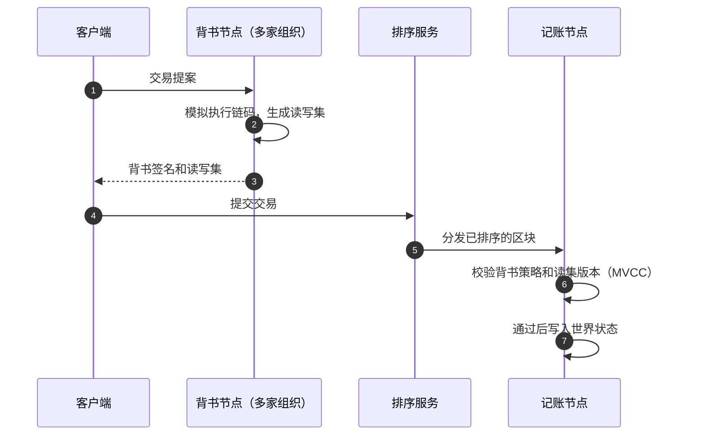

# 30 企业级与许可链安全：威胁模型、Fabric、Corda、Besu 与联盟治理

> 学习目标：读完本章，你能——
> 1. 说明许可链的威胁模型为什么不同于公链，并写出信任边界。
> 2. 审查 Hyperledger Fabric 网络的身份、背书、隐私和排序配置。
> 3. 说出 Corda 的网络准入、公证人、Flow 和附件约束的安全要点。
> 4. 判断 GoQuorum、Tessera、Besu 的维护状态，以及隐私和准入功能是否还存在。
> 5. 用 ENT 检查项评估一个 Fabric、Corda 或 Besu 联盟网络，并把结果写成报告。
>
> 前置章节：[16 共识层与链级安全](16-consensus-chain-security.md)、[17 节点与 RPC](17-node-rpc-infrastructure.md)、[24 数据与隐私](24-data-privacy.md)
> 相关：[12 跨链桥安全](12-cross-chain-bridges.md)、[18 钱包与密钥管理](18-wallet-key-management.md)
> 交互实验：本章没有专用实验。链码示例只供离线阅读，不需要部署网络。

> 最后核对：2026-11-10

---

## 开场：同一个区块哈希，两份账本

Fabric 公布过一项漏洞（CVE-2023-46132）。攻击者能重新组合一个区块内的交易，使区块哈希不变，但节点解析出的交易不同。收到不同版本的节点，世界状态出现分歧。网络里每个参与者都持有有效证书，账本仍然分叉了。5.1 节给出公告和修复版本。

本章先讲许可链的通用威胁模型，再讲 Hyperledger Fabric 和联盟治理，最后讲 Corda、Quorum 与 Besu（§3.3–3.4）。

---

## 1. 一句话理解

**许可链把"谁能参与"从密码学和经济问题，变成了身份和治理问题。攻击者不再需要多数算力，只需要一张有效证书、一把管理员密钥，或者几家成员的共谋。**

**Corda 和 Besu 用不同方式限制谁能看、谁能写。Corda 靠点对点分发和公证人；Besu 靠验证者投票和节点准入。它们的单点在运营方、公证人、验证者，以及软件是否还有人维护。**

许可链（Permissioned Blockchain）：只有获得授权的参与者才能读、写或出块的区块链。
联盟链（Consortium Blockchain）：由多家组织共同治理的许可链。

> 🎯 打个比方：公链像公共广场，任何人都能进，靠规则和押金维持秩序。许可链像一栋写字楼，进门要刷工牌。大多数陌生人进不来，但发工牌的前台、有万能钥匙的物业，成了最值得攻击的人。
>
> 比喻的局限：写字楼失窃后可以调监控、报警。联盟链的多数成员可以合法地重写业务状态，账本本身看不出这是作恶。

> 🎯 打个比方：沿用上面的写字楼比喻。Corda 的公证人像前台的登记簿，防止同一张单据被用两次。Besu 的验证者像物业委员会，投票决定新记录。
>
> 比喻的局限：登记簿和委员会都按规则办事。规则的实现有漏洞时，诚实的人也会照章办错，§3.4 的 Besu 漏洞就是这样。

---

## 2. 威胁模型：攻击者能控制什么

| 比较项 | 公链 | 许可链 |
|---|---|---|
| 准入 | 开放 | 证书或白名单 |
| 主要攻击者 | 匿名外部人 | 成员、内部人、被攻破的成员 |
| 共识安全来源 | 算力或质押的经济成本 | 身份、法律合同、BFT/CFT 假设 |
| 女巫攻击 | 靠算力或权益加权抵抗 | 靠 CA 抵抗；CA 被攻破时失效 |
| 数据可见性 | 默认公开 | 按通道、集合或交易参与方限制 |
| 单点 | 客户端 bug、矿池、质押集中 | 根 CA、排序服务、管理员密钥、网络运营方 |
| 代码升级 | 开放治理或硬分叉 | 成员审批，少数管理员可以推动 |
| 外部可验证性 | 任何人可以验证 | 只有成员可以验证 |
| 个人数据 | 公开传播，难以限制 | 范围较小，但仍受数据保护法约束（[24 章](24-data-privacy.md) 4.5 节） |

攻击者的入口，按控制资源分类：

| 控制的资源 | 能造成什么 |
|---|---|
| 一张普通成员证书 | 调用自己权限内的合约；读通道数据；发送畸形请求 |
| 组织管理员证书 | 修改本组织配置；批准链码 |
| 根 CA 或中间 CA 私钥 | 签发任意身份 |
| 排序节点 | CFT 模式下影响排序和可用性；BFT 模式下受阈值限制 |
| 足够数量的背书组织 | 写入符合背书策略的任意状态 |
| 网络访问 | 向 P2P 或 gRPC 端口发送攻击流量（§5.4） |

Corda 与 Quorum/Besu 两类平台的单点和攻击面：

| 平台 | 单点或攻击面 | 本章位置 |
|---|---|---|
| Corda | 网络运营方（证书、网络图）；公证人；Flow 收到的数据；附件约束 | 3.3 节 |
| Quorum / Besu | 验证者集合；各节点的本地准入配置；验证者的 P2P 端口；已停止维护的组件 | 3.4 节、5.4–5.5 节 |

> ⚠️ 警告：不要把"成员都是持牌机构"写成安全假设。Ronin 桥有 9 个验证者，5 个签名就能放行，攻击者控制验证者后提走了资金（[12 章](12-cross-chain-bridges.md) 4.1 节）。许可集合小，攻破门槛也低。

---

## 3. 攻击路径

### 3.1 Hyperledger Fabric

**版本现状（2026 年 11 月 10 日核对）**：最新发布是 v3.1.5 和 v2.5.16（2026 年 6 月）。项目 README 仍把 v2.5.x 列为当前 LTS。v3.0 引入 BFT 排序。来源：[GitHub Releases](https://github.com/hyperledger/fabric/releases)、[README](https://github.com/hyperledger/fabric#readme)。

Fabric 使用"执行—排序—验证"流程：



**读图要点：**

- 链码只在背书阶段执行。记账节点不重新执行，只比较读写集。
- 排序服务决定顺序，不判断业务是否正确。
- 第 6 步拒绝的交易仍然留在区块里，只是被标记为无效。
- 局限：图中没有画私有数据。私有数据走 gossip，不经过排序服务。

#### 3.1.1 MSP 与 CA

成员服务提供者（MSP，Membership Service Provider）：定义哪些证书属于某个组织、属于什么角色。

- 根 CA 决定信任边界。根 CA 私钥泄露，攻击者能签发该组织的任意身份。
- Fabric 文档建议身份 CA 和 TLS CA 分开，管理员证书与 CA 证书分开。
- Fabric 文档说明，MSP 身份不会自动过期，只能吊销；TLS 证书的吊销目前不被强制执行。所以吊销流程要提前演练。来源：[Fabric MSP 文档](https://hyperledger-fabric.readthedocs.io/en/latest/msp.html)。

#### 3.1.2 通道与私有数据集合

通道（Channel）：一组组织共享的独立账本。
私有数据集合（PDC，Private Data Collection）：通道内只分发给部分组织的数据。

- 私有数据通过 gossip 分发给授权节点；全部节点的账本上只有哈希。排序服务看不到私有数据。来源：[Fabric 私有数据文档](https://hyperledger-fabric.readthedocs.io/en/latest/private-data/private-data.html)。
- 输入要放进提案的 `transient` 字段。放进普通参数时，数据会进入通道交易。
- `memberOnlyRead` 和 `memberOnlyWrite` 限制客户端访问。非成员在满足背书策略时也能写入，除非打开 `memberOnlyWrite`。
- `blockToLive` 控制自动清除。`DelPrivateData` 只删除当前状态；`PurgePrivateData` 才从授权节点彻底清除。
- 如果私有数据可以预测，要加入随机盐。否则通道成员能暴力比对哈希。来源：[Fabric 私有数据架构](https://hyperledger-fabric.readthedocs.io/en/latest/private-data-arch.html)。

<details class="predict"><summary>🤔 先猜再看：一个集合只包含 Org1 和 Org2。集合里存着“客户等级 = A / B / C”。Org3 能知道某个客户的等级吗？</summary>

如果没有加盐，能。Org3 的账本上有哈希，等级只有 3 种取值，它算出 3 个哈希比对即可。集合权限只限制原文的分发，不隐藏低熵数据的哈希。

</details>

#### 3.1.3 背书策略与排序服务

- 背书策略决定一笔交易需要哪些组织签名。默认策略要求通道成员的多数。来源：[Fabric 部署文档](https://hyperledger-fabric.readthedocs.io/en/latest/deploy_chaincode.html)。
- 过弱的策略（例如 `OR('Org1MSP.peer','Org2MSP.peer')`）让任一成员单独决定写入。
- Raft 是崩溃容错（CFT）：3 个节点容忍 1 个宕机，5 个节点容忍 2 个宕机。它不防恶意节点。
- BFT（SmartBFT）能容忍少于 1/3 的节点作恶，需要启用通道能力 `V3_0`。
- Kafka 在 3.x 中不再受支持，Solo 也已弃用。来源：[Fabric 排序服务文档](https://hyperledger-fabric.readthedocs.io/en/latest/orderer/ordering_service.html)。

<details class="predict"><summary>🤔 先猜再看：Raft 排序服务由 5 个节点组成。其中一家运营方的节点被攻破，它是当前 leader。背书策略和 MVCC 还在。攻击者能做什么？</summary>

攻击者不能伪造背书，记账节点会拒绝。但它能决定排序、延迟或丢弃交易。Raft 不防恶意节点。需要抵抗恶意排序节点时，选 BFT，并把节点分给不同运营方。

</details>

#### 3.1.4 链码的非确定性与幻读

链码（Chaincode）：Fabric 上的智能合约。

如果不同背书节点的执行结果不同，读写集不一致，交易无法得到有效背书。

```go
// ❌ 漏洞：各背书节点的本地时间不同，读写集不一致
func (c *Contract) Stamp(ctx contractapi.TransactionContextInterface, id string) error {
	ts := time.Now().Unix()   // 非确定性：每个背书节点得到不同时间
	// 读写集不同，背书结果不一致，交易无法通过背书策略
	return ctx.GetStub().PutState(id, []byte(strconv.FormatInt(ts, 10)))
}

// ✅ 修复：使用提案中的交易时间戳，所有背书节点读到同一个值
func (c *Contract) Stamp(ctx contractapi.TransactionContextInterface, id string) error {
	// 交易时间戳来自客户端提案，各节点一致
	t, err := ctx.GetStub().GetTxTimestamp()
	if err != nil {
		return err
	}
	return ctx.GetStub().PutState(id, []byte(strconv.FormatInt(t.Seconds, 10)))
}
```

非确定性的常见来源：本地时间、随机数、遍历 Go 的 map、访问外部 API、不稳定的 JSON 序列化。Fabric 教程要求相同输入产生相同的字节。来源：[Fabric 链码教程](https://hyperledger-fabric.readthedocs.io/en/latest/chaincode4ade.html)。

```go
// ❌ 漏洞：写交易依赖富查询，提交时不检查结果集是否变化
// 富查询结果不进入读写集，提交时不做幻读校验
it, _ := stub.GetQueryResult(`{"selector":{"status":"open"}}`)

// ✅ 修复：写交易使用范围查询，或由应用保证结果集稳定
// 范围查询在提交时重新校验，结果变化则交易失效
it, _ := stub.GetStateByRange("order:0000", "order:9999")
```

幻读（Phantom Read）：查询执行后，有新记录进入查询范围，事务却没有发现。

Fabric 只对 `GetStateByRange` 这类范围查询提供幻读保护。`GetQueryResult` 没有这种保护，文档建议只在不提交排序的只读交易中使用。另外，同一交易中先写后读，读到的是已提交的旧值。来源：[Fabric 读写集语义](https://hyperledger-fabric.readthedocs.io/en/latest/readwrite.html)。

> 🧪 动手验证：不部署网络，在纸上跟踪上面两段代码。写出背书节点 A、B 各自的读写集，再判断记账节点在 MVCC 校验时检查了哪些键。

### 3.2 联盟治理与密钥管理

许可链的最大风险常在流程。

| 风险 | 攻击路径 | 控制 |
|---|---|---|
| 根 CA 单点 | 根私钥放在在线服务器，被攻破后签发身份 | 根 CA 离线，HSM 保存，中间 CA 负责日常签发 |
| 管理员集中 | 一家技术服务商持有多家组织的管理员证书 | 每家组织自持密钥；服务商只有受限运维权限 |
| 配置更新 | 少数管理员修改通道策略或成员列表 | 配置更新需要多组织签名，变更留痕 |
| 成员退出 | 退出后证书未吊销，历史账本仍在对方手中 | 退出流程：吊销、改策略、评估已分发数据 |
| 成员共谋 | 达到背书阈值的成员写入虚假业务状态 | 外部锚定、第三方审计、争议处理条款 |
| 单一云或运营商 | 所有节点在同一账户 | 分账户、分地域、分运营方 |

外部锚定：定期把账本摘要写到公链或交由第三方保存。它能证明历史没有被改写，不能证明数据本身真实。

### 3.3 Corda

**版本现状（2026 年 11 月 10 日核对）**：`corda/corda` 仓库的最新标签是 4.14.4，并有 4.15 的候选标签；`release/os/4.14` 分支在 2026 年 11 月仍有提交。Corda 5 的代码在 `corda-runtime-os`，仓库没有归档，存在 `release/os/5.3` 分支，但默认分支自 2024 年 12 月后只见到维护性提交。R3 文档站拒绝了本书的自动访问，本书没有读到完整的官方停止支持表，也没有找到"Corda 5 已停止"的官方声明。选型前要向 R3 确认。Corda 5 与 4.x 不兼容，不能共用网络。来源：[corda/corda](https://github.com/corda/corda)、[corda-runtime-os](https://github.com/corda/corda-runtime-os)、[R3 开发者博客](https://developer.r3.com/blog/corda-5-developer-preview-what-is-in-the-box/)。

Corda 不广播交易。数据只发给需要知道的参与方。

- **网络准入**：节点要从网络运营方取得证书；网络图（Network Map）发布节点地址。运营方是单点。来源：[Corda 网络文档](https://docs.r3.com/en/platform/corda/4.12/community/key-concepts-ecosystem.html)。
- **公证人（Notary）**：防止同一状态被消费两次。公证人有两种：验证型能看到完整交易及其依赖，隐私较差；非验证型只看到输入引用，存在"状态拒绝"风险，也就是恶意节点用无效交易消费别人的状态。来源：[Corda 公证人文档](https://docs.r3.com/en/platform/corda/4.9/community/key-concepts-notaries.html)。
- **流程（Flow）**：节点之间通过流程点对点协商。收到的数据类型是 `UntrustworthyData`，必须校验后才能使用。来源：[Corda Flow API](https://docs.r3.com/en/platform/corda/4.9/community/api-flows.html)。
- **附件（Attachment）**：合约代码和数据以 JAR/ZIP 附件形式随交易分发，用哈希标识。签名约束允许某组密钥签署的任何版本。`always-accept` 约束只用于测试。来源：[Corda 合约约束](https://docs.r3.com/en/platform/corda/4.9/community/api-contract-constraints.html)。

<details class="predict"><summary>🤔 先猜再看：一个 Corda 网络使用单节点、非验证型公证人。公证人运营方作恶，它能看到交易内容吗？它能造成什么损害？</summary>

它看不到完整内容，只看到输入引用、时间窗口和公证人身份。但它能拒绝服务，也能错误地为同一状态签署两次，造成双花。单节点公证人是这个网络的共识单点，要改为集群并分开运营方。

</details>

### 3.4 Quorum 与 Besu 的隐私和准入

2026 年 9 月，Besu 公布了一项 QBFT 漏洞。启用 Shanghai 或更新分叉后，一名拜占庭验证者能注入未经授权的提款。诚实验证者照常执行并最终确定，原生币凭空增加。受影响版本从 24.5.2 开始，26.8.1 修复。来源：[GHSA-p4h2-gvh4-pv6j](https://github.com/hyperledger/besu/security/advisories/GHSA-p4h2-gvh4-pv6j)。准入名单挡不住一名成员。

<details class="predict"><summary>🤔 先猜再看：一个 4 家银行组成的 QBFT 网络，每家运行一个验证者，彼此签了合同。只有一家行为异常。按“3f+1 能容忍 1 个恶意节点”，这个网络安全吗？</summary>

共识投票的容错数只说明协议按规范执行时的结果。这个漏洞里，诚实节点的验证规则本身缺了一项，所以一名验证者就够了。合同让你事后能追责，但不能阻止状态被写错。许可链也要审计客户端实现。

</details>

**版本现状（2026 年 11 月 10 日核对）**：

| 项目 | 状态 | 来源 |
|---|---|---|
| GoQuorum | 仓库已归档，README 声明 Consensys 不再维护，不建议用于新项目。最后发布 v24.4.1（2024 年 6 月） | [Consensys/quorum](https://github.com/Consensys/quorum) |
| Tessera | 项目已弃用，README 写明 2026 年 6 月 1 日归档。最后发布 24.4.2（2024 年 6 月） | [Consensys/tessera](https://github.com/Consensys/tessera) |
| Besu | 活跃，最新版本 26.11.0（2026 年 11 月 2 日），仓库迁到 besu-eth 组织 | [besu-eth/besu](https://github.com/besu-eth/besu) |
| Besu 的 Tessera 隐私 | 25.6.0 移除；`EEA`、`PRIV` RPC 组在 25.7.0 移除 | [Besu Changelog](https://github.com/besu-eth/besu/blob/main/CHANGELOG.md) |
| Besu 的链上准入 | 25.6.0 移除；维护者建议用应用层方案替代隐私和合约准入 | [LF Decentralized Trust](https://www.lfdecentralizedtrust.org/blog/sunsetting-tessera-and-simplifying-hyperledger-besu) |
| Besu 的本地准入 | 仍在文档中，通过每个节点的配置文件定义节点和账户规则，也支持插件 | [Besu 文档](https://docs.besu-eth.org/private-networks/concepts/permissioning) |

> ⚠️ 警告：还在运行 GoQuorum 或 Tessera 的网络，已经没有上游安全修复。Besu 的旧版本文档也不能代表新版本的功能。

这一类网络的安全要点：

1. Tessera 这类交易管理器把私有载荷加密后发给参与方，链上只留引用。下线或迁移时，要规划历史私有状态的归属。
2. 本地准入规则只影响本节点，不约束其他节点产生的区块。每个成员都要配置，并核对一致。
3. QBFT 按验证者投票。4 个验证者只容忍 1 个拜占庭节点。验证者的增减本身是高危操作。

---

## 4. 防御方法

### 4.1 选型

1. 先问是否需要区块链。如果一家机构可信，数据库加审计日志更简单。
2. 确认软件的维护状态。不选已归档的项目。
3. 按威胁选排序：只担心宕机用 Raft；成员之间互不信任时用 BFT。
4. 列出每项安全假设所依赖的组织，不写"成员可信"这种整体结论。

### 4.2 身份与密钥

1. 根 CA 离线；中间 CA 按组织、按用途分开；身份 CA 与 TLS CA 分开。
2. 节点和管理员私钥放进 HSM 或 KMS。
3. 证书吊销和撤换要有演练记录。
4. 轮换计划覆盖 CA、节点、TLS、管理员四类证书。

### 4.3 链码与合约

1. 审查非确定性来源。
2. 写交易不依赖无幻读保护的查询。
3. 链码在函数内部校验调用者身份，不只依赖通道成员资格。
4. 私有数据用 `transient` 传入，低熵数据加盐。
5. 链码升级需要多组织审批，并复现构建产物。

### 4.4 网络与运营

1. P2P、gRPC、CA 接口只对成员网络开放，启用 mTLS。
2. 客户端 SDK 和 Fabric CA 进入依赖扫描。
3. 节点加固沿用 [17 章](17-node-rpc-infrastructure.md) 4.2 节。
4. 各成员独立保存账本备份，定期比对状态哈希。

### 4.5 Corda

1. 公证人改为集群，并分开运营方。
2. 按隐私需求选择验证型或非验证型公证人；选非验证型时，评估状态拒绝风险。
3. Flow 先校验收到的 `UntrustworthyData`，再使用。
4. 生产环境不使用 `always-accept` 约束。

### 4.6 Quorum 与 Besu

1. 盘点 GoQuorum 和 Tessera，制订迁移计划。它们已经没有上游安全修复。
2. 每个成员都配置本地准入规则，并核对一致。
3. 验证者的增减走审批。
4. 在网络层限制谁能连到验证者的 P2P 端口。
5. Besu 版本覆盖已公开的 QBFT 公告（§3.4 和 §5.4）。

---

## 5. 真实案例

> 💡 注意：企业链的内部事故很少公开。下面主要是公开的安全公告，不是已发生的资金损失。本书未查到可以独立核实、造成公开资金损失的 Fabric 或 Corda 主网事故。

### 5.1 Fabric 交易交联（CVE-2023-46132）

攻击者能重新组合一个区块内的交易，使区块哈希不变，但节点解析出的交易不同。收到不同版本的节点，世界状态出现分歧。漏洞在 2.2.14 和 2.5.5 修复。教训：哈希编码必须无歧义。来源：[GHSA-v9w2-543f-h69m](https://github.com/hyperledger/fabric/security/advisories/GHSA-v9w2-543f-h69m)。

### 5.2 Fabric 的 DoS 公告（2022 年）

畸形的共识请求能让排序节点崩溃（CVE-2022-31121，修复于 2.2.7、2.4.5）。畸形的 Gateway 请求能让 Peer 崩溃（CVE-2022-36023，修复于 2.4.6）。教训：一张有效的客户端身份加一个端口，就是攻击面。来源：[GHSA-72x4-cq6r-jp4p](https://github.com/hyperledger/fabric/security/advisories/GHSA-72x4-cq6r-jp4p)、[GHSA-qj6r-fhrc-jj5r](https://github.com/hyperledger/fabric/security/advisories/GHSA-qj6r-fhrc-jj5r)。

### 5.3 Fabric 周边组件（2026 年）

- **fabric-sdk-java（CVE-2026-41586，Critical）**：`Channel` 的反序列化没有过滤器，造成远程代码执行风险。这个 SDK 已弃用，公告没有列出修复版本。迁移到 Fabric Gateway。来源：[GHSA-prf8-cf2x-rhx7](https://github.com/hyperledger/fabric/security/advisories/GHSA-prf8-cf2x-rhx7)。
- **Fabric CA（CVE-2026-53658，Medium）**：使用 LDAP 后端时，用户名未转义，存在 LDAP 注入。1.5.21 修复。来源：[GHSA-xghw-p77p-3r7x](https://github.com/hyperledger/fabric-ca/security/advisories/GHSA-xghw-p77p-3r7x)。
- **fabric-chaincode-java（CVE-2026-45581）**：敏感信息写入日志。来源：[GitLab 公告库](https://advisories.gitlab.com/maven/org.hyperledger.fabric-chaincode-java/fabric-chaincode-shim/CVE-2026-45581/)。

### 5.4 Besu QBFT 公告（2026 年 9–10 月）

- **一名验证者增发原生币**：见 §3.4。
- **非验证者阻止最终确定**：能访问足够多验证者 P2P 端口的节点，用大体积提案耗尽共识线程，阻止网络形成法定数。26.9.0 修复。来源：[GHSA-g5j7-4r2x-rx9j](https://github.com/hyperledger/besu/security/advisories/GHSA-g5j7-4r2x-rx9j)。
- 教训：P2P 监听也是攻击面。要在网络层限制谁能连到验证者。

### 5.5 软件退役（2024–2026）

GoQuorum 和 Tessera 已归档，Besu 移除了 Tessera 隐私。没有漏洞被利用，风险同样真实：依赖这些功能的网络失去上游修复，要自行维护或迁移。

---

## 6. 审计检查点

- [ ] **ENT-1** 有书面的信任边界：每项安全假设依赖哪些组织。
- [ ] **ENT-2** 所用软件仍在维护；版本已覆盖公开安全公告；有退役和迁移计划。
- [ ] **ENT-3** 根 CA 离线或在 HSM 中；中间 CA 分用途；身份 CA 和 TLS CA 分开。
- [ ] **ENT-4** 管理员密钥由各组织自持；没有一家服务商掌握多家的管理员证书。
- [ ] **ENT-5** 吊销、撤换、成员退出有流程和演练记录。
- [ ] **ENT-6** 通道配置更新需要多组织签名，变更留痕。
- [ ] **ENT-7** 背书策略与业务风险匹配；没有让单一组织决定高价值写入。
- [ ] **ENT-8** 排序方式与威胁匹配；节点分布在不同运营方；法定数在单组织故障后仍成立。
- [ ] **ENT-9** 链码没有非确定性来源；同一输入在不同背书节点产生相同字节。
- [ ] **ENT-10** 写交易不依赖无幻读保护的查询；代码不依赖"读自己的写"。
- [ ] **ENT-11** 私有数据经 `transient` 传入；低熵数据加盐；`memberOnlyRead/Write` 和保留期已审查。
- [ ] **ENT-14** 链上和私有数据的个人数据处理符合 [24 章](24-data-privacy.md) 4.5 节的要求。
- [ ] **ENT-15** 各成员独立备份账本并比对状态哈希；需要外部可验证时有锚定机制。
- [ ] **ENT-12** Corda 公证人类型和运营方已评估；Flow 校验 `UntrustworthyData`；生产环境没有 `always-accept`。
- [ ] **ENT-13** Besu 本地准入规则在各成员之间一致；验证者增减有审批；P2P 端口有网络层限制。

**把检查结果写进报告：**

| 检查项 | 发现时的证据 | 常见定级（用 [A02](assessment/A02-risk-rating-reporting.md) 复核） | 练习位置 |
|---|---|---|---|
| ENT-1、ENT-2 | 信任边界文档；版本与公告比对；迁移计划 | High（使用无维护组件时） | [T06](templates/T06-ops-security-self-check.md) |
| ENT-3、ENT-4、ENT-5 | CA 架构图、密钥清单、吊销演练记录 | Critical / High | [A06 运营与密钥安全](assessment/A06-operational-key-security.md) |
| ENT-6、ENT-7、ENT-8 | 通道配置、背书策略、排序节点的运营方分布 | High / Medium | 本章 3.1.3 节 |
| ENT-9、ENT-10 | 代码位置；不同节点读写集的差异 | High / Medium | 本章 3.1.4 节 |
| ENT-11、ENT-14 | 集合定义；哈希枚举测试；数据流图 | High（可恢复私有内容时） | [24 章](24-data-privacy.md) |
| ENT-15 | 备份比对结果 | High / Medium | [17 章](17-node-rpc-infrastructure.md) |
| ENT-12 | 公证人配置；约束类型；Flow 代码 | Critical / High（可双花时） | 本章 3.3 节 |
| ENT-13 | 准入配置比对；验证者变更记录；防火墙规则 | High / Medium | [17 章](17-node-rpc-infrastructure.md) |

发现按 [T03 报告模板](templates/T03-finding-report.md) 记录。

---

## 7. 用户侧防护

1. 听到"上链了，不可篡改"时，先问：谁能写、谁能看、谁能改规则。
2. 业务伙伴的联盟链不等于公开可查。要求对方给出可验证的证据，例如公链锚定或审计报告。
3. 你的个人数据写入联盟链前，询问删除和更正的方式。
4. 项目方宣称使用某个企业链框架时，核对它的维护状态。

---

## 8. 术语表

| 术语 | 英文 | 定义 |
|---|---|---|
| 许可链 | Permissioned Blockchain | 只有获得授权的参与者才能读、写或出块 |
| 联盟链 | Consortium Blockchain | 多家组织共同治理的许可链 |
| 成员服务提供者 | MSP | 定义 Fabric 组织的证书和角色 |
| 通道 | Channel | 一组组织共享的独立账本 |
| 私有数据集合 | PDC | 通道内只分发给部分组织的数据 |
| 背书策略 | Endorsement Policy | 规定一笔交易需要哪些组织签名 |
| 读写集 | Read-Write Set | 链码模拟执行产生的读取版本和写入值 |
| 幻读 | Phantom Read | 查询后有新记录进入范围，事务未发现 |
| 崩溃容错 | CFT | 能容忍节点宕机，不防恶意节点 |
| 拜占庭容错 | BFT | 能容忍部分节点恶意行为 |
| 外部锚定 | External Anchoring | 把账本摘要保存到外部系统以证明历史未变 |
| 公证人 | Notary | Corda 中防止状态被重复消费的服务 |
| 状态拒绝 | Denial of State | 恶意节点用无效交易消费别人的状态 |

---

> 🪞 反思：选一个你接触过的联盟链或内部账本项目。
> 1. 列出能单独改变业务状态的组织或人。
> 2. 根 CA 的私钥现在在哪里？谁能接触？
> 3. 一家成员退出后，它手里的历史数据怎么办？
> 4. 如果它是 Corda、Quorum 或 Besu 网络：公证人或验证者由谁运营？一家运营方失效后，网络还能确认交易吗？它依赖的客户端和隐私组件，最后一次安全更新是什么时候？

## 9. 思考题

1. 一个 5 家银行的 Fabric 网络使用 Raft 排序，全部排序节点由同一家科技公司托管，背书策略为 `OR` 任一成员。指出两项最严重的问题，并给出修改方案。
2. 下面的需求要写入 Fabric 私有数据集合：用户的身份证号、三档风险等级。集合成员 2 家，通道成员 6 家。写出你的字段设计，并说明用户要求删除时怎么处理。
3. 一个仍在运行 GoQuorum 和 Tessera 的联盟要继续运营 3 年。你会要求它在迁移前后分别完成什么？
4. 一个 4 家银行的 Besu QBFT 网络：每家一个验证者，验证者的 P2P 端口对互联网开放，各家的本地准入规则由各自维护、从未比对。指出风险，并给出控制。
5. 一个生产环境的 Corda 网络使用 `always-accept` 合约约束，Flow 直接使用对方发来的数据。这两点各有什么风险？

返回：[29 2026 专题](29-signing-path-2026.md) ｜ [手册目录](README.md)
