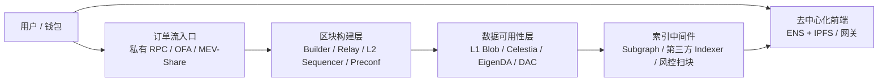

# 31 模块化栈、数据可用性、现代 MEV 与去中心化中间件

> 学习目标：读完本章，你能——
> 1. 识别模块化区块链的数据可用性（DA）层核心威胁：数据扣留攻击、DAS 轻节点假设、DAC 委员会串谋与 EIP-4844 Blob 修剪。
> 2. 拆解现代 MEV 供应链与区块构建演进中的安全边界：OFA / MEV-Share、ePBS / FOCIL、Based Rollup 预确认与 L2 / 跨链 MEV。
> 3. 防御去中心化存储与索引中间件风险：ENS / IPFS 网关劫持、The Graph / Subgraph 与第三方索引器投毒。
>
> 前置章节：[09 MEV 与签名安全](09-mev-signatures.md)、[16 共识层与链级安全](16-consensus-chain-security.md)、[17 节点、RPC 与验证者基础设施](17-node-rpc-infrastructure.md)、[20 前端、DNS 与供应链](20-frontend-dns-supply-chain.md)
> 配套章节：[C08 主流 Rollup 差异](chains/C08-rollups-op-arb-zkevm.md) ｜ [X32 L2、跨链桥与预言机运营方](arch/X32-l2-bridge-oracle-ops.md) ｜ 交互实验：[RPC 多源仲裁实验](interactive/rpc-quorum-lab.html)
> 最后核对：2026-11-23

## 开场：当合约、节点和密钥都完好，为什么用户资产依然无法取出

假设一条采用外部数据可用性委员会（DAC）的 Validium 链，合约代码通过了五轮审计，零知识证明验证器也没有漏洞。某天排序器提交了一个合法的新状态根，却故意不公开这批交易的原始明文数据（数据扣留攻击）。由于没有原始交易数据，任何用户都无法在本地构造自己余额的 Merkle 证明去触发 L1 强制退出——所有资金瞬间被锁死，直到排序器勒索成功。

🤔 先猜再看：零知识证明（ZK Proof）明明已经在数学上证明了状态转换合法，为什么缺失原始交易数据（DA）仍然能让用户取不出钱？

ZK 证明只证明“新状态根是由旧状态根经过合法交易算出来的”，它不告诉别人每个叶子节点（用户余额）现在是多少。用户在 L1 发起逃生舱强制提款时，必须出示自己的最新余额 Merkle 路径。如果排序器扣留了原始交易数据，用户就算不出最新 Merkle 路径，资产就会被永久冻结。

## 1. 一句话理解

Web3 架构模块化之后，**数据可用性（DA）、订单流与区块构建（MEV 供应链）、以及去中心化存储和索引中间件**构成了三条独立于合约代码之外的关键信任边界。

> 🎯 打个比方：智能合约是银行保险库的大门，模块化栈就像运钞路上的三道外围环节——**DA 层**是公开张贴的交易流水单（丢了流水就证明不了存款归谁），**MEV 供应链**是决定谁先排队的叫号系统，**IPFS/索引器**是银行大堂的电子公告牌（牌子被篡改，客户就会按假账号转账）。
> 比喻的局限：这三层之间存在联动放大效应——例如排序器与外部索引器同时被控时，监控告警与用户前端会同步失明。

## 2. 威胁模型：攻击者能控制什么

读图要点：
- **信任链条**：一笔交易从前端展示、发送订单流、排序出块、发布 DA 数据，再到被索引器读回前端，经过五个独立信任域。
- **典型攻击者能力**：恶意排序器/DAC 扣留数据；恶意 Builder 或 OFA 泄露/抢跑私有订单流；被劫持的 IPFS 网关或 Subgraph 返回篡改后的前端脚本或虚假链上余额。
- **局限**：主链共识节点本身并不感知前端网关、私有订单流或第三方索引器的异常。

## 3. 核心攻击路径与机制

### 3.1 数据可用性（DA）层安全

1. **数据扣留攻击（Data Withholding）**：区块提议者或 L2 排序器只广播区块头/状态根，隐藏交易主体数据，阻止欺诈证明挑战者验证或阻止用户生成强制退出证明。
2. **EIP-4844 Blob 过期与历史重建风险**：以太坊 L1 Blob 数据按协议约 18 天（4096 个 Epoch）后由共识层自动修剪。如果 Rollup 运营方、区块浏览器或交易所未独立归档历史 Blob，新节点将无法仅靠 L1 共识层从创世块完整重放 L2 状态。
3. **外部 DA（Celestia / EigenDA / Avail）与 DAC 信任差异**：
   - **DAC（数据可用性委员会）**：依赖 M-of-N 签名背书“我们存了数据”，委员会串谋即可实施数据扣留。
   - **DAS（数据可用性采样）**：轻节点通过随机抽样与纠删码（Erasure Coding）在概率上验证数据完整；安全前提是网络中存在足够数量的诚实轻节点且未遭受日蚀攻击（Eclipse Attack）。
   - **DA 桥验证滞后**：L1 结算合约依赖 DA 证明桥（如 Blobstream）确认外部 DA 已落盘，若证明桥多签失守，攻击者可伪造“数据已可用”证明。

### 3.2 现代 MEV 供应链与区块构建演进

在 [09 MEV 与签名安全](09-mev-signatures.md) 的三明治攻击与 [17 节点、RPC 与验证者基础设施](17-node-rpc-infrastructure.md) 的 Relay 集中度之外，现代 MEV 供应链演化出四类新边界：

| 机制 | 核心作用 | 新增安全与经济风险 | 缓解思路 |
|---|---|---|---|
| **OFA / MEV-Share** | 订单流拍卖，把部分 MEV 返还给用户 | 私有交易意图（Hint）过度暴露被 Searcher 逆向还原；OFA 运营方私吞返佣或审查交易 | 最小化暴露字段（隐藏精确路径与滑点），采用多 OFA 竞争与加密内存池 |
| **ePBS / FOCIL** | 协议内提议者-构建者分离与多验证者强制包含列表（Fork-Choice Enforced Inclusion Lists） | 消除对链下 Relay 的中心化信任，但需防范免费期权（Free Option）与包含列表垃圾填充 | 协议层惩罚未满足包含列表的区块提议者，监控审查延迟指标 |
| **Based Rollup 与预确认（Preconfirmation）** | 由 L1 提议者直接排序 L2 并提前给出毫秒级确认承诺 | 提议者违约（签了预确认却未打包进块，或重排交易套利） | 要求预确认提供方质押担保并配置链上可验证的罚没（Slashing）合约 |
| **L2 排序器 MEV 与跨链 MEV** | 如 Arbitrum Timeboost（拍卖优先车道）或跨链套利 | 排序器垄断延迟套利、时间竞拍串谋；跨链异步套利在预言机更新间隙抽干多链流动性 | 透明化排序规则、引入加密内存池、多链共享风控熔断 |

### 3.3 去中心化存储与索引中间件安全

1. **ENS + IPFS / Arweave 去中心化前端劫持**：
   - **域名与 Contenthash 篡改**：ENS 域名未配置多签+时间锁，或 ENS 到期被抢注，攻击者替换 `contenthash` 指向钓鱼前端。
   - **HTTP 网关单点风险**：绝大多数用户并非运行本地 IPFS 节点，而是通过中心化网关（如 `eth.limo`、`ipfs.io`）访问。一旦网关 DNS、CDN 或证书被劫持，底层 IPFS 哈希再不可变，用户浏览器拿到的仍是恶意 JS。
2. **The Graph / Subgraph 与第三方索引器投毒**：
   - 许多 DeFi 前端、交易机器人甚至交易所风控系统直接查询第三方索引器 API 来展示余额、计算健康因子或决定是否放行提现。
   - 若第三方索引器遭遇链重组未回滚、映射脚本存在逻辑漏洞或被攻击者控权，就会向前端返回伪造的授权状态、错误价格或漏报大额异动，诱导用户误签或让风控系统漏警。

## 4. 分层防御方法

- **DA 与 Rollup 接入层**：评估任何 L2/Validium 前，核对 L2BEAT 的 DA 类别（L1 Blob vs 外部 DA vs DAC）；关键业务自行归档历史 Blob，不把历史状态重建押注在第三方归档节点。
- **交易发送与 MEV 防护层**：高滑点或大额调仓交易走可信私有订单流（Protect / OFA）并设置严格 `minAmountOut` 与短 `deadline`；在协议层避免把清算或再平衡暴露成无保护的公开套利。
- **前端与索引中间件层**：
  1. ENS `contenthash` 变更纳入多签与时间锁，设置域名到期前 90 天自动续费与告警。
  2. 为核心用户提供可离线验证哈希的静态前端发布包（IPFS CID + GPG/Sigstore 签名）。
  3. 关键风控、账务与充值扫块**禁止单点信任第三方 Subgraph 或单一 RPC 索引器**，至少使用两套独立节点+自建索引做交叉仲裁（参见 [RPC 多源仲裁实验](interactive/rpc-quorum-lab.html)）。

## 5. 真实案例

- **以太坊 MEV-Boost Relay 漏洞导致约 2000 万美元三明治反杀事件（2023 年 4 月，Ethereum；公开来源：Flashbots 与安全公司复盘）**：恶意验证者利用早期 MEV-Boost Relay 在返回完整区块前未严格验证区块头有效性的缺陷，提前窥探并拆分了 Searcher 的交易捆绑包，反向盗走套利机器人约 2000 万美元资金。
- **去中心化前端网关与域名依赖教训（2022–2025 年多起案例；公开来源：项目方安全公告）**：多个宣称“前端已上 IPFS 抗审查”的 DeFi 协议，因主站 DNS 或公共 IPFS 网关配置被篡改，仍导致访问常规 Web 入口的用户连接了恶意前端；凸显“存储去中心化”不等于“访问入口去中心化”。

## 6. 审计与评估检查点

- [ ] **MOD-1** 接入或构建 L2 / Validium 时，是否明确记录 DA 模式（L1 Blob / 外部 DA / DAC）及数据扣留下的逃生舱可行性？
- [ ] **MOD-2** 若依赖 EIP-4844 Blob，机构或协议是否建立了超过 18 天修剪窗口的独立历史数据归档？
- [ ] **MOD-3** 大额协议调仓、金库兑换与做市交易是否使用私有订单流并强制设置严格滑点下限与过期时间？
- [ ] **MOD-4** 接入基于 Preconfirmation 或 Timeboost 的 L2 时，是否评估了排序器违约或优先车道抢跑对协议清算的影响？
- [ ] **MOD-5** ENS 域名所有权与 `contenthash` 更新是否受多签与时间锁保护，并配置了域名到期监控？
- [ ] **MOD-6** 去中心化前端发布流程是否同时校验 IPFS CID 与外部网关 CSP/SRI，防止网关层篡改脚本？
- [ ] **MOD-7** 前端展示的关键余额/授权、风控监控与充值扫块是否避免单点依赖第三方 Subgraph，并具备链重组回滚处理？
- [ ] **MOD-8** 是否对第三方索引器数据与直连全节点（`eth_call`）的关键读数实施定期或实时交叉校验？
- [ ] **MOD-9** 跨链协议是否评估了不同链出块延迟与预言机更新时差引发的跨链 MEV 抽血风险？

| 检查项 | 报告对应位置 | 失守时的典型定级 |
|---|---|---|
| MOD-1、MOD-5、MOD-7 | 资金冻结 / 前端投毒 / 假账风控失效 | 严重（Critical） |
| MOD-3、MOD-6、MOD-8 | MEV 资损 / 网关劫持 / 索引漂移 | 高危（High） |
| MOD-2、MOD-4、MOD-9 | 历史重建受阻 / 排序器与跨链套利风险 | 中危（Medium） |

## 7. 用户侧防护

1. 大额兑换优先开启钱包自带的 MEV 保护 RPC，并手动调低滑点容忍度（如主流稳定币对 ≤ 0.1%–0.3%）。
2. 访问常用 DeFi 协议时通过书签打开并核对域名，不要盲信搜索广告或陌生 IPFS 公共网关链接。
3. 将大额资产跨入外部 DA / DAC 模式的 Validium 前，先查明其是否具备无许可强制退出路径。

## 8. 术语表

| 术语 | 英文 | 一句话定义 |
|---|---|---|
| 数据扣留攻击 | Data Withholding Attack | 提议者或排序器只发布状态根而不公开交易原文，使他人无法验证状态或生成退出证明的攻击。 |
| 数据可用性采样 | DAS（Data Availability Sampling） | 轻节点通过随机抽查纠删码数据块，在无需下载全量数据的前提下高概率验证数据已公开的技术。 |
| 订单流拍卖 | OFA（Order Flow Auction） | 让搜索者或构建者竞价获取用户交易执行权，并将部分 MEV 收益返还给用户的机制。 |
| 预确认 | Preconfirmation | L1 提议者或排序器在区块正式上链前，向用户出具带罚没担保的快速打包承诺。 |

> 🪞 反思：如果你的协议或交易所风控系统今天突然收到第三方 Subgraph 返回的虚假余额或延迟 30 分钟的索引数据，你的系统会自动熔断，还是会照常放行提现与清算？

## 9. 思考题

1. 为什么采用 ZK 有效性证明的 Validium 链，如果关闭了 L1 数据可用性而改用中心化 DAC，用户资产依然存在被永久冻结的风险？
2. 对比公开内存池、私有 RPC 和 OFA（MEV-Share）三种发交易方式：各自减少了哪类攻击面，又引入了哪类新的信任假设？
3. 为什么说“把前端代码放上 IPFS + ENS”本身并不能完全防止前端钓鱼？从浏览器输入地址到页面执行 JS，中间还有哪些可被劫持的环节？
