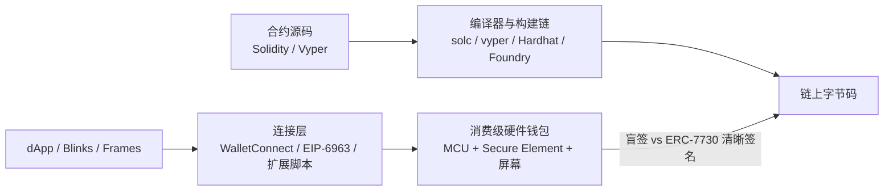

# 32 dApp 连接层、编译器工具链与硬件钱包底层安全

> 学习目标：读完本章，你能——
> 1. 识别 dApp 与钱包连接层的四类高危攻击面：WalletConnect 会话劫持、`window.ethereum` 注入竞态、浏览器扩展 Content Script 篡改，以及 Blinks / Frames 社交嵌入式签名钓鱼。
> 2. 理解编译器与构建工具链漏洞（Vyper 重入锁失效、Solidity `--via-ir` 语义差异、插件投毒）为什么会击穿已经审计过的源码。
> 3. 掌握消费级硬件钱包的底层物理/固件攻防（安全芯片、侧信道、故障注入）与 **ERC-7730（清晰签名）** 协议的落地原理。
>
> 前置章节：[04 重入攻击](04-reentrancy.md)、[18 钱包与密钥管理](18-wallet-key-management.md)、[19 用户侧诈骗](19-user-scams.md)、[20 前端、DNS 与供应链](20-frontend-dns-supply-chain.md)
> 配套章节：[X37 钱包厂商安全](arch/X37-wallet-vendor-security.md) ｜ [X40 TEE、HSM 与密钥仪式](arch/X40-tee-hsm-key-ceremony.md) ｜ 代码示例：[vyper-reentrancy/](../practice-example-code/non-evm/vyper-reentrancy/README.md) ｜ 交互实验：[钓鱼签名识别](interactive/phishing-signature-lab.html)
> 最后核对：2026-11-23

## 开场：源码里明明写了 `@nonreentrant`，为什么四个资金池还是被瞬间抽空

2023 年 7 月，Curve Finance 多个稳定币池在几小时内被盗约 6200 万美元（事发时估值；公开来源：Vyper 官方复盘与安全公司分析）。审计报告早已确认合约源码里正确添加了 `@nonreentrant('lock')` 修饰器。真正的罪魁祸首不是开发者，而是 **Vyper 0.2.15–0.3.0 编译器本身**——它在编译时给不同函数上的同名重入锁分配了**不同的存储槽位**，导致跨函数重入锁形同虚设。

<details class="predict">
<summary>🤔 先猜再看：除了编译器漏洞，为什么“经过审计的合约 + 正版硬件钱包”组合，在用户点击签名那一刻依然经常失守？</summary>

因为在“合约源码”和“硬件屏幕”之间还隔着一条脆弱的链条：浏览器扩展注入、WalletConnect 中继会话、社交卡片（Blinks/Frames）和原始十六进制 Calldata。只要其中任何一环篡改了交易参数，而硬件钱包又因缺少结构化元数据只能要求用户“盲签（Blind Signing）”，硬件芯片再安全也拦不住用户亲手批准恶意交易。
</details>

## 1. 一句话理解

Web3 安全的最后三道底层盲区分别是：**把网页连向钱包的通信协议层、把源码变成字节码的编译器工具链、以及保护私钥并展示交易原文的硬件终端层**。

> 🎯 打个比方：源码审计像检查支票上的条款，编译器是印钞厂的排版机（排版机出错，印出来的支票就会少一条限制），WalletConnect/浏览器扩展是递支票的跑腿员，硬件钱包屏幕是最后核对金额的验钞机——如果验钞机只显示一串乱码哈希（盲签），前面全白搭。
> 比喻的局限：硬件钱包的物理攻击（侧信道、电压故障注入）属于线下实验室级别攻击，前提是攻击者必须物理接触到设备。

## 2. 威胁模型：攻击者能控制什么



读图要点：
- **两条并行风险线**：上方是“代码 → 字节码”的构建供应链；下方是“网页/社交卡片 → 钱包连接 → 硬件屏幕”的签名路径。
- **关键失效点**：编译器静默生成错误字节码；恶意扩展在页面层劫持 `window.ethereum`；硬件钱包缺乏 ERC-7730 元数据被迫回退盲签。
- **防御闭环**：构建侧靠固定安全版本 + 可复现构建 + 字节码验证；签名侧靠 EIP-6963 隔离 + WalletConnect Verify + ERC-7730 清晰签名。

## 3. 核心攻击路径与机制

### 3.1 dApp 连接协议与客户端交互层

1. **WalletConnect v2 会话与配对钓鱼**：
   - 攻击者诱导用户扫描或点击恶意配对 URI，建立持久化会话后，在用户毫无防备时静默推送 `eth_signTypedData_v4`（如 Permit2 授权）弹窗。
   - 若钱包未接入并强制展示 **Verify API** 的域名校验警告，用户无法分辨弹窗请求究竟来自官网还是仿冒域名。
2. **`window.ethereum` 注入竞态与 EIP-6963**：
   - 传统钱包通过向网页全局变量 `window.ethereum` 挂载对象来通信，多个扩展同时注入时会互相覆盖，恶意扩展可抢先劫持 `window.ethereum.request` 并在发往真实钱包前偷换收款地址。
   - **EIP-6963** 通过浏览器自定义事件（`eip6963:announceProvider`）让每个钱包以独立对象和元数据声明自己，消除了全局单点覆盖竞态。
3. **浏览器扩展 Content Script 与 RPC 拦截**：
   - 拥有 `<all_urls>` 权限的恶意或被收购的普通浏览器扩展（如翻译、比价插件），可向页面注入脚本劫持 RPC 响应，把前端显示的“合约地址”或“安全检查结果”伪装成正常。
4. **Solana Blinks 与 Farcaster Frames（社交嵌入式签名）**：
   - 用户无需跳转到 dApp 官网，直接在 X（Twitter）时间线或 Farcaster 信息流里点击卡片即可拉起钱包签名。
   - **新攻击面**：攻击者在看似正常的帖子中嵌入恶意 Action URL；或劫持合法项目方的 Action 后端 API，把正常铸造请求动态替换为清空钱包的交易。防御关键在于钱包端对 Action 域名的白名单注册表校验与强制交易模拟预览。

### 3.2 编译器与构建工具链安全

1. **Vyper 重入锁编译器漏洞（0.2.15–0.3.0）**：
   - 即使源码里所有关键函数都写了 `@nonreentrant('lock')`，旧版 Vyper 编译器按函数生成了各自独立的存储槽位，导致 `remove_liquidity` 回调外部时可以重入 `add_liquidity` 或 `exchange`。

```python
# ❌ 漏洞历史场景（Vyper 0.2.15 - 0.3.0 编译器缺陷，非源码语法错误）
@external
@nonreentrant('lock')
def remove_liquidity():
    # 在受影响版本中，此函数与下面函数的锁槽位不一致！
    raw_call(msg.sender, b"", value=self.balances[msg.sender])

@external
@nonreentrant('lock')
def add_liquidity():
    # 攻击者可在回调中重入此函数，读取未更新的池子状态
    pass

# ✅ 修复：升级至 Vyper >= 0.3.1（修复统一锁槽位），并严格遵循 CEI 模式（先改状态再外部调用）
```

2. **Solidity 编译器与 `--via-ir` 流水线差异**：
   - 开启 `--via-ir`（通过 Yul 中间表示优化编译）能解决 `Stack too deep` 并节省 Gas，但它曾出现过与旧版流水线不一致的优化器边界 Bug（如特定内联汇编与内存清理假设冲突、ABI 解码优化差异）。
   - **工程准则**：避免在生产主网直接使用刚发布不到 1 个月的最新 `solc` 小版本；切换 `--via-ir` 后必须全量重跑不变量测试与字节码级差异复核。
3. **Hardhat / Foundry 工具链与构建投毒**：
   - 攻击者通过投毒 npm 插件（如伪造 Hardhat 验证插件）、恶意 Foundry 依赖库或诱导在 CI 中执行带 `--ffi` 的测试脚本，直接窃取开发者本机 `.env` 中的部署私钥或篡改编译产物。

### 3.3 消费级硬件钱包底层与 ERC-7730 清晰签名

1. **硬件底层攻击面**：
   - **供应链与 Evil Maid 攻击**：设备在出厂至收货途中被拆封刷入恶意固件或预置助记词卡片。对策：拒绝任何非官方渠道设备，首次开机必须通过设备内置安全芯片完成**真伪证明（Genuine Check）**并自行现场生成助记词。
   - **通用 MCU vs 安全芯片（Secure Element, SE）**：没有独立安全芯片的早期或低配硬件钱包，私钥存储在普通微控制器 Flash 中，攻击者物理拿到设备后可通过**电压故障注入（Voltage Fault Injection / Glitching）**跳过芯片读保护（RDP）直接导出加密种子，再离线暴力破解弱 PIN 码。
   - **侧信道分析（Side-Channel Attack）**：通过测量签名瞬间芯片的功耗（DPA）或电磁辐射曲线，逐步推导出私钥位。具备 EAL5+/6+ 认证的安全芯片会在硬件层引入随机掩码、恒定时间运算和主动防护网格来抵御物理提取。
2. **从盲签到 ERC-7730（Clear Signing 清晰签名）**：
   - 硬件钱包芯片算力与屏幕空间极小，无法内置全网所有 DeFi 协议的 ABI，导致用户与复杂合约交互时只能开启“Blind Signing”，屏幕上只显示 `Data: 0x095ea7b3...`。
   - **ERC-7730** 定义了一套标准化的 JSON 描述符（Descriptor），由协议方发布并经签名/注册表审核，把合约函数选择器、字段偏移量映射为人类可读意图（例如“将 500 USDC 授权给 Uniswap Router”），硬件钱包在离线校验元数据签名后，直接在**可信硬件屏幕**上逐字段渲染，彻底切断被劫持前端的欺骗路径。

## 4. 分层防御方法

- **dApp 与协议方**：
  1. 前端接入 EIP-6963 钱包发现机制，集成 WalletConnect Verify 域名验证。
  2. 为核心主网合约编写并提交 **ERC-7730** 清晰签名描述符，让主流硬件钱包原生展示可读意图。
  3. 锁定经过充分验证的 `solc` / `vyper` 版本，在 CI 中禁用非必要 `--ffi`，发布后同步在 Sourcify / Etherscan 完成可复现字节码验证。
- **钱包与基础设施团队**：
  1. 强制对 Blinks / Frames 与 WalletConnect 请求执行域名信誉检查和全量交易模拟。
  2. 消费级硬件采用带安全芯片架构 + 固件签名校验 + 支持 ERC-7730 元数据离线验签。

## 5. 真实案例

- **Curve Finance Vyper 编译器重入锁事故（2023 年 7 月，Ethereum，损失约 6200 万美元，事发时估值，后部分追回；公开来源：Vyper 官方公告与 BlockSec 复盘）**：`pETH/ETH`、`msETH/ETH`、`alETH/ETH`、`CRV/ETH` 四个池子因使用 Vyper 0.2.15–0.3.0 编译导致 `@nonreentrant` 失效而被重入抽干，成为史上影响最大的智能合约编译器漏洞事件。
- **消费级硬件钱包电压故障注入演示（2020–2023 年，公开来源：Kraken Security Labs、Unphishable 等硬件安全研究报告）**：研究人员证明，在没有安全芯片保护的通用 MCU 设备上，物理接触设备 15 分钟内即可通过电压毛刺绕过读保护提取加密种子（强 Passphrase 仍可阻止离线爆破）。

## 6. 审计与评估检查点

- [ ] **DCH-1** dApp 前端是否已迁移至 EIP-6963 钱包发现，避免 `window.ethereum` 全局覆盖风险？
- [ ] **DCH-2** WalletConnect 集成是否启用 Verify API 域名验证，并在断开连接时主动销毁过期会话？
- [ ] **DCH-3** 若项目提供 Solana Blinks / Farcaster Frames，Action API 后端是否具备鉴权、HTTPS 防篡改与响应签名保护？
- [ ] **DCH-4** 合约使用的 `solc` / `vyper` 编译器版本是否已对照官方已知 Bug 列表（`bugs_by_version.json`）排查，禁止使用受已知高危 Bug 影响的编译器版本？
- [ ] **DCH-5** 若启用 `--via-ir` 或高优化参数，是否在相同配置下完成了全部模糊测试、不变量测试与最终字节码核对？
- [ ] **DCH-6** Hardhat / Foundry 项目是否锁死依赖哈希、禁用不受控的 `--ffi` 脚本，且部署私钥不以明文存入 `.env`？
- [ ] **DCH-7** 主网核心交互合约是否提供并维护 ERC-7730 清晰签名描述符，减少用户被迫开启盲签的场景？
- [ ] **DCH-8** 机构与高净值人员采购的硬件钱包是否具备独立安全芯片（SE）、固件真伪校验，且启用了独立强 Passphrase（第 25 词）？
- [ ] **DCH-9** 浏览器签名环境是否与日常办公浏览彻底隔离（专用纯净浏览器 Profile，零无关第三方扩展）？

| 检查项 | 报告对应位置 | 失守时的典型定级 |
|---|---|---|
| DCH-4、DCH-6、DCH-8 | 编译器漏洞 / 私钥泄露 / 物理提取 | 严重（Critical） |
| DCH-1、DCH-2、DCH-3、DCH-9 | 连接层劫持 / 社交签名钓鱼 | 高危（High） |
| DCH-5、DCH-7 | 编译语义偏差 / 盲签风险暴露 | 中危至高危（Medium / High） |

## 7. 用户侧防护

1. 为加密钱包单独创建一个纯净浏览器配置文件，**不安装任何翻译、截图、比价或广告插件**。
2. 硬件钱包只在官方直营渠道购买，开机先验证固件真伪，并设置独立的强 Passphrase（即使设备被物理偷走并提取芯片数据，无 Passphrase 也无法派生真实资金地址）。
3. 尽量关闭硬件钱包的“全局盲签”，优先使用支持清晰签名（ERC-7730）的钱包与固件版本；在社交平台看到 Blinks / Frames 卡片时，大额交互务必回到官网核对。

## 8. 术语表

| 术语 | 英文 | 一句话定义 |
|---|---|---|
| EIP-6963 | Multi Injected Provider Discovery | 通过浏览器事件隔离多个钱包注入对象的以太坊标准，解决 `window.ethereum` 互相覆盖冲突。 |
| 清晰签名 | Clear Signing（ERC-7730） | 用标准化元数据把合约原始 Calldata 在硬件钱包可信屏幕上渲染为可读字段的协议。 |
| 电压故障注入 | Voltage Fault Injection | 通过在微秒级瞬时拉低芯片供电电压，诱发芯片跳过安全读保护或密码校验指令的物理攻击。 |
| 侧信道攻击 | Side-Channel Attack | 不直接破解算法，而是通过分析芯片执行运算时的功耗、电磁辐射或耗时差异来推断私钥的攻击。 |

> 🪞 反思：你当前正在审计或维护的合约仓库里，上一次核对 `foundry.toml` / `hardhat.config.js` 里的编译器版本与已知编译器 Bug 清单是什么时候？

## 9. 思考题

1. 为什么在 2023 年 Curve 事故中，严格遵守 CEI（Checks-Effects-Interactions）模式的池子即便使用了受漏洞影响的 Vyper 编译器，也能免于或大幅降低重入损失？
2. 对比 `window.ethereum` 与 EIP-6963：EIP-6963 解决了什么问题，又**不能**解决哪类浏览器端攻击（例如恶意扩展篡改页面 DOM）？
3. 在消费级硬件钱包上，为什么“强 Passphrase（第 25 词）”能够作为抵御物理芯片提取（电压故障注入）的最后一道有效防线？
