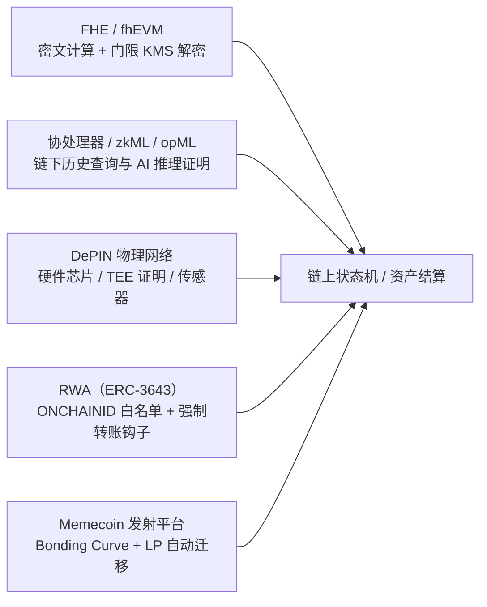

# 33 前沿赛道安全：FHE、可验证计算、DePIN、RWA 标准与 Memecoin 发射

> 学习目标：读完本章，你能——
> 1. 识别全同态加密（FHE / fhEVM）与链下协处理器 / 可验证 AI（zkML / opML）在密文访问控制、门限解密和计算证明边界上的特有漏洞。
> 2. 拆解 DePIN 物理硬件证明与激励作弊的攻防要点。
> 3. 评估 RWA 合规代币（ERC-3643）与 DeFi 组合时的冲突风险，以及 Memecoin 联合曲线（Bonding Curve）与发射平台的典型资金陷阱。
>
> 前置章节：[14 ZK 与证明系统](14-zk-proof-systems.md)、[19 用户侧诈骗](19-user-scams.md)、[26 AI × Web3 安全](26-ai-web3-security.md)
> 配套章节：[X34 稳定币与 RWA 发行方](arch/X34-stablecoin-rwa-issuer-ops.md) ｜ [A05 上币与合作尽调](assessment/A05-listing-due-diligence.md) ｜ 交互实验：[上币尽调评分卡](interactive/listing-scorecard.html)
> 最后核对：2026-11-23

## 开场：当“全部加密”或“完全合规”遇上公开组合的链上世界

一个隐私借贷协议引入了全同态加密（FHE），把用户余额和出价全部密文上链。开发者以为“密文即绝对安全”，却忘记在合约里给中间计算结果的密文句柄配置访问控制列表（ACL）——攻击者只需调用一次视图接口，就让门限解密网络把别人的隐藏出价解了出来。另一边，一个 RWA 协议把支持“合规强制回收（Forced Transfer）”的 ERC-3643 代币直接放进了标准借贷池，结果发行方冻结了某个黑名单地址的抵押品，导致清算人无法清算，整个借贷池留下巨额坏账。

<details class="predict">
<summary>🤔 先猜再看：为什么“支持管理员冻结或强制转移”的合规 RWA 代币，一旦直接接入无许可 DeFi 借贷池或 AMM 池，反而会制造系统性坏账？</summary>

无许可 DeFi 协议默认抵押品随时可自由转移与清算。如果 RWA 代币因为链下合规原因触发黑名单冻结、白名单限制（清算人未通过 KYC）或强制扣划，清算交易会持续回滚，坏账迅速累积并转嫁给池中所有正常存款人。
</details>

## 1. 一句话理解

前沿赛道并没有消灭旧漏洞，而是把攻击面延伸到了**密文权限（FHE）、链下计算证明边界（zkML/opML）、物理设备真实性（DePIN）、合规钩子冲突（ERC-3643）以及高频发行博弈（Memecoin 联合曲线）**五个新战场。

> 🎯 打个比方：传统合约安全像防小偷撬门；前沿赛道安全像同时面对五种新场馆——**FHE** 是戴着手套在黑箱里算账（但忘了锁上取件口 ACL），**DePIN** 是按步数发奖金（但有人把手机绑在摇步器上），**RWA** 是把带法院查封条款的房产证放进 24 小时自助典当行。
> 比喻的局限：这五个领域底层技术差异极大，但在审计方法论上共享同一条原则——**追踪外部信任假设在何处进入链上状态机**。

## 2. 威胁模型：五大前沿赛道的信任边界



读图要点：
- **共同弱点**：五个赛道的核心资损几乎都发生在**“链下/密文/合规/发行机制”与“链上结算合约”的接缝处**。
- **审计重心**：不仅要看合约代码行，更要核对门限密钥、证明输入绑定、硬件根信任、法律权属与流动性迁移顺序。

## 3. 五大赛道的核心漏洞与机制

### 3.1 FHE（全同态加密，如 fhEVM）安全

全同态加密允许合约直接对密文执行加减、比较和条件选择（`TFHE.select`），但引入四类新缺陷：
1. **ACL（访问控制列表）配置疏漏**：FHE 合约必须显式声明哪个地址有权访问或请求解密某个密文句柄（Handle）。漏设或错设 ACL 会导致任意用户读取他人隐私状态。
2. **分支与 Gas 侧信道泄露**：在链上根据密文比较结果走不同 `if/else` 分支（而非恒定路径的 `select`），或让交易在密文不满足条件时 `revert`，都会通过执行路径和 Gas 消耗直接暴露密文大小。
3. **异步解密回调重放与竞态**：密文解密通常由链下门限 KMS 网络异步回调写入链上。若回调入口未校验请求 ID、回调发送方（Gateway）或状态阶段，攻击者可重放旧解密结果或抢跑改变上下文。
4. **门限 KMS 串谋风险**：如果负责解密的门限节点数量过少或由单一实体控制，链上所谓“隐私”就会沦为可被随时窥探的伪隐私。

```solidity
// ❌ 漏洞：直接把密文比较结果解密后再分支，或漏掉异步解密回调的请求归属校验
function onDecryptCallbackVulnerable(uint256 requestId, uint64 decryptedAmount) external {
    // 未校验 msg.sender == kmsGateway，也未防 requestId 重放！
    pendingPayouts[requestId] = decryptedAmount;
}

// ✅ 修复：严格校验 KMS Gateway、防重放标记，且在链上逻辑中尽量使用无分支密文选择
function onDecryptCallbackSafe(uint256 requestId, uint64 decryptedAmount) external {
    require(msg.sender == kmsGateway, "only gateway");
    require(!processedRequests[requestId], "replayed");
    processedRequests[requestId] = true;
    pendingPayouts[requestId] = decryptedAmount;
}
```

### 3.2 链下协处理器与可验证 AI（Coprocessor / zkML / opML）

- **链下协处理器（Axiom、Brevis 等）**：把海量历史区块状态查询移至链下计算并生成 ZK 证明回传链上。风险在于**输入承诺绑定缺失**（例如未把证明对应的区块高度范围、合约地址和链 ID 绑定进公开输入，导致拿旧区块历史数据冒充最新状态）以及电路约束不足（参见 [14 ZK 与证明系统](14-zk-proof-systems.md)）。
- **zkML（零知识机器学习）**：神经网络浮点权重必须量化为有限域定点整数才能进电路；量化误差可能改变边界分类结果，且如果电路只证明了“某个模型算出了结果”而未把**官方模型权重哈希**固化为公开输入，攻击者可替换为自制假模型通过验证。
- **opML（乐观机器学习）**：先提交推理结果、允许挑战期用交互式欺诈证明推翻。高风险点在于 GPU/浮点运算在不同硬件上的**非确定性微小误差**被恶意利用发起无效挑战，或挑战期过短导致验证者来不及复算。

### 3.3 DePIN（去中心化物理基础设施）安全

DePIN 通过代币激励分布式物理资源（无线热点、GPU 算力、位置传感、带宽），核心攻击是**“伪造物理贡献套取激励”**：
1. **硬件女巫与虚拟机冒充（Sybil）**：攻击者用云服务器脚本模拟成千上万台物理矿机刷取空投或在线奖励。
2. **TEE 远程证明（Remote Attestation）欺骗与密钥提取**：若设备私钥明文写在可刷写的固件中，攻击者拆解一台真实设备提取私钥，即可克隆出无数“合法设备”上报假数据；即便是 TEE，也需防范过期固件证书未吊销与已知侧信道漏洞。
3. **传感器与地理围栏造假**：通过 GPS 信号模拟器、代理转发（Relay Attack）伪造覆盖范围或带宽测速。
4. **激励经济失衡**：代币排放速度高于真实外部需求收入，一旦奖励曲线设计不当，女巫团伙的边际作弊成本低于补贴收益，会迅速抽干国库。

### 3.4 RWA 合规代币标准（ERC-3643 / T-REX）合约安全

ERC-3643 是机构级 RWA（美债、基金份额、证券型代币）广泛采用的合规标准，核心特点是在每次 `transfer` 前自动查询链上身份注册表（ONCHAINID）与合规模块（Compliance Contract）。将其接入 DeFi 或交易所时有四类高频隐患：
- **强制转账（`forcedTransfer`）与资产冻结（`setAddressFrozen`）破坏协议账本**：发行方或合规官可在不经过 `approve` 的情况下划走合约内余额，直接打破 DeFi 金库的 `totalAssets == balanceOf(vault)` 不变量。
- **白名单阻断清算与提取**：如果清算机器人或 AMM 路由合约不在白名单内，抵押品无法被清算或提取，引发连环坏账。
- **链下法律权属脱钩**：代币合约本身无漏洞，但链下托管银行破产隔离不足或储备审计造假，导致链上 1:1 赎回权失效（运营控制见 [X34 稳定币与 RWA 发行方](arch/X34-stablecoin-rwa-issuer-ops.md)）。

### 3.5 Memecoin 发射平台与联合曲线（Bonding Curve）攻防

高频散户资损高度集中在 Memecoin 发射平台（如 pump.fun 类联合曲线发射）与无许可新币：
1. **联合曲线（Bonding Curve）抢跑与狙击**：开盘同区块内，创建者或 MEV 机器人通过多地址捆绑买入占据极低成本筹码，推高曲线价格后砸盘收割散户。
2. **毕业迁移流动性（LP Migration）漏洞**：当代币募资达到阈值从联合曲线迁移到 DEX（如 Uniswap / Raydium）建池时，历史上曾多次出现攻击者**提前用极小金额抢先创建目标交易对并设定极端初始价格**，导致发射平台迁移脚本按错误价格注入全部募集资金而被瞬间套空。
3. **蜜罐（Honeypot）与隐蔽后门**：创建者通过动态修改买卖税率至 99%、限制非白名单地址卖出、在 `transfer` 中隐藏增发/拉黑逻辑，或伪造“已放弃权限 / 已销毁 LP”（实际保留代理升级权或隐蔽白名单）实施 Rugpull。

## 4. 分层防御方法

- **FHE / 可验证计算**：强制所有敏感状态使用无分支密文原语，校验 KMS 回调来源与重放标志；zkML / 协处理器必须将模型哈希、区块高度与链 ID 绑定至公开输入。
- **DePIN**：结合不可导出安全元件（Hardware Root of Trust）、定期证书吊销列表（CRL）、物理交叉验证（如多节点三角测距/随机算力挑战）与罚没质押金，抬高作弊成本。
- **RWA（ERC-3643）**：DeFi 协议接入 RWA 代币时必须使用独立隔离池（Isolated Market），禁止与高流动性蓝筹资产混池，且对清算人白名单和冻结事件配置熔断预案。
- **Memecoin 发射平台**：迁移流动性时先检查目标池是否已被抢注，若已存在则绕过或校验池子现货价与目标价偏差；上币与钱包侧结合 [A05 上币与合作尽调](assessment/A05-listing-due-diligence.md) 执行自动蜜罐模拟卖出测试。

## 5. 真实案例

- **联合曲线毕业迁移抢注建池事故（2024 年，多起 EVM/Solana 发射平台事件；公开来源：安全公司链上预警分析）**：多个仿盘发射平台在自动向 DEX 迁移流动性时未校验目标池是否已被提前创建，攻击者抢先创建 1 wei 极端比例池子，导致迁移脚本注入的数十至数百万美元流动性瞬间被套利抽走。
- **Memecoin 发射平台内部人闪电贷盗窃事件（2024 年 5 月，Solana，损失约 190 万美元，事发时估值；公开来源：pump.fun 复盘公告）**：前员工滥用未及时回收的特权提款权限，配合闪电贷买满联合曲线并抽走迁移前的联合曲线资金，凸显平台特权隔离与离职权限回收同样决定发射平台生死。

## 6. 审计与评估检查点

- [ ] **FRT-1** FHE 合约中所有中间与最终密文句柄是否设置了最小权限 ACL，且避免了基于密文的明文分支与条件回滚？
- [ ] **FRT-2** FHE 异步解密回调是否校验 Gateway 地址、请求 ID 防重放以及回调时的状态一致性？
- [ ] **FRT-3** 协处理器与 zkML 合约是否将模型权重哈希、源链 ID、区块高度范围与目标合约地址全部绑定到 ZK 公开输入？
- [ ] **FRT-4** opML / 乐观验证系统是否消除浮点非确定性差异，且挑战期足以覆盖网络拥堵与全量复算？
- [ ] **FRT-5** DePIN 激励系统是否结合硬件根信任（SE/TEE）、固件吊销与随机物理挑战，防止虚拟机女巫刷量？
- [ ] **FRT-6** 接入 ERC-3643 等合规 RWA 代币的 DeFi 协议是否采用隔离池，并处理了 `forcedTransfer`、地址冻结与白名单拦截清算的异常场景？
- [ ] **FRT-7** Memecoin 发射平台的联合曲线数学是否检查舍入方向与溢出，且 LP 自动迁移逻辑能否防御“抢先建池设极端价格”攻击？
- [ ] **FRT-8** 发射平台迁移权限与手续费提取权限是否由多签+时间锁控制，防止内部人直接抽走尚未毕业的曲线资金？
- [ ] **FRT-9** 交易所或钱包展示新发射代币时，是否自动化模拟“买入 + 卖出”闭环，识别高税率、黑名单和隐藏增发后门？

| 检查项 | 报告对应位置 | 失守时的典型定级 |
|---|---|---|
| FRT-2、FRT-3、FRT-7、FRT-8 | 解密伪造 / 证明绕过 / 流动性被抽空 | 严重（Critical） |
| FRT-1、FRT-5、FRT-6 | 密文泄露 / 女巫掏空激励 / 隔离池坏账 | 高危（High） |
| FRT-4、FRT-9 | 挑战失效 / 蜜罐识别漏报 | 中危至高危（Medium / High） |

## 7. 用户侧防护

1. 参与新发射 Memecoin 前，使用链上模拟工具确认“能买也能卖”、买卖税率正常且无隐蔽铸币/拉黑权限，避免在联合曲线临近毕业时无保护高滑点追高。
2. 投资 RWA 代币时，不仅要看智能合约审计，更要核查链下法律托管结构、赎回门槛以及是否具备白名单冻结条款。
3. 购买 DePIN 矿机前，警惕脱离真实外部需求的“纯庞氏回本模型”，确认设备硬件身份与激励释放规则透明可审计。

## 8. 术语表

| 术语 | 英文 | 一句话定义 |
|---|---|---|
| 全同态加密 | FHE（Fully Homomorphic Encryption） | 允许在不解密数据的前提下，直接对密文执行算术与逻辑运算的密码学技术。 |
| 零知识机器学习 | zkML（Zero-Knowledge Machine Learning） | 用零知识证明验证“指定 AI 模型对给定输入确实算出了该输出”的技术。 |
| ERC-3643（T-REX） | Permissioned Token Standard | 内置链上身份注册表与合规校验钩子的许可型 RWA 代币标准，支持白名单、冻结与强制转账。 |
| 联合曲线 | Bonding Curve | 根据代币当前已发行量按确定性数学公式自动定价的链上发行与做市机制。 |

> 🪞 反思：如果明天业务团队要求接入一个基于 ERC-3643 的国债代币或一个使用 zkML 的链上风控预言机，你现有的审计清单（只看重入、溢出和预言机）会漏掉哪三条最致命的信任边界？

## 9. 思考题

1. 在 FHE 合约中，为什么“用 `require(decrypt(balance >= amount))` 判断余额是否足够”会泄露用户隐私，而改用密文条件选择（余额不足时实际转账密文 `0`）能缓解侧信道？
2. 某发射平台在联合曲线募满 20 ETH 后，自动把 20 ETH 和剩余代币注入 Uniswap V2 交易对。如果攻击者提前 1 个区块用 `0.0001 ETH + 1 枚代币` 建好了该交易对，发射平台直接调用 `addLiquidity` 会发生什么？该如何修复？
3. 对比 ERC-20 与 ERC-3643：为什么在借贷协议中把 ERC-3643 资产设为抵押品时，必须为清算机器人单独设计合规白名单与坏账隔离机制？
