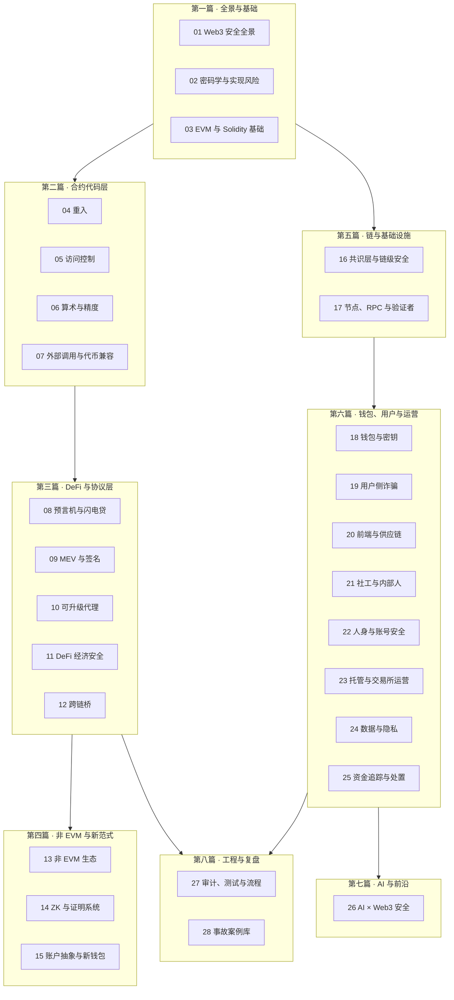

# Web3 安全学习手册（合约 · 链与基础设施 · 钱包与运营 · 评估）

> 目标：由浅入深，理解 Web3 资产从**生成密钥**到**出事后追回**的每个环节会在哪里出错、怎样防御、怎样评估。合约代码只是其中一环。
> 形式：Markdown 章节（文字 + Mermaid 图）+ HTML 交互实验 + 可编译的漏洞 / 修复示例合约 + 评估模板。
> 风格：80% 遵循 ASD-STE100 受控语言（短句、主动语态、一词一义），20% 用比喻和案例。见 [WRITING-GUIDE.md](WRITING-GUIDE.md)。
> 视角：以交易所 / 项目方安全团队为主；每章另有一节"用户侧防护"。
> 姊妹篇：[《CEX 交易所学习手册》](../CEX/README.md) ｜ [《Web3 合约与项目学习手册》](../Contract/README.md) ｜ 事故详解：[《Web3 行业安全资损 101》](../web3-loss-101/index.html)

> 💡 注意：本手册由《合约安全学习手册》升级而来，全书已重新编号。原 01–13 章现在是 01、03–12、27、28 章。旧链接会自动跳转到新章节。全部 28 章已完成。

> 🧭 不知道从哪里开始？打开[学习路径导航](interactive/learning-paths.html)，回答 4 个问题，得到适合你的路径。

> 🗂 先获取仓库：本手册的示例代码和靶场都在 GitHub 仓库里。先下载，再**进入 `web3-security-handbook/` 目录**，之后全书的命令都从这个目录运行。详细步骤见 [B04 第 6 节](bootcamp/B04-setup.md)。
>
> ```bash
> git clone https://github.com/ocean-8848/web3-security-handbook.git  # 下载仓库
> cd web3-security-handbook                                           # 进入仓库根目录：之后都从这里出发
> bash practice-example-code/setup.sh                                 # 下载依赖（只需一次）
> ```

## 1. 一张图看懂学习路径



读图要点：

- 第一篇建立两样东西：资产生命周期上的攻击面地图，以及"攻击者能控制什么"的思维方式。
- 第二到第四篇讲**链上**：合约代码、DeFi 协议、非 EVM 链和新的账户模型。
- 第五到第七篇讲**链下**：链本身、基础设施、钱包、人和组织。近年最大的损失大多发生在这里。
- 第八篇把两条线汇合：怎样把安全写进流程，怎样从事故中学习。
- 局限：章节按主题划分，真实事故通常跨越多个章节。例如 Bybit 事故同时涉及 09（签名）、18（多签运营）、20（前端供应链）和 21（社工）。

## 2. 章节目录

### Web3 安全训练营（[bootcamp/](bootcamp/B00-roadmap.md)）

如果你准备做 Web3 安全，或者还没写过合约，从这里开始。训练营有两条线：合约审计主线（阶段 0–7）从零基础一步步走到能独立交付审计报告；链下赛道（L1 个人与终端安全、L2 基础设施与运营）完成阶段 1 后就能开始。每个阶段先读导读：它列出本阶段要掌握的主题、在哪学、怎样算掌握。每一步都有可复制的命令、过关标准和原创靶场。训练营融合了《智能合约安全审计 101》的内容，覆盖慢雾《智能合约审计工程师学习路线图》的全部条目（对照表见 [B02](bootcamp/B02-study-method.md)）。与前八篇重合的漏洞原理不重复收录，直接链接到主线章节。

| 阶段 | 阶段导读（目标、主题、过关标准） | 章节（按学习顺序） |
|---|---|---|
| 训练营总览 | — | [B00 从零到专家：训练营路线](bootcamp/B00-roadmap.md)（不属于任何阶段，开始前先读） |
| 阶段 0 整装待发：环境与第一个合约 | [B01 导读](bootcamp/B01-stage0-guide.md) | [B02 学习心法与每日训练](bootcamp/B02-study-method.md)、[B03 区块链基础](bootcamp/B03-blockchain-basics.md)、[B04 环境搭建](bootcamp/B04-setup.md)、[B05 第一个合约](bootcamp/B05-first-contract.md)、[B06 Foundry 基本功](bootcamp/B06-foundry-basics.md) |
| 阶段 1 初窥门径：合约安全入门 | [B07 导读](bootcamp/B07-stage1-guide.md) | [B08 代币与小金库](bootcamp/B08-tokens-and-vault.md)、[B09 读代码与攻击者思维](bootcamp/B09-reading-code-mindset.md)、[B10 CTF 入门关卡](bootcamp/B10-ctf-practice.md) |
| 阶段 2 小试牛刀：能审小合约 | [B11 导读](bootcamp/B11-stage2-guide.md) | [B12 Foundry 进阶](bootcamp/B12-foundry-advanced.md)、[B13 第 1 次审计](bootcamp/B13-audit-1-notebox.md)、[B14 写好一个发现](bootcamp/B14-writing-findings.md)、[B15 第 2 次审计](bootcamp/B15-audit-2-luckypot.md) |
| 阶段 3 渐入佳境：能审 DeFi | [B16 导读](bootcamp/B16-stage3-guide.md) | [B17 DeFi 地图与头部协议](bootcamp/B17-defi-basics.md)、[B18 DEX 与 AMM](bootcamp/B18-dex-amm.md)、[B19 第 3 次审计](bootcamp/B19-audit-3-miniswap.md)、[B20 借贷与 CDP](bootcamp/B20-lending-cdp.md)、[B21 第 4 次审计](bootcamp/B21-audit-4-flashdesk.md)、[B22 经济模型风险](bootcamp/B22-economics-governance.md)、[B23 拆解复杂 DeFi 协议](bootcamp/B23-complex-protocols.md)、[B24 DeFi CTF 攻防](bootcamp/B24-defi-ctf.md)、[B25 MiniLend 实战与模型报告](bootcamp/B25-capstone-minilend.md) |
| 阶段 4 独当一面：独立审计 | [B26 导读](bootcamp/B26-stage4-guide.md) | [B27 专业审计流程](bootcamp/B27-what-is-audit.md)、[B28 高频漏洞模式库](bootcamp/B28-bug-patterns.md)、[B29 为什么会漏掉漏洞](bootcamp/B29-why-audits-miss.md)、[B30 跟审实录](bootcamp/B30-think-aloud.md)、[B31 创造力与工程化](bootcamp/B31-automation-tools.md)、[B32 第 5 次审计](bootcamp/B32-audit-5-echobridge.md)、[B33 毕业审计](bootcamp/B33-audit-6-guardvault.md) |
| 阶段 5 庖丁解牛：头部协议与高级 DeFi | [B34 导读](bootcamp/B34-stage5-guide.md) | [B35 项目实例分析方法](bootcamp/B35-case-method.md)、[B36 Uniswap V2](bootcamp/B36-case-uniswap-v2.md)、[B37 集中流动性与 V4 Hooks](bootcamp/B37-clamm-v4.md)、[B38 Aave V3](bootcamp/B38-case-aave-v3.md)、[B39 Lido stETH](bootcamp/B39-case-lido.md)、[B40 Safe 多签](bootcamp/B40-case-safe.md)、[B41 ERC-4626 金库](bootcamp/B41-case-erc4626.md)、[B42 永续合约](bootcamp/B42-perps.md)、[B43 第 7 次审计](bootcamp/B43-audit-7-perplite.md) |
| 阶段 6 追本溯源：EVM 底层与形式化 | [B44 导读](bootcamp/B44-stage6-guide.md) | [B45 深入 EVM 与字节码审计](bootcamp/B45-yul-opcodes.md)、[B46 calldata 与内存](bootcamp/B46-calldata-memory.md)、[B47 Gas 优化与 Gas 安全](bootcamp/B47-gas.md)、[B48 形式化验证](bootcamp/B48-formal-verification.md) |
| 阶段 7 登堂入室：走向专家 | [B49 导读](bootcamp/B49-stage7-guide.md) | [B50 Solana 程序审计实战](bootcamp/B50-solana-audit.md)、[B51 Move 审计实战](bootcamp/B51-move-audit.md)、[B52 AI 辅助审计工作流](bootcamp/B52-ai-assisted-audit.md)、[B53 竞赛、赏金与每日训练](bootcamp/B53-contests-and-habits.md)、[B54 求职与专家之路](bootcamp/B54-expert.md)、[B55 面试题库](bootcamp/B55-interview.md) |
| 链下 L1 守好家门：个人与终端安全 | [B56 导读](bootcamp/B56-offchain-l1-guide.md) | [B57 钱包与私钥实操](bootcamp/B57-wallet-key-practice.md)、[B58 读懂签名请求与本地链演练](bootcamp/B58-signing-phishing-practice.md)、[B59 识破社工](bootcamp/B59-social-engineering-practice.md)、[B60 账号、SIM 与权限](bootcamp/B60-account-access-security.md) |
| 链下 L2 固若金汤：基础设施与运营 | [B61 导读](bootcamp/B61-offchain-l2-guide.md) | [B62 前端供应链与 DNS](bootcamp/B62-frontend-supply-chain-practice.md)、[B63 节点、RPC 与暴露面](bootcamp/B63-node-rpc-practice.md)、[B64 热钱包与提现风控](bootcamp/B64-custody-ops-ir-practice.md)、[B65 应急与 runbook](bootcamp/B65-incident-response-practice.md)、[B66 资金追踪与处置](bootcamp/B66-tracing-privacy-practice.md)、[B67 数据隐私与合规](bootcamp/B67-privacy-compliance-practice.md)、[B68 密码学实现风险](bootcamp/B68-crypto-zk-bridge-practice.md)、[B69 ZK 与跨链实现风险](bootcamp/B69-zk-bridge-practice.md) |
| 训练营附录 · 与同道者行 | — | [B70 术语表与资源索引](bootcamp/B70-glossary-resources.md) |

### 第一篇 · 全景与基础

| # | 章节 | 你会学到 | 交互实验 |
|---|---|---|---|
| 01 | [Web3 安全全景与威胁建模](01-security-landscape.md) | Web3 与 Web2/CEX 安全的区别；漏洞六大类别；威胁建模步骤 | [事故浏览器](interactive/incident-explorer.html) |
| 02 | [密码学基础与实现风险](02-cryptography-randomness.md) | 熵不足、nonce 重用与可预测、靶号地址、MPC 实现漏洞（BitForge / TSSHOCK）、后量子现状 | [签名重放](interactive/signature-replay-lab.html) |
| 03 | [EVM 与 Solidity 基础](03-evm-solidity-basics.md) | 调用上下文、三种调用、存储布局、8 个易错语言特性 | [存储与代理](interactive/storage-proxy-lab.html) |

### 第二篇 · 合约代码层

| # | 章节 | 你会学到 | 交互实验 | 示例合约 |
|---|---|---|---|---|
| 04 | [重入攻击](04-reentrancy.md) | 单函数 / 跨函数 / 跨合约 / 只读重入；CEI 与重入锁 | [重入模拟器](interactive/reentrancy-lab.html) | [01-Reentrancy.sol](../practice-example-code/01-Reentrancy.sol) |
| 05 | [访问控制与权限](05-access-control.md) | 6 种权限缺陷；多签 + 时间锁；TRON 账户权限 | [存储与代理](interactive/storage-proxy-lab.html) | [02-AccessControl.sol](../practice-example-code/02-AccessControl.sol) |
| 06 | [算术与精度](06-arithmetic-precision.md) | 溢出、舍入方向、金库通胀攻击、三链 USDT 精度、Uranium | [金库通胀](interactive/vault-inflation-lab.html) | [03-VaultInflation.sol](../practice-example-code/03-VaultInflation.sol) |
| 07 | [外部调用与代币兼容性](07-external-calls-tokens.md) | 低级调用陷阱、8 类非标准代币、TRON USDT 返回 false、Qubit | [链迁移检查](interactive/chain-porting-lab.html) | [05-SafeTokenOps.sol](../practice-example-code/05-SafeTokenOps.sol) |

### 第三篇 · DeFi 与协议层

| # | 章节 | 你会学到 | 交互实验 | 示例合约 |
|---|---|---|---|---|
| 08 | [预言机与闪电贷](08-oracle-flashloan.md) | 现货价操纵、TWAP、链下喂价检查、L2 排序器状态、BSC 案例 | [预言机操纵](interactive/oracle-manipulation-lab.html) | [04-SpotOracle.sol](../practice-example-code/04-SpotOracle.sol) |
| 09 | [MEV 与签名安全](09-mev-signatures.md) | 三明治攻击、签名五要素、可塑性、Bybit 盲签 | [签名重放](interactive/signature-replay-lab.html) | [06-SignatureReplay.sol](../practice-example-code/06-SignatureReplay.sol) |
| 10 | [可升级合约与代理](10-upgradeable-proxy.md) | 三种代理模式、存储冲突、初始化、Nomad、安全升级流程 | [存储与代理](interactive/storage-proxy-lab.html) | [07-ProxyStorage.sol](../practice-example-code/07-ProxyStorage.sol) |
| 11 | [DeFi 经济安全](11-defi-economic-security.md) | 偿付不变量、Euler、Beanstalk、Venus、延迟作为安全参数；稳定币与 RWA 发行方风险 | [预言机操纵](interactive/oracle-manipulation-lab.html) | — |
| 12 | [跨链桥安全](12-cross-chain-bridges.md) | 四种验证方式、四类根因、CEX 充值即"桥" | [签名重放](interactive/signature-replay-lab.html) | — |

### 第四篇 · 非 EVM 与新范式

| # | 章节 | 你会学到 | 交互实验 |
|---|---|---|---|
| 13 | [非 EVM 生态](13-non-evm-ecosystems.md) | Solana 账户校验、Move 数学库与验证器、Bitcoin 元协议与闪电网络、Cosmos/IBC；交易所接入新链清单 | [链迁移检查](interactive/chain-porting-lab.html) |
| 14 | [ZK 与证明系统](14-zk-proof-systems.md) | 电路约束不足、可信设置、验证器与 zkVM 漏洞、公开输入绑定、L2BEAT Stages | — |
| 15 | [账户抽象与新钱包范式](15-account-abstraction-wallets.md) | ERC-4337、EIP-7702、Passkey、Session Key、意图与 Solver、Permit2 | [钓鱼签名识别](interactive/phishing-signature-lab.html) |

### 第五篇 · 链与基础设施

| # | 章节 | 你会学到 | 交互实验 |
|---|---|---|---|
| 16 | [共识层与链级安全](16-consensus-chain-security.md) | 链停摆、终局性丢失、客户端多样性、L2 排序器；PoW 小链 51% 案例；确认与停摆策略；女巫、51% 与双花、自私挖矿、长程攻击与弱主观性、贿赂、活性停摆；按"攻击者控制了什么"分类 | — |
| 17 | [节点、RPC 与验证者基础设施](17-node-rpc-infrastructure.md) | RPC 数据可信度、BGP 劫持、日蚀攻击与 P2P 层、节点加固；罚没与防罚没、远程签名、MEV relay 漏洞与集中度 | — |
| 30 | [企业级与许可链安全](30-enterprise-blockchain-security.md) | 许可链威胁模型；Hyperledger Fabric；联盟治理与密钥管理；Corda 公证人与 Denial of State；Quorum/Besu 隐私与准入；软件退役 | — |

### 第六篇 · 钱包、用户与运营

| # | 章节 | 你会学到 | 交互实验 |
|---|---|---|---|
| 18 | [钱包与密钥管理](18-wallet-key-management.md) | 五种密钥方案对比、密钥生命周期、多签独立解码、交易所三层钱包 | [钱包方案对比器](interactive/wallet-scheme-lab.html) |
| 19 | [用户侧诈骗](19-user-scams.md) | 五类危险签名、Drainer 即服务、地址投毒、代币骗局识别 | [钓鱼签名识别](interactive/phishing-signature-lab.html)、[地址投毒比对](interactive/address-poisoning-lab.html) |
| 20 | [前端、DNS 与供应链](20-frontend-dns-supply-chain.md) | 域名劫持、npm 投毒、CDN 边缘脚本、精准篡改多签前端（Bybit） | [钓鱼签名识别](interactive/phishing-signature-lab.html) |
| 21 | [社工与内部人](21-social-engineering-insiders.md) | 假招聘与假面试、恶意文件、假会议软件、冒名受雇、离职权限回收 | [T07 防社工清单](templates/T07-staff-anti-social-engineering.md) |
| 22 | [人身与账号安全](22-physical-account-security.md) | 扳手攻击趋势、SIM 卡劫持、社交账号劫持、关键人员防护 | — |
| 23 | [托管、充提与合规安全](23-custody-exchange-ops.md) | 托管攻击面、六类假充值、签名服务独立校验、热钱包被盗案例；制裁筛查、Travel Rule / 欧盟 TFR、AML 监控；Tornado Cash 案件与交易所 AML 执法 | [地址投毒比对](interactive/address-poisoning-lab.html) |
| 24 | [数据与隐私](24-data-privacy.md) | KYC 与客服数据泄露、第三方风险、链上去匿名化、数据访问控制 | — |
| 25 | [资金追踪、冻结与事后处置](25-fund-tracing-response.md) | 被盗资金流向、五条追回路径、前 6 小时、安全港；链上监控与威胁情报 | [事故浏览器](interactive/incident-explorer.html) |

### 第七篇 · AI 与前沿

| # | 章节 | 你会学到 | 交互实验 |
|---|---|---|---|
| 26 | [AI × Web3 安全](26-ai-web3-security.md) | 智能体钱包的提示注入与记忆注入、MCP 工具投毒、深度伪造、AI 找漏洞与 AI 审计的能力边界 | [钓鱼签名识别](interactive/phishing-signature-lab.html) |

### 第八篇 · 工程与复盘

| # | 章节 | 你会学到 | 交互实验 |
|---|---|---|---|
| 27 | [审计、测试与开发流程](27-audit-testing-workflow.md) | 8 个安全关口、Foundry 模糊 / 不变量测试、链特定测试项 | [链迁移检查](interactive/chain-porting-lab.html) |
| 28 | [事故案例库](28-incident-casebook.md) | 60+ 起事故分链分类总表（含链下、NFT 与 GameFi）、8 种反复出现的模式、复盘模板 | [事故浏览器](interactive/incident-explorer.html) |
| 29 | [2026 专题：控制签名路径与签名服务架构](29-signing-path-2026.md) | 用 Binance、Bitget、Drift、KelpDAO 串起同一种攻击形态；请求来源、账本绑定签名、策略引擎、分链熔断、MPC 紧急撤销；SIG 检查项 | [多签复核](interactive/multisig-review-lab.html)、[应急沙盘](interactive/incident-response-sim.html) |

### 链专题（[chains/](chains/)）

| # | 链 | 重点 | 交互实验 |
|---|---|---|---|
| C00 | [以太坊](chains/C00-ethereum.md) | 参照环境（PBS、EIP-1153/6780/7702、Fusaka、Glamsterdam）；EIP-7702 委托钓鱼；链下风险地图；9 起主网事故深潜：Fei Rari、Penpie、Akutars、KyberSwap、Harvest、Inverse、Sushi RouteProcessor2、Compound 提案 62、WazirX | [重入模拟器](interactive/reentrancy-lab.html)、[事故浏览器](interactive/incident-explorer.html) |
| C01 | [BNB Chain](chains/C01-bnb-chain.md) | 出块 0.45 秒与区块计时、BSC-USD 18 位精度、分叉项目、Uranium / PancakeBunny / Venus / Qubit / Token Hub 深潜；链下风险（官方账号、发射平台） | [链迁移检查](interactive/chain-porting-lab.html) |
| C02 | [TRON](chains/C02-tron.md) | TVM 8 项差异、USDT 返回 false、能量与 80 ms 时限、TRX 转账绕过 fallback、账户权限诈骗、地址投毒；链下风险与 T3 冻结 | [链迁移检查](interactive/chain-porting-lab.html) |
| C03 | [Mantle](chains/C03-mantle.md) | L2 信任假设（L2BEAT）、MNT 原生币与 ERC-20 形式的 ETH、op-geth 审计、mETH 追回 cmETH；L2 运营方风险 | [链迁移检查](interactive/chain-porting-lab.html) |

全部交互实验入口：[interactive/index.html](interactive/index.html)（浏览器直接打开，无需服务器）。
全部示例合约：[practice-example-code/](../practice-example-code/README.md)（Solidity ^0.8.20，已通过编译）。

### 评估篇（[assessment/](assessment/A01-methodology.md)）：把"懂风险"变成"能做评估"

三类评估对象：**A 交易所自有合约与钱包**、**B DeFi 协议**、**C 上币与合作项目尽调**。以自评为主，外部审计作补充。

| # | 章节 | 你会学到 | 工具 / 模板 |
|---|---|---|---|
| A01 | [评估方法论](assessment/A01-methodology.md) | 7 阶段流程；三类对象的分流；深度与工时 | [T01 资料清单](templates/T01-intake-checklist.md)、[T02 威胁建模](templates/T02-threat-model.md) |
| A02 | [风险评级与报告](assessment/A02-risk-rating-reporting.md) | 影响×可能性矩阵；Immunefi 口径；已接受风险 | [评级计算器](interactive/severity-calculator.html)、[T03 报告](templates/T03-finding-report.md) |
| A03 | [交易所合约与钱包](assessment/A03-exchange-contracts-wallets.md) | 攻击面；签名流程评估；Bybit / WazirX / Radiant 映射 | [T04 门禁](templates/T04-go-live-gate.md) |
| A04 | [DeFi 协议评估](assessment/A04-defi-protocol-review.md) | 通用清单 + 八类协议清单；经济与依赖评估 | [预言机](interactive/oracle-manipulation-lab.html)、[金库](interactive/vault-inflation-lab.html) |
| A05 | [上币与合作尽调](assessment/A05-listing-due-diligence.md) | 八条红线；四维评分；链上取证 | [评分卡](interactive/listing-scorecard.html)、[T05 问卷](templates/T05-listing-dd-questionnaire.md) |
| A06 | [运营与密钥安全](assessment/A06-operational-key-security.md) | 链下四类根因；密钥方案对比；前端与供应链 | [事故浏览器](interactive/incident-explorer.html)、[T06 运营安全自查](templates/T06-ops-security-self-check.md) |
| A07 | [外部审计与赏金](assessment/A07-external-audit-bounty.md) | 选审计、界定范围、读报告红旗、设计赏金 | [T01](templates/T01-intake-checklist.md) |
| A08 | [事故分析与防御性验证](assessment/A08-reproduce-attacks.md) | 五步读攻击交易；事故→不变量；验证修复 | [事故浏览器](interactive/incident-explorer.html) |
| A09 | [应急响应](assessment/A09-incident-response.md) | 监控与暂停；决策树；桌面推演；复盘 | [T04](templates/T04-go-live-gate.md) |
| A10 | [实例：币安 Audit 页](assessment/A10-case-binance-alpha-audit.md) | 钱包 Audit 页的数据链路（已公开 vs 推断）；扫描能发现与发现不了什么；第 0 步分诊 | [评分卡](interactive/listing-scorecard.html) |
| A11 | [区块链系统安全测试](assessment/A11-blockchain-system-testing.md) | 授权测试方法：网络、节点、共识配置、合约、钱包、API、前端 | [T04](templates/T04-go-live-gate.md) |

## 3. 四种学习路线

| 你的角色 | 推荐路线 | 重点 |
|---|---|---|
| 合约开发者 | 01 → 03 → 04–07 → 10 → 15 → 27 → C00 → 目标链专题 | 写出安全的代码；知道部署到哪条链要改什么 |
| 审计 / 安全研究 | 01 → 02 → 03 → 04–14 全部 → 27 → 28 → C00–C03；动手主线走[审计训练营](bootcamp/B00-roadmap.md) | 漏洞模式识别；跨生态的复盘能力 |
| 交易所 / 钱包 / 产品 | 01 → 07 → 09 → 12 → 15 → 18–25 → 28 → C02 → C03 | 集成风险、签名界面、托管运营、用户诈骗、事后处置 |
| 安全评估负责人 | 01 → 04–12 通读 → 18 → 20 → 21 → A01 → A02 → 按对象选 A03 / A04 / A05 → A06 → A07 → A08 → A09 → 25 | 方法论、评级、门禁、尽调、应急 |

## 4. 怎么用交互实验和示例合约

1. 先读章节的"一句话理解"和第一张图。
2. 打开交互页，按"怎么玩"操作。记录你观察到的现象。
3. 打开对应示例合约，找到 `// ❌ 漏洞` 和 `// ✅ 修复` 两段代码，对照实验结果。
4. 回到章节末尾的"思考题"，用实验和代码回答。

> 💡 注意：交互页里的储备、费率、延迟等参数是**示例值**，用于演示机制。链参数（出块时间、多签门槛等）会随升级变化，以官方文档和 L2BEAT 等独立来源的最新页面为准。

> ⚠️ 警告：本手册只用于学习防御。示例合约只演示原理，不包含针对任何在线合约的攻击脚本。不要在未授权的合约或系统上做任何测试。

## 5. 三个层次的信息

本手册始终区分三类信息：

- **公开事实**：项目方复盘、官方文档、审计报告、L2BEAT、执法机构公告、主流媒体与安全公司分析。事故金额为事发时美元估值约数。
- **业界通用做法**：没有单一权威来源、但被广泛采用的做法。
- **本手册示例**：`practice-example-code/` 中的合约和 `interactive/` 中的模拟，数值均为示例。
