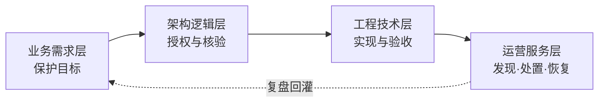

# X00 覆盖度地图：全库知识矩阵与架构层次对照

> 学习目标：读完本章，你能——
> 1. 用一张**全库知识总图**定位"主线原理（01–33）× 链专题（C00–C08）× 评估（A01–A11）× 架构运营（X01–X48）× 实战靶场"的完整对应关系。
> 2. 用"领域 × 四层"矩阵判断自己机构的哪个格子还是空白，并按角色排出阅读顺序。
> 3. 知道本书哪些边界留给了外部官方规范，以及遇到这些情形时去哪里补。
>
> 适用角色：第一次打开本手册或架构组的读者、要给团队排学习计划的安全负责人
> 前置章节：无。建议先扫一眼 [X01 安全体系怎么搭](X01-security-program-controls.md) 的第 1 节
> 最后核对：2026-11-23

## 0. 全库知识覆盖总图（原理 × 链专题 × 评估 × 架构运营 × 靶场）

下表把本仓库全部五大模块收敛到同一张总图，方便按安全域一站式定位对应章节与动手靶场：

| 安全域 | 主线原理（01–33） | 链专题（C00–C08） | 评估与模板（A/T） | 架构与运营（X01–X48） | 动手靶场（`practice-example-code/`） |
|---|---|---|---|---|---|
| EVM 合约与 DeFi 经济安全 | [03](../03-evm-solidity-basics.md)–[11](../11-defi-economic-security.md)、[27](../27-audit-testing-workflow.md) | [C00](../chains/C00-ethereum.md)、[C01](../chains/C01-bnb-chain.md)、[C02](../chains/C02-tron.md) | [A04](../assessment/A04-defi-protocol-review.md)、[A08](../assessment/A08-reproduce-attacks.md) | [X33](X33-defi-project-ops.md)、[X44](X44-nft-gamefi-ops.md)–[X47](X47-dao-governance-ops.md) | `01–08`、`foundry/`、`minilend/`、`range/`、Echidna/Halmos |
| 非 EVM 与主流 Rollup / 跨链 | [12](../12-cross-chain-bridges.md)–[14](../14-zk-proof-systems.md) | [C03](../chains/C03-mantle.md)–[C08](../chains/C08-rollups-op-arb-zkevm.md) | [A04](../assessment/A04-defi-protocol-review.md)、[A05](../assessment/A05-listing-due-diligence.md) | [X31](X31-chain-foundation-client-ops.md)、[X32](X32-l2-bridge-oracle-ops.md) | `non-evm/solana-vault`、`sui-move-lending`、`zk-circom-underconstrained` |
| 链层、模块化 DA、MEV 与中间件 | [16](../16-consensus-chain-security.md)、[17](../17-node-rpc-infrastructure.md)、[30](../30-enterprise-blockchain-security.md)、[31](../31-modular-da-mev-middleware.md) | [C00](../chains/C00-ethereum.md)、[C08](../chains/C08-rollups-op-arb-zkevm.md) | [A11](../assessment/A11-blockchain-system-testing.md) | [X03](X03-production-infra-security.md)、[X31](X31-chain-foundation-client-ops.md)、[X35](X35-staking-validator-ops.md) | 交互实验 `rpc-quorum-lab`、`confirmation-depth-lab` |
| 钱包、连接层、编译器与终端硬件 | [15](../15-account-abstraction-wallets.md)、[18](../18-wallet-key-management.md)–[22](../22-physical-account-security.md)、[32](../32-dapp-connector-compiler-hardware.md) | [C06](../chains/C06-ton-tma.md)、[C07](../chains/C07-bitcoin.md) | [A03](../assessment/A03-exchange-contracts-wallets.md)、[A06](../assessment/A06-operational-key-security.md) | [X04](X04-delivery-supply-chain.md)、[X37](X37-wallet-vendor-security.md)、[X39](X39-mobile-client-security.md)、[X40](X40-tee-hsm-key-ceremony.md) | `non-evm/vyper-reentrancy`、`foundry/test/EIP7702.t.sol` |
| 交易所、托管、签名架构与追回 | [23](../23-custody-exchange-ops.md)–[25](../25-fund-tracing-response.md)、[29](../29-signing-path-2026.md) | [C02](../chains/C02-tron.md)、[C07](../chains/C07-bitcoin.md) | [A03](../assessment/A03-exchange-contracts-wallets.md)、[A09](../assessment/A09-incident-response.md)、[T08](../templates/T08-control-matrix-risk-register.md)–[T12](../templates/T12-security-architecture-review.md) | [X10](X10-cex-architecture-overview.md)–[X30](X30-cex-reserves-solvency.md)、[X38](X38-custodian-security.md)–[X42](X42-market-maker-security.md) | `ops/`（MiniEx 运营靶场，配 B70–B83） |
| AI 与前沿赛道（FHE/DePIN/RWA/Meme） | [26](../26-ai-web3-security.md)、[33](../33-frontier-fhe-depin-rwa-memecoin.md) | — | [A05](../assessment/A05-listing-due-diligence.md)、[A10](../assessment/A10-case-binance-alpha-audit.md) | [X34](X34-stablecoin-rwa-issuer-ops.md)、[X43](X43-agent-platform-security.md)、[X48](X48-privacy-protocol-ops.md) | 交互实验 `listing-scorecard`、`phishing-signature-lab` |

## 1. 一句话理解

这组章节回答的问题是：**一个机构怎样把防御建成体系，并在出事后把业务安全地恢复。** 它不重复"攻击怎样发生"（那是 01–30 章），而是按"领域 × 层次"把每一块做成可落地的工作。

## 2. 四个层次

每个领域都按同一套四层来讲，方便你判断自己做到了哪一层：

| 层次 | 回答的问题 | 典型产出 | 对应章节类型 |
|---|---|---|---|
| 业务需求层 | 要保护什么？谁对什么负责？ | 保护目标、信任边界、资产清单 | 设计章（X11、X12、X13、X14、X15、X16 等）的前半 |
| 架构逻辑层 | 授权和核验怎样划分？ | 参考架构、控制清单、分级落地 | 设计章的后半 |
| 工程技术层 | 控制做出来了吗？怎么证明有效？ | 验收用例、回放脚本、上线门禁 | **工程验收章**（X17、X19、X21、X23、X25、X27） |
| 运营服务层 | 出事后怎样发现、处置、恢复？ | 恢复状态机、决策矩阵、演练剧本 | **运营与恢复章**（X18、X20、X22、X24、X26、X28） |

读图要点：
- 箭头表示"从设计走到运营"，虚线表示复盘结果要回到保护目标，重新排优先级。
- 多数机构的短板在后两层：控制写在文档里，却没人证明有效；出事时没有预先批准的恢复路径。
- 工程验收章和运营恢复章是第二轮新增，用来补这两层。

## 3. 交易所：六个域 × 四层

交易所有六个保护域。下表把每个域的每一层对应到章节。设计章在第一轮写成，验收章与恢复章在第二轮补齐。

| 保护域 | 需求与逻辑（设计） | 工程验收 | 运营与恢复 | 练习章（训练营） |
|---|---|---|---|---|
| 客户身份、账户与访问 | [X11](X11-cex-identity-account-access.md) | [X17](X17-cex-identity-verification.md) | [X18](X18-cex-identity-recovery-ops.md) | B83（部分） |
| 资产与市场准入 | [X12](X12-cex-asset-listing-market-access.md) | [X19](X19-cex-listing-verification.md) | [X20](X20-cex-listing-recovery-ops.md) | — |
| 交易、结算与信用 | [X13](X13-cex-trading-settlement-credit.md) | [X21](X21-cex-trading-verification.md) | [X22](X22-cex-trading-recovery-ops.md) | B79、B80 |
| 钱包、财资与支付渠道 | [X14](X14-cex-wallet-treasury-payment.md) | [X23](X23-cex-treasury-verification.md) | [X24](X24-cex-treasury-recovery-ops.md) | B81 |
| 生产环境与数据 | [X15](X15-cex-production-data.md) | [X25](X25-cex-production-verification.md) | [X26](X26-cex-production-recovery-ops.md) | B80（部分） |
| 反欺诈、合规与安全运营 | [X16](X16-cex-fraud-compliance-secops.md) | [X27](X27-cex-fraud-verification.md) | [X28](X28-cex-fraud-recovery-ops.md) | B83 |

跨域的两章：

| 主题 | 章节 | 说明 |
|---|---|---|
| 交易账务与钱包支付之间的交接（原单、预留、批准、实收、实付、未决状态） | [X29](X29-cex-ledger-wallet-handoff.md) | 大量对账差异和资损出在这条接缝上，配 B81 |
| 储备、负债与偿付能力 | [X30](X30-cex-reserves-solvency.md) | 配 B82 |

总览见 [X10 交易所安全架构总览](X10-cex-architecture-overview.md)；已有的攻击与运营基础见 [23 托管、充提与合规安全](../23-custody-exchange-ops.md) 和 [29 控制签名路径与签名服务架构](../29-signing-path-2026.md)。

## 4. 通用底座与其他应用场景

| 领域 | 章节 | 主要内容 |
|---|---|---|
| A · 通用底座 | [X01](X01-security-program-controls.md)–[X09](X09-security-team-management.md) | 控制矩阵、标准与合规、生产基础设施、软件交付、检测响应、灾备与演练、威胁情报、人员安全、安全团队建设 |
| C · 公链与项目方 | [X31](X31-chain-foundation-client-ops.md)–[X36](X36-disclosure-bounty-ops.md) | 基金会与客户端、L2/桥/预言机、DeFi 项目方、稳定币与 RWA、验证者、披露与赏金 |
| D · 其他应用场景 | [X37](X37-wallet-vendor-security.md)–[X48](X48-privacy-protocol-ops.md) | 钱包厂商、托管机构、移动端工程、TEE/HSM 与密钥仪式、支付与法币、做市商、AI Agent、NFT/GameFi、预测市场、再质押、DAO、隐私协议 |

## 5. 按角色的阅读顺序

| 你是 | 先读 | 再读 | 然后动手 |
|---|---|---|---|
| 刚入行的安全工程师 | X01 → X10 → X05 | 你所在领域的设计章 | B71 控制矩阵，B73 检测工程 |
| 交易所安全工程师 | X10 → X11–X16 各域设计章 | X17–X30 全部（验收、恢复、交接、储备） | B72、B74、B79–B83 |
| 交易所风控、账务、运营 | X13 → X21 → X22 → X29 | X30、X28 | B79、B80、B82 |
| 项目方安全负责人 | X33 → X47 → X36 | X32、X34、X44–X46 | B75、B76 |
| 钱包或托管团队 | X37、X38 → X40 | X39、X23、X24 | B74 |
| 安全负责人（管理者） | X01 → X02 → X06 | X08、X09、X07 | B77 毕业项目 |

## 6. 有意没有展开的地方

下面这些主题在本组章节里只做了边界说明，没有单独成章。遇到时按"去哪里补"走：

| 主题 | 去哪里补 |
|---|---|
| 合约漏洞原理（重入、预言机、签名等） | 04–12 章与训练营阶段 0–7 |
| 具体链的差异（以太坊、BNB、TRON、Mantle 等） | 链专题 C00–C03 |
| 各辖区法律条文的细节 | 本书只写与安全直接相关的通用事实，条文以官方最新文本和法务意见为准 |
| 零知识证明系统的审计 | 14 章与 [B69 ZK 与跨链实现风险](../bootcamp/B69-zk-bridge-practice.md) |
| 非交易所类中心化机构（保险、托管银行等） | X38 的托管部分可迁移，其他未单独成章 |

## 7. 怎样用这张地图自查

1. 复制第 3 节的矩阵，把"章节"列换成你机构里对应的**真实文档或系统**。
2. 每格标一个状态：有、部分、无。写不出对应文档的格子就是空白。
3. 先补"工程技术层"和"运营服务层"的空白，再回头补设计。
4. 每季度重新填一次，把结果写进 [X06](X06-resilience-validation.md) 里的安全月报。

## 8. 动手练习与思考题

练习：
- 用第 3 节的矩阵给你熟悉的一个机构（真实的或虚构的）打分，找出三个空白格，并按"影响 × 缺口"排序。
- 选一个空白格，写出补上它的第一周任务（谁、做什么、交付什么）。

思考题：
1. 为什么本组章节把"验收"和"恢复"拆成两章，而不是并入设计章？
2. 如果只能补一个空白格，你会选"验收"还是"恢复"？各自的理由是什么？

建议配套：训练营链下 L3 的练习章见 [B70 链下 L3 导读](../bootcamp/B70-offchain-l3-guide.md)。
