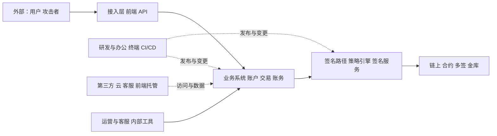
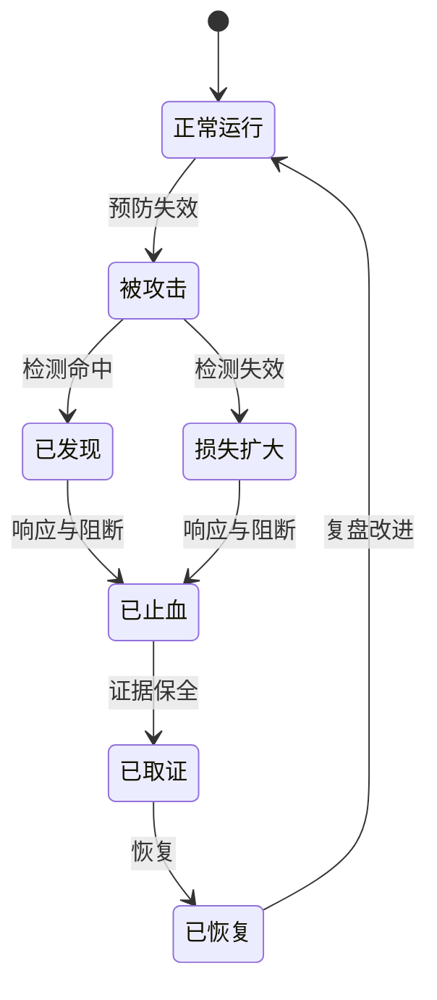
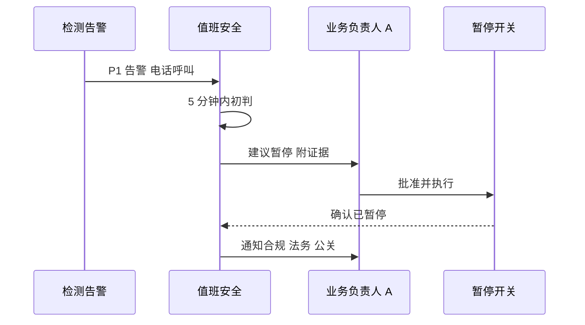

# X01 安全体系怎么搭：资产、威胁、控制矩阵与组织

> 学习目标：读完本章，你能——
> 1. 为一家机构列出资产清单，并按"丢了会怎样"给资产分级。
> 2. 把威胁落成一张控制矩阵，并给每个控制标上类型、优先级和验证方法。
> 3. 画出安全团队的分工与 RACI，写出首年 90 / 180 / 365 天路线图，并用风险登记表管理"暂时不做"的事。
>
> 适用角色：安全负责人、安全工程师、GRC（治理、风险、合规）人员、交易所 / 公链 / 项目方 / 钱包 / 托管机构的技术管理者
> 前置章节：[01 安全全景](../01-security-landscape.md)、[28 事故案例库](../28-incident-casebook.md)、[T02 威胁建模模板](../templates/T02-threat-model.md)
> 交互实验 / 模板：本章第 4 节"控制矩阵表"与第 6 节"风险登记表"可直接复制；[incident-response-sim.html](../interactive/incident-response-sim.html)
> 最后核对：2026-11-23

---

## 开场：一家机构，三件"都做了"的事

一家虚构的中型交易所（示例）开安全复盘会。三个人各报一件事。

- 工程负责人说：热钱包用了多签，审计也做了。
- IT 负责人说：全员开了 MFA，办公电脑装了 EDR。
- 客服负责人说：外包客服每年做一次保密培训。

安全负责人问了一个问题：如果一个外包客服被收买，把 7 万用户的资料卖给诈骗团伙，你们哪条控制会在 24 小时内发现？

三个人都沉默了。每个人都做了事，但没有人把这些事放进同一张图里。

<details class="predict"><summary>🤔 先猜再看：这家交易所缺的最可能是什么？A. 更贵的安全产品　B. 一张把资产、威胁、控制和负责人连起来的矩阵　C. 更多的培训</summary>

答案是 B。每一项控制单独看都合理。问题在于没有人回答"哪个资产被哪个威胁打中时，哪条控制负责防、哪条控制负责发现、谁负责处置"。本章教你建这张图，再用它排优先级、分人、定节奏。

</details>

---

## 1. 一句话理解

**安全体系是一张持续更新的"资产—威胁—控制—负责人—证据"对照表，加上让它保持更新的组织和节奏。**

安全体系（Security Program）：机构为管理安全风险而建立的一整套目标、控制、人员和流程。
控制（Control）：一项能降低某个风险发生概率或影响的具体措施。

> 🎯 打个比方：安全体系像一栋大楼的消防系统。有防火墙（预防），有烟感（检测），有喷淋（响应），有疏散图（恢复），有防火门（阻断扩散），还有监控录像（证据）。任何一样单独存在都不算"有消防"。
>
> 比喻的局限：火灾是随机的，没有人故意挑你最薄弱的那扇门。Web3 的攻击者会研究你的组织，专找控制之间的缝隙，所以体系要假设"有一层已经失陷"。

---

## 2. 保护目标与信任边界

### 2.1 六类资产

先问"我们到底在保护什么"。Web3 机构的资产分六类。

| 资产类别 | 例子 | 丢了会怎样 | 默认等级 |
|---|---|---|---|
| 密钥 | 热 / 冷钱包私钥、MPC 分片、验证者密钥、升级多签密钥、云根账号 | 资金被直接转走，且链上不可撤销 | 最高（L1） |
| 资金 | 钱包余额、银行账户、保证金、保险基金 | 直接损失 | 最高（L1） |
| 用户数据 | KYC 资料、地址与账户映射、API Key、会话 | 诈骗、合规罚款、品牌受损 | 高（L2） |
| 代码 | 合约、签名服务、交易与账务系统、构建流水线 | 漏洞、后门、供应链投毒 | 高（L2） |
| 基础设施 | 云账号、K8s、CI/CD、RPC 节点、DNS、办公网络 | 失陷后成为跳板 | 高（L2） |
| 品牌与渠道 | 官网、前端、官方社交账号、App 商店账号、客服渠道 | 假冒、钓鱼、信任崩塌 | 中（L3） |

分级的判据只用一句话：**这类资产失陷后，最坏情况能不能在 24 小时内不可逆地造成资金损失。** 能，就是 L1。能造成大规模数据泄露或让攻击者获得 L1 的入口，就是 L2。其余是 L3。

> 💡 注意：等级看"最坏影响"，不看"出事概率"。一台开发者笔记本出事概率不高，但它能触达签名流水线，所以它的等级要按它能触达的最高资产来定。

### 2.2 Web3 增补的三类威胁

经典的 STRIDE 模型（Spoofing 伪造、Tampering 篡改、Repudiation 抵赖、Information disclosure 信息泄露、Denial of service 拒绝服务、Elevation of privilege 提权）仍然适用。Web3 机构还要增补三类。

| 增补类别 | 问题 | 例子 |
|---|---|---|
| 签名路径 | 谁能让一笔交易被签名？签名人看到的内容是否等于实际执行的内容？ | 多签前端被篡改；签名服务被调用 |
| 链上权限 | 谁有权升级合约、铸币、暂停、冻结、改参数？ | 升级多签、`owner`、`guardian` |
| 共识外依赖 | 哪些不在链上的东西决定了链上结果？ | 预言机、桥验证者、排序器、RPC、DNS |

### 2.3 信任边界图

信任边界回答"谁信任谁，哪些东西不能被信任"。下图是一家 Web3 机构的通用版本。



读图要点：
- 实线是业务数据流，虚线是"管理面"：谁能改系统本身。攻击者常走虚线，而不是正门。
- 签名路径是最后一道关口。它之前的任何一层失陷，都应该被它拦住。
- 研发、第三方、客服三个来源都能触达业务系统，但不应该能触达签名路径。
- 局限：图只画了层级。每家机构要把真实系统名填进去，并标出每条线的认证方式。

---

## 3. 参考架构：六种控制类型与纵深防御

### 3.1 控制的六种类型

很多机构的控制清单只有"预防"。一个完整的体系要有六种类型。

| 类型 | 目标 | Web3 例子 |
|---|---|---|
| 预防（Prevent） | 让攻击做不成 | 签名服务只允许白名单地址；硬件密钥 MFA |
| 检测（Detect） | 让攻击被看见 | 大额流出告警；异常登录告警 |
| 响应（Respond） | 让攻击被中止 | 暂停提币开关；撤销 API Key；暂停合约 |
| 恢复（Recover） | 让业务回到正常 | 密钥轮换；从不可变备份恢复；分阶段恢复提币 |
| 阻断扩散（Contain） | 让一处失陷不变成全面失陷 | 网络分段；热钱包限额；账号权限隔离 |
| 证据保全（Preserve） | 让事后能查清并追责 | 不可篡改日志；终端镜像；链上与链下对账记录 |

### 3.2 纵深防御与"失陷即常态"

纵深防御（Defense in Depth）：用多层相互独立的控制保护同一个资产，一层失效时下一层仍然有效。

"失陷即常态"（Assume Breach）：设计时假设某一层已经被攻破，然后问"下一层是否还挡得住，我们多久能发现"。

对一个 L1 资产，建议每次设计评审都问四个问题。

1. 如果这层控制被绕过，下一层是什么？
2. 两层控制是否独立？（不共用同一个账号、同一台机器、同一个供应商。）
3. 绕过发生时，哪条检测会响应？多久？
4. 发现之后，谁有权按下暂停开关？

> ⚠️ 警告：两层控制共用同一个失败点，就是一层。例如多签的 3 个签名人都通过同一个前端看交易，前端被篡改时，3 个签名人同时被骗。

### 3.3 事件的生命周期

下图把六种控制类型映射到一次事件的时间线上。



读图要点：
- 预防失效不是终点，而是进入"被攻击"状态。后面每个状态都要有对应控制。
- "检测失效"这条边的代价最大：Ronin 在 2022 年约 6 天后才发现（第 8 节）。
- 复盘改进把结果写回控制矩阵，体系才会越用越准。
- 局限：真实事件会同时处于多个状态，例如一部分资产已止血而另一部分仍在流出。

---

## 4. 控制清单：从威胁到控制矩阵

### 4.1 方法：五步把威胁落到控制

1. 列资产：用第 2.1 节的六类，每类列到具体系统。
2. 列威胁：对每个 L1 与 L2 资产，用 STRIDE 加三类增补，各问一遍"攻击者怎样做到"。
3. 列控制：对每条威胁，至少写一个预防控制和一个检测控制。
4. 标属性：类型、优先级、负责人、验证方法、验证频率。
5. 找缺口：某个 L1 资产的威胁只有预防控制没有检测控制，就是缺口。

### 4.2 控制矩阵表（模板）

下表是可直接复制的模板，含 6 行示例（示例数据，仅演示格式）。

| ID | 资产 | 威胁 | 控制项 | 类型 | 优先级 | 负责人 | 怎么验证 | 验证频率 |
|---|---|---|---|---|---|---|---|---|
| C-001 | 热钱包私钥 | 签名服务被未授权调用 | 签名服务只接受带账务单号的请求，并按地址白名单放行 | 预防 | P0 | 钱包安全 | 用不在白名单的地址发起测试请求，应被拒绝 | 季度 |
| C-002 | 热钱包资金 | 签名服务被控后连续转出 | 单笔与每小时限额，超限自动熔断 | 阻断扩散 | P0 | 钱包安全 | 在测试环境连续发起超限请求，核对熔断 | 季度 |
| C-003 | 热钱包资金 | 控制失效后资金流出未被发现 | 链上大额流出告警，对接值班电话 | 检测 | P0 | 安全运营 | 向测试地址转账触发告警，记录从转账到电话的时间 | 月度 |
| C-004 | 云根账号 | 凭证泄露 | 硬件密钥 MFA；根账号不日常使用；使用即告警 | 预防 / 检测 | P0 | 基础设施 | 抽查登录日志；演练 break-glass | 季度 |
| C-005 | 日志 | 攻击者删除日志 | 日志实时转存到独立账号的只写存储 | 证据保全 | P1 | 安全运营 | 用生产账号尝试删除，应失败 | 半年 |
| C-006 | 升级多签 | 签名人看到的不是实际内容 | 签名前用独立工具解码交易，并与预期哈希核对 | 预防 | P0 | 合约安全 | 对一笔测试交易演示解码步骤，两名签名人独立复现 | 每次升级 |

> 💡 注意：每一行"怎么验证"必须是一个能做、有结果、有人签字的动作。"已配置"不是验证，"测试过并得到预期结果"才是。

### 4.3 优先级判据

| 优先级 | 判据 | 完成期限（建议） |
|---|---|---|
| P0 | 失效后，L1 资产可能在 24 小时内遭受不可逆损失；或者监管、合同强制要求 | 90 天内 |
| P1 | 失效后，会让攻击者更容易获得 L1 入口；或者造成大规模数据泄露 | 180 天内 |
| P2 | 提高成熟度，减少运营成本，满足认证加分项 | 365 天内或按需 |

当 P0 太多做不完时，按"该控制同时覆盖的 L1 威胁数量 ÷ 实施人天"排序，先做比值高的。

### 4.4 Web3 常见的"必有"控制（P0 起点）

以下是通用做法，可作为矩阵的起点。具体内容已在别处展开。

| 主题 | 一句话 | 详见 |
|---|---|---|
| 签名路径 | 签名人看到的内容必须独立解码，并与账务单据绑定 | [29 签名路径](../29-signing-path-2026.md) |
| 钱包分层 | 热钱包限额，大额走冷 / 温，并有延迟与双人 | [23 托管、充提](../23-custody-exchange-ops.md)、[18 钱包与密钥](../18-wallet-key-management.md) |
| 发布与前端 | 前端、合约、基础设施的发布权限与签名权限分开 | [20 前端与供应链](../20-frontend-dns-supply-chain.md) |
| 人与内部人 | 外包、客服、开发者的访问最小化并有审计 | [21 社工与内部人](../21-social-engineering-insiders.md)、[24 数据隐私](../24-data-privacy.md) |
| 事后处置 | 暂停、冻结、追踪、对外沟通有预案 | [25 资金追踪](../25-fund-tracing-response.md) |

---

## 5. 分级落地：三档做法

按团队规模选档。人数和时间为"建议"，不是统计数字。

| 档位 | 适用 | 做什么 | 需要的人 | 时间 |
|---|---|---|---|---|
| 最小可行 | 10–50 人的项目方、初创钱包 | 资产清单；L1 资产的 6–10 条 P0 控制；一个暂停开关；一份值班电话表；每季度一次推演 | 1 名安全负责人（可兼职）+ 外部审计 / 咨询 | 90 天 |
| 标准 | 50–300 人，有真实用户资金的交易所、托管、桥运营方 | 完整控制矩阵；独立的 AppSec 与 SecOps；SIEM 与链上监控；风险登记；季度红蓝或桌面推演；对照一项标准（见 [X02](X02-standards-compliance-map.md)） | 5–10 人安全团队 | 180–365 天 |
| 成熟 | 300 人以上、受监管、管理大额客户资产 | 独立的 GRC；7×24 SecOps；持续验证（红队、紫队）；度量驱动的董事会汇报；多项认证 | 15 人以上，分专业方向 | 持续迭代，第 2–3 年稳定 |

> 💡 注意：最小可行档的关键不是"少做"，而是只做 L1。先保证最坏的情况（资金被不可逆转走）有预防、有检测、有人能按暂停开关。

---

## 6. 落地做法：组织、RACI、路线图与风险登记

### 6.1 组织：谁负责什么

| 职能 | 做什么 | 常见错位 |
|---|---|---|
| 安全负责人（CISO / Head of Security） | 定策略、定优先级、汇报风险、有权叫停高风险上线 | 汇报给 CTO 时，容易被交付进度压住 |
| 安全工程 | 设计与实现控制：密钥、签名路径、基础设施加固 | 被当成"帮开发配防火墙" |
| AppSec（应用与合约安全） | 设计评审、代码与合约评审、审计协调、发布门禁 | 只在上线前一周才被拉进来 |
| SecOps（安全运营） | 日志、检测、告警、值班、事件响应 | 只有工作时间值班 |
| GRC（治理、风险、合规） | 控制矩阵维护、风险登记、证据、审计对接、政策 | 被当成"文书工作" |
| 合规（Compliance / AML） | KYC、制裁、Travel Rule、监管沟通 | 与安全各自为政 |
| 风控（Risk / Fraud） | 交易与提币风控规则、反欺诈 | 规则变更没有安全评审 |

汇报线建议：安全负责人向 CEO 或 COO 汇报，并保留向董事会风险委员会直接汇报的渠道。这是建议做法。受监管机构的具体要求以所在辖区的规定为准。

NIST CSF 2.0（2024 年 2 月发布）在原有五个功能之外增加了"治理（Govern）"，并说明六个功能应同时推进。这与本章的做法一致：组织、政策和风险决策不是"最后再补"的事。具体版本与条款以 NIST 官方最新文档为准。

### 6.2 RACI 表（模板）

R = 负责执行，A = 最终负责（每行只能有一个），C = 被咨询，I = 被通知。

| 活动 | 安全负责人 | 安全工程 | AppSec | SecOps | GRC | 合规 | 风控 | 业务 / 工程负责人 |
|---|---|---|---|---|---|---|---|---|
| 维护控制矩阵 | A | C | C | C | R | I | C | C |
| 合约 / 代码上线评审 | A | C | R | I | I | I | I | C |
| 签名路径与密钥管理 | A | R | C | I | I | I | C | C |
| 告警分诊与事件响应 | A | C | C | R | I | C | C | I |
| 暂停提币决策 | C | I | I | R | I | C | C | A |
| 风险登记与接受 | R | C | C | C | R | C | C | A |
| 审计与认证证据 | C | C | C | C | A | C | I | I |

> ⚠️ 警告：每行只能有一个 A。"暂停提币"这类要在几分钟内做的决定，必须预先写明由谁拍板。事故发生后才争论谁有权，会白白浪费几十分钟（详见 [X16](X16-cex-fraud-compliance-secops.md)）。

下图是"暂停提币"决策的预定流程。它把 RACI 里的 R 与 A 画成时间顺序。



读图要点：
- 值班安全负责判断，业务负责人负责拍板，开关本身由一人一步执行。
- "5 分钟"是示例阈值，每家机构按自己的演练结果设定。
- 若业务负责人联系不上，要预先指定备份人，避免流程卡在一个人身上。
- 局限：图只画了一条主路径。联系不上人、告警是误报等分支要写进运行手册。

### 6.3 首年路线图

| 阶段 | 目标 | 交付物（示例） |
|---|---|---|
| 0–90 天 | 看清并堵住最大的洞 | 资产清单；L1 威胁列表；P0 控制上线；暂停开关；值班电话；第一次桌面推演；风险登记表 v1 |
| 91–180 天 | 让控制可检测、可证明 | SIEM 与链上告警；检测规则回放测试；终端与云基线；供应商清单与访问盘点；控制矩阵每项有验证记录 |
| 181–365 天 | 持续运营与外部验证 | 红队 / 紫队演练；一项标准的差距分析与整改（[X02](X02-standards-compliance-map.md)）；度量月报；灾备演练（[X06](X06-resilience-validation.md)） |

### 6.4 风险登记表（模板）

不是所有风险都能立刻修。登记表让"暂时不修"成为有名字、有期限、有人签字的决定。

| ID | 风险描述 | 资产 | 可能性（1–5） | 影响（1–5） | 现有控制 | 处置 | 负责人 | 接受人 | 复核日期 |
|---|---|---|---|---|---|---|---|---|---|
| R-001 | 外包客服可导出完整 KYC 资料 | 用户数据 | 3 | 5 | 仅有保密协议 | 降低：按角色限制字段，导出需审批并告警 | 客服负责人 | 无（必须降低） | 示例：2027-02-28 |
| R-002 | 旧版桥合约升级无时间锁 | 密钥 / 代码 | 2 | 5 | 3/5 多签 | 接受 90 天，同时加告警；之后加时间锁 | 合约安全 | CTO 与安全负责人 | 示例：2027-03-31 |

规则：
1. 可能性与影响的评分标准要写成文字，例如"影响 5 = 可能造成 L1 资产不可逆损失"。
2. 只有 A 角色（业务负责人）可以"接受"风险，安全部门不能替业务接受。
3. 每条已接受的风险都有复核日期。到期未复核，自动升级给安全负责人。
4. L1 资产上的风险不允许无限期接受。

### 6.5 一段可直接用的脚本：矩阵缺口扫描

把控制矩阵导出为 CSV（列同 4.2 节），用下面的脚本找出"某资产缺少预防、检测或响应控制"的缺口。

```python
# 示例脚本：扫描控制矩阵缺口。列名需与你的 CSV 一致。
import csv, collections

rows = list(csv.DictReader(open("controls.csv", encoding="utf-8")))
by_asset = collections.defaultdict(set)
for r in rows:
    for t in r["类型"].replace(" ", "").split("/"):
        by_asset[r["资产"]].add(t)

required = {"预防", "检测", "响应"}
for asset, types in by_asset.items():
    missing = required - types
    if missing:
        print(f"缺口: {asset} 缺少 {', '.join(sorted(missing))}")
```

### 6.6 一段可直接用的规则：临时授权到期检查

第 8.1 节的 Ronin 案例说明，临时授权不撤销会变成后门。下面是一条示例 SQL，用于每周检查访问授权表中超期的临时授权。表名与字段为示例，需按你的系统改写。

```sql
-- 示例：列出已过期但仍然有效的临时授权
SELECT grantee, resource, granted_at, expires_at, granted_by
FROM access_grants
WHERE is_temporary = TRUE
  AND revoked_at IS NULL
  AND expires_at < CURRENT_TIMESTAMP
ORDER BY expires_at ASC;
-- 假阳性：授权已过期但撤销任务尚在排队。调优：给撤销任务设 24 小时 SLA，超出即升级。
```

### 6.7 一段可直接用的模板：上线安全评审单

```yaml
# 示例：L1 相关变更的安全评审单（可放进工单系统）
change_id: CHG-0000
touches_l1_asset: true        # 是否触达密钥 / 资金 / 签名路径
new_third_party_access: false # 是否新增供应商或外包访问
new_temporary_grants: []      # 每项必须带 expires_at
detection_updated: true       # 对应检测规则是否已更新
rollback_plan: "写明回滚步骤与负责人"
pause_switch_tested: true     # 暂停开关在本次变更后是否测试过
security_signoff: "安全负责人姓名与日期"  # 缺少则不得上线
```

### 6.8 常见坑

- 控制矩阵只在审计前更新。解决：把"每次架构变更要更新矩阵"写进上线门禁（见 [T04](../templates/T04-go-live-gate.md)）。
- 把"买了产品"当成"有控制"。解决：每个控制必须有验证动作和验证记录。
- 安全团队只有"否决权"，没有"替代方案"。解决：评审意见必须给出可行的替代做法。
- 所有风险都标 P0。解决：用 4.3 节的判据，并限制 P0 总数不超过团队一个季度能完成的量。

---

## 7. 运营：指标、告警、值班、演练、季度节奏

### 7.1 指标

| 指标 | 定义 | 用途 | 注意 |
|---|---|---|---|
| 控制覆盖率 | 有验证记录的 P0 / P1 控制数 ÷ 全部 P0 / P1 控制数 | 看体系是否"真在运行" | 分母必须来自矩阵，不是自选 |
| MTTD | 从攻击开始到被发现的平均时间 | 看检测能力 | 样本少时，看最大值而不是平均值 |
| MTTR | 从被发现到止血的平均时间 | 看响应能力 | 把"暂停开关"演练的耗时单独记录 |
| 红线项 | 不允许出现的状态，例如 L1 资产无检测控制、根账号无 MFA | 给管理层一个"是 / 否"的信号 | 红线项不平均，出现就上报 |
| 已接受风险数 | 登记表里有效的已接受风险 | 看风险负债 | 同时看逾期复核数 |
| 演练完成率 | 计划演练中按期完成的比例 | 看节奏是否被业务挤掉 | 演练发现的行动项关闭率同样要看 |

> ⚠️ 警告：不要编造或美化指标。覆盖率 100% 但验证记录为空，是最危险的状态。

### 7.2 季度节奏（建议）

| 周 | 活动 |
|---|---|
| 第 1 周 | 控制矩阵与风险登记评审；上季度行动项复盘 |
| 第 2–4 周 | 选 2–3 个 P0 控制做真实验证（按 4.2 节"怎么验证"） |
| 第 5–8 周 | 一次桌面推演（30–60 分钟，见 [X06](X06-resilience-validation.md)） |
| 第 9–11 周 | 供应商与访问盘点；离职与转岗权限清理 |
| 第 12 周 | 向管理层汇报：红线项、趋势、未关闭风险 |

### 7.3 告警与值班

至少保证三件事：L1 资产的检测告警有人 7×24 接收；值班表里每个人都知道暂停开关怎么按；每次值班交接有记录。告警分级与 SIEM 设计见 [X05](X05-detection-response-engineering.md)。

---

## 8. 失效案例：控制在哪里断了

以下案例只写摘要和教训。完整复盘见《Web3 行业安全资损 101》与 [28 事故案例库](../28-incident-casebook.md)。每个案例的公开来源均已单独核对。归因写"公开报道归因于"。

### 8.1 Ronin 桥（2022-03，Ronin 链 / 以太坊）

- 公开事实：项目方复盘称，攻击者控制了 9 个验证者中的 5 个，伪造提款，取走约 17.36 万 ETH 与 2550 万 USDC（约 6.2 亿美元，事发时估值）。其中 4 个验证者由 Sky Mavis 控制，1 个属于 Axie DAO。复盘称，Axie DAO 验证者的签名通过一个免 gas 的 RPC 节点取得。该授权源于 2021 年 11 月的一次临时安排，12 月结束后，白名单访问权限没有被撤销。
- 发现过程：复盘称，团队在 3 月 29 日因一名用户报告无法提取 5000 ETH 才发现事件。媒体报道的盗取时间为 3 月 23 日，约 6 天后才被发现。Forklog 引述复盘称，对桥地址的大额流出监控较弱。
- 归因：Elliptic 的分析与公开报道归因于朝鲜关联的 Lazarus Group。
- 映射本章控制：C-003（大额流出检测）缺失；密钥集中在同一机构，且阈值只有 5/9，存在"共用失败点"（第 3.2 节）；临时授权没有到期与撤销（对应第 6.4 节规则 3 与 SYS-9）。
- 来源类型：项目方复盘（Sky Mavis 博客）、媒体报道（The Block、TechCrunch）、安全公司分析（Elliptic、SlowMist）。
- 教训：临时授权必须有到期日；大额流出检测是独立于预防的控制，不能省。

### 8.2 DMM Bitcoin（2024-05，比特币）

- 公开事实：FBI 与日本警察厅的通报称，4502.9 BTC（约 3.08 亿美元，事发时估值）被盗。通报称，攻击者冒充 LinkedIn 招聘者，向钱包软件供应商 Ginco 的一名有关键权限的员工发送"入职测试"脚本。该员工把代码复制到个人 GitHub 页面后被攻陷。约两个月后，攻击者用会话 Cookie 冒充该员工，进入 Ginco 的通信系统，并在 5 月底篡改了 DMM 员工发起的一笔合法交易请求。
- 归因：FBI 通报归因于朝鲜关联团队 TraderTraitor。
- 映射本章控制：第三方供应商的员工终端等同于 L1 路径的一部分（SYS-8）；会话 Cookie 被盗后缺乏异常检测；交易请求在传输中可被篡改，缺少独立校验（与 C-006 同类的控制）。
- 来源类型：执法机构通报（FBI 与日本警察厅）。本次核对中 FBI 原文页面无法抓取，细节取自 SecurityWeek 对通报的转述，使用时请以执法机构原文为准。
- 教训：控制边界要画到供应商员工的终端；交易必须由与请求发起方独立的通道复核。

### 8.3 Bybit（2025-02，以太坊）

- 公开事实：2025 年 2 月 21 日，Bybit 的以太坊多签冷钱包在一次例行转账中被转走超过 40 万枚 ETH 与 stETH，约 15 亿美元（事发时估值）。Safe 的调查称，攻击者先攻陷了一台 Safe{Wallet} 开发者的电脑，由此取得一个 Bybit 使用的账号，并提议了一笔被伪装的恶意交易。Sygnia 的取证称，恶意 JavaScript 来自 Safe 的 AWS S3 存储，在攻击前两天被修改，并只对特定目标触发。攻击后约两分钟，代码被换回干净版本。Bybit 与调查方称，Bybit 自己的基础设施没有发现失陷证据，Safe 的合约与前端源代码没有发现漏洞。
- 归因：FBI 公告（I-022625-PSA，2025-02-26）归因于朝鲜关联的 TraderTraitor。
- 映射本章控制：供应商发布链路（前端托管与云凭证）是共识外依赖；签名人看到的内容与实际执行内容不一致，缺少独立解码（C-006）；"多个签名人 × 同一前端"是共用失败点。
- 来源类型：执法机构公告（FBI IC3）、托管工具方调查（Safe）、取证公司（Sygnia、Verichains，经媒体转述）、媒体报道（BleepingComputer）。
- 教训：对 L1 的签名，要用独立于界面的工具解码并核对哈希；把供应商的发布链路写进你的控制矩阵。

### 8.4 Coinbase 客服数据泄露（2025-05，链下）

- 公开事实：Coinbase 在 2025 年 5 月 15 日向 SEC 提交的文件中披露，攻击者贿赂了境外客服人员，取得用户的账户与 KYC 数据。公司拒绝了 2000 万美元的勒索，转而设立 2000 万美元的悬赏。公司初步估计补救和自愿赔偿成本约 1.8 亿至 4 亿美元。公开报道称，受影响用户少于月交易用户的 1%；缅因州总检察长的通知列出约 6.9 万名用户。
- 映射本章控制：用户数据（L2）的最小权限与导出审批（风险登记 R-001 的同类风险）；对"批量读取数据"行为的检测；外包人员的访问盘点（SYS-8）。
- 来源类型：监管文件（SEC 披露，经 The Block 等转述）、媒体报道（The Register、Fortune）。
- 教训：L2 数据的失陷也会产生巨额成本。人员权限要按"最坏情况能导出多少"来设计，并对批量读取告警。

> 💡 注意：这四个案例的共同点不是"缺少某个产品"，而是控制之间存在缝隙：授权不过期、供应商终端不在边界内、签名内容不独立校验、批量数据读取无告警。

---

## 9. 评估检查点

- [ ] **SYS-1** 资产清单覆盖六类资产，每项资产有等级（L1/L2/L3）、负责人和所在系统。
- [ ] **SYS-2** 每个 L1 资产至少有一个预防控制、一个检测控制和一个响应控制。
- [ ] **SYS-3** 控制矩阵中每个 P0 控制都有"怎么验证"，并在近 12 个月内有验证记录。
- [ ] **SYS-4** 签名路径、链上权限、共识外依赖三类 Web3 威胁都已写入威胁列表。
- [ ] **SYS-5** 有一个已演练过的暂停开关，并写明谁能按、多久内要按、怎么恢复。
- [ ] **SYS-6** RACI 每行只有一个 A；暂停提币（或等价的止损动作）有预先指定的决策人和备份。
- [ ] **SYS-7** 日志存储与生产账号分离，生产账号无法删除安全日志。
- [ ] **SYS-8** 供应商与外包人员的访问清单在近 6 个月内盘点过，并按最小权限收敛。
- [ ] **SYS-9** 所有临时授权（权限、白名单、API Key）有到期日，到期自动撤销或复核。
- [ ] **SYS-10** 风险登记表存在，每条已接受风险有接受人和复核日期，没有逾期项。
- [ ] **SYS-11** L1 资产相关的变更（上线、升级、签名人变动）必须经过安全评审，安全负责人有权暂缓。
- [ ] **SYS-12** 每季度至少一次桌面推演，行动项有负责人和截止日期。
- [ ] **SYS-13** 有向管理层的定期汇报，含红线项、MTTD、MTTR、未关闭风险。

### 把检查结果写进报告

| 检查项 | 结论（通过 / 部分 / 不通过） | 证据（文件、日志、截图编号） | 差距与整改 | 负责人 | 截止日期 |
|---|---|---|---|---|---|
| SYS-1 | | | | | |
| …… | | | | | |

结论规则：没有证据就写"不通过"。"部分"必须写明缺的是哪一部分。

---

## 10. 上手路径

### 第一周

1. 开一次 2 小时的会，用白板列出六类资产，圈出 L1 资产。
2. 画第 2.3 节的信任边界图，把真实系统名填进去。
3. 找出"谁能按暂停开关"。如果答案不清楚，这就是本周最重要的发现。
4. 打开云账号、代码仓库、CI/CD 和 DNS 注册商的管理员列表，数一数谁有最高权限。
5. 建矩阵表头与风险登记表（直接复制本章模板）。

### 第一个月

1. 对每个 L1 资产做一次威胁梳理（用 [T02](../templates/T02-threat-model.md)），把结果填进矩阵。
2. 用 6.5 节脚本扫描缺口，列出前 10 个 P0 缺口。
3. 做一次 30 分钟的桌面推演：一台开发者电脑被控，会触达什么。
4. 盘点供应商与外包人员的访问，并运行 6.6 节的临时授权检查。
5. 与业务负责人确定 RACI，并让他们签字。

### 第一个季度

1. P0 控制全部上线，每项有验证记录。
2. 值班表与告警上线，L1 资产有 7×24 的接收人。
3. 做第一次暂停开关演练，记录耗时。
4. 向管理层提交第一份度量月报与风险登记表。
5. 选定一项对照标准（见 [X02](X02-standards-compliance-map.md)），启动差距分析。

---

## 11. 常见误区

| 误区 | 为什么错 | 正确做法 |
|---|---|---|
| "我们做过审计，所以安全" | 合约审计只覆盖代码。Bybit、DMM Bitcoin、Coinbase 事件的根因在链下 | 审计是一条控制，不是体系 |
| "多签就安全" | 签名人若被同一前端欺骗，多签等于单点 | 独立解码，并用独立通道核对 |
| "买了 EDR / SIEM 就有检测" | 没有规则、没有人值班，等于没有 | 每个 L1 威胁有对应检测规则和接收人 |
| "合规做了就等于安全" | 合规是最低线，且常滞后于攻击手法 | 合规控制映射进同一张矩阵（见 [X02](X02-standards-compliance-map.md)） |
| "供应商有认证，所以我们不用管" | 认证不证明它对你的具体路径安全 | 把供应商路径写进矩阵，并做访问盘点 |
| "风险接受 = 不管了" | 接受是有期限的决定 | 接受人签字，设复核日期 |

---

## 12. 术语表

| 术语 | 英文 | 定义 |
|---|---|---|
| 安全体系 | Security Program | 机构为管理安全风险而建立的目标、控制、人员和流程的整体 |
| 控制 | Control | 降低某个风险概率或影响的一项具体措施 |
| 控制矩阵 | Control Matrix | 把资产、威胁、控制、负责人、验证方法放在一张表里的对照表 |
| 纵深防御 | Defense in Depth | 用多层独立控制保护同一个资产 |
| 失陷即常态 | Assume Breach | 设计时假设某一层已被攻破 |
| 阻断扩散 | Containment | 让一处失陷不蔓延到其他资产的控制 |
| 证据保全 | Evidence Preservation | 保存不可篡改的日志与镜像，供事后调查 |
| 红线项 | Red-line Item | 不允许出现的状态，出现即上报 |
| RACI | RACI | 负责、最终负责、被咨询、被通知的职责分配表 |
| GRC | Governance, Risk, Compliance | 治理、风险与合规职能 |
| MTTD / MTTR | Mean Time To Detect / Respond | 平均发现时间 / 平均响应时间 |
| 已接受风险 | Accepted Risk | 业务负责人在知情下书面同意暂不处理的风险 |
| 共识外依赖 | Off-chain Dependency | 不在链上、却决定链上结果的组件，例如预言机、桥验证者 |

---

## 13. 动手练习与思考题

### 练习 1：为一家虚构机构画图（45 分钟）

虚构一家"有热钱包的小型交易所"。在纸上完成：六类资产清单（每类至少 2 项）、信任边界图（至少 6 个节点）、L1 资产标注。

### 练习 2：填 10 行控制矩阵（60 分钟）

用 4.2 节模板，为练习 1 的 L1 资产填 10 行，至少覆盖预防、检测、响应三种类型。运行 6.5 节脚本，确认没有缺口。

### 练习 3：做一次 30 分钟桌面推演

场景："一名外包客服的账号在凌晨被用来批量导出 KYC 资料。"两人一组，一人当主持人，一人当值班安全工程师。回答：第一个告警是什么？谁被通知？谁有权停用该账号？需要通知谁？把缺失的控制写入风险登记表。可在 [incident-response-sim.html](../interactive/incident-response-sim.html) 里对照事故响应流程。

### 建议配套（后续在 L3 训练营实现）

- 控制矩阵缺口扫描小工具：读 CSV，输出缺口与覆盖率。
- 风险登记表复核提醒脚本：列出逾期未复核的已接受风险。

### 思考题

1. 你的机构里，哪两个控制看起来独立，实际共用同一个失败点？
2. 如果只能做 5 个 P0 控制，你会选哪 5 个？你用什么判据来选？
3. 安全负责人汇报给 CTO 与汇报给 CEO，在"叫停一次高风险上线"这件事上有什么区别？
