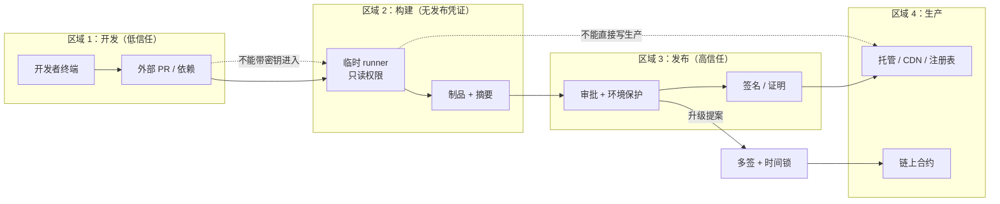
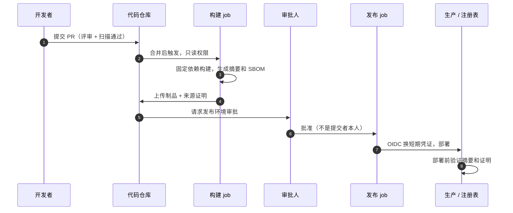
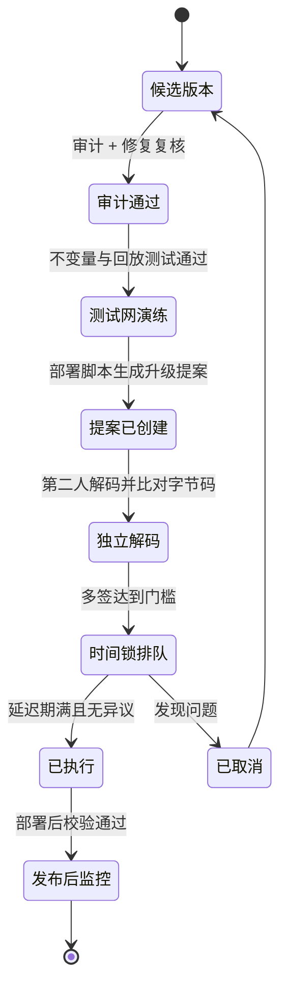

# X04 软件交付与供应链安全：CI/CD、制品签名、依赖与发布门禁

> 学习目标：读完本章，你能——
> 1. 画出一条"代码 → 构建 → 签名 → 发布"的流水线，标出每一段的凭证、权限和可被替换的环节。
> 2. 把 CI/CD 加固成"构建不带发布凭证、发布必须审批、制品必须可验证"的形态，并写出对应的工作流和检查脚本。
> 3. 为合约升级、前端发布和 npm 发布设计各自的发布门禁，并把发布权限与签名权限分开。
>
> 适用角色：项目方安全负责人、AppSec 工程师、DevOps / 平台工程师、钱包与交易所的发布负责人。
> 前置章节：[20 前端、DNS 与供应链](../20-frontend-dns-supply-chain.md)、[27 审计与测试工作流](../27-audit-testing-workflow.md)、[X01 安全体系怎么搭](X01-security-program-controls.md)、[X03 生产基础设施安全](X03-production-infra-security.md)
> 交互实验 / 模板：[T04 上线门禁模板](../templates/T04-go-live-gate.md) ｜ 训练营：[B62 前端与供应链实操](../bootcamp/B62-frontend-supply-chain-practice.md)
> 最后核对：2026-11-23

> 💡 注意：本章的 CI 配置、命令和版本号是"示例"。工具更新很快。落地前以各工具的官方文档为准。本章的时效事实截至 2026 年公开资料。

---

## 开场：一行没改的代码

假设你的仓库里有一个工作流文件。它只有一行引用：`uses: tj-actions/changed-files@v45`。这行写了一年，没有人动过。

2025 年 3 月，这个第三方 GitHub Action（GitHub 上可复用的 CI 步骤）被入侵。你的仓库没有任何提交。你的 CI 却在某次运行时，把仓库里的云密钥和令牌打印进了工作流日志。

<details class="predict"><summary>🤔 先猜再看：`@v45` 是版本标签。标签能保证你每次拿到同一份代码吗？</summary>

不能。Git 标签是一个可以被移动的指针。有写权限的人（或拿到他令牌的人）可以把 `v45` 指向另一个提交。你的工作流文件没有变，但它运行的代码变了。只有完整的 40 位提交哈希（SHA）才指向一份固定的内容。

</details>

这就是本章的主题：**你的产品由很多不是你写的东西组成，而且发布路径上的每个凭证，都是攻击者的目标。** 合约审计只覆盖合约源码。从源码到用户手里的那一段，由本章的控制负责。

---

## 1. 一句话理解

**软件供应链安全的目标，是让"用户拿到的东西"和"团队评审过的东西"保持一致，并且能证明这一点。**

供应链（Supply Chain）：一个产品从源码到用户手里，经过的所有人、工具、凭证和系统。
制品（Artifact）：构建的产出物，例如前端静态文件包、npm 包、Docker 镜像、合约字节码。
来源证明（Provenance）：一份签名声明，写明"这个制品由哪个仓库、哪个提交、哪条流水线构建"。

> 🎯 打个比方：食品工厂。原料（依赖）要有供应商资质。生产线（CI）要有卫生规程。成品出厂要有批号和封条（签名与来源证明）。冷链运输（发布与托管）要有温度记录。超市收货（部署）要验封条。任何一环缺失，消费者吃到的就不是质检过的那一份。
>
> 比喻的局限：食品出问题一般是意外。软件供应链的对手是主动的。他会盯着流程里最弱的一环，例如离职员工的账号或一个过期的访问令牌，并且可以只对某一个客户下手。

---

## 2. 保护目标与信任边界

要保护的东西有四类：

1. **发布路径上的凭证**：npm 令牌、云访问密钥、CDN 与域名账号、浏览器扩展商店密钥、合约部署密钥。
2. **制品的完整性**：线上运行的和评审过的是同一份。
3. **开发者终端**：它能碰到以上所有凭证。
4. **链上权限**：谁能升级合约、改参数、暂停协议。



**读图要点：**

- 区域之间的箭头是"受控的交接"。虚线是"必须被阻止的穿越"：外部代码不能拿到构建凭证，构建不能直接写生产。
- 关键原则：**越靠近生产，凭证越少、审批越多、存活时间越短。**
- 局限：图里没有画"人"。区域 1 的开发者终端一旦失陷，攻击者可以冒充开发者提交代码，或偷走会话令牌。Safe 与 Bybit 的案例（第 8 节）就是这样发生的。

**哪些东西不能被信任：**

| 对象 | 为什么不能默认信任 |
|---|---|
| 第三方依赖的"最新版" | 维护者账号被钓鱼后，下一个版本就是恶意的 |
| 版本标签（tag） | 标签可以被移动 |
| 外部贡献者的 PR | 代码和 PR 标题、分支名都可能含恶意内容 |
| 开发者笔记本上的会话令牌 | 恶意软件可以直接使用它们，绕过 MFA |
| "有来源证明"的包 | 证明只说明"这个构建来自这条流水线"，不说明源码没问题（见第 8.7 节） |

---

## 3. 参考架构

### 3.1 SDLC 里的七个安全关口

SDLC（软件开发生命周期，Software Development Life Cycle）：需求、设计、开发、测试、发布、运维的全过程。每个关口回答一个问题。

| 关口 | 要回答的问题 | 典型控制 | 对应控制 ID |
|---|---|---|---|
| G1 需求与设计评审 | 这个改动引入了新的信任边界或权限吗？ | 设计评审问卷、威胁模型（[T02](../templates/T02-threat-model.md)） | SDL-1 |
| G2 代码评审 | 有第二个人看过吗？ | 分支保护、CODEOWNERS、必需评审 | SDL-2、SDL-3 |
| G3 自动扫描 | 有明显的漏洞、泄露的密钥、有毒的依赖吗？ | SAST、SCA、Secret 扫描 | SDL-4 至 SDL-8 |
| G4 构建 | 构建环境干净、可重复吗？ | 临时 runner、固定依赖、固定 Action | SDL-11 至 SDL-13 |
| G5 签名与证明 | 能证明制品来自这条流水线吗？ | Sigstore、SLSA 来源证明 | SDL-16 |
| G6 发布 | 谁批准的？谁有权限发布？ | 环境审批、OIDC、权限分离 | SDL-14、SDL-15、SDL-18 |
| G7 发布后 | 线上的就是发出去的吗？出问题能回滚吗？ | 线上哈希巡检、监控、回滚演练 | SDL-21、SDL-23 |

### 3.2 一条加固的发布流水线



**读图要点：**

- 构建 job（第 3 步）没有任何发布凭证。就算构建被投毒，攻击者也拿不到可以直接发布的令牌。
- 发布 job 的凭证来自 OIDC（第 7 步）。OIDC（OpenID Connect）：CI 平台向云或注册表出示一份短期身份令牌，换取只在本次运行有效的访问权限，不需要长期密钥。
- 第 8 步验证摘要。如果制品在构建和发布之间被替换，验证失败，部署终止。
- 局限：如果源码本身已经被攻击者合入（比如评审被绕过），整条流水线会忠实地构建并签名恶意代码。

### 3.3 发布权限与签名权限分离

"发布"和"签名"是两个权力。它们必须分开，也不能由同一个人或同一个凭证行使。

| 对象 | 谁能发布 | 谁能签名 / 授权 | 分离方式 |
|---|---|---|---|
| 前端静态文件 | 发布 job（OIDC 角色，只能写指定存储桶） | 流水线身份签名摘要 | 云角色只有写权限，没有改 CDN 或 DNS 的权限 |
| npm 包 | 受信任发布（Trusted Publishing）的工作流 | 同一工作流的 OIDC 身份 | 不存在可被偷走的长期发布令牌 |
| 合约 | 部署脚本生成升级提案 | 多签持有人在硬件钱包上签名 | 部署者不是多签持有人，多签不能改代码仓库 |
| 域名 / DNS | 注册商账号（独立 SSO，硬件密钥） | 变更需要第二人审批 | 与开发者账号体系分离 |
| 浏览器扩展 / App | 发布 job | 发布需要人工批准，商店密钥放在受保护环境 | 商店 API 密钥不放在开发者环境变量里 |

> ⚠️ 警告：如果一个人的笔记本同时能推代码、批准发布、签名和改 DNS，他的笔记本失陷就等于整条供应链失陷。

---

## 4. 控制清单

优先级判据（沿用 [X01](X01-security-program-controls.md)）：P0 = 缺失会让一次失陷直接导致资金损失或用户资产被盗；P1 = 缺失会显著扩大影响面；P2 = 成熟度加分。

| ID | 控制项 | 要防什么 | 优先级 | 怎么验证 |
|---|---|---|---|---|
| SDL-1 | 涉及权限、信任边界、资金路径的改动必须有设计评审记录 | 新增后门式权限、绕过审批的"便捷"通道 | P1 | 抽查最近 5 个涉及权限的 PR，是否有评审记录 |
| SDL-2 | 默认分支保护：必需评审、禁止强推、敏感路径（`.github/`、部署脚本、合约）设 CODEOWNERS | 单人把恶意代码合入主干 | P0 | 在仓库设置里核对；尝试用普通账号直推主干应被拒绝 |
| SDL-3 | 提交者与批准者不是同一人；管理员也受规则约束 | 管理员账号失陷后绕过评审 | P1 | 规则集不含管理员绕过；抽查合并记录 |
| SDL-4 | Secret 扫描：提交前、CI、历史全量三处 | 密钥进入仓库或日志 | P0 | 向测试分支提交一个假密钥，应被拦截 |
| SDL-5 | SAST、SCA、合约静态分析作为合并门禁 | 已知漏洞模式、已知漏洞依赖 | P1 | 门禁失败时 PR 不能合并 |
| SDL-6 | 依赖锁定：提交锁文件，CI 用 `npm ci`（或等价命令），生产依赖不使用 `latest`，不从 CDN 动态加载第三方脚本 | "最新版"投毒直接进入产物 | P0 | `grep` 清单；构建时锁文件变化应使 CI 失败 |
| SDL-7 | 新依赖评审 + 新版本冷却期（建议至少 1 天，关键项目 3–7 天） | 刚发布的恶意版本进入构建 | P0 | 检查包管理器配置；尝试安装 1 小时前发布的版本应被拒绝 |
| SDL-8 | 安装脚本默认禁用，需要的包用白名单 | `preinstall` / `postinstall` 在开发机和 CI 上执行恶意代码 | P0 | 检查 `ignore-scripts` 配置；用一个带安装脚本的测试包验证不执行 |
| SDL-9 | 依赖经由私有代理 / 镜像，保留可审计的包缓存 | 上游被撤下后无法取证；typosquatting（仿冒包名） | P1 | 构建网络只允许访问代理 |
| SDL-10 | 每次发布生成并留存 SBOM | 事故时无法回答"哪些发布用了受影响的包" | P2 | 任选一个历史版本，能在 10 分钟内查出依赖清单 |
| SDL-11 | CI 中所有第三方 Action 固定到完整 40 位 SHA；用组织策略强制 | 标签被移动导致任意代码在 CI 里运行 | P0 | 第 6.2 节的 `grep` 脚本；策略开启后未固定的工作流应失败 |
| SDL-12 | 工作流默认最小权限（`permissions: {}` 起步）；不在 `pull_request_target` 等高权限触发器里运行不可信代码；不把 PR 标题、分支名直接拼进 shell | 外部 PR 窃取密钥或令牌；脚本注入 | P0 | 全库 `grep pull_request_target`；用 `zizmor` 等工作流静态检查工具扫描 |
| SDL-13 | runner 隔离：每次运行用临时 runner；自托管 runner 不接公开仓库的外部 PR；构建环境不放长期凭证 | runner 被持久化植入；密钥跨任务泄露 | P0 | 查看 runner 清单；确认任务结束后 runner 销毁 |
| SDL-14 | 发布与部署用 OIDC 短期凭证，仓库里不存长期令牌 | 令牌泄露后长期可用 | P0 | 列出仓库和组织的 secrets，不应有长期云密钥或 npm 令牌 |
| SDL-15 | 构建与发布分 job；发布 job 绑定带审批的环境（environment） | 构建被投毒时直接发布 | P0 | 环境设置里核对必需审批人；构建 job 的 `permissions` 不含 `id-token` 以外的写权限 |
| SDL-16 | 制品签名与来源证明（Sigstore、GitHub Artifact Attestations 或 SLSA 兼容方案） | 制品在构建后被替换；无法证明来源 | P1 | 对最新发布执行第 6.4 节的验证命令 |
| SDL-17 | 部署端强制验证摘要或证明，不通过不部署 | 发布环节之后的替换 | P1 | 给部署端一个被改过的文件，应拒绝 |
| SDL-18 | 发布权限与签名权限分离；发布者不能批准自己的发布 | 单点失陷即整条链失陷 | P0 | 画权限矩阵（第 3.3 节），检查无人同时持有两项 |
| SDL-19 | 合约发布门禁：审计与修复复核、不变量测试、测试网演练、部署后字节码校验 | 未经验证的代码上线 | P0 | 第 6.5 节的校验脚本；门禁记录 |
| SDL-20 | 升级走多签 + 时间锁；升级提案做独立解码 | 单个密钥改合约；盲签 | P0 | 链上读取时间锁延迟和多签门槛；对照 [29 签名路径](../29-signing-path-2026.md) |
| SDL-21 | 前端发布：SRI、CSP、域名与注册商锁、CDN 与存储写权限审批、线上哈希巡检 | 页面被替换却无人发现 | P0 | 第 6.6 节的巡检脚本；注册商后台核对锁状态 |
| SDL-22 | 开发者终端：硬件密钥 MFA、不在笔记本长期保存云会话、运行不可信项目必须在隔离环境、离职回收清单含 npm 与注册商 | 会话令牌被偷；离职账号被利用 | P0 | 抽查终端基线；检查离职回收清单是否覆盖所有发布相关账号 |
| SDL-23 | 发布后监控与回滚演练 | 发布出错后无法快速撤回 | P1 | 每季度演练一次回滚，记录耗时 |
| SDL-24 | 供应链事件手册：令牌轮换、撤销包版本、公告模板、取证步骤 | 事故时临场混乱 | P1 | 桌面推演一次（第 10 节） |

---

## 5. 分级落地

人数和时间是"建议"，按团队规模调整。

| 档位 | 适合 | 做什么 | 投入（建议） |
|---|---|---|---|
| 最小可行 | 5–30 人的项目方，没有专职安全 | SDL-2、4、6、7、8、11、12（先做 `permissions` 与 Action 固定）、14（npm 与云用 OIDC）、22（硬件密钥 + 离职清单）；合约上线走 [T04](../templates/T04-go-live-gate.md) | 1 名工程师，2–4 周 |
| 标准 | 有安全岗的交易所、钱包、公链基金会 | 最小可行全部，加上 SDL-3、5、9、13、15、16、17、18、19、20、21、23；发布环境审批；线上哈希巡检 | 1–2 名安全 / 平台工程师，2–3 个月 |
| 成熟 | 管理大额资金或大量用户的机构 | 标准全部，加上 SDL-10、24；SLSA 构建 L3 级别的隔离构建；可复现构建；供应链专项红队和季度推演；内部包镜像 + 自动冷却 | 3–5 人的平台安全小组，持续运营 |

> 💡 注意：先做"凭证"，再做"签名"。大部分事故（第 8 节）的根因是一个泄露的令牌或会话，不是缺少签名。把长期令牌换成 OIDC 的收益，高于先上复杂的来源证明。

---

## 6. 落地做法

### 6.1 步骤总览

1. 盘点：列出所有发布路径（npm、前端、合约、镜像、扩展商店、域名）和每条路径上的凭证。
2. 删除：能用 OIDC 的，删掉长期令牌。
3. 固定：Action 固定 SHA，依赖锁定，加冷却期，禁用安装脚本。
4. 分离：构建与发布分 job；发布绑定环境审批。
5. 证明：生成来源证明；部署端验证。
6. 巡检：线上哈希、合约状态、权限变更。
7. 演练：做一次令牌泄露和一次依赖投毒的推演。

### 6.2 示例：找出没有固定的 Action 和危险触发器

这是第一周就能跑的检查。示例命令，在仓库根目录执行。

```bash
# 示例：列出所有没有固定到 40 位 SHA 的第三方 Action
grep -rnE 'uses:[[:space:]]+[^./][^@[:space:]]*@' .github/workflows \
  | grep -vE '@[0-9a-f]{40}([[:space:]]|$)'

# 示例：列出使用高权限触发器的工作流，逐个人工复核
grep -rnE 'pull_request_target|workflow_run' .github/workflows

# 示例：找出把不可信字段直接拼进脚本的写法（脚本注入的常见形态）
grep -rnE '\$\{\{[[:space:]]*github\.(event\.(pull_request\.(title|body|head\.ref)|issue\.(title|body)|comment\.body)|head_ref)' .github/workflows
```

读结果的方法：第一条每一行都是一个需要处理的引用；第二条每一行都要回答"这个工作流会不会检出并运行 PR 里的代码"；第三条每一行都应改成"先放进环境变量，再在脚本里引用环境变量"。

> ⚠️ 警告：2025 年 8 月 Nx 的 npm 令牌就是这样被偷的：一个使用 `pull_request_target` 的工作流，把 PR 标题原样输出到 shell（第 8.5 节）。

GitHub 在这个方向上有几项新机制，都以官方文档为准：

- 2025 年 8 月起，"允许的 Action"策略可以强制要求使用完整 SHA（[GitHub 更新日志](https://github.blog/changelog/2025-08-15-github-actions-policy-now-supports-blocking-and-sha-pinning-actions/)）。
- 2026 年 10 月 28 日，Actions 锁文件（`.github/workflows/actions.lock`）正式可用。它记录工作流依赖（包括组合 Action 的间接依赖）解析到的提交（[InfoQ 报道](https://infoq.com/news/2026/11/github-actions-lockfiles-ga)）。锁文件不判断依赖是否安全，只保证"不会悄悄变"。
- GitHub 宣布：从 2026 年 12 月 2 日起，公开仓库默认阻止 `pull_request_target` 触发器，除非有策略明确允许（[GitHub 更新日志](https://github.blog/changelog/2026-11-02-pull_request_target-blocked-by-default-december-2)）。如果你的公开仓库依赖它，现在就要评估。

### 6.3 示例：加固的发布工作流（构建与发布分离）

下面是一个示例。`<完整40位SHA>` 需要你替换成实际审核过的提交。`ORG`、`REPO`、角色名都是占位。

```yaml
# .github/workflows/release.yml  —— 示例
name: release
on:
  push:
    tags: ["v*"]          # 只在受保护的发布标签上触发

permissions: {}           # 默认没有任何权限，每个 job 自己声明

jobs:
  build:
    runs-on: ubuntu-latest      # 临时 runner，每次运行后销毁
    permissions:
      contents: read
      id-token: write           # 仅用于生成来源证明
      attestations: write
    steps:
      - uses: actions/checkout@<完整40位SHA>   # vX.Y.Z（示例）
        with:
          persist-credentials: false           # 不把令牌留在本地 git 配置里
      - uses: actions/setup-node@<完整40位SHA> # vX.Y.Z（示例）
        with:
          node-version-file: .nvmrc
      - run: npm ci --ignore-scripts            # 严格按锁文件安装，不执行安装脚本
      - run: npm run build && npm test
      - name: 打包并计算摘要
        run: |
          tar -czf dist.tar.gz dist
          sha256sum dist.tar.gz | tee dist.sha256
      - uses: actions/attest-build-provenance@<完整40位SHA>  # 新项目可改用 actions/attest，以官方文档为准
        with:
          subject-path: dist.tar.gz
      - uses: actions/upload-artifact@<完整40位SHA>
        with:
          name: dist
          path: |
            dist.tar.gz
            dist.sha256

  deploy:
    needs: build
    runs-on: ubuntu-latest
    environment: production-release   # 在仓库设置里配置：必需审批人（不能是提交者）、仅限发布标签
    permissions:
      contents: read
      id-token: write                 # 向云平台换取短期凭证
    steps:
      - uses: actions/download-artifact@<完整40位SHA>
        with:
          name: dist
      - name: 部署前验证来源证明
        env:
          GH_TOKEN: ${{ github.token }}
        run: |
          sha256sum -c dist.sha256
          gh attestation verify dist.tar.gz --repo ORG/REPO
      - uses: aws-actions/configure-aws-credentials@<完整40位SHA>
        with:
          role-to-assume: arn:aws:iam::123456789012:role/frontend-deploy   # 示例角色：只能写指定存储桶
          aws-region: us-east-1
      - run: |
          mkdir out && tar -xzf dist.tar.gz -C out
          aws s3 sync out/dist s3://example-frontend-bucket --delete
```

要点：

- 工作流顶部 `permissions: {}`，每个 job 只开自己需要的权限。
- `build` 里没有任何云凭证，也没有发布权限。
- `deploy` 绑定 `production-release` 环境，需要审批人批准；云角色的信任策略应限定为这个仓库、这个环境和这个工作流（在云侧配置 `sub` 条件，示例：`repo:ORG/REPO:environment:production-release`）。
- 云角色只允许写一个存储桶。它没有改 CDN、DNS、IAM 的权限。

**npm 发布：用受信任发布替换令牌**

受信任发布（Trusted Publishing）：npm 信任某个指定的仓库和工作流，用 OIDC 身份发布，不需要在 CI 里放 npm 令牌。Nx 事故后，Nx 团队改用了这种方式，并要求发布需要人工审批和 2FA（[Nx 复盘](https://nx.dev/blog/s1ngularity-postmortem)）。npm 方面，截至 2026 年公开资料：经典令牌已被撤销，细粒度令牌默认短期有效（[GitHub 更新日志](https://github.blog/changelog/2025-11-05-npm-classic-tokens-revoked-session-based-auth-and-cli-token-management-now-available/)）。具体有效期和 CLI 版本要求以 npm 官方文档为准。

```yaml
# npm 发布 job —— 示例（先在 npm 包设置里登记受信任发布者：组织 / 仓库 / 工作流文件名 / 环境）
  publish-npm:
    needs: build
    runs-on: ubuntu-latest
    environment: npm-release          # 需要审批
    permissions:
      contents: read
      id-token: write                 # npm 用它做 OIDC 身份
    steps:
      - uses: actions/checkout@<完整40位SHA>
        with: { persist-credentials: false }
      - uses: actions/setup-node@<完整40位SHA>
        with:
          node-version-file: .nvmrc
          registry-url: https://registry.npmjs.org
      - run: npm ci --ignore-scripts
      - run: npm publish --provenance --access public
```

> 💡 注意：CI 里不再有 `NPM_TOKEN`。如果有人在日志里搜到它，说明某处还留着长期令牌，要删掉。

### 6.4 示例：依赖配置、冷却期与签名验证

```ini
# .npmrc —— 示例（项目根目录）
ignore-scripts=true          # 默认不执行依赖的安装脚本
save-exact=true              # 新增依赖写成精确版本，不带 ^ 或 ~
min-release-age=1            # 新版本发布满 1 天才允许安装（单位：天；需要较新的 npm，以官方文档为准）
audit-level=high
```

```yaml
# pnpm-workspace.yaml —— 示例（pnpm 的写法和单位不同）
minimumReleaseAge: 1440      # 单位：分钟；1440 = 1 天。pnpm 10.16 起支持，默认值随版本变化
```

要点：

- 各包管理器的冷却期单位不同：npm 是天，pnpm 是分钟，Yarn 和 Bun 各有自己的字段。复制配置前先查所用版本的文档。
- 冷却期是"让别人先踩坑"。2026 年 8 月 keyv 事件中，恶意版本在发布后数小时内被发现，冷却期可以挡住它（第 8.7 节）。
- 冷却期不会阻止安装脚本。所以 SDL-7 和 SDL-8 要一起做。
- 紧急安全修复要有绕过流程（例如一次性设置 `--min-release-age=0`），并记录审批人。

签名与验证（示例）。CI 内生成来源证明后，下游用命令验证。以下用 GitHub 自带的证明命令和 Sigstore 的 cosign。

```bash
# 示例 1：验证 GitHub Artifact Attestation，并限定产生它的仓库和工作流
gh attestation verify dist.tar.gz \
  --repo ORG/REPO \
  --signer-workflow ORG/REPO/.github/workflows/release.yml

# 示例 2：用 cosign 对文件做"无密钥签名"（keyless，签名身份来自 CI 的 OIDC）
# 在 CI 里执行：
cosign sign-blob --yes --bundle dist.tar.gz.sigstore.json dist.tar.gz

# 下游验证：必须同时指定"谁签的"和"谁颁发的身份"
cosign verify-blob \
  --bundle dist.tar.gz.sigstore.json \
  --certificate-identity "https://github.com/ORG/REPO/.github/workflows/release.yml@refs/tags/v1.2.3" \
  --certificate-oidc-issuer "https://token.actions.githubusercontent.com" \
  dist.tar.gz
```

> 💡 注意：cosign v3 默认使用"bundle"格式，签名时需要指定 `--bundle`；旧的证书与签名分离参数被标记为弃用（[Sigstore 博客](https://blog.sigstore.dev/cosign-3-0-available/)）。验证时把身份写成宽松的正则等于没验证：一定要写死预期的身份。

SLSA（Supply-chain Levels for Software Artifacts）：一套按等级描述供应链完整性的规范。截至 2026 年公开资料，当前版本是 v1.2，2025 年 11 月发布，新增了"源码轨道"（Source Track），与 v1.1 向后兼容（[SLSA 公告](https://slsa.dev/blog/2025/11/announce-slsa-v1.2)）。构建轨道的 L1 到 L3 大致对应"有来源证明"、"由托管平台构建并签名"、"构建环境隔离、不可被其他构建篡改"。精确要求以 [slsa.dev](https://slsa.dev/spec/v1.2/) 为准。

### 6.5 示例：合约发布门禁与部署后校验

合约发布的门禁以 [27 章](../27-audit-testing-workflow.md) 的八个关口为基础。本节只写"发布这一步"需要的运营控制。



**读图要点：**

- "独立解码"是 [29 章](../29-signing-path-2026.md) 的结论落到发布流程里：提案的字节码和调用数据由第二个人在另一台设备上解码比对。
- 时间锁期间，监控系统和社区有机会发现问题并取消。这个窗口的长度是权衡：越长越安全，越不利于应急修复。很多协议为紧急暂停保留一条单独的、权限更窄的快速通道，见 [X33](X33-defi-project-ops.md)。
- 局限：时间锁只能拦住"已排队的恶意升级"。如果多签的签名人被欺骗，批准了恶意提案，时间锁仍然会让它如期执行。

部署后校验脚本（示例，使用 Foundry 的 `cast`）：

```bash
#!/usr/bin/env bash
# verify-release.sh —— 示例：部署后把链上状态与"发布清单"逐项比对
set -euo pipefail
RPC="$1"; PROXY="$2"; EXPECTED_IMPL="$3"; EXPECTED_CODEHASH="$4"
TIMELOCK="$5"; SAFE="$6"; MIN_DELAY="$7"; THRESHOLD="$8"

# 1. 代理指向的实现地址与清单一致（EIP-1967 存储槽）
IMPL=$(cast implementation "$PROXY" --rpc-url "$RPC")
[ "${IMPL,,}" = "${EXPECTED_IMPL,,}" ] || { echo "实现地址不一致: $IMPL"; exit 1; }

# 2. 实现合约的运行时字节码哈希与本地构建产物一致
CODEHASH=$(cast keccak "$(cast code "$IMPL" --rpc-url "$RPC")")
[ "$CODEHASH" = "$EXPECTED_CODEHASH" ] || { echo "字节码哈希不一致"; exit 1; }

# 3. 时间锁延迟没有被悄悄改短
DELAY=$(cast call "$TIMELOCK" "getMinDelay()(uint256)" --rpc-url "$RPC")
[ "${DELAY%% *}" -ge "$MIN_DELAY" ] || { echo "时间锁延迟过短: $DELAY"; exit 1; }

# 4. 多签门槛没有被降低
TH=$(cast call "$SAFE" "getThreshold()(uint256)" --rpc-url "$RPC")
[ "${TH%% *}" -ge "$THRESHOLD" ] || { echo "多签门槛过低: $TH"; exit 1; }

echo "发布后校验通过"
```

> 💡 注意：第 2 步里 `EXPECTED_CODEHASH` 要从"可复现的本地构建"得到，不能从线上读取后再拿来比对线上。如果合约含不可变变量或链接库，运行时字节码会随构造参数变化，比对前要先处理这些部分。脚本使用了 bash 4 的 `${VAR,,}` 写法，macOS 自带的 bash 3 需要另装新版。

### 6.6 示例：前端发布门禁与线上巡检

前端是用户读到的合约（见 [20 章](../20-frontend-dns-supply-chain.md)）。发布门禁包含三层：

1. **构建时**：产物里每个外部脚本都带 SRI（子资源完整性，Subresource Integrity，浏览器校验脚本哈希）；CSP（内容安全策略，Content Security Policy）限制脚本来源。
2. **发布时**：发布 job 只能写指定存储桶；CDN 配置、DNS、注册商由另一套账号和审批管理；注册商和 DNS 开启变更锁。
3. **发布后**：每 5 分钟从外部拉取线上页面，对比哈希。

```bash
#!/usr/bin/env bash
# audit-live-frontend.sh —— 示例：把线上文件与发布清单比对
# release-manifest.txt 每行："<sha384-base64> <相对路径>"，由发布 job 在构建后生成并签名
set -euo pipefail
BASE="https://app.example.com"
while read -r EXPECTED PATH_; do
  ACTUAL=$(curl -fsS "$BASE/$PATH_" | openssl dgst -sha384 -binary | openssl base64 -A)
  if [ "$ACTUAL" != "$EXPECTED" ]; then
    echo "ALERT: $PATH_ 与发布清单不一致" >&2
    # 这里接入值班告警（见 X05），并触发暂停前端 / 通知签名人
    exit 2
  fi
done < release-manifest.txt
echo "OK"
```

示例的 CSP 响应头（需要按你的页面实际依赖调整）：

```text
Content-Security-Policy: default-src 'self'; script-src 'self' 'sha384-<构建时生成的哈希>'; connect-src 'self' https://rpc.example.com; frame-ancestors 'none'; base-uri 'none'
```

> ⚠️ 警告：巡检从你自己的网络拉页面。攻击者可以只对特定来源或特定钱包地址下发恶意内容（第 8.3 节 Bybit）。所以巡检要从多个地区、多个出口发起，并配合第二层：让签名人的设备在签名前做独立解码，不信任页面显示。

### 6.7 常见坑

| 坑 | 后果 | 做法 |
|---|---|---|
| 把 Action 固定到 SHA，却从不更新 | 错过安全修复 | 用 Dependabot 或 Renovate 提更新 PR，人工评审 diff 后合并 |
| 自动合并所有依赖更新 | 把恶意版本自动合入锁文件 | 冷却期 + 人工评审；至少对 CI 和发布相关依赖不自动合并 |
| 构建 job 里留着发布令牌"方便" | 构建被投毒就等于发布被投毒 | 构建与发布分 job |
| 审批人就是提交者 | 审批形同虚设 | 环境设置里禁止自我审批 |
| `persist-credentials` 默认开启 | 后续步骤读到仓库令牌 | 检出时关闭，需要推送再单独授权 |
| 只对生产加 SRI，开发环境不管 | 开发机被投毒后污染产物 | 构建链全程用同一套锁定规则 |
| 离职清单只写公司邮箱、GitHub | npm、注册商、商店账号漏回收 | 按第 3.3 节的权限矩阵逐项回收 |

---

## 7. 运营：指标、告警、值班、演练、季度节奏

### 7.1 指标

| 指标 | 含义 | 建议目标（示例） |
|---|---|---|
| 固定率 | 已固定到 SHA 的 Action 引用占比 | 100% |
| 长期令牌数 | 仓库和组织里长期云密钥、npm 令牌的数量 | 0 |
| 构建 job 的发布权限数 | 构建 job 持有的写生产权限数量 | 0 |
| 签名覆盖率 | 有来源证明的生产发布占比 | 100%（标准档） |
| 线上哈希偏差次数 | 巡检发现线上与清单不一致的次数 | 0；非 0 必须有工单 |
| 新依赖评审时长 | 从提出新依赖到评审完成 | 3 个工作日内（示例） |
| 紧急绕过次数 | 冷却期、审批的紧急绕过 | 每次有记录；趋势下降 |

### 7.2 告警

| 告警 | 触发条件 | 级别 | 响应 |
|---|---|---|---|
| 工作流文件被修改 | `.github/workflows/` 或部署脚本有变更 | P2，涉及发布 job 为 P1 | CODEOWNERS 评审；核对变更是否经 PR |
| 新的自托管 runner 注册 | 组织内出现未登记的 runner | P1 | 立即核查；Shai-Hulud 2.0 会在受害机器上注册自托管 runner（[Datadog 分析](https://securitylabs.datadoghq.com/articles/shai-hulud-2.0-npm-worm/)） |
| 发布环境审批异常 | 非工作时间的审批、同一人提交并批准 | P1 | 联系审批人确认 |
| 令牌异常使用 | 云或注册表日志里，发布角色从未见过的 IP 调用 | P1 | 撤销会话，轮换 |
| 线上哈希不一致 | 第 6.6 节巡检失败 | P1 | 暂停前端、通知签名人、保全证据 |
| 时间锁出现新排队操作 | 链上事件 `CallScheduled` | P1 | 核对是否对应一个已批准的发布 |
| 包的新版本无来源证明 | 依赖或自家包的新版本缺少以前有的证明 | P2 | 视为可疑，暂不升级（pnpm 的 `trustPolicy` 等机制可以辅助，以官方文档为准） |

告警的完整分级和值班升级，见 [X05 检测与响应工程](X05-detection-response-engineering.md)。

### 7.3 季度节奏

- 每月：Action 与依赖更新评审；紧急绕过记录复盘。
- 每季度：权限矩阵复核（谁能发布、谁能签名、谁能改 DNS）；离职回收抽查；一次供应链桌面推演（第 13 节）；回滚演练。
- 每半年：重新评估冷却期长度、时间锁延迟；评审工具版本（SLSA、cosign、npm 策略变化）。
- 事故后：写复盘，把根因映射到本章控制 ID，补齐缺口。

---

## 8. 失效案例

下面每个案例都单独查证了公开来源。归因写"公开报道归因于"。金额写"约"，并按事发时美元估值。

### 8.1 tj-actions/changed-files：CI 里的第三方 Action 被入侵（2025 年 3 月）

- **经过**：美国 CISA 的告警称，GitHub Action `tj-actions/changed-files` 被入侵（CVE-2025-30066）。恶意版本可以泄露 CI 中的机密，包括云访问密钥、GitHub 个人访问令牌、npm 令牌和私钥。CISA 写明受影响的使用时间是 2025 年 3 月 12 日 00:00 至 3 月 15 日 12:00（UTC）。CISA 还提到，这次入侵可能由同期另一个 Action（`reviewdog/action-setup@v1`，CVE-2025-30154）的入侵促成。两个 CVE 于 2025 年 3 月 26 日被加入 CISA 的已知被利用漏洞目录。
- **绕过了哪条控制**：公开分析称，攻击者把已有的版本标签指向了恶意提交，引用标签的工作流没有任何改动。对应 SDL-11（固定到完整 SHA）缺失；密钥直接放在构建环境里，对应 SDL-14 缺失。
- **教训**：版本标签不是版本。公开仓库的工作流日志是公开的，泄露的机密会被任何人读到。事件之后，所有在窗口期运行过受影响版本的仓库，都要把里面的机密当作已泄露并轮换。
- 来源类型：政府机构告警（[CISA 告警](https://www.cisa.gov/news-events/alerts/2025/03/18/supply-chain-compromise-third-party-github-action-cve-2025-30066)）。

### 8.2 Ledger Connect Kit：离职员工的 npm 权限（2023 年 12 月）

- **经过**：Ledger 的事件报告称，一名前员工遭钓鱼，攻击者借助其 npm 账号的会话令牌和 API Key 绕过 2FA。Ledger 回收了他在其他系统的权限，但没有手动回收 npm 权限。攻击者在 2023 年 12 月 14 日上午发布了恶意版本 1.1.5、1.1.6、1.1.7，内含钱包盗取程序，依赖该库的 DApp 因此向用户弹出恶意签名请求。Ledger 称在得知后约 40 分钟内发布了修复版本，但 CDN 缓存使恶意文件约 5 小时后才完全清除。报告没有给出总损失金额。
- **绕过了哪条控制**：SDL-22（离职回收清单没有覆盖 npm）；SDL-14（长期令牌与会话令牌可用）；SDL-18（单个账号就能发布到所有下游）。
- **教训**：离职回收要按"权限矩阵"，不是按"我记得的系统"。下游依赖者如果把库从 CDN 动态加载最新版（违反 SDL-6），恶意版本会直接到用户浏览器。
- 来源类型：项目方事件报告（[Ledger 事件报告](https://www.ledger.com/blog/security-incident-report)）。

### 8.3 Bybit 与 Safe{Wallet}：开发者终端到多签前端（2025 年 2 月，以太坊）

- **经过**：美国 FBI 称，约 2025 年 2 月 21 日，加密交易所 Bybit 被盗约 15 亿美元（事发时估值），并将该活动归因于朝鲜的 TraderTraitor（[FBI 公告](https://www.ic3.gov/psa/2025/psa250226)）。多家来源（Safe 与 Mandiant 的调查，经媒体转述）称：Safe{Wallet} 一名开发者的 macOS 电脑，因运行了冒充开源贡献者发来的恶意 Docker Python 项目而失陷；攻击者劫持了该开发者仍然有效的 AWS 会话令牌，绕过了 MFA；之后修改了托管在 AWS S3 上的前端 JavaScript。Sygnia 称恶意脚本在攻击前约两天就已上传。Bybit 方面未发现自身基础设施被入侵的证据（[CryptoSlate 转述 Safe 调查](https://cryptoslate.com/safes-internal-investigation-reveals-developers-laptop-breach-led-to-bybit-hack/)、[Elastic Security Labs 分析](https://www.elastic.co/security-labs/bit-bybit)）。各来源对具体日期略有出入，细节以 Safe 的官方复盘为准。
- **绕过了哪条控制**：SDL-22（不可信项目没有隔离、会话令牌可被开发机恶意软件直接使用）；SDL-15 与 SDL-18（一台开发者终端的会话就能写生产存储桶，没有"发布需要第二人批准"）；SDL-21（线上前端文件没有哈希巡检）；SDL-20（签名人信任页面显示，没有独立解码）。
- **教训**：多签的安全取决于签名人"看到"的内容，而"看到"的内容来自前端。发布路径上任何一个人的终端，都是链上资金的入口。详细的攻击链与签名路径防御见 [20 章](../20-frontend-dns-supply-chain.md) 和 [29 章](../29-signing-path-2026.md)。完整复盘见《Web3 行业安全资损 101》。

### 8.4 chalk 与 debug 等 npm 包：维护者被钓鱼（2025 年 9 月）

- **经过**：Check Point 的分析称，2025 年 9 月 8 日，维护者 Josh Junon 收到冒充 npm 支持的钓鱼邮件，要求 48 小时内更新 2FA，他在攻击者的页面输入了凭据。攻击者随后发布了 chalk、debug 等至少 18 个包的恶意版本（不同安全公司统计的包数为 18 至 25 个不等）。这些包的周下载量合计超过 20 亿。恶意代码只在浏览器环境运行，挂钩 `fetch`、`XMLHttpRequest` 和 `window.ethereum`，把钱包地址替换成相似的攻击者地址，或在签名前改写目标地址（[Check Point](https://blog.checkpoint.com/crypto/the-great-npm-heist-september-2025/)）。公开资料对被盗金额没有统一数字。
- **绕过了哪条控制**：SDL-22（维护者没有使用抗钓鱼的 MFA，例如硬件密钥）；SDL-7（下游没有冷却期，恶意版本一发布就可能被拉取）；SDL-6（范围写成 `^`，构建时自动升级）。
- **教训**：用冷却期和锁文件，下游就有机会等到社区发现问题。对浏览器端的钱包界面，要假设依赖链里可能出现"改地址"的代码，所以转账前要在钱包里核对目标地址。
- 来源类型：安全公司分析（Check Point）。

### 8.5 Nx：CI 工作流注入偷走发布令牌（2025 年 8 月）

- **经过**：Nx 的复盘称，2025 年 8 月 26 日，Nx 的若干 npm 包被发布了恶意版本，约 4 小时后被 npm 移除。根因是一个使用 `pull_request_target` 的工作流：它把 PR 标题原样回显到 shell，使 fork 里的 PR 标题可以在带仓库权限和密钥的环境中执行命令。仓库的工作流令牌当时仍是读写默认权限；发布工作流可以被 `workflow_dispatch` 触发。攻击者借此拿到 `NPM_TOKEN` 并发布恶意包。事后 Nx 改用受信任发布，发布需要人工审批和 2FA，并对外部贡献者的流水线运行全部要求审批（[Nx 复盘](https://nx.dev/blog/s1ngularity-postmortem)）。
- **绕过了哪条控制**：SDL-12（危险触发器 + 脚本注入 + 读写默认权限）；SDL-14（发布用长期令牌）；SDL-15（发布 job 没有环境审批）。
- **教训**：CI 的 PR 标题、分支名、评论都是攻击者可控的输入。GitHub 已宣布从 2026 年 12 月 2 日起，公开仓库默认阻止 `pull_request_target`（见 6.2 节），这是平台层面的修补，但你仍要自己清理工作流。
- 来源类型：项目方复盘。

### 8.6 Trust Wallet 浏览器扩展：商店发布密钥泄露（2025 年 12 月）

- **经过**：Trust Wallet 称问题限于 Chrome 扩展 2.68 版本，建议用户升级到 2.69；移动端和其他浏览器扩展版本不受影响。SlowMist 的分析称，2.68 加入了会遍历钱包并请求助记词的恶意代码。据公开报道，其 CEO 称，一个泄露的 Chrome Web Store API 密钥被用于在 2025 年 12 月 24 日发布了这个版本，绕过了公司内部的发布流程。Trust Wallet 确认约 700 万美元被盗，并设立了赔付流程。公开资料中没有找到完整的根因复盘，也没有关于该密钥为何泄露的可靠结论（[BleepingComputer](https://www.bleepingcomputer.com/news/security/trust-wallet-confirms-extension-hack-led-to-7-million-crypto-theft)、[Bitdefender](https://www.bitdefender.com/en-us/blog/hotforsecurity/trust-wallet-chrome-extension-hack-drains-7-million-in-crypto-users-urged-to-update-and-protect-wallets)）。
- **绕过了哪条控制**：SDL-18 与 SDL-15（商店 API 密钥让持有者可以绕开内部审批直接发布）；SDL-14（长期密钥）。
- **教训**：发布渠道本身有一条"后门"：只要密钥能直接调用商店接口，内部评审流程就可以被绕过。商店密钥要放在受保护环境，发布要在商店侧再加一道人工确认（如果商店支持），并监控"没有对应内部发布记录的新版本"。
- 来源类型：媒体报道转述项目方说法；安全公司分析。

### 8.7 keyv：有来源证明的恶意包（2026 年 8 月）

- **经过**：Snyk 的分析称，2026 年 8 月 4 日，`keyv@6.0.0` 及相关包共 11 个恶意版本被发布，包含恶意的 `preinstall` 钩子。库的编译产物与候选版本相同，只有 `package.json` 和两个新增文件不同。Socket 称，`keyv@6.0.0` 带有通过验证的 npm 来源证明，原因是合法的发布工作流构建了已被植入恶意代码的源码。各来源对扩散范围的说法不同（从约 10 个包到数百个包）。Snyk 的建议是：任何安装了受影响版本并执行了安装脚本的环境，都应当视为已失陷（[Snyk 分析](https://snyk.io/blog/inside-keyv-npm-compromise-preinstall-malware-trusted-provenance-ide-hooks/)、[Socket](https://socket.dev/supply-chain-attacks/keyv-and-cacheable-compromise)）。
- **绕过了哪条控制**：来源证明（SDL-16）通过了，因为它只证明"构建来自这条流水线"。能挡住的是 SDL-7（冷却期）和 SDL-8（禁用安装脚本）。
- **教训**：来源证明和"代码是好的"是两回事。证明解决"制品是否被替换"，不解决"源码是否被投毒"。供应链防御要两层都做：来源证明 + 评审与冷却。本案例仍在公开分析中，各来源数字有出入，请以 Snyk 与 Socket 的最新页面为准。
- 来源类型：安全公司分析。

### 8.8 补充：蠕虫与 SDK 投毒

| 时间 | 事件 | 要点 | 映射 | 来源 |
|---|---|---|---|---|
| 2025-11 | Shai-Hulud 2.0 | Datadog 统计约 796 个包、1,092 个版本被入侵；通过 `preinstall` 触发，窃取开发者机器和云上的凭证，用被盗的 npm 令牌继续感染受害者的其他包，并在受害机器上注册自托管 runner | SDL-7、8、13、14 | [Datadog Security Labs](https://securitylabs.datadoghq.com/articles/shai-hulud-2.0-npm-worm/) |
| 2026-07 | Injective SDK | 报道称 `@injectivelabs/sdk-ts` 1.20.21 含恶意代码，在调用生成或导入钱包密钥的函数时窃取私钥和助记词；据研究者称，首批可疑提交出现在 6 月 8 日；报道未给出损失金额 | SDL-2、3、6、7 | [BleepingComputer](https://bleepingcomputer.com/news/security/injective-sdk-on-npm-infected-with-cryptocurrency-wallet-stealer) |

> 💡 注意：以上案例里，没有一个是"合约代码本身的漏洞"。它们都发生在合约被审计之后。

---

## 9. 评估检查点

下面的检查项可直接用于自查。每个 ID 与第 4 节的控制对应，这里写成"能不能拿出证据"。

- [ ] **SDL-1** 最近 5 个涉及权限或资金路径的改动，都有设计评审记录。
- [ ] **SDL-2** 默认分支开启必需评审；敏感路径有 CODEOWNERS；普通账号无法直推主干。
- [ ] **SDL-3** 提交者不能批准自己的 PR；管理员不能绕过规则。
- [ ] **SDL-4** 提交前、CI、历史全量三处都有 Secret 扫描；测试用假密钥能被拦截。
- [ ] **SDL-5** SAST、SCA、合约静态分析是合并门禁，失败即阻止合并。
- [ ] **SDL-6** 所有项目提交了锁文件；CI 用 `npm ci`；生产依赖没有 `latest`；页面不从 CDN 动态加载第三方库。
- [ ] **SDL-7** 新依赖需要评审；包管理器配置了冷却期；紧急绕过有记录。
- [ ] **SDL-8** 默认禁用安装脚本；白名单有负责人和理由。
- [ ] **SDL-9** 构建经由私有代理或镜像拉取依赖；缓存可审计。
- [ ] **SDL-10** 每次发布都有 SBOM；能在 10 分钟内回答"哪些发布含某个包"。
- [ ] **SDL-11** 所有第三方 Action 固定到 40 位 SHA；组织策略强制。
- [ ] **SDL-12** 工作流默认 `permissions: {}`；没有在高权限触发器里运行不可信代码；没有把不可信字段拼进脚本。
- [ ] **SDL-13** runner 为临时 runner；自托管 runner 不接外部 PR；构建环境没有长期凭证。
- [ ] **SDL-14** 仓库与组织里没有长期云密钥和 npm 令牌；发布走 OIDC。
- [ ] **SDL-15** 构建与发布分 job；发布环境有必需审批人，且审批人不是提交者。
- [ ] **SDL-16** 生产制品都有来源证明；验证命令写在发布手册里。
- [ ] **SDL-17** 部署端会验证摘要或证明；被改过的制品会被拒绝。
- [ ] **SDL-18** 权限矩阵显示没有任何人或凭证同时拥有"发布"和"签名/授权"。
- [ ] **SDL-19** 合约发布有门禁记录；部署后校验脚本每次都运行并留存输出。
- [ ] **SDL-20** 升级走多签 + 时间锁；时间锁延迟和多签门槛有链上监控；提案有独立解码记录。
- [ ] **SDL-21** 前端有 SRI 与 CSP；注册商与 DNS 开启变更锁；CDN 与存储写权限有审批；线上哈希巡检在运行。
- [ ] **SDL-22** 开发者与发布人员使用硬件密钥 MFA；不可信项目在隔离环境运行；离职回收清单覆盖 npm、注册商、商店、云。
- [ ] **SDL-23** 每季度有一次回滚演练和耗时记录。
- [ ] **SDL-24** 有供应链事件手册；做过一次桌面推演。

**把检查结果写进报告：**

| 检查项范围 | 证据 | 风险等级（未通过时） | 报告位置 |
|---|---|---|---|
| SDL-2、3、4、5 | 仓库规则截图、扫描配置、拦截测试记录 | 高 | 代码与评审 |
| SDL-6、7、8、9、10 | 包管理器配置、锁文件、冷却期测试记录、SBOM 样例 | 高 | 依赖治理 |
| SDL-11、12、13 | `grep` 输出、组织策略截图、工作流静态检查结果 | 高 | CI/CD 加固 |
| SDL-14、15、18 | 密钥清单、环境设置、权限矩阵 | 高 | 发布权限 |
| SDL-16、17 | 验证命令输出、拒绝部署的测试记录 | 中 | 签名与证明 |
| SDL-19、20 | 发布清单、校验脚本输出、链上读数 | 高 | 合约发布 |
| SDL-21 | 响应头、注册商锁截图、巡检日志 | 高 | 前端发布 |
| SDL-22 | 终端基线报告、离职清单 | 高 | 开发者终端 |
| SDL-1、23、24 | 评审记录、演练记录、事件手册 | 中 | 流程 |

---

## 10. 上手路径

**第一周**（目标：盘点和止血，不改架构）

1. 画出发布路径图：npm、前端、合约、镜像、扩展商店、域名，每条路径标出凭证、谁持有、能存活多久。
2. 运行第 6.2 节的三条 `grep`，得到未固定的 Action、高权限触发器和注入点清单。
3. 列出所有仓库和组织里的长期令牌，给每个令牌写一行：用途、能否换成 OIDC、负责人。
4. 检查离职回收清单是否覆盖 npm、注册商、CDN、扩展商店。
5. 给 npm 和 pnpm 配上 `ignore-scripts` 与冷却期（第 6.4 节）。

**第一个月**（目标：堵住 P0）

1. 把关键仓库的所有 Action 固定到 SHA，开启组织策略。
2. 工作流顶部设置 `permissions: {}`，逐个 job 补回所需权限。
3. 把 npm 发布迁到受信任发布；删除 `NPM_TOKEN`。
4. 把构建和发布分成两个 job；给发布环境加审批人。
5. 部署第 6.6 节的前端哈希巡检，接入告警。
6. 写出权限矩阵（第 3.3 节），找出"同时拥有发布和签名"的人或凭证。

**第一个季度**（目标：形成体系）

1. 上线来源证明与部署端验证（SDL-16、17）。
2. 把第 6.5 节的校验脚本接入合约发布流程，并和 [T04](../templates/T04-go-live-gate.md) 结合。
3. 做一次供应链桌面推演（见第 13 节练习 3）。
4. 做一次回滚演练，记录耗时。
5. 向管理层汇报：指标（第 7.1 节）、未关闭风险、下季度计划。检测和度量见 [X05](X05-detection-response-engineering.md)、[X06](X06-resilience-validation.md)。

---

## 11. 常见误区

1. **"我们锁了版本，所以安全。"** 锁版本只挡住"新版本投毒"。被锁定的那个版本本身有毒，或 Action 只用了标签，都不安全。
2. **"有来源证明就等于安全。"** 来源证明说明"制品来自哪条流水线"，不说明源码可信（第 8.7 节）。
3. **"我们用了 2FA，账号很安全。"** 钓鱼可以窃取会话令牌，或让用户在假页面输入一次性码。要使用抗钓鱼的方式（如硬件密钥）。开发者机器上的活跃会话还能被恶意软件直接使用（第 8.3 节）。
4. **"发布必须快，审批会拖慢我们。"** 把评审和扫描放在前面，把审批放在发布环节。真正耗时的是评审，审批只是一次点击。紧急修复走单独的快速通道，并事后复盘。
5. **"合约审计过了，前端和 CI 不重要。"** 本章案例没有一个是合约代码漏洞。
6. **"时间锁能挡住一切升级攻击。"** 时间锁只给你反应时间。没有监控和有权取消的人，它就只是延迟。

---

## 12. 术语表

| 术语 | 英文 | 含义 |
|---|---|---|
| 供应链 | Supply Chain | 产品从源码到用户经过的所有人、工具、凭证和系统 |
| 制品 | Artifact | 构建的产出物，如前端文件包、npm 包、镜像 |
| 来源证明 | Provenance | 记录制品由哪个仓库、提交、流水线构建的签名声明 |
| SBOM | Software Bill of Materials | 软件物料清单：一个发布里包含的全部组件和版本 |
| SLSA | Supply-chain Levels for Software Artifacts | 按等级描述供应链完整性的规范 |
| Sigstore | Sigstore | 开源签名与证明项目，含 cosign、证书颁发与透明日志 |
| OIDC | OpenID Connect | CI 向云或注册表出示短期身份令牌，换取短期访问权限 |
| 受信任发布 | Trusted Publishing | 注册表信任指定仓库和工作流，用 OIDC 身份发布，无需长期令牌 |
| 冷却期 | Minimum Release Age | 新发布的包版本满一定时间后才允许安装 |
| SRI | Subresource Integrity | 浏览器校验外部脚本哈希，不一致则拒绝执行 |
| CSP | Content Security Policy | 限制页面能加载哪些脚本、连接哪些地址的浏览器策略 |
| 脚本注入 | Script Injection | 不可信输入被拼进 shell 命令，作为命令执行 |
| typosquatting | Typosquatting | 用与知名包相近的名字发布恶意包 |
| 时间锁 | Timelock | 升级或参数变更排队，满延迟后才可执行的合约机制 |
| 独立解码 | Independent Decoding | 第二人在另一台设备上解码提案数据并与预期比对 |
| 自托管 runner | Self-hosted Runner | 用自己的机器运行 CI 任务的执行器 |

---

## 13. 动手练习与思考题

### 练习（笔记本即可完成）

**练习 1：画发布路径与权限矩阵（40 分钟）。** 选你熟悉的一个项目（或虚构一个 DApp）。画出它的前端、npm 包、合约三条发布路径。表格列出：每条路径上的凭证、谁持有、存活多久、能否被一个人的笔记本触达。找出"同时拥有发布和签名"的单点。

**练习 2：审一份示例工作流（30 分钟）。** 下面这份示例有至少 8 处问题，找出并写出对应的控制 ID 和修复。

```yaml
# 示例：有问题的工作流（用于练习，不要照抄）
name: deploy
on:
  pull_request_target:
    types: [opened, synchronize]
permissions: write-all
jobs:
  deploy:
    runs-on: self-hosted
    steps:
      - uses: actions/checkout@v4
        with:
          ref: ${{ github.event.pull_request.head.sha }}
      - uses: some-org/deploy-helper@main
      - run: |
          echo "Deploying: ${{ github.event.pull_request.title }}"
          npm install
          npm publish
        env:
          NPM_TOKEN: ${{ secrets.NPM_TOKEN }}
          AWS_ACCESS_KEY_ID: ${{ secrets.AWS_ACCESS_KEY_ID }}
          AWS_SECRET_ACCESS_KEY: ${{ secrets.AWS_SECRET_ACCESS_KEY }}
```

参考答案要点：高权限触发器检出并运行 PR 代码（SDL-12）；`write-all`（SDL-12）；自托管 runner 接外部 PR（SDL-13）；Action 引用标签与分支 `main`（SDL-11）；PR 标题拼进 shell（SDL-12）；`npm install` 不是 `npm ci --ignore-scripts`（SDL-6、8）；长期令牌与云密钥（SDL-14）；构建和发布在同一个 job，没有审批环境（SDL-15）。

**练习 3：30 分钟桌面推演——"发布令牌疑似泄露"。** 找 2–3 个同伴，角色分为主持人、发布负责人、安全工程师。主持人依次给出信息：

1. 14:02，一个依赖项的维护者发出公告：他的账号被钓鱼，他的包有恶意版本。
2. 14:10，你的 SCA 工具提示，昨天的发布里含该包的新版本。
3. 14:20，云日志显示，发布角色在 13:50 从未见过的 IP 调用过。
4. 14:35，社交媒体上出现"某 DApp 页面弹出异常授权"的帖子。

参与者回答：先做什么（暂停发布、撤销会话、保全日志）？谁能决定暂停前端？用哪个命令验证线上文件？怎么对外公告？评分点：是否在 15 分钟内决定暂停；是否保全证据；是否轮换所有可能暴露的凭证；是否通知了下游依赖者和交易所。

**练习 4：写一条检测规则（20 分钟）。** 用伪代码或 SQL 写一条规则：当"发布环境审批人 = 提交者"或"审批发生在非工作时间"时告警。写出你需要的日志字段、假阳性来源（例如紧急修复）和调优办法。

**建议配套（后续在 L3 训练营实现）**：一个能对仓库运行第 6.2 节检查并输出报告的小脚本；一个对线上前端做多出口哈希巡检的小工具。

### 思考题

1. 来源证明挡不住 keyv 那种"源码已被投毒"的情况。除了冷却期和禁用安装脚本，你还会在流水线里加哪一层控制？它会增加多少发布时间？
2. 时间锁的延迟设置为 48 小时。一次紧急漏洞需要立即修复。你会怎样设计"紧急通道"，才能做到既能快速响应，又不会变成绕过时间锁的后门？
3. 你的团队只有 3 名工程师，没有专职安全。第一个月你会先做哪三项控制？为什么先做它们，而不是先做来源证明？

> 🪞 反思：回到你自己的团队。现在有哪个令牌，如果今天被偷，攻击者可以在不经过任何人批准的情况下，向用户发布新版本？那个令牌现在放在哪里？
