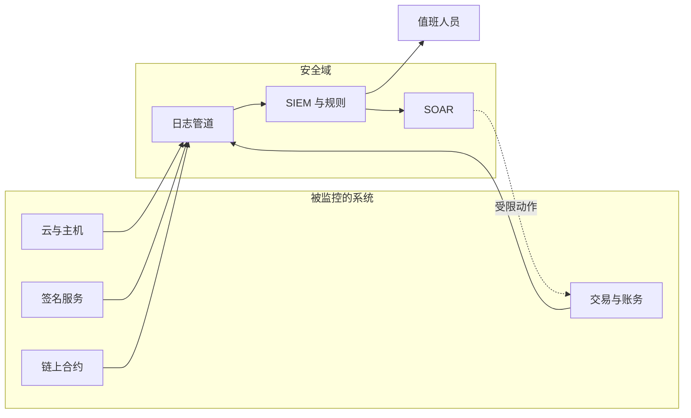
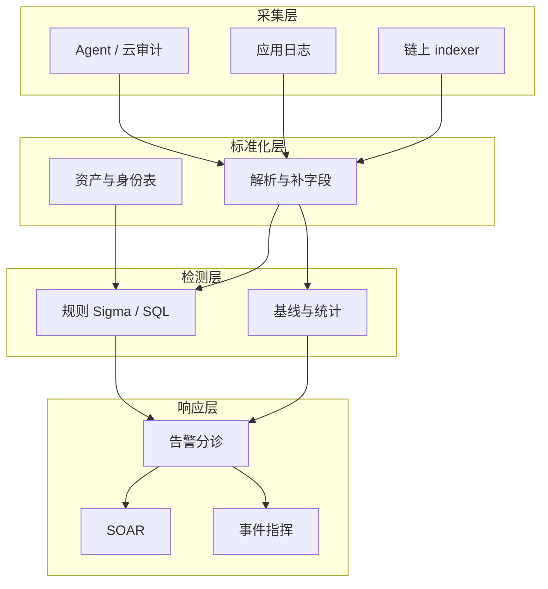
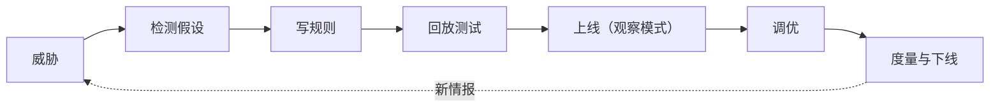
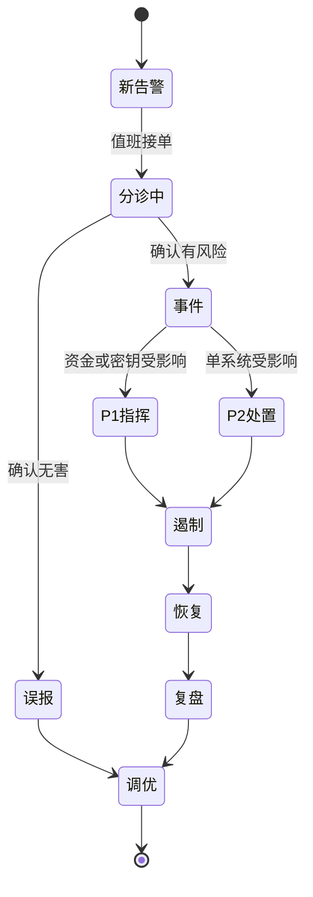

# X05 检测与响应工程：日志、SIEM、链上加链下检测与值班

> 学习目标：读完本章，你能——
> 1. 画出一家 Web3 机构的日志源清单与 SIEM 架构，并为每个日志源定义保留期和负责人。
> 2. 按"威胁 → 检测假设 → 规则 → 回放测试 → 上线 → 调优"写出一条链上或链下检测规则，并写清假阳性与调优方法。
> 3. 设计事件分级、值班升级、SOAR 自动动作边界，并主持一次 30 分钟的告警演练。
>
> 适用角色：安全运营（SecOps）工程师、检测工程师、值班负责人、交易所 / 项目方安全负责人
> 前置章节：[25 资金追踪、冻结与事后处置](../25-fund-tracing-response.md)、[A09 应急响应](../assessment/A09-incident-response.md)、[X03 生产基础设施安全](X03-production-infra-security.md)
> 交互实验 / 模板：[incident-response-sim.html](../interactive/incident-response-sim.html)；本章给出告警分级表、规则模板、事件通报模板
> 最后核对：2026-11-23

---

## 开场：一个真实场景

2022 年 3 月，Ronin 跨链桥被盗。攻击者控制了 9 个验证者中的 5 个，伪造了两笔提款。公开报道称，攻击发生在 3 月 23 日。Ronin 团队在 3 月 29 日才发现。发现的方式不是告警。是一位用户反馈：他无法从桥里提出 5,000 ETH。

<details class="predict"><summary>🤔 先猜再看：这座桥每天有大量提款。为什么 6 天里没有任何告警响起？</summary>

因为没有人为"桥的总出金量"写规则。每一笔被盗提款都带着合法的验证者签名，合约认为它们有效。日志里没有"错误"，只有"成功"。这说明：检测必须覆盖"成功但不合理"的事件，而不只是"失败"和"报错"。

</details>

2025 年 11 月 3 日，Balancer v2 被利用。公开报道称，监控方在数分钟内就识别出了异常。但被利用的部分池子已经无法暂停。检测很快，响应却受限于合约设计。

两个事故说明同一件事：**检测不等于响应**。检测要快，响应要有人、有权限、有开关。本章讲怎样把这三件事做成一套运营体系。

---

## 1. 一句话理解

**检测与响应工程，是把"发现异常、判断异常、处置异常"做成可重复、可度量、可演练的流水线，而不是靠某个人盯屏幕。**

检测工程（Detection Engineering）：像做软件一样做检测规则，包含假设、代码、测试、上线和调优。
SIEM（Security Information and Event Management，安全信息与事件管理）：集中收集日志、跑规则、出告警的系统。
SOAR（Security Orchestration, Automation and Response，安全编排与自动化响应）：把告警后的处置动作自动化的系统。
MTTD / MTTR：平均检测时间 / 平均响应时间。

> 🎯 打个比方：医院的急诊分诊。护士先量体征，再按严重程度分级。危重病人立刻进抢救室，轻症排队。检测规则是体征监护仪，告警分级是分诊台，值班是抢救团队。
>
> 比喻的局限：病人不会伪装成健康。攻击者会。他们会让异常看起来像正常业务，例如用合法签名、合法 API Key、合法客服账号。所以规则不能只看"是否合法"，还要看"是否符合这个主体的历史行为"。

---

## 2. 保护目标与信任边界

检测系统本身也是攻击目标。攻击者拿到权限后，第一件事常常是关日志、删日志、改规则。



读图要点：
- 日志单向流向安全域。被监控系统的管理员不能改写安全域里的日志。
- SOAR 回写业务系统的箭头用虚线，表示只开放少数受限动作（见第 6.14 节）。
- 局限：图里没有画"日志管道本身被打断"。这要靠"静默检测"规则（第 6.11 节规则 9）。

**不可信的东西**：
- 来自被监控主机的日志可能被失陷主机伪造。重要事件要有第二来源（云控制台日志、网络流量、链上数据）。
- 告警里的文本字段（用户名、备注、合约名称）可能含恶意内容。不要把它们直接拼进自动化脚本。
- 链上数据是公开的，攻击者也能看到你监控了什么。规则里的阈值不要写进公开仓库。

---

## 3. 参考架构

### 3.1 日志源清单

| 层 | 日志源 | 必须记录的字段 | 保留期（建议） | 负责人 |
|---|---|---|---|---|
| 云 | 云审计日志（如 CloudTrail）、IAM、KMS、网络流日志 | 主体、动作、来源 IP、资源、结果 | 在线 90 天，归档 1 年以上 | 云平台 |
| 主机 | EDR、auditd、进程创建、登录 | 进程树、命令行、用户、哈希 | 在线 90 天 | 终端安全 |
| 容器 | K8s 审计日志、准入控制日志、镜像拉取 | verb、资源、命名空间、用户 | 在线 90 天 | 平台 |
| 身份 | SSO、MFA、PAM 会话、break-glass | 登录结果、设备、会话 ID | 1 年 | IAM |
| 应用 | 网关、客户登录、找回、API Key 事件 | 账户 ID、设备指纹、IP、结果 | 1 年 | 应用团队 |
| 业务 | 提币申请与审批、地址簿变更、风控决策 | 申请人、审批人、规则命中 | 按合规要求，建议 5 年 | 风控 |
| 签名服务 | 签名请求、策略决策、HSM / MPC 日志 | 请求来源、交易摘要、策略版本 | 5 年 | 钱包团队 |
| 内部工具 | 客服后台、数据导出、BI 查询 | 操作者、查看的客户、导出行数 | 1 年 | IT / 数据 |
| 研发 | 代码仓库、CI/CD、制品库 | 提交者、runner、发布人 | 1 年 | 研发效能 |
| 链上 | 自家合约事件、交互地址、治理提案、预言机价格 | 区块号、交易哈希、事件参数 | 永久（可重放） | 链上监控 |

> 💡 注意：保留期受监管和法务要求约束。上表是"建议"，不是法规。最终数字请与合规确认。

### 3.2 标准化

所有日志写入前，补齐同一套公共字段。没有公共字段，规则就要为每个来源重写一遍。

```json
{
  "ts": "2026-11-23T08:15:30Z",
  "source": "exchange.withdrawal",
  "actor": {"type": "user", "id": "u_12345"},
  "action": "withdraw.create",
  "target": {"asset": "ETH", "chain": "ethereum", "address": "0xAbC..."},
  "result": "success",
  "ctx": {"ip": "203.0.113.9", "device_id": "d_77", "session": "s_9"},
  "env": "prod"
}
```

（示例。字段名按你的体系统一，关键是全公司一套。）

### 3.3 SIEM 与链上检测的整体分层



读图要点：
- "资产与身份表"是关键：它告诉规则哪个地址是热钱包、哪个账号是客服、哪个合约属于自己。没有它，规则无法区分"正常调拨"和"异常转出"。
- 链上 indexer 和云日志进入同一个标准化层。这样才能写出"链上转出 + 链下无审批单"这类跨域规则。
- 为什么这样分：采集层可以换产品，规则层要保持可移植。用 Sigma 或 SQL 写规则，是为了不被某个产品绑定。

### 3.4 链上检测的自建思路

不依赖具体产品。最小实现只需三件事：

1. 订阅区块或日志。节点 RPC 订阅 `newHeads` 与 `logs`，或者用自建 indexer 把事件写进数据库。
2. 把事件解码后写入表。表里至少有：区块号、交易哈希、合约、事件名、参数、时间。
3. 每个区块（或每分钟）跑一批 SQL / 规则，命中后推送告警。

> ⚠️ 警告：只依赖单个第三方 RPC 做监控，是单点风险。RPC 掉线或返回过期数据时，你会"看不见"而不是"看见异常"。至少使用两个独立来源，并监控"区块高度停滞"。

---

## 4. 控制清单

| ID | 控制项 | 要防什么 | 优先级 | 怎么验证 |
|---|---|---|---|---|
| DET-1 | 维护日志源清单，含负责人、保留期、接入状态 | 事故时发现"没日志" | P0 | 抽 3 个关键系统，查最近 24 小时日志是否到达 |
| DET-2 | 云审计、身份、签名服务日志写入独立安全账号，业务管理员无删除权限 | 攻击者删日志 | P0 | 用业务管理员账号尝试删除，应失败 |
| DET-3 | 日志静默检测：关键来源 15 分钟无数据即告警 | 日志管道被关闭 | P0 | 临时停掉一个测试来源，看是否告警 |
| DET-4 | 告警分级 P1–P4，每级有响应时限和升级路径 | 告警淹没、重要告警被忽略 | P0 | 随机抽 10 条告警，核对分级与响应时间 |
| DET-5 | 7×24 值班，有主备，有升级电话，每季度测试联系链 | 夜里无人响应 | P0 | 非工作时间发测试 P1，记录确认时间 |
| DET-6 | 链上监控覆盖自家全部合约与热 / 温钱包地址，至少两个数据源 | 单点盲区 | P0 | 清单对账：合约地址表与监控配置一致 |
| DET-7 | 规则有版本、有测试用例、有负责人、有最近调优日期 | 规则腐化、无人维护 | P1 | 抽 5 条规则，查回放测试记录 |
| DET-8 | 每个上线规则记录假阳性率，超阈值须调优或下线 | 告警疲劳 | P1 | 月度报告含各规则假阳性率 |
| DET-9 | 事件分级与指挥体系成文，指挥官有权暂停业务 | 决策拖延 | P0 | 桌面演练中计时：从确认到暂停决策 |
| DET-10 | SOAR 自动动作白名单成文，含回滚方式 | 自动化误伤业务 | P1 | 阅读 SOAR 动作清单，逐项核对批准记录 |
| DET-11 | 证据保全流程：快照、哈希、保管链 | 证据被污染，无法用于追责 | P1 | 演练中保全一份磁盘或日志快照，验证哈希 |
| DET-12 | 每季度至少一次检测覆盖复盘（对照 ATT&CK 与 Web3 增补） | 长期盲区 | P2 | 查季度覆盖矩阵 |

---

## 5. 分级落地

| 档位 | 日志与 SIEM | 链上检测 | 响应与值班 | 人力与时间（示例） |
|---|---|---|---|---|
| 最小可行 | 云审计、身份、签名服务、提币业务日志集中到一个托管 SIEM 或日志库；10–15 条规则 | 自家合约与热钱包的大额流出、授权、升级、暂停事件告警 | 3–4 人轮值，P1 电话升级，一页事件手册 | 1–2 名工程师，约 4–6 周 |
| 标准 | 全部日志源接入；规则 50+，有回放测试；静默检测；资产与身份表 | 自建 indexer 或多来源；预言机偏离、治理提案、桥消息监控 | 分级指挥体系；SOAR 白名单动作；每季度演练 | 3–5 人安全运营，约 3–6 个月 |
| 成熟 | 基线与异常检测；检测即代码流水线；紫队驱动覆盖 | 实时模拟与交易前拦截；跨链对账；威胁情报联动 | 7×24 专职 SOC；多方联动（风控、合规、法务、公关、执法）；月度红蓝验证 | 6–12 人，持续建设 |

> 💡 注意：上表人数与周期为"示例"，随业务规模变化。小团队也可以先用托管服务把值班外包，但"谁有权暂停业务"必须由自家人决定。

---

## 6. 落地做法

### 6.1 检测工程流程



读图要点：
- 先写"假设"，再写规则。假设的格式：如果攻击者做了 X，我们在日志 Y 里会看到 Z。
- 回放测试用历史数据：既要找出能命中的攻击样本，也要统计一周正常数据里会误报几次。
- "观察模式"指规则先只记录、不叫醒人。观察 1–2 周，再决定分级。
- 局限：没有历史攻击样本时，只能用自己构造的模拟事件。模拟事件会让规则看上去比真实情况更好。

**ATT&CK 与 Web3 增补**：MITRE ATT&CK 是通用的攻击技术知识库。截至 2026 年公开资料，官方版本页显示最新版本为 v20.1（2026-10-13 起）；v19 起 Enterprise 把 Defense Evasion 拆为 Stealth 与 Defense Impairment 两个战术。以官方最新文档为准。ATT&CK 没有覆盖 Web3 特有动作，所以团队要自己补一张增补表：

| Web3 增补类别 | 例子 | 检测来源 |
|---|---|---|
| 签名路径篡改 | 前端被替换、签名请求与展示不一致 | 前端发布日志、签名服务策略日志、链上 delegatecall |
| 链上权限变更 | 升级、`transferOwnership`、角色授予、暂停权转移 | 合约事件 |
| 共识外依赖失效 | 预言机停更或偏离、桥消息异常、RPC 分叉 | 链上价格、桥事件、节点健康 |
| 资金出口 | 大额流出、新地址首次接收、授权异常 | 链上 indexer + 业务审批单 |
| 内部数据外流 | 客服批量查看客户、BI 导出 | 内部工具日志 |

### 6.2 规则示例总览

以下所有规则都是"示例"。字段名、表名、阈值按你的环境调整。规则语法为 Sigma（YAML）与 SQL（PostgreSQL 风格）。Sigma 规则规范以 SigmaHQ 官方文档为准；用 pySigma 后端转换为你的 SIEM 查询语言之前，先在测试库验证字段映射。

| # | 规则 | 来源 | 语言 | 对应控制 |
|---|---|---|---|---|
| 1 | 云 root 账号控制台登录 | 云审计 | Sigma | DET-2 |
| 2 | 签名密钥被禁用、计划删除或改策略 | KMS 审计 | Sigma | DET-2 |
| 3 | 有人进入签名服务的容器 | K8s 审计 | Sigma | DET-2 |
| 4 | 开发机上包管理器拉起外联工具 | 终端 | Sigma | DET-1 |
| 5 | 改密 / 换 2FA 后短时间大额提币到新地址 | 业务 | SQL | DET-6 |
| 6 | API Key 刚开提币权限即从新 IP 使用 | 应用 | SQL | DET-6 |
| 7 | 客服批量查看客户资料（偏离基线） | 内部工具 | SQL | DET-1 |
| 8 | Safe 多签 delegatecall 到未审核目标 | 链上 | SQL | DET-6 |
| 9 | 日志源静默 | 管道 | SQL | DET-3 |
| 10 | 链上热钱包净流出超过预算且无审批单 | 链上 + 业务 | SQL | DET-6 |
| 11 | 预言机价格偏离 | 链上 | SQL | DET-6 |

### 6.3 规则 1：云 root 账号控制台登录（Sigma）

假设：生产云账号的 root 账号只在极少数应急场景使用。任何登录都应有工单。

```yaml
title: AWS Root Console Login
id: 3b2f6c1e-0001-4a5e-9a10-5d0c7e1a0001
status: experimental
description: 检测 root 账号登录 AWS 控制台（示例）
logsource:
  product: aws
  service: cloudtrail
detection:
  selection:
    eventSource: 'signin.amazonaws.com'
    eventName: 'ConsoleLogin'
    userIdentity.type: 'Root'
  condition: selection
fields:
  - sourceIPAddress
  - userAgent
  - additionalEventData.MFAUsed
falsepositives:
  - 经批准的 break-glass 演练（应有工单号）
  - 新账号初始化
level: high
tags:
  - attack.initial-access
  - attack.t1078
```

- **假阳性**：break-glass 演练。调优：在 SOAR 里查工单系统，有批准工单则降为 P3 并附工单，无工单直接 P1。
- **回放测试**：用测试账号登录一次 root，规则应在分钟级命中。

### 6.4 规则 2：签名密钥被禁用、删除或改策略（Sigma）

假设：攻击者想阻止签名服务工作、或把密钥权限改给自己时，会调用密钥管理的管理类接口。

```yaml
title: KMS Signing Key Administrative Change
id: 3b2f6c1e-0002-4a5e-9a10-5d0c7e1a0002
status: experimental
description: 检测 KMS 密钥禁用、计划删除、策略修改、创建授权（示例）
logsource:
  product: aws
  service: cloudtrail
detection:
  selection:
    eventSource: 'kms.amazonaws.com'
    eventName:
      - 'DisableKey'
      - 'ScheduleKeyDeletion'
      - 'PutKeyPolicy'
      - 'CreateGrant'
  filter_pipeline:
    userIdentity.arn|contains: 'role/approved-key-admin-pipeline'
  condition: selection and not filter_pipeline
falsepositives:
  - 计划内的密钥轮换（通过审批流水线执行，已被过滤）
  - 灾备演练
level: critical
tags:
  - attack.impact
  - attack.t1485
```

- **假阳性**：轮换和灾备。调优：只允许一个审批流水线角色做这些操作，其他任何主体命中都是 P1。
- **注意**：`filter_pipeline` 里的角色名是示例。过滤条件越宽，漏报风险越大。要定期核对被过滤角色的权限。

### 6.5 规则 3：有人进入签名服务容器（Sigma）

```yaml
title: Kubectl Exec Into Signer Namespace
id: 3b2f6c1e-0003-4a5e-9a10-5d0c7e1a0003
status: experimental
description: 检测对签名命名空间 Pod 的 exec（示例）
logsource:
  product: kubernetes
  service: audit
detection:
  selection:
    verb: 'create'
    objectRef.resource: 'pods'
    objectRef.subresource: 'exec'
    objectRef.namespace: 'signer'
  condition: selection
falsepositives:
  - 值班人员经批准的排障（应有 break-glass 记录）
level: high
tags:
  - attack.execution
  - attack.t1609
```

- **调优**：生产的签名服务通常不允许 exec。如果制度禁止，这条规则假阳性应接近 0，命中就升 P1。若允许，要求每次 exec 前有 PAM 工单，规则关联工单后降级。

### 6.6 规则 4：开发机上包管理器拉起外联工具（Sigma）

假设：Safe 对 Bybit 事件的调查（媒体转述）显示，一台开发者机器曾与恶意 Docker 项目交互。开发机上"安装依赖后触发外联"是供应链攻击的常见一步。这条规则不能证明恶意，只能提示复核。

```yaml
title: Package Manager Spawns Network Tool
id: 3b2f6c1e-0004-4a5e-9a10-5d0c7e1a0004
status: experimental
description: npm / pip 安装过程中拉起 curl、wget、nc 等（示例）
logsource:
  category: process_creation
  product: macos
detection:
  selection_parent:
    ParentImage|endswith:
      - '/node'
      - '/python3'
    ParentCommandLine|contains:
      - 'install'
      - 'postinstall'
  selection_child:
    Image|endswith:
      - '/curl'
      - '/wget'
      - '/nc'
  condition: selection_parent and selection_child
falsepositives:
  - 合法包在安装时下载二进制（如 esbuild、playwright）
level: medium
tags:
  - attack.execution
  - attack.t1059
```

- **假阳性**：很多合法包会在安装时下载文件。调优：建立"已知良好包白名单"（按包名与下载域名），只对白名单外的组合升级到 P2。
- **局限**：命令行字段在不同终端产品里字段名不同。上线前确认字段映射。

### 6.7 规则 5：改密 / 换 2FA 后大额提币到新地址（SQL）

假设：账户接管后，攻击者先改安全设置，再尽快提币到新地址。（对应 [X08](X08-cex-identity-account-access.md)）

```sql
-- 示例表：security_events(user_id, event_type, ts)
--         withdrawals(id, user_id, asset, amount_usd, to_address, created_at)
--         address_book(user_id, address, first_seen_at)
SELECT w.user_id, w.id AS withdrawal_id, w.amount_usd, w.to_address,
       s.event_type, s.ts AS security_change_ts, w.created_at
FROM withdrawals w
JOIN security_events s
  ON s.user_id = w.user_id
 AND s.event_type IN ('password_change','2fa_reset','email_change','phone_change')
 AND w.created_at BETWEEN s.ts AND s.ts + INTERVAL '24 hours'
LEFT JOIN address_book a
  ON a.user_id = w.user_id AND a.address = w.to_address
 AND a.first_seen_at < w.created_at - INTERVAL '7 days'
WHERE a.address IS NULL            -- 目的地址不是 7 天前就存在的老地址
  AND w.amount_usd >= 5000         -- 示例阈值
  AND w.created_at > now() - INTERVAL '10 minutes';
```

- **假阳性**：用户正常换手机后立刻提币。调优：命中后不直接封号，先加"延迟生效 + 二次确认"；对已通过强验证（硬件密钥）的用户降低分值。
- **阈值调优**：用最近 30 天数据回放，从高到低调 `amount_usd`，使人工复核量在值班可承受范围内（示例目标：每天不超过 30 条）。
- **局限**：攻击者可以先绑定地址、等 7 天再动手。该规则要与"地址簿变更"规则配合。

### 6.8 规则 6：API Key 刚开提币权限就从新 IP 使用（SQL）

```sql
-- 示例表：api_key_events(key_id, user_id, event_type, ts)
--         api_requests(key_id, endpoint, src_ip, ts)
--         api_key_known_ips(key_id, src_ip)
WITH perm AS (
  SELECT key_id, MIN(ts) AS enabled_ts
  FROM api_key_events
  WHERE event_type = 'withdraw_permission_enabled'
  GROUP BY key_id
)
SELECT r.key_id, r.src_ip, r.endpoint, r.ts, p.enabled_ts
FROM api_requests r
JOIN perm p ON p.key_id = r.key_id
LEFT JOIN api_key_known_ips k ON k.key_id = r.key_id AND k.src_ip = r.src_ip
WHERE r.endpoint LIKE '/withdraw%'
  AND r.ts BETWEEN p.enabled_ts AND p.enabled_ts + INTERVAL '2 hours'
  AND k.src_ip IS NULL
  AND r.ts > now() - INTERVAL '10 minutes';
```

- **假阳性**：机构客户合法扩权并更换服务器。调优：提币权限要求 IP 白名单，白名单变更后冷静期 24 小时；命中规则时先暂停该 Key 的提币，不暂停交易。

### 6.9 规则 7：客服批量查看客户资料（SQL，偏离基线）

假设：Coinbase 2025 年的公开披露显示，被收买的客服人员复制客户数据；公司称其监控曾在勒索之前发现客服人员访问了与职责无关的数据。这类规则看的是"数量偏离"，不是"访问本身"。

```sql
-- 示例表：support_views(agent_id, customer_id, ts)
WITH hourly AS (
  SELECT agent_id,
         date_trunc('hour', ts) AS h,
         COUNT(DISTINCT customer_id) AS n
  FROM support_views
  WHERE ts > now() - INTERVAL '30 days'
  GROUP BY 1, 2
),
baseline AS (
  SELECT agent_id,
         percentile_cont(0.95) WITHIN GROUP (ORDER BY n) AS p95
  FROM hourly
  WHERE h < date_trunc('hour', now())
  GROUP BY 1
)
SELECT c.agent_id, c.n AS views_this_hour, b.p95
FROM hourly c
JOIN baseline b USING (agent_id)
WHERE c.h = date_trunc('hour', now())
  AND c.n > GREATEST(b.p95 * 2, 40);   -- 示例：2 倍基线，且至少 40 个客户 / 小时
```

- **假阳性**：活动日、故障期间客服量大增。调优：按团队而非个人建基线；与工单系统关联，只统计"没有对应工单"的查看；对新入职 30 天内的人使用团队基线。
- **关键点**：这条规则只能"发现"。要让它有用，必须有后续动作：谁调查、多久内关闭客服权限（见第 6.14 节与案例 3）。

### 6.10 规则 8：Safe 多签 delegatecall 到未审核目标（SQL，链上）

假设：多签钱包执行 `operation = 1`（delegatecall）几乎不是日常转账。NCC Group 对 Bybit 事件的分析指出，签名人看到的是普通转账，实际签署的是 delegatecall 到攻击者合约。本规则在链上看到结果；更好的做法是签名前模拟（见 [X11](X11-cex-wallet-treasury-payment.md)、[29 签名路径](../29-signing-path-2026.md)）。

```sql
-- 示例表（由 indexer 解码）：safe_exec(tx_hash, safe_address, to_address, operation, value_wei, block_ts)
--   watched_safes(safe_address, owner_team)
--   approved_delegate_targets(to_address)       -- 如已审核的批量调用库
SELECT e.tx_hash, e.safe_address, e.to_address, e.operation, e.block_ts
FROM safe_exec e
JOIN watched_safes w USING (safe_address)
LEFT JOIN approved_delegate_targets a ON a.to_address = e.to_address
WHERE e.operation = 1
  AND a.to_address IS NULL
  AND e.block_ts > now() - INTERVAL '2 minutes';
```

- **假阳性**：合法的批量操作库调用。调优：把已审核的目标合约放入 `approved_delegate_targets`。
- **配套规则**：同一钱包的代理实现地址变化，直接 P1。
- **局限**：这条规则在交易上链之后才触发。事后检测只能缩短响应时间，不能阻止第一笔转出。要阻止，需要签名前的策略引擎。

### 6.11 规则 9–11：静默、无审批转出、预言机偏离（SQL）

**规则 9：日志源静默**

```sql
-- 示例表：log_sources(source_name, tier, expected_max_gap_minutes)
--         log_heartbeat(source_name, last_event_ts)
SELECT s.source_name, h.last_event_ts
FROM log_sources s
JOIN log_heartbeat h USING (source_name)
WHERE s.tier = 'critical'
  AND h.last_event_ts < now() - make_interval(mins => s.expected_max_gap_minutes);
```

- **假阳性**：低流量时段合法静默。调优：每个来源按自己的历史间隔设定 `expected_max_gap_minutes`，夜间可单独设值。

**规则 10：热钱包净流出超过预算且无审批单**

```sql
-- 示例表：chain_transfers(tx_hash, from_address, to_address, asset, amount_usd, block_ts)
--         hot_wallets(address, hourly_budget_usd)
--         treasury_tickets(tx_hash_expected, status)  -- 已审批调拨
SELECT h.address, SUM(t.amount_usd) AS out_usd, h.hourly_budget_usd
FROM chain_transfers t
JOIN hot_wallets h ON h.address = t.from_address
LEFT JOIN treasury_tickets k ON k.tx_hash_expected = t.tx_hash AND k.status = 'approved'
WHERE t.block_ts > now() - INTERVAL '1 hour'
  AND k.tx_hash_expected IS NULL
GROUP BY h.address, h.hourly_budget_usd
HAVING SUM(t.amount_usd) > h.hourly_budget_usd;
```

- **假阳性**：提币高峰（行情暴涨暴跌）。调优：预算按近 30 天同时段分位数动态调整；用户提币与调拨分开统计；超过预算时先报 P2，超过预算 3 倍报 P1（示例）。

**规则 11：预言机价格偏离**

```sql
-- 示例表：oracle_prices(feed, price, block_ts)   reference_prices(feed, price, ts)
SELECT o.feed, o.price AS oracle_price, r.price AS ref_price,
       ABS(o.price - r.price) / r.price AS deviation
FROM oracle_prices o
JOIN LATERAL (
  SELECT price FROM reference_prices
  WHERE feed = o.feed ORDER BY ts DESC LIMIT 1
) r ON TRUE
WHERE o.block_ts = (SELECT MAX(block_ts) FROM oracle_prices WHERE feed = o.feed)
  AND ABS(o.price - r.price) / r.price > 0.03;   -- 示例：偏离 3%
```

- **假阳性**：剧烈行情中参考价自身滞后。调优：参考价取多来源中位数；波动大时提高阈值，但同时缩短检查间隔；另设"价格超过 N 分钟未更新"规则。

### 6.12 规则回放测试

每条规则上线前，用脚本回放测试。下面是一个最小实现（示例，使用 Python 标准库）。

```python
# replay_test.py：对一批已标注日志跑规则，输出命中与误报
import json, sys

def rule_root_login(ev):
    return (ev.get("eventSource") == "signin.amazonaws.com"
            and ev.get("eventName") == "ConsoleLogin"
            and ev.get("userIdentity", {}).get("type") == "Root")

def main(path, rule):
    tp = fp = fn = tn = 0
    with open(path) as f:
        for line in f:
            ev = json.loads(line)
            hit = rule(ev)
            bad = ev.get("_label") == "malicious"
            if hit and bad: tp += 1
            elif hit and not bad: fp += 1
            elif not hit and bad: fn += 1
            else: tn += 1
    print(f"TP={tp} FP={fp} FN={fn} TN={tn}")
    if tp + fp:
        print(f"precision={tp/(tp+fp):.2f}")
    if tp + fn:
        print(f"recall={tp/(tp+fn):.2f}")

if __name__ == "__main__":
    main(sys.argv[1], rule_root_login)
```

做法：
1. 准备一份 JSON Lines 日志：一周的正常数据 + 你构造的攻击样本，每条带 `_label`。
2. 运行脚本，看精确率和召回率。
3. 精确率太低，说明要加过滤条件；召回率太低，说明规则太窄。
4. 把测试数据和结果与规则一起放进版本库。

建议配套（后续在 L3 训练营实现）：把这个脚本扩展成"多规则回放框架"，支持 Sigma 转换后的查询。

### 6.13 告警分级与升级



读图要点：
- "误报"与"复盘"都会流向"调优"。每一条告警的最终结果必须反馈给规则负责人。
- P1 直接进入指挥体系；分诊最长时间要有上限，否则告警会堆积。
- 局限：状态机省略了"升级"和"降级"。真实流程里，分诊中的 P3 可能因新证据升为 P1。

| 级别 | 含义 | 例子 | 响应时限（示例） | 谁被叫醒 |
|---|---|---|---|---|
| P1 | 资金或密钥正在或可能被盗 | 规则 2、8、10 命中且无工单 | 5 分钟确认，15 分钟指挥官就位 | 值班、指挥官、钱包负责人 |
| P2 | 单个关键系统被入侵或高风险异常 | 规则 3、5 批量命中 | 15 分钟确认，1 小时处置方案 | 值班、系统负责人 |
| P3 | 可疑但需人工判断 | 规则 4、6、7 | 4 小时内分诊 | 值班 |
| P4 | 信息类或合规提醒 | 配置漂移 | 下一个工作日 | 工单队列 |

### 6.14 SOAR 自动化的边界

自动动作要满足两条：动作可逆；误伤的代价小于漏报的代价。下面是一份示例白名单配置。

```yaml
# soar-actions.yaml（示例）
actions:
  - name: pause_withdrawals_for_user
    auto: true
    condition: "rule in [R5, R6] and score >= 80"
    scope: single_user
    reversible: true
    max_duration: 24h
    notify: [secops, risk]
  - name: disable_api_key_withdraw
    auto: true
    condition: "rule == R6"
    scope: single_key
    reversible: true
  - name: freeze_user_account
    auto: false          # 需风控人员确认
    approver: [risk_lead]
  - name: pause_all_withdrawals
    auto: false          # 全局暂停，必须指挥官决定
    approver: [incident_commander]
    sla_to_decision: 10m
  - name: rotate_signing_keys
    auto: false          # 涉及密钥仪式，必须人工
    approver: [custody_lead, ciso]
  - name: public_announcement
    auto: false          # 对外沟通
    approver: [incident_commander, legal, pr]
```

自动与人工的分界：

| 动作 | 可自动？ | 原因 |
|---|---|---|
| 暂停单个用户 / 单个 API Key 的提币 | 可以 | 范围小、可恢复 |
| 对单笔提币加人工复核 | 可以 | 只增加延迟 |
| 隔离单台主机的网络 | 可以（有告警置信度要求） | 可恢复，但要确认不是签名主机 |
| 冻结用户账户 | 人工确认 | 有法律和客户影响 |
| 全局暂停提币 | 人工决定，预先授权，决策时限短 | 影响全体用户 |
| 轮换签名密钥、迁移冷钱包 | 必须人工，多人在场 | 操作本身有风险 |
| 对外公告、通知监管 | 必须人工，法务参与 | 法律后果 |

> ⚠️ 警告：不要让 SOAR 读取告警里的自由文本并执行。攻击者可以在用户名或备注里放入恶意内容，诱导自动化脚本误操作。

### 6.15 响应：事件指挥与通信

**指挥体系**：

| 角色 | 职责 | 不做什么 |
|---|---|---|
| 事件指挥官（IC） | 决定暂停、升级、对外沟通 | 不亲自动手排查 |
| 技术负责人 | 分配排查和遏制任务 | 不与外部沟通 |
| 记录员 | 记录时间线、决定和证据 | 不参与技术讨论 |
| 通信负责人 | 起草内外部通报，经 IC 与法务批准 | 不未经批准发布 |
| 联络人 | 对接交易所、稳定币发行方、安全公司、执法 | — |

**对内通报模板**（示例）：

```text
[P1] 事件通报 #{序号}  时间：{UTC 时间}
状态：调查中 / 遏制中 / 恢复中
影响：{资产、系统、用户范围；已知 / 未知}
已采取动作：{时间 + 动作}
下一步与负责人：{动作 + 人 + 预计时间}
下次更新：{时间，P1 建议每 30 分钟}
决策请求：{需要 IC 决定的事项}
```

**证据保全清单**：
1. 记录时间线：谁在何时看到了什么。
2. 对受影响主机做内存与磁盘快照，不要先重启。
3. 导出相关日志，计算哈希并记录。
4. 记录链上证据：交易哈希、地址、区块号。
5. 保管链：谁在何时拿走了哪份证据。
6. 遏制动作前先保全，除非遏制必须立即执行。

链上资金追踪与冻结请求，见 [25 资金追踪、冻结与事后处置](../25-fund-tracing-response.md)。事故响应总流程，见 [A09 应急响应](../assessment/A09-incident-response.md)。

### 6.16 常见坑

- 只写"失败"规则，不写"成功但异常"规则。
- 规则没有负责人，一年后没人敢删。
- 阈值写死。行情大幅波动时告警风暴，值班关掉了通知。
- 告警里没有"下一步做什么"。值班要现想。
- 监控只在工作时间看。事故多发生在周末和节假日。
- 只监控链上，没有关联链下审批单，导致无法区分"自己人转"和"被盗转出"。

---

## 7. 运营：指标、告警、值班、演练、季度节奏

### 7.1 指标

| 指标 | 定义 | 目标（示例） | 注意 |
|---|---|---|---|
| MTTD | 从恶意动作开始到被确认的时间 | P1 类 < 15 分钟 | 起点要用事后还原的时间，而不是告警时间 |
| MTTA | 从告警到有人确认 | P1 < 5 分钟 | 夜间单独统计 |
| MTTR | 从确认到遏制 | P1 < 60 分钟 | 区分遏制与完全恢复 |
| 假阳性率 | 误报数 ÷ 告警总数 | 每条规则 < 50%（P1 规则更低） | 只统计已分诊的告警 |
| 规则覆盖率 | 有规则的 ATT&CK 技术 + Web3 增补类别 ÷ 应覆盖的总数 | 按威胁模型设定 | 覆盖不等于有效，要配回放测试 |
| 日志覆盖率 | 实际接入的日志源 ÷ 日志源清单 | 关键源 100% | 含"静默检测" |
| 演练通过率 | 演练中按时完成的步骤占比 | 持续上升 | 失败也要记录 |
| 告警积压 | 超过响应时限仍未处理的告警数 | 0 | 积压说明人力或规则有问题 |

> ⚠️ 警告：MTTD 容易被"美化"。把起点定为"告警时间"，数字会好看，但没有意义。用事后复盘还原的真实起点。

### 7.2 值班制度

- 主备两人，轮换周期 1 周。
- 值班手机必须有备用通道（电话、短信、第二个通讯 App）。
- 交接会：上一班讲未关闭告警、最近调优、已知误报。
- 值班人员有权在预先授权范围内执行动作（第 6.14 节表中"可以"的动作），事后补记。
- 补休：夜间被叫醒后给补休。长期没有补休的值班会流失。
- 升级路径：值班 → 安全负责人 → CISO → CEO / 董事会（P1 且涉及资金时）。

### 7.3 演练

- 每月：一次 15 分钟的"告警演练"。用规则 5 或规则 10 的模拟数据，看值班是否在时限内分诊。
- 每季度：一次 30 分钟桌面推演。剧本见 [X06 韧性与验证](X06-resilience-validation.md)。
- 每半年：一次联动演练，邀请风控、合规、法务、公关、客服参加。
- 每次演练输出：时间线、卡点、行动项、规则调整。

### 7.4 季度节奏

| 周 | 做什么 |
|---|---|
| 第 1–2 周 | 规则健康检查：假阳性率最高的 10 条规则调优或下线 |
| 第 3–4 周 | 覆盖复盘：对照 ATT&CK 与 Web3 增补，列出盲区 |
| 第 5–8 周 | 新规则开发：把最近行业事故转成规则（假设 → 规则 → 回放） |
| 第 9–10 周 | 值班联动演练 |
| 第 11–12 周 | 汇报：指标、红线项、未关闭风险（模板见 X06） |

---

## 8. 失效案例

所有案例只写摘要和教训。数字为公开报道值，金额为"约"和"事发时美元估值"。不同来源数字有差异，以下标注区间。

### 案例 1：Ronin 跨链桥（2022 年 3 月，Ronin 链）——没有"总出金"规则，6 天后才发现

- **来源类型**：项目方（Sky Mavis）公开说明，经 The Record 等媒体报道。
- **经过**：公开报道称，攻击者控制了 Sky Mavis 的 4 个验证者和 Axie DAO 的 1 个验证者，共 9 个中的 5 个，达到批准门槛。攻击在 2022 年 3 月 23 日发生，伪造两笔提款，约 17.36 万 ETH 和约 2,550 万 USDC，各来源估值在约 5.4 亿至 6.25 亿美元之间（取决于估值时点）。Sky Mavis 称 3 月 29 日发现，起因是用户报告无法提出 5,000 ETH。Sky Mavis 还称，2021 年授予的签名白名单权限在 12 月之后未被撤销。
- **绕过了哪条控制**：没有"桥的净流出与存款对账"（对应 DET-6）；没有对"验证者签名使用"的告警；临时权限没有及时回收。
- **教训**：对资金出口做"总量对账"规则；不要等用户先发现。事后，Ronin 把验证者门槛从 5 提高到 8（公开说明）。

### 案例 2：Bybit 冷钱包（2025 年 2 月，以太坊）——签名人看到的与实际签的不一致

- **来源类型**：安全公司分析（NCC Group）、Safe 的初步调查报告（经媒体转述）。
- **经过**：2025 年 2 月 21 日，Bybit 一个多签冷钱包被转出超过 14 亿美元资产，含约 40.1 万 ETH。NCC Group 的分析指出，攻击者在 Safe{Wallet} 前端注入恶意 JavaScript。签名人界面显示常规转账，实际签署的操作被改为 delegatecall 到攻击者合约，替换了钱包逻辑。Safe 的调查（媒体转述）称，一台开发者的 macOS 机器曾与恶意 Docker 项目交互；公开报道将攻击归因于朝鲜相关的 Lazarus 组织。
- **绕过了哪条控制**：签名前独立解码（本章规则 8 的链上检测只能在事后触发）；开发机终端检测（规则 4）；前端发布完整性。
- **教训**：对多签 delegatecall 做链上告警，但更重要的是在签名前拦截。检测要覆盖"供应商前端被改"这种共识外依赖。对应章节：[X11](X11-cex-wallet-treasury-payment.md)、[X04](X04-delivery-supply-chain.md)、[29](../29-signing-path-2026.md)。

### 案例 3：Coinbase 客服数据泄露（2024 年 12 月至 2025 年 5 月，链下）——发现了异常，但没有及时关闭

- **来源类型**：公司向美国 SEC 提交的 8-K（经媒体转述）、缅因州总检察长披露、媒体报道。
- **经过**：公司披露称，不法分子贿赂海外客服人员，复制客户支持工具里的数据，涉及不足 1% 的月度交易用户；缅因州披露的受影响客户数约 6.9 万。公司表示，在 2025 年 5 月 11 日收到勒索邮件之前的几个月，监控已发现部分客服人员访问了与其职责无关的数据。公司没有支付 2,000 万美元勒索，改为设立同额悬赏。公司在 8-K 中估计整改和自愿补偿成本约 1.8 亿至 4 亿美元（估计值，会变化）。
- **绕过了哪条控制**：不是没有检测，而是检测到之后遏制太慢（对应 DET-9、DET-10）。数据在被发现之前已长期外流。
- **教训**：规则 7 这类"偏离基线"规则必须配套处置权限：发现后多久内关闭权限、停止导出。内部人员风险需要访问最小化、导出控制和岗位轮换，不只是监控。对应 [X12](X12-cex-production-data.md)。

### 案例 4：Balancer v2（2025 年 11 月，多链）——检测很快，部分池子没有开关

- **来源类型**：项目方复盘（Balancer 事后总结）、安全公司分析（Check Point Research、Trail of Bits）、媒体报道。
- **经过**：2025 年 11 月 3 日，攻击者利用 Balancer v2 Composable Stable Pool 的舍入方向错误，在多条链上取走资金。各来源估计损失约 0.95 亿至 1.28 亿美元不等（口径不同：是否含分叉协议）。Check Point 称其监控在数分钟内识别出异常（这是厂商自述）。媒体整理的时间线显示，攻击约 07:46 UTC 开始，Balancer 官方首次公开确认约在 09:39 UTC（各来源细节略有出入）。复盘称，处于暂停窗口内的池子被暂停并保护了约 1,930 万美元；协同响应共追回或保护约 4,570 万美元（引自复盘报道，以官方最终报告为准）。
- **绕过了哪条控制**：能否暂停取决于合约设计，已过暂停窗口的池子没有应急开关（对应 DET-9 与 [X16](X16-defi-project-ops.md) 的暂停守护者）。
- **教训**：检测与响应要一起设计：监控再快，没有开关也无济于事。Trail of Bits 的分析建议：自动告警、速率限制、时间锁、暂停守护者。

---

## 9. 评估检查点

- [ ] **DET-1** 日志源清单存在，含负责人、保留期、接入状态，最近 90 天内更新过。
- [ ] **DET-2** 云审计、身份、签名服务日志写入独立安全账号，业务管理员无法删除。
- [ ] **DET-3** 关键日志源有静默检测，演练过一次关闭日志后的告警。
- [ ] **DET-4** 告警分级 P1–P4 成文，每级有响应时限和升级路径。
- [ ] **DET-5** 7×24 值班有主备，联系链每季度测试一次。
- [ ] **DET-6** 链上监控覆盖全部自有合约和热 / 温钱包，使用至少两个数据源，有"区块停滞"告警。
- [ ] **DET-7** 每条规则有版本、负责人、回放测试和最近调优日期。
- [ ] **DET-8** 每条规则有假阳性率记录，超阈值的规则有调优或下线记录。
- [ ] **DET-9** 事件指挥体系成文，指挥官有权暂停业务，演练中从确认到暂停决策不超过预设时限。
- [ ] **DET-10** SOAR 自动动作有白名单、回滚方式和批准记录。
- [ ] **DET-11** 证据保全流程演练过，快照哈希可复验。
- [ ] **DET-12** 每季度有一次对照 ATT&CK 与 Web3 增补的覆盖复盘。

**把结果写进报告**：

| 检查项 | 状态（通过 / 部分 / 缺失） | 证据（链接 / 截图 / 日志） | 负责人 | 补齐日期 |
|---|---|---|---|---|
| DET-1 | | | | |
| DET-2 | | | | |
| DET-3 至 DET-12 | | | | |

---

## 10. 上手路径

**第一周**
1. 列出日志源清单：哪些系统有日志，谁管，现在写到哪里，保留多久。
2. 确认云审计日志是否在独立账号里，用普通管理员账号测试能否删除。
3. 找到"谁有权暂停提币"的答案。如果没有明确答案，写下来，请管理层确认。
4. 部署规则 1、2（云 root 登录、KMS 变更）。它们假阳性低，收益高。

**第一个月**
1. 建立"资产与身份表"：热钱包地址、自家合约地址、客服账号、审批流水线角色。
2. 上线链上基础监控：大额流出、升级、暂停、所有权变更；至少两个数据源。
3. 写下 P1–P4 分级与值班联系链，做一次夜间测试告警。
4. 上线规则 5、6、10，先观察模式运行 2 周，记录假阳性。
5. 写一页事件手册和通报模板。

**第一个季度**
1. 完成静默检测和回放测试脚本。
2. 引入 SOAR 白名单动作（只做单用户 / 单 Key 暂停）。
3. 做第一次 30 分钟桌面推演（剧本见 X06）。
4. 用本章 12 条控制做一次自评，把结果写进报告，向管理层汇报。
5. 对照行业最近 3 个事故，各写一条新规则。

---

## 11. 常见误区

| 误区 | 事实 |
|---|---|
| "买了 SIEM 就有检测" | SIEM 只是容器。没有规则、日志和人，它什么也检测不出来。 |
| "规则越多越好" | 低质量规则制造告警疲劳。按假阳性率定期清理。 |
| "链上监控能防住攻击" | 链上告警多数发生在交易之后。要阻止，需要签名前的策略检查和限额。 |
| "自动封号最快" | 误封的代价很高。自动动作应限于小范围、可恢复的动作。 |
| "告警处理完就结束" | 每条告警的结论都要回流给规则负责人，否则规则不会变好。 |
| "监控由安全团队负责" | 规则需要业务团队解释业务含义。安全团队与业务团队共同维护。 |
| "MTTD 看起来不错" | 检查 MTTD 的起点是不是告警时间。要用事后还原的真实起点。 |

---

## 12. 术语表

| 术语 | 英文 | 含义 |
|---|---|---|
| 检测工程 | Detection Engineering | 把检测规则当软件做：假设、代码、测试、调优 |
| SIEM | Security Information and Event Management | 集中日志、跑规则、出告警的系统 |
| SOAR | Security Orchestration, Automation and Response | 告警后自动执行处置动作的系统 |
| Sigma | Sigma | 与产品无关的检测规则开源格式（YAML） |
| 假阳性 | False Positive | 规则命中，但实际是正常行为 |
| 回放测试 | Replay Test | 用历史数据验证规则的命中与误报 |
| 基线 | Baseline | 一个主体正常行为的统计范围 |
| MTTD / MTTR | Mean Time To Detect / Respond | 平均检测 / 响应时间 |
| 事件指挥官 | Incident Commander (IC) | 事件中对暂停、升级、沟通做最终决定的人 |
| 保管链 | Chain of Custody | 证据从取得到使用的全程记录 |
| 静默检测 | Silence Detection | 当某个日志源停止发送数据时告警 |
| 暂停守护者 | Guardian | 有权在紧急情况下暂停合约的受限角色 |
| ATT&CK | MITRE ATT&CK | 攻击者战术与技术的公开知识库 |

---

## 13. 动手练习与思考题

**练习 1：画你的日志源清单。** 选一家你熟悉的机构（可以用虚构的交易所）。按第 3.1 节的表格列出至少 10 个日志源，填负责人和保留期。圈出"没有日志"的关键系统。

**练习 2：写一条规则。** 从下面三个假设里选一个，用 Sigma 或 SQL 写成规则：
- 某个签名服务账号在非工作时间调用了从未调用过的接口。
- 某地址在 10 分钟内收到来自 20 个不同热钱包的小额转入。
- 治理提案在创建后 5 分钟内被大量新地址投票。

写清假阳性来源和调优办法。

**练习 3：读日志找异常。** 用下面这段示例日志，找出异常行并回答：命中哪条规则？应该定什么级别？

```text
08:01:12 user=u_88 action=login result=success ip=198.51.100.7
08:02:40 user=u_88 action=2fa_reset result=success ip=198.51.100.7
08:03:05 user=u_88 action=address_add result=success addr=0xAAA...
08:03:48 user=u_88 action=withdraw amount_usd=48000 to=0xAAA...
```

参考答案：四步在 3 分钟内完成；2FA 重置后马上添加新地址并大额提币；命中规则 5，应定 P2，并触发自动暂停该用户提币（SOAR 白名单动作）。

**练习 4：30 分钟告警演练。** 找两位同事。一人念告警（用规则 8 的结果），一人扮值班，你扮指挥官。计时：多久确认告警？多久做出"是否暂停"的决定？谁有权做这个决定？把卡点写下来。

**思考题**

1. Ronin 案例里，攻击者的每一笔提款都"合法"。如果你只能为桥写一条规则，写什么？它的假阳性来源是什么？
2. Coinbase 案例里，监控发现了异常，但数据仍然外流。从"检测"到"遏制"，哪些环节可能拖延？你会把哪一步自动化，哪一步保持人工？
3. 规则 8 只能在链上交易之后触发。要在交易之前拦截，你会在签名流程里加哪两种控制？（提示：看 [29 签名路径](../29-signing-path-2026.md)）

建议配套（后续在 L3 训练营实现）：一个可运行的"规则回放框架"，输入 Sigma 规则与 JSON Lines 日志，输出精确率、召回率和误报样本。
