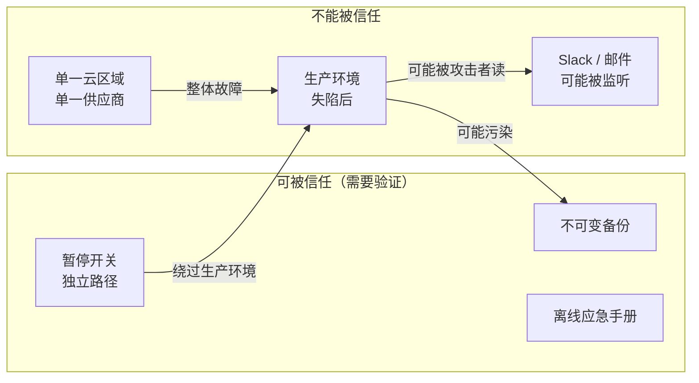
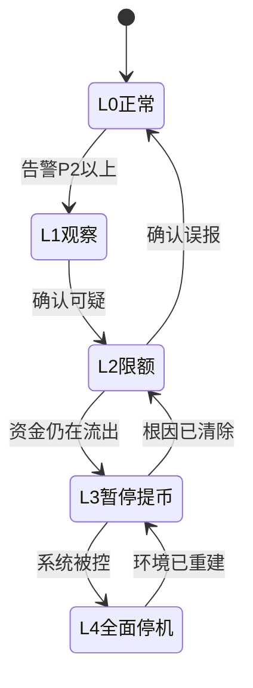
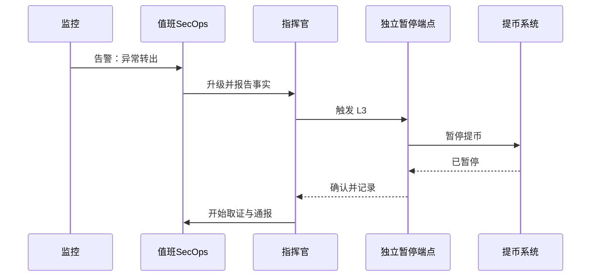

# X06 韧性与验证：灾备、红蓝对抗、桌面推演与安全度量

> 学习目标：读完本章，你能——
> 1. 为签名服务、提币系统和前端写出 RTO / RPO 目标，并设计分级的"安全暂停开关"。
> 2. 区分渗透测试、红队、紫队和桌面推演，排出一年的验证节奏，并主持 3 个现成剧本的推演。
> 3. 写出给管理层的安全月报，并在事故后主持一次无责复盘。
>
> 适用角色：安全工程师、SRE / 平台工程师、交易所或项目方的安全负责人、事件指挥官（IC）
> 前置章节：[A09 应急响应](../assessment/A09-incident-response.md)、[X01 安全体系怎么搭](X01-security-program-controls.md)、[X05 检测与响应工程](X05-detection-response-engineering.md)
> 延伸章节：[23 托管、充提与合规安全](../23-custody-exchange-ops.md)、[25 资金追踪、冻结与事后处置](../25-fund-tracing-response.md)、[28 事故案例集](../28-incident-casebook.md)、[29 签名路径 2026](../29-signing-path-2026.md)
> 模板：[T06 运营安全自查](../templates/T06-ops-security-self-check.md)；本章第 6 节有可直接改写的推演剧本、月报与复盘模板
> 最后核对：2026-11-23

---

## 开场：一个真实场景

某交易所的值班工程师凌晨 3 点收到告警：冷钱包发起了一笔大额转出。签名人说，他们只批准过一笔例行内部调拨。

指挥官打开预案。预案写着"联系安全负责人，由其决定是否暂停提币"。安全负责人的手机在飞行模式里。

> 这家机构去年做过渗透测试，报告是干净的。它没有做过一次桌面推演。

<details class="predict"><summary>🤔 先猜再看：这家机构最缺的是哪一类能力？</summary>

缺的是**验证过的响应能力**。渗透测试回答"系统能不能被攻破"。它不回答"被攻破之后，人和流程能不能在 15 分钟内做对决定"。

本章的主线是：**控制写在纸上不算数，演练过、量过的才算数。**

</details>

---

## 1. 一句话理解

**韧性是"出事后还能撑住并恢复"的能力；验证是"用演练和度量证明这种能力真的存在"。**

> 🎯 打个比方：韧性与验证像**飞行员的模拟机训练**。
>
> - 飞行员不会等发动机真起火才第一次处理起火。他们每半年在模拟机里被迫处理一次。
> - 模拟机里会故意出故障，教官会打分，飞行员要写复盘。
>
> 比喻的局限：模拟机的故障脚本是固定的，对手不会反击。真实攻击者会观察你的反应并改变路径，所以还需要红队这种"会还手"的验证。

本章回答四个问题：

1. 系统坏了，多久能恢复？恢复后数据可信吗？（灾备）
2. 发现异常时，谁能按下哪个开关？（安全暂停）
3. 怎么证明上面两条不是纸上谈兵？（演练、红蓝对抗、故障注入）
4. 怎么向管理层持续证明，并从事故里学到东西？（度量、复盘）

---

## 2. 保护目标与信任边界

韧性设计保护三样东西：**资金**不再继续流失，**服务**能在可接受时间内恢复，**证据与数据**在恢复后仍然可信。



**读图要点：**

- 失陷后的生产环境不可信。备份、应急手册和暂停开关必须放在**生产环境之外**，否则攻击者先动它们。
- 通信渠道也可能失陷。应急指挥要有备用渠道（例如离线电话树、独立的聊天工具）。
- 单一云区域和单一供应商是"共因故障"：一个故障同时拿走主系统和备系统。
- 局限：图只画了信任关系，没有画人。人员失联也是韧性风险（见第 4 节 RES-11）。

三个基本假设：

1. **失陷即常态**：设计时假设某一层已经被攻破，问"下一层能拦住吗？"（见 [X01](X01-security-program-controls.md)）
2. **应急操作不能依赖被攻破的东西**：暂停开关不能要求先登录已失陷的后台。
3. **恢复比预防更容易被忽略**：预防有预算，恢复常常没人认领。

---

## 3. 参考架构

### 3.1 业务连续性与灾备

先定义目标，再选方案。

- **RTO**（Recovery Time Objective，恢复时间目标）：服务中断后，最长可接受多久恢复。
- **RPO**（Recovery Point Objective，恢复点目标）：最多可接受丢失多久的数据。

下表是**示例**目标，每个机构按自己的业务和监管要求调整。

| 系统 | RTO（示例） | RPO（示例） | 备注 |
|---|---|---|---|
| 行情与前端展示 | 1 小时 | 不适用 | 无状态，多区域部署 |
| 撮合与交易 | 15 分钟–1 小时 | 0（不丢已确认订单） | 需要同步复制或可重放的事件日志 |
| 账务与清结算 | 1–4 小时 | 0 | 账务不能丢，宁可慢恢复 |
| 提币与签名服务 | 4–24 小时 | 0（交易状态不能丢） | 宁可慢，不要错：恢复期间保持暂停 |
| 客服与工单 | 24 小时 | 1 小时 | 可降级 |
| 办公与研发 | 24–72 小时 | 24 小时 | 不得连通生产签名网络 |

> 💡 注意：签名服务的 RTO 故意放宽。资金系统在恢复时犯错的代价，高于多暂停几小时的代价。

**备份温度**（通用做法）：

| 类型 | 含义 | 切换时间 | 成本 |
|---|---|---|---|
| 热备 | 备用系统实时同步，随时接管 | 分钟级 | 高 |
| 温备 | 备用系统已搭好，数据定期同步，需要人工切换 | 小时级 | 中 |
| 冷备 | 只有备份和部署脚本，要重新搭建 | 天级 | 低 |

**密钥与签名服务的灾备**要单独设计，因为密钥不能像数据库那样随便复制：

1. **多签 / MPC 分片**分散在不同地理位置和不同保管人手里。任何一个地点或一个人丢失，不影响恢复。
2. **恢复材料**（分片备份、HSM 备份卡、密钥仪式记录）放在离线保险设备里，并有双人取用制度。
3. **恢复演练**要证明：只用离线材料和书面手册，能在目标时间内重新建立签名能力。演练用测试密钥，不用真实密钥。
4. **恢复后**先在测试网或小额交易上验证，再开放大额。

### 3.2 安全暂停开关（分级）

暂停开关是应急响应里性价比最高的控制。A09 已讲过"暂停与升级权限分离"。本章补上**分级**，因为"全站停机"代价太大，没人敢按；没人敢按的开关等于没有开关。



**读图要点：**

- 级别逐步收紧：L1 加强监控，L2 降低限额并拉长延迟，L3 只暂停提币，L4 停止全部写操作。
- **升级要快，降级要慢**。升级由值班人员按下；降级必须由指挥官 + 另一名负责人共同批准，并验证根因已清除。
- 每个级别都有"谁能按"和"恢复条件"，并且路径独立于被暂停的系统。
- 局限：图是通用模板。链上合约的暂停（pause）和链下系统的暂停是两套机制，都要有对应的级别。

分级暂停表（示例，机构按业务调整）：

| 级别 | 动作 | 谁能触发 | 谁能恢复 | 业务影响 |
|---|---|---|---|---|
| L1 观察 | 提高监控频率，值班升级 | 任何值班安全人员 | 值班安全人员 | 无 |
| L2 限额 | 降低单笔 / 日限额，延长提币延迟 | 值班指挥官 | 指挥官 + 风控负责人 | 大额用户受影响 |
| L3 暂停提币 | 暂停全部或指定币种 / 链的提币 | 值班指挥官 | 指挥官 + 安全负责人 + 业务负责人 | 用户无法提币，交易可继续 |
| L4 全面停机 | 停止交易、提币、登录以外的全部写操作 | 安全负责人或更高 | 管理层 + 安全负责人 | 业务中断 |

暂停的实际决策流（示例）：



**读图要点：**

- 暂停命令走独立端点 P，不经过业务后台。
- 值班人员只负责确认与升级，由有权限的指挥官触发。
- 每一步都留痕，事后复盘要用这条时间线。
- 局限：图假设指挥官在线。指挥官失联时要靠代理人规则（见第 7.3 节）。

### 3.3 验证体系的四件工具

| 工具 | 回答的问题 | 对手是否还手 | 谁参与 | 典型频率 |
|---|---|---|---|---|
| 渗透测试 | 这个系统有哪些已知类型的漏洞？ | 否，按范围逐项测 | 外部或内部测试员 | 每个重大版本 + 每年 |
| 红队（Red Team） | 一个有目标的攻击者能不能达成目标（例如转走测试资金）？ | 是，模拟真实对手，蓝队不知情 | 红队，管理层知情 | 每年 1 次 |
| 紫队（Purple Team） | 我们的检测规则能不能发现这些具体手法？ | 红蓝公开协作，边打边调规则 | 红队 + 检测工程师 | 每季度 |
| 桌面推演 | 人和流程在压力下能不能做对决定？ | 主持人按剧本放消息 | 业务、安全、法务、公关 | 每季度 1 次，每年至少 1 次跨部门 |

> 💡 注意：这四件事不能互相替代。渗透测试干净，不代表蓝队能发现入侵；红队成功，也不代表流程有问题，只说明某条路径被走通了。

### 3.4 故障注入（混沌工程）在 Web3 的做法

混沌工程是**在受控条件下主动制造故障，观察系统是否按设计降级**。Web3 系统有一些特有的依赖，值得单独演练。

| 故障 | 要验证什么 | 安全做法 |
|---|---|---|
| 链节点宕机 | 充值确认、提币广播是否切换到备用节点 | 先在预发环境，再在生产的小流量 |
| RPC 返回分叉 / 落后数据 | 系统是否使用确认深度，不把短暂分叉当作最终状态 | 用自建测试链或回放数据 |
| 预言机停更 | 协议是否识别"价格过期"并暂停借款或清算 | 在测试网部署模拟喂价合约 |
| 预言机价格触底 / 触顶 | 价格是否被硬编码边界截断，协议是否有独立的偏离检查 | 测试网模拟 |
| 云区域不可用 | 控制面和数据面能否在备用区域运行；是否依赖了仅在故障区域存在的服务 | 预演日，先做小范围 |
| 依赖服务不可用（KMS、DNS、身份服务） | 应急登录和暂停是否还可用 | 演练时准备好 break-glass 账号 |
| 签名服务单点故障 | 提币是否自动暂停，而不是绕过策略引擎 | 用测试密钥 |

> ⚠️ 警告：不要在生产的资金路径上做破坏性实验。混沌实验要有爆炸半径限制、终止开关和事前通知。

---

## 4. 控制清单

优先级：P0 必须有；P1 应该有；P2 成熟后再做。

| ID | 控制项 | 要防什么 | 优先级 | 怎么验证 |
|---|---|---|---|---|
| RES-1 | 每个关键系统有书面 RTO / RPO，业务负责人签字 | 恢复目标不明，无法评估差距 | P0 | 抽查 3 个系统，对照文件和最近一次恢复演练时间 |
| RES-2 | 备份不可变（写一次读多次）且与生产账号隔离 | 勒索或失陷后备份被删或被加密 | P0 | 用生产管理员账号尝试删除备份，应失败 |
| RES-3 | 每季度做一次恢复演练，并记录实际耗时 | 备份存在但无法恢复 | P0 | 看演练记录：实际耗时 vs RTO |
| RES-4 | 签名服务和密钥有离线恢复材料与书面手册 | 保管人失联或机房不可用后无法恢复签名 | P0 | 用测试密钥，按手册由非原作者操作一次 |
| RES-5 | 有分级暂停开关，每级明确触发者、恢复条件和独立路径 | 无人敢按或没有人能按 | P0 | 看暂停表；演练中真的触发一次 L2 |
| RES-6 | 暂停权限与升级权限分离 | 暂停权被滥用为升级后门，或升级太慢 | P0 | 检查链上 / 系统权限配置 |
| RES-7 | 应急联系人清单每月核对，含备用渠道 | 凌晨找不到人 | P0 | 随机打 3 个电话，记录响应时间 |
| RES-8 | 每季度至少一次桌面推演，行动项有负责人和截止日期 | 预案无人演练，缺口不被发现 | P0 | 看推演记录与行动项关闭率 |
| RES-9 | 每年至少一次外部渗透测试，重大版本前一次 | 已知类型漏洞未被发现 | P1 | 看报告、整改记录和复测记录 |
| RES-10 | 每年一次红队或攻防演练，有明确目标（例如到达测试资金） | 检测与响应从未被真实对抗验证 | P1 | 看红队报告：检测到几步、用时多久 |
| RES-11 | 关键角色有 AB 角和轮岗，不依赖单人 | 一个人失联就卡住流程 | P1 | 抽查 5 个关键角色，是否有备份人员并演练过 |
| RES-12 | 每半年做一次故障注入（节点、RPC、预言机、云区域） | 依赖失效时系统行为未知 | P1 | 看实验记录与发现的问题 |
| RES-13 | 月度安全报告含红线项、趋势和未关闭风险 | 管理层看不到真实状况 | P1 | 抽查最近 3 份月报 |
| RES-14 | 事故后 5 个工作日内完成无责复盘，行动项进入追踪系统 | 同一类错误反复发生 | P0 | 抽查最近 3 次事故的复盘与行动项状态 |
| RES-15 | 应急操作不依赖单一云区域 / 单一身份服务 | 云或身份服务故障时无法应急 | P1 | 模拟身份服务不可用，验证 break-glass 登录 |
| RES-16 | 恢复后有数据可信校验（账务对账、链上余额比对） | 带着被污染的数据恢复上线 | P0 | 看恢复手册里是否有校验步骤，演练中执行 |
| RES-17 | 已评估保险与责任边界，管理层知道哪些损失不在保单内 | 以为有保险，实际被排除 | P2 | 看保单摘要与排除条款清单 |

---

## 5. 分级落地

| 档位 | 做什么 | 需要多少人 | 需要多久 |
|---|---|---|---|
| **最小可行**（小团队，10–50 人） | 写 RTO / RPO 一页纸；备份隔离并做一次恢复；写 L2 / L3 暂停表；联系人清单；做一次 60 分钟推演（用剧本 A） | 1 名安全工程师 + 1 名 SRE 兼职 | 约 1 个月 |
| **标准**（中型机构，50–500 人） | 全部 P0；季度恢复演练与推演；年度渗透测试；月度安全报告；复盘制度；半年一次故障注入 | 2–3 名安全工程师 + 平台团队配合 | 约 3 个月建成，之后持续运营 |
| **成熟**（大型机构或持牌机构） | 全部 P1；年度红队；季度紫队；跨区域灾备；演练覆盖法务与公关；度量接入风险登记；演练结果对外审计提供证据 | 专职红队 / 紫队 + GRC + 平台团队 | 6–12 个月，之后持续运营 |

> 💡 注意：以上人数与时间是**建议的量级**，不是统计数字。实际取决于系统复杂度和现有基础。

最小可行档要抓住的核心：**一个能按下去的暂停开关，加一次真实演练**。

---

## 6. 落地做法

### 6.1 恢复演练：做法与验证脚本

步骤：

1. 选一个系统和一个场景（例如"数据库主库损坏"）。
2. 写下目标 RTO / RPO。
3. 找一位**没有写过恢复手册的人**，只按手册操作。
4. 计时，记录每一步的卡点。
5. 恢复后执行数据校验（见下）。
6. 把实际耗时与目标对比，差距写进行动项。

恢复后的账务与余额校验（示例 SQL，表名为示意）：

```sql
-- 示例：恢复后检查账务是否借贷平衡
SELECT currency,
       SUM(CASE WHEN side = 'debit'  THEN amount ELSE 0 END) AS debit_total,
       SUM(CASE WHEN side = 'credit' THEN amount ELSE 0 END) AS credit_total
FROM   ledger_entries
GROUP  BY currency
HAVING SUM(CASE WHEN side = 'debit'  THEN amount ELSE 0 END)
    <> SUM(CASE WHEN side = 'credit' THEN amount ELSE 0 END);
-- 预期：返回 0 行。返回任何行都要在重新开放提币前解释清楚。

-- 示例：恢复点之后是否缺少已确认的提币记录
SELECT w.id, w.status, w.tx_hash
FROM   withdrawals w
WHERE  w.status = 'broadcasted'
  AND  w.tx_hash IS NOT NULL
  AND  NOT EXISTS (SELECT 1 FROM chain_tx c WHERE c.tx_hash = w.tx_hash);
-- 预期：返回 0 行。非 0 行说明账务以为已广播，链上却找不到。
```

备份不可变性检查（示例脚本，对象存储以 S3 风格接口为例，命令与桶名均为示意）：

```bash
#!/usr/bin/env bash
# 示例：用"生产管理员"凭证尝试删除备份，预期必须失败
set -u
BUCKET="example-backup-vault"
KEY="db/latest.dump"

if aws s3api delete-object --bucket "$BUCKET" --key "$KEY" \
     --version-id "$(aws s3api list-object-versions --bucket "$BUCKET" \
       --prefix "$KEY" --query 'Versions[0].VersionId' --output text)" 2>/dev/null; then
  echo "FAIL: 生产管理员能删除备份，RES-2 不通过"
  exit 1
else
  echo "PASS: 删除被拒绝"
fi
```

> 💡 注意：这类检查要放进定期任务，不要只做一次。权限会漂移。

### 6.2 暂停开关：配置示例

把暂停表写成机器可读的配置，并让它进入版本控制与变更评审。

```yaml
# 示例：分级暂停策略（示意，字段为本章约定）
pause_levels:
  - level: L1
    name: observe
    actions: [raise_alert_priority, page_oncall_secops]
    trigger_by: [oncall_secops]
    restore_by: [oncall_secops]
  - level: L2
    name: throttle
    actions:
      - set_withdraw_limit_ratio: 0.2      # 示例：限额降到平时的 20%
      - set_withdraw_delay_minutes: 60
    trigger_by: [incident_commander]
    restore_by: [incident_commander, risk_head]   # 双人
  - level: L3
    name: halt_withdrawals
    actions: [halt_withdrawals]
    scope: [all, per_chain, per_asset]
    trigger_by: [incident_commander]
    restore_by: [incident_commander, security_head, business_head]
    restore_preconditions:
      - root_cause_removed
      - ledger_reconciled
      - signer_environment_verified
  - level: L4
    name: full_stop
    actions: [halt_trading, halt_withdrawals, revoke_sessions]
    trigger_by: [security_head, cto]
    restore_by: [ceo_or_delegate, security_head]
out_of_band_path:
  # 暂停走独立路径：不经过被暂停的业务后台
  channel: dedicated_admin_endpoint
  auth: hardware_key_and_pager_confirmation
  drill_frequency: quarterly
```

链上合约的暂停要点（沿用 [A09](../assessment/A09-incident-response.md)）：

1. 暂停权限（guardian）与升级权限（时间锁多签）分离。
2. guardian 只能暂停，不能恢复。恢复要走更慢、更多人的路径。
3. 暂停时要回答：用户还能不能提款？谁恢复？恢复前验证什么？

### 6.3 桌面推演：怎么组织

一次推演 60–90 分钟。角色：

| 角色 | 职责 |
|---|---|
| 主持人 | 按剧本释放注入，控制节奏；不替参与者做决定 |
| 参与者 | 按真实岗位行动：指挥官、安全、SRE、风控、客服、法务、公关 |
| 记录员 | 记录时间线、决定、卡点；不参与讨论 |
| 评估员 | 按评分点打分 |

规则：

1. 参与者按**真实预案和真实权限**行动，不能"假设我有权限"。
2. 每个注入之后，参与者要说出：我做什么、为什么、我需要谁。
3. 主持人可以故意加入"摩擦"：联系人不接电话、系统响应变慢、信息互相矛盾。
4. 结束后立刻做 15 分钟热复盘，一周内出行动项。

通用评分表（每个剧本都用）：

| 维度 | 满分 | 判据 |
|---|---|---|
| 检测与确认 | 20 | 是否在目标时间内判定为真实事件 |
| 止血决策 | 25 | 是否在目标时间内选择了正确级别的暂停 |
| 权限与联系 | 15 | 是否知道谁有权限，联系人是否找得到 |
| 沟通 | 15 | 内部、用户、合作方的通报是否及时、准确、不夸大 |
| 证据保全 | 10 | 是否在恢复动作之前保存了日志、镜像和链上证据 |
| 恢复条件 | 15 | 是否定义了恢复前必须满足的条件 |

70 分以上算合格。更重要的是**卡点清单**：每个卡点都要变成一个有负责人的行动项。

---

#### 剧本 A：提币异常（温钱包出现未授权转出）

**背景**

- 一家中型交易所。热钱包放日常提币，温钱包补热钱包，冷钱包用多签保管大部分资产。
- 本次演练在周日凌晨 3:00 开始，值班人员只有 1 名 SecOps 和 1 名 SRE。
- 签名服务有策略引擎，包含限额和地址白名单。冷钱包是 3-of-5 多签。

**目标时间**：15 分钟内确认；30 分钟内止血。

| 时间 | 注入 | 主持人说明 |
|---|---|---|
| T+0 | 链上监控告警：一笔 8000 万美元（示例）等值的稳定币从温钱包转到一个陌生地址。账务系统里没有对应的提币申请。 | 告警发到值班频道 |
| T+10 | 值班人员发现，温钱包的签名请求来自"调拨系统"的账号。调拨系统的审批记录里有一条 3 小时前的"已批准"工单，审批人是一名正在休假的财务经理。 | 提示：此人的账号可能失陷，也可能是内部人员 |
| T+20 | 链上追踪显示，资金正被拆分成多笔，部分进入一个跨链桥。另有 2 笔较小转出在最近 10 分钟发生。 | 资金仍在流出 |
| T+30 | 一名客服主管在群里问："有用户反馈提币延迟，我们要不要发公告？" 另一位高管问："要不要先别告诉监管？" | 压力与沟通冲突 |
| T+45 | 安全负责人联系上了。他说他在飞机上，30 分钟后落地。 | 权限与代理人 |
| T+60 | 签名人 B 回复："我刚才在手机上批准过一笔调拨，没看清地址。" | 内部取证与责任边界 |

**问题（主持人逐条提问）**

1. T+0 时，谁有权决定暂停提币？是 L2、L3 还是 L4？为什么？
2. 在不依赖调拨系统和已怀疑账号的前提下，怎样暂停？走哪条独立路径？
3. 资金正在进入跨链桥。联系谁？按什么顺序？（交易所、稳定币发行方、桥运营方、安全公司，见 [25 章](../25-fund-tracing-response.md)）
4. 签名人 B 的话说明了什么？签名界面和独立解码怎么改进？（见 [29 章](../29-signing-path-2026.md)）
5. 对用户的第一条公告写什么？不写什么？
6. 对监管和执法的通报，谁决定、什么时候发？
7. 恢复提币前要满足哪些条件？

**评分点（本剧本的特别扣分项）**

- 在 15 分钟内没有按下任何暂停：止血决策扣 15 分。
- 通过被怀疑的调拨系统来执行暂停：权限与联系扣 10 分。
- 恢复动作之前没有保存调拨系统日志：证据保全扣 10 分。
- 公告里推测攻击者身份或确切损失：沟通扣 8 分。
- 有人提议"先观察一小时"而没有设定观察终止条件：止血决策扣 10 分。

**加分点**：主动检查其他温钱包与热钱包有没有同类请求；主动要求冻结审批人账号并保存其设备。

---

#### 剧本 B：签名服务被控（签名基础设施失陷）

**背景**

- 一家托管型机构。签名服务由一组服务器运行，密钥在 HSM / MPC 中，策略引擎决定哪些请求可以签名。
- 安全团队收到外部研究员的私下报告：他能在预发环境中，通过一个内部管理接口修改"地址白名单"。
- 同一天，SIEM 在生产签名网络里发现了一次从办公网络发起的管理登录，时间是凌晨，账号是一名运维工程师的。

**目标时间**：1 小时内决定是否进入 L3 或 L4；4 小时内形成"可信签名环境"的判定方案。

| 时间 | 注入 | 主持人说明 |
|---|---|---|
| T+0 | 研究员的报告到达。他附了截图，没有给出可操作的利用步骤。 | 先判断可信度 |
| T+15 | SIEM 告警：那个管理登录之后，策略引擎的白名单表有 1 次修改，新增 1 个地址。修改者是该运维账号。运维工程师说，他"没有那样操作过"。 | 可能是账号失陷 |
| T+30 | 日志显示，签名服务在修改之后签过 2 笔交易，都是小额，目标地址是新加入的白名单地址。 | 攻击者在试水 |
| T+45 | 签名服务的日志存放在同一个管理域里，日志管理员账号与运维账号同属一个组。有人发现过去 2 小时的日志有一段是空的。 | 证据可信性问题 |
| T+60 | 大客户来电：他们有一笔大额提币申请在队列中，要求"必须今天处理"。销售负责人在推动。 | 业务压力 |
| T+90 | 云服务商支持工单回复：需要 6 小时才能提供控制面审计日志。 | 外部依赖延迟 |

**问题**

1. T+15 时，你的决策是什么？是否暂停全部签名？谁来决定？
2. 签名服务已被怀疑，应该信任哪些环境来做调查？（例如独立的取证环境）
3. 白名单被篡改。怎样确认**已有白名单**的完整性？以哪份基线对比？
4. 日志出现空洞。证据怎么保全？谁来负责？是否需要外部取证公司？
5. 大客户要求处理提币，你怎么回答？谁来拒绝？
6. 恢复签名能力的路径是什么：修复现有环境，还是在新环境重建？各自的风险与耗时？
7. 密钥是否需要轮换？轮换意味着链上要做哪些动作？（旧多签向新多签迁移，见 [X11](X11-cex-wallet-treasury-payment.md)）
8. 什么时候通知客户？通知里写什么？

**评分点**

- 在 T+30 之前进入 L3（暂停提币）：止血决策加 5 分；到 T+60 仍未暂停：扣 20 分。
- 判断"现有环境不可信，要在独立环境取证"：证据保全加 5 分。
- 接受销售压力、放行大额提币而没有独立校验：权限与联系扣 15 分。
- 明确了"恢复前必须满足"的清单（环境重建、白名单从基线重放、独立解码、小额试签）：恢复条件加 5 分。
- 没有考虑策略引擎本身被改过：检测与确认扣 10 分。

**加分点**：主动提出"策略引擎规则的变更需要双人审批，且变更日志写入独立存储"，作为长期行动项。

---

#### 剧本 C：前端被篡改（官网与交易界面被注入恶意脚本）

**背景**

- 一个 DeFi 项目方的前端托管在云存储 + CDN 上，域名由注册商管理。
- 用户使用前端授权和存款。项目方有暂停守护者（guardian）可以暂停合约，但前端不受合约控制。
- 项目方有 1 名安全负责人和 3 名核心开发者，社区运营在另一个时区。

**目标时间**：30 分钟内下线被篡改前端并告警用户；2 小时内恢复可信前端。

| 时间 | 注入 | 主持人说明 |
|---|---|---|
| T+0 | 社区成员在 Discord 里发帖："授权弹窗的目标地址很奇怪。" 3 条类似回复。 | 先判断可信度 |
| T+10 | 安全负责人检查：线上页面 HTML 没变，但加载的一个 JS 文件的哈希与上次发布不同。构建系统里没有对应的发布记录。 | 供应链或存储被改 |
| T+20 | 链上监控显示，已有 40 个用户地址向一个未知合约授权了无限额度（示例数字）。 | 损失在扩大 |
| T+30 | 有人建议"先把合约暂停"。另一人指出：合约本身没问题，暂停会让用户无法提款。第三个人说："我们要不要先把域名解析指向一个静态公告页？" | 选择对的止血手段 |
| T+45 | 云服务控制台的审计日志显示：存储桶策略在 6 天前被修改，操作者是一名开发者的访问密钥。该开发者说他的笔记本上周装过一个新的开源工具。 | 开发者终端失陷 |
| T+60 | 一个社交媒体大号发推："项目被黑，快撤授权！"，附了未经证实的损失数字。 | 舆论 |

**问题**

1. T+0 谁有权决定下线前端？第一步做什么？（域名解析指向公告页 / 关闭 CDN 回源 / 暂停合约，各自的取舍）
2. 合约暂停在这个场景里合适吗？为什么？
3. 已授权的用户怎么办？怎样发布"撤销授权"的指引？是否有官方的撤销页面？
4. 怎样确认**哪些**文件被改？以什么为可信基线？（版本控制中的构建产物哈希、SRI 记录）
5. 开发者终端怎么处理？访问密钥怎么轮换？还有哪些密钥可能被偷？
6. 重新发布前，要满足哪些条件？（凭证全部轮换、发布流程重建、存储桶策略锁定、SRI / CSP 启用）
7. 对用户的公告有什么必须包含的内容？对社交媒体上的错误数字怎么回应？
8. 是否要联系钱包厂商、浏览器安全团队、风险名单提供方，把恶意地址和域名标记出去？

**评分点**

- 在 30 分钟内把用户流量从被篡改资源切走：止血决策加 5 分。
- 把"暂停合约"作为唯一手段并说不清它对用户提款的影响：止血决策扣 10 分。
- 公告中包含撤销授权的具体指引与官方渠道提醒：沟通加 5 分。
- 恢复前没有轮换开发者与云账号的全部凭证：恢复条件扣 10 分。
- 没有保存被篡改的 JS 文件副本和云审计日志：证据保全扣 10 分。

**加分点**：提出"前端发布权限与签名权限分离，且发布产物需要独立哈希核对"（见 [X04](X04-delivery-supply-chain.md) 与 [20 章](../20-frontend-dns-supply-chain.md)）。

---

### 6.4 故障注入实验卡

用统一的卡片管理实验，防止"随手搞坏生产"。

```yaml
# 示例：实验卡
id: CHAOS-007
title: "预言机停更 3 小时"
hypothesis: "当喂价超过 60 分钟未更新，借贷合约暂停新增借款并告警"
environment: testnet            # 先在测试网
blast_radius: "仅测试市场 TEST-ETH/USDC"
steps:
  - "部署模拟喂价合约，设置更新间隔 15 分钟"
  - "第 0 分钟停止更新"
  - "观察监控与暂停逻辑"
abort_conditions:
  - "测试网出现与本实验无关的告警"
success_criteria:
  - "第 60-65 分钟内产生 P2 告警"
  - "第 65 分钟起新增借款被拒绝"
  - "清算逻辑不使用过期价格"
owner: "protocol-security"
review_after: "2027-Q1"
```

另一个常被忽略的实验：**价格触底 / 触顶**。有的价格源会设置硬编码的最低 / 最高值。真实价格跌穿下限时，链上价格会"卡在下限"，协议若没有独立检查，就会按错误价格估值（见第 8 节案例 4）。实验要验证：协议能否识别"价格长时间贴着边界"并暂停。

### 6.5 给管理层的月度安全报告

一页纸，同一格式连续报 12 个月，趋势比单月数字重要。

```markdown
# 安全月报：20XX 年 XX 月

## 1. 红线项（任何一项为"红"，需要管理层当月决策）
| 红线 | 状态 | 说明 |
|---|---|---|
| 暂停开关最近一次演练 ≤ 90 天 | 绿/红 | 上次演练日期 |
| 备份最近一次恢复演练 ≤ 90 天 | 绿/红 | 实际耗时 vs RTO |
| P0 控制缺口数 | 数字 | 较上月变化 |
| 超期未关闭的高危漏洞数 | 数字 | 最长超期天数 |
| 超期未关闭的复盘行动项数 | 数字 | |

## 2. 趋势（最近 6 个月折线：数字由团队自己统计）
- MTTD（平均检测时间）
- MTTR（平均响应时间）
- 告警假阳性率
- 控制覆盖率（P0 / P1）

## 3. 事件与近失误
| 日期 | 级别 | 一句话 | 根因类别 | 行动项状态 |

## 4. 演练与验证
- 本月做了什么（推演、红队、渗透、故障注入），得分，发现的卡点

## 5. 未关闭风险与已接受风险
| 风险 | 负责人 | 到期日 | 是否续期（需管理层签字） |

## 6. 下月计划与需要的决策
```

> 💡 注意：报告里不要堆图表。管理层最需要的是三件事：**哪里是红的、趋势是变好还是变坏、需要我决定什么**。

### 6.6 复盘：无责复盘模板与"根因五问"

**无责复盘**（blameless post-mortem）：关注"系统为什么允许这样的错误发生"，不关注"谁犯了错"。原因：追责会让人隐瞒信息，下次事故你会更晚发现问题。

```markdown
# 复盘：事件名称（日期，级别）

## 摘要（3 句话）
## 影响（资金、用户、时长；金额写"约"，并注明估值时点）
## 时间线（精确到分钟，含检测、决策、动作，每条标来源）
## 做得好的
## 做得不好的
## 根因（技术根因 + 流程根因 + 组织根因）
## 行动项
| 编号 | 行动 | 控制 ID | 负责人 | 截止日期 | 状态 |
## 回流：这起事件暴露了哪条检查项缺失？更新了哪份清单 / 规则？
```

**根因五问**示例：

1. 为什么资金被转走？因为签名人批准了一笔恶意交易。
2. 为什么批准了？因为签名界面显示的内容与实际签名的数据不一致。
3. 为什么不一致？因为界面由一个可被篡改的前端渲染，签名人没有独立解码。
4. 为什么没有独立解码？因为流程没有要求，设备也不支持清晰显示。
5. 为什么流程没有要求？因为威胁模型里没有"前端被篡改"这一项。

→ 行动项：威胁模型新增"签名界面失陷"；签名流程新增独立解码步骤；检查项补充对应条目。

> 💡 注意：五问不是机械地问五次。目标是问到"我们能改的流程或设计"为止。问到"某人粗心"就停错了位置。

**行动项追踪的三条规则**：每项有负责人和截止日期；超期要升级到管理层；关闭要附证据（链接、截图、配置差异），不能只写"已完成"。

### 6.7 保险与责任（通用事实）

- **保险不是韧性的替代**。保险补偿部分经济损失，不恢复服务、不恢复信任。
- 常见的承保范围包括：外部盗窃、内部欺诈、密钥物理损毁等。不同保单对**热钱包**与**冷存储**常设不同的限额。
- 常见的限制与排除：密钥管理不当、社会工程、第三方协议风险、特定类型的智能合约交互；保单可能设单次限额和年度累计限额。
- 一般的网络安全险可能覆盖取证、通知和业务中断，但**不一定覆盖加密资产本身的损失**。
- 这些是行业通用情况，来自保险经纪与托管机构的公开资料，且多为商业机构发布。**具体条款必须看自己的保单原文**，并让法务和保险经纪核对。

做法：

1. 让保险经纪出具"承保与排除对照表"。
2. 把排除条款映射到本章控制：保单排除"社会工程"，就要在 RES-5、RES-8 里加强对应剧本。
3. 事故发生后，**先通知保险公司**（保单常规定通知时限），再做可能影响取证的恢复动作。

### 6.8 常见坑

| 坑 | 后果 | 对策 |
|---|---|---|
| 备份与生产同一账号 | 失陷后备份一起被删 | 独立账号 + 不可变存储（RES-2） |
| 只测备份"成功"，不测恢复 | 需要时才发现无法恢复 | 每季度恢复演练（RES-3） |
| 暂停开关只有一档：全站停机 | 没人敢按 | 分级暂停（RES-5） |
| 应急联系人是个人手机，且无人核对 | 凌晨联系不上 | 每月核对 + 备用渠道（RES-7） |
| 推演只有技术人员参加 | 法务、公关、客服的卡点没暴露 | 跨部门推演（RES-8） |
| 红队报告被当作一次性文件 | 发现的问题不被修复 | 行动项进入追踪系统（RES-14） |
| 演练用真实密钥 | 演练本身造成风险 | 用测试密钥和测试环境 |

---

## 7. 运营：指标、告警、值班、演练、季度节奏

### 7.1 指标

| 指标 | 定义 | 怎么用 |
|---|---|---|
| RTO 达成率 | 恢复演练中，实际耗时 ≤ RTO 的次数 / 总演练次数 | 目标 100%；低于就是缺口 |
| 备份恢复成功率 | 恢复演练成功次数 / 总次数 | 低于 100% 要立刻查 |
| 暂停开关演练间隔 | 距上次触发演练的天数 | 超过 90 天变红 |
| 推演得分与卡点数 | 每次推演的总分与新增卡点数 | 看趋势，不看单次 |
| 行动项关闭率与超期数 | 按期关闭 / 总数；超期未关闭数 | 超期要升级 |
| MTTD / MTTR | 平均检测时间 / 平均响应时间 | 来自 [X05](X05-detection-response-engineering.md) 的数据 |
| 红队检测率 | 红队行动中被蓝队发现的步骤占比，以及从首次动作到被发现的时间 | 红队报告的核心数字 |
| 联系人响应时间 | 月度联系人抽测的响应时长 | 超过预案目标要整改 |

算 MTTD 与 MTTR 的小脚本（示例，输入为事件时间线 CSV）：

```python
# 示例：从事件表计算 MTTD / MTTR（分钟）
import csv
from datetime import datetime

def minutes(a, b):
    f = "%Y-%m-%dT%H:%M:%S"
    return (datetime.strptime(b, f) - datetime.strptime(a, f)).total_seconds() / 60

rows = list(csv.DictReader(open("incidents.csv")))
# 列：id, started_at, detected_at, contained_at
mttd = sum(minutes(r["started_at"], r["detected_at"]) for r in rows) / len(rows)
mttr = sum(minutes(r["detected_at"], r["contained_at"]) for r in rows) / len(rows)
print(f"MTTD={mttd:.1f} 分钟  MTTR={mttr:.1f} 分钟")
```

### 7.2 告警

| 告警 | 触发 | 级别 |
|---|---|---|
| 备份任务失败 | 任一关键备份失败 | P2 |
| 备份恢复演练超期 | 距上次恢复演练 > 100 天 | P3，进月报 |
| 暂停开关路径不可用 | 每日自动探测独立管理端点失败 | P1 |
| 联系人名单过期 | 超过 30 天未核对 | P3 |
| 行动项超期 | 高优行动项超期 | P3，升级到负责人上级 |

> ⚠️ 警告：每日探测暂停开关可达性，但**不要**每日真的触发暂停。探测只检查路径、权限和认证是否可用。

### 7.3 值班

- 值班表上必须有一个**有权决定暂停的人**。没有权限的值班人只能升级，不能止血。
- 要有**代理人规则**：负责人失联 15 分钟，权限自动转给指定代理人。剧本 A 的 T+45 就是在测这一条。
- 值班交接要交"当前暂停级别"和"正在进行的演练或变更"。

### 7.4 季度节奏（示例）

| 季度 | 恢复演练 | 桌面推演 | 红蓝对抗 | 其他 |
|---|---|---|---|---|
| Q1 | 数据库与账务恢复 | 剧本 A（提币异常） | 紫队：检测规则回放 | 年度渗透测试启动；复核保险 |
| Q2 | 签名服务与密钥离线恢复（测试密钥） | 剧本 B（签名服务被控） | — | 故障注入：节点 / RPC |
| Q3 | 云区域切换 | 剧本 C（前端被篡改）+ 法务公关参与 | 年度红队 | 故障注入：预言机 / 依赖服务 |
| Q4 | 暂停开关全级别演练 | 自选新场景（来自本年事故） | 紫队 | 年度总结；行动项清零复核；下年计划 |

---

## 8. 失效案例

> 以下案例都独立核对了公开来源。金额均为"约"和"事发时美元估值"。案例只写摘要和教训，完整复盘见 [28 章](../28-incident-casebook.md) 和《Web3 行业安全资损 101》。

### 案例 1：Bybit 冷钱包被盗（2025 年 2 月，以太坊）

- **事实**：2025 年 2 月 21 日，Bybit 的以太坊多签冷钱包被转走约 40 万枚 ETH，事发时估值约 14 亿美元。Safe 的内部调查与取证报告显示，攻击起点是一名 Safe 开发者的 macOS 工作站被入侵；攻击者随后修改了托管在 Safe 云存储中的前端 JavaScript，让它只在针对 Bybit 的冷钱包交易时触发。签名人在界面上看到的是正常的调拨，实际签名的数据被换成了对攻击者合约的 delegatecall，使钱包的实现地址被改写。Bybit 聘请的取证公司称没有发现 Bybit 自己的基础设施被入侵。公开报道归因于朝鲜关联的 Lazarus 组织。
- **绕过了哪条控制**：对**签名界面**的信任。签名人没有独立解码，硬件设备在当时的流程里也不能清晰显示数据。
- **映射控制**：RES-5（暂停与响应路径）、RES-10（红队：假设前端失陷）、RES-14（复盘回流到签名流程）；上游控制见 [29 章](../29-signing-path-2026.md)、[X04](X04-delivery-supply-chain.md)、[X11](X11-cex-wallet-treasury-payment.md)。
- **教训**：剧本 C 与剧本 A 的合并场景。把"前端被篡改"和"签名人被欺骗"放进推演，检验独立解码和策略引擎拦截是否存在。
- **来源类型**：安全公司分析（NCC Group 技术分析）、媒体报道对 Safe 内部调查与 Sygnia / Verichains 取证报告的转述（The Block、CryptoSlate、BleepingComputer）。

### 案例 2：Ronin 桥被盗（2022 年 3 月，Ronin / 以太坊）

- **事实**：2022 年 3 月 23 日，Ronin 桥被转走约 17.36 万枚 ETH 和约 2550 万 USDC，事发时估值约 6 亿美元以上。项目方复盘称，攻击者先通过社工渗透 Sky Mavis 的基础设施，控制了 Sky Mavis 运营的 4 个验证者，又利用此前为了无 gas 交易而授予、事后没有撤销的权限，拿到了 Axie DAO 验证者的签名。事件在 3 月 29 日才被发现，起因是用户报告一笔提币失败。公开报道称，项目方缺少对桥大额流出的监控。事后项目方增加验证者数量并聘请安全公司。公开报道归因于朝鲜关联的 Lazarus 组织。
- **绕过了哪条控制**：**检测与暂停**。资金流出后相隔约 6 天才被发现，期间没有任何暂停动作。
- **映射控制**：RES-5（分级暂停）、RES-7（联系人与响应）、RES-8（推演"大额流出"场景）；上游控制见 [X05](X05-detection-response-engineering.md)、[X15](X15-l2-bridge-oracle-ops.md)。
- **教训**：权限用完要撤销；"没人知道出事了"比"出了事没人敢按开关"更糟。每日探测与大额流出告警，是推演之前的前提。
- **来源类型**：项目方复盘（Ronin / Sky Mavis 事后总结，经媒体转述核对）、安全公司分析（SlowMist、Halborn）、媒体报道（TechCrunch、The Block）。

### 案例 3：AWS us-east-1 故障影响交易平台（2025 年 10 月）

- **事实**：AWS 官方事后总结称，2025 年 10 月 19 日 23:48（太平洋夏令时）到 10 月 20 日 14:20，us-east-1 区域受影响。根因是 DynamoDB 的 DNS 自动管理系统中的一个潜在竞态条件，使区域端点的 DNS 记录为空；随后 EC2、网络负载均衡等多项服务受到连带影响，AWS 的控制台登录与支持中心也一度受影响。Coinbase 的复盘称，其客户经历了从无法登录到无法交易的不同程度影响，累计降级时长为 3 小时 17 分，状态页多次表示客户资金安全。未见客户资金被盗的报道。
- **说明的问题**：这不是安全攻击，但说明了**共因故障**与**应急操作依赖**：云区域级别故障，同时影响业务系统和排障入口。
- **映射控制**：RES-1（RTO / RPO）、RES-12（故障注入）、RES-15（应急不依赖单一区域与身份服务）。
- **教训**：把"云区域不可用"和"身份服务不可用"放进故障注入，检验 break-glass 登录和暂停开关是否还能工作。
- **来源类型**：云厂商官方事后总结（AWS）、机构复盘（Coinbase）、媒体与行业分析（InfoQ、The Register、ThousandEyes）。

### 案例 4：Terra / LUNA 崩盘中 Chainlink 价格触底（2022 年 5 月，BNB Chain）

- **事实**：2022 年 5 月 Terra 崩盘期间，Chainlink 的 LUNA/USD 价格源触发最低价边界（minAnswer），公开报道称下限为 0.10 美元，而市场价格已更低。借贷协议 Venus 上 LUNA 的链上价格停留在约 0.107 美元，攻击者用大量被高估的 LUNA 作为抵押借出资产，Venus 报告了约 1100 万美元以上的坏账（不同来源给出的数字在 1100 万到 1400 万美元之间）。Venus 随后暂停 LUNA 市场，并用风险基金弥补。Chainlink 事后称该喂价当时"可运行但不建议使用"，各方对责任归属有争议。
- **绕过了哪条控制**：对**价格源**的信任，缺少独立的偏离检查和"价格长时间贴着边界"的告警。
- **映射控制**：RES-12（预言机触底、触顶、停更的故障注入）、RES-5（对单个市场的 L3 级暂停）；上游控制见 [08 章](../08-oracle-flashloan.md)、[X16](X16-defi-project-ops.md)。
- **教训**：故障注入要覆盖"价格源可用但数值不可信"。暂停要能精确到**单个市场**，而不是只能暂停整个协议。
- **来源类型**：安全媒体分析（REKT）、媒体报道（The Record、BeInCrypto）。

### 案例 5：Cetus 被攻击后的暂停与验证者冻结（2025 年 5 月，Sui）

- **事实**：2025 年 5 月 22 日，Sui 上的 DEX Cetus 被攻击，损失约 2.23 亿美元（事发时估值）。Cetus 称根因是其集中流动性合约所用开源库中一个被忽略的溢出检查缺陷。Cetus 立即暂停合约。媒体报道称，Sui 验证者在约 80 分钟内开始拒绝来自攻击者地址的交易，约 1.6 亿美元被冻结；5 月 30 日社区治理投票通过了追回方案。Dedaub 在 5 月 25 日发布了事后分析。这次冻结也引发了对验证者权力与去中心化的争论。
- **说明的问题**：暂停与外部协调的效果。项目方暂停**能阻止继续利用**，但已被拿走的资金，要靠与链上验证者、发行方、交易所的协作。这个结果依赖链的特性，不能当作通用预期。
- **映射控制**：RES-5（暂停）、RES-7（外部联系人清单）、RES-8（推演"链级协作"）；上游控制见 [25 章](../25-fund-tracing-response.md)、[X15](X15-l2-bridge-oracle-ops.md)。
- **教训**：外部协作要在平时建立联系；事后治理有争议，需提前和法务讨论"请求冻结"的边界。
- **来源类型**：项目方说明与媒体报道（The Block、Cointelegraph、SecurityWeek）、安全公司分析（Dedaub，经媒体转述）。

> 💡 注意：案例 1 与 2 都与朝鲜关联组织有关，且都在"签名之前"出问题：一个是签名界面，一个是验证者权限。韧性验证要同时覆盖"预防失败之后怎么办"。

---

## 9. 评估检查点

- [ ] **RES-1** 每个关键系统有书面 RTO / RPO 并经业务负责人签字。
- [ ] **RES-2** 备份不可变，且生产管理员无法删除。
- [ ] **RES-3** 最近 90 天内做过恢复演练，实际耗时已记录并与 RTO 对比。
- [ ] **RES-4** 签名服务有离线恢复材料和书面手册，非原作者按手册操作成功过一次（测试密钥）。
- [ ] **RES-5** 有分级暂停开关，每级有触发者、恢复条件和独立路径，最近 90 天内演练过。
- [ ] **RES-6** 暂停权限与升级权限分离。
- [ ] **RES-7** 应急联系人清单每月核对，含备用渠道，抽测响应时间达标。
- [ ] **RES-8** 每季度做过桌面推演，行动项有负责人与截止日期。
- [ ] **RES-9** 每年有外部渗透测试，重大版本前有测试，并做过复测。
- [ ] **RES-10** 每年有红队或攻防演练，报告含"检测到几步、用时多久"。
- [ ] **RES-11** 关键角色有 AB 角并演练过交接。
- [ ] **RES-12** 每半年做过故障注入，覆盖节点、RPC、预言机、云区域至少三项。
- [ ] **RES-13** 月度安全报告含红线项、趋势、未关闭风险，连续 3 个月按期交付。
- [ ] **RES-14** 最近 3 次事故都有复盘和行动项，行动项超期数为 0 或已升级。
- [ ] **RES-15** 应急登录与暂停操作在云区域或身份服务不可用时仍可用，已演练。
- [ ] **RES-16** 恢复手册包含数据可信校验，演练中执行过。
- [ ] **RES-17** 已让法务与经纪核对保单的承保范围和排除条款，并映射到控制。

**把检查结果写进报告（对照表）：**

| 检查结果 | 报告里怎么写 | 严重性建议 |
|---|---|---|
| RES-2 / RES-5 / RES-16 任一不通过 | "关键恢复或止血能力缺失"，附测试证据 | 高 |
| RES-3 / RES-4 / RES-8 超过 90 天未做 | "演练过期"，附最近一次日期 | 中到高 |
| RES-7 抽测联系不上 | "联系渠道失效"，附测试记录 | 中 |
| RES-13 / RES-14 缺失 | "治理与回流缺失" | 中 |
| RES-17 不清楚 | "保险边界未评估" | 低到中 |

---

## 10. 上手路径

**第一周**

1. 列出 5 个最关键系统（至少含签名 / 提币、账务、前端），问负责人"坏了多久能恢复"，把答案写成 RTO 初稿。
2. 找到现有暂停开关：谁能按、在哪按、按了发生什么。画一页纸。
3. 打 3 个应急联系人的电话，记录谁没接。
4. 读 [A09](../assessment/A09-incident-response.md)，把预案放在你能离线读到的地方。

**第一个月**

1. 写分级暂停表（L1–L4），拉负责人评审。
2. 做一次备份"不可变"检查（6.1 的脚本思路）。
3. 主持第一次 60 分钟桌面推演（剧本 A），产出卡点清单与行动项。
4. 建立月报，先交一版只有红线项的。

**第一个季度**

1. 做第一次恢复演练，并统计 RTO 达成率。
2. 做剧本 B 或剧本 C 的跨部门推演。
3. 与红队 / 渗透服务商确认年度计划，把紫队列入检测工程节奏。
4. 设计 2 个故障注入实验（预言机停更、节点切换），先在测试环境运行。
5. 用已发生的真实近失误，写第一份无责复盘。

---

## 11. 常见误区

| 误区 | 事实 |
|---|---|
| "渗透测试通过了，所以我们安全" | 渗透测试查漏洞，不验证响应能力 |
| "我们有备份" | 没做过恢复演练的备份，不能算备份 |
| "暂停开关太危险，不要给值班人员" | 没人能按的开关等于没有；用分级和双人恢复控制风险 |
| "桌面推演浪费时间" | 它能暴露联系人、权限、预案缺口，成本远低于真实事故 |
| "红队就是更厉害的渗透测试" | 红队的目标是达成业务目标并测试检测与响应，范围和规则不同 |
| "复盘是为了找出责任人" | 追责会让人隐瞒信息，无责复盘才能拿到真实时间线 |
| "有保险就不怕" | 保单常有排除条款和限额，且保险不恢复服务 |

---

## 12. 术语表

| 术语 | 英文 | 定义 |
|---|---|---|
| 恢复时间目标 | Recovery Time Objective (RTO) | 服务中断后最长可接受的恢复时间 |
| 恢复点目标 | Recovery Point Objective (RPO) | 最多可接受丢失多长时间的数据 |
| 业务连续性 | Business Continuity (BCP) | 保证关键业务在故障后继续或尽快恢复的计划 |
| 灾备 | Disaster Recovery (DR) | 技术层面的系统与数据恢复能力 |
| 不可变备份 | Immutable Backup | 写入后在保留期内不能被修改或删除的备份 |
| 暂停开关 | Pause / Kill Switch | 紧急停止部分或全部功能的机制 |
| 红队 | Red Team | 模拟真实对手、以达成目标为导向的攻击团队 |
| 蓝队 | Blue Team | 负责防御、检测与响应的团队 |
| 紫队 | Purple Team | 红蓝公开协作，用来调优检测规则的活动 |
| 桌面推演 | Tabletop Exercise | 围桌模拟事故、检验决策与流程的演练 |
| 混沌工程 | Chaos Engineering | 受控地制造故障，观察系统是否按设计降级 |
| 无责复盘 | Blameless Post-mortem | 关注系统与流程原因、不追究个人的复盘方式 |
| 事件指挥官 | Incident Commander (IC) | 事故中负责决策与协调的人 |
| 共因故障 | Common-cause Failure | 一个原因同时让多个"独立"组件失效 |
| 破玻璃账号 | Break-glass Account | 紧急情况下才启用的特殊账号 |
| 平均检测时间 | Mean Time To Detect (MTTD) | 从事件开始到被发现的平均时长 |
| 平均响应时间 | Mean Time To Respond (MTTR) | 从被发现到被控制的平均时长 |

**关于监管的时效说明（截至 2026 年公开资料）**：在欧盟，数字运营韧性法案 DORA 自 2025 年 1 月 17 日起适用，其覆盖范围包括获 MiCA 授权的加密资产服务提供商；其中要求金融实体建立数字运营韧性测试计划，部分被主管机关选定的机构还要做基于威胁的渗透测试（TLPT）。2025 年 11 月有关于 DORA 的"数字综合法案"修订草案的公开信息，具体条款是否变化，**以官方最新文档为准**。其他辖区（美国纽约州金融服务局 500 部分、香港、新加坡、迪拜等）对演练与连续性的要求，见 [X02](X02-standards-compliance-map.md)，以各监管机构最新文本为准。

---

## 13. 动手练习与思考题

### 练习（笔记本即可完成）

1. **写 RTO / RPO 表**：选一个你熟悉的系统（或本章第 3.1 节的虚拟交易所），为 6 个系统写 RTO / RPO，并写出"如果这个目标做不到，业务代价是什么"。
2. **设计暂停表**：为一个虚构的借贷协议写 L1–L4，要求：每级的触发者、恢复条件、独立路径，并写出"哪一级不能用单人恢复，为什么"。
3. **做一次 30 分钟推演**：找 2–3 个同学，用剧本 C 的前 4 个注入，只回答第 1、2、3、5 问；用 6.3 的评分表打分，写出 3 个卡点和对应行动项。
4. **写月报**：用 6.5 模板，为一个虚构机构填写一份月报，包含 3 个红线项、1 个趋势和 2 个未关闭风险。
5. **改写复盘**：选 [28 章](../28-incident-casebook.md) 中任一事故，按 6.6 的模板写一页"无责复盘"，并做一次根因五问。

**建议配套（后续在 L3 训练营实现）**：一个"暂停表校验脚本"，读取 YAML 暂停策略，检查每级是否有触发者、恢复者、双人要求；一个"推演计时器"，按剧本时间表自动释放注入并记录响应时间。

### 思考题

1. 如果只能在"每季度做恢复演练"和"每季度做桌面推演"之间选一项，你的机构应该先做哪个？依据是你所在系统的哪个风险？
2. 暂停开关要"升级快、降级慢"。如果一个攻击者的目的就是让你频繁暂停，造成业务损失，你怎么在安全与可用性之间设计取舍？
3. 红队演练成功拿到了测试资金，但蓝队**一步都没发现**。你向管理层汇报时，会先说"我们有问题"还是先说"我们发现了问题"？这会如何影响下一年的预算和团队文化？

> 🪞 反思：想想你所在机构最近一次"没演练就上线"的应急流程。如果明天凌晨它被用上，卡在哪一步的概率最大？你现在能做的最小改动是什么？

下一章：[X07 交易所安全架构总览](X07-cex-architecture-overview.md)
