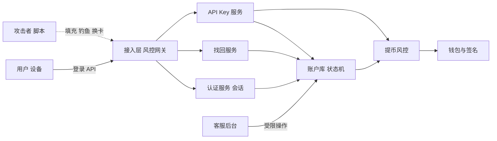
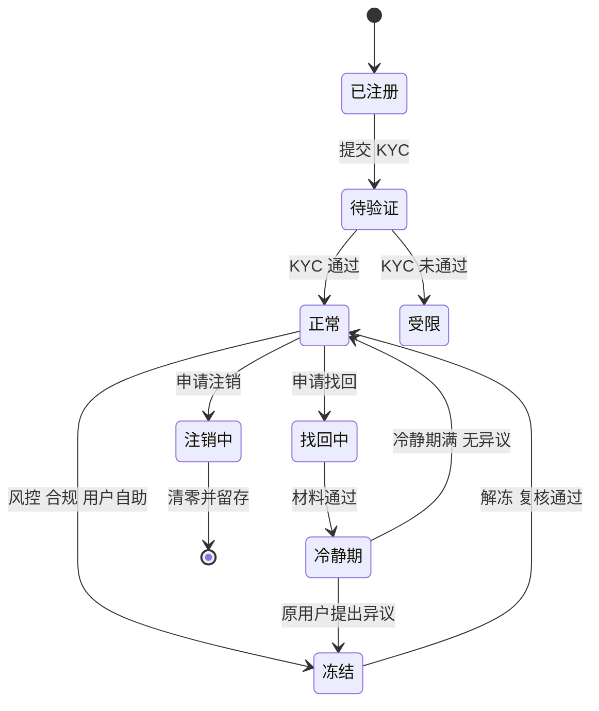
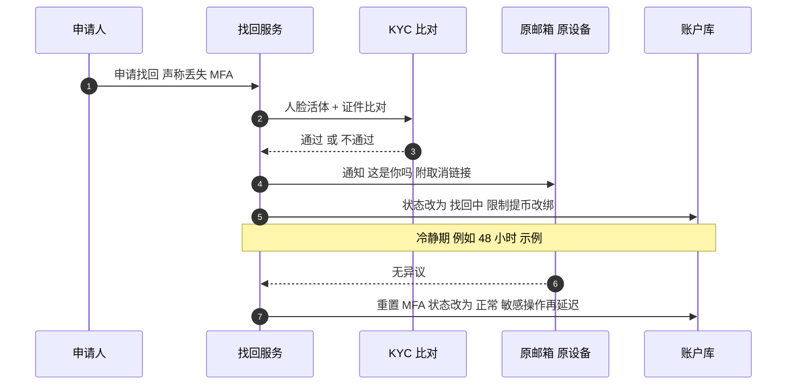
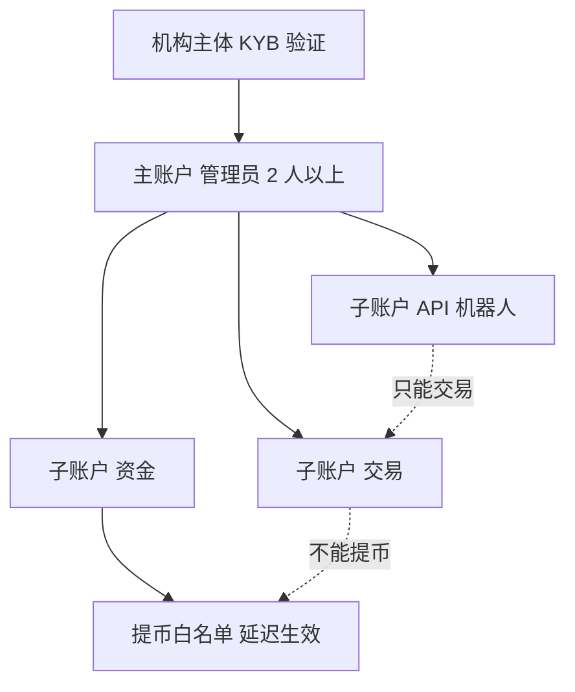

# X08 客户身份、账户与访问：认证、找回、API Key 与机构权限

> 学习目标：读完本章，你能——
> 1. 画出交易所"账户全生命周期"图，并指出每个阶段里攻击者最想利用的一个环节（登录、找回、API Key、客服后台）。
> 2. 为一家交易所写出认证、找回、API Key、机构权限四套策略，并说明每条策略防的是哪条账户接管路径。
> 3. 写出至少 5 条账户安全检测规则，算出接管率、找回成功率等指标，并用它们向管理层汇报。
>
> 适用角色：交易所安全工程师、账户与身份团队负责人、风控工程师、客服与运营系统负责人
> 前置章节：[22 人身与账号安全](../22-physical-account-security.md)、[23 托管、充提与合规安全](../23-custody-exchange-ops.md)、[X07 交易所安全架构总览](X07-cex-architecture-overview.md)
> 交互实验 / 模板：本章第 6 节的策略配置、检测规则与找回评分可直接改写；[T07 员工防社工清单](../templates/T07-staff-anti-social-engineering.md)
> 最后核对：2026-11-23

---

## 开场：密码对了，验证码也对了

一家虚构的交易所（示例）凌晨收到十几起被盗申诉。用户都说"我没有泄露验证码"。安全工程师翻日志，发现一个共同点：这些账户在被盗前一小时，都走过一次"手机号换绑 + 短信找回"流程。登录、提币本身的日志看上去全部合法：密码正确，短信验证码正确，提币地址是刚刚新加的。

<details class="predict"><summary>🤔 先猜再看：这家交易所的哪一环最先被打穿？A. 登录页的密码校验　B. 提币页的验证码校验　C. 找回流程</summary>

答案是 C。攻击者不需要打败登录和提币的校验，只需要让系统把自己当成"丢了手机的真用户"。找回流程的强度，决定了整套认证的强度。第 3.3 节专门讲怎样设计它。

</details>

---

## 1. 一句话理解

**交易所的账户安全，不取决于"最强的那个因素"，而取决于"攻击者能走的最弱的那条路"：登录、找回、API Key、客服后台，每一条路都要被设计和监控。**

账户接管（Account Takeover，ATO）：攻击者在用户不知情的情况下，取得并使用其交易所账户。
认证（Authentication）：系统确认"来的人是不是这个账户的主人"。
找回（Recovery）：用户丢失认证因素后，重新取得账户控制权的流程。

> 🎯 打个比方：账户像一间有保险柜的办公室。大门有指纹锁（登录），保险柜有密码（提币验证）。但物业前台还有一条规矩："丢了钥匙，说出你的名字和生日，我给你配一把新的。"攻击者当然走前台。
>
> 比喻的局限：前台只面对线下的一个人，交易所的"前台"（找回入口、客服工单、API）同时面对全球数百万人和自动化脚本，攻击成本接近零。

---

## 2. 保护目标与信任边界

### 2.1 保护什么

| 目标 | 失陷后的后果 | 对应 [X01](X01-security-program-controls.md) 的资产类别 |
|---|---|---|
| 用户账户的控制权 | 资金被提走、被用来洗钱、被用来诈骗他人 | 资金、用户数据 |
| 凭证与因素（密码、MFA、Passkey、API Key） | 攻击者可以反复登录 | 密钥（用户级） |
| 找回通道 | 绕过上面所有因素 | 用户数据、品牌与渠道 |
| 客服与内部后台 | 一个后台账号可以影响很多用户 | 基础设施、用户数据 |

### 2.2 信任边界图



**读图要点：**

- 四个入口（登录、找回、API、客服后台）最终都落到同一个账户库。任何一个入口的强度都不应低于登录。
- 提币风控（WD）是最后一道账户侧的关口。它要独立判断，不能只相信"这个会话已经登录"。
- 客服后台不是"内部的、可信的"。它是第四个入口，要像对外 API 一样被限权和审计。
- 局限：图没有画第三方身份提供方（社交登录、SSO）。机构客户若用 SSO，信任边界会多一个外部节点。

### 2.3 账户全生命周期



**读图要点：**

- 每个状态都要回答三件事：谁能让账户进入这个状态，谁能让它离开，离开时是否通知原用户。
- "找回中"和"冷静期"是独立状态，不是"正常"的一个分支。这两个状态里，提币和改绑被限制。
- 冻结后的解冻由风控或合规人员执行，客服无权解冻（第 4 节 IC-13）。
- 局限：图只画了零售账户。机构账户有"主账户、子账户、成员"三层，见第 3.6 节。

---

## 3. 参考架构

### 3.1 账户接管的主要路径

| 路径 | 攻击者做什么 | 主要防线 |
|---|---|---|
| 凭证填充（Credential Stuffing） | 用其他网站泄露的"邮箱 + 密码"批量尝试登录 | 速率限制、设备风险、泄露密码检查、MFA |
| 钓鱼 / 中间人 | 假登录页实时转发密码和一次性验证码 | 防钓鱼因素（Passkey、硬件密钥）、反钓鱼码、新设备延迟 |
| SIM 卡劫持 | 让运营商把号码转到自己的卡，截获短信 | 不用短信做唯一因素或恢复；号码变更信号 |
| 会话劫持 | 窃取浏览器 Cookie 或令牌，免登录接管 | 会话绑定设备、短会话、敏感操作重新认证 |
| 找回流程社工 | 骗客服或骗自动化找回，换掉 MFA | 找回设计（第 3.3 节）、客服限权 |
| 恶意软件 / 剪贴板 | 在用户设备上改地址、截屏 | 提币地址白名单、新地址延迟、设备侧教育 |
| 内部或外包人员 | 收买客服导出数据，再诈骗用户 | 数据最小化、批量读取告警（见 [24](../24-data-privacy.md)） |

SIM 卡劫持和社交账号被盗的公开案例已在 [22 章](../22-physical-account-security.md) 讲过。本章只写"交易所怎样设计才不被这条路打穿"。

### 3.2 认证：因素怎么选

| 因素 | 能防什么 | 防不住什么 | 建议用法 |
|---|---|---|---|
| 密码 | 无（只是第一道） | 填充、钓鱼、键盘记录 | 配合泄露密码检查；不强制定期更换 |
| 短信验证码 | 防简单撞库 | SIM 劫持、钓鱼、运营商社工 | 只做兜底，不做找回的唯一依据 |
| 验证器 App（TOTP） | 防撞库、SIM 劫持 | 实时钓鱼（用户可被骗着输入） | 标准档默认选项 |
| 推送确认 | 体验好 | 疲劳轰炸（用户被刷到点同意） | 必须带"数字匹配"，并限频 |
| Passkey（FIDO2） | 防钓鱼（凭证绑定域名） | 设备丢失后的找回弱点 | 成熟档推荐；注意同步型 Passkey 的云账户风险 |
| 硬件安全密钥 | 防钓鱼，不可导出 | 丢失时的找回弱点 | 机构账户、大额用户必配 |

> 💡 注意：同步型 Passkey（跟随云账号同步到多台设备）方便用户，但它的强度还取决于云账号自身的保护。截至 2026 年公开资料，NIST SP 800-63B-4 于 2025 年 7 月发布终稿，允许同步型认证器用于 AAL2，不允许用于 AAL3（AAL3 要求不可导出的密钥）。短信等电话网络渠道在该指南中属于受限的认证器类型。具体条款以 NIST 官方最新文本为准。

风险认证（Risk-based Authentication）：系统根据设备、位置、行为给每次登录打分，分高放行，分低加验证，分更低拒绝。示例信号见第 6.3 节。

设备绑定：把"可信设备"登记在账户里。新设备登录后的前 24 小时内，限制改绑、加提币地址和提币。这条规则成本低，对"接管后立即变现"的路径非常有效。

### 3.3 找回：最大的后门

找回流程的设计原则只有一条：**找回的强度不能低于被找回的因素。** 用户丢了硬件密钥，不能靠"发一个短信验证码"找回来。

分层设计：

1. 先判断"丢了什么"：只丢密码，只丢第二因素，还是全丢。
2. 按丢失的因素设定要求：丢密码，用已验证邮箱加第二因素；丢第二因素，用密码加备份码或另一个已绑定因素；全丢，进入"高风险找回"。
3. 高风险找回必须包含：与 KYC 时一致的人脸活体比对、已知设备或已知 IP 信号、冷静期。
4. 找回成功后，立即限制敏感操作：提币、改绑、加白名单地址、创建 API Key，延迟 24–72 小时（建议，按风险调整）。
5. 全程向原邮箱、原手机和 App 推送通知，给原用户一个"这不是我"的按钮，按下即冻结。



**读图要点：**

- 第 4 步先限制，再等待。限制发生在"找回中"，而不是找回成功之后。
- 通知发往"原"渠道，而不是申请人新填的渠道。申请人如果是攻击者，他收不到。
- 人工复核只处理"自动流程拿不准"的单子，复核人看到的是证据摘要，不能自己改状态。
- 局限：冷静期会让真实丢设备的用户着急。要提供"冷静期内只读 + 小额操作"的体验，而不是完全锁死。

人工复核的边界：

- 客服可以收集材料、解释流程、提交复核单。
- 客服不可以：决定通过、绕过冷静期、直接重置 MFA、关闭通知。
- 复核通过的权限给独立的"账户恢复小组"，每单双人，决定写入审计日志。

### 3.4 API Key 管理

API Key 是不经过登录页和 MFA 的入口。它的强度完全来自权限设计。

| 设计点 | 建议 |
|---|---|
| 权限分级 | 读取、交易、提币三档分开；创建时默认只读 |
| 提币权限 | 默认关闭；开启需要 MFA、IP 白名单，并有延迟生效 |
| IP 白名单 | 提币和交易权限必须绑定 IP；未绑定 IP 的 Key 只能读取 |
| 有效期 | 设定最长有效期，到期需要用户续期 |
| 展示与存储 | 密钥只在创建时展示一次；服务端只存哈希或加密值 |
| 泄露应对 | 提供"一键撤销所有 Key"；支持第三方发起的批量撤销请求 |
| 子账户隔离 | 机器人和第三方工具用子账户 Key，主账户不暴露 Key |

截至 2026 年公开资料，Binance 官方帮助页说明：没有设置 IP 限制的 Key 只有读取权限；要开启提币权限，必须先添加 IPv4 白名单。这是"权限随绑定条件放开"的一个通用例子（具体规则以官方文档为准）。

### 3.5 客服与内部工具

客服后台是账户安全最容易被忽略的入口。原则：**客服能看到的，不等于客服能改的；能改的，不等于不留痕。**

- 数据最小化：默认展示脱敏字段。查看完整证件图需要工单号与原因，并记录。
- 操作分级：查询和通知类可直接执行；改绑、重置 MFA、解冻、改提币地址，客服无权，只能提交给对应小组。
- 批量限制：单个客服每小时可查看的账户数设上限，超限需要主管审批。
- 与风控的关系：客服操作不能绕过风控。风控把账户标成"找回中"时，客服后台里的"解冻"按钮对该账户必须变灰。
- 外包客服：与内部客服分环境，不能导出，会话录屏，设备由公司管理（见 [X03](X03-production-infra-security.md)、[24](../24-data-privacy.md)）。

### 3.6 子账户与机构账户

机构账户的特点是"多人、多角色、大额"。结构建议：



**读图要点：**

- 角色分离：交易员能交易，不能提币；资金管理员能提币，不能交易；管理员能改角色，但不能自己审批自己。
- 提币白名单是机构账户的核心控制。新增地址要双人审批，并延迟生效（建议 24 小时以上）。
- 四眼原则（Four-eyes Principle）：关键操作必须由两个不同的人完成，一个发起，一个批准。
- 局限：小型机构只有一两个人。此时用"设备分离"补偿：发起用一台设备，批准用另一把硬件密钥。

---

## 4. 控制清单

优先级：P0 为失效后可能直接导致资金被盗；P1 为让接管更容易；P2 为成熟度提升。

| ID | 控制项 | 要防什么 | 优先级 | 怎么验证 |
|---|---|---|---|---|
| IC-01 | 登录接口速率限制与设备风险评分 | 凭证填充 | P0 | 用测试账户在单 IP 连续失败，核对被限速并触发告警 |
| IC-02 | 提供并推广防钓鱼因素（Passkey / 硬件密钥） | 钓鱼、实时中间人 | P1 | 统计启用率；用钓鱼测试页确认 Passkey 无法被转发 |
| IC-03 | 短信不作为找回的唯一依据 | SIM 劫持 | P0 | 在测试账户用"只有短信"走找回，应被拒绝或升级为高风险 |
| IC-04 | 新设备登录后限制改绑、加地址、提币 | 接管后立即变现 | P0 | 用新设备登录测试账户并尝试提币，应被延迟 |
| IC-05 | 找回设计：分层、冷静期、原渠道通知 | 找回社工 | P0 | 走一遍找回流程，核对每一步限制与通知，留存截图 |
| IC-06 | 找回成功后敏感操作延迟 | 找回后立即提走 | P0 | 找回后立刻加地址并提币，应被延迟 |
| IC-07 | 提币地址白名单，新地址延迟生效 | 接管后提走到新地址 | P0 | 新增地址后立即提币，应被拒绝或延迟 |
| IC-08 | 服务端确认"MFA 已完成"，不信任客户端 | 绕过 MFA 的接口缺陷 | P0 | 对提币接口做缺参、跳步测试：缺少 MFA 令牌必须被拒绝 |
| IC-09 | 会话绑定设备，短有效期，敏感操作重新认证 | 会话劫持 | P1 | 把 Cookie 复制到另一台设备，应失效或要求重新认证 |
| IC-10 | API Key：默认只读，提币需 IP 白名单与 MFA | Key 泄露后被提币 | P0 | 创建 Key，核对默认权限；无 IP 绑定时无法开提币 |
| IC-11 | API Key 有效期与一键撤销，支持批量撤销 | 第三方平台泄露 | P1 | 演练：撤销测试用户的全部 Key，记录耗时 |
| IC-12 | 客服操作分级与批量限制 | 客服被收买、被社工 | P0 | 客服测试账号尝试重置 MFA 与批量查询，应被拒绝或需要审批 |
| IC-13 | 风控标记账户时，客服无法解冻 | 绕过风控 | P0 | 对测试账户设风控冻结，用客服账号尝试解冻 |
| IC-14 | 解冻、重置 MFA、改绑由独立小组双人执行 | 单人滥权 | P1 | 抽样检查最近 30 单，每单是否有两个不同审批人 |
| IC-15 | 机构账户角色分离与提币双人审批 | 机构内部单点 | P0 | 用交易员角色尝试提币，应被拒绝 |
| IC-16 | 账户事件日志不可被客服或运营删改 | 抹除痕迹 | P1 | 用业务账号尝试修改日志表，应失败 |
| IC-17 | 账户安全检测规则上线并按月评审 | 前面所有控制被绕过 | P0 | 抽取 3 条规则，用历史或测试数据回放，确认能触发 |

> 💡 注意：IC-17 是兜底。预防类控制再强，也要假设某一层会被绕过（见 [X01](X01-security-program-controls.md) 第 3.2 节）。第 6.4 节给出规则示例。

---

## 5. 分级落地

人数与时间为建议值，不是统计数字。

| 档位 | 适用 | 做什么 | 人和时间 |
|---|---|---|---|
| 最小可行 | 新交易所、用户规模较小 | IC-01、03、04、05、06、07、10、12、13：速率限制、短信不单独找回、新设备与找回后延迟、地址白名单、API Key 默认只读、客服限权；每周看一次接管申诉 | 2 名工程师 + 1 名安全，约 90 天 |
| 标准 | 有明确合规要求、有机构客户 | 全部 P0 与 P1；风险认证；Passkey；找回小组；机构账户角色分离；检测规则与月度指标；每季度演练 | 账户团队 4–6 人 + 安全与风控各 2 人，约 180–365 天 |
| 成熟 | 大型、全球化 | 持续风险评分；找回自动化加人工复核；与运营商、邮箱服务商的信号共享；红队演练覆盖找回与客服；外包客服隔离环境 | 专职账户安全小组 6–10 人，持续迭代 |

> 💡 注意：最小可行档里，"新设备与找回后延迟"和"地址白名单延迟"是性价比最高的两条。它们不阻止接管，但阻止"接管后马上变现"，给检测和用户申诉争取时间。

---

## 6. 落地做法

### 6.1 步骤

1. 画出四个入口（登录、找回、API、客服后台），写下各自的认证方式。
2. 找出最弱的入口，通常是找回或客服。把它的强度补到不低于登录。
3. 上线"新设备限制"与"找回后限制"两条延迟规则。
4. 给 API Key 加默认只读与 IP 绑定，对存量 Key 做一次盘点和通知。
5. 给客服后台加操作分级和批量查询上限。
6. 上线 6.4 节的检测规则，先设 P2 / P3 告警，跑两周后调优。
7. 每月拉一次指标（第 7 节），每季度做一次接管演练。

### 6.2 策略配置示例

下面是一份示例策略（YAML，字段为示意，不对应任何真实产品）。

```yaml
# 示例：账户安全策略
auth:
  password:
    min_length: 12
    check_breached_list: true      # 注册和改密时检查泄露库
  mfa:
    allowed: [passkey, security_key, totp]
    sms_allowed_as: fallback_only   # 短信只做兜底
    push_requires_number_match: true
  session:
    bind_device: true
    idle_timeout_minutes: 30
    sensitive_ops_reauth: [withdraw, add_address, create_api_key, change_mfa]

device_trust:
  new_device_restrict_hours: 24
  restricted_ops: [withdraw, add_address, change_mfa, change_phone, change_email]

recovery:
  tiers:
    lost_password:      {require: [verified_email, second_factor]}
    lost_second_factor: {require: [password, backup_code_or_other_factor]}
    lost_all:           {require: [kyc_liveness, known_device_or_ip], cooldown_hours: 48}
  notify_original_channels: true
  post_recovery_restrict_hours: 72
  sms_only_recovery: deny

api_key:
  default_permission: read
  trade_requires_ip_bind: true
  withdraw:
    enabled_by_default: false
    requires: [mfa, ip_bind, whitelist_addresses]
    activation_delay_hours: 24
  max_lifetime_days: 90
  bulk_revoke_endpoint: true

withdraw_whitelist:
  new_address_delay_hours: 24
  institutional_requires_approvers: 2
```

### 6.3 找回风险评分（示例）

下面是一段 Python 伪代码，演示如何把信号变成决策。权重为示例，需用你们自己的历史数据校准。

```python
# 示例：找回申请评分（权重仅为示意）
def score_recovery(req):
    s = 0
    if req.device_id not in req.account.known_devices: s += 30
    if req.ip_asn not in req.account.usual_asns:        s += 15
    if req.country != req.account.usual_country:        s += 15
    if req.phone_changed_last_7d:                       s += 20  # 近期换号：SIM 劫持信号
    if req.email_changed_last_7d:                       s += 20
    if req.liveness_match < 0.9:                        s += 40
    if req.account.balance_usd_bucket == "high":        s += 10
    return s

def decide(score):
    if score >= 80: return "deny_and_freeze_review"
    if score >= 40: return "manual_review_with_cooldown"
    return "auto_with_cooldown"   # 即使低风险也保留冷静期
```

### 6.4 检测规则示例（7 条）

假设日志已标准化（见 [X05](X05-detection-response-engineering.md)）。表名与字段为示例。SQL 使用 PostgreSQL 语法；Sigma 规则的 `logsource` 为自定义示例。阈值均为示例，要用你们自己的基线校准。

**规则 1：凭证填充（SQL）**——同一来源 IP 在 10 分钟内对大量不同账户登录失败。

```sql
-- 示例：每 5 分钟运行
SELECT src_ip,
       COUNT(*)                 AS attempts,
       COUNT(DISTINCT user_id)  AS distinct_users
FROM auth_events
WHERE event_type = 'login'
  AND result = 'fail'
  AND ts >= now() - interval '10 minutes'
GROUP BY src_ip
HAVING COUNT(DISTINCT user_id) >= 20
   AND COUNT(*) >= 50;
```

- 假阳性：大型企业出口 IP、校园网络、移动运营商的共享出口。
- 调优：排除已知企业 IP 段；按 ASN 聚合；成功率偏低时不告警，只限速。

**规则 2：找回后 24 小时内提币（SQL）**——找回与提币强相关，是接管变现的典型路径。

```sql
SELECT r.user_id, r.ts AS recovery_ts, w.ts AS withdraw_ts, w.amount_usd
FROM recovery_events r
JOIN withdraw_events w
  ON w.user_id = r.user_id
 AND w.ts BETWEEN r.ts AND r.ts + interval '24 hours'
WHERE r.result = 'success'
  AND w.amount_usd >= 1000;
```

- 假阳性：真实丢设备的用户找回后急着提币。
- 调优：叠加"新设备"和"新增提币地址"两个条件，三项同时满足才升 P1；其余 P3。

**规则 3：30 分钟内先改绑再加地址（SQL）**——一个用户在短时间内改 MFA 或手机，随后加提币地址。

```sql
SELECT a.user_id, a.ts AS change_ts, b.ts AS addr_ts
FROM account_events a
JOIN account_events b
  ON b.user_id = a.user_id
 AND b.event_type = 'add_withdraw_address'
 AND b.ts BETWEEN a.ts AND a.ts + interval '30 minutes'
WHERE a.event_type IN ('mfa_reset', 'mfa_unbind', 'phone_change');
```

- 假阳性：用户换手机时一并整理地址簿。
- 调优：按用户历史做基线；对机构账户用"是否经过双人审批"过滤。

**规则 4：开启提币权限但没有 IP 绑定的 API Key（Sigma）**

```yaml
title: API Key Withdraw Permission Without IP Binding
id: 7c9a3f1e-4b2d-4f6a-9d1e-0a5b8c2d3e41
status: experimental
description: 示例规则。检测创建或修改 API Key 时开启提币权限但未设置 IP 白名单。
logsource:
  product: exchange
  service: api_key_audit
detection:
  selection:
    event_type:
      - api_key_created
      - api_key_updated
    permissions|contains: 'withdraw'
  filter_ip_bound:
    ip_whitelist_count|gt: 0
  condition: selection and not filter_ip_bound
falsepositives:
  - 产品策略允许的内部测试账户
level: high
```

- 假阳性：内部测试账户。
- 调优：IC-10 正确实施后，这条规则应永远不触发；它触发即说明策略被绕过，要查原因。

**规则 5：客服在没有工单时重置 MFA（Sigma）**

```yaml
title: Support Agent MFA Reset Without Ticket
id: 3d5e9a72-8b14-4c0f-a6e2-1f7b9c4d5a68
status: experimental
description: 示例规则。检测客服账号在没有关联工单的情况下重置用户 MFA。
logsource:
  product: exchange
  service: support_console_audit
detection:
  selection:
    action: 'mfa_reset'
    actor_role: 'support_agent'
  filter_has_ticket:
    ticket_id|exists: true
  condition: selection and not filter_has_ticket
falsepositives:
  - 工单系统同步延迟导致字段暂时为空
level: high
```

- 假阳性：工单同步延迟。
- 调优：IC-12 实施后客服本不应有该权限。这条规则既检测滥权，也检测权限配置漂移。

**规则 6：客服批量查看账户（SQL）**——对应第 8.4 节的事件类型。

```sql
SELECT actor_id,
       date_trunc('hour', ts)         AS hour,
       COUNT(DISTINCT target_user_id) AS users_viewed,
       COUNT(*) FILTER (WHERE field_group = 'kyc_document') AS kyc_doc_views
FROM support_console_audit
WHERE action = 'view_profile'
  AND ts >= now() - interval '24 hours'
GROUP BY actor_id, date_trunc('hour', ts)
HAVING COUNT(DISTINCT target_user_id) >= 60
    OR COUNT(*) FILTER (WHERE field_group = 'kyc_document') >= 15;
```

- 假阳性：客服在高峰期集中处理积压工单。
- 调优：按每个客服自己的 30 天基线与当班时段设阈值；对比其关联工单数，查看数远大于工单数才升级。

**规则 7：被拒的 API 调用突增（SQL）**——Key 泄露后，攻击者常先试探权限。

```sql
SELECT api_key_id,
       COUNT(*) FILTER (WHERE result = 'denied_ip')         AS ip_denied,
       COUNT(*) FILTER (WHERE result = 'denied_permission') AS perm_denied
FROM api_calls
WHERE ts >= now() - interval '15 minutes'
GROUP BY api_key_id
HAVING COUNT(*) FILTER (WHERE result = 'denied_ip') >= 30
    OR COUNT(*) FILTER (WHERE result = 'denied_permission') >= 20;
```

- 假阳性：用户自己的机器人配置错误。
- 调优：先通知用户并建议轮换，不直接冻结；多次出现且伴随新来源 IP 再升级。

### 6.5 常见坑

- 找回流程走的是另一套老代码，没有接新设备限制和冷静期。上线后要用"找回 + 提币"的整条路径做测试。
- 只在前端校验 MFA。接口缺少 MFA 令牌时仍然成功（IC-08）。
- "一键撤销所有 API Key"只撤销了主账户的，没有撤销子账户的。
- 通知发到了"当前登录的邮箱"。攻击者改完邮箱，通知就发给了他自己。通知必须发到变更前的渠道。
- 客服后台的权限靠隐藏菜单，接口本身没有鉴权。隐藏菜单不是权限控制。
- 风控冻结只写了前台标记，客服工具读不到这个标记（IC-13）。

---

## 7. 运营：指标、告警、值班、演练、季度节奏

### 7.1 指标

| 指标 | 定义 | 怎么用 |
|---|---|---|
| 账户接管率 | 当期确认被接管的账户数 ÷ 当期活跃账户数 | 趋势比绝对值重要；按渠道（找回、API、填充）拆分 |
| 找回成功率 | 找回成功数 ÷ 找回申请数 | 突然升高说明门槛被绕过；突然降低说明误伤真用户 |
| 找回后 7 天内被盗申诉率 | 找回成功后 7 天内出现被盗申诉的账户数 ÷ 找回成功数 | 衡量找回质量，目标是持续下降 |
| 被盗申诉量与处理时长 | 每周申诉数；从申诉到冻结的中位时间 | 反映检测与响应速度 |
| 防钓鱼因素启用率 | 启用 Passkey 或硬件密钥的活跃账户占比 | 衡量预防层覆盖 |
| 短信依赖率 | 只有短信一个因素的活跃账户占比 | 目标是持续下降 |
| 未绑 IP 的提币权限 Key 数 | 应为 0 | 红线项 |
| 客服高权限操作审批覆盖率 | 重置 MFA、解冻、改绑中有双人审批的占比 | 目标 100% |

> 💡 注意：不要把"零接管"当目标。接管一定会发生，指标要看的是它被发现的速度，以及它能造成多大损失（延迟规则是否起作用）。

### 7.2 告警分级与值班

| 级别 | 示例 | 响应 |
|---|---|---|
| P1 | 规则 2、3 同时命中；客服批量读取 KYC 超阈值 | 值班安全 15 分钟内确认，必要时冻结账户或停用客服账号 |
| P2 | 规则 1 持续命中；规则 4 触发 | 当班处理，当天关闭 |
| P3 | 单条规则 2 命中；规则 7 | 进入工单队列，按日汇总 |

自动化的边界（见 [X05](X05-detection-response-engineering.md)）：对单个账户"临时冻结提币"可自动；"永久封号""通知监管"必须人工。

### 7.3 季度节奏（建议）

- 每月：指标评审；检测规则的假阳性评审；客服高权限操作抽检。
- 每季度：一次"账户接管桌面推演"（见练习 3）；一次找回流程端到端测试；API Key 存量盘点。
- 每半年：对客服与外包做一次权限回收与访问盘点。
- 每年：红队演练，目标包含找回流程与客服后台。

---

## 8. 失效案例

以下案例只写摘要和教训，每个案例的公开来源均已单独核对。完整复盘见《Web3 行业安全资损 101》与 [28 事故案例库](../28-incident-casebook.md)。金额为事发时美元估值。

### 8.1 Coinbase 的短信找回缺陷（2021-03 至 2021-05，披露于 2021-10）

- 公开事实：Coinbase 向加州总检察长办公室提交的用户通知称，2021 年 3 月至 5 月 20 日，攻击者利用其短信账户找回流程中的一个缺陷，取得短信验证码，绕过短信两步验证。至少 6000 名客户的资金被转走。公司称，攻击者需要事先知道受害者的邮箱、密码和已验证的手机号，公司怀疑这些信息来自钓鱼，没有证据显示来自 Coinbase 自身系统。公司表示赔偿受影响用户，并建议改用硬件密钥或验证器 App。
- 映射本章控制：IC-03（短信不能单独完成找回）、IC-08（服务端确认 MFA 状态）。
- 来源类型：企业向监管机构的用户通知（经 [CoinDesk](https://www.coindesk.com/business/2021/10/01/coinbase-multi-factor-authentication-hack-affects-at-least-6000-customers) 报道）、媒体报道（[The Record](https://therecord.media/hackers-bypass-coinbase-2fa-to-steal-customer-funds)）。缺陷的技术细节公司未公开。
- 教训：登录页的 MFA 再强，找回流程里的短信也能把它绕过。要对找回流程单独做安全测试。

### 8.2 Crypto.com 未经完整 2FA 的提币（2022-01）

- 公开事实：2022 年 1 月，Crypto.com 暂停提币。公司事后复盘称，483 名用户账户发生未授权提币，涉及 4,836.26 枚 ETH、443.93 枚 BTC 和约 6.62 万美元的其他代币，约 3380 万美元（事发时估值）。复盘把原因归结为两步验证（2FA）相关问题。公司称已全额补偿 483 个账户，撤销全部用户的 2FA 令牌并迁移到新的 2FA 基础设施，新增"新提币地址 24 小时后才能首次提币"的延迟。
- 说明：公开资料没有给出这次 2FA 问题的完整技术机制，不应据此推断具体绕过手法。
- 映射本章控制：IC-08（服务端确认 MFA 已完成）、IC-07（新地址延迟）、规则 3。
- 来源类型：企业复盘（经 [Decrypt](https://decrypt.co/90786/crypto-com-confirms-exchange-lost-nearly-34m-hackers) 报道）、媒体报道（[BleepingComputer](https://www.bleepingcomputer.com/news/security/cryptocom-confirms-483-accounts-hacked-34-million-withdrawn/)）。
- 教训：当 MFA 出问题时，"新地址延迟"是最后一道缓冲。它不阻止攻击，但给检测和用户申诉留出时间。

### 8.3 3Commas API Key 泄露（2022-12）

- 公开事实：2022 年 12 月，有人在社交平台公开了一批关联 3Commas 的交易所 API Key。3Commas 起初暗示是用户被钓鱼，随后确认公开文件中的数据属实，称有超过 100 万个 Key 与平台关联、约 100 名用户反馈异常，并请 Binance、KuCoin 等交易所吊销相关 Key。SiliconANGLE 报道称，泄露的 Key 约 10 万个，一批交易者称损失约 2200 万美元；ZachXBT 核实了 44 名受害者、约 1480 万美元的损失。Halborn 指出，攻击者声称是内部人作案，但具体手法没有被证明。
- 映射本章控制：IC-10（IP 绑定：Key 被拿走后，换一个 IP 就用不了）、IC-11（批量撤销）、规则 7。
- 来源类型：媒体报道（[SiliconANGLE](https://siliconangle.com/2022/12/29/crypto-trading-service-3commas-confirms-massive-api-key-leak-hack/)）、安全公司分析（[Halborn](https://www.halborn.com/blog/post/explained-the-3commas-breach-december-2022)）、链上调查者统计（经媒体转述）。损失数字口径不一，只能写区间。
- 教训：第三方平台泄露的 Key，要靠交易所侧的 IP 绑定与权限设计兜底。交易所自己没被攻破，但要承担批量撤销的协调工作。

### 8.4 Coinbase 外包客服数据泄露（2025-05）

- 公开事实：2025 年 5 月 14 日，Coinbase 在 SEC 的 8-K 文件中披露：有人声称掌握客户账户信息并索要钱财；公司认为攻击者买通了境外的客服类合同人员或员工，从其有权访问的内部系统收集数据。公司称，监控在前几个月已发现这些不当访问，相关人员被解雇；密码与私钥未被取得，涉事人员无法动用客户资金。缅因州通知称约 69,461 人的信息受影响。公司拒绝了 2000 万美元勒索，估算补救与自愿赔偿成本约 1.8 亿至 4 亿美元，并计划设立新的美国客服中心。
- 映射本章控制：IC-12（客服操作分级与批量限制）、IC-14、规则 6。
- 来源类型：监管文件（[SEC 8-K](https://www.sec.gov/Archives/edgar/data/1679788/000167978825000094/coin-20250514.htm)）、媒体报道（[The Record](https://therecord.media/nearly-70000-impacted-coinbase-breach)）。
- 教训：没有密码、没有私钥，数据也能造成接管之外的巨额损失：攻击者拿数据冒充客服诈骗用户。客服后台的"能看多少"要按最坏情况设计。

### 8.5 Binance 的 API Key 与 2FA 码泄露（2019-05）

- 公开事实：2019 年 5 月，Binance 宣布约 7000 枚 BTC（约 4000 万美元，事发时估值）从热钱包被转走。公司称，攻击者取得了大量用户的 API Key、2FA 验证码和可能的其他信息；热钱包约占 BTC 总量的 2%，冷存储未受影响；损失由公司的安全资产基金（SAFU）承担。
- 说明：公开报道对入侵手法只写到"钓鱼、病毒等多种方式"。本书不推断更多细节。
- 映射本章控制：IC-10、IC-07、规则 7；提币链路的限额和延迟见 [23](../23-custody-exchange-ops.md)。
- 来源类型：企业公告（经 [The Block](https://www.theblock.co/news/regulation/2019-05-07-security-breach-on-binance-results-in-a-loss-of-7000-btc-22448)、[TechCrunch](https://techcrunch.com/2019/05/07/binance-breach/) 报道）。
- 教训：账户侧失陷可以演变成资金侧的大额损失。账户安全与钱包限额是同一道防线的两半。

> 💡 注意：这五个案例的共同点是：被打穿的都不是"登录页本身"，而是找回、2FA 逻辑、API Key 权限、客服数据这些"侧门"。

---

## 9. 评估检查点

- [ ] **IAM-1** 已画出登录、找回、API、客服后台四个入口，并写明各自的认证方式。
- [ ] **IAM-2** 登录接口有速率限制、设备风险评分和泄露密码检查。
- [ ] **IAM-3** 短信不能单独完成找回，也不是唯一的第二因素选项。
- [ ] **IAM-4** 找回流程按"丢了什么"分层，高风险找回包含活体比对和冷静期。
- [ ] **IAM-5** 找回通知发往变更前的原渠道，并带"不是我"的冻结入口。
- [ ] **IAM-6** 新设备和找回成功后，提币、改绑、加地址、创建 API Key 都被延迟。
- [ ] **IAM-7** 提币地址白名单有效，新地址延迟生效；机构账户新增地址需要双人审批。
- [ ] **IAM-8** 服务端校验"MFA 已完成"，已对提币等接口做缺参与跳步测试。
- [ ] **IAM-9** API Key 默认只读；提币权限默认关闭，开启需要 MFA 与 IP 绑定。
- [ ] **IAM-10** 有一键撤销与批量撤销能力，并在最近一年演练过。
- [ ] **IAM-11** 客服操作已分级；客服无权重置 MFA、解冻、改绑提币地址。
- [ ] **IAM-12** 客服批量查看有上限和告警；完整证件图查看需要工单号。
- [ ] **IAM-13** 风控冻结对客服不可解除，已用测试账户验证。
- [ ] **IAM-14** 机构账户有角色分离，提币需要双人审批。
- [ ] **IAM-15** 账户事件日志只写、不可被业务账号修改。
- [ ] **IAM-16** 本章规则 1–7 已上线，并按月评审假阳性。
- [ ] **IAM-17** 每月输出接管率、找回成功率、找回后被盗申诉率三项指标。

**把检查结果写进报告：**

| 检查项 | 发现时的证据 | 常见定级（用 [A02](../assessment/A02-risk-rating-reporting.md) 复核） | 练习位置 |
|---|---|---|---|
| IAM-3、IAM-4、IAM-5、IAM-6 | 找回流程端到端测试记录；截图；通知收件人 | Critical / High | 本章练习 2、[B60](../bootcamp/B60-account-access-security.md) |
| IAM-7、IAM-8 | 提币接口测试用例与结果；白名单配置 | Critical / High | 本章练习 2 |
| IAM-9、IAM-10 | Key 创建与权限配置截图；撤销演练耗时 | High | 本章练习 1 |
| IAM-11、IAM-12、IAM-13 | 客服角色权限表；测试账号的尝试结果；告警记录 | High | [T07](../templates/T07-staff-anti-social-engineering.md) |
| IAM-14、IAM-15 | 机构账户配置；日志权限配置 | High / Medium | [A06](../assessment/A06-operational-key-security.md) |
| IAM-16、IAM-17 | 规则清单；回放结果；月度指标表 | Medium | 本章练习 3、4 |

发现按 [T03 报告模板](../templates/T03-finding-report.md) 记录。涉及用户个人信息的证据只写结论和脱敏后的标识。

---

## 10. 上手路径

### 第一周

1. 读本章第 2 节，画出你们的四个入口图，写下认证方式。
2. 用测试账户走一遍找回流程，截图每一步，记录它是否被延迟、是否通知原渠道。
3. 查三件事：新设备后能否立即提币；新地址能否立即使用；客服账号能否重置 MFA。
4. 列出 API Key 现状：有多少个带提币权限，其中多少未绑 IP。

### 第一个月

1. 上线"新设备限制"与"找回后限制"（IC-04、IC-06）。
2. 上线规则 4、5（Sigma，能直接落地的两条），并开始每周看规则 2、3。
3. 与客服负责人一起做客服权限表，砍掉不必要的权限（IC-12、IC-13）。
4. 为 API Key 盘点结果出整改计划和用户通知。

### 第一个季度

1. 完成找回流程重构（分层、冷静期、原渠道通知）。
2. 全部检测规则上线并完成第一轮调优，开始输出月度指标。
3. 做一次接管桌面推演，并把行动项写入 [X01](X01-security-program-controls.md) 的风险登记。
4. 机构账户做一次角色与白名单审计。

---

## 11. 常见误区

- **"开了 MFA 就安全了。"** MFA 只保护登录。找回、API、客服后台不一定经过它。
- **"短信是第二因素，有它就比没有强。"** 对撞库有用，对 SIM 劫持和钓鱼没用。更危险的是把短信用作找回，它等于把 MFA 拆掉。
- **"客服是自己人，所以不用限权。"** 客服后台是第四个入口。外包客服更是被收买的高发点。
- **"API Key 是用户自己的事。"** Key 泄露时，用户和监管都会找交易所。默认值和绑定策略是交易所的设计责任。
- **"延迟会让用户不满。"** 延迟只作用在"新设备"和"找回后"这些高风险时刻。对老设备上的老用户没有影响。
- **"接管率低就说明安全。"** 低可能只是没被发现。要同时看检测规则的命中率和被盗申诉量。

---

## 12. 术语表

| 术语 | 英文 | 定义 |
|---|---|---|
| 账户接管 | Account Takeover（ATO） | 攻击者在用户不知情时取得并使用其账户 |
| 凭证填充 | Credential Stuffing | 用其他网站泄露的账号密码批量尝试登录 |
| 通行密钥 | Passkey | 基于 FIDO2、绑定域名、可抵抗钓鱼的无密码凭证 |
| 风险认证 | Risk-based Authentication | 按设备、位置、行为给登录打分，并按分数决定验证强度 |
| 设备绑定 | Device Binding | 把可信设备登记到账户，新设备受限 |
| 冷静期 | Cooldown Period | 找回或敏感变更之后，延迟生效的等待时间 |
| 四眼原则 | Four-eyes Principle | 关键操作必须由两个不同的人发起和批准 |
| 提币白名单 | Withdrawal Allowlist | 只允许向预先登记并已生效的地址提币 |
| 子账户 | Sub-account | 主账户下的隔离账户，权限和资金可单独设置 |
| 认证保证等级 | Authenticator Assurance Level（AAL） | NIST 对认证强度的分级，共 AAL1–AAL3 |

---

## 13. 动手练习与思考题

### 练习 1：审一份示例 API Key 清单（30 分钟）

下面是 6 个示例 Key（示例数据）。请找出违反 IC-10 的 Key，并写出整改动作。

```text
key_id  permissions        ip_whitelist     created   last_used
k1      read               (none)           2024-01   2026-11
k2      trade              203.0.113.7      2025-03   2026-11
k3      trade,withdraw     (none)           2023-06   2026-10
k4      read,withdraw      198.51.100.9     2026-05   2026-11
k5      trade              (none)           2022-09   2025-02
k6      withdraw           (none)           2026-11   2026-11
```

提示：k3 和 k6 最危险；k5 长期不用且未绑 IP；k4 开了提币但没有交易权限，是否有业务理由？写出你对 90 天有效期的处理办法。

### 练习 2：端到端找回评审表（45 分钟）

选一家交易所（可用公开帮助文档，或你自己虚构的），画出它的找回流程，回答 10 个问题：丢了哪种因素，系统要求什么？是否有冷静期？通知发往哪里？找回后哪些操作被限制？客服能否绕过？把答案填进下表，并对照 IC-03、IC-05、IC-06、IC-07 打分。

| 问题 | 答案 | 对应控制 | 通过？ |
|---|---|---|---|
| 只有短信能否完成找回 | | IC-03 | |
| 找回后能否立即提币 | | IC-06 | |

### 练习 3：30 分钟桌面推演——"凌晨 3 点的十起申诉"

场景：凌晨 3 点，客服收到 10 起"账户被盗"申诉，共涉及约 40 万美元（示例）。日志显示这些账户在被盗前 1 小时都有"找回成功"记录，来源 IP 属于同一个 ASN。

1. 写出前 15 分钟的 5 件事：谁被叫醒，谁有权暂停"找回"，是否冻结这 10 个账户。
2. 判断是否要暂停全站的找回功能，写出理由与代价。
3. 用 6.4 节规则 2 写出查"其他可能受害账户"的查询。
4. 写出 24 小时内的用户通知草稿（不含内部细节）。

### 练习 4：改写一条规则（30 分钟）

把规则 2 改写成 Sigma 相关性规则（Correlation Rule）或你熟悉的 SIEM 语法。写出"三项同时满足才升 P1"的逻辑，并说明为什么单独一项不应升到 P1。

### 建议配套（后续在 L3 训练营实现）

一个"规则回放脚本"：输入一份脱敏的示例日志，输出每条规则命中的账户与假阳性比例；以及一个"找回策略沙盒"，让读者调整冷静期与评分权重，观察真实用户被拒率和攻击成功率的变化。

### 思考题

1. 冷静期设 24 小时与 72 小时，分别对真实用户和攻击者造成什么影响？你会怎样用数据选值？
2. 一名用户同时是机构客户的交易员，需要用手机号找回个人账户，而公司账户要求只用硬件密钥。个人账户和机构账户能否共用一套找回流程？为什么？
3. 如果只能在"Passkey 推广"和"找回流程重构"之间先做一个，你选哪个？用第 3.1 节的接管路径表给出理由。

> 🪞 反思：在你熟悉的交易所里，从"点忘记密码"到"提走资产"，最短路径需要几步、几小时？这条路径上，哪一步是最后可以让人或系统喊停的？

下一章：[X09 资产与市场准入：上币全周期、信息保护与分级准入](X09-cex-asset-listing-market-access.md)
