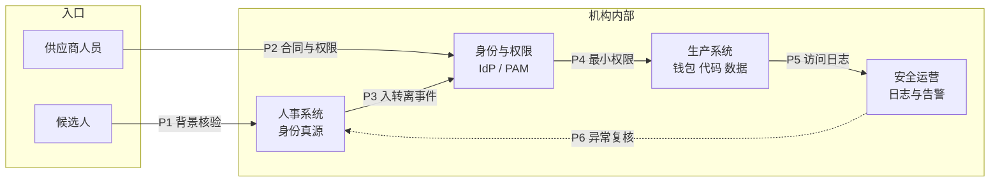
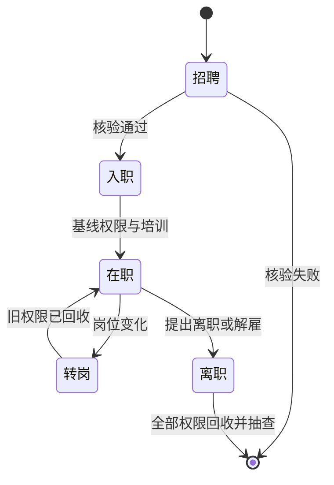
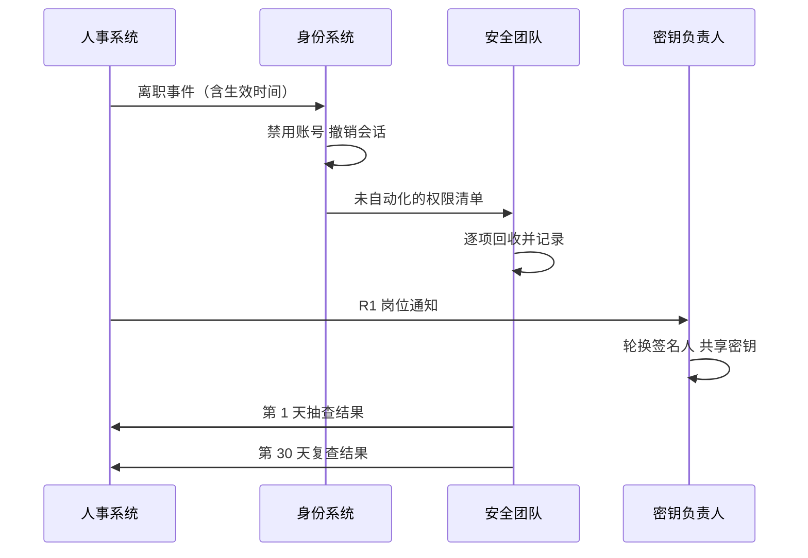

# X08 人员安全：意识、背景核查、内部威胁与离职

> 学习目标：读完本章，你能——
> 1. 按"招聘、入职、在职、转岗、离职"五个阶段，为一家 Web3 机构写出人员安全控制清单，并说明每条控制怎样验证。
> 2. 写出分级的背景核查策略、特权人员名单、异常数据访问规则和一份离职回收清单，并写明各自的合规边界。
> 3. 解释为什么"每年一次培训加钓鱼演练"不够，并改用技术控制加行为度量的组合。
>
> 适用角色：安全负责人、人事与法务负责人、业务部门主管。
> 前置章节：[21 社工与内部人](../21-social-engineering-insiders.md)、[22 人身与账号安全](../22-physical-account-security.md)、X01-security-program-controls.md、X03-production-infra-security.md
> 交互实验 / 模板：[社工实验](../interactive/social-engineering-lab.html)；[T07 员工防社工清单](../templates/T07-staff-anti-social-engineering.md)、[T06 运营安全自查](../templates/T06-ops-security-self-check.md)
> 最后核对：2026-11-23

> 💡 注意：分工。[21 章](../21-social-engineering-insiders.md)讲攻击者怎样用假招聘、冒名员工、收买客服攻击人。[22 章](../22-physical-account-security.md)讲扳手攻击与 SIM 劫持。X03 讲零信任访问、机密管理的技术实现。本章讲**机构怎样管理"人"这个环节**：招人、培训、授权、监测、转岗、离职。技术实现链接过去，不重复。
>
> ⚠️ 警告：本章涉及背景核查、员工监测和个人信息。各国家和地区的法律差异很大，且会变化。本章只给通用的合规边界，不是法律意见。落地前须由法务按用工所在地的法律审核。

---

## 开场：面试里的第二个声音

2025 年 5 月，加密交易所 Kraken 公开说明了一次招聘中的发现。公开报道称：Kraken 的安全团队把一名应聘者的邮箱，与行业伙伴提供的黑客关联邮箱清单做了比对，发现命中。这名应聘者在早期通话中使用的名字与简历不同，被报道"声音偶尔切换"，疑似有人在旁指导。Kraken 没有立刻拒绝。它让该应聘者继续走流程，由首席安全官设计最后一轮面试：要求回答与声称所在地有关的本地常识，并出示实时证件。应聘者没有通过。Kraken 把它描述为朝鲜关联的渗透尝试（来源：Kraken 官方博客与 Fortune 等媒体报道）。

这个案例里没有技术漏洞。拦住攻击的是招聘流程里的三个动作：用情报比对候选人、让人事与安全团队协作、在面试中设置只有真人才能通过的核验。

<details class="predict"><summary>🤔 先猜再看：一家公司的每名员工每年做一次安全培训，每季度被钓鱼演练一次。这足以防住"被收买的内部人"吗？</summary>

不能。培训和演练针对"被骗的人"。被收买的内部人、冒名入职的人，知道自己在做什么，培训对他们没有作用。对这类风险有效的是权限最小化、数据访问监测、双人控制、背景核查和离职回收。本章把两类风险分开处理。

</details>

---

## 1. 一句话理解

**人员安全，是让每个人只拿到完成工作所需的权限，并让"被骗、被收买、被胁迫、不当使用权限"这四种情况下的损失有上限。**

> 🎯 打个比方：人员安全像机场的地勤管理。地勤入职要审查，进隔离区要通行证，通行证只开必要的门，离职当天收回，重要区域不会一个人进。机场不是不信任地勤，而是承认再好的人也会有出事的一天。
>
> 比喻的局限：地勤的通行证是物理的，一收就失效。Web3 机构的"通行证"散落在代码仓库、云、npm、域名、社交账号、多签地址里，回收很容易漏。

本章用四个来源描述人带来的风险：

| 来源 | 说明 | 主要对策 |
|---|---|---|
| 被骗（Deceived） | 员工被钓鱼、假面试、假会议欺骗 | 技术控制优先，意识为辅 |
| 被收买（Bribed） | 员工或外包人员为钱泄露数据、放行操作 | 最小权限、数据访问监测、双人控制 |
| 被胁迫（Coerced） | 员工或家人被威胁（见 [22 章](../22-physical-account-security.md)） | 单人不能动资产、胁迫暗号、关键人员保护 |
| 不当使用（Misuse） | 员工自己滥用权限，或离职后仍有权限 | 背景核查、职责分离、离职回收、审计 |

---

## 2. 保护目标与信任边界

### 2.1 保护目标

| 目标 | 一句话 | 失守的后果 |
|---|---|---|
| 入口可信 | 新人的身份与履历经过与岗位风险匹配的核验 | 冒名者拿到生产权限 |
| 权限匹配 | 权限与当前岗位一致，有人负责定期复核 | 权限累积，一个账号能做太多事 |
| 单人上限 | 任何一个人（包括高管）的最大损失有上限 | 一次收买或胁迫造成全局损失 |
| 可发现 | 异常的数据访问和操作能被发现并有人处理 | 内部人慢慢导出数据而无人知晓 |
| 可回收 | 离职和转岗当天，所有身份和凭证被收回 | 前员工仍可进入系统 |
| 可报告 | 员工可以安全地报告错误和可疑情况 | 点了链接的人因怕被罚而隐瞒 |

### 2.2 信任边界



**读图要点：**

- 人事系统是身份的唯一真源（P3）。入职、转岗、离职事件由它驱动身份系统，而不是靠邮件通知。
- 供应商人员（P2）不经过人事系统，是最常见的盲区。他们的权限要由采购或业务负责人登记，并定期复核。
- P6 虚线：安全运营发现异常后，要有一条明确的、受限的路径通知人事和法务，不能由安全团队自行"调查个人"。
- 局限：图没有画高管、董事会成员和外部顾问。它们的权限同样要登记（见第 4 节 PPL-12）。

> ⚠️ 警告：以下东西**不能被信任**。
> 1. 第三方背景调查报告的"通过"结论。要看覆盖项和范围，岗位不同需要的项目不同。
> 2. 培训完成率。完成率只说明人点了"完成"，不说明行为改变。
> 3. 供应商自己声称的"已做背景核查"。要在合同中要求并抽查证据。
> 4. 高管"我没问题"的豁免请求。高管账号是被攻击最多的目标之一。

---

## 3. 参考架构：人员生命周期



**读图要点：**

- 每个箭头都是一个控制点：核验、基线权限、旧权限回收、全部回收。
- "转岗到在职"必须经过"旧权限已回收"。很多机构只加权限不减权限。
- 离职之后还要抽查：离职后 30 天检查是否还有活跃凭证。局限：图没有画长假和停薪留职，这类状态要同样处理。

### 3.1 按岗位风险分级

不要对所有员工做同样的核查和监控。按岗位能造成的最大损失分级（建议）：

| 级别 | 岗位例子 | 能造成的损失 |
|---|---|---|
| R1 关键 | 签名人、密钥仪式参与者、生产管理员、发布负责人、合约升级权限人 | 直接转走资产或改变合约 |
| R2 高 | 有合并或发布权的开发者、数据库管理员、客服主管、财务出纳 | 批量数据泄露、改动账务 |
| R3 一般 | 普通研发、运营、市场 | 局部影响 |
| R4 外部 | 供应商人员、外包客服、临时工、顾问 | 视其权限，按对应级别处理 |

> 💡 注意：级别看的是**权限**，不是职位高低。一名初级运维有生产管理员权限，就是 R1。

### 3.2 三条设计原则

1. **技术控制优先，教育控制补充。** 能用硬件密钥挡住的钓鱼，不依赖员工"看出来"。
2. **单人上限。** 设计时假设任何一个人都可能被骗、被收买或被胁迫，看最大损失是否可承受。
3. **公平与透明。** 监测规则、核查范围、处罚规则事先书面告知。偷偷监控会损害信任，在不少地区也违法。

---

## 4. 控制清单

| ID | 控制项 | 要防什么 | 优先级 | 怎么验证 |
|---|---|---|---|---|
| PPL-1 | 按岗位风险分级（R1–R4），级别写入人事系统 | 一刀切或无人管 | P0 | 抽 10 人，核对级别与实际权限一致 |
| PPL-2 | 候选人身份与履历核验，R1/R2 增加学历、工作经历、制裁名单核查 | 冒名入职 | P0 | 抽 5 份招聘档案，查核验记录 |
| PPL-3 | 远程岗位：视频面试本人出镜，设备和收货地址与声称所在地一致 | 代人面试、笔记本农场 | P0 | 抽查入职设备的登录地与合同地 |
| PPL-4 | 招聘流程里人事与安全团队联动，可比对威胁情报 | 已知恶意身份入职 | P1 | 演练：给一个"测试邮箱"，看是否被拦 |
| PPL-5 | 入职首日：公司配发设备、硬件安全密钥、最小基线权限 | 个人设备接入生产 | P0 | 新员工清单与设备清单对账 |
| PPL-6 | 入职培训含社工典型场景、报告渠道、"不惩罚报告"承诺 | 员工不知如何报告 | P1 | 抽查签收记录与测验 |
| PPL-7 | 技术底线：关键系统只用抗钓鱼认证（FIDO2/通行密钥） | 凭证被钓鱼 | P0 | 登录日志中无短信或一次性密码登录关键系统 |
| PPL-8 | R1 岗位：高价值操作需第二人批准，批准人与发起人不同团队 | 单人被收买或被胁迫 | P0 | 用 R1 账号单独发起，被拒 |
| PPL-9 | 特权人员名单：R1 名单、权限、批准人、上次复核日期 | 权限累积 | P0 | 名单与系统实际权限对账 |
| PPL-10 | 权限季度复核：权限所有者逐项确认，未确认的自动收回 | 僵尸权限 | P0 | 看最近一次复核记录与收回数量 |
| PPL-11 | 转岗事件当天触发旧权限回收 | 权限随转岗累积 | P0 | 抽 5 次转岗，比对前后权限 |
| PPL-12 | 外部人员（供应商、顾问、董事）登记权限，有责任人和到期日 | 盲区账号 | P0 | 查外部账号是否都有到期日 |
| PPL-13 | 异常数据访问检测：批量查看、非本职数据、离职前拷贝（见第 6.3 节） | 被收买的客服、离职前拷贝 | P0 | 注入测试：造一次批量查看，看告警 |
| PPL-14 | 员工监测政策：范围、目的、保留期限书面公示并经法务审核 | 违法监控、信任受损 | P0 | 政策文件与法务意见 |
| PPL-15 | 离职清单覆盖所有边缘权限（见第 6.4 节），当天完成 | 前员工仍有权限 | P0 | 离职后 24 小时抽查 |
| PPL-16 | 共享凭证与多签签名人身份在离职时轮换 | 前员工保留密钥材料 | P0 | 看轮换记录 |
| PPL-17 | 离职后 30 天复查：活跃会话、令牌、应用商店与域名账号 | 漏网权限 | P1 | 复查记录 |
| PPL-18 | 关键人员保护：个人信息最小公开、胁迫暗号、家属联系渠道（见 [22 章](../22-physical-account-security.md)） | 扳手攻击、被胁迫 | P1 | 演练：触发暗号后的流程 |
| PPL-19 | 远程办公基线：受管设备、磁盘加密、屏幕锁、公共场所规则 | 设备丢失、肩窥 | P1 | 设备管理平台报表 |
| PPL-20 | 个人设备默认禁止接入生产；确需接入的用受管的隔离方案 | 个人设备被攻破 | P1 | 抽查接入设备的受管状态 |
| PPL-21 | 供应商合同含人员核查、保密、泄露通报与审计条款 | 外包人员失控 | P0 | 合同条款核对表 |
| PPL-22 | 员工可用的无惩罚报告渠道，处理时限公布 | 沉默 | P1 | 看近一年的报告量与处理时间 |
| PPL-23 | 利益冲突与交易管理：持仓披露、禁止利用非公开信息交易、关键岗位预先批准 | 滥用非公开信息 | P1 | 抽查披露记录 |
| PPL-24 | 纪律与升级流程书面化，涉及个人的调查须经人事、法务共同批准 | 越权调查、冤枉 | P0 | 流程文件与最近一次案例复盘 |

---

## 5. 分级落地

| 档位 | 做什么 | 人力与时间（示例） |
|---|---|---|
| 最小可行 | 岗位分级；R1/R2 核验；硬件密钥；R1 双人批准；离职当天清单；季度权限复核（表格即可） | 0.3 名安全人员加人事配合；4–6 周 |
| 标准 | 加：人事系统驱动身份系统；异常数据访问告警；外部人员登记；监测政策；无惩罚报告渠道；意识培训与度量 | 0.5–1 名人员；2–3 个季度 |
| 成熟 | 加：轮岗与强制休假；离职后复查自动化；红队式社工测试；供应商人员定期审计 | 1–2 名人员加人事、法务、内审；持续 |

> 💡 注意：小团队（10 人以下）没有专职人事时，也要做最小可行档。关键是三件事：R1 名单、硬件密钥、离职当天清单。

---

## 6. 落地做法

### 6.1 招聘：分级背景核查策略

背景核查（Background Screening）：在录用前，用合法手段核实候选人的身份、履历和与岗位相关的风险信息。

1. 先定义每个岗位级别要核查的项目，写成策略。
2. 候选人事先书面知情并同意。
3. 只核查与岗位相关的项目。
4. 结果不利时，给候选人说明和申诉的机会。
5. 保留最短必要的时间，并限制查看者。

```yaml
# 示例：背景核查策略（各项是否可做，以用工所在地法律为准）
screening_policy:
  all_roles:
    - identity_document_check        # 证件与本人核验
    - employment_history_confirm     # 与前雇主确认任职
    - sanctions_list_screening       # 制裁名单比对
  R2_high:
    - education_verification
    - reference_check: 2
    - public_record_check: "仅与岗位直接相关，且法律允许"
  R1_critical:
    - everything_in_R2
    - remote_role_device_and_location_check
    - interview_with_live_id_verification
    - re_screening_interval_months: 36   # 仅在法律允许时
  process_rules:
    consent: "written, before screening starts"
    adverse_result: "show candidate the result and allow a response before decision"
    retention_days: 90                  # 示例
    access: ["HR", "Legal"]             # 业务主管只看结论
```

**合规边界（通用，须法务确认）：**

- 美国：用第三方机构做背景调查，通常受《公平信用报告法》（FCRA）约束：要书面告知并取得同意，基于结果拒绝录用时有事先告知、事后通知的步骤。部分州与城市对犯罪记录核查的时机另有限制。
- 欧盟：GDPR 第 10 条限制处理犯罪记录类数据，通常要有法律明确授权。
- 中国内地：《个人信息保护法》要求处理个人信息有合法基础并遵循最小必要，处理敏感个人信息要单独同意。背景调查应限于与岗位直接相关的信息。
- 通用：不对候选人做社交媒体"全面搜索"；不收集健康、宗教、政治倾向、家庭关系等与岗位无关的信息；不做候选人未同意的暗访。

> ⚠️ 警告：对"疑似朝鲜关联"的筛查是合规与反渗透问题。不要因国籍或种族对候选人做一刀切拒绝。以身份真实性、证件、所在地和岗位合规要求为判断依据，各地反歧视法律有要求。

### 6.2 入职培训与意识：从"完成率"改成"行为"

先看证据。2025 年 IEEE S&P 会议上发表的研究（加州大学圣迭戈分校等），在 UC San Diego Health 对 19,500 多名员工，用 8 个月、10 次钓鱼演练比较了嵌入式培训与年度培训。公开报道与论文称：刚做完年度培训的员工，与一年多没做的相比，点击钓鱼邮件的概率没有显著差异；嵌入式培训（点击后弹出培训页）仅使点击概率降低约 2%；互动式培训的完成者略好（报道称约 19%），但完成率低。邮件主题的影响更大：假的"休假政策更新"点击率约 30.8%，假的 Outlook 密码更新约 1.8%。作者倾向于推荐双因素认证、只在正确域名下填充的密码管理器等技术控制（来源：论文与学校新闻稿，截至 2026 年公开资料）。

这不是说培训无用。它说明：**培训不能是唯一的防线，也不能用"点击率下降"证明安全。** 建议做法：

| 做法 | 说明 |
|---|---|
| 技术底线先行 | 关键系统用 FIDO2/通行密钥；邮件网关拦截；见 [X03](X03-production-infra-security.md) |
| 培训聚焦"该怎么做" | 遇到索要验证码、陌生"测试题"、远程控制请求，怎么拒绝和报告。使用 [T07](../templates/T07-staff-anti-social-engineering.md) |
| 角色化 | 签名人、客服、开发、高管、官方账号管理员各一份 15 分钟的场景课 |
| 演练的目的是练流程 | 不是抓人。度量"多久报告"，不只是"多少人点击" |
| 不羞辱 | 不公布点击者名单；点击后给即时、简短的指导 |
| 把"报告"当成功 | 员工报告可疑邮件，要得到反馈 |

度量建议：

```text
指标                       定义                               目标（示例）
报告率                     演练或真实可疑邮件被报告的比例       > 50%
中位报告时间               从送达到首个报告                    < 15 分钟
提交凭证率                 在假登录页提交了凭证的比例           持续下降
关键岗位抗钓鱼认证覆盖率   R1/R2 中使用 FIDO2 的比例            100%
```

> 💡 注意：提交凭证率下降，但抗钓鱼认证覆盖率没变，可能只是演练变简单了。两个数要一起看。

### 6.3 在职：特权人员与内部威胁检测

**特权人员管理：**

1. 建立 R1 名单：姓名、权限、批准人、备份人、上次复核日期。
2. 高价值操作走双人批准，批准人与发起人不同汇报线。
3. 为 R1 人员提供"胁迫暗号"和报告渠道：被威胁时能用约定操作触发审批拒绝并通知安全团队。
4. 对 R1 岗位推行轮岗或强制连续休假（例如每年一次连续 10 个工作日不登录，由代理人执行职责），帮助发现靠个人隐瞒维持的问题（通用做法）。

**内部威胁检测的原则：**

- 目标是发现**行为异常**，不是评判人。
- 规则关注数据与操作，不读取员工私人通信。
- 告警由安全运营初筛，涉及个人的调查须经人事和法务批准（PPL-24）。

示例规则一：客服账号短时间内查看大量不同用户（被收买客服的典型特征）。

```sql
-- 示例：客服 1 小时内查看的不同用户数，超过阈值和个人基线的 3 倍
SELECT l.agent_id,
       COUNT(DISTINCT l.customer_id) AS viewed_customers
FROM   support_data_access_log l
LEFT   JOIN agent_baseline b ON b.agent_id = l.agent_id
WHERE  l.ts >= NOW() - INTERVAL '1 hour'
  AND  l.fields_viewed && ARRAY['id_document','address','balance']
GROUP  BY l.agent_id, b.p90_hourly
HAVING COUNT(DISTINCT l.customer_id) > 40                 -- 阈值：示例，按岗位基线校准
   AND COUNT(DISTINCT l.customer_id) > 3 * COALESCE(b.p90_hourly, 10);
```

示例规则二：查看了用户资料，但 30 分钟内没有对应工单。

```sql
-- 示例：无工单查看计数
SELECT a.agent_id, COUNT(*) AS views_without_ticket
FROM   support_data_access_log a
LEFT   JOIN support_tickets t
       ON t.customer_id = a.customer_id
      AND t.assignee_id = a.agent_id
      AND t.opened_at BETWEEN a.ts - INTERVAL '30 minutes' AND a.ts
WHERE  a.ts >= NOW() - INTERVAL '1 day'
  AND  t.customer_id IS NULL
GROUP  BY a.agent_id
HAVING COUNT(*) >= 5;
```

示例规则三：已提出离职的人员，在最后阶段的仓库克隆、下载与外部分享量。

```text
条件：employee.status = "notice_period"
      AND (git_clone_count_7d > 3 * personal_p90
           OR download_bytes_1d > 5 * personal_p90
           OR new_external_share_links_1d > 0)
动作：中优先级告警，工单给安全运营；是否沟通由人事与法务决定
```

**工程配套限制**（比检测更可靠）：客服默认只看脱敏字段，看完整证件要二次申请；批量导出走审批；屏幕水印；客服工位限制个人手机（部分地区受法律限制，须法务确认）。

**监测的合规边界（通用，须法务确认）：** 事先书面告知员工监测的范围与目的；只监测公司系统与数据；按最小必要保留日志；在部分地区须与员工代表协商或取得同意；不把监测数据用于告知范围之外的目的。

### 6.4 转岗与离职：回收清单

转岗与离职由人事事件驱动，不靠"想起来了"。下面的清单可直接改写成任务模板。

```yaml
# 示例：离职回收清单（离职当天完成；R1 岗位在通知本人之前开始）
offboarding:
  identity:
    - disable_sso_account
    - revoke_all_sessions_and_refresh_tokens
    - remove_hardware_security_key_registration
    - disable_vpn_and_zero_trust_device
  code_and_build:
    - remove_git_org_membership_and_deploy_keys
    - rotate_ci_secrets_the_person_could_read
    - remove_package_registry_owner      # npm / PyPI / crates / 应用商店
    - remove_container_registry_access
  cloud_and_infra:
    - remove_cloud_iam_and_ssh_keys
    - rotate_shared_credentials          # 数据库、监控、第三方 API
  assets_and_keys:
    - remove_multisig_signer_and_review_threshold
    - revoke_mpc_share_holder_role       # 按密钥仪式流程
    - recover_hardware_wallets_and_tokens
  external_and_brand:
    - transfer_domain_registrar_and_dns_account
    - transfer_official_social_accounts
    - remove_from_vendor_portals         # 云、审计公司、交易所机构账户
  data_and_devices:
    - collect_company_devices_and_wipe
    - remind_confidentiality_obligations
  followups:
    - day_1_spot_check
    - day_30_review_active_credentials
```



**读图要点：**

- 人事事件是起点。身份系统自动处理能自动化的部分，剩下的（npm、域名、社交账号）进入人工清单。
- 密钥相关回收单独走"密钥负责人"，可能需要重新做仪式（见 [X40](X40-tee-hsm-key-ceremony.md)）。
- 局限：图没有画解雇场景。解雇时要在通知本人之前先完成回收。

> ⚠️ 警告：解雇或敏感离职时，先回收权限，再通知本人。次序反了，就给了对方一段操作窗口。

**离职的人文与合规：** 保持尊重；提醒保密与竞业义务的合法范围；不公开指责个人；争议交人事与法务处理。

### 6.5 供应商人员与外包

1. 合同要求：接触你数据的人员做与你同级的核查；泄露在约定时限内通报；你有权审计。
2. 每个外部人员有登记、有责任人、有到期日。
3. 外部人员默认不能带出数据：不用个人设备，不留本地副本。
4. 访问由你的身份系统发放（联合身份或受管账号），离场由你这边禁用，不等供应商通知。
5. 外包客服等能看到敏感数据的岗位，同样适用脱敏、频率限制与异常告警（第 6.3 节）。

### 6.6 远程办公与个人设备

- 工作设备由公司配发并受管：磁盘加密、自动更新、端点检测。
- 关键操作（签名、发布、生产管理）只在专用设备上，专用设备不做浏览、聊天、私人事务（见 [21 章](../21-social-engineering-insiders.md)）。
- 个人设备默认不接入生产。必须接入时用受管的隔离方案，设备上不留数据。
- 公共场所：屏幕隐私膜，不在公共网络上做高价值操作。
- 高管与 R1 的家庭网络、个人账号安全，在本人自愿并同意的前提下提供支持。

### 6.7 文化与心理安全

- 把"报告错误"变成最低成本的动作：一个按钮、一个邮箱别名、一个值班人。
- 公开承诺：真诚报告点击或误操作，不惩罚；故意隐瞒才处理。
- 事故复盘不点名，关注流程和控制。
- 压力与财务困难是内部风险的背景因素之一。合理的薪酬与工作量、员工援助，比单纯监控更有效。内部威胁研究机构（如卡内基梅隆大学 CERT）的指南也把行为与组织因素与技术监测并列。

---

## 7. 运营：指标、告警、值班、演练、季度节奏

| 指标 | 说明 | 目标（示例） |
|---|---|---|
| 离职回收完成时间 | 离职生效到全部权限回收 | 自动化部分 < 1 小时；全部 < 24 小时 |
| 权限复核完成率 | 季度复核被确认或收回的比例 | 100% |
| R1 名单与系统一致性 | 对账差异数 | 0 |
| 外部账号到期覆盖率 | 有到期日的外部账号占比 | 100% |
| 异常访问告警处理时间 | 从告警到分诊 | < 1 个工作日 |
| 报告率与中位报告时间 | 见第 6.2 节 | 持续改善 |
| 离职后 30 天仍活跃凭证数 | 复查发现的漏网数 | 0 |

| 周期 | 动作 |
|---|---|
| 每周 | 异常访问告警分诊；本周入转离清单对账 |
| 每月 | R1 名单与系统权限对账；外部账号到期检查 |
| 每季度 | 权限复核；离职回收抽查；一次桌面推演（场景：外包客服被收买；核心开发者离职后仍有发布权） |
| 每年 | 背景核查策略与监测政策由法务复审；红队式社工测试；培训内容更新 |

---

## 8. 失效案例

以下只写摘要和教训。完整复盘见《Web3 行业安全资损 101》。

### 8.1 外包客服被收买（2025 年 5 月，Coinbase）

- 公开事实：2025 年 5 月，Coinbase 公开称攻击者贿赂海外客服人员获取客户数据，并索要 2,000 万美元。Coinbase 拒绝支付，改为设立同额悬赏。Coinbase 向美国证券交易委员会披露的成本估算约为 1.8 亿至 4 亿美元。向缅因州总检察长办公室披露的受影响用户为 69,461 人。媒体报道称涉事人员属于外包公司 TaskUs 的印度员工，2025 年 12 月有一名前客服在印度被捕的报道。美国法院文件中的指控属于指控，不是判决。（来源：Coinbase 披露与新闻报道，细节仍可能变化。）
- 映射：PPL-13、PPL-21、PPL-12。
- 教训：客服能看到的数据越完整，被收买的价值越高。要减少可见字段，监测批量查看，并要求外包方核查人员、限时通报。

### 8.2 一份"职位邀请"与一条没收回的白名单（2022 年 3 月，Ronin）

- 公开事实：Sky Mavis 的复盘称，一名员工被高度定制的鱼叉式钓鱼攻陷（媒体报道是 LinkedIn 上的假工作邀请，附 PDF）。攻击者借此控制了 Ronin 验证者节点（需 5 个签名）中的 4 个。Axie DAO 此前为 Sky Mavis 开放的签名白名单未被撤销，攻击者借它取得第 5 个签名。损失约 17.36 万 ETH 与 2,550 万 USDC（各媒体美元估值不同，约 5.4 亿至 6.2 亿美元）。美国政府公开将其归因于 Lazarus Group（朝鲜关联）。
- 映射：PPL-7、PPL-8、PPL-12、PPL-10。
- 教训：两个失效叠加。一是一名员工的设备能触及多个签名身份。二是一条临时授权在需求结束后没有到期日。

### 8.3 被识破的"应聘者"（2025 年 5 月，Kraken，拦截成功）

- 公开事实：见开场。Kraken 自述通过情报比对、姓名与声音异常、最终轮实时核验，发现疑似朝鲜关联的应聘者（来源：Kraken 博客、Fortune）。美国司法部 2025 年 6 月 30 日公告称，朝鲜远程 IT 工人计划已让其人员在 100 多家美国公司获得岗位，并公布了对美国境内"笔记本电脑农场"的搜查。（各媒体对搜查地点数量的报道不同，本章不引用具体数字。）
- 映射：PPL-2、PPL-3、PPL-4。
- 教训：远程岗位的真实性核验是安全工作的一部分。人事与安全团队要联动，设计只有真人才能通过的环节。冒名入职的更多细节见 [21 章 3.4 节](../21-social-engineering-insiders.md)。

### 8.4 利用非公开信息交易（OpenSea，2022 年）

- 公开事实：美国检方指控 OpenSea 前产品负责人 Nathaniel Chastain 利用"哪些 NFT 将在首页展示"这一非公开信息，提前买入相关 NFT。他在 2023 年被陪审团定罪。2025 年 7 月 31 日，美国第二巡回上诉法院撤销定罪并发回重审，理由是陪审团指示有误：保密商业信息须有商业价值才构成线上欺诈罪所指的"财产"，法官意见有分歧。重审结果我们没有查到，本章不写。（来源：律所对判决的分析文章。）
- 映射：PPL-23、PPL-24。
- 教训：不要把防线寄托在刑法上，法律认定有不确定性。机构要有自己的书面政策：披露持仓、关键信息预先批准、违规的纪律后果。

### 8.5 综合观察

| 案例 | 人的因素 | 缺失或有效的控制 |
|---|---|---|
| Coinbase | 被收买 | 数据最小化、批量查看告警、外包人员核查 |
| Ronin | 被骗加残留授权 | 设备隔离、授权到期 |
| Kraken | 冒名应聘（拦截成功） | 有效的招聘核验（对照） |
| OpenSea | 滥用非公开信息 | 书面披露与预先批准政策 |

---

## 9. 评估检查点

- [ ] **PPL-C1** 所有岗位有 R1–R4 级别，写入人事系统。
- [ ] **PPL-C2** R1/R2 候选人在录用前完成与级别匹配的核验，有书面同意与记录。
- [ ] **PPL-C3** 远程岗位有"本人出镜、设备与所在地一致"的核验记录。
- [ ] **PPL-C4** 招聘流程中人事与安全团队联动，演练过一次"可疑候选人"。
- [ ] **PPL-C5** 关键系统只允许抗钓鱼认证，日志中查不到短信或一次性密码登录。
- [ ] **PPL-C6** R1 名单存在，与系统实际权限对账无差异。
- [ ] **PPL-C7** R1 高价值操作无法由一人完成，用 R1 账号实测被拒。
- [ ] **PPL-C8** 最近一个季度做过权限复核，未确认的权限已收回。
- [ ] **PPL-C9** 转岗当天收回旧权限，抽 5 次验证。
- [ ] **PPL-C10** 外部人员都有责任人和到期日。
- [ ] **PPL-C11** 异常数据访问规则上线，注入测试在目标时间内告警。
- [ ] **PPL-C12** 员工监测政策书面公示，并有法务审核意见。
- [ ] **PPL-C13** 离职清单覆盖 npm、应用商店、域名、官方社交账号、多签与 MPC 身份。
- [ ] **PPL-C14** 近 12 个月的离职样本中，自动化部分在 1 小时内完成。
- [ ] **PPL-C15** 离职后 30 天复查已执行，发现的漏网项已关闭。
- [ ] **PPL-C16** 供应商合同含人员核查、泄露通报与审计条款。
- [ ] **PPL-C17** 员工有无惩罚的报告渠道，处理时间公布。
- [ ] **PPL-C18** 培训度量包含报告率与报告时间，不只是完成率与点击率。
- [ ] **PPL-C19** 个人调查须人事与法务批准，有流程文件。

把结果写进报告：

| 检查项 | 结果（通过 / 部分 / 未通过） | 证据位置 | 负责人 | 下次复查 |
|---|---|---|---|---|
| PPL-C1 | | | | |

---

## 10. 上手路径

**第一周**

1. 列出所有有生产权限的人和外部账号，初步分出 R1–R4。
2. 导出最近 90 天离职名单，与活跃凭证对账，找出仍活跃的账号。
3. 把第 6.4 节的离职清单复制成工单模板。

**第一个月**

1. 建 R1 名单，推行硬件密钥和高价值操作双人批准。
2. 与人事、法务开会，确认背景核查范围与监测政策。
3. 上线第一条异常访问规则（第 6.3 节规则一），先只告警不处置。

**第一季度**

1. 做第一次权限复核，收回未确认的权限。
2. 做一次"核心开发者离职"桌面推演。
3. 把培训度量改成报告率与报告时间，启动无惩罚报告渠道。
4. 对重要供应商的合同补人员核查与通报条款。

---

## 11. 常见误区

| 误区 | 实际 |
|---|---|
| 培训做得够多就安全 | 研究显示培训单独效果有限，要配技术控制 |
| 钓鱼演练点击率低就说明员工安全 | 要看报告率与关键岗位的抗钓鱼认证覆盖率 |
| 背景核查越全越好 | 超出岗位相关与合法范围，会违法并伤害信任 |
| 老员工、高管不需要核查和复核 | 他们权限最大，反而最需要 |
| 监控员工越多越好 | 偷偷监控可能违法且损害信任，应公示并限定范围 |
| 供应商人员由供应商负责 | 数据泄露时受损的是你的客户，你要有合同与技术控制 |
| 离职清单只需禁用 SSO | 边缘权限（npm、域名、社交账号、多签）常被漏掉 |
| 内部人问题由安全团队独自处理 | 涉及个人时要人事与法务一起决定 |

---

## 12. 术语表

| 术语 | 英文 | 定义 |
|---|---|---|
| 背景核查 | Background Screening | 录用前用合法手段核实身份、履历和岗位相关风险 |
| 特权人员 | Privileged User | 拥有能造成重大损失权限的人员 |
| 内部威胁 | Insider Threat | 来自拥有合法权限的人员的风险，含恶意、被收买与无意 |
| 职责分离 | Segregation of Duties | 把高风险操作拆给不同的人，任何一人不能独自完成 |
| 抗钓鱼认证 | Phishing-resistant MFA | 凭证绑定域名、无法被转发的认证，如 FIDO2 |
| 权限复核 | Access Recertification | 定期由权限所有者确认每项权限是否仍需要 |
| 入转离事件 | Joiner-Mover-Leaver | 由入职、转岗、离职事件触发身份与权限变更 |
| 胁迫暗号 | Duress Code | 被威胁时使用的、表面正常却触发警报的约定操作 |
| 强制休假 | Mandatory Leave | 要求关键岗位连续离岗，由他人代行职责，以暴露隐藏问题 |
| 无惩罚报告 | Blameless Reporting | 员工真诚报告错误或可疑事件时不被惩罚的制度 |

标准对照（以官方最新版本为准）：ISO/IEC 27001:2022 附录 A 的 6.1–6.8（筛选、聘用条款、意识与培训、纪律、终止后的责任、保密协议、远程工作、事件报告）；NIST SP 800-53 Rev.5 的人员安全（PS）控制族（含人员筛选、终止、调动、访问协议、外部人员、处罚）。对照关系见 [X02](X02-standards-compliance-map.md)。

---

## 13. 动手练习与思考题

**练习 1：分级与名单（30 分钟）。** 虚构一家 40 人的钱包公司。给 12 个岗位定 R1–R4，写出 R1 名单的 6 列（姓名、权限、批准人、备份人、上次复核、备注），标出"一个人就够"的位置。

**练习 2：写异常访问规则（30 分钟）。** 为一家交易所的外包客服写两条规则：一条抓批量查看，一条抓"无工单查看"。写出阈值怎样校准，以及误报来源（例如大促、事故期间）。

**练习 3：改写离职清单（30 分钟）。** 把第 6.4 节清单改成你所在机构的版本，补充 3 个本机构特有的边缘权限，写出由谁回收、怎样验证。

**练习 4：桌面推演（30 分钟）。** 场景：核心合约升级多签的一名签名人周五提出辞职，周一生效，周日晚有人看到他在下载仓库。写出 6 个动作，说明谁有权暂停他的权限、什么时候通知人事与法务、什么情况下要重新做密钥轮换。

**练习 5：评价一份培训方案（20 分钟）。** 方案写着"每年一次 1 小时培训，每季度钓鱼演练，点击率目标 < 5%，点击者名单发给主管"。找出至少 4 个问题，改写成含技术控制与行为度量的方案。

**建议配套（后续在 L3 训练营实现）：** 一份异常数据访问规则回放数据集；一个离职回收清单自动对账脚本。可先参考 [B59 社会工程练习](../bootcamp/B59-social-engineering-practice.md)。

**思考题：**

1. 监测可能让员工感到不被信任，不监测又会漏掉被收买的客服。你怎样设计"公示加最小必要"的监测方案，并向员工解释？
2. 强制休假与轮岗对小团队很难执行。有哪些低成本的替代手段，也能让隐藏的问题暴露？
3. 一家供应商拒绝在合同里加入"对接触你数据的人员做背景核查"。你有哪些替代的技术控制，把最坏情况限制在可承受范围？

> 🪞 反思：回到你的机构。如果一名有发布权限的开发者明天被人收买，你能在 24 小时内发现吗？写下他一个人最大的损失，再对照第 4 节的 PPL-8、PPL-13，看看你的上限在哪里。
