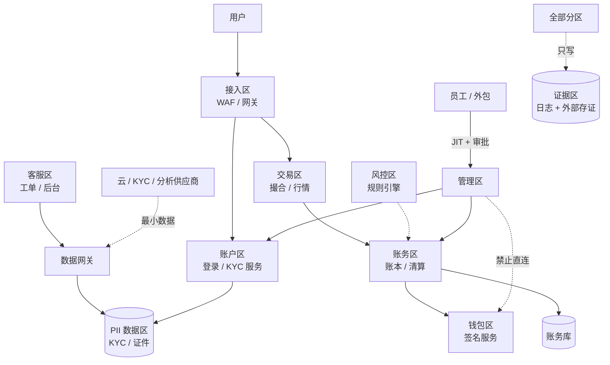
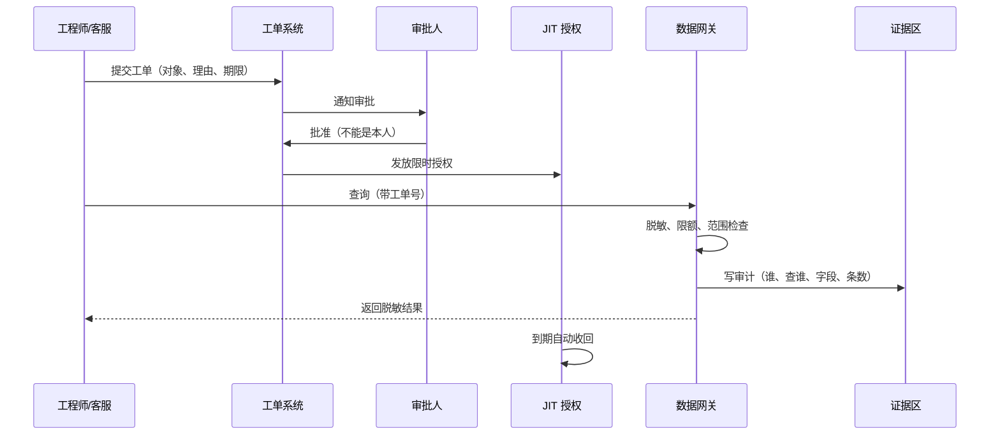
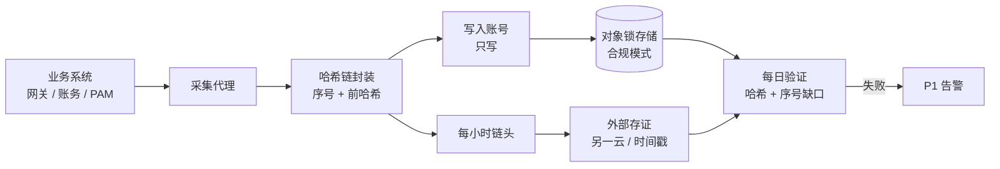
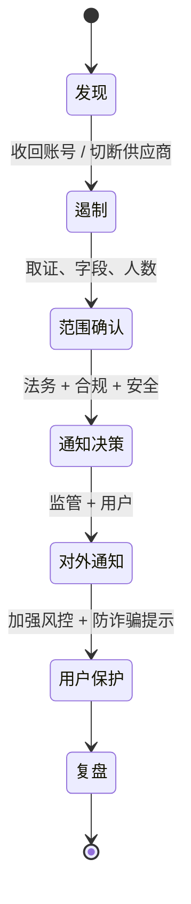

# X12 交易所生产环境与数据：核心系统保护、数据分级与可信证据

> 学习目标：读完本章，你能——
> 1. 画出交易所核心系统的分区图，并为"生产数据访问"设计一条"工单 → 审批 → 限时授权 → 留痕 → 复核"的完整链路。
> 2. 给交易所数据分级，为每一级写出加密、脱敏、导出和保留规则，并写出至少三条数据外流检测规则。
> 3. 设计一套"事后仍可信"的证据方案：日志哈希链、外部存证、不可变备份和恢复校验，并用 XDT-1 至 XDT-24 做第一轮评估。
>
> 适用角色：交易所安全工程师、平台 / SRE 工程师、数据保护官（DPO）、安全负责人。
> 前置章节：[X03 生产基础设施安全](X03-production-infra-security.md)（通用部分，本章不重复）；[X07 交易所安全架构总览](X07-cex-architecture-overview.md)；[24 数据与隐私](../24-data-privacy.md)；[21 社工与内部人](../21-social-engineering-insiders.md)
> 交互实验 / 模板：[T06 运营安全自查表](../templates/T06-ops-security-self-check.md)；[热钱包应急演练](../interactive/incident-response-sim.html)
> 最后核对：2026-11-23

> 💡 注意：全书里 `DAT-1` 至 `DAT-13` 已被 [24 章](../24-data-privacy.md) 使用。为保证前缀唯一，本章检查项使用前缀 **XDT**，控制项使用 **XDT-C**。

---

## 开场：没有人"入侵"的入侵

2025 年 5 月，Coinbase 在向美国 SEC 提交的 8-K 文件中披露：一个攻击者向美国境外的客服外包人员行贿，让他们把内部系统里的客户资料发出来。Coinbase 在文件里写道：它的安全监控在此前几个月就独立发现了这些"不当访问"，后来确认它们属于同一次行动。5 月 11 日，公司收到勒索邮件。Coinbase 拒绝付款，并估算整治与自愿赔付的成本约 1.8 亿至 4 亿美元（公司初步估算）。

没有漏洞被利用。每一次读取，都是有合法账号的人，在合法的系统里，用合法的界面完成的。

<details class="predict"><summary>🤔 先猜再看：监控在几个月前就看到了异常访问，为什么数据还是被带走了？</summary>

"看到"和"拦住"是两件事。公开资料没有披露 Coinbase 内部的告警处理细节，所以我们不能断言它漏了什么。但这个问题能帮你检查自己的系统：异常访问告警出现后，谁在多长时间内必须处理？有没有权力当场收回这个账号的访问？告警是只读的"通知"，还是能自动收紧权限的"控制"？本章第 6.5 节给出批量读取规则，并要求规则命中后自动降权。

</details>

---

## 1. 一句话理解

**交易所的生产环境和数据，是一个"人人都要用、又不能被任何一个人带走"的东西。本章的任务，是让每一次访问都有理由、有期限、有记录，并且记录本身事后仍然可信。**

> 🎯 打个比方：生产环境像银行的金库加档案室。金库有双人开门（交易、账务、钱包）。档案室的卷宗要登记才能调阅（客户数据）。监控录像存在另一栋楼，保安队长自己也删不了（日志）。
>
> 比喻的局限：档案室的卷宗一次只能看一份，数据却能被一键复制成百万份。所以数据控制不止要管"谁能进门"，还要管"带出去多少"。

本章与 X03 的分工：

| 内容 | 在哪里 |
|---|---|
| 云账号、SCP、K8s 加固、PAM、break-glass、机密管理 | [X03](X03-production-infra-security.md)，本章直接引用 INF-x |
| 交易所核心系统怎么分区、变更怎么管、生产数据谁能看 | 本章第 2、3、6.1、6.2 节 |
| 数据分级、脱敏、导出、外流检测 | 本章第 3、6.3–6.5 节 |
| 日志、时间、备份、恢复的"可信" | 本章第 6.6–6.7 节 |
| 供应商与泄露应对 | 本章第 6.8、6.9 节 |

---

## 2. 保护目标与信任边界

### 2.1 保护目标

1. **核心系统完整性**：交易、账务、钱包、风控的代码、配置和数据不能被未经授权的人改动。
2. **数据机密性**：KYC、交易、余额数据不能被批量带出。
3. **证据可信**：事故发生后，日志和备份仍然能说明"发生了什么"。
4. **可恢复**：被勒索或被破坏后，能恢复到一个"已验证正确"的状态。

### 2.2 核心系统分区与信任边界



**读图要点：**

- 业务区各自独立。账务区是"真相来源"，交易区只能请求账务区，不能直接改账。
- 客服区不直接读 PII 数据区。它通过带脱敏和限额的数据网关访问。
- 证据区只接受写入。管理区也不能删。
- 局限：图里"员工 / 外包"是一个框。外包的接入路径、设备和账号，要按第 3.3 节单独分级。

### 2.3 哪些东西不能被信任

| 对象 | 为什么不能信任 |
|---|---|
| 持有合法账号的客服和外包 | 可以被收买、被社工；2025 Coinbase 事件即是例证 |
| 运维管理员的"自觉" | 单人权限过大，事后无法证明未滥用 |
| 同一管理员保管的日志 | 攻击者拿到管理员权限后，第一件事常是删日志 |
| 没有验证过的备份 | 备份可能已被一起加密或污染 |
| 供应商的"我们很安全" | 你的数据在他们那里，你仍承担通知义务 |

---

## 3. 参考架构

### 3.1 分层与职责

| 层 | 组件 | 职责 | 为什么这样分 |
|---|---|---|---|
| 访问层 | SSO、PAM、JIT 授权服务、工单系统 | 决定"谁在什么理由下能碰什么" | 授权与使用分离 |
| 数据访问层 | 数据网关、脱敏服务、查询审计 | 业务和客服只能通过网关读数据 | 在一个点上做脱敏、限额和留痕 |
| 数据存储层 | PII 库、账务库、数据仓库 | 加密存放 | 分库使一个库泄露不扩散 |
| 变更层 | CI/CD、变更管理、配置中心 | 所有生产变更的唯一入口 | 把"人改生产"变成"流程改生产" |
| 证据层 | 日志账号、哈希链、外部存证、不可变备份 | 保存事后可信的记录 | 与业务管理员的权限完全分离 |

### 3.2 生产数据访问的标准链路



**读图要点：**

- 授权绑定到工单，工单绑定到具体用户或具体系统。授权不绑定到"人"。
- 数据网关是唯一的读取点。直接连数据库的路径被网络策略堵死。
- 审计由网关写，使用者无法跳过。
- 局限：这条链路对每天处理上万张客服工单的场景太重。所以客服的"工单内查询"用预授权：工单分配时自动授权，范围限定为该工单的用户（见 6.2 节）。

### 3.3 人员与账号分级

| 类别 | 例子 | 能访问什么 | 设备要求 |
|---|---|---|---|
| T0 核心 | 签名、账务、钱包运维 | 管理区，经 PAM | 公司专用设备 + 硬件密钥 |
| T1 内部工程 | 后端、SRE | 管理区，经 JIT | 公司管理设备 |
| T2 客服与运营 | 自营客服、合规审核 | 数据网关，脱敏视图 | 公司设备 / 虚拟桌面 |
| T3 外包 | 外包客服、标注 | 虚拟桌面，只读，限额 | 虚拟桌面，禁止下载、截屏 |
| 供应商系统 | KYC 供应商、分析工具 | 只收最小数据集 | 供应商侧另行评估 |

---

## 4. 控制清单

| ID | 控制项 | 要防什么 | 优先级 | 怎么验证 |
|---|---|---|---|---|
| XDT-C01 | 核心系统分区，业务区直连签名区的路径为 0 | 一个区失陷扩散 | P0 | 从账户区扫描签名区端口，必须全部不通 |
| XDT-C02 | 所有生产变更走流水线；至少一位非作者审批 | 单人改生产 | P0 | 抽 10 条近期变更，核对审批人不是提交人 |
| XDT-C03 | 变更窗口与冻结期；窗口外变更需升级审批 | 高峰期事故，趁乱改动 | P1 | 查近 90 天窗口外变更及审批 |
| XDT-C04 | 生产数据只能经数据网关读取 | 直连数据库批量拖库 | P0 | 用有权账号从办公网直连数据库，必须失败 |
| XDT-C05 | 客服只能查"当前工单对应用户"，默认脱敏 | 客服批量查询 | P0 | 用测试客服账号搜索非工单用户，必须失败 |
| XDT-C06 | 批量读取与导出有限额、审批和水印 | 数据被一次带走 | P0 | 尝试导出 1000 条，应被拒或进入审批 |
| XDT-C07 | 数据分级并写进数据清单，每级有加密、保留规则 | 不知道有什么数据 | P0 | 抽 5 个表，核对分级与规则落实 |
| XDT-C08 | D3 字段加密，密钥与数据分库保管 | 库被拖走即明文 | P1 | 读一份库快照，D3 列必须是密文 |
| XDT-C09 | 测试和分析环境只用脱敏数据 | 非生产环境成为泄露点 | P1 | 抽查测试库，找真实证件号 |
| XDT-C10 | 外流检测：异常查询量、异常导出、异常出站流量 | 内部人和被盗账号批量取数 | P0 | 回放第 6.5 节构造数据，规则必须命中 |
| XDT-C11 | 规则命中后自动降权，再人工复核 | 告警被"晚一点再看" | P1 | 触发命中，测量降权用时 |
| XDT-C12 | 日志写入独立账号，只写，开启对象锁 | 攻击后删日志 | P0 | 用管理员账号删除日志，必须失败并告警 |
| XDT-C13 | 日志哈希链，链头定期锚定到外部 | 日志被悄悄改写 | P1 | 改一条旧日志，验证脚本必须报错 |
| XDT-C14 | 全部系统时间同步，偏差告警 | 事件顺序无法还原 | P1 | 把一台测试机拨快 5 分钟，应告警 |
| XDT-C15 | 日志访问分权：读者不能改，存储管理员不能读内容 | 管理员既当球员又当裁判 | P1 | 角色矩阵与实测 |
| XDT-C16 | 不可变备份（对象锁 / 离线副本），与生产账号隔离 | 勒索软件连备份一起加密 | P0 | 用生产管理员尝试删除备份，必须失败 |
| XDT-C17 | 每季度恢复演练，并做数据可信校验 | 备份无法恢复或被污染 | P0 | 演练报告，含校验结果与用时 |
| XDT-C18 | 供应商清单，含数据范围、访问方式、通知时限 | 供应商泄露而不自知 | P0 | 采购、SSO、出站流量三方对账 |
| XDT-C19 | 供应商最小数据，优先令牌化或脱敏 | 供应商成为数据池 | P1 | 抽 3 家，对比实际字段与合同范围 |
| XDT-C20 | 数据泄露响应手册，含通知时限矩阵 | 通知超时、说法前后不一 | P0 | 桌面推演，计时 |
| XDT-C21 | 离职、调岗当日回收访问；外包合同到期自动失效 | 前员工、过期外包仍有访问 | P0 | 抽 10 名离职者，核对停用时间 |
| XDT-C22 | 个人设备不得接触生产与 D2 以上数据；外包用虚拟桌面 | 终端成为拖库通道 | P1 | 个人设备接入测试必须失败（见 X03 INF-22） |

---

## 5. 分级落地

| 档位 | 适用 | 做什么 | 投入（示例） |
|---|---|---|---|
| 最小可行 | 小型交易所，安全 1–3 人 | XDT-C01、C02、C04、C05、C07、C12、C16、C21 | 1–2 人 × 3 个月 |
| 标准 | 中型交易所，有独立安全团队 | 最小可行 + C03、C06、C08、C10、C13、C14、C17、C18、C20 | 3–5 人 × 6 个月 |
| 成熟 | 大型 / 持牌交易所 | 全部控制项 + 数据网关全覆盖、外部存证、恢复自动化校验、供应商持续监控 | 5–8 人 × 12 个月，持续运营 |

> 💡 注意：人数与时间为示例，取决于现有基础设施成熟度。顺序建议：先"看清"（C07 数据清单），再"堵路"（C04、C05），再"取证"（C12、C13），最后"恢复"（C16、C17）。

---

## 6. 落地做法

### 6.1 核心系统隔离与变更控制

1. 画出分区图（第 2.2 节），标出每条边的协议、端口和负责人。
2. 对每对分区写"允许清单"，默认拒绝。X03 的 NetworkPolicy 示例直接复用。
3. 所有生产变更只来自流水线。工程师没有常驻的生产写权限。
4. 在变更系统里写入窗口与审批规则。示例策略（Rego，示意）：

```rego
# 示例：生产变更准入策略（OPA / Rego，示意）
package change.prod

default allow = false

allow {
  input.env == "prod"
  count(input.approvers) >= 2              # 至少两位审批人
  not input.author in input.approvers      # 作者不能自批
  in_window
  tier_ok
}

in_window {
  input.in_change_window == true           # 由变更系统按日历计算：示例为工作日 10:00-16:00
}

tier_ok { input.risk_tier != "critical" }
tier_ok {                                  # 关键变更（账务、签名、风控规则）
  input.risk_tier == "critical"
  "security-lead" in input.approver_roles
  not input.peak_hours
}
```

常见坑：

- 紧急变更通道没有限制，变成日常通道。要求紧急变更 24 小时内补审，并每月统计占比。
- 审批人只点"同意"。审批界面要展示差异（diff）和影响范围，审批记录写入证据区。
- 数据库结构变更（DDL）和数据修复（手工 SQL）没有进流水线。把它们纳入，手工 SQL 必须双人复核并保存原文。

### 6.2 生产数据访问审批

沿用第 3.2 节的链路。

| 场景 | 授权方式 | 期限 | 范围 |
|---|---|---|---|
| 客服处理工单 | 工单分配时自动授权 | 工单关闭或 24 小时 | 该工单的用户，脱敏视图 |
| 工程师排障 | JIT，需非作者审批 | 最长 4 小时 | 指定系统，默认无 PII |
| 合规 / 调查取数 | 工单 + 合规负责人批准 | 按任务 | 指定用户或时间段 |
| 全量导出（审计、监管） | 安全负责人 + 数据负责人双批 | 单次 | 只写入受控导出区，不到个人设备 |

> ⚠️ 警告：不要用"全员只读账号"解决排障需求。全员只读，等于全员都能拖库。

### 6.3 数据分级与处理规则

先写清单，再谈保护。示例分级配置（YAML，示意）：

```yaml
# 示例：数据分级与处理规则
classes:
  D4_secret:        # 密钥材料、签名相关
    examples: ["HSM 配置", "MPC 分片元数据", "机密平台根令牌"]
    storage: "HSM / MPC，不入通用库"
    access: "T0，PAM + 双人"
    export: "禁止"
  D3_restricted:    # 可直接造成用户伤害或监管事件
    examples: ["证件图像", "证件号", "人脸模板", "完整地址", "银行账号"]
    storage: "字段级加密；密钥与数据分库"
    access: "KYC 审核、合规；经数据网关，默认脱敏"
    export: "审批 + 水印 + 受控导出区"
    retention: "按监管最短要求；到期自动删除并记录"
  D2_confidential:  # 交易与余额记录
    examples: ["余额快照", "订单与成交", "充提记录", "客服工单正文"]
    storage: "加密存储；分析区用令牌化用户 ID"
    access: "按岗位；查询审计"
    export: "限额；分析区只出聚合"
  D1_internal:      # 内部文档、培训材料、运营报表
    examples: ["内部手册", "客服话术", "组织架构"]
    access: "员工"
    export: "不得公开发布"   # 客服话术也会被诈骗者利用
```

做法：

1. 对每张表、每个存储桶、每个日志流写出级别。没写的，默认 D3。
2. **脱敏规则**写在数据网关，不写在每个前端。例：证件号只显示后 4 位；余额只显示区间；地址只显示城市。
3. **分析区**使用令牌化用户 ID（映射表存在另一个系统）。原始 ID 不进数据仓库。
4. **删除**要覆盖日志、备份、数据仓库和第三方副本，清单见 24 章 DAT-12。

> 💡 注意：客服话术和培训材料也要保护。Coinbase 的 8-K 提到被取走的数据含"客服人员可访问的培训材料和通信"。攻击者拿到话术，冒充客服会更像。

### 6.4 加密与密钥

1. 静态加密（磁盘 / 存储层）是底线。它防丢盘，防不了有权账号。
2. D3 数据做字段级加密：在应用层加密，密钥由 KMS / HSM 管理。数据库管理员看到密文，看不到明文。
3. 密钥与数据分账号保管。密钥管理员不能读数据，数据管理员不能用密钥（对应 X03 的 INF-18）。
4. 对称密钥定期轮换并支持重加密。轮换演练计入季度节奏。

> 💡 注意：字段级加密挡不住"有权账号在应用里正常查询"。这由 6.5 节的外流检测负责。

### 6.5 外流检测规则

三条示例规则（Sigma 风格，示意；字段名按自己的日志调整）。

**规则 1：单个客服账号读取量突增**

```yaml
title: Support agent bulk customer record reads
status: experimental
logsource: { product: data_gateway, service: query_audit }
detection:
  selection:
    role: "support"
    data_class: ["D3_restricted", "D2_confidential"]
  timeframe: 1h
  condition: selection | count(target_user_id) by actor > 40   # 示例阈值
falsepositives:
  - 大促或事故期间的工单高峰
  - 新入职客服批量处理积压工单
tuning: >
  阈值按岗位基线定：取该岗位 30 天 P99 的 2 倍。
  与工单系统联动：有对应 ticket_id 的查询降一级。
response: "自动降为只读脱敏视图；通知值班和客服主管"
```

**规则 2：查询的用户与工单无关**

```sql
-- 示例：被查用户不在该客服名下任何开放工单中
SELECT q.actor, COUNT(*) AS n
FROM query_audit q
LEFT JOIN tickets t
  ON t.user_id = q.target_user_id
 AND t.assignee = q.actor
 AND t.status IN ('open','pending')
WHERE q.role = 'support'
  AND q.ts > now() - interval '1 hour'
  AND t.user_id IS NULL
GROUP BY q.actor
HAVING COUNT(*) >= 5;   -- 示例阈值
-- 假阳性：转接工单、历史工单回看。调优：把"转接"和"回看"写成工单状态，而不是放宽阈值。
```

**规则 3：数据仓库批量导出**

```yaml
title: Warehouse bulk export of restricted data
logsource: { product: data_warehouse, service: audit }
detection:
  selection:
    action: ["EXPORT", "UNLOAD", "COPY_TO_EXTERNAL"]
    table_class: ["D3_restricted", "D2_confidential"]
  filter_approved:
    export_ticket_approved: true
  condition: selection and not filter_approved
falsepositives: ["计划内监管报送任务（应绑定审批工单）"]
```

自动降权的边界：

- 可以自动：降为只读脱敏、暂停导出、要求二次认证。
- 必须人工：停用账号、联系外包公司、通知监管。

> 🧪 动手验证：做第 13 节练习 B，用构造数据回放规则 1 和 2。

### 6.6 日志可信：哈希链与外部存证

日志在事故后最有价值，也最容易被改。做法：

1. 日志写入独立账号。写入角色只有 PutObject，没有 Delete。存储桶开启对象锁（合规模式，保留期按监管与内部要求设定）。X03 的 INF-4 已给出基础。
2. 写入前给每条记录加序号和前一条的哈希，形成哈希链。
3. 每小时把链头哈希发到外部：另一家云、公证 / 时间戳服务，或监管可访问的存证服务。
4. 每天跑验证脚本。验证失败即 P1 告警。

示例脚本（Python，示意）：

```python
# 示例：简化的日志哈希链。生产环境应由日志管道写入，而不是业务代码
import hashlib, json

def _digest(prev: str, seq: int, record: dict) -> str:
    body = json.dumps(record, sort_keys=True, separators=(",", ":"))
    return hashlib.sha256(f"{prev}|{seq}|{body}".encode()).hexdigest()

def chain_append(prev_hash: str, seq: int, record: dict) -> dict:
    return {"prev": prev_hash, "seq": seq, "record": record,
            "hash": _digest(prev_hash, seq, record)}

def chain_verify(entries: list[dict], genesis: str):
    """返回第一条异常记录的下标；全部通过返回 None"""
    prev = genesis
    for i, e in enumerate(entries):
        ok = (e["prev"] == prev and e["seq"] == i
              and e["hash"] == _digest(prev, i, e["record"]))
        if not ok:
            return i
        prev = e["hash"]
    return None
```

读这段代码要注意：

- 攻击者若能改全部后续记录并重算哈希，单靠哈希链仍可伪造。所以必须把链头发到攻击者控制不到的外部（步骤 3）。
- 云厂商的日志完整性功能（例如 CloudTrail 的日志文件验证，用签名摘要文件校验）可作底层。业务日志仍需自己做链。
- 哈希链只证明"未被改"。序号能暴露"被删"。



**读图要点：**

- 日志经一次封装，再经只写账号落入对象锁存储。
- 外部存证是"第二把尺子"。存储被攻破时，用它比对。
- 验证失败有两种原因：被篡改，或采集丢失。两种都要查。
- 局限：这套方案防事后篡改。事发时日志管道被停掉，要靠"日志停止"告警（第 7 节）。

时间同步：

1. 全部主机和服务使用 2–3 个内部时间源，内部源再同步到可信外部源。
2. 日志同时记录事件时间 `ts` 和采集时间 `ingest_ts`。偏差超过阈值（示例：2 秒）告警。
3. 事故时间线以 UTC 为准，附上时间源状态。

日志访问分权：

| 角色 | 能做 | 不能做 |
|---|---|---|
| 日志管道运维 | 管理存储、保留策略 | 读取日志内容 |
| 安全分析 | 读取、查询 | 改保留策略、删除 |
| 业务管理员 | 无 | 读写证据区 |
| 审计 / 合规 | 只读副本 | 其他 |

### 6.7 备份与恢复

1. 备份写入隔离账号，使用对象锁或离线介质。生产管理员无法删除或缩短保留期。
2. 备份分类：账务库、PII 库、配置与代码、密钥元数据。密钥材料的备份遵循 X03 与 [18 章](../18-wallet-key-management.md)，不放进本章的备份系统。
3. 恢复演练每季度一次，在隔离环境进行。
4. **恢复后先校验，再上线。** 示例校验框架（Bash，示意）：

```bash
#!/usr/bin/env bash
# 示例：恢复后账务库的可信校验（框架）。变量与命令按自己环境调整
set -euo pipefail
RESTORE_DB="ledger_restore"                    # 隔离环境里的恢复库
ANCHOR_FILE="anchors/ledger_$(date -u +%F).sha256"   # 从外部存证取回的日终摘要

# 1. 日终余额摘要与外部存证一致？
LOCAL=$(psql -tA -d "$RESTORE_DB" -c "SELECT encode(digest(string_agg(user_id||':'||asset||':'||balance, ',' ORDER BY user_id, asset),'sha256'),'hex') FROM balances;")
[ "$LOCAL" = "$(cat "$ANCHOR_FILE")" ] || { echo "FAIL: 余额摘要与外部存证不一致"; exit 1; }

# 2. 借贷平衡：每种资产的流水之和必须为 0
BAD=$(psql -tA -d "$RESTORE_DB" -c "SELECT asset FROM journal GROUP BY asset HAVING SUM(amount) <> 0;")
[ -z "$BAD" ] || { echo "FAIL: 借贷不平 $BAD"; exit 1; }

# 3. 与链上热 / 冷钱包余额对账（只读对账脚本，示意）
./reconcile_onchain.sh --db "$RESTORE_DB" --max-diff-bps 1

echo "OK: 恢复库通过校验，可进入上线审批"
```

要点：

- 校验依据来自**恢复库之外**：外部存证的摘要、链上余额。不能用被恢复的数据校验自己。
- 勒索事件中，先确认"备份在入侵之前"：把日志起点与已知入侵时间线比较，选最后一个可信恢复点。
- 恢复上线的批准人，不是执行恢复的人。

### 6.8 第三方与供应商

1. 建清单：云、KYC / 人脸识别、客服系统、邮件 / 短信、分析工具、监控、外包公司。每家记录：拿走哪些字段、通过什么方式、联系人、合同通知时限。
2. 对账：采购系统、SSO 应用列表、出站流量日志三方比对，找出未登记的数据流。
3. 最小数据：能发令牌就不发原值；能发 D1 就不发 D2。
4. 持续监控：供应商安全公告、暗网售卖、证书与域名变化。
5. 合同：写明泄露通知时限（建议 24–48 小时内，示例）、审计权、子处理方清单、退出时的数据删除证明。

### 6.9 数据泄露应对

总流程见 [24 章](../24-data-privacy.md) 第 4.4 节。本章补充交易所特有的部分。



**读图要点：**

- "遏制"在"通知决策"之前。先止血，再决定怎么说。遏制的同时保全日志快照。
- "范围确认"依赖证据区。证据不可信，范围只能往大了估。
- 通知时限因法域而异。通用做法举例：欧盟 GDPR 要求在知悉后 72 小时内通知监管机构（构成风险时）；美国上市公司在确定事件"重大"后四个工作日内提交 8-K（SEC Item 1.05）；纽约州金融服务署 NYDFS 第 500 部分要求在确定事件后 72 小时内通知。截至 2026 年公开资料如此，实施前请法务核对最新条款。
- 局限：本章不构成法律意见。

通知决策矩阵（示例）：

| 项目 | 内容 |
|---|---|
| 需要决定 | 是否通知监管、是否通知用户、通知文本、是否公告 |
| 决策人 | 安全负责人（事实）、法务（义务）、合规（监管沟通）、公关（文本）、CEO（最终） |
| 决策时间窗 | 示例：发现后 4 小时内形成初判；24 小时内确定首次口径 |
| 用户保护 | 对受影响用户启用提币延迟、异常登录拦截；公开"我们永远不会做的事"清单 |

---

## 7. 运营：指标、告警、值班、演练、季度节奏

### 7.1 指标

| 指标 | 说明 | 示例目标 |
|---|---|---|
| 敏感数据查询的有工单占比 | 有 ticket_id 的查询 / 全部敏感查询 | ≥ 99% |
| 导出审批率 | 经审批的导出 / 全部导出 | 100% |
| 外流告警降权用时 | 告警到降权生效 | ≤ 5 分钟（自动） |
| 日志哈希链验证通过率 | 每日验证通过次数 / 总次数 | 100%；失败 1 次即复盘 |
| 时间偏差超阈值主机数 | 超阈值主机 | 0 |
| 恢复演练 | 实际用时与校验是否通过 | 满足业务 RTO，校验通过 |
| 离职账号停用时效 | 离职到停用 | 当日 |
| 供应商清单对账差异 | 未登记数据流数量 | 0 |

### 7.2 告警（示例）

| 告警 | 级别 | 响应 |
|---|---|---|
| 日志管道停止或序号缺口 | P1 | 当班安全；查是否人为停止 |
| 哈希链验证失败 | P1 | 保全副本；启动取证 |
| 证据区出现删除或策略变更尝试 | P1 | 通知安全负责人 |
| 客服账号批量读取（规则 1 / 2） | P2 | 自动降权；主管复核 |
| 非审批导出（规则 3） | P2 | 阻断；联系数据负责人 |
| 备份任务连续 2 次失败 | P2 | 平台团队当日处理 |
| 时间偏差超阈值 | P3 | 平台团队 |

### 7.3 季度节奏

| 周 | 动作 |
|---|---|
| 第 1–2 周 | 权限复核：T0–T3 清单、外包名单、离职对账 |
| 第 3–4 周 | 规则调优：假阳性复盘，更新基线 |
| 第 5–6 周 | 恢复演练：选一个库，完整恢复并跑可信校验 |
| 第 7–8 周 | 证据演练：改一条旧日志，验证能否发现 |
| 第 9–10 周 | 供应商复核：清单对账，抽 3 家核查数据范围 |
| 第 11–12 周 | 泄露桌面推演（练习 D）；向管理层汇报 |

---

## 8. 失效案例

以下均为公开报道的真实事故。金额为公司估算或事发时估值。归因写"公开报道归因于"。

### 8.1 Coinbase：外包客服被收买（2025 年 5 月）

- **事实**：Coinbase 在 2025 年 5 月 15 日的 8-K 中披露：攻击者向美国境外的客服合同工 / 员工行贿，取得内部系统里的客户资料；监控此前已独立发现不当访问，后确认属于同一次行动；5 月 11 日公司收到勒索邮件。被取走的数据包括姓名、地址、电话、邮箱、脱敏的社保号后四位、脱敏的银行账号、证件图像、余额快照与交易记录，以及客服可见的培训资料。没有密码和私钥被取走，涉事人员无法动用客户资金。公司拒绝支付勒索金，初步估算整治与自愿赔付成本约 1.8 亿至 4 亿美元。媒体据其后向缅因州总检察长提交的通知报道，受影响个人为 69,461 人，活动自 2024 年 12 月 26 日起。
- **绕过的控制**：XDT-C05、C06、C10、C11、C21。
- **教训**：合法账号、合法界面的批量读取，最难靠边界防御发现。要靠"查询必须绑定工单"、限额和行为基线。发现异常后，要有当场收紧权限的能力。数据泄露的主要成本在后续赔付，而不是数据本身。
- **来源类型**：上市公司监管文件与媒体报道（Coinbase 8-K；SecurityWeek、The Register 等对缅因州通知的报道）。

### 8.2 Kroll：一次 SIM 劫持，破产案债权人数据暴露（2023 年 8 月）

- **事实**：Kroll 是 FTX、BlockFi、Genesis 等破产案的债权人服务商。Kroll 称，2023 年 8 月 19 日发现，攻击者通过 SIM 劫持，把一名员工的手机号转到自己控制的 SIM 卡上。FTX 称被访问的是部分债权人的"非敏感"数据；公开报道称包括姓名、地址、邮箱和债权详情，受影响人数没有公开。各来源对攻击者访问了多少案件的说法不完全一致，本章不做推断。
- **绕过的控制**：XDT-C18、C19、C22。
- **教训**：你的用户数据可能存放在你没想到的服务商那里。一个供应商员工的手机号被劫持，就可能影响多家客户。供应商尽调要问：员工账号是否仍用短信验证？账号恢复流程如何？
- **来源类型**：媒体报道与公司声明转述（SecurityWeek、BankInfoSecurity、Bloomberg）。本章没有取得 Kroll 的完整原始通知，细节以其官方页面为准。

### 8.3 Trezor：第三方客服工单系统被访问（2024 年 1 月）

- **事实**：Trezor 称，2024 年 1 月 17 日，一个未授权方访问了其第三方客服工单系统。可能暴露的是自 2021 年 12 月以来联系过客服的用户的姓名或昵称与邮箱，最多约 66,000 人。Trezor 称没有用户资金被动用；攻击者向 41 名用户发过询问助记词的邮件，没有人泄露助记词。公开报道没有确认供应商名称。
- **绕过的控制**：XDT-C18、C19、C20。
- **教训**：客服工单数据说明"这个人是你的用户"，对诈骗者价值很高，却常被忽视。事发后迅速发出明确的防诈骗提示，是减小损失的关键一步。
- **来源类型**：公司声明与媒体报道（BleepingComputer、Forklog）。

### 8.4 Ledger：电商与营销数据外流（2020 年）

- **事实**：2020 年 12 月，约 272,000 名客户的营销与电商数据（姓名、邮箱、电话、地址、所购产品类型）在 RaidForums 上被公布，不含支付信息。公开报道称，Ledger 此前已在 7 月通过赏金渠道收到研究员关于第三方 API 密钥配置错误的报告。Ledger 另称，Shopify 在 12 月 23 日通知它：Shopify 有员工曾导出商家的客户数据库。各方对泄露路径的说法并不一致，本章不确定归因。后续有针对 Ledger 与 Shopify 的集体诉讼。
- **绕过的控制**：XDT-C07、C09、C18、C19。
- **教训**：购买记录暴露"谁持有硬件钱包、住在哪里"，之后被用于针对性钓鱼与实体威胁（见 [24 章](../24-data-privacy.md)）。收到赏金报告并修复后，要核实是否已有数据被取走。
- **来源类型**：媒体报道与公司说明（Cointelegraph、The Block、Ledger 官方页面、INCIBE-CERT）。归因有争议。

### 8.5 Bithumb：员工家用电脑上的客户数据库（2017 年 7 月）

- **事实**：Bithumb（韩国交易所）称，客户信息库是从一名员工的家用电脑被盗的，公司内部网络没有被入侵。公开报道的受影响数量为 30,000 余人（一份泄露追踪报告写作 31,800 人），数据为姓名、手机号和邮箱，密码未被盗。媒体称其后出现针对用户的诈骗。Bithumb 称将给受影响用户每人 10 万韩元补偿。损失总额各方说法不一，本章不引用。
- **绕过的控制**：XDT-C06、C07、C22。
- **教训**：数据一旦被带出办公网络、存放在无管控的设备上，所有边界防御都失去意义。"禁止个人设备与导出"要靠工具强制，不能只靠制度。
- **来源类型**：媒体报道（Dark Reading、The Register、eSecurity Planet、SC Media）。

### 8.6 案例与控制映射

| 案例 | 保护域 | 关键控制 |
|---|---|---|
| Coinbase 2025 | 数据 / 内部人 | XDT-C05、C06、C10、C11 |
| Kroll 2023 | 供应商 | XDT-C18、C19 |
| Trezor 2024 | 供应商 / 客服数据 | XDT-C18、C20 |
| Ledger 2020 | 数据清单 / 第三方 | XDT-C07、C19 |
| Bithumb 2017 | 终端 / 导出 | XDT-C06、C22 |

> 💡 注意：资金被盗类事故（Bybit、DMM 等）已在 [X03](X03-production-infra-security.md) 与 [X07](X07-cex-architecture-overview.md) 复盘，这里不重复。

---

## 9. 评估检查点

- [ ] **XDT-1** 有核心系统分区图，业务区到签名区的直连路径为 0（实测）。
- [ ] **XDT-2** 所有生产变更经流水线；抽 10 条，作者与审批人不是同一人。
- [ ] **XDT-3** 有变更窗口与冻结期，窗口外变更有升级审批和统计。
- [ ] **XDT-4** 手工 SQL 与数据修复纳入变更管理，原文留存，双人复核。
- [ ] **XDT-5** 生产数据只能通过数据网关读取，直连数据库的路径已堵死（实测）。
- [ ] **XDT-6** 客服默认脱敏视图，只能查当前工单对应用户（实测）。
- [ ] **XDT-7** 授权带期限并自动到期，没有全员常驻只读账号。
- [ ] **XDT-8** 批量读取与导出有限额、审批和水印，导出只到受控区。
- [ ] **XDT-9** 有数据清单，每张表、存储桶和日志流有分级；未分级默认 D3。
- [ ] **XDT-10** D3 数据字段级加密，密钥与数据分账号保管。
- [ ] **XDT-11** 测试、分析环境不含真实证件号等 D3 数据（抽查）。
- [ ] **XDT-12** 有批量读取、无工单查询、批量导出三条检测规则，回放通过。
- [ ] **XDT-13** 规则命中可自动降权，降权用时已测量。
- [ ] **XDT-14** 日志写入独立账号，开启对象锁，管理员删除测试失败并告警。
- [ ] **XDT-15** 日志有哈希链和序号，每日验证，链头定期发往外部。
- [ ] **XDT-16** 时间同步有告警，事故时间线以 UTC 为准。
- [ ] **XDT-17** 日志访问分权：读者不能改，存储管理员不能读内容。
- [ ] **XDT-18** 备份不可变，生产管理员无法删除（实测）。
- [ ] **XDT-19** 每季度做恢复演练，含数据可信校验，批准人不是执行人。
- [ ] **XDT-20** 有供应商清单（字段、方式、通知时限），并与采购、SSO、出站流量对账。
- [ ] **XDT-21** 供应商只接收最小数据，合同含通知时限、审计权和删除证明。
- [ ] **XDT-22** 有数据泄露响应手册和通知时限矩阵，每年至少推演一次。
- [ ] **XDT-23** 离职、调岗当日回收访问；外包合同到期自动失效（抽 10 人）。
- [ ] **XDT-24** 个人设备无法接触生产和 D2 以上数据；外包使用虚拟桌面。

**把检查结果写进报告：**

| 检查项 | 发现时的证据 | 常见定级（用 [A02](../assessment/A02-risk-rating-reporting.md) 复核） | 练习位置 |
|---|---|---|---|
| XDT-1 至 XDT-4 | 分区图、连通性测试、变更记录抽样 | High（签名区可直连时为 Critical） | [X03](X03-production-infra-security.md) |
| XDT-5 至 XDT-8 | 网关配置、客服账号测试、导出日志 | High | [21 章](../21-social-engineering-insiders.md)、[24 章](../24-data-privacy.md) |
| XDT-9 至 XDT-11 | 数据清单、库快照、测试库抽查 | High / Medium | [T06](../templates/T06-ops-security-self-check.md) |
| XDT-12、XDT-13 | 规则文件、回放结果、降权记录 | High | [X05](X05-detection-response-engineering.md) |
| XDT-14 至 XDT-17 | 删除测试、验证脚本输出、时间偏差日志 | High | [A06 运营与密钥安全](../assessment/A06-operational-key-security.md) |
| XDT-18、XDT-19 | 删除测试、恢复演练报告 | High | [X06](X06-resilience-validation.md) |
| XDT-20、XDT-21 | 供应商清单、对账记录、合同条款 | High / Medium | [A03](../assessment/A03-exchange-contracts-wallets.md) |
| XDT-22 | 响应手册、推演记录 | Medium | [25 章](../25-fund-tracing-response.md) |
| XDT-23、XDT-24 | 离职抽样、终端策略 | High | [X03](X03-production-infra-security.md) |

发现按 [T03 报告模板](../templates/T03-finding-report.md) 记录。报告里不写真实用户数据，只写字段名和数量。

---

## 10. 上手路径

**第一周**

1. 列出你负责的系统里最敏感的 5 张表，写出谁能读、怎么读。
2. 拿一个测试客服账号，尝试搜索一个不在它名下的用户。记录结果。
3. 用管理员测试账号尝试删除一条日志和一份备份。记录结果。
4. 找到数据泄露响应手册。若没有，记下"没有"。

**第一个月**

1. 建数据清单（XDT-9）初版，先覆盖 D3。
2. 画核心系统分区图（第 2.2 节），拿网络策略对一遍。
3. 上线规则 1 与规则 3，先只告警。
4. 做一次供应商清单对账（采购、SSO、出站流量）。
5. 在测试环境跑日志哈希链原型（6.6 节），验证"改一条日志即报错"。

**第一个季度**

1. 数据网关上线，客服默认脱敏，直连路径关闭。
2. 规则命中自动降权上线。
3. 完成一次恢复演练并通过可信校验。
4. 完成一次泄露桌面推演，修订手册。
5. 把 XDT-1 至 XDT-24 的第一轮评估结果交给安全负责人。

---

## 11. 常见误区

| 误区 | 实际情况 |
|---|---|
| "加密了就安全" | 字段级加密挡不住有权账号在应用里正常查询。要靠网关限额与行为检测 |
| "日志在 SIEM 里，所以可信" | SIEM 管理员能删能改。要靠只写、对象锁、哈希链和外部存证 |
| "有备份就能恢复" | 没演练过的备份不算备份；没校验的恢复可能把污染数据一起恢复 |
| "外包签了保密协议就行" | 协议拦不住被收买的个人。要靠访问范围、设备、监控和限额 |
| "哈希后的数据不是个人数据" | 取值范围小的数据（邮箱、手机号）可被枚举，见 [24 章](../24-data-privacy.md) |
| "告警了就是安全" | 告警要有处理时限和自动收紧的能力，否则只是"事后证明" |
| "客服话术不算敏感" | 攻击者靠话术把冒充客服演得更像 |

---

## 12. 术语表

| 术语 | 英文 | 定义 |
|---|---|---|
| 数据网关 | Data Gateway | 业务读取生产数据的唯一入口，负责脱敏、限额和审计 |
| 字段级加密 | Field-level Encryption | 在应用层加密某些字段，数据库中只有密文 |
| 令牌化 | Tokenization | 用随机令牌代替原值，映射关系存在另一个系统 |
| 数据防泄露 | DLP, Data Loss Prevention | 检测和阻止敏感数据被带出的控制 |
| 哈希链 | Hash Chain | 每条记录包含前一条的哈希，改一条会破坏后面所有哈希 |
| 对象锁 | Object Lock | 存储对象在保留期内不能被删除或覆盖 |
| 外部存证 | External Anchoring | 把摘要写到攻击者控制不到的外部系统 |
| 不可变备份 | Immutable Backup | 在保留期内无法被修改或删除的备份 |
| 恢复点目标 | RPO | 能接受丢失多长时间的数据 |
| 恢复时间目标 | RTO | 从故障到恢复服务能接受的最长时间 |
| 数据保护官 | DPO, Data Protection Officer | 负责数据保护合规的角色 |
| 子处理方 | Sub-processor | 供应商再使用的下游服务商 |
| 变更窗口 | Change Window | 允许对生产做变更的时间段 |

---

## 13. 动手练习与思考题

### 13.1 动手练习（笔记本完成）

**练习 A：画分区图与数据清单（40 分钟）。** 为一家有"登录、KYC、撮合、账务、签名、客服、数据仓库"的交易所，画出分区图，并给 15 张示例表分级（D1–D4）。标出哪些表必须字段级加密。

**练习 B：规则回放（30 分钟）。** 下面是 8 行示例查询审计。用规则 1（阈值改为 4 个不同用户 / 小时）和规则 2（阈值改为 3 次）找出异常，并写出各自的假阳性。

```text
actor  ts     target  ticket
a17    10:02  u101    T-9001
a17    10:05  u102    -
a17    10:07  u103    -
a17    10:08  u104    -
a17    10:09  u105    -
a21    10:15  u200    T-9100
a21    10:40  u200    T-9100
a33    11:01  u300    T-9300
```

提示：区分"没有工单号"和"工单不属于该客服"。

**练习 C：改日志（30 分钟）。** 用 6.6 节的 Python 代码，生成 20 条链，改第 7 条的内容，运行验证，写出输出。再删除第 9 条，运行验证，说明为什么需要序号。

**练习 D：推演（30 分钟）。** 场景：周六凌晨，监控发现某外包客服账号在 2 小时内读取了 3,000 个用户的 D3 数据，随后收到匿名邮件要求付款。写出你的前 5 个动作、通知清单、要保存的证据，以及"何时通知监管"的决策依据。

建议配套（后续在 L3 训练营实现）：一个读取查询审计 CSV、回放 6.5 节规则并输出命中与假阳性的小脚本；一个日志哈希链生成与验证工具。

### 13.2 思考题

1. Coinbase 的 8-K 说监控此前已发现异常访问。如果你负责这个监控，"自动降权"应在什么阈值触发？误触发的代价怎样控制？
2. 你的团队想建一个"备份账号"，定期把全部库复制到对象存储，而生产管理员也有这个账号的权限。这会削弱哪些控制？怎样改？
3. 哈希链加外部存证能证明日志没被改。它证明不了什么？举出两种仍可能误导调查的情形。

下一章：[X13 反欺诈、合规与安全运营](X13-cex-fraud-compliance-secops.md) —— 把数据和证据用起来：监测、处置权限、取证与恢复。

---

来源（独立查证，截至 2026-11-23）：

- Coinbase Form 8-K（2025-05-15，SEC EDGAR）；SecurityWeek、The Register 对缅因州通知（69,461 人）的报道。
- Kroll 2023 年事件：SecurityWeek、BankInfoSecurity、Bloomberg、SecurityAffairs 报道。
- Trezor 2024 年 1 月事件：BleepingComputer、Forklog 报道。
- Ledger 2020 年事件：Cointelegraph、The Block、INCIBE-CERT、Ledger 官方页面。
- Bithumb 2017 年事件：Dark Reading、The Register、eSecurity Planet、SC Media。
- 时限示例（GDPR 72 小时、SEC 8-K 四个工作日、NYDFS 72 小时）为通用做法概述，实施前请法务核对最新条款。
