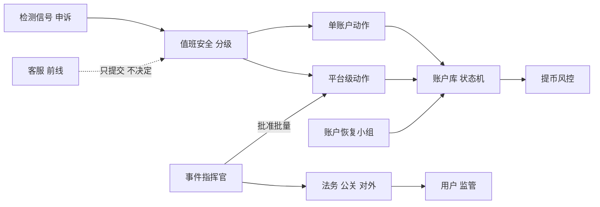
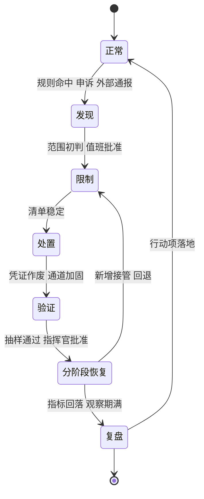
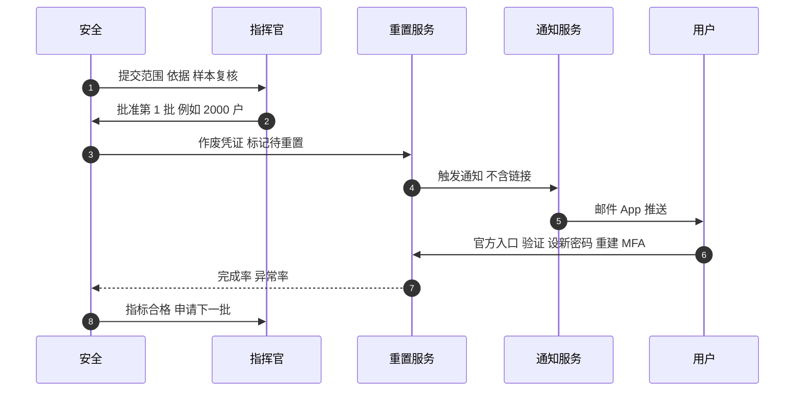
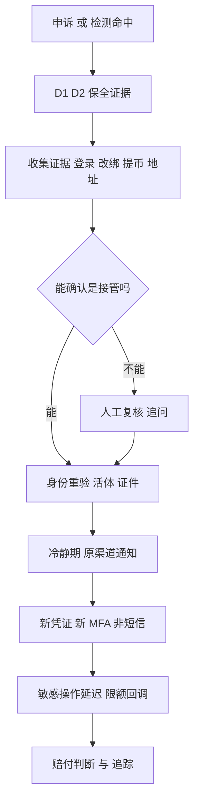

# X15 客户身份与访问·运营与恢复：接管事件、批量重置与账户恢复

> 学习目标：读完本章，你能——
> 1. 把账户接管事件分成五类、四级，并说清每一级谁有权冻结、强制登出、重置、撤销 API Key。
> 2. 设计一次批量重置：怎样圈定范围、怎样分批、怎样发通知又不制造新的钓鱼窗口。
> 3. 写出被盗账户的恢复流程与客服话术边界，并在笔记本上完成一次 30–45 分钟桌面推演。
>
> 适用角色：交易所安全运营、账户与身份团队、客服运营主管、风控与合规负责人、事件指挥官
> 前置章节：[X08 客户身份、账户与访问](X08-cex-identity-account-access.md)（设计）、[X05 检测与响应工程](X05-detection-response-engineering.md)、[X06 韧性与验证](X06-resilience-validation.md)、[X13 反欺诈、合规与安全运营](X13-cex-fraud-compliance-secops.md)
> 相关章节：[X14 客户身份与访问·工程验收](X14-cex-identity-verification.md)、[22 人身与账号安全](../22-physical-account-security.md)、[24 数据与隐私](../24-data-privacy.md)、[T09 事件手册与值班模板](../templates/T09-incident-runbook-oncall.md)
> 交互实验 / 模板：[T07 员工防社工清单](../templates/T07-staff-anti-social-engineering.md)；本章第 4 节决策矩阵与第 7 节清单可直接改写
> 最后核对：2026-11-23

---

## 开场：周一凌晨的两条曲线

一家虚构的交易所（示例）周一 02:10，值班安全看到两条曲线同时上升。第一条是登录失败数，是平时的 30 倍，来自上万个 IP。第二条是"找回申请"，是平时的 6 倍。03:00，客服收到 3 起被盗申诉。老板在群里问：要不要现在给全体用户强制重置密码？

<details class="predict"><summary>🤔 先猜再看：此刻最该做的第一件事是什么？A. 立刻全员强制重置　B. 先圈定受影响账户，对其限制提币与改绑，再决定重置范围　C. 先发全站公告</summary>

答案是 B。全员重置会在同一小时制造数百万封"请点击重置"的邮件。这正是钓鱼者最想要的窗口。你要先回答三个问题：哪些账户被打了，哪些被成功登录了，哪些已经被动过。先限制，再核实，再分批恢复。第 4 节给出授权矩阵，第 6 节讲批量重置。

</details>

---

## 1. 一句话理解

**账户事件的恢复，是"先把账户收进可控状态，再按证据分批放行"。放行的顺序比速度重要。**

接管事件（Takeover Incident）：一个或多个账户在用户不知情时被他人控制。
批量重置（Mass Reset）：对一批账户同时作废凭证，要求用户重新建立登录因素。
账户恢复（Account Recovery）：事件之后，让真正的用户拿回账户并恢复正常权限。

> 🎯 打个比方：一栋公寓发现有人配了假钥匙。物业不会一夜之间给 3000 户换锁，也不会让每个来领新钥匙的人只报名字。他们先封住侧门，查哪几户被进过，按楼层分批换锁，领钥匙要验证件，领完还要三天内不许搬走大件家具。
>
> 比喻的局限：换锁是线下一对一的。线上"领新钥匙"的入口同时面对攻击者、脚本和用户，攻击者还会冒充物业发假通知。

本章与相邻章节的分工：[X08](X08-cex-identity-account-access.md) 讲"怎样设计认证、找回、API Key 才难被打穿"；[X14](X14-cex-identity-verification.md) 讲"怎样证明它有效"；本章讲"一旦被打穿，怎样限制、处置、恢复"。通用的事件指挥、暂停开关分级与演练方法见 [X05](X05-detection-response-engineering.md)、[X06](X06-resilience-validation.md)、[X13](X13-cex-fraud-compliance-secops.md)，本章只写身份域特有的部分。

---

## 2. 事件分类与信任边界

### 2.1 五类事件与四个级别

| 类型 | 代号 | 典型信号 | 难点 |
|---|---|---|---|
| 单账户接管 | E1 | 申诉、新设备登录后立即改绑或提币 | 要快速判断是接管，还是用户自己操作 |
| 批量撞库（凭证填充） | E2 | 失败率飙升、分布式 IP、成功登录率异常 | 成功登录的那一小部分如何圈定 |
| 找回通道被利用 | E3 | 找回申请激增、材料相似、通过率异常 | 通道本身是受害者，不能继续当"恢复手段"用 |
| SIM 劫持 / 号码被转 | E4 | 号码变更信号后立即短信登录或找回 | 用户和运营商都不一定知道 |
| API Key 泄露 | E5 | 第三方平台泄露公告、异常调用、IP 突变 | 受害者往往不知情，且 Key 数量大 |

级别按"已确认受影响账户数"和"是否有资金损失"划分（建议，示例）：S1 单账户；S2 十个量级；S3 百至万量级；S4 万级以上或全站通道失效。任何一级只要出现"平台缺陷导致"，立即升一级。

### 2.2 谁能做什么：信任边界



**读图要点：**

- 客服是信号来源，不是决策点。所有"改状态"的动作都经过值班安全或账户恢复小组。
- 单账户动作与平台级动作分两条线。批量动作必须有指挥官批准，因为它会影响全体用户和客服容量。
- 提币风控是事件中最后一道账户侧关口。恢复过程中，它的限制比账户状态更晚放开。
- 局限：图没有画合规与执法协助通道，那部分见 [X13](X13-cex-fraud-compliance-secops.md)。

---

## 3. 恢复状态机

### 3.1 事件级状态机



**读图要点：**

- "分阶段恢复 → 限制"的回退箭头必须存在。恢复中若出现新接管，立刻回到限制，不要"再观察一下"。
- 每个状态都有进入条件、退出条件和有权推动的人，见下表。
- 回到"正常"的前提是复盘行动项已落地，其中包括规则回灌（第 3.3 节）。
- 局限：状态机描述一次事件。同时有多起事件时，每起各一份，不要合并。

### 3.2 状态、条件与权限

| 状态 | 进入条件 | 退出条件 | 谁有权推动 |
|---|---|---|---|
| 发现 | 规则 P1/P2 命中，或 ≥3 起独立申诉指向同一路径 | 完成 E1–E5 分类与 S1–S4 分级 | 值班安全（15 分钟内） |
| 限制 | 确认存在被接管或被利用的账户 | 受影响清单稳定，30 分钟无新增（示例） | 值班安全（单账户）；指挥官（平台级） |
| 处置 | 清单稳定 | 凭证已作废、攻击通道已关闭或加固、证据已保全 | 事件指挥官 |
| 验证 | 处置动作完成 | 抽样复核：被限制账户中，真用户与攻击者可区分 | 账户恢复小组 + 风控 |
| 分阶段恢复 | 验证通过 | 各批指标正常，观察期满 | 指挥官批准每一批 |
| 复盘 | 恢复完成 | 行动项有负责人与日期，规则已回灌 | 安全负责人 |

### 3.3 复盘的退出条件

- 时间线已写完，含"第一个信号到第一个动作"的时间差。
- 至少一条检测规则或一项控制因此新增或调整，并交给 [X14](X14-cex-identity-verification.md) 转成验收用例。
- 被盗账户的赔付与申诉有结论。
- 对外沟通记录已归档。

### 3.4 账户级状态

事件级状态机管"这起事件"，账户级状态管"这个账户"。恢复期间，账户在 X08 的状态之外增加三个标记：

| 标记 | 含义 | 效果 | 谁能清除 |
|---|---|---|---|
| 事件限制 | 属于某起事件的受影响清单 | 提币、改绑、加地址、建 Key 被暂停 | 值班安全，需事件编号 |
| 待重置 | 凭证已作废 | 只能走重置入口 | 用户完成重置 |
| 观察期 | 已恢复但仍在监控 | 提币延迟、限额回调、规则阈值收紧 | 到期自动，或恢复小组提前 |

---

## 4. 处置权限与决策矩阵

### 4.1 处置动作

| 动作 | 影响 | 可逆性 |
|---|---|---|
| D1 强制登出（单账户所有会话） | 单账户 | 可逆 |
| D2 暂停单账户提币与改绑 | 单账户 | 可逆 |
| D3 撤销单账户 API Key | 单账户 | 可逆（重新创建） |
| D4 冻结账户 | 单账户 | 可逆，有申诉义务 |
| D5 对账户群强制重置密码 | 一批账户 | 不可逆 |
| D6 重置某账户 MFA | 单账户 | 不可逆，高风险 |
| D7 暂停找回通道（全站或某路径） | 全体 | 可逆，用户体验差 |
| D8 对某来源（ASN、国家、号段）加验证 | 一类流量 | 可逆 |
| D9 批量撤销 API Key（某第三方或时间段） | 一批 Key | 可逆 |
| D10 全员强制重置 | 全体用户 | 不可逆，客服与钓鱼风险高 |

### 4.2 授权与时间窗（建议，示例）

| 动作 | 授权人 | 时间窗 | 前置条件 |
|---|---|---|---|
| D1、D2、D3 | 值班安全，自动化可执行 | 立即 | 命中 P1 规则或申诉可信 |
| D4 | 值班安全；风控标记的冻结，客服不可解 | 立即 | 有记录的依据 |
| D5（≤1 万账户） | 安全负责人 | 15 分钟内决定 | 圈定范围已复核 |
| D5（>1 万账户） | 事件指挥官 + 客服主管 | 1 小时内 | 客服容量与通知已就绪 |
| D6 | 账户恢复小组，双人 | 冷静期之后 | 第 6.4 节流程已走完 |
| D7 | 指挥官 | 立即，须同步公告 | E3 类事件，且有加强版替代流程 |
| D8 | 值班安全 | 立即 | 须设自动到期 |
| D9 | 值班安全；对第三方的通知经法务 | 1 小时内 | 泄露证据来自可信来源 |
| D10 | 指挥官 + 管理层 | 仅在无法圈定范围时 | 书面记录原因 |

### 4.3 决策矩阵：影响范围 × 恢复条件

| 影响范围 | 恢复前必须满足 | 授权人 | 目标时间窗（示例） |
|---|---|---|---|
| 单账户（S1） | 真人重验、冷静期、通知原渠道 | 账户恢复小组 | 冷静期 24–72 小时 |
| 十个量级（S2） | 同路径已关闭、逐户复核 | 安全负责人 | 24 小时内分批 |
| 百至万账户（S3） | 范围稳定、重置通知就绪、客服扩容 | 指挥官 | 3–7 天分批 |
| 全站（S4） | 通道重建、独立验证、对外公告 | 指挥官 + 管理层 | 视情况，按批放行 |

---

## 5. 各类事件的处置要点

| 类型 | 第一个 15 分钟 | 处置 | 恢复条件 |
|---|---|---|---|
| E1 单账户 | D1 + D2，保全日志 | 核对改绑、新地址、API Key；撤销可疑 Key | 第 6.4 节流程 |
| E2 撞库 | D8 对来源加验证；统计成功登录 | 对"成功登录且有异常行为"的账户 D1、D2；只重置"成功登录且密码已泄露"的账户 | 失败率回落；受影响账户重置并通知 |
| E3 找回被利用 | D7 暂停受影响路径；冻结"找回中"账户的改绑 | 逐个复核最近 N 天通过的找回；关闭被绕过的环节 | 加固已通过 [X14](X14-cex-identity-verification.md) 的复测 |
| E4 SIM 劫持 | 对号码变更信号账户禁用短信因素 | 改用已绑定的验证器或硬件密钥；无其他因素的走高风险找回 | 用户已绑定非短信因素 |
| E5 Key 泄露 | D9 撤销泄露来源的 Key，通知用户 | 要求用户重建并绑 IP；审计窗口内的异常调用 | 新 Key 绑 IP；旧 Key 已无调用 |

> 💡 注意：E3 的恢复手段本身就是出事的通道。事件期间，不要用"走正常找回"来恢复被盗账户，要用第 6.4 节的加强流程。

---

## 6. 批量重置与被盗账户恢复

### 6.1 批量重置：圈定、分批、通知

原则：

1. 只重置"凭证已不可信"的账户。范围越小越好。
2. 分批：每批的大小由客服容量和邮件基础设施决定，不由"想尽快"决定。
3. 通知发往原渠道，不含登录链接，让用户自己打开官方 App 或输入网址。
4. 每批之后看指标：钓鱼投诉、客服排队、重置完成率、再次被盗率。



**读图要点：**

- 凭证先作废，再通知。顺序反了，通知期间攻击者仍可登录。
- 通知里不放链接，是为了让真通知与钓鱼邮件可区分：用户被告知"我们从不在事件邮件里放登录链接"。
- 重置完成后，账户进入"观察期"：提币、改绑延迟（沿用 X08 的找回后延迟）。
- 局限：不用链接会降低完成率。可以用 App 内通知弥补。

重置入口的几条要求：

- 重置要求"邮箱验证 + 一个未被泄露的因素"。只凭邮箱链接重置，等于把账户交给邮箱。
- 新密码要通过泄露密码检查，并且不能与旧密码相同。
- 重置期间，旧会话与旧 API Key（交易与提币权限）全部作废。只读 Key 可保留，由用户重建。
- 重置成功后给原渠道一条"已重置"通知，带"不是我"入口。

### 6.2 圈定受影响账户（示例 SQL）

```sql
-- 示例：撞库事件，圈定"成功登录且随后有敏感操作"的账户
-- login_event(user_id, ts, ip, asn, result, device_id)
-- account_event(user_id, ts, event_type)
WITH hit AS (
  SELECT l.user_id, MIN(l.ts) AS first_ok
  FROM login_event l
  WHERE l.ts BETWEEN :start AND :end
    AND l.result = 'success'
    AND l.ip IN (SELECT ip FROM attack_source)   -- 由失败率聚类得出
  GROUP BY l.user_id
)
SELECT h.user_id, h.first_ok,
       COUNT(a.event_type) FILTER (WHERE a.event_type IN
         ('bind_change','withdraw_addr_add','api_key_create','withdraw')) AS sens_ops
FROM hit h
LEFT JOIN account_event a
  ON a.user_id = h.user_id AND a.ts >= h.first_ok
GROUP BY h.user_id, h.first_ok
ORDER BY sens_ops DESC;   -- sens_ops>0 的先 D1+D2，再人工复核
```

常见坑：只按 IP 圈定会漏掉换 IP 的攻击者。第二轮用"同设备指纹、同时间段、同登录模式"扩展，并让第二人抽样 50 户核对。

### 6.3 分批调度与自动停批（示例）

```python
# 示例：每批放行前检查指标，任何一项越线就停批
def next_batch_allowed(m):
    return (
        m["phish_reports_per_1k"] < 2 and       # 阈值均为示例
        m["support_queue_minutes"] < 30 and
        m["reset_completion_rate"] > 0.5 and
        m["post_reset_compromise"] == 0
    )

def run(batches, metrics_fn, notify, approve):
    for i, b in enumerate(batches):
        if i > 0 and not next_batch_allowed(metrics_fn()):
            raise RuntimeError("停批：转人工，指挥官决定")
        approve(i, b)            # 每批都要有指挥官的批准记录
        notify(b)
```

事件手册里的批量重置参数要写成配置，方便演练时修改：首批规模（示例 2000 户）、放大系数（指标合格才翻倍）、单批上限、停批阈值（钓鱼投诉、客服排队、重置后再次被盗）、通知渠道、是否含登录链接（固定为否）、观察期长度、恢复后限额回调比例。参数由安全负责人维护，每次演练后复核。

### 6.4 被盗账户的恢复流程



**读图要点：**

- 保全在重验之前：先固定日志与设备信息，防止恢复动作覆盖证据。
- 重验标准不低于 X08 的高风险找回：活体比对、已知设备信号、冷静期。
- "赔付判断"与"恢复访问"分开：访问可以先恢复，赔付在证据齐全后判断。
- 局限：长冷静期会让真实受害者焦虑，要给出"只读 + 进度查询"的体验。

被盗账户的证据清单：

- 登录日志（时间、IP、设备、结果）、MFA 变更记录、改绑记录。
- 新增提币地址、提币记录与链上哈希、API Key 创建与调用。
- 用户陈述：最后一次正常登录、是否点击过可疑链接、是否接过自称客服的电话。

恢复后的限额回调（建议，示例）：

| 阶段 | 时间 | 提币限制 |
|---|---|---|
| 观察期 | 恢复后 0–72 小时 | 新地址不可用；已有白名单地址小额 |
| 过渡期 | 3–14 天 | 限额为常态的一部分，大额需额外验证 |
| 常态 | 14 天后 | 恢复常态，规则阈值回到默认 |

### 6.5 赔付判断（建议，示例）

| 情形 | 倾向 | 说明 |
|---|---|---|
| 平台缺陷导致（如找回逻辑可被绕过） | 全额赔付，并公告 | 平台责任，信任成本最高 |
| 凭证在第三方泄露，平台无缺陷 | 按政策与条款，个案判断 | 先看平台的防线是否按承诺工作 |
| 用户被钓鱼，并自己转出 | 通常不赔，协助追踪 | 条款与监管要求按司法辖区而异，咨询法务 |
| 无法判断 | 暂缓，保留证据，设时限 | 避免拖延超过监管或条款规定的期限 |

赔付政策的法律效力以条款与当地监管为准，本表只是流程示例。追踪资金的做法见 [25 资金追踪、冻结与事后处置](../25-fund-tracing-response.md)。

### 6.6 客服恢复流程防二次社工

- 事件期间，客服只能用统一话术，不能口头"帮你重置"。
- 客服不会主动致电用户索取验证码、密码或助记词。公告里明确写这条。
- 受害者常被自称"追回资金"的第三方二次诈骗。公告与申诉回复里提醒：官方不收取"解冻费"。
- 恢复请求只能经官方 App 内工单或已登记渠道。来电者须在原渠道回拨验证。
- 客服不得查看或复述完整的证件图与验证码。需要时由恢复小组在受控界面内处理。

| 用户问 | 客服可以说 | 客服不可以说 |
|---|---|---|
| "你们能不能现在帮我改密码" | 请在官方 App 的重置入口操作，我可以发起工单 | 直接口头告知临时密码 |
| "我的钱什么时候赔" | 已受理，证据齐全后由专门小组判断，会通过 App 内通知 | 承诺金额或时间 |
| "有人说能帮我追回，要先付费" | 官方不收取任何解冻费，请勿转账 | 推荐任何第三方追回服务 |

---

## 7. 恢复清单

可直接勾选。每一批恢复前，逐项确认。

**恢复前**
- [ ] 受影响账户清单已稳定，并由第二人抽样复核 ≥50 户。
- [ ] 日志、设备与会话信息已保全，有哈希与保管记录（见 [X12](X12-cex-production-data.md)）。
- [ ] 攻击通道已关闭或加固，加固项已通过复测。
- [ ] 提币风控对这批账户保持限额与延迟。
- [ ] 通知文案由法务、公关确认，不含登录链接。
- [ ] 客服已培训并扩容，话术为冻结版本。
- [ ] 账务对账：受影响账户的余额与链上、账务一致，无未决提币。
- [ ] 对外沟通与监管通报已按时限发出（见第 8 节）。

**每批之后**
- [ ] 钓鱼投诉、客服排队、重置完成率、再次被盗率在阈值内。
- [ ] 恢复后 72 小时内的敏感操作被抽检。
- [ ] 指挥官签字，才放下一批。

---

## 8. 对外沟通模板（示例）

### 8.1 用户公告（批量重置）

```text
标题：关于部分账户安全保护的通知
我们监测到针对登录接口的异常尝试。目前仅部分账户的登录凭证存在风险。
受影响账户已被临时限制提币，目前未发现资产损失。
我们会通过 App 内通知和注册邮箱联系您，邮件中不会包含登录链接。
请只在官方 App 或手动输入官方网址完成密码重置。
我们不会通过电话、私信索取验证码、密码或助记词，也不收取任何"解冻费"。
如有疑问，请使用 App 内工单。
```

### 8.2 监管通报（要点）

```text
事件时间线（首次发现、限制、范围）；受影响账户数与资产影响；
已采取措施；用户通知计划；是否涉及个人数据（按适用法规判断通报时限）；
联系人与后续更新承诺。
```

### 8.3 合作方通知（API Key 泄露）

```text
致 第三方平台：我们发现贵方相关的 API Key 出现泄露迹象，已暂时撤销 N 个。
请确认贵方侧是否发生数据泄露，并通知相关用户重新创建 Key 并绑定 IP。
附：受影响 Key 的前缀清单（不含密钥），联系人与时间窗。
```

---

## 9. 控制清单

优先级：P0 为缺失会使事件扩大或造成二次损失；P1 为提高恢复质量。

| ID | 控制项 | 要防什么 | 优先级 | 怎么验证 |
|---|---|---|---|---|
| IR-01 | 事件分类与分级写入手册，值班人员能在 15 分钟内分类 | 判断延迟 | P0 | 桌面推演，计时 |
| IR-02 | D1–D3 可由值班安全立即执行，不依赖研发 | 动作太慢 | P0 | 用测试账户演练，记录耗时 |
| IR-03 | 批量重置有范围复核、分批审批与自动停批 | 全员重置失控 | P0 | 演练：越线时是否停批 |
| IR-04 | 重置通知走原渠道，不含登录链接 | 钓鱼窗口 | P0 | 审核模板 |
| IR-05 | E3 事件可暂停找回路径，且有加强版替代流程 | 找回被继续利用 | P0 | 演练：关闭路径后用户仍可申诉 |
| IR-06 | 恢复后观察期：提币与改绑延迟、限额回调 | 恢复即被再盗 | P0 | 恢复后立刻提币，应被延迟 |
| IR-07 | 证据保全先于恢复，有保管记录 | 证据丢失 | P1 | 抽查一次事件的记录 |
| IR-08 | 客服话术冻结版本，客服无权重置 MFA | 二次社工 | P0 | 对客服做假冒用户来电测试 |
| IR-09 | 账户恢复小组双人决定，决定写入审计日志 | 单人滥权 | P1 | 抽样 30 单 |
| IR-10 | API Key 批量撤销可按来源与时间段执行 | Key 泄露扩大 | P1 | 演练撤销 1000 个测试 Key，记录耗时 |
| IR-11 | 赔付判断与恢复访问分开，政策经法务确认 | 草率赔付或拖延 | P1 | 抽查案卷 |
| IR-12 | 事件后规则与控制回灌，复盘有负责人与日期 | 同类事件重复 | P1 | 复盘记录 |
| IR-13 | 对外公告含"官方不收解冻费"等防二次诈骗句 | 追回资金诈骗 | P1 | 审核模板 |
| IR-14 | 每季度一次接管桌面推演，每年一次批量重置演练 | 手册失效 | P1 | 演练记录 |

---

## 10. 分级落地

| 档位 | 做什么 | 人数与时间（建议，示例） |
|---|---|---|
| 最小可行 | 事件分类表；D1–D3 手工可执行；恢复清单；一份公告模板；客服话术 | 1 名安全 + 1 名客服主管，约 2 周 |
| 标准 | 加批量重置流程与自动停批；恢复小组；E3 路径暂停开关；季度演练 | 2 名安全 + 账户团队支持，约 2–3 个月 |
| 成熟 | 状态机在系统里强制；批量动作需指挥官签批；恢复指标看板；与监管和第三方的联动手册；红队测试恢复通道 | 专职小组，约半年以上 |

## 11. 运营：指标与节奏

| 指标 | 定义 | 怎么用 |
|---|---|---|
| 首个动作时间 | 第一个信号到第一个限制动作 | 衡量响应速度 |
| 受影响账户圈定时间 | 发现到清单稳定 | 衡量取证能力 |
| 恢复后 7 天再盗率 | 恢复账户中再次被盗的占比 | 衡量恢复质量，应接近 0 |
| 批量重置完成率与钓鱼投诉率 | 每批的两个指标 | 决定是否放下一批 |
| 被盗申诉处理时长 | 申诉到结论的中位时间 | 衡量用户体验 |
| 误伤率 | 被限制的真用户占比 | 避免过度限制 |

告警分级与值班沿用 [X08](X08-cex-identity-account-access.md) 第 7.2 节。节奏：每月抽检案卷与客服话术；每季度一次接管桌面推演；每半年盘点 D1–D10 的授权人；每年一次批量重置演练。

### 11.1 复盘时间线怎么写

复盘的第一张表是时间线，每行四列：时间、事实、证据、动作。事实只写已证实的内容，推测单列。最重要的三个时间差是：首个异常信号到值班确认；确认到首个限制动作；限制到受影响清单稳定。三个时间差各自对应一类改进：检测规则、授权与自动化、取证与圈定能力。

复盘会上不追究个人，追问机制。典型问题有：当时谁有权做这个动作，是否需要等待审批；手册里这一步写得是否清楚；客服收到的口径是否一致；通知发出后用户的实际反应是什么。每个问题落成行动项，写明负责人和日期，并回灌到 [X14](X14-cex-identity-verification.md) 的验收用例与 X08 的检测规则。

---

## 12. 失效案例

案例均已核对公开来源，只写摘要与教训。除第一个外，其余不是加密行业，但公开信息清楚，适合学习批量重置与客服社工的运营。企业没有公开内部恢复细节，本章的状态机与阈值是建议做法，不是对这些公司实际流程的描述。

### 12.1 Bithumb 客户资料泄露与后续诈骗（2017 年）

- 公开事实：2017 年 7 月前后，Bithumb 披露一台员工电脑被入侵，客户的姓名、手机号、邮箱等信息被取得，公司称未涉及密码。公开报道称受影响用户约 3 万人量级。事后有用户遭冒充客服的电话诈骗。2020 年，首尔法院审理一起受害者诉讼，判决认定交易所有过失，同时认定受害人也有部分责任（其在电话中提供了未被泄露的信息）。
- 映射本章控制：IR-08、IR-13。
- 来源类型：媒体报道（[Fortune](https://fortune.com/2017/07/05/bitcoin-ethereum-bithumb-hack)、[Cointelegraph](https://cointelegraph.com/news/bithumb-found-partially-liable-for-a-2017-hacking-incident)）。受影响人数与具体字段口径不一，只写量级。
- 教训：数据泄露的后果，是之后几个月里的"冒充客服"诈骗。事件之后的客服话术与用户提醒，是恢复的一部分。

### 12.2 Robinhood 客服被社工（2021 年 11 月，非加密行业）

- 公开事实：2021 年 11 月 3 日晚，攻击者通过电话社工一名客服人员，取得部分客户支持系统的访问。公司称约 500 万个邮箱地址、约 200 万个姓名被取得，约 310 人另有姓名、出生日期和邮编，其中约 10 人的账户信息更完整；未涉及社保号、银行账号、借记卡号，未造成客户资金损失。控制入侵后，攻击者索要勒索款；公司通知了执法部门，并与 Mandiant 合作调查。
- 映射本章控制：IR-08、IR-13、IR-07。
- 来源类型：企业公告（[Robinhood 事件更新](https://robinhood.com/us/en/newsroom/robinhood-announces-data-security-incident-update)）、媒体报道（[TechCrunch](https://techcrunch.com/2021/11/09/robinhood-data-breach)）。
- 教训：客服后台是账户恢复链路的一部分。客服被社工，恢复流程就失去独立性。事件后要提醒用户钓鱼风险，并保全证据。

### 12.3 23andMe 撞库与分阶段加固（2023 年 10–12 月，非加密行业）

- 公开事实：公司称 2023 年 10 月 6 日发现可疑活动，攻击者使用从其他站点泄露的用户名与密码登录；公司称其自身系统未被入侵。后续披露：约 1.4 万个账户被直接登录（不到客户总数的 0.1%），并由此访问了约 550 万个 DNA Relatives 档案与约 140 万个 Family Tree 档案。公司于 10 月 9 日要求所有客户重置密码；11 月 6 日起要求邮件两步验证；12 月 1 日起对新老客户都强制两步验证。
- 映射本章控制：IR-03、IR-06。
- 来源类型：企业公告（[23andMe 官方博客](https://www.23andme.org/blog/articles/addressing-data-security-concerns)）、媒体报道（[Axios](https://www.axios.com/2023/12/04/23andme-customers-stolen-data)）。
- 教训：先作废凭证，再分阶段把更强的认证变成强制项。同时要评估"一个账户被攻破后，能看到多少关联数据"。

### 12.4 Roku 两轮撞库（2024 年，非加密行业）

- 公开事实：Roku 先在 2024 年 3 月披露约 1.5 万个账户被撞库登录，之后披露第二轮，约 57.6 万个账户受影响。公司称在不到 400 个案例中，攻击者用账户内存储的支付方式购买订阅与硬件，未取得完整信用卡号，相关扣款被退款或撤销。公司称凭证来自其他来源。受影响账户被重置密码并通知，并对所有账户（含未受影响者）启用两步验证。
- 映射本章控制：IR-03、IR-06、IR-12。
- 来源类型：企业公告（[Roku 博客](https://www.roku.com/blog/protecting-your-roku-account)）、媒体报道（[CBS News](https://www.cbsnews.com/news/roku-576000-accounts-compromised-recent-security-breach)）。
- 教训：第一轮之后若没有堵住通道，攻击者会再来一轮。规则回灌与全局加固，要在第一轮之后就做。

---

## 13. 评估检查点

- [ ] **IAR-1** 五类事件（E1–E5）与四级（S1–S4）已写入手册，值班人员 15 分钟内能分类。
- [ ] **IAR-2** D1–D3 值班安全可立即执行，已在测试账户上演练并记录耗时。
- [ ] **IAR-3** 批量重置有范围复核、分批审批与自动停批，并演练过越线停批。
- [ ] **IAR-4** 重置通知走原渠道且不含登录链接，模板经法务与公关确认。
- [ ] **IAR-5** E3 事件能暂停找回路径，并有加强版替代流程。
- [ ] **IAR-6** 恢复后账户有观察期：提币、改绑延迟，限额回调。
- [ ] **IAR-7** 证据保全先于恢复，保管记录可查。
- [ ] **IAR-8** 客服话术冻结，客服无权重置 MFA，已做假冒来电测试。
- [ ] **IAR-9** 账户恢复小组每单双人，决定写入审计日志。
- [ ] **IAR-10** API Key 批量撤销已演练，耗时已记录。
- [ ] **IAR-11** 赔付判断与恢复访问分开，政策经法务确认。
- [ ] **IAR-12** 每次事件后有规则回灌与行动项。
- [ ] **IAR-13** 公告含防二次诈骗声明。
- [ ] **IAR-14** 每季度接管桌面推演、每年批量重置演练有记录。

| 检查项 | 结果 | 证据 | 负责人 | 到期日 |
|---|---|---|---|---|
| IAR-1 … IAR-14 | 通过 / 部分 / 未做 | 演练记录、案卷、截图 | | |

---

## 14. 上手路径

**第一周**：读 X08；列出你们现有的 D1–D10 中哪些动作能做、谁能做、要多久；拿一个测试账户走一次"强制登出 + 暂停提币"，记录耗时。

**第一个月**：写事件分类表和授权表；写恢复清单与客服话术；做第一次 30 分钟推演（练习 2）；确认找回路径能被暂停。

**第一个季度**：做批量重置的分批与停批机制；建立恢复小组与案卷模板；做一次 API Key 批量撤销演练；把复盘行动项接入 X14 的验收用例。

---

## 15. 常见误区

- 误区：怕了就全员重置。后果：钓鱼窗口、客服崩溃、真用户被误伤。先圈定，再分批。
- 误区：恢复就是"让用户重新登录"。恢复还包括观察期、限额回调、证据保全与规则回灌。
- 误区：事件中继续用正常找回流程恢复用户。通道若本身被利用，要用加强版。
- 误区：赔付和恢复是同一个决定。分开，才不会因赔付压力草率放权。
- 误区：公告越详细越好。公告不写攻击细节，写用户该做什么、官方不会做什么。
- 误区：复盘结束就是事件结束。没有规则回灌的复盘，只是故事。

## 16. 术语表

- 接管事件（Takeover Incident）、批量重置（Mass Reset）、账户恢复（Account Recovery）：见第 1 节。
- 凭证填充（Credential Stuffing）：用别处泄露的账号密码批量尝试登录。
- 冷静期（Cooling-off Period）：恢复后一段时间内限制敏感操作。
- 停批（Stop-the-line）：指标越线时暂停下一批恢复或重置。
- 二次社工（Secondary Social Engineering）：事件后冒充官方或"追回服务"再次诈骗受害者。
- 保管链（Chain of Custody）：证据从采集到使用的全程记录。

---

## 17. 动手练习与思考题

### 练习 1：写一张处置权限表（30 分钟）

在笔记本上画出 D1–D10 与角色：值班安全、安全负责人、指挥官、账户恢复小组、客服、风控、合规。每个格子填"可执行 / 需批准 / 无权"。找出一个"没人能做"或"客服能做但不该做"的格子。

### 练习 2：桌面推演 A——"周一凌晨的两条曲线"（30–45 分钟）

- 背景：开场场景。
- 注入 1（T+0）：失败率与找回申请同时升高。问：先做什么？谁批准？
- 注入 2（T+30 分钟）：确认约 1500 个账户有成功登录，其中 40 个有新增提币地址。问：怎样圈定范围、限制动作？是否 D5？
- 注入 3（T+60 分钟）：社交媒体出现假"官方重置"邮件。问：公告怎么改？
- 注入 4（T+90 分钟，可选）：第一批重置后，客服排队超过 2 小时。问：停批还是继续？
- 评分（每项 0–2）：分类与分级、限制先于重置、授权正确、通知不含链接、停批判断、客服口径一致。总分 ≥10 为合格。

### 练习 3：桌面推演 B——"找回通道被利用"（30–45 分钟）

- 背景：3 天内有 80 个账户通过"人脸 + 证件"找回，其中 20 个随后被提币。
- 注入 1：发现这 80 个账户使用相似的证件照来源。问：是否 D7？替代流程是什么？
- 注入 2：用户群里出现"客户经理"私信，要求付"解冻费"。问：公告与客服口径。
- 注入 3：监管问：受影响账户数与时间线。问：你手里有什么证据？
- 评分同练习 2，另加"证据保全"与"赔付与恢复分开"两项。

### 练习 4：改写一份通知（15 分钟）

拿一份你收到过的"账户安全通知"邮件，按第 8.1 节的要求改写：去掉链接，写清"官方不会做什么"。

### 建议配套（后续在 L3 训练营实现）

可视化的恢复状态机与批量重置分批调度。相关阅读：[B60 账户与访问安全](../bootcamp/B60-account-access-security.md)、[B65 事件响应实战](../bootcamp/B65-incident-response-practice.md)。本章不创建练习代码。

### 思考题

1. 为什么批量重置通知不放链接会降低完成率，却仍然值得？你会用什么渠道弥补？
2. E3 事件中，若暂停所有找回，真正丢设备的用户怎么办？设计一个最小可用的替代流程。
3. 赔付和恢复访问为什么要拆成两个决定？在一次平台缺陷造成的事件里，这两个决定的先后顺序应该是什么？
