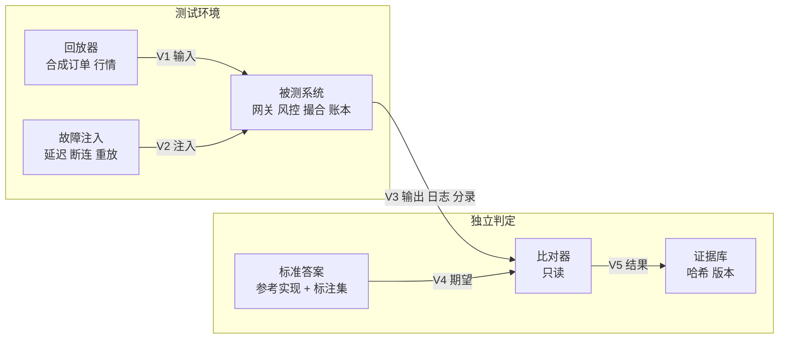
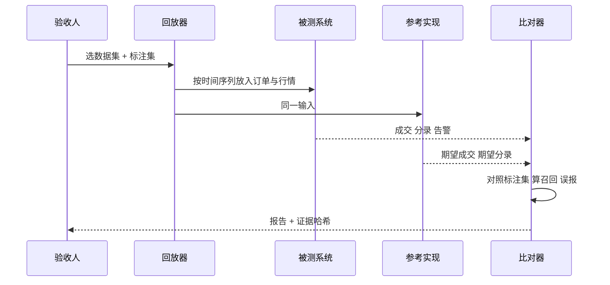
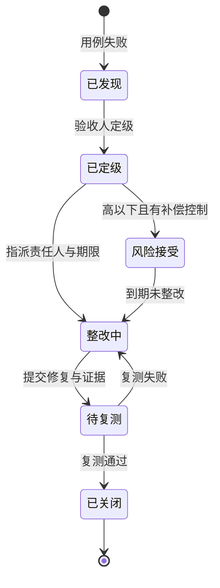

# X15 交易、结算与信用·工程验收：回放撤单与异常价格，核订单、成交、分录与估值

> 学习目标：读完本章，你能——
> 1. 写出一套覆盖订单、成交、分录、估值、撤单与强平的验收用例，并说明每条用例在测试环境怎样做、留什么证据。
> 2. 用合成数据和历史行情做回放，对照"标准答案"算出异常拦截的召回率与误报率。
> 3. 写一份验收报告：通过标准、不符合项分级、上线门禁（P0 用例清单）与复测规则。
>
> 适用角色：交易所安全工程师、QA、账务与风控系统负责人、内部审计。
> 前置章节：[X14 交易、结算与信用](X14-cex-trading-settlement-credit.md)、[X07 交易所安全架构总览](X07-cex-architecture-overview.md)、[X05 检测与响应工程](X05-detection-response-engineering.md)
> 后续章节：[X16 交易、结算与信用·运营与恢复](X16-cex-trading-recovery-ops.md)、[X26 域间交接](X26-cex-ledger-wallet-handoff.md)
> 交互实验：[永续合约实验](../interactive/perp-lab.html)、[预言机操纵实验](../interactive/oracle-manipulation-lab.html)
> 建议配套：训练营练习章 B79「交易与账务回放验收」（后续实现，配 X15、X14）
> 最后核对：2026-11-23

---

## 开场：一份"设计完备"的方案，为什么还是出事

2012 年 8 月 1 日，美国做市商 Knight Capital 开盘后 45 分钟内，自动路由器发出 400 多万笔订单，而它本来只需要处理 212 笔客户订单。美国证券交易委员会（SEC）的处罚材料称，公司因此损失超过 4.6 亿美元。SEC 指出两个原因：一次部署把新代码装到了路由器上，一段 2005 年遗留的功能被意外触发。SEC 还指出，开盘前内部系统已经发出 97 封自动邮件提示异常，没有人当成告警处理。

2026 年 2 月，韩国交易所 Bithumb 在一次小额奖励活动中，把发放数量的单位从"韩元"错填成"比特币"。韩国媒体报道，约 249 名用户的账户被记入约 62 万枚比特币，而交易所当时实际持有约 4 万多枚。报道同时指出，该所把内部账本与钱包实际持仓核对的频率是每天一次。

两家公司都"有"风控、都"有"账本。缺的是**证明这些控制在异常输入下真会动作**的验收。

<details class="predict"><summary>🤔 先猜再看：如果你是验收人，对 Bithumb 这样的发放系统，第一条用例该测什么？</summary>

测"账本记入的总量能不能超过钱包与托管实际持有的总量"。这条不变量在设计章里一句话就够了。验收要做的是：在测试环境里构造一笔超额发放，看系统在什么时候、由谁、用什么方式拒绝它，并留下证据。如果发放系统可以直接写账本，而对账一天一次，这条用例会失败。

</details>

---

## 1. 一句话理解

**设计章回答"控制应该怎么做"。验收章回答"我怎么知道它真的做了"。证明的办法是：造一个坏输入，看控制有没有拦住，再把证据留下来。**

> 🎯 打个比方：消防验收。图纸上画了喷淋头，不等于火来了会喷。验收员要点一把火（在受控的房间里），看喷淋什么时候启动、水压够不够、报警有没有响，再拍照盖章。
>
> 比喻的局限：消防测试通常一次一个房间。交易系统有成千上万并发订单，很多缺陷只在并发、重放和时序下出现，所以本章要求用回放和并发用例，不能只做单条手工测试。

本章覆盖 X14 保护域 ③ 的**工程技术层**。X14 讲设计与控制 ID（TRD-C01 到 TRD-C16），本章只引用，不重写设计。事故发生后的复市、恢复授信，见 [X16](X16-cex-trading-recovery-ops.md)。

---

## 2. 验收对象与信任边界

### 2.1 验收什么

| 验收对象 | 要证明的事 | 对应 X14 控制 |
|---|---|---|
| 订单序号 | 序号连续、不重复、不倒退，重启与切主后能接续 | TRD-C01、C04 |
| 撮合与成交 | 撮合日志与成交回报一一对应 | TRD-C06 |
| 账务分录 | 每笔成交借贷平衡，冻结与解冻对称，手续费正确 | TRD-C03、C04、C06 |
| 估值与标记价 | 标记价来自多源、过滤离群、受价格带限制 | TRD-C08 |
| 价格带与熔断 | 极端价格被拦截或限幅，且有受控的放宽流程 | TRD-C02、C08 |
| 撤单与撤权 | 撤销权限后，在途订单与新订单的行为符合预期 | TRD-C02、C15 |
| 并发与幂等 | 重放、并发提交不造成重复记账 | TRD-C04 |
| 强平与穿仓 | 强平价、破产价、保险基金扣减计算正确 | TRD-C09、C10、C11 |
| 参数变更 | 单人不能改关键参数 | TRD-C12 |

### 2.2 验收的信任边界



**读图要点：**

- 数据从左到右：回放器造输入，故障注入制造异常，被测系统产出日志与分录，比对器拿它们与"标准答案"对照。
- 标准答案（V4）必须独立于被测系统。如果用被测系统自己的输出当期望，验收永远通过。
- 比对器只读，证据库保存输入、输出、版本和哈希。证据要能让第三人复现同一结果。
- 局限：这是测试环境图。生产环境的持续对账见 X14 第 6.2 节，本章只验收它是否有效。

> ⚠️ 警告：验收环境不得连接生产账本、生产钱包与生产行情的写入口。所有"真实价格"只能以只读的历史行情文件进入。

---

## 3. 验收环境与数据

### 3.1 测试环境应该长什么样

1. **同构不同域。** 软件版本、配置结构、参数项与生产一致，网络、账号、密钥、数据库完全独立。
2. **时间可控。** 撮合与风控使用可注入的时钟，便于回放历史行情、测试时间窗与超时。
3. **钱包与银行是桩（stub）。** 账本只对接模拟钱包与模拟渠道，桩可以返回成功、失败、延迟和重复回执。
4. **参考实现。** 用一个简单、独立实现的撮合与记账程序作"标准答案"。它可以慢，但必须容易审查。
5. **证据自动落盘。** 每次运行写出输入文件哈希、被测版本号、参数版本号、输出文件哈希。

### 3.2 怎样造数据

| 数据类别 | 做法 | 用途 |
|---|---|---|
| 合成订单流 | 按分布生成：限价、市价、部分成交、撤单、改单；每条带标注 | 一致性、幂等、并发 |
| 历史行情 | 使用已公开的历史 K 线与逐笔成交；脱敏账户映射 | 价格带、标记价、强平 |
| 注入异常 | 在合成流里主动插入已知异常，写进标注集 | 算召回与误报 |
| 极端情景 | 单源偏离、行情断流、价格瞬时跳变、深度枯竭 | 估值、熔断、强平 |
| 账户类别 | 普通、做市、机构子账户、关联账户、内部账户 | 越权与特权账户 |

> 💡 注意：不要把生产账户的真实余额与成交导入测试环境。需要真实形状时，用脱敏后的统计分布重新生成。

### 3.3 标注集

标注集是验收的"标准答案"之一。每条异常记一行：

```csv
# 示例：标注集 anomalies.csv（示例数据）
case_id,type,injected_at,expected_control,expected_action
A001,seq_gap,2026-01-01T00:00:10Z,TRD-C06,alert_within_60s
A002,dup_fill,2026-01-01T00:00:20Z,TRD-C04,reject
A003,price_off_band,2026-01-01T00:00:30Z,TRD-C02,reject
A004,mark_outlier_source,2026-01-01T00:01:00Z,TRD-C08,exclude_source
A005,cancel_after_revoke,2026-01-01T00:01:20Z,TRD-C02,reject
```

---

## 4. 验收用例库

约定：用例 ID 为 `TRV-Txx`。"控制项"指向 X14 的 TRD-C 编号，本章自己的检查项另用 `TRV-n`（第 11 节）。"操作"只在测试环境执行。P0 用例未通过，不得上线（第 8.3 节）。

### 4.1 订单序号与签名

| 用例 ID | 控制项 | 前置条件 | 操作（测试环境） | 预期结果 | 证据 |
|---|---|---|---|---|---|
| TRV-T01 | TRD-C01 | 已有一条成功订单及其签名 | 原样重发该请求 | 被拒，错误码为重放；账本无新冻结 | 网关日志、账本流水 |
| TRV-T02 | TRD-C01 | 时间窗为 30 秒（示例） | 发送时间戳超出窗口 ±1 秒的请求 | 窗口外的被拒，窗口内的通过 | 请求与响应日志 |
| TRV-T03 | TRD-C04 | 撮合序号从 1 起 | 连续提交 10 万笔订单，检查序号 | 序号严格递增，无空洞、无重复 | 序号校验脚本输出 |
| TRV-T04 | TRD-C04 | 撮合进程在持续运行 | 在第 5 万笔时强杀撮合进程并重启 | 重启后序号接续，未确认订单要么落账要么明确拒绝 | 重启前后日志、订单状态表 |
| TRV-T05 | TRD-C01 | 一个 API Key 带交易权限 | 并发 200 个相同 nonce 请求 | 只有 1 个被接受 | 网关日志计数 |

### 4.2 撮合、成交与分录

| 用例 ID | 控制项 | 前置条件 | 操作 | 预期结果 | 证据 |
|---|---|---|---|---|---|
| TRV-T06 | TRD-C06 | 合成订单流 10 万笔 | 同一输入分别喂给被测系统与参考实现 | 成交集合（订单、价格、数量）逐笔一致 | 差异报告为空 |
| TRV-T07 | TRD-C03 | 任意一笔成交 | 取出该成交的全部分录 | 同币种借方合计 = 贷方合计 | 分录查询结果 |
| TRV-T08 | TRD-C03 | 部分成交的限价单 | 下单后分三次成交，再撤剩余 | 冻结总额 = 三次成交占用 + 撤单解冻，无残留 | 冻结账户对账 |
| TRV-T09 | TRD-C04 | 成交回报消息可重试 | 对同一成交 ID 重复推送 100 次 | 账本只记一次，其余返回幂等命中 | 账本流水、重试日志 |
| TRV-T10 | TRD-C06 | 费率表含 Maker / Taker 分档 | 构造跨档边界成交 | 手续费符合分档，舍入规则与文档一致 | 手续费明细、参考实现对照 |
| TRV-T11 | TRD-C03 | 用运维账号 | 尝试直接 UPDATE 或 DELETE 账本流水 | 数据库拒绝；尝试被审计日志记录 | 数据库错误、审计记录 |
| TRV-T12 | TRD-C07 | 全部账户表 | 查询风控豁免、允许透支标志 | 豁免账户在清单内，且余额不能为负 | 查询结果与清单对照 |

### 4.3 估值、价格带与异常成交

| 用例 ID | 控制项 | 前置条件 | 操作 | 预期结果 | 证据 |
|---|---|---|---|---|---|
| TRV-T13 | TRD-C08 | 5 个行情源 | 把其中 1 个源价格偏离 +20% | 该源被剔除，标记价基本不变，产生告警 | 标记价序列、告警记录 |
| TRV-T14 | TRD-C08 | 5 个行情源 | 令 3 个源同时过期（超过 5 秒，示例） | 来源不足，暂停开新仓，已有仓位按保底规则处理 | 状态变更日志 |
| TRV-T15 | TRD-C08 | 本交易所盘口很薄的资产 | 在测试盘口放入单边极端报价 | 指数价不受本所盘口直接影响（有外部来源与下限） | 指数价计算明细 |
| TRV-T16 | TRD-C02 | 标记价 100 | 下 130 的买单（带宽 ±10%，示例） | 被拒并留日志 | 风控拒绝日志 |
| TRV-T17 | TRD-C02 | 价格带触发 | 触发后检查强平与订单 | 强平延迟或转人工，不按越带价格直接强平 | 强平队列日志 |
| TRV-T18 | TRD-C12 | 价格带参数可放宽 | 一个人尝试放宽带宽；再用两人审批放宽 | 前者失败，后者生效且带版本与回滚点 | 参数中心审计 |

### 4.4 撤单、撤权与并发

| 用例 ID | 控制项 | 前置条件 | 操作 | 预期结果 | 证据 |
|---|---|---|---|---|---|
| TRV-T19 | TRD-C02 | API Key 有交易权限，挂有 10 笔订单 | 撤销 Key 的交易权限 | 新单立即被拒；在途订单按策略处理（保留或撤销，与文档一致）；用户仍可经网页撤单 | 权限变更时间与订单日志 |
| TRV-T20 | TRD-C15 | 行情峰值压测 | 在峰值下并发提交撤单与追加保证金 | 撤单走独立限频桶，成功率达标 | 压测报告 |
| TRV-T21 | TRD-C04 | 同一用户同一余额 | 100 个并发订单合计超出可用余额 | 超出部分被拒，冻结总额不超过可用余额 | 冻结流水 |
| TRV-T22 | TRD-C04 | 同一订单 | 同时发出撤单与成交 | 要么成交要么撤单，终态唯一，资金不重复解冻 | 订单状态机日志 |

### 4.5 强平、穿仓与保险基金

| 用例 ID | 控制项 | 前置条件 | 操作 | 预期结果 | 证据 |
|---|---|---|---|---|---|
| TRV-T23 | TRD-C09 | 单仓保证金已知 | 标记价移动到强平价 | 触发强平，强平价、破产价与参考实现一致 | 强平记录对照 |
| TRV-T24 | TRD-C11 | 强平成交价劣于破产价 | 制造穿仓 | 缺口先扣保险基金，分录平衡，告警触发 | 保险基金分录 |
| TRV-T25 | TRD-C11 | 保险基金设为不足 | 再次制造穿仓 | 触发自动减仓（ADL），顺序与规则一致，波及账户有记录 | ADL 清单 |
| TRV-T26 | TRD-C09 | 多个关联账户 | 各自小于上限，合计大于上限 | 合并计算后被拦截 | 风控日志 |
| TRV-T27 | TRD-C10 | 5 个抵押资产 | 抽查折价率、价格来源、集中度限额 | 与参数文档一致 | 抽查表 |

### 4.6 对账、故障注入与参数

| 用例 ID | 控制项 | 前置条件 | 操作 | 预期结果 | 证据 |
|---|---|---|---|---|---|
| TRV-T28 | TRD-C06 | 对账服务在运行 | 在账本中人为少记一笔成交 | 对账在目标时间内发出告警（目标值见第 8.4 节） | 告警时间与差异记录 |
| TRV-T29 | TRD-C13 | 已有三条历史差异 | 抽查差异处理单 | 每条有发现人、审批人、证据与关闭时间 | 差异处理单 |
| TRV-T30 | TRD-C05 | 钱包桩可延迟确认 | 返回"未确认"的充值，用户尝试交易或提币 | 不可用余额不增加，提币被拒 | 余额与风控日志 |
| TRV-T31 | TRD-C04 | 账务服务可注入故障 | 在写账本前后各断一次网络 | 事务要么全成功要么全回滚，无半条分录 | 数据库事务日志 |
| TRV-T32 | TRD-C12 | 参数中心 | 一个人改手续费、杠杆、风险限额各一次 | 全部失败；双人审批后才生效 | 参数中心审计 |

> 💡 注意：这 32 条是"最小全集"。每家交易所要按自己的产品（现货、永续、期权、借贷）补充。补充时沿用 `TRV-Txx` 编号，并给出控制项编号。

---

## 5. 回放验收方法

### 5.1 为什么要回放

手工用例只能覆盖想到的情况。回放把大量历史或合成数据喂给系统，再与标准答案对照，能发现**时序、并发、舍入**这类手工看不到的问题。回放要回答三个问题：

1. 对已知异常，系统拦住了多少（召回率）。
2. 对正常流量，系统误拦了多少（误报率）。
3. 从异常发生到告警，用了多久。

### 5.2 回放流程



**读图要点：**

- 被测系统与参考实现拿到**同一份**输入。差异只来自系统本身。
- 标注集告诉比对器"哪里该有告警"。没有标注集，只能看到差异，算不出召回。
- 局限：参考实现只覆盖核心撮合与记账规则。复杂产品（组合保证金）需要单独写参考实现，或改用不变量检查。

### 5.3 核对订单、成交与分录（Python 示例）

下面的脚本检查四件事：序号空洞、撮合成交与账本成交的一致、分录借贷平衡、冻结解冻对称。数据结构为示意表。

```python
# 示例：交易回放核对（数据结构为示意，不对应任何真实系统）
from collections import defaultdict
from decimal import Decimal

def check_seq(orders):
    """订单序号必须严格 +1。返回空洞与重复。"""
    issues, prev = [], None
    for o in sorted(orders, key=lambda x: x["ts"]):
        if prev is not None and o["seq"] != prev + 1:
            issues.append(("seq_gap" if o["seq"] > prev + 1 else "seq_dup_or_back",
                           prev, o["seq"]))
        prev = o["seq"]
    return issues

def check_fills(engine_fills, ledger_fills):
    """撮合成交与账本成交按 fill_id 对照。"""
    e = {f["fill_id"]: f for f in engine_fills}
    l = defaultdict(list)
    for f in ledger_fills:
        l[f["fill_id"]].append(f)
    issues = []
    for fid, f in e.items():
        if fid not in l:
            issues.append(("fill_missing_in_ledger", fid))
        elif len(l[fid]) > 1:
            issues.append(("fill_booked_twice", fid))
        else:
            g = l[fid][0]
            if (f["price"], f["qty"]) != (g["price"], g["qty"]):
                issues.append(("fill_mismatch", fid))
    for fid in l.keys() - e.keys():
        issues.append(("fill_only_in_ledger", fid))
    return issues

def check_entries(entries):
    """每个 txn_id 下，同币种借方 = 贷方。"""
    s = defaultdict(Decimal)
    for x in entries:
        sign = 1 if x["side"] == "DR" else -1
        s[(x["txn_id"], x["asset"])] += sign * Decimal(x["amount"])
    return [("unbalanced", k, v) for k, v in s.items() if v != 0]

def check_freeze_symmetry(freezes):
    """每个订单：冻结 = 成交占用 + 撤单解冻（终态订单）。"""
    out = []
    for oid, f in freezes.items():
        if f["final"] and f["frozen"] != f["used"] + f["released"]:
            out.append(("freeze_leak", oid, f["frozen"] - f["used"] - f["released"]))
    return out
```

### 5.4 算召回与误报（Python 示例）

```python
# 示例：对照标注集，计算异常拦截的召回率与误报占比
def score(labeled, alerts, window_s=60):
    """labeled: [{case_id, ts}]，alerts: [{ts}]；ts 为秒。"""
    hit, delays = set(), []
    for lab in labeled:
        for a in alerts:
            if 0 <= a["ts"] - lab["ts"] <= window_s:
                hit.add(lab["case_id"])
                delays.append(a["ts"] - lab["ts"])
                break
    matched_alerts = sum(
        1 for a in alerts
        if any(0 <= a["ts"] - l["ts"] <= window_s for l in labeled))
    recall = len(hit) / len(labeled) if labeled else 1.0
    precision = matched_alerts / len(alerts) if alerts else 1.0
    return {"recall": recall, "false_alert_share": 1 - precision,
            "max_delay_s": max(delays) if delays else None}
```

建议的通过线（示例，需与业务共同确定）：P0 类异常召回率 100%；全部异常召回率不低于 95%；正常流量下的误报每日不超过值班能处理的数量；告警延迟不超过第 8.4 节目标。

### 5.5 SQL 示例：账务三不变量

```sql
-- 示例：表结构为示意。ledger_entries(txn_id, asset, side, amount, ts)
-- 1) 借贷平衡：返回不平衡的交易
SELECT txn_id, asset,
       SUM(CASE WHEN side='DR' THEN amount ELSE -amount END) AS diff
FROM ledger_entries
GROUP BY txn_id, asset
HAVING SUM(CASE WHEN side='DR' THEN amount ELSE -amount END) <> 0;

-- 2) 余额守恒：账本总额大于钱包与银行实际资产时返回
SELECT a.asset,
       a.user_total + a.platform_total AS book_total,
       w.onchain_total + w.bank_total  AS asset_total,
       (a.user_total + a.platform_total) - (w.onchain_total + w.bank_total) AS gap
FROM (SELECT asset,
             SUM(CASE WHEN acct_type='USER' THEN balance END)     AS user_total,
             SUM(CASE WHEN acct_type='PLATFORM' THEN balance END) AS platform_total
      FROM balances GROUP BY asset) a
JOIN wallet_snapshot w USING (asset)
WHERE (a.user_total + a.platform_total) > (w.onchain_total + w.bank_total);

-- 3) 幂等：同一 fill_id 入账超过一次
SELECT fill_id, COUNT(*) FROM ledger_fills GROUP BY fill_id HAVING COUNT(*) > 1;
```

> ⚠️ 警告：第 2 个查询里的"账本大于资产"是红线。验收时要证明它能在分钟级告警，而不是当天结算才发现。Bithumb 事件中，媒体报道的重点正是对账频率与账本写入权限。

---

## 6. 对账与差异分类

验收要证明对账不只"跑了"，还会**把差异放进正确的桶，交给正确的人**。

### 6.1 差异分类

| 类别 | 例子 | 严重度 | 谁处理 | 时限（示例） |
|---|---|---|---|---|
| A 账本多于资产 | 账本记入大于钱包持有 | 红线 | 账务负责人 + 安全 | 立即暂停相关资产的提币，30 分钟内定性 |
| B 账本少于资产 | 链上到账未入账 | 中 | 账务 | 当日 |
| C 时间差 | 在途充提、未确认 | 低 | 对账系统自动核销 | 按确认规则 |
| D 重复记账 | 同一事件两次入账 | 高 | 账务 + 开发 | 4 小时内冲正并复盘 |
| E 舍入 | 手续费小数差 | 低 | 账务 | 周度汇总 |
| F 参数不一致 | 生产参数与参数中心版本不同 | 高 | 风控 + 运维 | 当日 |
| G 无法解释 | 以上都不匹配 | 高 | 安全牵头调查 | 24 小时内定性 |

### 6.2 验收要看什么

1. 每类差异有**判定规则**，而不是人工看着办。
2. 差异进入工单系统，记录发现人、审批人、证据、关闭时间。
3. A 类差异有**自动动作**：告警、暂停相关资产的新增冻结或提币。自动动作要在测试环境实测（TRV-T28）。
4. 差异不能由发现人自行抹平。抹平分录需要第二人批准，见 TRV-T29。
5. 无法解释的差异（G 类）不得长期挂账，超期自动升级。

---

## 7. 参考判定：撤权、撤单与异常价格

### 7.1 撤权后的订单行为

撤销 API Key 或交易权限后，系统要回答四个问题，并在设计文档中写明。验收时逐条测：

| 问题 | 可接受的策略 | 验收要点 |
|---|---|---|
| 新订单是否立即被拒 | 必须立即拒绝 | 撤权时间戳之后无新订单被接受 |
| 在途挂单怎么办 | 保留 / 撤销，二选一并写明 | 行为与文档一致 |
| 缓存的权限多久失效 | 有上限（示例：几秒内） | 测量权限缓存过期时间 |
| 用户本人能否撤单 | 能，且不受 Key 撤权影响 | 网页端撤单可用 |

### 7.2 异常价格回放

回放要覆盖三类输入：

1. **单源异常。** 一个来源偏离，其他正常。期望：剔除，标记价不动。
2. **多源异常。** 多个来源同时偏离或停更。期望：暂停开新仓，转人工。
3. **本所盘口扭曲。** 自家盘口价格异常，外部来源正常。期望：指数价不被牵动。

2025 年 10 月 10 日的 Binance 事件与第三类相近。Binance 公开说明，三种资产在平台上出现明显偏离并造成强平，之后按规则补偿；多家媒体援引 Ethena 方面的说法，称其他场所价格仍接近锚定价。验收的教训不是评判谁对谁错，而是**这类输入必须在测试里出现过**：本所盘口价与外部价大幅分离时，标记价、强平与价格带怎样动作。

---

## 8. 验收报告与上线门禁

### 8.1 验收报告模板

```markdown
# 交易与账务工程验收报告（模板）
- 被测系统与版本：             参数中心版本：
- 验收日期 / 验收人 / 复核人：
- 环境：测试环境 ID、数据集哈希、标注集哈希、参考实现版本
## 1. 结论
通过 / 有条件通过 / 不通过。P0 用例：通过 __ / __；P1：__ / __
## 2. 用例结果表
| 用例 ID | 结果 | 偏差说明 | 证据位置（哈希） |
## 3. 回放结果
召回率：__　误报：__　最大告警延迟：__
## 4. 不符合项
| 编号 | 描述 | 等级 | 责任人 | 整改期限 | 复测结果 |
## 5. 接受的风险
| 描述 | 接受人 | 到期日 | 补偿控制 |
```

### 8.2 不符合项分级

| 等级 | 定义 | 例子 | 处理 |
|---|---|---|---|
| 严重 | 可造成账实不符或凭空资产 | 账本可被运维直接改写；可重复入账 | 不得上线；整改后全量复测 |
| 高 | 控制存在但可被绕过 | 价格带可被单人放宽 | 上线前整改或批准补偿控制 |
| 中 | 控制有效但证据不足 | 差异处理单缺审批 | 30 天内整改 |
| 低 | 文档与实现不一致 | 参数说明过期 | 季度内整改 |

### 8.3 上线门禁

以下用例任何一条未通过，新版本或新产品不得上线。门禁由验收人出具结论，业务负责人不得单方面豁免。

| 门禁 | 用例 |
|---|---|
| G1 订单真实性 | TRV-T01、T05 |
| G2 成交与账务一致 | TRV-T06、T07、T08、T09、T11、T31 |
| G3 价格保护 | TRV-T13、T14、T15、T16、T17 |
| G4 特权与参数 | TRV-T12、T18、T32 |
| G5 对账与红线 | TRV-T28、T30 |
| G6 强平与穿仓 | TRV-T23、T24（含杠杆或衍生品产品时必须） |

### 8.4 复测与回归

1. 整改后只重跑相关用例，再加全部 P0 回放。
2. 每次变更撮合、账本、价格服务、参数中心的代码，自动触发回归。
3. 每季度抽 5 条用例在生产同构的预发布环境重做，防止测试环境与生产漂移。
4. 告警延迟目标（示例）：A 类差异 5 分钟内告警；价格带触发 1 分钟内告警。实际数值由业务确定后写进报告。

---

### 8.5 不符合项闭环



**读图要点：**

- 只有验收人可以把状态推到"已关闭"。责任人不能自行关闭自己的不符合项。
- "风险接受"必须有到期日与补偿控制。到期未整改，自动回到整改中。
- 严重等级不允许走"风险接受"，只能整改后复测。
- 局限：图没有画上线门禁。严重项同时会阻断发布（第 8.3 节）。

---

## 9. 并发、竞态与故障注入的专项做法

第 4 节的用例给出"测什么"。这一节给出"怎么造出问题"。并发与故障类缺陷最难复现，需要专门的方法。

### 9.1 并发与竞态

交易系统有三类典型竞态。每一类都要有一个可重复的构造方式。

| 竞态 | 构造方式（测试环境） | 判定 |
|---|---|---|
| 余额竞态：多笔订单同时冻结同一余额 | 用 100 个线程在同一毫秒提交订单，合计冻结量超出余额 | 冻结总额不超过余额；超出的订单被拒 |
| 撤单与成交竞态：撤单请求与撮合同时到达 | 在撮合桩里把"成交"与"撤单"强制排成两种顺序，各跑一遍 | 两种顺序下终态唯一，资金守恒 |
| 重试竞态：网关超时重试与原请求都成功 | 让撮合桩对第一次请求延迟返回，网关超时后重发 | 只有一笔订单；幂等键命中 |

做法建议：

1. 并发用例固定随机种子，失败时能原样重跑。
2. 每个并发用例跑至少 1000 轮。偶发一次失败也算失败。
3. 不要只看订单结果。检查冻结账户、成交账户和手续费账户三处的余额变化之和。

### 9.2 故障注入

故障注入的目的，是证明系统在"半完成"状态下仍守住不变量。

| 注入点 | 注入内容 | 要守住的不变量 |
|---|---|---|
| 网关到风控 | 超时、丢包 | 订单不重复、不丢失，状态可查 |
| 风控到账本 | 冻结请求成功但回执丢失 | 冻结按幂等键只生效一次 |
| 撮合到账本 | 成交回报延迟、乱序、重复 | 账本按成交 ID 去重，顺序错误不致余额为负 |
| 账本到数据库 | 提交前断连 | 无半条分录，借贷平衡 |
| 行情到价格服务 | 单源断流、延迟、时间戳回退 | 标记价受价格带约束，来源不足时暂停开新仓 |
| 主备切换 | 主节点失联后备节点接管 | 序号接续，旧主不再写入（见 X16 的停写验证） |

> 💡 注意：主备切换的"停写停发"属于恢复运营，验收这里只测"切换后序号与账本一致"。完整的切主验证见 [X16](X16-cex-trading-recovery-ops.md)。

### 9.3 强平与穿仓的参考计算

强平类用例需要一个独立的参考计算。下面是线性永续单仓的最小示意（示例公式，真实产品以其规则文档为准）：

```python
# 示例：线性永续、逐仓、多头的强平价与破产价（简化，忽略资金费率与手续费）
def liquidation_price(entry, leverage, mmr):
    """entry: 开仓均价；leverage: 杠杆；mmr: 维持保证金率。"""
    imr = 1 / leverage                     # 初始保证金率
    return entry * (1 - imr + mmr)         # 标记价跌到此处触发强平

def bankruptcy_price(entry, leverage):
    return entry * (1 - 1 / leverage)      # 保证金刚好亏光

# 对照：被测系统的强平价必须落在参考值的容差内（示例容差：一个最小价格单位）
assert abs(liquidation_price(100, 10, 0.005) - 90.5) < 1e-9
assert abs(bankruptcy_price(100, 10) - 90.0) < 1e-9
```

用法：

1. 用 100 组随机的入场价、杠杆和维持保证金率，分别喂给被测系统与参考计算。
2. 差异超过容差的，列入不符合项。
3. 穿仓缺口 = 破产价与实际强平成交价之差乘以数量。用它核对保险基金分录（TRV-T24）。

---

## 10. 运营：把验收变成日常

| 指标 | 含义 | 目标（示例） |
|---|---|---|
| 用例自动化率 | 自动执行的用例占比 | P0 100% |
| 回放召回率 | 已知异常被拦截的比例 | P0 类 100% |
| 告警延迟 | 异常到告警的时间 | 见第 8.4 节 |
| 差异闭环时长 | 差异从发现到关闭 | A 类 ≤ 4 小时 |
| 环境漂移 | 测试与生产配置不一致项 | 0 项高危 |
| 门禁绕过次数 | 未通过用例而上线 | 0 |

节奏（建议）：

1. **每次发布。** P0 回归自动跑，结果挂在发布单上。
2. **每月。** 极端行情回放一次，更新标注集。
3. **每季度。** 完整用例库复跑，审阅用例与控制 ID 的映射。
4. **每年。** 请独立第三方（内部审计或外部）抽测 10 条以上，并检查证据能否复现。

---

## 11. 评估检查点

- [ ] **TRV-1** 存在独立于被测系统的参考实现或不变量检查，并有版本管理。
- [ ] **TRV-2** 验收环境与生产在网络、账号、密钥上完全隔离，钱包与银行为桩。
- [ ] **TRV-3** 用例库覆盖第 4 节六类场景，每条带控制 ID，P0 用例有门禁映射。
- [ ] **TRV-4** 标注集存在并受版本控制，回放能输出召回率、误报与告警延迟。
- [ ] **TRV-5** 极端行情（单源偏离、多源失效、本所盘口扭曲）至少每月回放一次。
- [ ] **TRV-6** 借贷平衡、余额守恒、幂等三条不变量的检查在测试与生产都有自动执行。
- [ ] **TRV-7** A 类差异（账本多于资产）有自动动作，并在测试环境实测过。
- [ ] **TRV-8** 撤权后的新订单、在途订单、缓存失效时间有明确规则并经过测试。
- [ ] **TRV-9** 关键参数单人无法修改，测试覆盖价格带、费率、杠杆、风险限额。
- [ ] **TRV-10** 验收报告有固定模板，证据带哈希，第三人可复现。
- [ ] **TRV-11** 发布流水线会因 P0 用例失败而阻断上线，无人工绕过。
- [ ] **TRV-12** 每季度在预发布环境抽测，检查测试与生产漂移。

**把结果写进报告：**

| 检查点 | 状态（通过 / 不符合 / 不适用） | 证据 | 责任人 | 到期日 |
|---|---|---|---|---|
| TRV-1 ~ TRV-12 | | | | |

---

## 12. 失效案例

案例只写摘要与教训，来源均为公开资料；本章不重写 X14 的设计结论。

### 11.1 Knight Capital 路由器事故（2012 年 8 月，美国股票市场）：对应 TRV-T01、T21、T22；TRV-11

- **发生了什么：** SEC 新闻稿称，2012 年 8 月 1 日开盘后 45 分钟内，Knight 的自动路由器发出超过 400 万笔订单，成交超过 3.97 亿股，公司损失超过 4.6 亿美元。原因是 2005 年遗留的功能缺陷，与 2012 年 7 月新代码被错误部署到路由器的行为叠加。
- **哪条验收缺失：** SEC 认定公司缺少把离开路由器的订单与已录入订单对比的事前控制，缺少针对代码部署与测试的控制，也缺少对技术事故的书面应对程序。开盘前有 97 封自动邮件提示异常，但没有被当成告警。
- **教训：** 部署前要有"版本与配置一致性"用例，发布门禁要能阻断上线（TRV-11）。系统发出的异常提示要进入告警体系，而不是躺在邮箱里。
- **来源类型：** 监管文件（SEC 新闻稿，2013 年 10 月 16 日）。这是传统金融案例，不是加密行业事故，写在这里是因为它是"验收缺失"的经典公开材料。

### 11.2 Bithumb 错误发放（2026 年 2 月，韩国）：对应 TRV-T28、T11、T07；TRV-6、TRV-7

- **发生了什么：** 媒体报道，一次小额奖励活动中，操作员把发放数量的单位错填，约 249 名用户（也有报道称 695 名）被记入约 62 万枚比特币。交易所当时实际持有量约 4 万多枚。Bithumb 事后称已追回绝大部分被错发的比特币，少量未追回。韩国金融监督院启动现场检查，焦点是账本如何可以超出实际持仓。
- **哪条验收缺失：** 韩国媒体指出，该所账本与钱包持仓的核对为每日一次，而同业有更高频的核对；监管关注点是账本记录与实际持有是否一致。对应本章"账本大于资产"红线和 A 类差异自动动作。
- **教训：** 发放类功能与撮合账本一样是账本的写入口，要纳入验收（TRV-T07、T28），并测试"超额发放被拦截"。不同报道在受影响人数、金额上不一致，这里只写共同点。
- **来源类型：** 媒体报道（Korea Herald、The Block 等），截至 2026 年公开资料。监管检查结论以监管部门后续公告为准。

### 11.3 Binance 价格与强平事件（2025 年 10 月 10 日）：对应 TRV-T13、T15、T17、T20

- **发生了什么：** Binance 公开说明，在 2025 年 10 月 10 日 UTC 21:36 到 22:16 之间，USDe、BNSOL、WBETH 在平台上出现明显偏离，作为抵押品的合约、杠杆与借贷用户受影响。Binance 表示按"2025 年 10 月 11 日 00:00 UTC 的市场价与强平价之差"补偿，媒体报道总额约 2.83 亿美元。Binance 同时提到行情剧烈与平台延迟。
- **哪条验收缺失：** 公开资料不足以断言具体内部原因。多家媒体援引 Ethena 方面的说法，称偏离是单一场所价格与深度更大的市场脱节；有媒体称 Binance 事后计划调整价格来源与下限，具体变更以 Binance 官方公告为准，本章未取得原始公告，不作为事实使用。
- **教训：** 把"本所盘口扭曲，外部价正常"做成回放用例（第 7.2 节），并测试价格带触发时强平的行为（TRV-T17）与撤单通道（TRV-T20）。
- **来源类型：** 媒体报道转述平台公告（The Block、Decrypt 等）。

### 11.4 Kraken 充值入账缺陷（2024 年 6 月）：对应 TRV-T09、T30

- **发生了什么：** Kraken 安全负责人称，2024 年 6 月初收到漏洞赏金报告，发现一个缺陷：发起充值后，资金在清算完成前就可以使用。Kraken 称其中两个账户提走了接近 300 万美元，并拒绝配合说明；安全公司 CertiK 则公开承认其研究员发现并测试了该缺陷，双方对行为性质说法冲突。资金后来被退回，Kraken 称随后向用户发放。
- **哪条验收缺失：** 缺陷的共同点是"未清算的充值被当作可用余额"，对应 X14 的 TRD-C05。验收用例要显式测试"未确认充值不增加可用余额，且不可提币"（TRV-T30），并包含多种内部状态。
- **教训：** 状态机里每个中间状态都要有用例。行为是否构成攻击、是否属于白帽测试存在争议，本章不评判，只取工程教训。
- **来源类型：** 媒体报道（The Block、Coindesk 等），当事方说法互相冲突。

### 11.5 案例映射

| 案例 | 缺失的验收 | 本章用例 / 检查点 |
|---|---|---|
| Knight Capital | 部署一致性、事前拦截、告警进入体系 | TRV-T01、T21、T22；TRV-11 |
| Bithumb | 账本不得大于资产、对账频率与自动动作 | TRV-T07、T11、T28；TRV-6、TRV-7 |
| Binance 10 月 10 日 | 本所盘口扭曲的回放、价格带下的强平 | TRV-T13、T15、T17、T20；TRV-5 |
| Kraken 2024 | 未清算充值与可用余额 | TRV-T09、T30 |

---

## 13. 上手路径

**第一周**

1. 读 X14 第 4 节，把 TRD-C01 到 C16 抄成一张表，旁边列"现在有没有测试用例"。
2. 跑通第 5.5 节三条 SQL（在测试库或脱敏副本），看哪一条第一次就返回结果。
3. 跟账务和撮合负责人各约 30 分钟，问两个问题："序号怎样接续"和"谁能直接写账本"。

**第一个月**

1. 搭验收环境，接入钱包与银行的桩。
2. 把第 4 节 32 条用例落成可重复执行的脚本，先自动化 P0。
3. 写出第一版标注集（10–20 条异常），接上第 5.3、5.4 节的脚本。

**第一个季度**

1. 把 P0 回归接进发布流水线，失败即阻断。
2. 做一次极端行情回放，并出第一份验收报告。
3. 与内部审计约定抽测方式，证据入库。

---

## 14. 常见误区

1. **用被测系统自己的输出当标准答案。** 这样验收永远通过。
2. **只测正常路径。** 价格带、重放、并发、故障注入才是验收重点。
3. **只在生产看对账。** 对账本身也要被测试：构造差异，看是否告警。
4. **把验收等同于渗透测试。** 渗透测试找入口；本章证明业务不变量成立。
5. **一次性验收。** 变更撮合、账本、价格服务、参数中心就要回归。
6. **证据只留截图。** 要留输入、版本、哈希，第三人能复现。
7. **业务压力下豁免 P0。** 豁免必须由独立的验收结论和更高层批准，并设到期日。
8. **测试环境连了生产写入口。** 一律隔离，不连生产写入口。
9. **只验收撮合，不验收"旁路写账本"的功能。** 活动发放、人工调账、补偿、迁移脚本都是账本的写入口，都要有用例，也都要受"账本不得大于资产"的约束。
10. **把误报调到零。** 为了没有误报而放宽阈值，召回率会下降。验收要同时看召回与误报，并让值班团队参与定阈值。
11. **只验收新产品。** 老产品的参数变更、手续费调整同样会破坏不变量，变更后要回归。

---

## 15. 术语表

| 术语 | 英文 | 定义 |
|---|---|---|
| 验收 | Verification | 用用例与证据证明控制按设计工作 |
| 回放 | Replay | 把历史或合成数据重新喂给系统，对照预期结果 |
| 标注集 | Labeled set | 记录"哪里应该出现异常或告警"的标准答案 |
| 参考实现 | Reference implementation | 独立实现的简化版系统，用作期望值 |
| 召回率 | Recall | 已知异常中被拦截或告警的比例 |
| 误报 | False alert | 对正常流量发出的告警 |
| 借贷平衡 | Double-entry balance | 每笔分录借方合计等于贷方合计 |
| 守恒 | Conservation | 账本总额不大于实际资产总额 |
| 幂等 | Idempotency | 同一事件重复处理，结果与处理一次相同 |
| 破产价 | Bankruptcy price | 保证金刚好亏光时的价格 |
| 桩 | Stub | 在测试中替代真实外部系统的模拟程序 |

---

## 16. 动手练习与思考题

### 练习 1：画一张用例覆盖图（30 分钟）

在笔记本上画出 X14 第 2.2 节的交易链路。给每个控制点（B1–B6）标上本章对应的用例 ID，找出没有任何用例覆盖的控制点。

### 练习 2：写一条标注集和期望（20 分钟）

为"撤销 API Key 后 5 秒内，新订单仍被接受"写一行标注集，并写出期望告警与期望处置。

### 练习 3：填一份验收报告草稿（30 分钟）

假设你验收了 T01–T12，其中 T11 失败（运维账号可 UPDATE 流水）。用第 8.1 节模板，写出结论、不符合项等级、整改与复测要求。

### 思考题

1. 参考实现与被测系统由同一个团队编写，会带来什么风险？怎样降低？
2. 价格带触发时，"延迟强平"保护了用户，也可能让交易所承担穿仓。你会怎样在测试里验证这个取舍已被批准且有上限？
3. 对账每天只跑一次与每 5 分钟跑一次，在"账本多于资产"这条红线上，差别是什么？

---

**建议配套（后续在 L3 训练营实现）：** B79「交易与账务回放验收」，使用 MiniEx 的订单序号、撮合日志与账务分录数据，练习第 5 节的脚本与第 6 节的差异分类。
