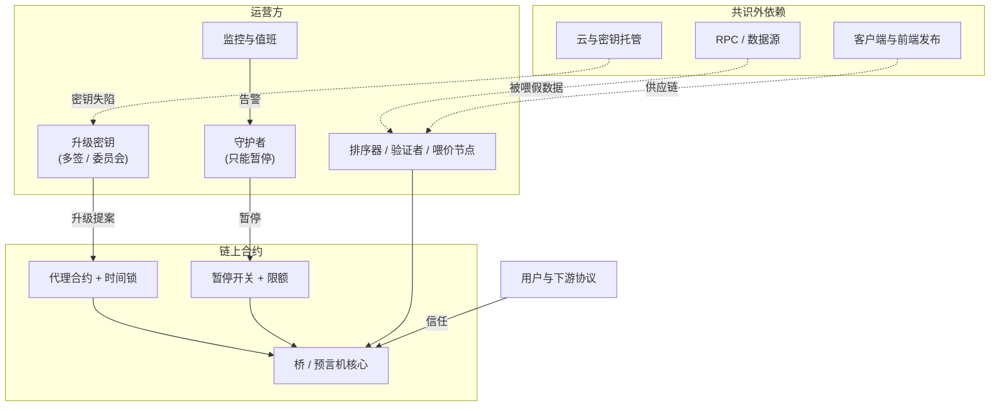
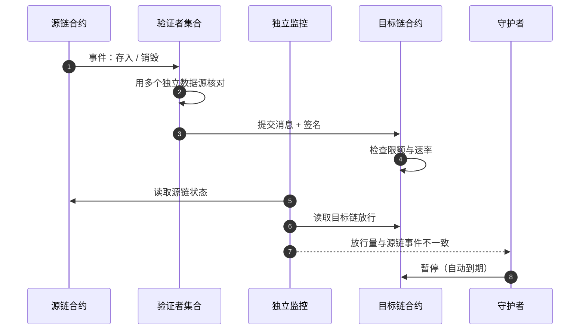
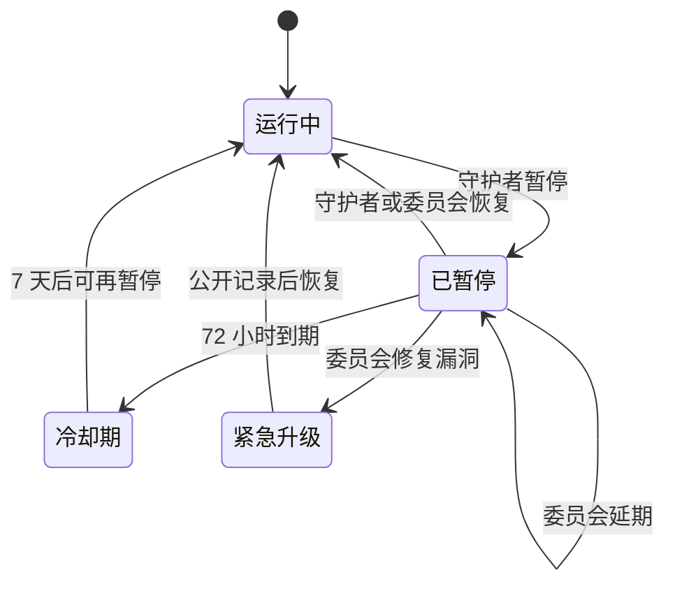

# X15 L2、跨链桥与预言机运营方：升级密钥、排序器与应急暂停

> 学习目标：读完本章，你能——
> 1. 为一个 L2、跨链桥或预言机写出"升级与应急权限矩阵"：谁能改代码、谁能暂停、谁能恢复，各自有什么延迟和上限。
> 2. 把 L2BEAT 的 Stage 要求翻译成运营控制，并说清"为什么要有安全委员会，又为什么要限制它"。
> 3. 为桥写出限额、暂停和对账规则，为预言机写出偏离、停更和换源流程，并做一次 30 分钟推演。
>
> 适用角色：L2 / 桥 / 预言机运营方的安全负责人、基础设施工程师、协议安全工程师；接入这些服务的项目方风控
> 前置章节：[12 跨链桥安全](../12-cross-chain-bridges.md)、[08 预言机与闪电贷](../08-oracle-flashloan.md)、[10 可升级合约与代理](../10-upgradeable-proxy.md)、[X01 安全体系怎么搭](X01-security-program-controls.md)、[X05 检测与响应工程](X05-detection-response-engineering.md)
> 交互实验 / 模板：[multisig-review-lab.html](../interactive/multisig-review-lab.html)、[rpc-quorum-lab.html](../interactive/rpc-quorum-lab.html)、[oracle-manipulation-lab.html](../interactive/oracle-manipulation-lab.html)；本章给出权限矩阵、限额配置、检测规则和推演脚本
> 最后核对：2026-11-23

---

## 开场：一个真实场景

2026 年 2 月 15 日，借贷协议 Moonwell 的一次治理提案生效后，cbETH 的价格源出了错。公开报道称，预言机把 cbETH/ETH 的比率当成了美元价格，没有乘以 ETH/USD。cbETH 被报成约 1.12 美元，实际约 2,200 美元。清算机器人只还很少的债务，就拿走了 1,096.317 枚 cbETH。协议留下约 178 万美元坏账（The Block 报道，含 Moonwell 事后复盘）。

监控在数分钟内发现了异常。团队把 cbETH 市场的供应和借款上限调到 0.01，阻止了新的借款和抵押。但是，修复价格源要走治理投票和时间锁。在补丁生效之前，清算还在继续。

<details class="predict"><summary>🤔 先猜再看：协议数分钟内就发现了问题，为什么还是损失了约 178 万美元？</summary>

因为"发现"和"止损"用了两条不同的路径。监控触发了一个快速、范围窄的动作（把市场上限调低）。而真正的修复动作（换价格源）被绑在慢路径上（治理 + 时间锁）。运营方的核心设计题就在这里：哪些动作必须快，哪些动作必须慢，两者之间怎样留出一个"快但受限"的中间层。

</details>

L2、桥和预言机都有同一个特点：它们本身不是用户的资金，但用户的资金要相信它们。它们的运营方握有升级密钥、暂停开关、验证者密钥和喂价节点。运营方的流程一旦出错，下游所有协议同时受损。本章讲这类运营方怎样设计和运营这些权限。

---

## 1. 一句话理解

**L2、桥和预言机运营方的安全工作，是把"能改变规则的权力"拆成快慢两档、层层设限，并让每一次使用都有人看见。**

排序器（Sequencer）：L2 里负责给交易排序、打包出块的节点。
安全委员会（Security Council）：持有 L2 紧急升级或暂停权的一组签名人。
守护者（Guardian）：只能执行有限动作（通常是暂停）的角色，权限小，响应快。
时间锁（Timelock）：升级提案生效前的强制等待期。
退出窗口（Exit Window）：升级生效前，用户可以带着资产离开的时间。
速率限制（Rate Limit）：在一段时间内，桥最多放出多少资产的上限。

> 🎯 打个比方：大楼的消防系统。日常改造（升级）要先公示、等几天，居民可以搬走。火警（紧急）时，保安可以立刻拉闸（守护者暂停），但只能拉闸，不能改电路。拆墙改线（紧急升级）要多位负责人一起签字。
>
> 比喻的局限：大楼里的居民可以看到公示栏。链上用户往往不看公示，所以"公示"要变成监控告警和自动通知，而不是只贴出来。

---

## 2. 保护目标与信任边界

三类运营方要保护的东西不同，但可以画在一张图上。



**读图要点：**

- 实线是你有意设计的权限。虚线是攻击者常走的路：数据源、云、发布链路。
- 升级密钥和守护者要分开。守护者失陷只会造成暂停，不会造成升级。
- 下游协议只能看到合约。它看不到你的云、RPC 和值班表，所以这些要靠你自己守。
- 局限：图中没有画跨多个运营方的组合风险，例如一个桥的验证者全部使用同一家 RPC。

---

## 3. 参考架构：升级与应急权限的通用模板

### 3.1 三类运营方共同的权限分层

建议把权限分成四层，每层的速度、范围和门槛不同。

| 层 | 角色 | 能做什么 | 速度 | 门槛（建议） | 上限 |
|---|---|---|---|---|---|
| 1 | 守护者 / 运营者 | 暂停、降低限额 | 分钟 | 单人或 2 人，7×24 | 暂停自动到期；到期前要委员会延期 |
| 2 | 安全委员会 | 紧急升级、关闭有问题的证明路径 | 数小时 | 高门槛（Stage 1 要求至少 75%） | 只用于已确认的漏洞；每次公开记录 |
| 3 | 常规升级 | 修改逻辑、参数、签名人 | 数天 | 治理或多签 + 时间锁 | 有退出窗口（Stage 1 要求至少 7 天） |
| 4 | 结构变更 | 更换委员会、改门槛、改暂停规则 | 数周 | 治理 + 更长的延迟 | 建议不短于常规升级的延迟 |

> 💡 注意：安全委员会的权限比常规升级大，因为它可以绕过延迟。所以它的签名人要比普通多签更独立、更少被同一次社工同时攻破。

### 3.2 L2BEAT 阶段怎样对应运营控制

L2BEAT 把 L2 分成 Stage 0、1、2，并公开列出各阶段的要求。2026 年 11 月起 L2BEAT 更名为 ETHBEAT，本章沿用旧称（见 [C03](../chains/C03-mantle.md) 第 2 节的说明）。以下要求取自其官方说明页和论坛（截至 2026 年公开资料，请以最新页面为准）。

| 阶段 | 公开要求（摘要） | 对运营方意味着什么 |
|---|---|---|
| Stage 0 | 有可用的证明系统；状态根与数据在 L1；至少 5 名外部参与者可提交欺诈证明；有状态重建软件 | 你仍可能是中心化运营。运营风险完全靠你自己的流程 |
| Stage 1 | 阻止或推送无效 L2→L1 消息需攻破委员会至少 75%；委员会之外的升级至少 7 天退出窗口；至少一个活跃提议者；乐观系统至少 7 天挑战期 | 你必须有真正的委员会、真正的时间锁，并能证明它们按规定运行 |
| Stage 2 | 委员会只能处理链上可检测的错误；升级至少 30 天退出窗口；欺诈证明无需许可 | 紧急权限被收窄，运营方要把大部分安全工作前移到代码与证明系统 |

对照关系：

- 评级看的是**权限结构**，不是你是否有人值班。一个 Stage 0 的 L2 也可以运营得很好，但用户只能相信你。
- L2BEAT 提醒，阶段评级不代表项目整体安全。它不覆盖你的云、客户端与前端。
- L2BEAT 在 2026 年 7 月的研究文章中建议：把高频、高活性的暂停职责交给受限的守护者或运营者，带到期和撤销机制；结构变更使用更长的延迟（文章建议至少 30 天）。这些是 L2BEAT 的建议，不是强制标准。

### 3.3 L2 运营：排序器、证明与逃生舱

| 对象 | 运营要点 | 为什么 |
|---|---|---|
| 排序器 | 主备部署；故障转移演练；出块高度和 L1 提交延迟都要告警 | 单一排序器停机，会让用户提款和协议清算同时卡住 |
| 强制交易通道 | 在 L1 提交的强制包含路径要定期做端到端测试 | 排序器审查或停机时，这是用户唯一的出口。C03 写到 Mantle 的最长延迟为 12 小时（见 [C03](../chains/C03-mantle.md)） |
| 证明与提议者 | 提议者密钥与排序器密钥分开；证明验证密钥的变更要公告 | 证明系统版本变了，信任假设就变了（见 [14 章](../14-zk-proof-systems.md)） |
| 紧急停链 | 提前决定谁能停排序器、停多久、怎样恢复 | 停链也是一种权力，滥用或误用都有成本（见案例 4） |
| 逃生舱 | 公开文档说明用户怎样绕过运营方提款，并有定期演示 | 没有演练过的逃生舱，在事故时往往走不通 |

### 3.4 跨链桥运营：验证者、限额、暂停与对账



**读图要点：**

- 第 2 步是验证者的信任点。验证者读的数据来自哪里，决定它能不能被骗（见 [12 章](../12-cross-chain-bridges.md) 第 4.6 节）。
- 第 4 步的限额与速率，是在"验证被骗"时的最后一道墙。
- 第 5–7 步是独立监控：它不使用验证者的数据源，只比较"源链发生了什么"和"目标链放出了什么"。
- 局限：监控与验证者若共用同一个 RPC 供应商，两者会一起被骗。

### 3.5 预言机运营：节点、聚合与停更

预言机运营方通常分两类：自己运营节点网络的预言机服务，和自己消费喂价的协议（例如借贷协议）。本章写前者的运营控制和后者的接入控制。

| 环节 | 运营要点 |
|---|---|
| 数据源 | 每个喂价至少多个独立来源；来源变更要走评审 |
| 节点运营方 | 节点之间不共用云账号、RPC 和签名密钥；运营方变更要公告 |
| 聚合 | 用中位数或截尾均值；单个节点异常不能改变结果 |
| 偏离与心跳 | 偏离阈值与心跳间隔写进文档；超时即视为停更 |
| 停更应急 | 提前约定：谁宣布停更、下游怎样得知、恢复后有多长宽限期 |
| 换源 | 换价格源是"高风险变更"，要有预发布测试与回滚方案（见案例 5） |

---

## 4. 控制清单

| ID | 控制项 | 要防什么 | 优先级 | 怎么验证 |
|---|---|---|---|---|
| BRG-9 | 升级与应急权限矩阵：每个角色的速度、门槛、上限成文 | 权限范围不清，事故时没人知道谁能按 | P0 | 抽一项权限，从矩阵追到链上地址 |
| BRG-10 | 升级密钥与守护者分离；守护者只能暂停且自动到期 | 守护者失陷被用来升级；暂停被滥用 | P0 | 读合约：守护者无升级函数；暂停有最长时长 |
| BRG-11 | 多签 / 委员会成员相互独立（组织、设备、云、地域） | 一次社工拿下多把钥匙（案例 1） | P0 | 签名人清单对比所属机构与设备 |
| BRG-12 | 常规升级有时间锁和公告；结构变更有更长延迟 | 恶意或误操作升级无人发现 | P0 | 链上读时间锁；升级公告早于生效 |
| BRG-13 | 验证者 / 预言机节点各自使用独立数据源与 RPC | 单一数据源被骗（案例 3） | P0 | 配置审查；rpc-quorum-lab 演练 |
| BRG-14 | 桥的单笔和时段限额、按资产分级 | 验证被骗后一次性掏空 | P0 | 读合约限额；用测试网放出超额消息，应被拒 |
| BRG-15 | 独立对账：目标链放行量对源链事件 | 验证被骗时没有第二双眼睛 | P0 | 规则回放；季度演练 |
| BRG-16 | 排序器主备与故障转移；强制交易通道端到端测试 | 停机、审查导致用户无法退出 | P1 | 季度故障转移演练；测试网强制提交 |
| BRG-17 | 签名密钥放入 HSM / 托管 KMS，人员无法导出；密钥不由一人独占 | 单人持钥（案例 2） | P0 | 密钥清单与访问记录；无单人可用路径 |
| BRG-18 | 预言机的偏离、心跳、停更告警，并有值班接收 | 价格错误无人发现 | P0 | 在测试环境注入偏离，计时 |
| BRG-19 | 价格源 / 参数的紧急路径（受限、有上限、公开记录） | 慢路径让错误持续（案例 5） | P0 | 读合约：紧急路径的权限与上限 |
| BRG-20 | 紧急动作公开记录（时间线、交易、验证过程） | 用户不信任，社区猜测 | P1 | 抽查最近一次紧急动作的公开记录 |
| BRG-21 | 运营方变更（签名人、节点、证明密钥）有公告与评审 | 悄悄改变信任假设 | P1 | 对比公告与链上事件 |
| BRG-22 | 下游协议接入评审：读取运营方的权限与风险 | 把运营方的风险当成自己的 | P1 | 接入单中有 Stage、权限、停更条款 |

---

## 5. 分级落地

| 档位 | 适用 | 做什么 | 人员与时间（建议） |
|---|---|---|---|
| 最小可行 | 刚上线的桥、小型 L2、单一喂价 | 权限矩阵成文；升级多签 + 时间锁；守护者暂停；桥有限额；有告警电话 | 1 名安全负责人（可兼职）；约 6–8 周 |
| 标准 | 有真实 TVL 的桥与 L2 | 委员会与守护者分离；独立对账；多源验证；排序器主备；季度推演 | 3–5 人（安全、基础设施、监控）；约 3–6 个月 |
| 成熟 | 头部 L2、主流桥、公共预言机 | 委员会多元化与公开记录；证明系统变更评审；7×24 值班；红队；对外透明报告 | 10 人以上；持续迭代 |

> 💡 注意：最小可行档最容易漏掉的是"紧急动作的反向保护"：暂停权要有到期，委员会权要有公开记录。有了暂停权却没有限制，本身就是一种新的风险。

---

## 6. 落地做法

### 6.1 步骤：一周内能做完的权限盘点

1. 列出所有能改变合约行为的地址（升级、暂停、参数、白名单、铸币）。
2. 为每个地址找出对应的持有人和签名人。
3. 画出每个签名人的所属机构、设备和云账号。
4. 标出"一个组织能单独凑够门槛"的权限。
5. 对每项权限写下：速度、门槛、延迟、上限。
6. 把表放进评审流程，任何签名人变动都要更新。

### 6.2 示例：升级与应急权限矩阵

```yaml
# 示例：权限矩阵（可放入仓库，由 CI 与链上读取脚本交叉校验）
protocol: example-bridge
authorities:
  - name: guardian
    holder: "2/3 on-call keys"
    can: [pause, lower_rate_limit]
    cannot: [upgrade, extend_own_pause]
    max_duration: 72h         # 暂停自动到期
    cooldown: 168h            # 到期后冷却期（示例）
    monitored_by: [siem-rule-bridge-pause]
  - name: security_council
    holder: "9/12, 6+ organizations"
    can: [emergency_upgrade, extend_pause]
    delay: 0
    requires: [public_record_within_24h, independent_payload_review]
  - name: regular_upgrade
    holder: "governance + timelock"
    delay: 10d                # 示例：大于 7 天退出窗口
    exit_window: 7d
  - name: structure_change
    holder: "governance"
    delay: 30d                # 更换委员会、改门槛、改暂停规则
review_cycle: quarterly
```

### 6.3 示例：带到期的暂停守护者（Solidity，示意）

```solidity
// 示例合约：守护者只能暂停，暂停自动到期，到期后有冷却期。
// 不是生产代码，仅演示"权限有上限"的写法。
contract ExpiringPause {
    address public immutable guardian;
    address public immutable council;
    uint64 public pausedUntil;
    uint64 public cooldownUntil;
    uint64 public constant MAX_PAUSE = 3 days;
    uint64 public constant COOLDOWN = 7 days;

    constructor(address g, address c) { guardian = g; council = c; }

    function paused() public view returns (bool) {
        return block.timestamp < pausedUntil;
    }

    function pause() external {
        require(msg.sender == guardian, "not guardian");
        require(block.timestamp >= cooldownUntil, "cooling down");
        pausedUntil = uint64(block.timestamp) + MAX_PAUSE;
        cooldownUntil = pausedUntil + COOLDOWN;
    }

    // ✅ 修复：延期必须由委员会执行，守护者不能自己续命
    function extendPause(uint64 extra) external {
        require(msg.sender == council, "not council");
        require(paused(), "not paused");
        pausedUntil += extra;
    }

    function unpause() external {
        require(msg.sender == guardian || msg.sender == council, "no auth");
        pausedUntil = 0;
    }
}
```

暂停的状态变化如下图。



**读图要点：**

- 守护者只能进入"已暂停"。延期和紧急升级都要委员会。
- 到期自动回到"冷却期"，防止守护者无限期冻结协议。
- 局限：冷却期内若出现新攻击，守护者无法再暂停，此时只能走委员会。示例数值要按自己的风险调整。

> ⚠️ 警告：暂停也可能被攻击者利用，例如先暂停，再发起假的"恢复"来骗用户。守护者密钥要有与升级密钥同等级别的保护，并对每次暂停告警。

### 6.4 示例：预言机消费方的检查（Solidity，示意）

```solidity
// 示例：在 L2 上读取喂价。排序器状态喂价见 Chainlink 官方文档。
(, int256 seqAnswer, uint256 startedAt, , ) = sequencerFeed.latestRoundData();
require(seqAnswer == 0, "sequencer down");      // 0 表示在线
require(startedAt != 0, "invalid round");       // ✅ 通用做法：startedAt 为 0 时拒绝
require(block.timestamp - startedAt > GRACE, "grace period"); // 恢复后设宽限期（示例 1 小时）

(, int256 p, , uint256 updatedAt, ) = priceFeed.latestRoundData();
require(p > 0 && block.timestamp - updatedAt <= MAX_DELAY, "stale");
require(uint256(p) >= MIN_BOUND && uint256(p) <= MAX_BOUND, "out of bounds");
```

这是消费方的检查，不是预言机运营方的。运营方的职责是：把"停更""偏离""恢复"写进文档，让消费方知道怎样判断。

### 6.5 示例：桥限额配置与对账规则

```yaml
# 示例：桥限额配置（数值为示例）
assets:
  USDC:
    per_tx_cap: 1_000_000
    window: 1h
    window_cap: 5_000_000
    daily_cap: 20_000_000
  WETH:
    per_tx_cap_usd: 2_000_000
    window_cap_usd: 8_000_000
on_breach:
  action: queue_for_review      # 超限消息进入队列，不直接放行
  notify: [oncall-bridge, security-lead]
  auto_pause_if: "window_cap breached twice in 1h"
```

```sql
-- 示例：对账规则。表名为示意。
-- 目标链放行了资产，但在源链找不到对应的存入 / 销毁事件，则告警。
SELECT d.msg_id, d.asset, d.amount_usd, d.release_tx
FROM dest_releases d
LEFT JOIN source_events s
  ON s.msg_id = d.msg_id
 AND s.finalized = TRUE
WHERE d.block_time > now() - interval '15 minutes'
  AND s.msg_id IS NULL;
-- 假阳性：源链最终性延迟、重组、延迟入库。
-- 调优：按资产设置容忍窗口；同一来源多次命中自动升级为 P1。
-- 注意：监控必须使用与验证者不同的数据源。
```

### 6.6 示例：预言机偏离与停更规则

```sql
-- 示例：偏离告警。链上喂价与多个独立参考价的中位数比较。
WITH ref AS (
  SELECT asset, percentile_cont(0.5) WITHIN GROUP (ORDER BY price) AS ref_price
  FROM reference_prices
  WHERE ts > now() - interval '5 minutes'
  GROUP BY asset
)
SELECT f.asset, f.price, r.ref_price,
       abs(f.price - r.ref_price) / r.ref_price AS dev
FROM feed_updates f JOIN ref r ON r.asset = f.asset
WHERE abs(f.price - r.ref_price) / r.ref_price > 0.02   -- 阈值为示例
  AND f.block_time > now() - interval '5 minutes';
-- 假阳性：行情剧烈波动；参考源本身故障。调优：按资产与时段设阈值；至少 3 个参考源。

-- 停更：超过心跳 1.5 倍无更新
SELECT asset, max(block_time) AS last_update
FROM feed_updates
GROUP BY asset
HAVING max(block_time) < now() - interval '90 minutes';  -- 示例：心跳 60 分钟
```

### 6.7 推演剧本：验证者数据源被污染（30 分钟）

1. 15:00 监控报告：目标链放行一笔 100,000 单位资产，源链找不到对应事件。
2. 值班工程师确认：限额已拦下后续两笔。
3. 守护者要不要暂停？写出决策人、依据和时限。
4. 15:10 发现：验证者使用的两个 RPC 由同一家云账号运营。
5. 谁来通知下游协议和交易所？写出通知模板的三句话。
6. 暂停多久？谁能延期？谁能恢复？
7. 复盘：加哪一条规则，能让第 1 步提前 10 分钟？

### 6.8 常见坑

- 委员会门槛是 9/12，但其中 5 人来自同一家机构。
- 暂停开关只有一个人有钥匙，且他在飞机上。
- 时间锁写在合约里，但紧急升级路径绕过了它，也没有公开记录。
- 监控使用与验证者相同的 RPC，被一起骗。
- 换价格源用同一份配置脚本上线，没有预发布环境的价格合理性核对。

---

## 7. 运营：指标、告警、值班、演练、季度节奏

### 7.1 指标

| 指标 | 含义 | 目标（建议） |
|---|---|---|
| 暂停响应时间 | 告警到暂停生效 | 分钟级，每季度演练实测 |
| 紧急升级耗时 | 通知到链上执行 | 参考 Arbitrum 2025 年 10 月的 2 小时 7 分钟，设定自己的目标 |
| 签名人在线率 | 紧急时能联系到的签名人比例 | 高于门槛所需人数的 1.5 倍 |
| 对账缺口 | 放行量与源链事件之差 | 0；非 0 即告警 |
| 喂价偏离次数 | 超阈值次数 | 趋势下降；按资产查原因 |
| 排序器故障转移时间 | 演练实测 | 写入 RTO |

### 7.2 告警与值班

- 升级提案、时间锁排队、守护者暂停、委员会操作：全部 P1，通知安全负责人和值班。
- 桥的超限、对账缺口、预言机偏离或停更：P1，7×24 接收。
- 值班表里每个人都知道谁能按暂停、怎么按、多久内要按。分级与升级流程见 [X05](X05-detection-response-engineering.md)，暂停开关的通用设计见 [X06](X06-resilience-validation.md)。

### 7.3 季度节奏（建议）

| 周 | 动作 |
|---|---|
| 第 1–2 周 | 权限矩阵对账：链上读取 vs 文档 |
| 第 3–4 周 | 签名人轮换检查：设备、机构、云账号、联系方式 |
| 第 5–6 周 | 排序器故障转移、强制交易通道演练 |
| 第 7–8 周 | 暂停与恢复演练（测试网 + 沙盒） |
| 第 9–10 周 | 对账规则回放；预言机偏离注入测试 |
| 第 11–12 周 | 桌面推演；公开透明报告；更新风险登记 |

---

## 8. 失效案例

以下案例只写摘要和教训。完整复盘见《Web3 行业安全资损 101》与 [28 事故案例库](../28-incident-casebook.md)。每个案例的公开来源均已单独核对。归因写"公开报道归因于"。

### 案例 1：Harmony Horizon 桥（2022 年 6 月，Harmony / 以太坊）——门槛太低

- 公开事实：2022 年 6 月 23 日，Horizon 桥的以太坊一侧被提走约 1 亿美元（事发时估值，各来源在约 9,700 万至 1 亿美元之间）。Polygon 的 CISO 等分析者称，桥合约要求 5 个密钥中的 2 个确认；CertiK 称，攻击者控制了多签的所有者地址。项目方称原因是私钥被攻破。各来源对签名人数的说法不完全一致。
- 事后：媒体报道称，Harmony 随后把以太坊侧改为 4/5 多签。
- 映射本章控制：BRG-11（成员独立）、BRG-14（限额）、BRG-17（密钥保管）。
- 来源类型：安全公司分析（CertiK）、媒体报道（The Block、Fortune、Cointelegraph）、项目方说明（Harmony）。
- 教训：门槛太低时，攻击者只需要攻破两个人。限额和对账能限制这类事故的上限。

### 案例 2：Multichain（2023 年 7 月，多链）——一个人握住全部钥匙

- 公开事实：2023 年 7 月初，Multichain 的多条桥出现异常转出，各来源的金额在约 1.26 亿至 1.3 亿美元之间。Multichain 称，此前已无法联系 CEO（媒体报道他在 2023 年 5 月被警方带走）。Chainalysis 称，攻击者可能控制了 MPC 密钥，并称这可能是内部人所为。这是推测，不是定论。Circle 和 Tether 随后冻结了部分相关资产（媒体报道称超过 6,500 万美元）。
- 映射本章控制：BRG-17（密钥不由一人独占）、BRG-9（权限矩阵）、BRG-21（运营方变更公告）。
- 来源类型：安全公司分析（Chainalysis，经 Cointelegraph、Blockworks 转述）、媒体报道（IBTimes）、安全公司说明（Halborn，称原因未知）。
- 教训：公开报道称，团队无法做服务器维护，因为只有 CEO 能访问服务器。一个人既是运营单点，也是安全单点。要把"人不在"当成失效模式来设计。

### 案例 3：KelpDAO rsETH 桥（2026 年 4 月，以太坊及多条 L2）——数据源被污染

- 公开事实：2026 年 4 月 18 日，攻击者伪造跨链消息，从 KelpDAO 的 LayerZero 桥合约放出约 116,500 枚 rsETH（约 2.92 亿美元，事发时估值）。Chainalysis 的分析称，该路径只配置了单一 DVN；攻击者入侵了两台内部 RPC 节点并替换软件，同时对一个外部 RPC 发起拒绝服务，使验证者切换到被控制的节点。LayerZero 初步归因于朝鲜关联的 Lazarus 下属 TraderTraitor 小组。
- 响应：KelpDAO 发现异常后暂停了相关合约，拉黑攻击者地址，并联系 SEAL-911。攻击者第二次伪造约 4 万枚 rsETH 的消息被拦下。责任在双方之间有争议，本章不下结论。
- 映射本章控制：BRG-13（独立数据源）、BRG-15（独立对账）、BRG-10（守护者暂停）。
- 来源类型：安全公司分析（Chainalysis）；项目方声明（LayerZero、KelpDAO，见 [12 章](../12-cross-chain-bridges.md) 第 4.6 节所引）。
- 教训：暂停权有价值：第二笔被拦住。但第一笔说明，验证者的数据源必须多元，并且要有不依赖验证者的第二双眼睛。

### 案例 4：Linea 暂停排序器（2024 年 6 月，Linea）——停链权是一把双刃剑

- 公开事实：2024 年 6 月，Velocore 在 Linea 上被攻击，损失约 680 万美元（据 Velocore 复盘）。Linea 称联系不上 Velocore 团队，于是暂停了排序器，阻止更多资金经桥转出，并屏蔽了攻击者地址。批评者指出，这说明运营方可以单方面停链。Linea 称，等网络成熟后团队将无法这样做。
- 映射本章控制：BRG-9（权限成文）、BRG-16（排序器）、BRG-20（紧急动作公开记录）。
- 来源类型：媒体报道（CryptoSlate）。其中 Linea 的说明经媒体转述。
- 教训：停链权在事故中有用，也让"去中心化"的说法打折。运营方要提前把它写成有条件、有记录、有退出计划的权限。

### 案例 5：Moonwell 价格源错误（2026 年 2 月，Base 与 Optimism）——慢路径放大损失

- 公开事实：见本章开场。公开报道称，错误来自一次治理提案生效后的预言机配置，修复需要治理投票和时间锁。Moonwell 的监控在数分钟内发现，团队把相关市场的上限调到 0.01，但清算在补丁生效前仍在继续。报道中有关代码由 AI 辅助生成的说法来自第三方，Moonwell 没有这样归因。
- 映射本章控制：BRG-19（紧急路径）、BRG-18（偏离告警）、BRG-12（变更前测试，对应 [X16](X16-defi-project-ops.md)）。
- 来源类型：媒体报道（The Block、Decrypt）与项目方的治理论坛复盘（经媒体转述）。
- 教训：高风险变更要有预发布的价格合理性测试。紧急路径要受限（只能降上限、停用市场），并能在数分钟内执行。

### 对照：成功的紧急升级

2025 年 10 月 13 日，Arbitrum 安全委员会对 Arbitrum One 和 Nova 执行了一次紧急动作：针对在测试网上发现的 Stylus 问题，把 WASM 最大栈深度参数设为 22000。官方论坛称"没有资金处于风险中"，从通知到链上执行约 2 小时 7 分钟，并公开了交易与时间线。来源类型：项目方治理论坛（Arbitrum Foundation）。教训：紧急权限一旦用起来，要有时间线、有独立验证、有公开记录。

> 💡 注意：这几个案例的共同点不是缺少某个产品，而是"快路径"与"慢路径"没有设计好：门槛太低、权限太集中、数据源单一、紧急路径缺失、紧急动作没有记录。

---

## 9. 评估检查点

- [ ] **BRG-9** 有成文的升级与应急权限矩阵，并每季度与链上状态对账。
- [ ] **BRG-10** 守护者只能暂停，暂停自动到期，延期需委员会批准。
- [ ] **BRG-11** 升级多签和委员会的签名人来自多个独立组织，没有任何一个组织能单独凑够门槛。
- [ ] **BRG-12** 常规升级有不短于规定退出窗口的时间锁；结构变更的延迟更长。
- [ ] **BRG-13** 验证者和预言机节点使用多个独立的数据源，不共用同一家 RPC 或云账号。
- [ ] **BRG-14** 桥有按资产分级的单笔和时段限额，并用超额消息测试过。
- [ ] **BRG-15** 目标链放行量与源链事件的对账规则在运行，数据源独立于验证者。
- [ ] **BRG-16** 排序器有主备与故障转移，强制交易通道每季度测试。
- [ ] **BRG-17** 验证者与节点密钥放入 HSM / KMS，不存在单人可独自使用的路径。
- [ ] **BRG-18** 喂价的偏离、心跳、停更告警有值班接收，并在测试环境实测过。
- [ ] **BRG-19** 价格源与关键参数有受限的紧急路径，权限范围与上限成文。
- [ ] **BRG-20** 每次紧急动作在 24 小时内有公开记录。
- [ ] **BRG-21** 签名人、节点和证明密钥的变更有公告与评审。
- [ ] **BRG-22** 接入该运营方的下游协议记录了其 Stage、权限和停更条款。

### 把检查结果写进报告

| 检查项 | 结论（通过 / 部分 / 不通过） | 证据（合约地址、配置、演练记录） | 差距与整改 | 负责人 | 截止日期 |
|---|---|---|---|---|---|
| BRG-9 | | | | | |
| …… | | | | | |

结论规则：没有证据就写"不通过"。"部分"必须写明缺的是哪一部分。

> 💡 注意：BRG-1 至 BRG-8 已被 [12 章](../12-cross-chain-bridges.md) 的审计检查点使用。本章从 BRG-9 起编号，避免重复。

---

## 10. 上手路径

### 第一周

- 做权限盘点（第 6.1 节）：列出所有能改变合约行为的地址。
- 找出一个"一个组织能单独凑够门槛"的权限，写成风险登记（见 [X01](X01-security-program-controls.md)）。
- 确认值班表里谁能按暂停，并测试一次联系。

### 第一个月

- 写出权限矩阵（第 6.2 节），并与链上对账。
- 为桥加限额；为预言机写偏离与停更规则（第 6.5、6.6 节）。
- 把升级、暂停、时间锁排队三类事件接入告警。

### 第一个季度

- 做一次暂停与恢复演练、一次排序器故障转移演练。
- 跑一次第 6.7 节的桌面推演，并归档行动项。
- 对照 L2BEAT 要求自评阶段，找出缺口。

---

## 11. 常见误区

| 误区 | 事实 |
|---|---|
| "有多签就安全" | 门槛、独立性和密钥保管同样重要（案例 1、2） |
| "合约没漏洞，桥就安全" | 验证者的数据源被骗，合约也会放行（案例 3） |
| "暂停权越大越好" | 暂停权要有到期和记录，否则它本身就是中心化风险（案例 4） |
| "时间锁能防一切" | 时间锁防恶意升级，也拖慢应急修复，需要受限的紧急路径（案例 5） |
| "Stage 1 就等于安全" | Stage 评级只看权限结构，不覆盖云、客户端和前端 |
| "预言机是别人的事" | 接入方要写停更条款和接入评审 |

---

## 12. 术语表

| 术语 | 英文 | 定义 |
|---|---|---|
| 排序器 | Sequencer | L2 中为交易排序、打包出块的节点 |
| 安全委员会 | Security Council | 持有 L2 紧急升级或暂停权的一组签名人 |
| 守护者 | Guardian | 权限有限（通常只能暂停）、响应快的角色 |
| 时间锁 | Timelock | 升级生效前的强制等待期 |
| 退出窗口 | Exit Window | 升级生效前用户可以离开的时间 |
| 速率限制 | Rate Limit | 一段时间内桥最多放出资产的上限 |
| 强制交易 | Forced Transaction | 用户通过 L1 绕过排序器提交的交易 |
| DVN | Decentralized Verifier Network | LayerZero 中验证跨链消息的验证方 |
| 心跳 | Heartbeat | 预言机最长多久必须更新一次 |
| 偏离阈值 | Deviation Threshold | 价格变化超过多少就触发更新 |
| 阶段 | Stage | L2BEAT 对 L2 去中心化程度的分级 |

---

## 13. 动手练习与思考题

### 练习 1：画一张权限图（45 分钟）

选一个公开的 L2 或桥，从 L2BEAT（现 ETHBEAT）的项目页读取它的升级、暂停与委员会信息，画出第 2 节那样的图，并填第 6.2 节的权限矩阵。

### 练习 2：写一条对账规则（30 分钟）

用第 6.5 节的 SQL 模板，为一个假想的桥写出对账规则。写出三种假阳性和调优方法。

### 练习 3：做一次推演（30 分钟）

用第 6.7 节的剧本，与一位同事做推演。记录决策时间、缺失的联系方式和需要新增的规则。

### 建议配套（后续在 L3 训练营实现）

做一个"权限矩阵与链上状态对账"的小脚本，并加一个"桥限额 + 暂停"的回放测试。

### 思考题

1. 你运营一个桥。守护者密钥失陷了，攻击者只能暂停。最坏的结果是什么？你怎样限制它？
2. 预言机停更 2 小时。下游借贷协议应该暂停借款、暂停清算，还是继续？写出你的判断依据。
3. 你的 L2 排序器停机了 10 分钟。哪些协议会先出问题？你的运营文档里有没有写给它们的通知？
