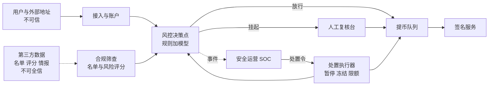
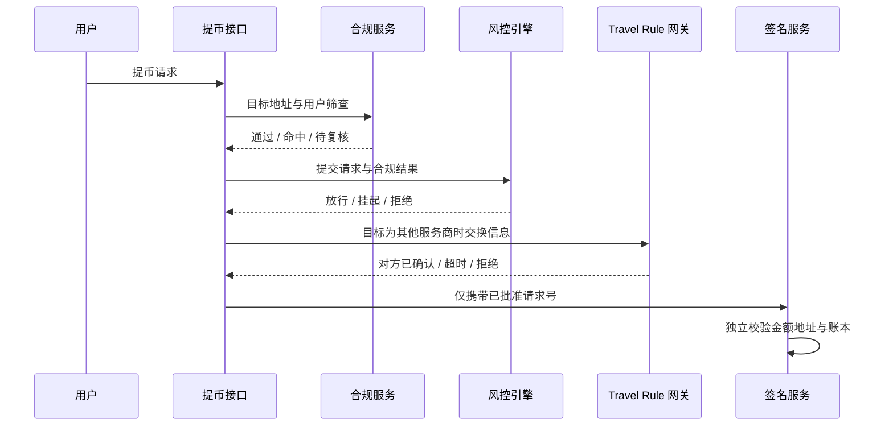
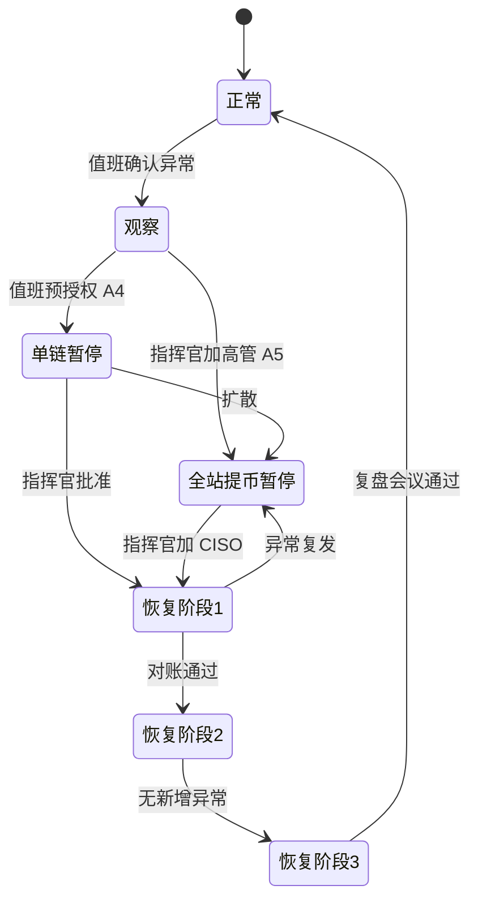

# X16 反欺诈、合规与安全运营：监测、处置权限、取证与恢复

> 学习目标：读完本章，你能——
> 1. 为交易所写出一张"处置权限表"：谁能在多长时间内暂停提币、冻结用户、通知监管、对外公告。
> 2. 把制裁筛查、Travel Rule、链上风险评分放进提币和充值链路，并写出分层规则与人工复核闭环。
> 3. 设计分阶段恢复提币的方案，并在笔记本上完成一次 30 分钟桌面推演。
>
> 适用角色：交易所安全运营（SecOps）负责人、风控与反欺诈工程师、合规官、事件指挥官。
> 前置章节：[X10 交易所安全架构总览](X10-cex-architecture-overview.md)（域 ⑥ 与暂停开关分级）、[X05 检测与响应工程](X05-detection-response-engineering.md)（检测方法、SIEM、SOAR、事件指挥通用做法）、[25 资金追踪、冻结与事后处置](../25-fund-tracing-response.md)、[23 托管、充提与合规安全](../23-custody-exchange-ops.md)
> 相关章节：[X11 客户身份、账户与访问](X11-cex-identity-account-access.md)、[X13 交易、结算与信用](X13-cex-trading-settlement-credit.md)、[X14 钱包、财资与支付渠道](X14-cex-wallet-treasury-payment.md)、[X15 交易所生产环境与数据](X15-cex-production-data.md)
> 最后核对：2026-11-23

> 💡 注意：本章不重复 X05 的通用内容（日志源、SIEM 分层、SOAR 通用边界、指挥角色、通报模板、证据保全清单）。本章只写交易所特有的三件事：**欺诈与合规监测怎样落到系统里**、**处置权限怎样设计**、**事后怎样取证与恢复**。需要通用做法时，请回到 X05。

---

## 开场：一个真实场景

周六凌晨 02:10，风控值班收到一条告警：一个 3 年老用户刚换了手机和邮箱，随后把约 8 万美元（示例）的 USDT 提到一个新地址。反欺诈规则给这笔提币打了 72 分。

值班人员有三个选择：放行、拦截、人工复核。每个选择都有代价。放行，可能是账户接管；拦截，可能是正常用户换了手机。更麻烦的是：同一时刻，合规系统提示这个新地址三跳之内接触过一个被制裁的混币服务。

这时需要回答的不是"这笔是不是欺诈"。需要回答的是：谁有权把这笔提币挂起？挂起多久？要不要通知合规官？要不要冻结账户？如果 20 分钟内同类告警出现 40 条，谁有权暂停全站提币？

<details class="predict"><summary>🤔 先猜再看：凌晨 02:10，风控值班发现同类提币在 20 分钟内出现 40 条。值班人员应该先暂停全站提币，还是先叫醒更高级别的人？</summary>

先做自己权限内最小的动作，同时叫人。合理的设计是：值班人员有权按下"单链或单类提币挂起"，并在 15 分钟内由事件指挥官追认；全站暂停需要指挥官加一名高管决定，决策时限在预案里写明。没有预授权的设计，会让值班人员在"擅自行动"和"等人批准"之间犹豫，而攻击者不会等。第 4 节给出权限表。

</details>

---

## 1. 一句话理解

**反欺诈管"谁在用账户"，合规管"这笔钱能不能走"，安全运营管"出事时谁说了算"。三者共用同一批数据和同一条提币链路，所以必须在一处协同，而不是三个部门各管一段。**

反欺诈（Fraud Prevention）：识别账户接管、盗刷、诈骗受害者、羊毛党等针对用户和平台的欺诈行为。
合规筛查（Compliance Screening）：按法规检查制裁名单、资金来源、Travel Rule 信息、地域限制。
处置权限（Disposition Authority）：事先规定谁在什么条件下，有权执行暂停、冻结、通报、公告。

> 🎯 打个比方：机场的安检、海关和机场指挥中心。安检查人（反欺诈），海关查货（合规），指挥中心在出事时决定关哪个登机口（处置权限）。三者看同一批旅客，但如果指挥中心不知道谁有权关闭登机口，一个可疑包裹就能让整座机场停摆半小时。
>
> 比喻的局限：机场的旅客大多不会主动伪装。交易所面对的是主动绕过规则、并持续试探阈值的对手。

---

## 2. 保护目标与信任边界

### 2.1 本章保护什么

| 保护目标 | 失去它的后果 |
|---|---|
| 用户资产（防账户接管与诈骗提币） | 用户损失，赔付成本，声誉 |
| 平台牌照与法律地位（防制裁与洗钱失守） | 罚款、刑事责任、被迫退出市场 |
| 处置动作的合法性与可审计性 | 冻结错人、滥用冻结权、证据无效 |
| 恢复过程的可信性 | 过早恢复导致二次失血 |

### 2.2 信任边界图



**读图要点：**

- 数据从左到右流动，决策点（风控）只有一个。合规筛查的结果输入风控，而不是各自旁路放行。
- 处置执行器是唯一能改变放行状态的组件。SOC 发"处置令"，不直接改数据库。这样每个动作都有令牌、有记录、可回放。
- 第三方名单与评分用虚线：它们是输入，不是真相。名单更新延迟、评分误报都要有人工复核兜底。
- 局限：图没有画客服渠道。客服的"解冻"请求也要走处置执行器，不能直接改状态（见 X11）。

> ⚠️ 警告：不要让 SOAR 或规则引擎读取告警里的自由文本并据此执行动作。攻击者可以把恶意内容写进用户名、备注或地址标签。通用理由见 [X05 第 6.14 节](X05-detection-response-engineering.md)。

---

## 3. 参考架构

### 3.1 欺诈类型与监测模型

| 欺诈类型 | 谁是受害者 | 典型信号 | 主要对策 |
|---|---|---|---|
| 账户接管（ATO） | 用户 | 新设备、改安全设置后提币、新地址 | 风险认证、延迟生效、提币挂起（[X11](X11-cex-identity-account-access.md)） |
| 盗刷与支付欺诈 | 平台或用户 | 被盗卡充值后快速换币提币 | 法币渠道隔离、充值后冷静期（[X14](X14-cex-wallet-treasury-payment.md)） |
| 钓鱼与杀猪盘（用户被骗后自己提币） | 用户 | 新地址、短时间内反复咨询、金额远超平时、被"指导"操作 | 受害者介入提示、延迟、人工回访 |
| 洗钱与混币 | 平台（法律责任） | 快进快出、拆分、链上来源污染 | 来源评分、AML 监控、上报 |
| 羊毛党与批量注册 | 平台 | 同设备多账号、同 IP 段、同时领奖励 | 设备指纹、关联图、奖励限额 |
| 内部人欺诈 | 平台与用户 | 客服批量查看、越权改状态 | 见 [X15](X15-cex-production-data.md) 与 [21 章](../21-social-engineering-insiders.md) |

> 💡 注意：杀猪盘里，操作提币的是用户本人，认证全部通过。规则不能只看"是不是本人"，还要看"是不是被人指挥"。这是账户安全之外的另一类风险。

### 3.2 规则与模型的分层

反欺诈不是一个"大模型打分"。通用做法是分四层，每层回答不同问题：

| 层 | 作用 | 举例 | 特点 |
|---|---|---|---|
| L0 硬规则 | 法律或政策禁止，命中即拒 | 制裁名单命中、被禁地域、已知被盗地址 | 无分数，不可被调参覆盖，改动需合规批准 |
| L1 专家规则 | 已知模式，可解释 | 改密后 24 小时内大额提币到新地址 | 有负责人、假阳性记录、回放测试 |
| L2 统计与模型 | 发现未知偏离 | 账户行为偏离自身基线、设备关联图异常 | 要有解释字段；先影子模式运行 |
| L3 人工复核 | 处理灰区与申诉 | 评分 60–85 的提币（示例） | 有 SLA、抽检、反馈回流 |

**为什么 L0 要独立于分数：** 合规义务不能用"概率"来履行。名单命中就是命中，不能因为用户信用分高而放行。

### 3.3 合规限制在系统中的落点



**读图要点：**

- 合规服务在风控之前，且结果必须进入风控的输入。命中名单的请求在 L0 就被拒，不会走到签名服务。
- Travel Rule 网关在放行之后、签名之前：对方服务商未确认时，请求停在队列，不进入签名。
- 签名服务只收"已批准请求号"，并独立核对账本（沿用 [X14](X14-cex-wallet-treasury-payment.md) 与 [29 章](../29-signing-path-2026.md) 的结论）。
- 局限：充值方向也要筛查，但流程相反（先入账待确认，再决定是否放行）。

### 3.4 合规要求速查（截至 2026 年公开资料）

> 以下只列与系统设计直接相关的要点。监管条款随辖区和时间变化，上线前请以官方最新文本和法务意见为准。

| 主题 | 要点 | 对系统的含义 | 来源类型 |
|---|---|---|---|
| FATF 第 16 项建议 | 2025 年 6 月修订，更名为"支付透明度"；总体生效时间为 2030 年底，需各辖区立法；对虚拟资产服务商以"适应新技术的框架"间接适用；明确 Travel Rule 本身不要求实时制裁筛查 | 传递信息与制裁筛查是两条独立链路，不能互相替代 | FATF 公告的律所与监管机构转述 |
| 欧盟 TFR（EU）2023/1113 | 适用于加密资产转账；第 14 条对信息随行不设最低金额；1,000 欧元只出现在第 14(5) 条：向自托管地址转账超过该金额时，须采取措施评估该地址是否由发起人拥有或控制；EBA 指引自 2024 年 12 月 30 日适用 | 欧盟业务不能设"小额豁免"；自托管地址要有归属评估流程 | EUR-Lex 法规原文、EBA 新闻稿 |
| 美国 | 制裁义务由 OFAC 管；FinCEN 的传递信息与记录保存要求适用于资金传输，金额门槛以现行规则为准；FinCEN 可依据《爱国者法》第 311 条对高风险外国机构采取特别措施，例如 2025 年 10 月对 Huione 集团的最终规则（2025 年 11 月 17 日生效） | 名单与特别措施变化快，筛查名单要自动更新，更新要有时间戳和审计 | FinCEN 公告、联邦公报 |

> 💡 注意：FATF 官方页面在本次核对时返回 403，FATF 修订要点来自律所与监管机构的转述。美国金额门槛本章没有核对到原文，因此写成"以现行规则为准"。

---

## 4. 处置权限设计

处置权限是本章的核心。目标是：事故中没人需要问"我能不能做"，也没人能越权做。

### 4.1 处置动作清单与分级

| 动作 | 影响范围 | 可逆性 | 法律 / 业务后果 |
|---|---|---|---|
| A1 对单笔提币挂起复核 | 单笔 | 可逆 | 低 |
| A2 暂停单个 API Key 或单用户提币 | 单用户 | 可逆 | 低 |
| A3 冻结单个用户账户 | 单用户 | 可逆，但有申诉义务 | 中：法律与客户影响 |
| A4 暂停单链或单币种提币 | 一条链 | 可逆 | 中：影响所有该链用户 |
| A5 暂停全站提币 | 全体用户 | 可逆，但挤兑与声誉代价高 | 高 |
| A6 暂停交易或全站停服 | 全体用户 | 可逆 | 最高 |
| A7 通知监管、报警 | 外部 | 不可逆 | 法律义务与时限 |
| A8 对外公告 | 外部 | 不可逆 | 法律与市场影响 |
| A9 向发行方、其他交易所提出冻结请求 | 外部 | 难撤回 | 需要证据与授权 |

### 4.2 权限矩阵示例

```yaml
# disposition-authority.yaml（示例，非任何真实机构配置）
actions:
  A1_hold_single_withdrawal:
    can_execute: [risk_analyst, secops_oncall]
    approver: none          # 自动或值班直接执行
    decision_window: "立即"
    notify: [risk_lead]
  A2_suspend_user_or_key:
    can_execute: [secops_oncall, risk_lead]
    approver: none
    max_duration: 24h       # 超过需 A3 流程
    notify: [compliance_officer]
  A3_freeze_account:
    can_execute: [risk_lead]
    approver: [compliance_officer]
    decision_window: "4h"
    require: [reason_code, evidence_ref, appeal_path]
  A4_pause_chain_withdrawals:
    can_execute: [secops_oncall]          # 预授权的最小熔断
    approver: [incident_commander]        # 事后 15 分钟内追认
    decision_window: "15m 内追认"
    notify: [custody_lead, cs_lead, comms_lead]
  A5_pause_all_withdrawals:
    can_execute: [incident_commander]
    approver: [ciso, ceo_or_delegate]     # 二人；其一失联则按顺位
    decision_window: "10m"
    deputy_order: [deputy_ic, cto]
  A7_notify_regulator_police:
    can_execute: [compliance_officer]
    approver: [general_counsel]
    decision_window: "按辖区法定时限；内部目标 4h 内完成首次通知"
  A8_public_announcement:
    can_execute: [comms_lead]
    approver: [incident_commander, general_counsel]
    require: [fact_check_by_tech_lead]
  A9_external_freeze_request:
    can_execute: [liaison]
    approver: [incident_commander]
    require: [address_list_versioned]
```

**设计要点：**

1. **预授权最小动作。** A4 允许值班先做，事后追认。没有预授权，值班人员会等人批准，损失在等待中发生。
2. **高影响动作双人。** A5 需要指挥官加一名高管，且写明顺位。人在休假不是不能处置的理由。
3. **不可逆动作走法务。** A7、A8 的措辞和时机有法律后果。技术人员不直接对外发布。
4. **每个动作都有原因码和证据引用。** 冻结必须能事后解释为什么冻结。
5. **滥用防护。** 冻结权也是风险：内部人可能冻结无关账户或泄露名单。所有 A3、A9 动作写入防篡改日志，月度抽检（见 [X15](X15-cex-production-data.md)）。

### 4.3 暂停开关状态机

[X10 的暂停开关](X10-cex-architecture-overview.md)给出了分级。本章补上"谁能推动状态转换"：



**读图要点：**

- 向上升级可以由权限较低的角色做；向下恢复必须由更高权限批准。这样"按错"可以修复，"过早恢复"受到约束。
- 恢复分阶段，任何阶段发现异常都回到暂停，不允许跳阶段。
- 图里的阶段 1–3 是简化：完整的六个阶段见第 6.5 节。
- 局限：图没有表示"部分币种先恢复"的组合。

---

## 5. 控制清单

| ID | 控制项 | 要防什么 | 优先级 | 怎么验证 |
|---|---|---|---|---|
| FRD-C01 | 合规筛查在风控之前，命中名单为 L0 硬拒，不受评分影响 | 为制裁对象提供服务 | P0 | 用测试名单地址发起提币，确认被拒且记录 |
| FRD-C02 | 制裁名单与风险评分自动更新，每次更新有版本和时间戳 | 名单过期 | P0 | 查看更新日志，抽查最近一次官方名单变更到上线的延迟 |
| FRD-C03 | 处置权限表存在，每个动作有执行人、批准人、决策时限、顺位 | 事故中无人敢动或越权 | P0 | 随机抽 3 个动作，问值班"你有没有权做"，答案与表一致 |
| FRD-C04 | 最小熔断动作（单链或单类提币）对值班预授权，并有追认流程 | 等待审批期间损失扩大 | P0 | 演练中从告警到执行用时 ≤ 目标值 |
| FRD-C05 | 处置通过执行器进行，所有动作有令牌、原因码与不可篡改日志 | 不可追溯的人工改库 | P0 | 审计抽 20 条冻结，100% 有原因码与证据引用 |
| FRD-C06 | 高风险提币进入人工复核台，有 SLA 与抽检 | 评分灰区无人处理 | P1 | 复核队列的积压量与处理时长报表 |
| FRD-C07 | 欺诈规则有负责人、假阳性记录、回放测试 | 规则腐烂 | P1 | 随机抽 5 条规则，查负责人与最近调优日期 |
| FRD-C08 | 受害者介入流程：对疑似被诱导的提币有延迟与回访 | 杀猪盘与诱导转账 | P1 | 回放历史被诈骗案例，确认规则能命中 |
| FRD-C09 | Travel Rule 网关：对方服务商未确认时请求不进入签名 | 信息缺失仍放行 | P1 | 向未响应对手方发起测试提币，确认停在队列 |
| FRD-C10 | 自托管地址归属评估流程（适用辖区） | 违反归属评估要求 | P1 | 抽查大额向自托管地址提币的评估记录 |
| FRD-C11 | 冻结与解冻有申诉通道与时限 | 错冻用户、法律风险 | P1 | 抽查申诉处理时长 |
| FRD-C12 | 证据保全先于清理与恢复；证据有哈希与保管链 | 证据被覆盖、无法起诉 | P0 | 演练后检查证据包完整性 |
| FRD-C13 | 恢复分阶段，每阶段有进入条件、对账与回退条件 | 过早恢复导致二次失血 | P0 | 审阅恢复方案文档与演练记录 |
| FRD-C14 | 外部协同联系人表（发行方、交易所、执法、安全公司）每季度验证有效 | 事发时联系不上 | P1 | 季度测试电话与邮件回复率 |
| FRD-C15 | 冻结权滥用防护：A3、A9 动作双人、月度抽检 | 内部人滥用冻结权 | P1 | 抽检记录与异常处理 |

---

## 6. 分级落地与落地做法

### 6.1 三档投入（建议，示例人数与时间）

| 档位 | 做什么 | 人数（示例） | 时间（示例） |
|---|---|---|---|
| 最小可行 | 处置权限表；L0 名单筛查；最小熔断；人工复核台（手工）；联系人表 | 兼职 2–3 人（风控、合规、安全各一） | 4–6 周 |
| 标准 | 加上 L1 规则 + 回放测试；处置执行器；Travel Rule 网关；分阶段恢复方案；季度演练 | 专职 4–6 人 + 7×24 值班轮转 | 3–6 个月 |
| 成熟 | 加上 L2 模型与关联图；案件管理；与执法对接流程；自动化证据收集；度量与外部审计 | 专职 8 人以上，独立反欺诈与金融犯罪团队 | 6–12 个月以上 |

> 💡 注意：最小档并不是"没有合规"。法定义务（名单筛查、可疑交易上报）不能因规模小而省略，但可以用外包服务和手工流程先满足。

### 6.2 规则示例 1：快进快出（洗钱漏斗，SQL）

假设：洗钱账户收到资金后很快转出，且净留存很低。

```sql
-- 示例表：deposits(user_id, amount_usd, created_at)
--         withdrawals(user_id, amount_usd, to_address, created_at)
--         users(id, kyc_level, registered_at)
WITH inflow AS (
  SELECT user_id, SUM(amount_usd) AS in_usd
  FROM deposits WHERE created_at > now() - INTERVAL '24 hours'
  GROUP BY user_id
), outflow AS (
  SELECT user_id, SUM(amount_usd) AS out_usd, COUNT(DISTINCT to_address) AS dst
  FROM withdrawals WHERE created_at > now() - INTERVAL '24 hours'
  GROUP BY user_id
)
SELECT u.id, i.in_usd, o.out_usd, o.dst
FROM inflow i JOIN outflow o USING (user_id)
JOIN users u ON u.id = i.user_id
WHERE i.in_usd >= 20000                    -- 示例阈值
  AND o.out_usd >= 0.9 * i.in_usd          -- 90% 以上已转出
  AND (o.dst >= 3 OR u.kyc_level < 2);     -- 拆到多个地址，或低 KYC
```

- **假阳性**：做市商、套利者、机构客户的正常资金周转。调优：对已登记的机构客户设白名单画像，不用同一阈值；按币种和业务类型分别设阈值。
- **局限**：攻击者可以拉长时间窗口或混入正常交易。该规则要与"来源评分"和"关联账户"规则配合。
- **动作**：命中后到 L3 人工复核，是否上报由合规官决定，不自动冻结。

### 6.3 规则示例 2：充值来源污染（SQL）

```sql
-- 示例表：deposits(id, user_id, chain, tx_hash, amount_usd, created_at)
--         address_risk(tx_hash, hop_count, category, score, source, fetched_at)
SELECT d.id, d.user_id, d.amount_usd, r.category, r.hop_count, r.score
FROM deposits d JOIN address_risk r ON r.tx_hash = d.tx_hash
WHERE d.created_at > now() - INTERVAL '10 minutes'
  AND ( r.category IN ('sanctioned','stolen_funds')          -- L0：直接进合规
        OR (r.category = 'mixer' AND r.hop_count <= 2 AND r.score >= 70) );  -- 示例阈值
```

- **假阳性**：评分供应商误标；小额混币后的"无辜"下游。调优：必须有人工复核与申诉；保留评分来源与时间戳；供应商之间交叉印证。
- **动作**：命中 `sanctioned` 的资金停在待处理账户，不得放行也不得自行退回，由合规官决定；被盗资金命中时，立即启动 [25 章](../25-fund-tracing-response.md) 的并行通知。
- **局限**：评分依赖第三方数据，存在漏报。不能把"没命中"当成"安全"。

### 6.4 规则示例 3：诱导转账（受害者介入，SQL）

```sql
-- 示例表：withdrawals(user_id, id, amount_usd, to_address, created_at)
--         support_chats(user_id, keyword_flag, ts)   -- 关键词标记：咨询"如何提币到某平台"等
SELECT w.user_id, w.id, w.amount_usd, w.to_address
FROM withdrawals w
WHERE w.created_at > now() - INTERVAL '10 minutes'
  AND w.amount_usd >= 3000                                    -- 示例阈值
  AND NOT EXISTS (SELECT 1 FROM withdrawals w2
                  WHERE w2.user_id = w.user_id AND w2.to_address = w.to_address
                    AND w2.created_at < w.created_at - INTERVAL '30 days')   -- 新地址
  AND EXISTS (SELECT 1 FROM support_chats s
              WHERE s.user_id = w.user_id AND s.keyword_flag = true
                AND s.ts > now() - INTERVAL '2 hours');       -- 刚咨询过提币类问题
```

- 逻辑：用户通过了全部认证，但行为呈现"刚被指导"的特征：新地址、短时间内咨询提币、金额远超平时。
- **动作**：延迟 2–24 小时（示例），向用户展示诈骗警示，人工回访。回访话术要避免引导用户说出"标准答案"，因为骗子会提前教。
- **假阳性**：用户真实地向新平台迁移资金。调优：对回访确认真实用途的用户记录在案，降低下次评分。
- **局限**：只能降低、不能消除风险。强硬拦截会让用户转去其他渠道，要平衡体验与保护。

### 6.5 分阶段恢复提币方案

恢复前的原则：**先证明账本可信，再放出资金；先小额，再大额；先低风险币种，再高风险币种。**

| 阶段 | 内容 | 进入条件 | 回退条件 |
|---|---|---|---|
| 0 暂停与证据 | 保全证据；确认攻击入口已关闭；撤销链上权限 | 指挥官批准 | — |
| 1 对账与封闭 | 链上余额、账本、银行三方对账；确认是否有资金缺口；轮换受影响密钥 | 入口关闭，证据已哈希 | 对账出现新差异 |
| 2 内测恢复 | 员工与受邀机构做小额提币；观察 1–4 小时（示例） | 对账通过 | 任何不一致 |
| 3 小额公开恢复 | 开放单笔小额（示例：≤ 500 美元）、日限额、低风险币种；挂起复核阈值调低 | 内测无异常 | P1 告警 |
| 4 扩展 | 逐步提高限额，开放更多币种与链 | 前阶段 24 小时无异常 | 同上 |
| 5 常态 | 恢复常规限额；保留额外监控 7–14 天 | 复盘会议通过 | — |

```python
# recovery_gate.py：恢复阶段进入条件检查（示例骨架）
CHECKS = {
  "evidence_hashed":  lambda s: s["evidence_manifest_hash"] is not None,
  "entry_closed":     lambda s: s["root_cause_contained"] is True,
  "balance_recon_ok": lambda s: abs(s["chain_balance"] - s["ledger_balance"]) <= s["tolerance"],
  "keys_rotated":     lambda s: s["affected_keys_rotated"] is True,
  "monitoring_up":    lambda s: s["alert_coverage"] >= 0.95,   # 示例阈值
  "approver_signed":  lambda s: len(s["approvers"]) >= 2,
}
REQUIRED = {1: ["evidence_hashed", "entry_closed"],
            2: ["balance_recon_ok", "keys_rotated"],
            3: ["monitoring_up", "approver_signed"]}

def can_enter_phase(state: dict, phase: int):
    need = REQUIRED.get(phase, ["approver_signed"])
    failed = [c for c in need if not (CHECKS[c])(state)]
    return len(failed) == 0, failed
```

> ⚠️ 警告：不要用恢复日期倒推方案（"周一必须开提币"）。恢复由条件触发，不由日历触发。

**赔付决策要点（通用做法）：**

1. 先确认损失范围和资金缺口，再决定赔付，不要在范围不明时公开承诺。
2. 区分"平台责任"与"用户被诈骗后自愿转出"。两类赔付政策不同，需要提前由法务、财务、合规共同定义。
3. 对赔付资金来源（保险基金、自有资金、借款）做出说明。
4. 赔付后保留追偿路径（保留证据、保留地址清单、参与悬赏与诉讼）。

### 6.6 调查取证

取证的通用清单（时间线、快照、哈希、保管链）见 [X05 第 6.15 节](X05-detection-response-engineering.md)。交易所特有的取证要点：

1. **链上证据包**：被盗交易哈希、攻击者地址清单（带版本号与时间戳）、下一跳、已冻结地址。地址清单每次更新都要有版本，因为冻结请求以版本为准（见 [25 章 4.2 节](../25-fund-tracing-response.md)）。
2. **链下证据包**：提币请求日志、风控决策记录、人工复核记录、登录与设备日志、客服记录、API 调用日志。
3. **时间一致**：所有日志统一到 UTC，并记录时钟偏差（见 [X15](X15-cex-production-data.md)）。
4. **保管链**：每份证据谁取得、谁保管、谁转交。
5. **与执法对接**：由单一联络人对接，每次提供的材料与日期都记录；提供前由法务审核，避免泄露无关用户信息。
6. **隐私与最小化**：证据包只含与事件相关的用户数据。对外共享前做脱敏（见 [24 章](../24-data-privacy.md)）。

```bash
# 示例：生成证据包清单与哈希（笔记本可跑；macOS 可把 sha256sum 换成 shasum -a 256）
cd evidence/incident-2026-001
find . -type f ! -name 'MANIFEST*' ! -name CUSTODY.log -print0 | sort -z | xargs -0 sha256sum > MANIFEST.sha256
sha256sum MANIFEST.sha256 > MANIFEST.sha256.sha256   # 清单自身的哈希，另存并外部存证
echo "$(date -u +%FT%TZ) sealed by $USER" >> CUSTODY.log
```

### 6.7 常见坑

- 把评分当作决策：评分只是输入，决策逻辑要写在可审计的规则里。
- 名单更新"每周手工"：制裁变更到上线的间隔应以小时计。
- 处置权限只写在预案文档，没有进入系统（执行器不校验权限）。
- 冻结后没有申诉通道，错冻用户长期无法联系到人。
- 恢复时先开放大额，再补对账。
- 只演练技术处置，不演练"谁来通知监管与公告"。

---

## 7. 运营：指标、告警、值班、演练、季度节奏

### 7.1 指标

| 指标 | 含义 | 目标（示例） |
|---|---|---|
| 欺诈损失率 | 欺诈损失 / 提币总额 | 趋势下降 |
| 命中精度（Precision） | 人工确认欺诈 / 规则命中 | 每条规则单独跟踪 |
| 复核积压时长 | L3 队列平均等待 | ≤ 1 小时 |
| 名单更新延迟 | 官方发布到系统生效 | 数小时内，目标写明 |
| 处置时延 | 告警到处置执行 | P1 ≤ 10 分钟 |
| 错冻率 | 申诉成功 / 冻结总数 | 趋势下降 |
| 演练完成率 | 本季度演练 / 计划 | 100% |

### 7.2 SOC 分级与协同矩阵

SOC 分级和值班制度沿用 [X05 第 7 节](X05-detection-response-engineering.md)。交易所的协同矩阵：

| 事件 | 主导 | 必须参与 | 通知 |
|---|---|---|---|
| 账户接管批量 | 风控 | 安全、客服 | 合规、公关 |
| 疑似制裁命中 | 合规 | 风控 | 法务 |
| 热钱包异常 | 事件指挥官 | 钱包、安全、风控 | 合规、法务、公关、执法、发行方 |
| 内部人异常 | 安全、人力 | 法务 | 合规 |
| 数据泄露 | 安全、法务 | 客服、公关 | 监管、受影响用户 |

> 💡 注意：矩阵里"通知"栏是权利，不是任务清单。每次事件开始时，指挥官要明确"谁在什么时间前被通知"。

### 7.3 季度节奏

| 时间 | 活动 |
|---|---|
| 每周 | 复核队列回顾；规则命中与调优；名单更新检查 |
| 每月 | 冻结与解冻抽检；欺诈损失与错冻报表；联系人表抽测 |
| 每季度 | 桌面推演（见第 13 节）；规则回放测试；权限表复核（有人员变动即更新） |
| 每半年 | 与法务、合规共同复核辖区义务变化；与外部审计对照 |
| 每年 | 跨部门演练（含监管沟通与对外公告）；红队攻击提币链路 |

---

## 8. 失效案例

> 💡 注意：以下案例均在 2026-11-23 重新查找公开来源。金额写"约"；归因写"公开报道归因于"。本章没有收入"羊毛党或反欺诈规则被绕过"的独立案例，因为没有找到足够可靠的公开来源。更多事故见 [28 事故案例库](../28-incident-casebook.md)。

### 案例 1：Binance 的合规认罪（2023 年 11 月，美国）——合规控制缺失

- **事实：** 2023 年 11 月 21 日，Binance 在美国认罪，同意支付约 43 亿美元的刑事罚款与没收。美国司法部称 Binance 尽管交易量巨大，从未向 FinCEN 提交过可疑活动报告；FinCEN、OFAC 另有处罚，司法部对其中约 18 亿美元予以抵免，所以各机构数字不能简单相加；财政部可在五年内通过监督员访问其账簿与系统。
- **打穿的控制：** 可疑活动上报、制裁筛查、合规独立性（对应 FRD-C01、C02）。
- **教训：** 合规失守的代价可以远超一次被盗。监管把"没有上报"当作独立的违法行为。
- 来源（律所解读与官方发布页）：[Reed Smith](https://www.reedsmith.com/our-insights/blogs/viewpoints/102ita1/binance-and-founder-changpeng-zhao-plead-guilty-and-pay-more-than-4-billion-in-p/)、[美国司法部发布页](https://www.justice.gov/opa/gallery/binance-and-ceo-plead-guilty-federal-charges-4b-resolution)。司法部主新闻稿本次抓取为空，细节以前两者为准。

### 案例 2：KuCoin 与 OKX 的认罪（2025 年 1–2 月，美国）——无牌经营与 AML 缺失

- **事实：** 2025 年 1 月 27 日，KuCoin 运营方 PEKEN 对"经营无牌资金传输业务"认罪，罚款与没收合计约 2.97 亿美元。公开报道称，检方指其缺少有效的 AML 与 KYC，也未提交可疑活动报告。2025 年 2 月，OKX 运营方 Aux Cayes FinTech 对同类罪名认罪，罚款与没收合计约 5.04 亿美元；司法部称其 2018 年至 2024 年初处理了超过 1 万亿美元的美国相关交易；认罪协议要求聘用外部合规顾问至 2027 年 2 月；OKX 的律师强调和解不含洗钱指控。
- **打穿的控制：** 地域限制与客户准入（FRD-C01）、可疑交易监控与上报（FRD-C06）。
- **教训：** "地域限制"不是服务条款里的一句话，而要落到注册、登录、设备与支付的系统控制里。
- 来源（官方新闻稿与媒体）：[美国司法部（KuCoin）](https://www.justice.gov/usao-sdny/pr/kucoin-pleads-guilty-unlicensed-money-transmission-charge-and-agrees-pay-penalties)、[美国司法部（OKX）](https://www.justice.gov/usao-sdny/pr/okx-pleads-guilty-violating-us-anti-money-laundering-laws-and-agrees-pay-penalties)、[The Block（KuCoin）](https://www.theblock.co/post/337275/crypto-exchange-kucoin-pleads-guilty-to-us-charges-and-agrees-to-pay-300-million-bloomberg)。

### 案例 3：Coinbase 客服内部人与诈骗（2024 年底至 2025 年 5 月）——内部人、数据与受害者赔付

- **事实：** Coinbase 称外部人员收买海外客服承包商，获取有限的客户账户数据。报道称缅因州总检察长备案显示受影响人数为 69,461；攻击者索要 2,000 万美元，Coinbase 拒绝，并设立 2,000 万美元悬赏征集线索；公司表示会赔付被诱骗转币的用户，并估计相关成本为 1.8 亿至 4 亿美元。
- **打穿的控制：** 客服可见数据范围、异常查看监测（X05 规则 7，[X15](X15-cex-production-data.md)）、诱导转账的受害者介入（FRD-C08）。
- **教训：** 数据泄露本身不丢币，但会变成后续社工诈骗的素材。赔付成本也要在处置权限表里有决策人。
- 来源（媒体报道）：[CyberScoop](https://cyberscoop.com/coinbase-cyberattack-extortion-counter-reward/)、[eSecurity Planet](https://www.esecurityplanet.com/?p=39214)。本章未能核对 SEC 8-K 原文与缅因州备案原文。

### 案例 4：Bybit 被盗后的恢复（2025 年 2 月）——"保持提币开放"的取舍

- **事实：** 公开报道称 Bybit 被盗后保持提币开放；CEO 称 ETH 缺口已补足。链上分析公司 Lookonchain 把补充来源归为借款、大户存入与购买，合计约 44.7 万 ETH（约 12.3 亿美元）；其中向 Bitget 借入的 4 万 ETH 在三天内归还。审计方 Hacken 称主要资产的抵押率超过 100%。被盗资产本身没有因此追回。
- **对应控制：** 恢复前的对账与缺口确认（FRD-C13）。
- **教训：** 这是"不暂停、靠外部资源补缺口"的路线，依赖大量流动性和市场信心，多数机构不具备。多数机构应按第 6.5 节分阶段恢复，并在公告里说明缺口数字与来源。
- 来源（媒体报道）：[The Block](https://www.theblock.co/post/342896/bybit-ceo-says-exchange-has-closed-shortfall-in-eth-reserves-plans-to-release-audited-por-report)、[Cointelegraph](https://cointelegraph.com/news/bybit-repays-bitget-loan-after-hack)。事故路径见 [29 章](../29-signing-path-2026.md)。

### 案例 5：Prince Group 与 Huione（2025 年 10 月）——杀猪盘资金与对手方筛查

- **事实：** 2025 年 10 月，美国司法部起诉柬埔寨 Prince Group 董事长陈志，指控其经营强迫劳动的诈骗园区并洗钱，同时提起民事没收，涉及 127,271 枚比特币（报道称约 150 亿美元，估值口径略有差异）。OFAC 同时制裁该集团的关联网络。FinCEN 依据《爱国者法》第 311 条对 Huione 集团发布最终规则，2025 年 10 月 16 日公布、11 月 17 日生效，禁止受管金融机构为其开立或维持代理账户。
- **对应控制：** 对手方与来源筛查、名单自动更新（FRD-C02）；杀猪盘受害者介入（FRD-C08）。
- **教训：** 制裁和特别措施会在公告日生效。交易所的名单更新延迟，等于在这段时间里违规服务。
- 来源（官方发布）：[美国司法部（EDNY）](https://www.justice.gov/usao-edny/pr/chairman-prince-group-indicted-operating-cambodian-forced-labor-scam-compounds-engaged)、[FinCEN 新闻稿](https://www.fincen.gov/news/news-releases/fincen-issues-final-rule-severing-huione-group-us-financial-system)、[联邦公报](https://www.federalregister.gov/documents/2025/10/16/2025-19571/imposition-of-special-measure-regarding-huione-group-as-a-foreign-financial-institution-of-primary)。

### 案例与控制映射

| 案例 | 打穿的控制 | 本章控制 |
|---|---|---|
| Binance 2023 | 上报、筛查、合规独立 | FRD-C01、C02 |
| KuCoin / OKX 2025 | 地域限制、AML 监控 | FRD-C01、C06 |
| Coinbase 2025 | 内部人数据、受害者介入、赔付决策 | FRD-C08、C03 |
| Bybit 2025 | 恢复与对账 | FRD-C13 |
| Prince Group / Huione 2025 | 名单更新、对手方筛查 | FRD-C02、C08 |

---

## 9. 评估检查点

- [ ] **FRD-1** 处置权限表存在，覆盖 A1–A9，每项有执行人、批准人、决策时限和顺位，最近 90 天内复核过。
- [ ] **FRD-2** 最小熔断（单链或单类提币）对值班预授权，并在演练中验证过从告警到执行的用时。
- [ ] **FRD-3** 处置动作经执行器执行，100% 有原因码、证据引用和不可篡改日志。
- [ ] **FRD-4** 制裁与风险名单自动更新，有版本与时间戳；最近一次官方变更到生效的延迟已测量。
- [ ] **FRD-5** 名单命中为 L0 硬拒，评分不能覆盖；测试地址验证过。
- [ ] **FRD-6** 欺诈规则有负责人、假阳性记录和回放测试；每季度至少调优一次。
- [ ] **FRD-7** 人工复核台有 SLA 与抽检，复核结果回流给规则负责人。
- [ ] **FRD-8** 存在受害者介入流程与话术，回访不引导标准答案。
- [ ] **FRD-9** Travel Rule 对方未确认时，请求不进入签名；测试验证过。
- [ ] **FRD-10** 自托管地址归属评估流程存在（适用辖区），抽查记录齐全。
- [ ] **FRD-11** 冻结与解冻有申诉通道与时限；错冻率被统计。
- [ ] **FRD-12** 证据包有清单哈希与保管链；演练后检查过完整性。
- [ ] **FRD-13** 恢复方案分阶段，每阶段有进入与回退条件，并有两人批准。
- [ ] **FRD-14** 外部联系人表每季度验证，回复率有记录。
- [ ] **FRD-15** 冻结权滥用防护：A3、A9 双人、月度抽检。
- [ ] **FRD-16** 近 12 个月做过至少一次包含"通知监管、对外公告"环节的演练。

**把检查结果写进报告：**

| 检查项 | 结果（通过 / 部分 / 不通过） | 证据位置 | 差距与负责人 | 目标日期 |
|---|---|---|---|---|
| FRD-1 | | | | |
| FRD-2 | | | | |
| …… | | | | |

---

## 10. 上手路径

**第一周：**
1. 读 X10 的暂停开关分级和 X05 的 SOAR 边界。
2. 画一张当前提币链路图，标出合规筛查、风控、人工复核、签名的位置。
3. 找出现状里"谁能暂停提币"的真实答案。问三个人，看答案是否一致。
4. 起草处置权限表第一版（只列 A1–A5）。

**第一个月：**
1. 把权限表推动到合规、法务、风控共同签署，并明确顺位。
2. 盘点名单与评分来源，测量更新延迟。
3. 写 3 条 L1 规则并做回放测试（第 6.2–6.4 节为起点）。
4. 做一次 30 分钟桌面推演（第 13 节）。

**第一季度：**
1. 建处置执行器的最小版本，让所有冻结有原因码。
2. 把分阶段恢复方案写成文档，并演练一次"阶段 1 到阶段 3"。
3. 建联系人表并做第一次真实联络测试。
4. 向管理层汇报：权限表、演练结果、指标基线。

---

## 11. 常见误区

| 误区 | 为什么错 | 正确做法 |
|---|---|---|
| "合规是法务的事，与安全无关" | 名单更新延迟、筛查位置错误都是工程问题 | 合规筛查纳入系统设计与演练 |
| "评分高就是欺诈，直接冻结" | 误伤正常用户，有法律风险 | 评分进入人工复核，冻结走 A3 流程 |
| "出事再决定谁有权暂停" | 等待审批期间损失扩大 | 预授权最小动作，事后追认 |
| "恢复越快越好" | 过早恢复可能二次失血 | 条件触发，分阶段 |
| "冻结后就结束了" | 错冻要有申诉，证据要保全 | 冻结配套申诉与证据包 |
| "杀猪盘用户本人操作，不是欺诈" | 用户是被诱导的受害者，平台有声誉与监管风险 | 加受害者介入流程 |

---

## 12. 术语表

| 术语 | 说明 |
|---|---|
| 反欺诈（Fraud Prevention） | 识别并阻止针对用户或平台的欺诈行为 |
| 账户接管（ATO，Account Takeover） | 攻击者取得用户账户的控制权 |
| 制裁筛查（Sanctions Screening） | 检查用户和地址是否在制裁名单上 |
| Travel Rule（旅行规则） | 虚拟资产服务商之间转账时传递发起人与受益人信息的要求 |
| 可疑活动报告（SAR） | 向金融情报机构上报可疑交易的报告 |
| 处置权限（Disposition Authority） | 事先规定的谁在何条件下可执行暂停、冻结、通报、公告 |
| 处置执行器 | 唯一能改变放行状态的组件，记录令牌与原因码 |
| L0 硬规则 | 法律或政策要求的规则，命中即拒，不受评分影响 |
| 受害者介入 | 对疑似被诱导的转账设置延迟、提示与回访 |
| 保管链（Chain of Custody） | 记录证据谁取得、谁保管、谁转交 |
| 第 311 条特别措施 | 美国《爱国者法》授权对高风险外国机构采取的限制措施 |

---

## 13. 动手练习与思考题

### 练习 1：写一张处置权限表（30 分钟）

用第 4.2 节的 YAML 作为模板。为你熟悉的机构（或虚构的 50 人交易所）填写 A1–A9：执行人、批准人、决策时限、顺位。然后找一位同事，问他"凌晨 3 点你发现同类提币异常，你能做什么"，对比答案。

### 练习 2：30 分钟桌面推演——"同类提币告警激增"

1. 旁白（2 分钟）：凌晨 02:10，风控收到 15 条同类告警，10 分钟后增至 40 条，涉及 3 条链，总额约 300 万美元（示例）。
2. 注入 1（5 分钟）：合规提示其中 6 个目标地址与被制裁实体有关联。
3. 注入 2（5 分钟）：客服收到 20 位用户称"没有提币，但账户被改了邮箱"。
4. 注入 3（5 分钟）：一名记者询问是否发生被盗。
5. 评分（13 分钟）：谁在几分钟内按下了哪个动作？有没有人越权或犹豫？谁通知了合规官与法务？公告由谁起草、谁批准？证据在恢复前保全了吗？

### 练习 3：写并回放一条规则

用第 6.2 节的 SQL 骨架，在本地用 SQLite 或 DuckDB 造 200 行示例数据，其中混入 3 条"洗钱漏斗"和 5 条"正常做市商"。调阈值，使命中 3 条且假阳性 ≤ 1 条。记录你的调参过程。

> 建议配套（后续在 L3 训练营实现）：一个规则回放与处置权限校验小工具，输入规则和日志样本，输出命中与误报，并检查处置动作是否越权。

### 思考题

1. 如果最小熔断（A4）对值班预授权，误按的代价由谁承担？你会怎样在制度里把"敢按"和"乱按"区分开？
2. 名单命中但用户是机构客户，且业务影响很大。L0 硬拒有没有例外？如果有，谁批准，怎样留痕？
3. 受害者介入会延迟用户提币，也会让一部分用户转向监管更松的平台。你怎样衡量这笔账？

> 🪞 反思：回想你所在机构，最近一次需要"暂停"的事件里，从发现到执行用了多久？这个时间里有多少是在找人而不是在判断？

---

## 附：来源与时效说明

- 第 3.4 节与第 8 节的事实来自 2026-11-23 当天的公开来源查询：美国司法部（KuCoin、OKX、Prince Group）、FinCEN 与联邦公报（Huione）、EUR-Lex（TFR 第 14 条）、EBA 新闻稿、律所与媒体转述（Binance、Bybit、Coinbase、FATF 修订）。
- 未能直接核对到原文的：FATF 第 16 项建议页面（403）、SEC 8-K 与缅因州备案原文、美国 Travel Rule 的金额门槛。正文已标明"转述"或"以现行规则为准"。
- 监管要求会随辖区和时间变化。上线前请以官方最新文本和法务意见为准。
