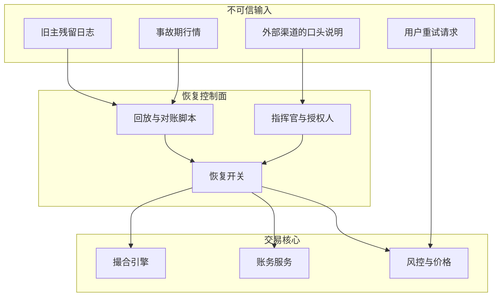
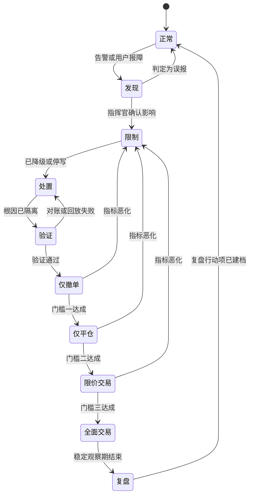
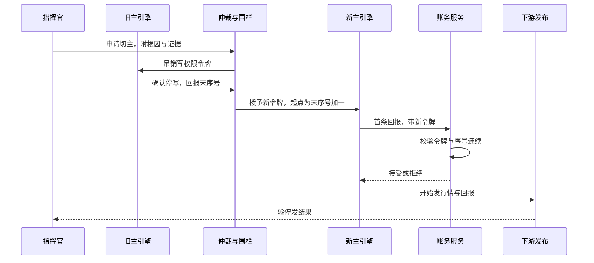

# X16 交易、结算与信用·运营与恢复：过载保撮合、切主验停写、复市与恢复授信

> 学习目标：读完本章，你能——
> 1. 画出交易事故的恢复状态机，写清每个状态的进入条件、退出条件和有权推动的人。
> 2. 为"过载、切主、异常价格、穿仓、授信"五类事故写出决策矩阵、复市清单和停写验证脚本。
> 3. 带团队跑两场 30–45 分钟的桌面推演，并写出用户公告、监管通报和合作方通知。
>
> 适用角色：交易所安全工程师、撮合与风控系统负责人、值班指挥、账务与运营人员。
> 前置章节：[X14 交易、结算与信用](X14-cex-trading-settlement-credit.md)（设计）、[X15 交易、结算与信用·工程验收](X15-cex-trading-verification.md)（验收）、[X05 检测与响应工程](X05-detection-response-engineering.md)、[X06 韧性与验证](X06-resilience-validation.md)
> 交互实验 / 模板：[永续合约实验](../interactive/perp-lab.html)、[事故响应手册与值班模板](../templates/T09-incident-runbook-oncall.md)、[桌面推演脚本与评分表](../templates/T10-tabletop-script-scorecard.md)
> 最后核对：2026-11-23

---

## 开场：一次"以为很快就好"的决定

2025 年 11 月 27 日美国东部时间 21:41（感恩节晚上），CME Group 的交易系统所在的一个数据中心出现冷却故障。公开报道称，故障设施是 CyrusOne 在伊利诺伊州 Aurora 的机房，市场停摆 10 小时以上（不同媒体给出 10 到 11 小时）。Bloomberg 转述的消息称，CME 在纽约地区有灾备机房，但没有切过去：当时得到的信息显示故障会很快结束，结果停机远比预期久（[Insurance Journal 转述 Bloomberg](https://www.insurancejournal.com/news/midwest/2025/12/01/849319.htm)、[Fortune](https://fortune.com/2025/11/30/cme-outage-financial-markets-data-center-cyrusone-aurora-illinois/)）。

这是传统衍生品交易所的案例，不是加密交易所。本章引用它，是因为它展示了所有交易事故共有的一个决策点：**"等它自己好"和"现在就切"，谁来拍板，凭什么拍板，什么时候必须放弃等待。**

<details class="predict"><summary>🤔 先猜再看：灾备机房就在那里，为什么不立刻切？</summary>

因为切换本身有风险。切主要保证旧主不再写、新主序号接得上、未确认的订单有说法。这些验证在平时没演练过，事故中谁也不敢按下按钮。公开报道只说"当时认为很快恢复"。本章教你把"切不切"变成一张有时间线的决策表：例如"超过 N 分钟没有恢复预期就必须切，并且切换步骤已经演练过"。

</details>

---

## 1. 一句话理解

**交易事故的恢复，核心不是"尽快重启"，而是"每放开一项功能之前，先证明账、单、价三样东西是对的"。**

> 🎯 打个比方：交易所像一家夜间营业的银行大厅。出事后，经理不会直接拉开卷帘门。他先让柜员只收回"取消的申请单"（只撤单），再让客户把手里的仓位结清（只平仓），再让有经验的客户办限价业务，最后才全面营业。每放开一档，他都要先点钞。
>
> 比喻的局限：银行大厅一次只有几十个人，点钞可以人工做。交易所的订单以毫秒计，"点钞"必须是预先写好的脚本和对账规则，事故中现写来不及。

本章负责保护域 ③ 的事后部分：事故发生后怎样发现、限制、处置、验证、分阶段恢复。设计见 X14，验收见 X15，本章不重复。

三类常见误解：

1. "恢复 = 系统重新启动。" 不是。系统启动只是进入"验证"状态。
2. "切到备机就安全了。" 不是。如果旧主还在写，会出现两套序号，称为脑裂（Split Brain：两个节点同时认为自己是主）。
3. "复市以后再补账。" 不是。账务差异在复市前没有闭合，复市只会放大差异。

---

## 2. 保护目标与恢复边界

### 2.1 恢复要保护什么

| 保护目标 | 具体含义 | 恢复时的典型威胁 |
|---|---|---|
| 订单真实 | 每笔订单有唯一序号，状态可追溯 | 备机序号重复或跳号；未确认订单被重复执行 |
| 成交真实 | 成交回报与撮合日志一致 | 事故中成交未入账，或入账两次 |
| 账务平衡 | 借贷相等，冻结与解冻对称 | 半截事务；切主后重放日志 |
| 价格可信 | 标记价来自多个独立来源 | 复市首笔用了事故价格或陈旧价格 |
| 用户公平 | 补偿、强平、撤单规则一致 | 事后拍板，对不同用户不同标准 |
| 授信稳健 | 贷款与抵押品净值匹配 | 事故后抵押品净值低于贷款，仍然放新贷款 |

### 2.2 恢复期间的信任边界



**读图要点：**

- 事故中产生的行情、日志、用户重试请求，全部是"待验证数据"，不能直接作为复市依据。
- 恢复开关只能由恢复控制面推动。开关必须由"指挥官授权 + 脚本验证结果"两个条件共同触发。
- 口头说明（例如某渠道说"已经修好"）要转成证据再用。
- 局限：本图只画交易核心。钱包与支付见 [X19](X19-cex-treasury-recovery-ops.md)，证据保全见 [X22](X22-cex-production-recovery-ops.md)。

---

## 3. 恢复状态机

### 3.1 状态图



**读图要点：**

- 恢复不是单向的。任何一档指标恶化，退回"限制"。
- "验证"是唯一能放行的入口，而且失败会回到"处置"。
- "复盘"要等稳定观察期结束才开始，防止事故还没稳就写结论。
- 局限：状态机只描述单个市场。多个市场共享一个撮合集群时，状态要按市场分别记录。

### 3.2 每个状态的条件与授权

| 状态 | 进入条件 | 退出条件 | 有权推动的人 |
|---|---|---|---|
| 发现 | 告警触发，或客服 10 分钟内收到 N 条同类报障（N 为示例，建议取近 30 天基线的 3 倍） | 值班确认"真事故"或"误报" | 一线值班 |
| 限制 | 指挥官确认影响范围，决定降级、暂停或只撤单 | 限制已落地，并有回报 | 事故指挥官 |
| 处置 | 限制已落地 | 根因已隔离：主备只有一个在写；价格源已剔除；恶意流量已拦截 | 技术负责人 |
| 验证 | 处置完成 | 第 6.2 节清单全部通过，并有证据 | 账务 + 风控 + 安全三方 |
| 仅撤单 | 验证通过 | 撤单成功率与延迟达标，持续 N 分钟 | 指挥官 + 风控负责人 |
| 仅平仓 | 门槛一达成 | 强平与平仓引擎无异常，保证金校验一致 | 指挥官 + 风控负责人 |
| 限价交易 | 门槛二达成 | 价格带有效，成交与分录对账差异为零 | 指挥官 + 风控负责人 |
| 全面交易 | 门槛三达成 | 稳定观察期无新告警（示例：2 小时） | 业务负责人（CRO 或同级） |
| 复盘 | 观察期结束 | 行动项有负责人与到期日 | 安全负责人主持 |

> 💡 注意："有权推动"不等于"一个人说了算"。所有放行动作建议用 X14 的双人审批机制，并在记录里写明谁批、依据什么证据。

---

## 4. 过载保撮合

### 4.1 为什么过载是安全问题

过载来自三类原因：行情暴涨暴跌带来的自然洪峰；脚本或做市商策略故障带来的订单风暴；恶意流量。无论原因，撮合引擎的目标只有一个：**保住已有订单的状态正确，其次才是接新单。**

2020 年 3 月 BitMEX 的事故是一个公开案例。BitMEX 称，2020 年 3 月 13 日 UTC，平台遭受两次分布式拒绝服务攻击（DDoS），分别在 02:16 与 12:56。据 Finance Magnates 转述，BitMEX 首席技术官 Samuel Reed 说明，攻击者找到一个"稳定而缓慢"的接口，让数据库做全表扫描，数千个并发查询把数据库推到高负载（[Finance Magnates](https://www.financemagnates.com/cryptocurrency/exchange/bitmex-caught-in-cross-hairs-of-two-attacks-in-one-month-says-cto/)）。详见第 16 节案例。

### 4.2 降级阶梯

降级要预先定义，每一档的触发指标、动作和回退条件都写死。示例如下（阈值为示例，需按自己的基线调整）：

| 档位 | 触发（任一） | 动作 | 回退条件 |
|---|---|---|---|
| L0 正常 | — | 无 | — |
| L1 限流 | 撮合队列延迟 > 基线 3 倍，持续 1 分钟 | 对下单接口按账户限流；关闭批量下单 | 延迟回到基线 1.5 倍内，持续 5 分钟 |
| L2 保撤单 | 队列延迟 > 基线 10 倍，或撤单 P99 超过阈值 | 撤单与平仓走独立通道，优先处理；新开仓单降速 | 撤单 P99 恢复，持续 10 分钟 |
| L3 只撤单 | 撮合延迟失控，或账务与撮合序号差异扩大 | 拒绝所有新订单，只接受撤单与强平 | 走第 3 节的验证与分阶段恢复 |
| L4 停写 | 数据一致性存疑 | 撮合停写，保留日志，不处理任何订单 | 走第 5 节"切主验停写停发" |

### 4.3 过载保护的配置示例

```yaml
# 示例：撮合入口的过载保护配置（示意，数值需按自己的压测结果调整）
overload_policy:
  metrics:
    - name: match_queue_delay_ms
      l1: { gt: 3x_baseline, for: 60s }
      l2: { gt: 10x_baseline, for: 30s }
    - name: cancel_p99_ms
      l2: { gt: 800, for: 30s }
    - name: ledger_seq_gap
      l3: { gt: 0, for: 10s }       # 撮合序号与账务序号出现缺口
  actions:
    l1: [per_account_rate_limit, disable_batch_orders]
    l2: [priority_lane_for_cancel_and_liquidation, slow_new_open_orders]
    l3: [reject_new_orders, allow_cancel_only, allow_liquidation]
    l4: [freeze_write, preserve_logs]
  guard:
    # 降级必须可被自动触发，但回退必须人工确认
    auto_escalate: true
    auto_deescalate: false
    approvers_for_deescalate: [incident_commander, risk_lead]
```

关键设计：**升级自动、降级人工。** 自动升级能在凌晨三点保护账本；人工降级防止指标刚好过线就放开、又立刻被打回。

### 4.4 撤单优先的原因

用户在波动期最需要的是撤单与降低风险。如果撮合引擎把撤单和新单放在同一个队列里，过载时撤单会被拖慢，用户损失扩大，投诉与补偿成本也随之增加。建议：

1. 撤单和强平有独立的入口、独立的线程池或队列。
2. 撤单不做复杂的前置风控，只验证"这笔单属于这个账户"。
3. 撤单在日志里单独成行，便于事后回放。
4. 压测报告必须含"撤单洪峰"（对应 X14 的 TRD-C15）。

> ⚠️ 警告：过载时关闭"撤单"来保护撮合引擎，是最危险的选择。用户无法降低风险，会把自己的损失归因于平台。如果必须限制，也要保留强平通道与撤单的最小流量。

---

## 5. 切主、验停写、验停发

### 5.1 为什么切主最危险

撮合引擎主备切换，要回答三个问题：旧主停了吗？新主的序号接得上吗？切换期间的订单去哪了？答错任何一个，都会出现双写、跳号或重复成交。



**读图要点：**

- 先吊销旧主令牌，再授权新主。顺序反了就会有一段时间两个主同时可写。
- 账务服务是最后一道关：它只接受带有效令牌、序号连续的回报。
- 旧主"回报末序号"必须来自日志实际最后一行，不能来自内存状态，因为内存可能已丢失。
- 局限：本图假设有独立的仲裁服务。如果仲裁服务本身是单点，要先解决这个问题。

### 5.2 验停写

"停写"指旧主不再向订单库、成交库、账务和行情写入。验证办法有三类，建议叠加：

1. **令牌围栏（Fencing Token）：** 每次主切换产生一个单调递增的令牌。所有下游写入都带令牌，下游拒绝令牌小于已见最大值的请求。
2. **网络与进程隔离：** 在旧主所在节点上切断对外写入的网络路径，必要时终止进程；并保存现场。
3. **日志核对：** 对比旧主最后写入序号与新主起点序号，应连续无重叠。

```python
# 示例：切主后的序号接续与重复检查（示意，表结构为假设）
import sqlite3

def check_cutover(conn, old_token, new_token):
    cur = conn.cursor()
    # 1. 旧令牌下最后一个序号
    last_old = cur.execute(
        "SELECT MAX(seq) FROM order_events WHERE token=?", (old_token,)
    ).fetchone()[0]
    # 2. 新令牌下第一个序号
    first_new = cur.execute(
        "SELECT MIN(seq) FROM order_events WHERE token=?", (new_token,)
    ).fetchone()[0]
    # 3. 旧令牌在新令牌授权之后是否还有写入
    t_new = cur.execute(
        "SELECT MIN(created_at) FROM order_events WHERE token=?", (new_token,)
    ).fetchone()[0]
    late_writes = cur.execute(
        "SELECT COUNT(*) FROM order_events WHERE token=? AND created_at>?",
        (old_token, t_new),
    ).fetchone()[0]
    # 4. 序号是否重复
    dup = cur.execute(
        "SELECT COUNT(*) FROM (SELECT seq FROM order_events "
        "GROUP BY seq HAVING COUNT(*)>1)"
    ).fetchone()[0]
    return {
        "gap_or_overlap": first_new - last_old - 1,   # 应为 0
        "late_writes_by_old": late_writes,            # 应为 0
        "duplicate_seq": dup,                         # 应为 0
    }
```

通过标准：三个数字全为 0。任何一个非 0，状态回到"处置"，不得进入分阶段恢复。

### 5.3 验停发

"停发"指旧主不再向行情推送、成交回报、用户通知、API 回调发布消息。常见遗漏是旧主的消息发布组件独立运行，主引擎已停，它仍在重放缓冲区里的旧消息。

验停发清单：

1. 行情推送：新旧主的序号在订阅端是否出现回退或重复。
2. 成交回报：同一成交 ID 是否只被推送一次。
3. 回调与 Webhook：做市商与机构客户的回调是否有幂等键，重复回调是否被对方拒绝。
4. 用户通知：邮件、短信、站内信是否有重复发送（成交通知重复会引发用户误解）。

### 5.4 未确认订单的处理

切主窗口内的订单有三种状态：已确认、已拒绝、未确认。未确认订单的处理规则建议提前写死：

| 状态 | 处理规则 | 理由 |
|---|---|---|
| 已入撮合日志，未回报 | 按日志重放，向用户补发回报 | 日志是唯一的真相 |
| 未入日志，用户端显示"已提交" | 一律视为未成交，通知用户重新下单 | 不能凭用户截图反推成交 |
| 已部分成交 | 按日志中的成交部分入账，剩余部分按用户设置处理（保留或撤销） | 避免部分成交丢失 |
| 触发类订单（止损等） | 在复市前先冻结，复市后按新价格带重新评估 | 防止事故价格误触发 |

触发类订单需要特别处理。据 Cointelegraph 报道，BitMEX 在 2020 年 3 月的事后说明中提到，有 156 个账户的 ETHUSD 止损单因事故期间延迟处理的市价单而被错误触发，并已退还差额。详见第 16 节。

### 5.5 CME 案例的启示：把"何时切"写成规则

CME 的公开信息是"当时判断很快恢复"。给自己的系统写规则时，建议用时间线加条件，而不是依赖判断：

```text
示例：切主决策规则（示意，时间为示例）
T0          故障被确认
T0+10 分钟  未得到故障方给出的明确恢复时间 → 指挥官必须评估是否切主
T0+20 分钟  恢复时间未确认或超过 30 分钟 → 默认切主，除非指挥官书面说明不切的理由
切主时      必须先跑第 5.2 节停写检查；检查失败 → 回到处置，不得放行
```

这条规则的价值不在数字，而在两点：把"等待"变成有期限的决定；把"不切"变成需要写下理由的例外。

---

## 6. 异常价格与复市条件

### 6.1 异常价格后的第一小时

异常价格事故（例如某抵押资产在单一来源被打到极低）要做的事，按先后：

1. 暂停受影响资产的估值使用与强平（对应 X14 的价格带与下限，见 TRD-C08），保留事故期行情的完整副本。
2. 圈定受影响范围：哪些市场、哪些抵押品、哪些时间段、多少账户。
3. 冻结补偿基准的选择：先不公布赔付价格，先收集证据。
4. 指定一人负责"价格档案"：各来源在事故时间窗内的逐秒价格、来源状态、剔除决定。

### 6.2 复市前必须核对的清单

下表是"验证"状态的出口条件。每一行要有证据（截图、脚本输出或工单），缺一不得放行。

| 核对项 | 通过标准 | 证据 |
|---|---|---|
| 序号 | 订单序号连续，无重复，无缺口 | 第 5.2 节脚本输出 |
| 撮合与成交 | 撮合日志成交数 = 成交库成交数 | 对账报告 |
| 分录 | 事故时间窗内每笔成交借贷平衡 | 账务对账 SQL 结果 |
| 冻结 | 冻结与解冻成对；无孤儿冻结 | 对账报告 |
| 估值 | 复市前标记价来自至少 3 个独立来源，且与事故前后价格差在预设范围内 | 价格档案 |
| 价格带 | 价格带与下限已重新装载，有版本号 | 配置版本记录 |
| 强平 | 事故期间触发的强平已逐笔复核，疑似错误强平有清单 | 强平复核表 |
| 保证金 | 全账户保证金率按复市价重新计算，分布无异常尖峰 | 保证金分布图 |
| 钱包与渠道 | 充值与提币的在途状态已与钱包域对齐 | 与 [X19](X19-cex-treasury-recovery-ops.md)、[X26](X26-cex-ledger-wallet-handoff.md) 交接记录 |
| 证据保全 | 事故期日志、行情、操作记录已哈希封存 | 保全清单（见 [X22](X22-cex-production-recovery-ops.md)） |
| 对外沟通 | 复市时间与规则已公告 | 公告链接 |

### 6.3 凭单据重放与行情记录批准

"批准复市"的人，必须看到的不是口头汇报，而是两样东西：

1. **订单与成交的回放结果：** 用事故期间的原始订单流，在隔离环境重放一遍，与线上记录逐笔比对。差异率必须为零，或每条差异有解释。
2. **行情记录：** 事故期间各来源价格的逐秒记录，以及价格服务当时的判断（剔除了谁，为什么）。

```sql
-- 示例：回放结果与线上成交的差异分类（示意，表结构为假设）
SELECT
  CASE
    WHEN r.trade_id IS NULL THEN 'online_only'       -- 线上有，回放无
    WHEN o.trade_id IS NULL THEN 'replay_only'       -- 回放有，线上无
    WHEN r.price <> o.price OR r.qty <> o.qty THEN 'mismatch'
    ELSE 'match'
  END AS diff_class,
  COUNT(*) AS n
FROM replay_trades r
FULL OUTER JOIN online_trades o USING (trade_id)
GROUP BY 1;
-- 通过标准：online_only、replay_only、mismatch 均为 0；或每条有已批准的解释
```

### 6.4 分阶段复市

分四档，每档有进入门槛和持续观察时间。示例：

| 阶段 | 开放的功能 | 门槛 | 观察时间（示例） |
|---|---|---|---|
| 仅撤单 | 撤单；不接受新订单 | 第 6.2 节清单通过 | 15 分钟 |
| 仅平仓 | 撤单；只减仓的订单；强平 | 撤单成功率与延迟达标；保证金分布无异常 | 30 分钟 |
| 限价交易 | 限价单；暂不开放市价单与高杠杆 | 价格带有效；成交与分录对账差异为零 | 30–60 分钟 |
| 全面交易 | 全部功能 | 前三档无新告警 | 2 小时后进入复盘 |

据 CoinDesk 与 Finance Magnates，BitMEX 在 2020 年 5 月 19 日的事故中，交易引擎恢复后先进入"仅撤单"阶段，再恢复全部功能，延迟的订单被拒绝，期间没有发生强平（[CoinDesk](https://www.coindesk.com/markets/2020/05/19/bitmex-trading-engine-back-online-company-says-updated/)、[Finance Magnates](https://www.financemagnates.com/cryptocurrency/exchange/bitmex-restores-operations-after-75-minute-outage-in-trading-engine/)）。这个做法与本节的阶段设计一致。

### 6.5 为什么先放开撤单

在"仅撤单"阶段，用户最先要做的是撤掉事故前挂着的订单。这些旧订单的价格可能已远离市价。Binance 2025 年 10 月事件后的公开说明提到，一些旧的限价单（有的挂于 2019 年）在抛售中成交，见第 16 节。所以复市前建议提示用户"事故前的挂单仍然有效"，并在"仅撤单"阶段给用户足够时间处理。

---

## 7. 强平、穿仓与保险基金的善后

### 7.1 事故后要先分清四类损失

| 类别 | 含义 | 谁承担（通用做法，以平台规则为准） |
|---|---|---|
| 正常强平 | 价格真实，规则正确，用户保证金不足 | 用户 |
| 错误强平 | 价格错误或系统故障导致的强平 | 平台（补偿） |
| 穿仓 | 强平后账户净值为负 | 保险基金，不足则按规则分摊（ADL，自动减仓） |
| 延迟类损失 | 因事故延迟而造成的订单触发或成交偏差 | 平台（按预先规则补偿） |

关键是把"错误强平"与"正常强平"分开，而且分开的依据必须是证据，不是用户抱怨的大小。

### 7.2 补偿规则要事先写好

补偿规则建议包含以下要素，写在平台规则里并公开：

1. **范围：** 哪些资产、哪些产品、哪个时间窗。
2. **基准价：** 用哪个时间点的哪个价格计算差额。
3. **审批人：** 谁有权批准补偿方案，金额超过多少要升级。
4. **资金来源：** 平台自有资金、保险基金，或其他。
5. **申诉渠道：** 用户怎样提出异议，多久回复。

示例：Binance 的公开说明称，补偿额是 2025 年 10 月 11 日 00:00 UTC 的市场价与强平价之差，覆盖 21:36–22:16 UTC 之间受影响的合约、杠杆与借贷用户，并称仍在处理个案（[The Block](https://www.theblock.co/news/markets/2025-10-12-binance-pays-283-million-in-compensation-following-fridays-depegs-covering-user-losses-374295)）。这是事故发生后才公布的规则；本章建议把这类规则事先写进平台协议。

BitMEX 在 2020 年 3 月的事故后，按止损触发价与指数价之差退还受影响账户，据 Cointelegraph 报道总计约 40.3 个 XBT（[Cointelegraph](https://cointelegraph.com/news/bitmex-explains-why-bitcoin-nearly-hit-0-last-week-pays-out-200k)）。

### 7.3 保险基金与 ADL 的复核

事故后需要核对：

1. 保险基金在事故前后的余额变化是否与穿仓记录一致。
2. ADL 是否被触发；如果被触发，被减仓的账户清单、顺序与规则是否一致。
3. 如果因错误价格触发了 ADL，要把这批减仓列为"待补偿"。

```sql
-- 示例：保险基金变动与穿仓记录的核对（示意，表结构为假设）
SELECT
  (SELECT SUM(amount) FROM insurance_fund_ledger
     WHERE created_at BETWEEN :t_start AND :t_end) AS fund_delta,
  (SELECT SUM(-negative_equity) FROM liquidation_events
     WHERE created_at BETWEEN :t_start AND :t_end
       AND negative_equity < 0)                   AS bankruptcy_sum;
-- 差异应能被分录解释；解释不了的差异进入对账差异流程（X14 TRD-C13）
```

---

## 8. 恢复授信

### 8.1 为什么要单独做

交易所的抵押借贷与杠杆产品，在事故中会同时遇到"抵押品价格异常"和"强平执行失败"。事故后如果直接恢复授信，可能在抵押品净值已不足的情况下放出新贷款。

### 8.2 核算三个数

1. **已发贷款余额：** 事故时点所有未还贷款，含应计利息。
2. **抵押品净回收额：** 抵押品按复市后可信价格估值，减去折价率、处置成本和预估滑点。
3. **缺口：** 已发贷款余额 − 抵押品净回收额。缺口为正，说明有亏损风险。

```sql
-- 示例：按账户核算净回收额与缺口（示意，表结构与系数为假设）
SELECT
  l.account_id,
  l.principal + l.accrued_interest                       AS loan_balance,
  SUM(c.qty * p.price * c.haircut - c.disposal_cost)     AS net_recovery,
  (l.principal + l.accrued_interest)
    - SUM(c.qty * p.price * c.haircut - c.disposal_cost) AS shortfall
FROM loans l
JOIN collateral c ON c.account_id = l.account_id
JOIN post_incident_price p ON p.asset = c.asset
GROUP BY l.account_id, l.principal, l.accrued_interest
HAVING (l.principal + l.accrued_interest)
     > SUM(c.qty * p.price * c.haircut - c.disposal_cost);
-- 结果：缺口为正的账户清单。先处置它们，再讨论恢复新增授信
```

### 8.3 恢复授信的阶梯

| 阶段 | 开放内容 | 条件（示例） |
|---|---|---|
| 冻结新增 | 不放新贷款，不提高杠杆，不放宽折价率 | 事故期间默认状态 |
| 只还款与补仓 | 允许还款、追加抵押品、减仓 | 第 6.2 节清单通过 |
| 受限新增 | 新增贷款限额为事故前 50%（示例）；抵押品折价率提高 | 缺口账户已处置；保险基金达标 |
| 全面恢复 | 按平时规则 | 稳定观察期结束；风控委员会批准 |

注意：抵押品资产的准入级别要与 [X11](X11-cex-asset-listing-market-access.md) 联动。如果事故暴露某资产价格来源不足，应先降低其抵押级别，再恢复授信。

---

## 9. 决策矩阵

下表把"影响范围 × 恢复条件 × 授权人 × 时间窗"放在一起。数值为示例。

| 事故类型 | 影响范围 | 恢复条件 | 授权人 | 时间窗 |
|---|---|---|---|---|
| 撮合过载 | 单一市场 | 队列延迟回到基线；撤单 P99 达标 | 指挥官 | 回退到 L1 前观察 10 分钟 |
| 撮合过载 | 多个市场 | 同上，并且全市场分别验证 | 指挥官 + 技术负责人 | 观察 30 分钟 |
| 主备切换 | 单一撮合集群 | 第 5.2 节三个数全为 0；验停发通过 | 指挥官 + 账务负责人 | 切换后"仅撤单"至少 15 分钟 |
| 异常价格 | 单一抵押品 | 价格档案完成；多源价格回到范围；价格带更新 | 风控负责人 + 指挥官 | 恢复估值前至少 30 分钟稳定 |
| 异常价格 | 多个资产 | 同上，加上全账户保证金重算 | CRO 或同级 | 逐资产分批放开 |
| 错误强平 | 数量小于 N 个账户（示例：100） | 复核表完成；补偿方案获批 | 风控负责人 | 24 小时内公告方案 |
| 错误强平 | 大量账户 | 同上，加上管理层批准与对外沟通 | CRO + 管理层 | 公告在复市前发出 |
| 穿仓 | 保险基金可覆盖 | 分录核对完成 | 风控负责人 | 复盘中披露 |
| 穿仓 | 保险基金不足 | ADL 规则执行；对外披露 | CRO + 管理层 | 与复市同步披露 |
| 授信恢复 | 缺口为零 | 第 8.3 节阶梯 | 风控委员会 | 逐档，每档观察期不少于 24 小时 |
| 授信恢复 | 缺口为正 | 缺口已处置或已计提 | 风控委员会 + 管理层 | 缺口未清不得进入"受限新增" |

---

## 10. 恢复清单（可直接勾选）

**A. 发现与限制（前 15 分钟）**

- [ ] 事故指挥官已指定，值班频道已建立，时间线记录人已指定。
- [ ] 影响范围初判：哪些市场、产品、用户群。
- [ ] 已决定降级档位（L1–L4），并回报"已落地"。
- [ ] 如涉及主备，已按第 5.5 节规则评估是否切主。
- [ ] 事故期行情、日志、操作记录已开始保全。

**B. 处置与验证**

- [ ] 旧主已停写（令牌吊销 + 网络隔离），脚本输出已保存。
- [ ] 序号接续脚本三项为零。
- [ ] 验停发清单四项已核对。
- [ ] 未确认订单已按第 5.4 节规则分类。
- [ ] 触发类订单已冻结，待复市后评估。
- [ ] 回放对账差异为零或每条有解释。
- [ ] 价格档案已完成；复市标记价来源 ≥ 3 个。
- [ ] 全账户保证金已按复市价重算。
- [ ] 错误强平清单与补偿方案草案已准备。

**C. 分阶段恢复**

- [ ] "仅撤单"阶段：公告已发布，旧挂单提示已发出。
- [ ] "仅平仓"阶段：强平引擎核对通过。
- [ ] "限价交易"阶段：成交与分录对账差异为零。
- [ ] "全面交易"阶段：稳定观察期结束，业务负责人已批准。
- [ ] 授信恢复按第 8.3 节阶梯逐档执行。

**D. 收尾**

- [ ] 事故报告在 N 天内（示例：5 个工作日）发出。
- [ ] 复盘行动项有负责人与到期日。
- [ ] 复盘中发现的规则缺口已回灌到 X14 的控制与 X15 的验收用例。

---

## 11. 控制清单

优先级：P0 = 没有它，事故中极可能放大资损或错误复市；P1 = 显著降低恢复风险；P2 = 成熟度提升。

| ID | 控制项 | 要防什么 | 优先级 | 怎么验证 |
|---|---|---|---|---|
| TRR-C01 | 过载降级阶梯（L0–L4）预先定义，升级自动，降级需人工确认 | 临场拍板；指标过线即放开 | P0 | 压测中触发每档，核对动作与回退审批 |
| TRR-C02 | 撤单与强平有独立通道，过载时优先保留 | 用户无法降低风险 | P0 | 过载压测中撤单 P99 达标 |
| TRR-C03 | 主备切换使用令牌围栏，下游拒绝旧令牌 | 脑裂；旧主残留写入 | P0 | 演练中模拟旧主仍在写，必须被拒 |
| TRR-C04 | 切主后序号接续检查脚本（缺口、重复、旧主迟写） | 跳号与重复成交 | P0 | 演练输出三项全为 0 |
| TRR-C05 | 验停发清单：行情、回报、回调、通知 | 旧主残留消息再次发出 | P1 | 演练中核对订阅端序号与幂等 |
| TRR-C06 | "何时切主"的时间线规则，不切需书面理由 | 一直等待故障自行恢复 | P1 | 抽查事故记录有无决策时间点 |
| TRR-C07 | 未确认订单与触发类订单的处理规则 | 重复执行；事故价触发止损 | P0 | 演练中构造两类订单，核对处理 |
| TRR-C08 | 复市清单：序号、对账、分录、估值、价格带、强平、保证金，每项有证据 | 带着差异复市 | P0 | 抽查近一次事故的清单与证据 |
| TRR-C09 | 复市由"指挥官 + 风控 + 账务"联合批准，批准依据为回放与行情记录 | 口头批准；单人拍板 | P0 | 检查批准记录的签署人与附件 |
| TRR-C10 | 分阶段复市（仅撤单 → 仅平仓 → 限价 → 全面），每档有门槛和观察期 | 一次性全面开放 | P1 | 演练中核对每档门槛 |
| TRR-C11 | 价格档案：事故期各来源逐秒价格与剔除决定 | 事后无法解释价格 | P1 | 演练后价格档案是否 1 小时内成形 |
| TRR-C12 | 错误强平复核表与补偿规则预先写好并公开 | 事后拍板；用户不同标准 | P1 | 规则文档；桌面推演 |
| TRR-C13 | 保险基金与 ADL 的事后核对（分录与穿仓记录） | 损失悄悄蔓延 | P1 | 抽查最近一次穿仓事故的核对记录 |
| TRR-C14 | 事故后授信核算：贷款余额、净回收额、缺口；缺口未清不得恢复新增 | 在净值不足时继续放贷 | P0 | 回放事故数据，核对缺口清单 |
| TRR-C15 | 对外沟通模板与审批链（用户、监管、合作方），告警进入有人负责的值班通道 | 公告迟发或前后矛盾；告警无人看 | P1 | 推演中核对时限 |
| TRR-C16 | 复盘行动项回灌 X14 控制与 X15 用例，到期未关闭升级 | 同一事故重复发生 | P2 | 检查行动项关闭率 |

---

## 12. 分级落地

| 档位 | 适用 | 做什么 | 示例投入（本章估算，非行业统计） |
|---|---|---|---|
| 最小可行 | 小型交易所，安全 1–3 人 | TRR-C01、C02、C07、C08、C09、C12；用第 10 节清单手工执行 | 1–2 人 × 1–2 个月，加一次桌面推演 |
| 标准 | 中型交易所，安全 5–15 人 | 全部 P0 + C05、C06、C10、C11、C13、C15；每半年一次切主演练 | 3–5 人 × 4–6 个月，需撮合、账务、风控配合 |
| 成熟 | 头部交易所 | 全部控制；季度切主演练；复市清单脚本化；授信核算自动化 | 持续运营 |

> 💡 注意：恢复控制必须在平时演练过。事故中第一次使用的脚本，大概率不能用。上线 TRR-C03、C04 之前，先在预发环境跑通切主与序号检查。

---

## 13. 运营：指标、告警、值班、演练

### 13.1 指标

| 指标 | 含义 | 告警建议（示例） |
|---|---|---|
| 撮合队列延迟 | 订单从入口到撮合的耗时 | 超基线 3 倍，持续 1 分钟 |
| 撤单 P99 | 撤单请求处理耗时 | 超阈值，持续 30 秒 |
| 序号缺口 | 撮合序号与账务序号之差 | 大于 0，持续 10 秒 |
| 旧令牌写入尝试 | 被拒绝的旧令牌请求数 | 大于 0 即告警 |
| 价格来源离群数 | 被剔除的价格来源数 | 大于 1 个来源或持续 5 分钟 |
| 错误强平候选数 | 复核表中待确认条数 | 大于 0 即升级 |
| 恢复各阶段耗时 | 每档实际用时与计划之比 | 复盘使用 |

### 13.2 值班与升级

- 一线值班（撮合、风控各一人）：10 分钟内确认。
- 指挥官：由值班经理或安全负责人担任，30 分钟内到位；指挥官拥有"限制"与"切主评估"的权限。
- 业务负责人（CRO 或同级）：只批准"全面交易"和补偿方案。
- 值班模板见 [T09](../templates/T09-incident-runbook-oncall.md)。

### 13.3 季度节奏（建议）

| 周期 | 内容 |
|---|---|
| 每月 | 抽查一次过载降级的自动触发；复核恢复清单是否与系统变化一致 |
| 每季度 | 一次切主演练（预发或隔离环境）；一次桌面推演（第 14 节） |
| 每半年 | 价格档案与错误强平复核演练；授信核算脚本演练 |
| 每年 | 在生产环境的灰度切主演练（选低流量时段，提前公告） |

演练的更多方法见 [X06](X06-resilience-validation.md)。

---

## 14. 演练剧本

> 两个剧本都不需要真实系统，只需要一块白板、一个计时器和一份第 10 节清单。参与人：指挥官、撮合负责人、风控负责人、账务负责人、客服代表、合规代表。评分表见 [T10](../templates/T10-tabletop-script-scorecard.md)。

### 剧本 A：深夜撮合集群故障（40 分钟）

**背景：** 周六 02:10 UTC，主撮合集群所在机房出现故障。机房方回复"预计 30 分钟内恢复，没有确认"。BTC 行情正在剧烈波动，用户挂单很多。

**注入（主持人按时间点宣读）：**

| 时间 | 注入内容 |
|---|---|
| T+0 | 撮合延迟升到基线 20 倍，撤单失败率上升 |
| T+5 | 机房方说"预计 30 分钟"，但没有证据 |
| T+12 | 客服收到 80 条"撤单失败"报障；一家做市商问是否可以继续报价 |
| T+18 | 指挥官决定切主。主持人告知：序号检查脚本输出"旧主在新令牌授权后仍有 3 笔写入" |
| T+25 | 账务报告：有 11 笔成交已入账，撮合日志中找不到 |
| T+32 | 业务负责人问：能不能马上复市？ |

**要回答的问题：**

1. T+5 时，按第 5.5 节规则，是否应该切主？谁决定？写下理由。
2. T+18 的"旧主迟写 3 笔"意味着什么？下一步做什么？
3. T+25 的 11 笔成交怎么处理？能直接冲销吗？
4. T+32 业务负责人要求马上复市，你的回答依据是什么？

**评分（满分 10 分）：**

| 项目 | 分数 |
|---|---|
| 在 10 分钟内决定降级档位并说明理由 | 2 |
| 正确识别"旧主迟写"是停写失败，回到"处置" | 2 |
| 11 笔成交走对账差异流程，不直接冲销 | 2 |
| 拒绝在清单未通过时复市，并给出分阶段方案 | 2 |
| 在 40 分钟内给出用户公告草稿 | 2 |

### 剧本 B：抵押品异常价格与强平（45 分钟）

**背景：** 21:36 UTC，价格服务告警：某抵押资产在 A 来源的价格比其他来源低 40%。强平量上升。合约与借贷产品都接受该资产作抵押。

**注入：**

| 时间 | 注入内容 |
|---|---|
| T+0 | 告警；强平队列开始增长 |
| T+8 | 风控发现标记价仍包含 A 来源，价格带没有拦截 |
| T+15 | 社交媒体出现"平台错误强平"的帖子；客服收到 200 条投诉 |
| T+22 | 价格服务已剔除 A 来源。已强平账户 1,240 个（示例）；其中疑似错误 900 个 |
| T+30 | 账务报告：保险基金已被动用，穿仓合计高于基金的 20%（示例） |
| T+38 | 管理层问：补偿方案何时公布？赔付基准价用哪个？ |

**要回答的问题：**

1. T+0 到 T+8，谁有权暂停该资产的估值与强平？第一步是什么？
2. 疑似错误的 900 个账户如何复核？依据什么证据？
3. 补偿基准价怎样选？是否能在事先规则中找到依据？
4. 授信怎么办：借贷产品是否继续放新贷款？
5. 什么时候、用什么方式向用户公告？

**评分（满分 10 分）：**

| 项目 | 分数 |
|---|---|
| T+10 内暂停受影响资产的估值使用与强平 | 2 |
| 价格档案的责任人与证据收集已落实 | 2 |
| 错误强平复核表有明确标准（价格来源、时间窗） | 2 |
| 补偿基准价有依据，且审批链完整 | 2 |
| 授信冻结新增，并说明恢复条件 | 2 |

---

## 15. 对外沟通模板

沟通原则：只写已确认的事实；写明下一次更新时间；不猜原因；不承诺没有批准的补偿。

### 15.1 用户公告（事故进行中）

```text
【示例】关于 [市场/产品] 暂时调整的公告

[时间，UTC] 我们发现 [市场/产品] 出现 [过载/延迟/价格异常]。
为保护用户资产，我们已将 [市场/产品] 调整为 [只撤单/暂停交易]。

目前情况：
- 您的资产与已有持仓 [不受影响/正在核对]。
- 已有挂单 [保持有效，您可以撤单/已暂停]。
- 充提 [正常/暂停]。

我们正在做：[验证订单与账务一致，再分阶段恢复]。
下一次更新：[时间，UTC]。
如需协助，请通过 [官方渠道] 联系客服。
```

### 15.2 用户公告（复市与补偿）

```text
【示例】关于 [市场/产品] 恢复与处理方案的公告

[时间，UTC] 我们将按以下阶段恢复 [市场/产品]：
1. 仅撤单：[时间]
2. 仅平仓：[时间]
3. 限价交易：[时间]
4. 全面交易：[时间，视稳定性而定]

提醒：事故前的挂单仍然有效。请在"仅撤单"阶段检查您的挂单。

补偿方案：
- 范围：[资产、产品、时间窗]
- 基准价：[时间点与来源]
- 发放时间：[时间]
- 申诉渠道：[链接]；我们将在 [N] 个工作日内回复。
```

### 15.3 监管通报

```text
【示例】事件通报

机构：[名称]    联系人：[姓名、电话、邮箱]
事件时间：[开始、发现、限制、恢复，UTC]
影响范围：[市场、产品、受影响账户数的初步估计]
事件性质：[过载/主备切换/价格异常/其他]，[是否涉及外部攻击：待确认]
已采取措施：[降级、暂停、保全证据]
用户资产状况：[当前判断及依据]
补偿与后续：[方案或计划时间]
下次更新时间：[时间]
```

> 💡 注意：监管通报的格式、时限与是否必须通报，各辖区要求不同。以当地监管机构的最新要求为准，通报前请合规部门确认。

### 15.4 合作方通知（做市商与机构客户）

```text
【示例】给做市商与 API 机构客户的通知

[时间，UTC] [市场] 将在 [时间] 进入 [仅撤单/限价] 阶段。
请注意：
- 恢复后的 [订单序号/时间戳] 以 [字段] 为准；请使用新的会话重新连接。
- 事故期间的未确认订单，请以 [查询接口] 的状态为准；不要自行重发。
- 回调 [Webhook] 可能出现重复，请按幂等键去重。
联系窗口：[邮箱/电话]。
```

---

## 16. 失效案例

> 💡 注意：以下案例在 2026-11-23 重新查找公开来源并核对。案例只写摘要和教训；各方说法不一致处如实标注。完整复盘见《Web3 行业安全资损 101》。其中有两个案例来自传统金融，因为它们公开程度更高，机制与交易所相同。

### 16.1 BitMEX 2020 年 3 月 DDoS 与止损误触发：对应 TRR-C01、C02、C07、C12

- **事实：** BitMEX 称，2020 年 3 月 13 日 UTC 平台遭受两次 DDoS，时间在 02:16 与 12:56。Finance Magnates 转述其首席技术官 Samuel Reed 的说法：攻击者找到一个"稳定而缓慢"的接口，查询做全表扫描，数千个并发查询使数据库 CPU 与 I/O 满载，在 AWS 上表现类似存储故障，BitMEX 对数据库做了故障切换，服务恢复。事故时间约 25–30 分钟（不同媒体不同）（[Finance Magnates](https://www.financemagnates.com/cryptocurrency/exchange/bitmex-caught-in-cross-hairs-of-two-attacks-in-one-month-says-cto/)）。
- **善后：** Cointelegraph 报道，BitMEX 事后发现 156 个账户的 ETHUSD 最新价止损单，因第一次停机期间市价单被延迟处理而被错误触发，并退还触发价与指数价之差，合计约 40.3 个 XBT（[Cointelegraph](https://cointelegraph.com/news/bitmex-explains-why-bitcoin-nearly-hit-0-last-week-pays-out-200k)）。
- **说法分歧：** 公开资料显示 BitMEX 最初把事故归因为云服务商的硬件问题，后来修正；部分交易者怀疑 BitMEX 人为制造停机，BitMEX 否认。**未确认：** 完整的内部时间线（BitMEX 原博客本次抓取返回 404，本章不依赖其原文）。
- **打穿的控制：** 对慢接口缺少限流与隔离；事故期间延迟的市价单与触发单没有统一处理规则。
- **教训：** 恢复时必须有"触发类订单与延迟订单的处理规则"（第 5.4 节），否则止损单会在事故价格上被误触发。补偿规则要能按账户算出差额。

### 16.2 BitMEX 2020 年 5 月 19 日交易引擎故障：对应 TRR-C03、C04、C10

- **事实：** 据 CoinDesk 与 Finance Magnates，2020 年 5 月 19 日 UTC，BitMEX 的交易引擎约在 12:13 出现故障，13:40 左右恢复交易；恢复时先进入"仅撤单"阶段，期间没有发生强平，停机期间延迟的订单被拒绝，充提暂停近 1 小时后恢复（[CoinDesk](https://www.coindesk.com/markets/2020/05/19/bitmex-trading-engine-back-online-company-says-updated/)、[Finance Magnates](https://www.financemagnates.com/cryptocurrency/exchange/bitmex-restores-operations-after-75-minute-outage-in-trading-engine/)）。
- **未确认：** 搜索摘要中引用的 BitMEX 事后报告称，故障源于"意外的服务器重启"，恢复过程中还发生了第二次重启，触发了迁移到备用服务器的恢复流程。事后报告原文本次抓取返回 404，且各来源的时间点不一致，本章不引用其具体时间与数字。
- **打穿的控制：** 无（该事件反而是一个"控制起作用"的例子）。
- **教训：** "先仅撤单"是一个低成本、对用户有价值的恢复阶段；同时说明，主备迁移要有预先演练的流程（TRR-C03、C04），否则第二次故障会让恢复时间翻倍（后一点依据未核实的事后报告摘要，仅作提示）。

### 16.3 Knight Capital 2012 年 8 月 1 日：对应 TRR-C01、C09、C15

- **事实：** SEC 的新闻稿称，2012 年 8 月 1 日开盘后 45 分钟内，Knight 的订单路由器因 2005 年的一次代码改动和 2012 年 7 月底的错误部署，向市场发出超过 400 万笔订单，只为成交 212 笔客户订单，成交超过 3.97 亿股，累积数十亿美元不想要的头寸，损失超过 4.6 亿美元。开盘前系统发出 97 封自动邮件提示错误，但无人处理，因为这些邮件不是为"系统告警"设计的。SEC 认定其缺少有效的事前风险控制、部署与测试程序、事件响应书面程序等，Knight 同意支付 1200 万美元罚款并聘请独立顾问（[SEC 新闻稿 2013-222](https://www.sec.gov/news/press-release/2013-222)）。
- **说法分歧：** Knight 未承认也未否认 SEC 的认定。
- **打穿的控制：** 缺少能自动停止订单流的"熔断"；告警没有进入值班流程；缺少事件响应程序。
- **教训：** 过载或错误订单风暴时，必须有自动升级的降级阶梯（TRR-C01）；告警要进入有人负责的值班通道，而不是邮箱；事件响应程序必须书面化并演练（TRR-C15）。这是传统金融案例，但机制与交易所的撮合风控完全对应。

### 16.4 CME 2025 年 11 月数据中心冷却故障：对应 TRR-C06、C10

- **事实：** 2025 年 11 月 27 日晚（美东时间），CME 所用的 CyrusOne Aurora 数据中心冷却故障，市场停摆 10 小时以上；Al Jazeera 引用 LSEG 数据称"超过 11 小时"。CyrusOne 称是冷却设备故障，重启了部分冷机并部署临时冷却设备。公开报道称 CME 在纽约地区有灾备机房，但据知情人士，因当时判断故障会很快结束，没有切换。Insurance Journal 的报道称，期货交易在周日美东时间 18:00 恢复正常，CFTC 称在做例行监测（[Insurance Journal](https://www.insurancejournal.com/news/midwest/2025/12/01/849319.htm)、[Fortune](https://fortune.com/2025/11/30/cme-outage-financial-markets-data-center-cyrusone-aurora-illinois/)、[Al Jazeera](https://www.aljazeera.com/economy/2025/11/28/global-futures-reopen-after-exchange-operator-cme-hit-by-hours-long-outage)）。
- **说法分歧与未确认：** 各媒体给出的停机时长与恢复时间不同；"不切灾备"的原因来自匿名知情人士，不是官方说法；故障的根因细节也未完全公开。
- **打穿的控制：** "切不切"没有带时限的决策规则（此为依据公开报道的推断，非官方结论）。
- **教训：** 把"等待"变成有期限的决定（第 5.5 节）。Fortune 报道称，市场重新开放后部分做市商仍犹豫是否交易，直到确认问题已修复，说明复市不是"开关打开"，而是"让参与者重新信任"。这是传统金融案例，加密交易所的数据中心与云可用区故障有同样的决策难题。

### 16.5 Binance 2025 年 10 月 10 日的价格异常与补偿：对应 TRR-C10、C12、C14

- **事实：** Binance 公告称，在 2025 年 10 月 10 日 21:36–22:16 UTC 之间，USDe、BNSOL、WBETH 在平台上出现偏离。把这些资产作为抵押品、受影响的合约、杠杆和借贷用户，按"10 月 11 日 00:00 UTC 的市场价"与"强平价"之差补偿，总额约 2.83 亿美元（事发时估值），分两批发放。据 The Block 报道，Binance 会把这些资产的赎回价加入指数权重，并给 USDe 设置软价格下限；一些旧的限价单（有的挂于 2019 年）在抛售中成交；部分价格显示为零被称为显示问题（[The Block](https://www.theblock.co/news/markets/2025-10-12-binance-pays-283-million-in-compensation-following-fridays-depegs-covering-user-losses-374295)）。
- **说法分歧：** Ethena 方面称只有单一场所偏离，最深的流动性池没有偏离；Binance 称市场下跌先于脱锚。**未确认：** 完整的技术根因报告。
- **打穿的控制：** 抵押品估值对单一场所依赖（设计层面见 [X14 第 8.1 节](X14-cex-trading-settlement-credit.md)）；恢复层面：补偿规则是事后公布，基准价选择引发讨论。
- **教训：** 恢复层面有三点：补偿范围与基准价应事先写进平台规则；错误强平要有复核表和证据；旧挂单在波动后仍有效，复市前要提示用户。

### 16.6 案例映射

| 案例 | 恢复层面的失效点 | 对应控制 |
|---|---|---|
| BitMEX 2020 年 3 月 | 慢接口无隔离；延迟订单与触发单无规则 | TRR-C01、C02、C07、C12 |
| BitMEX 2020 年 5 月 | 控制起作用：先仅撤单；迁移流程需预演 | TRR-C03、C04、C10 |
| Knight Capital 2012 | 无自动熔断；告警无人处理；无书面程序 | TRR-C01、C09、C15 |
| CME 2025 | 切灾备的决策无期限 | TRR-C06、C10 |
| Binance 2025 年 10 月 | 补偿规则事后公布；基准价争议 | TRR-C10、C12、C14 |

本章没有收入 Binance 2025 年 8 月 29 日的期货短暂停机案例：The Defiant 报道称其源于统一保证金系统的技术问题，但没有公开根因与恢复细节，本次也未找到足够来源。

---

## 17. 评估检查点

- [ ] **TRR-1** 有书面的过载降级阶梯（L0–L4），并在压测中触发过每一档。
- [ ] **TRR-2** 过载时撤单与强平有独立通道，撤单 P99 在压测中达标。
- [ ] **TRR-3** 降级自动升级、人工回退，回退审批人已定义。
- [ ] **TRR-4** 主备切换使用令牌围栏，演练中旧主写入被下游拒绝。
- [ ] **TRR-5** 切主后序号缺口、重复、旧主迟写三项检查脚本存在并已演练。
- [ ] **TRR-6** 验停发清单覆盖行情、回报、回调、通知四类。
- [ ] **TRR-7** "何时切主"的时间线规则已写，并规定"不切需书面理由"。
- [ ] **TRR-8** 未确认订单与触发类订单的处理规则已写，并在演练中验证。
- [ ] **TRR-9** 复市清单每项有证据；最近一次事故的清单可调出。
- [ ] **TRR-10** 复市批准人包含指挥官、风控、账务，批准依据含回放与行情记录。
- [ ] **TRR-11** 分阶段复市的四档门槛与观察期已定义。
- [ ] **TRR-12** 价格档案流程存在；演练中 1 小时内成形。
- [ ] **TRR-13** 错误强平复核表与补偿规则已写，范围、基准价、审批人、资金来源齐全。
- [ ] **TRR-14** 保险基金与 ADL 的事后核对脚本存在。
- [ ] **TRR-15** 事故后授信核算含贷款余额、净回收额、缺口，缺口未清不得恢复新增。
- [ ] **TRR-16** 用户、监管、合作方三类沟通模板已审批，最近半年演练过。
- [ ] **TRR-17** 复盘行动项回灌 X14 控制与 X15 用例，关闭率有统计。

**把结果写进报告：**

| 检查点 | 状态（通过 / 部分 / 未通过） | 证据位置 | 整改负责人 | 到期日 |
|---|---|---|---|---|
| TRR-1 … TRR-17 | | | | |

---

## 18. 上手路径

**第一周**

1. 读 X14 与 X15，列出自己公司的撮合、账务、价格、风控系统清单。
2. 找到最近一次交易事故的记录，看它有没有"决策时间点"、"复市依据"、"补偿规则"。
3. 画出自己公司的恢复状态机（第 3 节），标出每个状态谁有权推动。
4. 把第 10 节清单复制一份，按自己的系统改名词。

**第一个月**

1. 和撮合、账务、风控团队一起，写出降级阶梯的第一版（只写触发条件与动作）。
2. 在预发环境实现切主后的序号检查脚本（第 5.2 节），记录一次演练输出。
3. 和合规、客服一起写第 15 节的四类模板。
4. 做一次剧本 A 的桌面推演，记录得分与缺口。

**第一个季度**

1. 把降级阶梯接入监控，升级自动、降级人工。
2. 做一次切主演练，包含验停写与验停发。
3. 写出错误强平复核表与补偿规则，征求法务意见。
4. 做一次剧本 B 的桌面推演，并核算一次授信缺口（可用历史数据）。
5. 把复盘行动项回灌到 X15 的验收用例。

---

## 19. 常见误区

1. **"系统重启了就是恢复了。"** 重启只是进入"验证"。放行需要清单与证据。
2. **"切备机最安全。"** 没有令牌围栏与序号检查的切换，可能制造脑裂。
3. **"等一等，也许自己就好了。"** 等待要有期限，不切要写理由（第 5.5 节）。
4. **"过载时先关撤单保撮合。"** 这会放大用户损失。撤单与强平应该最后被限制。
5. **"复市越快越好。"** 带着对账差异复市，会让差异扩大。分阶段复市更稳。
6. **"补偿规则等事故后再定。"** 事后拍板会引发不同标准的争议。事先写好范围、基准价、审批人。
7. **"抵押品价格恢复了，授信也就恢复了。"** 授信要核算贷款余额与抵押品净回收额，缺口未清不能放新贷款。
8. **"演练只是走过场。"** 事故中第一次用的脚本多半不能用。演练要产出可保存的输出。

---

## 20. 术语表

| 术语 | 英文 | 定义 |
|---|---|---|
| 撮合引擎 | Matching Engine | 按价格与时间优先规则匹配买卖订单的系统 |
| 只撤单模式 | Cancel-only Mode | 只允许撤销订单，不接受新订单 |
| 脑裂 | Split Brain | 两个节点同时认为自己是主节点，并同时写入 |
| 围栏令牌 | Fencing Token | 单调递增的令牌，下游据此拒绝旧主的请求 |
| 标记价 | Mark Price | 用于计算浮动盈亏与强平的价格，通常由多个来源合成 |
| 穿仓 | Bankruptcy / Negative Equity | 强平后账户净值为负 |
| 保险基金 | Insurance Fund | 用来覆盖穿仓损失的资金池 |
| 自动减仓 | ADL（Auto-Deleveraging） | 保险基金不足时，按规则减少盈利对手方仓位 |
| 折价率 | Haircut | 抵押品估值打折的比例 |
| 净回收额 | Net Recovery | 抵押品估值扣除折价与处置成本后的可回收金额 |
| 价格档案 | Price Record | 事故期各来源价格与剔除决定的完整记录 |
| 事故指挥官 | Incident Commander | 事故中拥有限制与协调权限的唯一负责人 |

---

## 21. 动手练习与思考题

> 🧪 动手验证：打开[永续合约实验](../interactive/perp-lab.html)，把标记价设成偏离 40%，观察强平触发点怎样变化。写下：如果复市时标记价仍含这个来源，哪个阶段会先出问题。

**练习（均可在笔记本上完成）：**

1. 画图：为你熟悉的交易所画一张恢复状态机，在每个箭头旁写"谁批、依据什么"。
2. 填表：用第 9 节的格式，为"单一市场撮合过载"和"多资产价格异常"各写一行，换成你们公司的阈值与授权人。
3. 写规则：写一条"何时必须切主"的时间线规则（第 5.5 节），并写出"不切"需要的书面内容。
4. 写模板：用第 15 节格式，为"强平错误补偿"写一份用户公告草稿，不超过 200 字。
5. 推演：与同事一起做剧本 A 或 B，记录得分与缺口，每个缺口落到一个 TRR 控制上。

**建议配套：** 练习章 B80（复市与恢复演练：对账差异与分阶段恢复），配 X16 与 X22；B79（交易与账务回放验收），配 X15 与 X14。这些练习使用靶场数据，本章只做笔记本上的练习。

> 🪞 反思：回想你上一次经历的系统故障。当时是谁决定"现在就切"或"再等等"的？有没有留下决定时间点和理由？

### 思考题

1. 如果撮合序号与账务序号出现缺口，但缺口只有 1，是否可以先复市、事后再查？为什么"缺口的大小"不是放行的依据？
2. 在"仅撤单"阶段，用户可能撤掉对自己不利的订单，也可能撤掉对手方依赖的订单。这对市场公平有什么影响？怎样在规则与公告里说明？
3. 补偿基准价可以选"事故前最后一个可信价格"，也可以选"事故后某一时点的价格"。两者各自奖励或惩罚了谁？为什么要事先写好？
