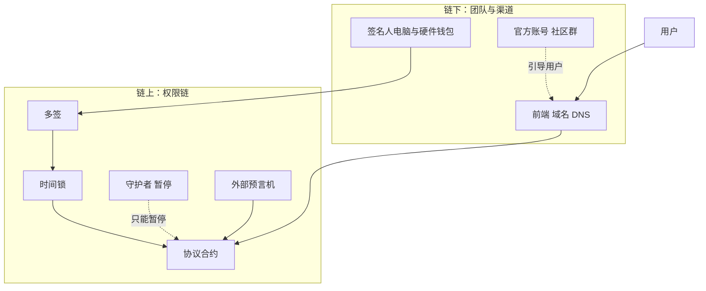
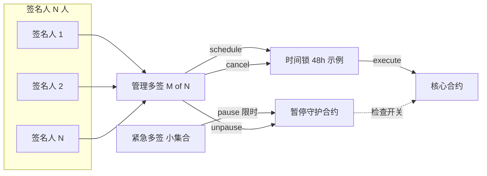
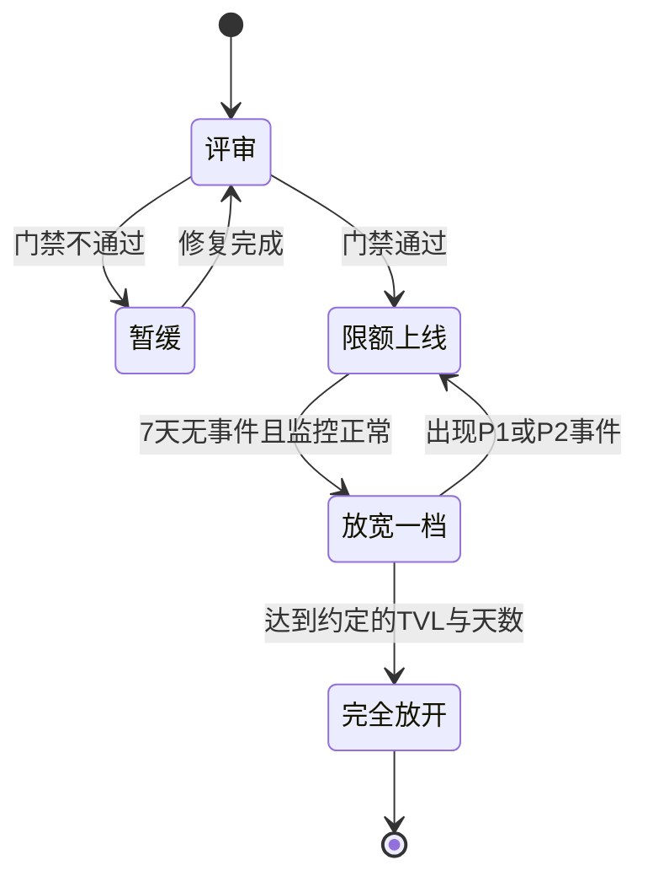
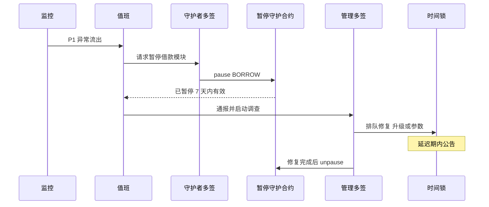

# X16 DeFi 项目方安全运营：上线就绪、监控、暂停守护与治理金库

> 学习目标：读完本章，你能——
> 1. 主持一次上线就绪评审，用一张门禁表判断"可上线 / 附条件 / 暂缓"，并写出每项的证据。
> 2. 为协议设计"多签 → 时间锁 → 合约"的权限链、暂停守护者和参数变更流程，并用 `cast` 命令验证链上配置与文档一致。
> 3. 写出 5 类上线后监控规则（权限变更、时间锁排队、异常流出、治理、预言机），加上前端 DNS 监控，并主持一次 30 分钟的暂停演练。
>
> 适用角色：DeFi 项目方安全负责人、协议工程师、多签签名人、社区与治理运营
> 前置章节：[05 访问控制与权限](../05-access-control.md)、[10 可升级合约与代理](../10-upgradeable-proxy.md)、[11 DeFi 经济安全](../11-defi-economic-security.md)、[A04 DeFi 协议评估](../assessment/A04-defi-protocol-review.md)、[X05 检测与响应工程](X05-detection-response-engineering.md)、[X06 韧性与验证](X06-resilience-validation.md)
> 交互实验 / 模板：[T04 上线门禁清单](../templates/T04-go-live-gate.md)、[多签交易签前复核面板](../interactive/multisig-review-lab.html)、[治理攻击实验](../interactive/audit-governance.html)；本章给出权限登记表、暂停守护者合约、监控规则和签名日清单
> 最后核对：2026-11-23

---

## 开场：一个真实场景

2024 年 5 月，借贷协议 Sonne Finance 要在 Optimism 上新增 VELO 市场。治理提案通过。团队把"创建市场"和"设置抵押系数"等操作排进时间锁队列，延迟 2 天。流程看起来很规范：提案、投票、时间锁，一步不少。

公开分析称，时间锁到期后，任何人都可以执行队列里的交易。这些操作是分开排队的。攻击者抢先执行了其中几笔，让一个刚创建、几乎没有流动性的空市场先变得可以抵押。随后他用"捐赠"抬高汇率，借走了其他市场的资产。公开分析给出的损失约为 2,000 万美元（事发时估值）。

<details class="predict"><summary>🤔 先猜再看：这个协议有审计、有投票、有时间锁。哪一步的"运营设计"出了问题？</summary>

问题不在某一行代码，而在"上线操作的编排"。市场创建和参数设置被拆成多笔独立交易，又允许任何人执行。攻击者因此能选择执行顺序，在一个中间状态里下手。时间锁只保证"延迟"，不保证"原子"。

正确的做法是把一组相关操作打包成一个批次，一次排队、一次执行。同时，新市场要用"零额度上线"，再逐步放开。本章会把这类运营细节做成清单。

</details>

2025 年 11 月，Balancer v2 被利用。公开报道称，较新的池子被暂停，但部分已上线多年的池子超出了暂停窗口，没有开关可按。

这两起事故指向同一个结论：**DeFi 项目的安全，一半在合约里，另一半在"谁能改、怎么改、出事谁能停"的运营里。** 审计报告解决前一半。本章解决后一半。

---

## 1. 一句话理解

**DeFi 项目方安全运营，是把"上线、改参数、升级、花金库、应急暂停"这五类特权动作，变成有门禁、有延迟、有监控、有演练的流程。**

特权动作（Privileged Action）：只有特定角色能调用的合约函数，例如升级、改参数、铸币、暂停。
多签（Multisig）：需要 M-of-N 个签名人同意才能执行的账户。
时间锁（Timelock）：操作先公开排队，延迟一段时间后才能执行的合约。
守护者（Guardian）：只有"刹车"权限的角色，可以暂停或取消，不能升级或转走资金。
金库（Treasury）：协议或 DAO 持有的资金，用于激励、运营和储备。

> 🎯 打个比方：核电站的控制室。反应堆设计（合约代码）再好，也要有操作规程：谁能提升功率，要几个人同时转钥匙，紧急停堆按钮在哪里、谁能按、多久演练一次。
>
> 比喻的局限：核电站的操作员是受监管的专业人员，操作在封闭环境里进行。DeFi 的"控制室"是公开的链上合约，任何人都能看到排队的操作，也能在延迟期内抢先利用中间状态。攻击者还会专门攻击操作员的电脑，而不是反应堆。

---

## 2. 保护目标与信任边界

项目方要保护五样东西：用户存款、协议权限、金库资金、前端与域名、官方渠道的可信度。



读图要点：
- 权限从左到右逐级收紧：签名人 → 多签 → 时间锁 → 合约。任何一段被绕过，后面的保护都失效。
- 守护者的虚线只指向"暂停"。它不在升级路径上。
- 用户走的是另一条路：前端 → 合约。前端被换掉，用户就会向攻击者签名，合约本身毫发无损。
- 局限：图没有画第三方依赖（审计公司、托管 RPC、数据服务商）。它们也属于信任边界，见 [X15](X15-l2-bridge-oracle-ops.md)。

**不能被信任的东西：**
- **签名人看到的界面**。恶意软件可以让界面显示正常内容，却签下另一笔交易（见案例 1）。
- **提案的文字描述**。描述与代码可以不一致（见案例 2）。
- **一个"已经排好队"的操作序列**。如果任何人能执行，攻击者能选择顺序（见案例 3）。
- **一个"以后可以暂停"的假设**。暂停能力要看合约里的实际设计（见案例 4）。
- **域名注册商的账号**。它能让用户进入任何地方（见案例 5）。

---

## 3. 参考架构

### 3.1 权限链：谁能对合约做什么



读图要点：
- 管理多签负责"慢操作"：升级、改参数、换预言机。必须经过时间锁。
- 紧急多签负责"快操作"：只能暂停，暂停会自动过期（见第 6.2 节）。解除暂停要回到管理多签。
- 两个多签的签名人集合应该部分不重叠，避免同一批人被一次钓鱼全部拿下。
- 局限：时间锁要求用户能看到队列并在延迟期内退出。如果没有监控和公告，延迟只是摆设（见第 7 节）。

### 3.2 组件职责表

| 组件 | 职责 | 不能做什么 | 变更方式 |
|---|---|---|---|
| 管理多签 | 提交升级、参数、金库大额支出 | 不能绕过时间锁执行 | 签名人变更也走时间锁 |
| 时间锁 | 公开排队并延迟执行；按批次原子执行 | 不能由单个 EOA（Externally Owned Account，外部账户）管理 | 改最小延迟需要经过时间锁自身 |
| 紧急多签 / 守护者 | 暂停指定模块；取消可疑排队 | 不能升级、转账、改参数 | 由管理多签替换 |
| 金库多签 | 日常运营支出，限额内 | 不能改协议合约 | 与管理多签分离 |
| 监控与值班 | 发现权限变更、异常流出、预言机问题 | 不持有任何签名权 | 由安全负责人管理 |
| 前端与域名 | 面向用户的入口 | 不持有合约权限 | 发布流程见 [X04](X04-delivery-supply-chain.md) |

> 💡 注意：多签、时间锁和守护者合约本身也是代码。它们要被审计，并且要在 `A04` 的评估范围内。

### 3.3 上线阶段：从"能用"到"放开"



读图要点：
- 上线不是一次性的"开关"。每个阶段都有退出条件和回退路径。
- 限额（示例：总存款上限、单笔上限、单个新资产上限）是最便宜的保险。
- 回退只能向更严格的方向走，由守护者或安全负责人触发。
- 局限：限额降低了损失上限，也降低了产品吸引力。业务和安全要在评审会上共同决定每档数值。

---

## 4. 控制清单

优先级：P0 必须有；P1 应该有；P2 成熟后再做。

| ID | 控制项 | 要防什么 | 优先级 | 怎么验证 |
|---|---|---|---|---|
| PRJ-1 | 上线前完成就绪评审，用 [T04](../templates/T04-go-live-gate.md) 的必须项逐条留证据 | 凭感觉上线 | P0 | 看评审记录，抽查 3 条证据能否复现 |
| PRJ-2 | 上线字节码、构造参数、初始化与审计版本一致，源码已验证 | 审计的不是上线的 | P0 | 用提交哈希重编译，与链上 `codehash` 比对 |
| PRJ-3 | 上线初期有限额（总额、单笔、单资产），并有书面放宽条件 | 未知漏洞造成无上限损失 | P0 | 读合约限额变量，对照放宽计划 |
| PRJ-4 | 新市场、新资产按"零额度创建 → 播种 → 放开"顺序上线 | 空市场被操纵（见案例 3） | P0 | 检查上线脚本，看是否原子批次且含播种步骤 |
| PRJ-5 | 所有特权地址登记在"权限登记表"，每季度与链上核对 | 文档与实际权限脱节 | P0 | 用脚本读取 owner / role，与登记表 diff |
| PRJ-6 | 升级与参数权限只属于多签 + 时间锁，没有单签 EOA | 一个私钥失陷即全部失陷 | P0 | `cast` 查询角色持有者，必须是合约地址 |
| PRJ-7 | 签名人 ≥ 5 人，门槛 ≥ 3，人员、地域、设备类型分散 | 一次钓鱼拿下全部签名 | P0 | 看签名人名册与门槛配置 |
| PRJ-8 | 签名前由第二个工具独立解码，并与排队内容比对哈希 | 盲签与界面欺骗（见案例 1） | P0 | 看最近 3 次签名日记录 |
| PRJ-9 | 签名使用专用设备，与日常办公、聊天、下载隔离 | 签名人电脑被恶意软件控制 | P0 | 抽查设备清单，检查是否有聊天软件与浏览器扩展 |
| PRJ-10 | 时间锁延迟满足约定时长，且批次原子执行 | 中间状态被利用（见案例 3） | P0 | 查最小延迟；看是否使用 `scheduleBatch` |
| PRJ-11 | 守护者只能暂停 / 取消，暂停自动过期 | 守护者变成审查者或后门 | P0 | 读合约，尝试用守护者调用升级函数应失败 |
| PRJ-12 | 每个模块有独立暂停开关，且不依赖"创建时的窗口" | 老合约无法暂停（见案例 4） | P0 | 对每个模块在测试网触发暂停 |
| PRJ-13 | 治理提案上线前有人审查可执行代码，记录代码哈希 | 描述与代码不一致（见案例 2） | P0 | 看提案审查记录，对照执行前哈希 |
| PRJ-14 | 投票权快照在提案创建前，设有法定人数和执行延迟 | 闪电贷借票、低投票率通过 | P1 | 读治理合约参数 |
| PRJ-15 | 金库分层：运营热钱包 / 储备多签；支出有限额与双人审批 | 单点失陷清空金库 | P1 | 看金库地址清单与限额 |
| PRJ-16 | 对手方（托管、做市、桥、稳定币）有集中度上限与退出方案 | 对手方失败拖垮协议 | P1 | 看敞口表与上限 |
| PRJ-17 | 对权限变更、升级、时间锁排队、异常流出有链上告警 | 攻击已发生却无人知道 | P0 | 在测试网触发一次，记录响应时间 |
| PRJ-18 | 预言机偏离与停更有告警和降级方案 | 坏价格引发坏账 | P0 | 回放历史价格数据，看告警是否触发 |
| PRJ-19 | 域名启用注册局锁与硬件密钥 MFA，DNS 变更有告警 | 前端被劫持（见案例 5） | P0 | 查域名状态；检查 DNS 监控 |
| PRJ-20 | 官方渠道清单公开；社群有管理员最小权限和验证 | 假官方账号、群内钓鱼 | P1 | 看渠道清单与管理员名单 |
| PRJ-21 | 每季度做一次暂停与时间锁演练 | 开关存在但没人会按 | P0 | 看演练记录与耗时 |
| PRJ-22 | 事故响应预案含联系人、决策树、公告模板，并链接 [A09](../assessment/A09-incident-response.md) | 凌晨找不到人 | P0 | 随机联系 3 人，记录响应时间 |

---

## 5. 分级落地

| 档位 | 做什么 | 需要多少人 | 需要多久 |
|---|---|---|---|
| **最小可行**（5–15 人团队，TVL 较小） | PRJ-1 至 PRJ-3、PRJ-5 至 PRJ-8、PRJ-11、PRJ-17、PRJ-19：写权限登记表；多签 + 时间锁；限额上线；签名日清单；一个能按的暂停；三条链上告警；域名加锁 | 1 名安全负责人 + 1 名协议工程师 | 约 4 周 |
| **标准**（15–60 人，TVL 中等） | 全部 P0；独立紧急多签；提案审查流程；预言机与流出监控；季度暂停演练；赏金计划（见 [X19](X19-disclosure-bounty-ops.md)） | 2–3 名安全 / 运营 + 值班轮换 | 约 3 个月 |
| **成熟**（大型协议或多链部署） | 全部 P1；7×24 值班；自动暂停（受限）；金库分层与对手方限额；外部红队；多链权限统一登记 | 专职安全团队 + 跨团队值班 | 持续运营 |

> 💡 注意：人数与时间是建议量级，不是统计数字。小团队的核心是"一个能按下去的暂停，加一次真实演练"。

---

## 6. 落地做法

### 6.1 上线就绪评审：怎么开这个会

评审会不是"宣布上线"，而是"让上线负责人证明"。

1. 上线前 7 天，工程负责人提交评审包：提交哈希、审计报告、测试报告、权限登记表、参数表、监控清单、应急预案。
2. 安全负责人逐条对 [T04](../templates/T04-go-live-gate.md) 必须项打勾。每一项要附证据链接。
3. 一人（非原作者）在测试网按部署脚本重做一遍，对比参数。
4. 评审会 60 分钟。只讨论"未通过"和"附条件"的项。
5. 结论写成：可上线 / 附条件上线 / 暂缓 / 否决。业务负责人签字接受剩余风险。

下面是一份可改写的门禁配置（示例），让评审结果可被脚本读取：

```yaml
# go-live-gate.yaml（示例）
release: "lending-v2.1"
commit: "<git 提交哈希>"
chain: "optimism"
gates:
  audit_version_matches_deploy: {status: pass, evidence: "forge inspect + codehash diff"}
  privileged_roles_in_registry: {status: pass, evidence: "roles-diff-2026-11-20.txt"}
  upgrade_via_multisig_timelock: {status: pass, evidence: "tl-config.txt"}
  guardian_pause_tested:       {status: pass, evidence: "drill-2026-11-18.md"}
  monitoring_alerts_live:      {status: fail, evidence: "缺少预言机偏离告警"}
  launch_limits:
    total_deposit_cap_usd: 2000000   # 示例
    per_tx_cap_usd: 100000           # 示例
    relax_after_days: 7
decision: "conditional"
conditions:
  - "上线前补齐预言机偏离告警，安全负责人复核"
```

> ⚠️ 警告：不要把"审计通过"当作门禁的全部。审计报告只覆盖被审计的提交。上线后的参数、权限、新市场和前端不在审计范围里，除非你明确要求。见 [A07](../assessment/A07-external-audit-bounty.md)。

### 6.2 暂停守护者：设计与代码

设计目标有三条：
- 守护者能快速暂停，不需要等时间锁。
- 守护者不能升级、不能转走资金。
- 暂停会自动过期，并有冷却期。这样守护者不能无限期冻结协议。

下面是一个精简示例（`^0.8.20`，仅示意，使用前需审计）：

```solidity
// SPDX-License-Identifier: MIT
pragma solidity ^0.8.20;

/// 暂停守护合约（示例）：守护者只能限时暂停，解除与换人必须由治理（时间锁）完成
contract PauseGuardian {
    address public immutable governance;   // 时间锁合约地址
    address public guardian;               // 紧急多签
    uint64 public constant MAX_PAUSE = 7 days;
    uint64 public constant COOLDOWN  = 1 days;

    mapping(bytes32 => uint64) public pausedUntil;
    mapping(bytes32 => uint64) public cooldownUntil;

    event Paused(bytes32 indexed module, address indexed by, uint64 until);
    event Unpaused(bytes32 indexed module, address indexed by);
    event GuardianChanged(address indexed oldGuardian, address indexed newGuardian);

    error NotAuthorized();
    error AlreadyPaused();
    error InCooldown();

    constructor(address gov, address g) {
        governance = gov;
        guardian = g;
    }

    function isPaused(bytes32 module) public view returns (bool) {
        return block.timestamp < pausedUntil[module];
    }

    function pause(bytes32 module) external {
        bool isGov = msg.sender == governance;
        if (!isGov && msg.sender != guardian) revert NotAuthorized();
        if (isPaused(module)) revert AlreadyPaused();
        // ✅ 守护者在冷却期内不能再次暂停，治理不受此限
        if (!isGov && block.timestamp < cooldownUntil[module]) revert InCooldown();
        uint64 until = uint64(block.timestamp) + MAX_PAUSE;
        pausedUntil[module] = until;
        cooldownUntil[module] = until + COOLDOWN;
        emit Paused(module, msg.sender, until);
    }

    function unpause(bytes32 module) external {
        if (msg.sender != governance) revert NotAuthorized();
        pausedUntil[module] = 0;
        emit Unpaused(module, msg.sender);
    }

    function setGuardian(address g) external {
        if (msg.sender != governance) revert NotAuthorized();
        emit GuardianChanged(guardian, g);
        guardian = g;
    }
}
```

核心合约这样使用它：

```solidity
bytes32 constant M_DEPOSIT  = keccak256("DEPOSIT");
bytes32 constant M_BORROW   = keccak256("BORROW");
bytes32 constant M_WITHDRAW = keccak256("WITHDRAW");
// ⚠️ 还款（repay）与清算（liquidate）默认不接入暂停：暂停它们会让坏账扩大

function deposit(uint256 amt) external {
    require(!guard.isPaused(M_DEPOSIT), "paused");
    // ...
}
```

设计要点：
1. **按模块暂停**。存款、借款、提款分开。出事时先停"进"，再决定是否停"出"。
2. **不要暂停还款和清算**。暂停它们会让坏账变大，也会让用户无法自救。
3. **暂停开关要在合约创建时就接入**。Balancer v2 的部分池子，暂停能力有"窗口"，窗口过期后就没有开关（见案例 4）。新协议不要依赖"以后再加"。
4. **守护者地址是高价值目标**。它是一个小多签，签名人和管理多签部分不同。它的任何操作都有链上告警。
5. **公开说明守护者的权力边界**。用户有权知道谁能暂停、能暂停多久。

> 💡 注意：自动暂停（由监控机器人触发）要谨慎。机器人的私钥是热钥匙，一旦被攻破，攻击者能暂停整个协议。若使用，限定为"只暂停单个模块、时长很短、有告警"。

### 6.3 多签运营与签名日

多签的风险不在合约，而在"人"。Radiant 的案例（见案例 1）说明：硬件钱包安全，不代表签名流程安全。

**签名人选择（建议）：**
- 至少 5 人，门槛至少 3。人数和门槛的比例按团队规模和响应速度权衡。
- 来自不同公司或部门，不同城市和时区。不要全部是同一个团队的同一批人。
- 每人用专用签名设备，只做签名，不装聊天软件，不装无关浏览器扩展。
- 每季度核对一次签名人名单。人员离职当天移除。

**签名日清单（示例）：**

1. 提交人在内部频道发布：目的、目标合约、函数、参数、预期结果。
2. 每位签名人在**独立的第二个工具**里解码 calldata（见下面的命令），不能只看钱包界面。
3. 签名人对比：`safeTxHash`、目标地址、`operation`（`0` 为 call，`1` 为 delegatecall）。
4. 出现 `delegatecall`、`transferOwnership`、`upgradeTo`、批准额度，一律升级为"高风险操作"，要求带外（电话或视频）确认。
5. 签名后，提交人在频道中贴出交易哈希，其他人核对链上排队内容。

用 `cast` 独立解码的示例：

```bash
# 示例：从 Safe 交易的 data 字段解出函数与参数
cast 4byte 0xf2fde38b
# → transferOwnership(address)

cast calldata-decode "transferOwnership(address)" 0xf2fde38b000000000000000000000000...
# 把输出的地址与"权限登记表"中的预期新 owner 比对

# 读取 Safe 合约对这笔交易计算出的哈希，与硬件钱包屏幕显示的哈希核对
cast call $SAFE "getTransactionHash(address,uint256,bytes,uint8,uint256,uint256,uint256,address,address,uint256)(bytes32)" \
  $TO $VALUE $DATA $OPERATION 0 0 0 0x0000000000000000000000000000000000000000 0x0000000000000000000000000000000000000000 $NONCE \
  --rpc-url $RPC
```

> ⚠️ 警告：钱包界面、模拟器和区块浏览器可能同时被同一个攻击者影响。"换一个工具"的意思是换一条独立的数据路径，例如自己的 RPC 加本地解码。更完整的签名链路讨论见 [29 2026 签名链路](../29-signing-path-2026.md) 和 [X11](X11-cex-wallet-treasury-payment.md)。

### 6.4 时间锁与治理：配置检查与提案审查

先验证时间锁配置。以下命令以 OpenZeppelin `TimelockController` 为例（不同版本角色名不同，v4 与 v5 请对照所用版本）：

```bash
TL=0x...            # 时间锁地址（示例）
SAFE=0x...          # 管理多签地址（示例）
ZERO=0x0000000000000000000000000000000000000000

cast call $TL "getMinDelay()(uint256)" --rpc-url $RPC            # 最小延迟（秒）
cast call $TL "hasRole(bytes32,address)(bool)" $(cast keccak "PROPOSER_ROLE")  $SAFE --rpc-url $RPC   # 应为 true
cast call $TL "hasRole(bytes32,address)(bool)" $(cast keccak "EXECUTOR_ROLE")  $ZERO --rpc-url $RPC   # true = 任何人可执行
cast call $TL "hasRole(bytes32,address)(bool)" $(cast keccak "CANCELLER_ROLE") $GUARDIAN --rpc-url $RPC
cast call $TL "hasRole(bytes32,address)(bool)" 0x0000000000000000000000000000000000000000000000000000000000000000 $DEPLOYER --rpc-url $RPC  # 管理员角色：部署者应为 false
```

读结果时问四个问题：
1. 最小延迟是否等于对外承诺的值？
2. 提案者是否只有管理多签？
3. 如果"任何人可执行"，一组操作是否用 `scheduleBatch` 原子执行？
4. 部署者是否已经放弃管理员角色？

**提案审查流程**（防止描述与代码不一致）：

1. 提案提交后，安全负责人在 24 小时内给出审查意见：目标合约、`delegatecall`、`selfdestruct`、升级、授权、资金流向。
2. 审查人记录提案执行合约的代码哈希。
3. 排队前和执行前，各复核一次哈希，不一致就取消。
4. 把审查结论发到治理论坛，附上可读的 calldata 解码。

```bash
# 记录与复核提案合约的代码哈希（示例）
PROP=0x...
cast keccak $(cast code $PROP --rpc-url $RPC)    # 提案创建时记下
cast keccak $(cast code $PROP --rpc-url $RPC)    # 排队前、执行前各再比对一次

# 粗略检查字节码里有没有 SELFDESTRUCT(0xff) 与 DELEGATECALL(0xf4)
# 字节码里的 0xff / 0xf4 可能是数据，结果只用于"提醒人工审查"，不是结论
cast code $PROP --rpc-url $RPC | grep -o -E "ff|f4" | sort | uniq -c
```

> 💡 注意：截至 2026 年公开资料，以太坊主网自 Dencun 升级（EIP-6780）起，`SELFDESTRUCT` 只在合约创建的同一笔交易里才会删除代码，Tornado Cash 那种"销毁后用同一地址重新部署"的手法在主网上已被封堵。但其他链是否实现该改动，要查对应链的文档。通过 `delegatecall` 到可变目标仍能达到类似效果。所以审查的重点是"执行时的实际代码"，不是某个具体操作码。

**治理参数的防御清单**沿用 [11 DeFi 经济安全](../11-defi-economic-security.md) 第 3.2 节。本章补充运营动作：
- 紧急通道要写清"谁控制、能做什么、有效多久"，并公开。
- 守护者可以取消恶意提案，但不能自己发提案。
- 大额代币转入治理合约、委托集中度突变，都要有告警（见第 7 节规则 4）。

### 6.5 金库与资金管理

金库的失陷路径常常和协议合约无关：多签被钓鱼、支出被伪造、对手方失败。

1. **分层**：运营钱包（日常支出，小额，限额）、储备多签（大额，双人加门槛）、长期储备（冷存，时间锁或更高门槛）。
2. **支出审批**：超过限额的支出需要提案、说明、第二人复核。常规支出（工资、服务商）预先登记为"白名单收款地址"。
3. **对手方限额**：托管、做市商、桥、稳定币发行方的敞口，各设一个占金库的百分比上限（示例：单一对手方不超过 20%）。
4. **稳定币与代币的集中度**：金库里的协议自有代币，不能被计入"储备"来证明偿付能力。
5. **链上与账面对账**：每周一次，把链上余额与财务表对账，差异写入记录。

> 💡 注意：金库如果存放在交易所或托管商，其风险按 [X21](X21-custodian-security.md) 和 [X11](X11-cex-wallet-treasury-payment.md) 的方法评估。

### 6.6 参数变更管理

风险参数（抵押系数、借款上限、清算折价、预言机来源、白名单资产）的变更，是 DeFi 最常见的"合法的坏操作"。

变更流程（示例）：

1. **提出**：变更单写明：参数、旧值、新值、动机、模拟结果（坏账、清算量）。
2. **风控审查**：由风险研究员或外部风险服务商给出意见。
3. **安全审查**：检查依赖（预言机、流动性）、与其他参数的联动、上线顺序。
4. **原子打包**：同一批变更用批次排进时间锁，避免中间状态（案例 3）。
5. **预发布验证**：在主网分叉上执行批次，检查关键不变量（见下）。
6. **执行后观察**：执行后 24 小时内加强监控。

在主网分叉上验证批次的示例（Foundry）：

```solidity
// 示例：在 fork 上执行排队批次，再检查不变量
function test_paramBatch_keepsInvariants() public {
    vm.createSelectFork(vm.envString("RPC_URL"));
    vm.warp(block.timestamp + 2 days + 1);            // 跳过时间锁延迟
    timelock.executeBatch(targets, values, payloads, 0, salt);
    // ✅ 偿付不变量：总存款 >= 总借款（按价格折算后）
    assertGe(pool.totalDepositsUSD(), pool.totalBorrowsUSD());
    // ✅ 新市场：总供应为零时，汇率仍等于初始汇率
    assertEq(newMarket.exchangeRate(), INITIAL_RATE);
}
```

> 💡 注意：示例里的函数名（`totalDepositsUSD` 等）是占位，要换成你协议的真实接口。关键是"每次变更前后，同一组不变量必须成立"。

### 6.7 前端、域名与官方渠道

用户不读合约，只点前端。入口被换，合约再安全也没用。详细机制见 [20 前端、DNS 与供应链](../20-frontend-dns-supply-chain.md) 和 [X04](X04-delivery-supply-chain.md)。这里只写项目方的运营动作：

1. **域名**：启用注册局锁（Registry Lock，需要带外确认才能改 NS 记录）；注册商账号用硬件密钥 MFA；账号绑定团队共享邮箱，不绑个人邮箱；每年核对一次谁能访问注册商账号。
2. **DNS 监控**：每 5 分钟检查 NS、A / CNAME 记录和 TLS 证书是否变化。

```bash
#!/usr/bin/env bash
# dns-watch.sh（示例）：与基线比对，不一致即告警
DOMAIN=example.xyz
BASE_NS="ns1.provider.example. ns2.provider.example."
NOW_NS=$(dig +short NS $DOMAIN | sort | tr '\n' ' ' | sed 's/ $//')
EXPECT=$(echo $BASE_NS | tr ' ' '\n' | sort | tr '\n' ' ' | sed 's/ $//')
if [ "$NOW_NS" != "$EXPECT" ]; then
  echo "ALERT: NS changed: $NOW_NS"   # 接入告警渠道
fi
# 同理比对 A / CNAME，并订阅证书透明度日志对该域名的新签发
```

3. **前端发布**：发布需要两人审批；静态资源用内容哈希；关键页面使用 SRI 与 CSP。前端提交"授权 / 签名"请求的代码，需要单独的评审。
4. **官方渠道清单**：在官网和文档公开列出全部官方账号、论坛、Discord 与 Telegram 链接。
5. **社区群管理**：管理员最小化，开启双重验证；机器人权限有限；禁止管理员私聊发链接；置顶消息写明"团队永远不会私聊索要助记词或让你授权"。
6. **假官方应对**：定期搜索品牌名 + "空投 / 领取"；向平台举报；在官方渠道发防骗公告。

### 6.8 常见坑

- **只审合约，不审流程**：审计报告里没有"签名日清单"，但事故往往发生在那里。
- **时间锁只做了一半**：延迟存在，但没有监控和公告，用户看不到队列。
- **守护者权限过大**：能暂停，也能升级，变成了后门。
- **多签人员相同**：管理多签和紧急多签是同一批人，一次钓鱼全部失陷。
- **暂停没演练**：第一次按开关就在事故中，发现签名人联系不上。
- **新市场直接满额**：空市场没有播种，没有上限。
- **提案只看描述**：没有人看执行合约的实际代码。
- **域名账号绑定个人邮箱**：邮箱被盗，域名也丢了。

---

## 7. 运营：指标、告警、值班、演练、季度节奏

### 7.1 监控规则（示例）

下面规则的通用方法见 [X05](X05-detection-response-engineering.md)。这里只写 DeFi 项目方特有的。假设你有一个自建的链上索引库，包含 `events`（合约事件）、`transfers`（代币转账）等表。表结构和阈值均为示例。

**规则 1：权限与升级变更**

```sql
-- 任何受监控合约出现所有权、角色、升级、管理员变更
SELECT block_time, contract, event_name, tx_hash
FROM events
WHERE contract IN (SELECT address FROM protocol_registry)
  AND event_name IN ('OwnershipTransferred','RoleGranted','RoleRevoked',
                     'Upgraded','AdminChanged','BeaconUpgraded')
  AND block_time > now() - interval '5 minutes';
```
假阳性：计划内的升级。调优：与时间锁的 `CallExecuted` 事件关联；有对应排队记录的降级为 P3，没有的升为 P1。

**规则 2：时间锁排队与"非常规"操作**

```sql
-- 有新操作被排进时间锁：延迟偏短，或目标不在登记表里
SELECT block_time, target, delay_seconds, tx_hash
FROM events_timelock_scheduled
WHERE delay_seconds < 172800            -- 示例：小于 48 小时
   OR target NOT IN (SELECT address FROM protocol_registry);
```
假阳性：登记表过期。调优：每次部署同步更新登记表。**每个排队操作都应推送到团队频道和公开公告**，即使它是合法的。

**规则 3：异常流出**

```sql
-- 一小时内，从协议主合约流出的某代币价值超过 TVL 的 5%（示例）
SELECT token, sum(usd_value) AS out_usd
FROM transfers
WHERE from_addr = :protocol_vault
  AND block_time > now() - interval '1 hour'
GROUP BY token
HAVING sum(usd_value) > 0.05 * :tvl_usd;
```
假阳性：大额正常提款、迁移。调优：按资产分别设阈值；与"提款人是否新地址、是否闪电贷"一起看。命中 P1：值班立即评估是否暂停单个模块。

**规则 4：治理动态**

```sql
-- 最近 24 小时内，委托票数集中到少数地址，且超过法定人数的 30%（示例）
SELECT delegate, sum(votes_delta) AS delta
FROM events_delegation
WHERE block_time > now() - interval '24 hours'
GROUP BY delegate
HAVING sum(votes_delta) > :quorum * 0.3;
```
假阳性：大户正常委托。调优：对比近 30 天基线。命中 P2：审查该地址相关的提案。

**规则 5：预言机偏离与停更**

```sql
-- 喂价与第二来源偏离超过 3%，或最近更新超过心跳的 2 倍（示例）
SELECT feed, price, ref_price, updated_at
FROM oracle_prices
WHERE abs(price/ref_price - 1) > 0.03
   OR now() - updated_at > heartbeat_seconds * 2;
```
假阳性：低流动性时段。调优：对每个资产用自己的阈值；对用 TWAP 的市场换成 TWAP 与现货的偏离。机制见 [08 预言机与闪电贷](../08-oracle-flashloan.md)。

另外，第 6.7 节的 DNS 与证书监控是第 6 类规则，P1。

### 7.2 告警分级与响应时间（示例）

| 级别 | 示例 | 响应目标 | 动作 |
|---|---|---|---|
| P1 | 无排队的升级；单小时流出超阈值；守护者地址被操作；DNS 记录变更 | 15 分钟内有人确认 | 拉响应群；评估暂停；联系签名人 |
| P2 | 预言机偏离；治理委托异常 | 1 小时内 | 调查；准备公告 |
| P3 | 计划内变更；阈值临界 | 下一个工作日 | 记录 |

### 7.3 值班与暂停演练

- 小团队至少 3 人轮换值班，每人有备份。联系方式有两种渠道（电话 + 即时通讯）。
- 守护者的签名人**至少 3 人在不同时区**，保证任何时刻至少 2 人能在 30 分钟内响应。
- 每季度做一次暂停演练：在测试网（或带标记的主网小额市场）完成"告警 → 联系 → 签名 → 暂停 → 公告 → 恢复"，并记录每一步耗时。

事故中的暂停与恢复流程：



读图要点：
- 守护者只负责"止血"。修复必须走时间锁，让用户有时间看到并决定去留。
- 如果漏洞需要立即修复而不能等时间锁，协议要有公开说明的"紧急升级"路径。这条路径的权限和限制必须事先写进文档，并有更强的签名要求。
- 局限：公开的修复排队会暴露漏洞。有些团队会先私下协调白帽救援或重新部署，再公布。这要在预案里写清楚。

### 7.4 季度节奏（示例）

| 周 | 动作 |
|---|---|
| 第 1 周 | 权限登记表与链上 diff；签名人名单核对 |
| 第 2 周 | 暂停与时间锁演练 |
| 第 3 周 | 监控规则回放；调优假阳性 |
| 第 4 周 | 对手方敞口与限额复核；域名与渠道清单复核 |
| 第 5–12 周 | 按事件驱动：升级评审、参数变更、赏金分诊 |
| 第 13 周 | 季度复盘；给管理层 / DAO 的安全报告 |

### 7.5 指标

| 指标 | 含义 | 目标（示例） |
|---|---|---|
| 权限登记 diff 为零的比例 | 文档与链上一致 | 100% |
| 暂停演练的实际耗时 | 从告警到暂停 | 小于 30 分钟 |
| P1 告警确认时间 | 值班响应 | 小于 15 分钟 |
| 升级与参数变更经过评审的比例 | 流程遵守 | 100% |
| 时间锁队列公告覆盖率 | 每个排队有公告 | 100% |
| 未关闭的审计发现 | 遗留风险 | 严重 / 高为 0 |

---

## 8. 失效案例

所有案例只写摘要和教训。金额为"约"和"事发时美元估值"。不同来源数字有差异时写明。

### 案例 1：Radiant Capital（2024 年 10 月，Arbitrum / BNB Chain 等）——硬件钱包不能保证签的就是看到的

- **来源类型**：项目方事后总结（Radiant 公开说明，经 Cointelegraph 等媒体转述）、媒体报道（SecurityWeek、BleepingComputer）。
- **经过**：公开报道称，2024 年 10 月 16 日，攻击者从 Arbitrum 和 BNB Chain 取走约 5,000 万美元资产。Radiant 称，至少三名核心开发者的设备被恶意软件入侵。签名人在 Safe 界面和 Tenderly 模拟里看到的内容正常，实际签名的却是恶意交易。项目方后续称，Mandiant 以较高置信度将其归因于与朝鲜有关联的组织，并称初始入口是一条通过 Telegram 发来的、伪装成前承包商的消息和文件。Safe 方面则表示其界面未被入侵，并称这是盲签问题。各方对"界面是否被篡改"有分歧，本章不下结论。
- **绕过了哪条控制**：签名人设备隔离（PRJ-9）；独立解码（PRJ-8）；对高风险操作的带外确认。
- **教训**：只靠"多个签名人各看各的界面"不够。要在独立数据路径里解码，并对 `transferOwnership` 这类高风险函数强制带外确认。签名设备不能装聊天软件和接收文件。据媒体转述，项目方后续措施包括重新生成签名人地址并给升级与所有权转移加更长的延迟（以其官方说明为准）。

### 案例 2：Tornado Cash 治理接管（2023 年 5 月，以太坊）——提案描述与执行代码不一致

- **来源类型**：安全公司分析（Halborn、Oak Security）、媒体报道（The Block、Cointelegraph）。
- **经过**：公开分析称，攻击者提交了一个看起来与此前已通过提案相同的新提案，但其中含有 `selfdestruct`。提案获批后，攻击者销毁该合约，并在同一地址部署了不同的代码。代码在被治理合约执行时，给攻击者控制的每个地址分配 1 万票，合计约 120 万票，远超约 7 万的合法票数。各来源对被取走的 TORN 数量略有出入，Halborn 给出约 48.3 万枚、事发时约 217 万美元。
- **绕过了哪条控制**：提案审查（PRJ-13）；治理参数（PRJ-14）。
- **教训**：投票人信任的是"描述"，合约执行的是"代码"。提案审查要比对代码哈希，并在执行前再核对一次。以太坊主网已经通过 EIP-6780 限制了这条具体路径（见第 6.4 节），但"描述与代码不一致"的问题仍然存在。对应 [11 DeFi 经济安全](../11-defi-economic-security.md)、[B22 经济与治理](../bootcamp/B22-economics-governance.md)。

### 案例 3：Sonne Finance（2024 年 5 月，Optimism）——新市场上线的编排缺口

- **来源类型**：安全公司分析（CertiK、Neptune Mutual、Halborn）、媒体报道（The Block、Cointelegraph）。
- **经过**：公开分析称，2024 年 5 月 4 日提案发起，7 日投票通过，团队把市场创建和抵押系数设置分别排进有 2 天延迟的时间锁。在 Optimism 上，时间锁到期后任何人都可执行。攻击者抢在团队预定的节奏之前执行了部分操作，对一个刚创建、总供应量只有几 wei 的空市场实施"捐赠 + 舍入"攻击，把汇率抬高后借走其他市场资产。损失约 2,000 万美元（事发时估值）。CertiK 指出，这是已在 Hundred Finance 等 Compound v2 分叉上出现过的已知问题。Sonne 暂停了 Optimism 上的全部市场；Base 上的市场未受影响。
- **绕过了哪条控制**：上线编排（PRJ-4）；原子批次（PRJ-10）。
- **教训**：时间锁只保证延迟，不保证顺序。相关操作要打包成同一批次执行；新市场先播种、先零额度，再放开。已知的分叉漏洞要进入上线检查清单。对应 [A04](../assessment/A04-defi-protocol-review.md)。

### 案例 4：Balancer v2（2025 年 11 月，多链）——合约里没有（可用的）开关

- **来源类型**：项目方事后报告（Balancer，初步报告）、安全公司分析（Check Point Research、BlockSec、Trail of Bits）、媒体报道（SecurityWeek、The Block）。
- **经过**：2025 年 11 月 3 日，攻击者利用 Composable Stable Pool 在 `EXACT_OUT` 路径里的舍入不一致，结合批量兑换操纵池内余额，从多条链上取走资金。各来源估计的损失约 9,480 万至 1.28 亿美元，口径不同，Balancer 称完整数字要等对账后公布。公开报道称，较新、可暂停的池子被暂停并进入恢复模式，而部分已上线多年的池子超出了暂停窗口，无法暂停。后续也有项目通过自己的多签抢先回收部分资产。
- **绕过了哪条控制**：模块级暂停且不过期（PRJ-12）；暂停演练（PRJ-21）。
- **教训**：开关的有效期是一个设计参数，不能靠"过去设了窗口"。对已上线的老合约，要主动盘点"哪些能暂停、哪些不能"，并为不能暂停的部分准备替代方案（限额、迁移、对手方协调）。对应 [X05](X05-detection-response-engineering.md) 案例 4。

### 案例 5：Squarespace 域名劫持潮（2024 年 7 月）——前端入口被域名注册商账号攻破

- **来源类型**：研究员分析（MetaMask、Paradigm 研究人员，经 Krebs on Security 报道）、媒体报道（BleepingComputer、The Block）、注册商声明。
- **经过**：公开报道称，2024 年 7 月 9 日至 12 日，至少十余家在 Squarespace 注册域名的机构被劫持，其中包括 Compound、Celer、Pendle 和 Unstoppable Domains。部分域名被重定向到钓鱼站点。Celer 和 Pendle 称已夺回域名，Pendle 称没有资产受损。研究人员认为，原因与迁移自 Google Domains 的账号上的邮箱登录验证缺陷有关；Squarespace 事后称问题是 OAuth 登录的弱点，已在数小时内修复，并称其迁移没有改变认证或多因素设置。双方说法不一致，具体原因以注册商的官方声明为准。
- **绕过了哪条控制**：域名保护（PRJ-19）；DNS 变更告警。
- **教训**：域名注册商账号是协议的"根权限"之一。要检查哪些邮箱能访问账号、是否开启 MFA、是否有注册局锁，并对 NS / A 记录做持续监控。对应 [20 前端、DNS 与供应链](../20-frontend-dns-supply-chain.md)。

> 💡 注意：以上案例的事实以所列来源类型的公开资料为准。事故细节会随官方更新而修订。归因写"公开报道归因于"，不构成法律结论。

---

## 9. 评估检查点

- [ ] **PRJ-1** 上线前有评审记录，T04 必须项逐条有证据。
- [ ] **PRJ-2** 上线字节码与审计提交一致，已用 `codehash` 比对。
- [ ] **PRJ-3** 上线初期有总额、单笔、单资产限额，放宽条件已书面化。
- [ ] **PRJ-4** 新市场 / 新资产按零额度、播种、放开的顺序上线，且为原子批次。
- [ ] **PRJ-5** 权限登记表与链上 owner / role 一致，最近 90 天内核对过。
- [ ] **PRJ-6** 升级与参数权限的持有者都是多签 / 时间锁，没有单签 EOA。
- [ ] **PRJ-7** 管理多签有至少 5 名签名人、门槛至少 3，人员与地域分散。
- [ ] **PRJ-8** 最近 3 次签名日都有独立解码记录和 `safeTxHash` 比对。
- [ ] **PRJ-9** 签名设备专用且隔离，已抽查。
- [ ] **PRJ-10** 时间锁延迟等于对外承诺值，相关操作用批次原子执行。
- [ ] **PRJ-11** 守护者只能暂停 / 取消，暂停自动过期；用守护者尝试升级失败。
- [ ] **PRJ-12** 每个模块都能独立暂停，并已在测试网触发过。
- [ ] **PRJ-13** 治理提案有审查记录和代码哈希，执行前再次比对。
- [ ] **PRJ-14** 治理参数（快照、法定人数、执行延迟）已核对。
- [ ] **PRJ-15** 金库分层，支出有限额与双人审批。
- [ ] **PRJ-16** 对手方有集中度上限与退出方案。
- [ ] **PRJ-17** 权限变更、升级、排队、异常流出有链上告警，响应时间已测。
- [ ] **PRJ-18** 预言机偏离与停更有告警与降级方案，用历史数据回放过。
- [ ] **PRJ-19** 域名有注册局锁与硬件密钥 MFA，DNS 与证书有监控。
- [ ] **PRJ-20** 官方渠道清单公开，社群管理员最小化。
- [ ] **PRJ-21** 最近 90 天内做过暂停与时间锁演练，耗时已记录。
- [ ] **PRJ-22** 应急预案的联系人抽测成功。

**把检查结果写进报告（对照表）：**

| 检查结果 | 报告里怎么写 | 严重性建议 |
|---|---|---|
| PRJ-6 / PRJ-11 / PRJ-12 任一不通过 | "特权控制缺失或可被滥用"，附链上查询输出 | 高到严重 |
| PRJ-2 / PRJ-4 / PRJ-10 不通过 | "上线编排缺陷"，附上线脚本与时间锁配置 | 高 |
| PRJ-8 / PRJ-9 缺失 | "签名流程不可信"，附最近签名日记录 | 高 |
| PRJ-17 / PRJ-18 缺失 | "检测缺口"，附未覆盖的事件类型 | 中到高 |
| PRJ-19 不通过 | "前端入口可被接管" | 高 |
| PRJ-21 / PRJ-22 超过 90 天未做 | "演练过期"，附最近一次日期 | 中 |
| PRJ-15 / PRJ-16 / PRJ-20 缺失 | "金库与渠道治理不足" | 中 |

---

## 10. 上手路径

**第一周（一个人，不需要特殊权限就能做）：**
1. 列出协议的全部合约地址，读取每个的 owner、admin、角色持有者，做成权限登记表（第一版）。
2. 用第 6.4 节的 `cast` 命令检查时间锁配置，写下发现的偏差。
3. 查询域名的 NS 记录、注册商和是否有锁；记录谁能登录注册商账号。
4. 读一遍 T04，把现状对照打一次分，标出红项。
5. 给团队发一页"我看到了什么"的报告。

**第一个月：**
1. 把权限登记表接入每周自动 diff。
2. 写好规则 1、2、3 并在测试网触发一次；记录告警到响应的耗时。
3. 起草暂停守护者的设计和权限边界，交给协议团队评审。
4. 制定签名日清单，并陪同团队做一次真实的签名日。
5. 梳理官方渠道清单并公开。

**第一个季度：**
1. 完成暂停与时间锁演练，输出耗时记录和行动项。
2. 上线提案审查流程和参数变更单。
3. 建立金库分层与对手方敞口表。
4. 与外部审计和赏金平台对接（见 [A07](../assessment/A07-external-audit-bounty.md)、[X19](X19-disclosure-bounty-ops.md)）。
5. 做一次 60 分钟桌面推演，剧本见 [X06](X06-resilience-validation.md)；向管理层提交第一份季度安全报告。

---

## 11. 常见误区

| 误区 | 事实 |
|---|---|
| "有审计就可以上线" | 审计只覆盖被审计的提交。参数、权限、新市场与前端要单独评审。 |
| "有时间锁就安全" | 时间锁给的是延迟。没有监控、公告和原子批次，延迟只是摆设。 |
| "多签是硬件钱包，所以没风险" | 签名人的电脑和界面可被控制，要独立解码和带外确认。 |
| "守护者越强越好" | 守护者越强，越像后门。它只该有刹车。 |
| "以后需要时再加暂停" | 老合约往往加不进去；加得进去也要走升级流程。 |
| "治理投票通过就合法" | 描述与代码可能不一致，要审查执行代码。 |
| "域名不属于安全范围" | 前端入口被换，用户会向攻击者签名。 |
| "监控越多越好" | 假阳性多会让值班麻木。每条规则要有负责人与调优周期。 |

---

## 12. 术语表

| 术语 | 说明 |
|---|---|
| 特权动作（Privileged Action） | 只有特定角色才能调用的函数，如升级、改参数、暂停 |
| 多签（Multisig） | 需要 M-of-N 个签名人同意才能执行的账户 |
| 时间锁（Timelock） | 先排队、延迟到期后才能执行的合约 |
| 守护者（Guardian） | 只有暂停或取消权限的角色 |
| 盲签（Blind Signing） | 签名人看不到交易的可读含义就签名 |
| 独立解码（Independent Decoding） | 用与签名界面不同的数据路径解析交易内容 |
| 带外确认（Out-of-band） | 通过另一条沟通渠道（电话、视频）核实 |
| 原子批次（Atomic Batch） | 多个操作在同一笔交易中全部成功或全部失败 |
| 播种（Seeding） | 在新市场上线时先注入初始流动性，避免空市场 |
| 暂停窗口（Pause Window） | 合约设计中允许暂停的有效期限，过期后不可暂停 |
| 注册局锁（Registry Lock） | 在域名注册局层面锁定记录，变更需带外确认 |
| 权限登记表（Permission Registry） | 记录所有特权地址、角色与持有者的清单 |
| 恢复模式（Recovery Mode） | 某些协议在暂停后提供的、让用户按比例退出的简化通道 |

---

## 13. 动手练习与思考题

### 练习（笔记本即可完成）

**练习 1：画权限链并找洞（30 分钟）。** 选一个公开协议的文档，画出它的"签名人 → 多签 → 时间锁 → 合约 → 暂停"链。标出每个节点的持有者类型（EOA / 多签 / 合约）、延迟、门槛。找出"哪里可以绕过时间锁"和"哪里没有暂停"。把发现写成 5 行摘要。

**练习 2：写一份权限登记表（30 分钟）。** 用下面的表头，为一个你熟悉的协议（或本章示例合约）填 8 行：

```text
合约 | 地址 | 角色 / owner | 持有者类型 | 能做什么 | 是否经时间锁 | 最近核对日期
```

**练习 3：30 分钟暂停推演。** 剧本："凌晨 3 点，规则 3 报警，借款模块一小时内流出 TVL 的 8%。" 三个人分别扮演值班、守护者签名人、公关。按第 7.3 节的序列图走一遍。记录：谁第一个发现、联系了多久、暂停需要几个签名、公告怎么写。最后写 3 条行动项。

**练习 4：审一份示例配置。** 阅读第 6.1 节的 `go-live-gate.yaml`，回答：哪一项不通过？应该给出什么结论？还缺哪些门禁项（提示：赏金、前端、签名流程）？

**练习 5：规则回放。** 用纸笔构造 10 行 `transfers` 数据，故意包含 1 次异常流出，手动运行规则 3，写出命中的行，并把阈值调到"假阳性最小但仍命中"。

建议配套（后续在 L3 训练营实现）：一个读取权限登记表并对链上做 diff 的小脚本，以及一个时间锁配置检查器。

### 思考题

1. 如果把守护者的暂停时长从 7 天改成永久，用户风险与协议风险分别怎样变化？你会接受哪个折中？
2. 你的协议有一个已上线两年、没有暂停开关的老金库。事故发生时你有哪些不改合约的手段？它们各自的代价是什么？
3. 管理多签和紧急多签应该有多少重合的签名人？重合多了与重合少了，各自带来什么风险？

> 🪞 反思：想一想你团队上一次签名日。有几个人在独立工具里解码了 calldata？如果是零，你现在就可以补上这一步。
