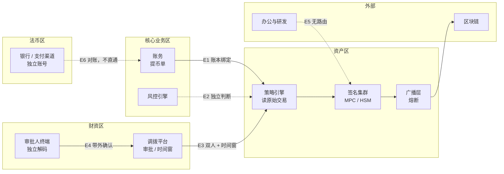
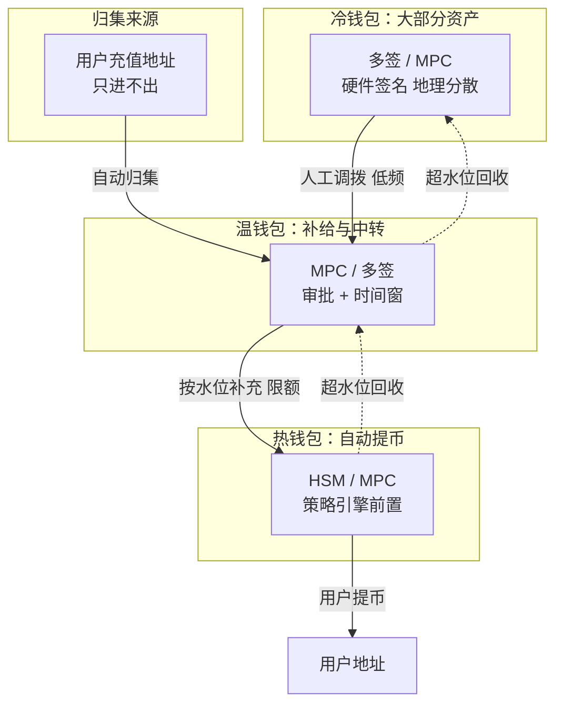
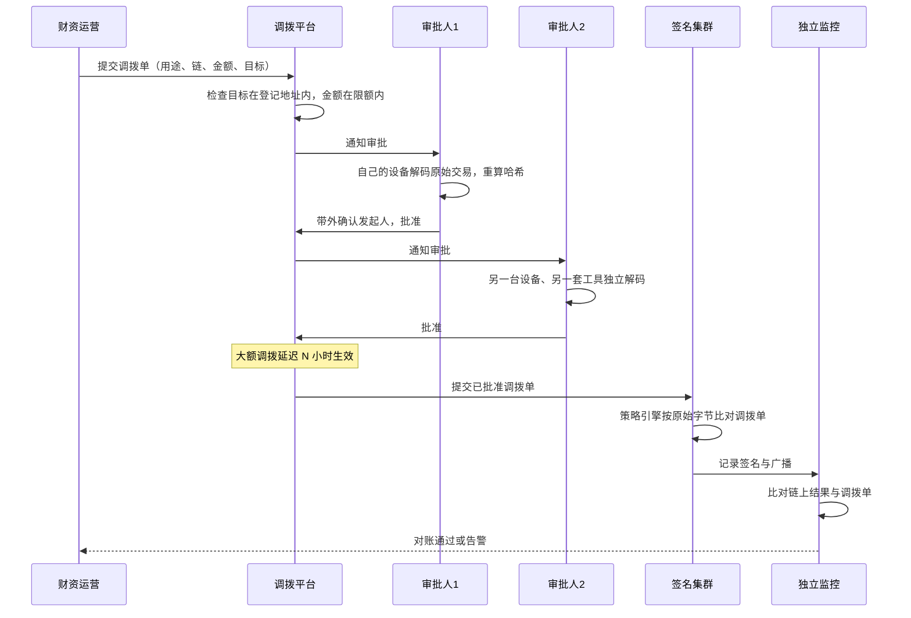

# X17 钱包、财资与支付渠道：分层、签名服务、调拨与法币渠道隔离

> 学习目标：读完本章，你能——
> 1. 为一家交易所画出钱包分层、签名服务和法币渠道的参考架构，并写出每一层的限额、审批和熔断规则。
> 2. 写出一份"冷 → 温 → 热"调拨审批流程，包括双人控制、时间窗口、独立解码和事后对账。
> 3. 搭一套链上余额、内部账务、银行流水三方对账，并写出第一批告警规则（含 EIP-7702 委托监控）。
>
> 适用角色：交易所安全工程师、财资与运营负责人、钱包团队、安全负责人。
> 前置章节：[18 钱包与密钥管理](../18-wallet-key-management.md)、[23 托管、充提与合规安全](../23-custody-exchange-ops.md)、[29 2026 专题：签名路径](../29-signing-path-2026.md)、X07-cex-architecture-overview.md
> 交互实验：[热钱包应急演练](../interactive/incident-response-sim.html)、[多签签前复核](../interactive/multisig-review-lab.html)、[地址投毒实验](../interactive/address-poisoning-lab.html)
> 最后核对：2026-11-23

> 💡 注意：分工。[18 章](../18-wallet-key-management.md)讲密钥怎样生成、保管、销毁。[23 章](../23-custody-exchange-ops.md)讲假充值与合规。[29 章](../29-signing-path-2026.md)讲签名路径被控的原理，并给出签名服务的防御层。本章不重复这些内容和事故复盘。本章回答一个运营问题：**这些控制怎样在一家交易所里每天运转，由谁负责，坏了谁来发现。**

---

## 开场：一笔"例行调拨"

2025 年 2 月 21 日，Bybit 的以太坊冷钱包向温钱包做一次转账。Bybit 的 CEO 公开称，这是一笔例行操作。FBI 在 2025 年 2 月 26 日的公告里确认，约 15 亿美元（事发时估值）的虚拟资产被盗，并把这次盗窃归因于朝鲜的 TraderTraitor 团伙。Sygnia 与 Verichains 的分析称，多签界面所依赖的 JavaScript 被替换，恶意代码针对 Bybit 的交易触发。

调拨是交易所最低频、最大额、最"信任流程"的资金动作。攻击者选了它。

<details class="predict"><summary>🤔 先猜再看：冷钱包用了硬件钱包和多签。调拨流程里，哪一步最可能被攻击者利用？</summary>

不是私钥，而是"签名人相信自己看到的内容"这一步。每个签名人都点了确认，多签门槛也满足了。问题出在每个人看到的是同一份被污染的界面。本章第 6.2 节的"独立解码"就是针对这一步。

</details>

---

## 1. 一句话理解

**钱包与财资的安全，是把"资金能走多快、一次走多少、谁能让它走"变成三组数字，并保证有人每天核对这三组数字。**

财资（Treasury）：交易所内部负责管理自有资金和客户资产在各钱包、各银行账户之间配置与调拨的职能。

> 🎯 打个比方：银行有金库、柜台抽屉和 ATM。金库存大部分现金。柜台抽屉只放当天要用的。ATM 里只放几千元。每次从金库取钱补柜台，要两个人在场，写单据，晚上对账。
>
> 比喻的局限：现金在抽屉里，劫匪必须到场。链上资产没有"到场"这个限制：攻击者在地球另一端提交一笔请求，系统就可能把钱发出去。所以请求本身必须被核对，不能只靠"门锁得好"。

---

## 2. 保护目标与信任边界

### 2.1 保护目标

| 目标 | 一句话 | 失守的后果 |
|---|---|---|
| 资金方向正确 | 钱只流向业务上存在的收款方 | 被盗 |
| 资金速度可控 | 任一时间窗口内的流出有上限 | 单次事故损失不封顶 |
| 三方账一致 | 链上、账务、银行三份记录相符 | 被盗或记错账，很久才发现 |
| 权限可撤销 | 授权、委托、升级权限随时能收回 | 关了服务，攻击者仍能动钱 |
| 渠道隔离 | 法币渠道被攻破不波及链上钱包，反之亦然 | 一处失陷，两边受损 |

### 2.2 信任边界



**读图要点：**

- 资金只走实线，且必须经过策略引擎。办公与研发（虚线）没有通向签名集群的路径。
- E3、E4 是人的控制点：调拨由平台记录，由审批人在自己的设备上独立解码。
- 法币区只通过对账与账务相连。银行账号的密钥、操作员和审批人，与链上钱包不重叠（E6）。
- 局限：图没有画 KYC 供应商、客服、做市账号等对资金的间接影响。它们见 X08、X23。

> ⚠️ 警告：以下东西**不能被信任**。
> 1. 调拨平台或钱包后台显示的收款地址与金额。它们可被上游改写。
> 2. 多签界面显示的交易内容。它们可以被替换。
> 3. 邮件、聊天、电话里"通知变更收款账户"的消息。
> 4. 单一一台节点返回的余额、nonce 或合约代码。
> 5. "我们已经暂停提币"这句话。暂停提币不会撤销链上已有的授权。

---

## 3. 参考架构

### 3.1 钱包分层与限额



**读图要点：**

- 资金从高层向低层流动要审批。从低层回收到高层可以自动，但也有限额。
- 充值地址只进不出：它的唯一出口是自动归集到温钱包。
- 热钱包被攻破时，损失上限是热钱包水位，加上被攻击者利用的授权额度。
- 局限：分层限制的是"持有量"。如果攻击者能让策略引擎放行大额请求，分层会失效。第 3.2 节处理这一点。

**分层参数的设计方法（通用做法，数值为示例）：**

| 层 | 水位的依据 | 示例水位 | 补充方式 | 签名方式 |
|---|---|---|---|---|
| 热 | 各链各币种的提币量，按补充周期估算 | 过去 30 天日均提币量的 1–2 倍 | 自动，单次限额 | HSM 或 MPC，策略前置 |
| 温 | 热钱包的若干次补充量 | 热钱包水位的 3–5 倍 | 人工审批，时间窗 | MPC 或多签 |
| 冷 | 其余全部 | — | 人工审批，双人，延迟 | 多签或 MPC，硬件 |

> 💡 注意：水位不是越低越好。水位太低，提币频繁排队，运营会要求提高限额或绕过审批。水位要跟着提币量定期复核，每季度一次。

### 3.2 签名服务的运营视角

签名服务的防御层（请求来源、账本绑定、策略引擎、分链熔断、委托监控、紧急撤销）在 [29 章第 4 节](../29-signing-path-2026.md)。MPC 与多签的取舍沿用 29 章的结论：**MPC 或多签只管"谁持有密钥"，不管"这笔交易该不该签"；该不该签由策略引擎管。** 本章只补四件运营事务：

| 事务 | 谁负责 | 多久做一次 | 产出 |
|---|---|---|---|
| 策略规则变更 | 钱包团队提，安全团队审，风控团队独立批 | 随需要，走变更单 | 变更单、回放测试结果 |
| 策略回放测试 | 安全工程师 | 每次变更；每季度全量 | 历史交易回放：误拒率、漏放率 |
| 签名节点轮换与恢复演练 | 钱包团队 | 每季度 | 演练记录与用时 |
| 紧急撤销演练 | 钱包团队 + 安全 | 每季度，测试网 | 清零授权的完整记录 |

> ⚠️ 警告：策略规则也是资产。谁能改"限额""白名单""允许的交易类型"，谁就等于能动钱。规则变更要像代码发布一样：双人评审、留痕、可回滚。X03、X04 给出发布与变更的通用做法。

### 3.3 三条资金流与三套对账

| 资金流 | 起点 → 终点 | 记账方 | 对账对象 |
|---|---|---|---|
| 链上流 | 用户地址 ↔ 交易所钱包 | 账务 | 链上余额与账务余额 |
| 内部流 | 冷 ↔ 温 ↔ 热 | 财资 | 调拨单与链上转账 |
| 法币流 | 银行 ↔ 交易所银行账户 | 财务 | 银行流水与账务法币余额 |

三套对账的目的相同：任何一边单独被篡改，另一边的差异会暴露它。

---

## 4. 控制清单

| ID | 控制项 | 要防什么 | 优先级 | 怎么验证 |
|---|---|---|---|---|
| TRS-C01 | 热钱包水位、单笔与单日限额，按链按币配置 | 一次失陷清空热资金 | P0 | 配置导出；构造超额请求，确认被拒 |
| TRS-C02 | 签名前策略引擎读原始交易字节，默认拒绝未知类型 | 伪造请求、委托授权、盲签 | P0 | 回放含 7702、`eth_sign`、Safe `operation=1` 的测试集 |
| TRS-C03 | 账本绑定：每笔签名对应一条未签过的已批准提币单 | 无业务背景的流出 | P0 | 用不存在的订单号请求签名，确认被拒 |
| TRS-C04 | 冷 → 温 → 热调拨：双人审批、时间窗、独立解码 | 例行调拨被劫持 | P0 | 抽查 3 笔调拨的审批记录与解码截图 |
| TRS-C05 | 分链熔断：广播层与签名层各一道，独立通道触发 | 多链批量流出 | P0 | 季度演练：触发熔断并记录用时 |
| TRS-C06 | 链上余额、账务、银行三方对账，差异自动告警 | 被盗或记错账长期不发现 | P0 | 人为注入 1 笔差异，测告警延迟 |
| TRS-C07 | 自有地址代码与 nonce 监控（含 EIP-7702 委托） | 委托在关服务后继续生效 | P0 | 在测试网设置委托，确认 1 个区块内告警 |
| TRS-C08 | 紧急撤销手册与预批准路径 | 暂停提币后权限仍在 | P0 | 季度测试网全流程演练 |
| TRS-C09 | 提币地址簿：新地址冷却期，变更需二次验证 | 地址被替换、投毒 | P1 | 新增地址后立即提币，确认被延迟 |
| TRS-C10 | 法币收款账户变更：回拨确认、双人审批、延迟生效 | BEC 与账户替换 | P0 | 抽查近 3 个月账户变更的回拨记录 |
| TRS-C11 | 法币渠道与链上钱包在身份、设备、审批人上隔离 | 一处失陷两边受损 | P1 | 比对两边操作员与审批人名单，交集为零 |
| TRS-C12 | 办公与研发网络到签名集群无路由；终端无生产令牌 | 终端失陷直达签名 | P0 | 网络可达性测试；令牌扫描报告 |
| TRS-C13 | 小额探测告警：新目标地址的极小额转账 | 攻击者用小额试探阈值 | P1 | 回放历史，确认规则触发并可调优 |
| TRS-C14 | 升级与管理权限清单：自有合约、代理管理员、授权额度 | 权限被忘记 | P1 | 清单与链上读取一致，季度复核 |

---

## 5. 分级落地

| 档次 | 做什么 | 人和时间（示例） |
|---|---|---|
| 最小可行 | 三层钱包与水位；热钱包单日限额；地址簿冷却期；调拨双人审批；每日人工对账表；法币账户变更回拨 | 1 名安全工程师 + 财资 1 名；4–6 周 |
| 标准 | 加：策略引擎读原始字节、账本绑定、分链熔断、自动三方对账、7702 与代码监控、季度演练 | 2–3 人（钱包、安全、风控各 1）；3–6 个月 |
| 成熟 | 加：独立的意图签发服务、策略回放平台、预批准紧急撤销路径、法币渠道独立环境、第三方渗透与季度红队 | 5 人以上，跨团队；12 个月以上 |

> 💡 注意：时间与人数是示例，取决于链数量、币种数量和既有系统。关键顺序是：先做限额与对账（成本低、见效快），再做策略与熔断，最后做撤销与隔离的演练。

---

## 6. 落地做法

### 6.1 第一步：写出"资金地图"

1. 列出所有自有地址：每条链、每个层级、每个用途（热、温、冷、归集、手续费、做市）。
2. 为每个地址写：谁能签、门槛、水位、最后一次演练日期。
3. 列出所有银行与支付账户，字段相同。
4. 列出所有"权限"：代理合约管理员、授权额度、升级密钥。
5. 把以上放进一张受控表格，每月复核一次。

```yaml
# 示例：资金地图条目（字段名为示例）
- id: eth-hot-01
  chain: ethereum
  tier: hot
  address: "0x…（登记）"
  signer: mpc-cluster-a          # 谁签名
  policy_id: pol-eth-hot-v7      # 对应策略版本
  water_level_usd: 2000000       # 示例
  daily_limit_usd: 1500000       # 示例
  code_expected: "0x"            # 期望的链上代码；7702 监控用
  last_drill: 2026-09-12
- id: eth-cold-01
  tier: cold
  signer: multisig-4of7
  signer_devices: independent-per-signer   # 不共用电脑和前端
  last_drill: 2026-08-30
```

### 6.2 调拨审批流程（冷 → 温 → 热）



**读图要点：**

- 两名审批人各自解码，用不同设备、不同工具，才能发现"界面被污染"这一类问题。
- 时间窗让大额调拨有"后悔期"，期间监控与风控可以介入。
- 策略引擎比对的是调拨单和原始字节，不是平台页面上的文字。
- 局限：调拨平台、审批人终端和签名集群被同一个攻击者同时控制时，流程仍会被绕过。这时靠限额、熔断和三方对账兜底。

```yaml
# 示例：调拨审批策略（数值为示例，需按自身业务调整）
transfer_policy:
  cold_to_warm:
    approvers: 2                 # 不同部门，不含发起人
    independent_decode: true
    out_of_band_confirm: true    # 电话或当面
    delay_hours: 4               # 大额延迟
    max_single_usd: 20000000
    destination: registered_only
  warm_to_hot:
    approvers: 1
    max_daily_usd: 3000000
    destination: registered_only
  any:
    forbid_new_destination: true   # 新目标地址须先走地址簿流程
    forbid_delegatecall: true      # Safe operation 只允许 0
```

常见坑：

1. 两名审批人用同一个界面或同一台电脑。这等于一个人。
2. "紧急"通道不受限额约束，攻击者伪装紧急。紧急通道要更严，不是更松。
3. 审批人只看平台上的"摘要"，没有解码原始交易。

### 6.3 地址簿与白名单

1. 地址簿登记时保存：地址、链、用途、登记人、审批人、回拨记录。
2. 新增或修改地址，进入冷却期（示例：24 小时），冷却期内不能收款。
3. 修改地址需要重新验证（硬件密钥或带外确认），不能只靠登录会话。
4. 展示地址时用完整地址，并强提示首尾相同、中间不同的相似地址。可以用[地址投毒实验](../interactive/address-poisoning-lab.html)体会。
5. 每季度清理：90 天无使用的地址下线。

### 6.4 链上权限：授权、升级与 EIP-7702 委托

交易所自己的地址有三类链上权限需要登记和监控：

| 权限 | 例子 | 监控方法 |
|---|---|---|
| 代币授权 | 向路由、桥、做市合约的 `approve` | 定期读取 allowance；超过阈值告警或撤销 |
| 管理权限 | 自有代理合约的 admin、升级者 | 读取存储槽；变化即告警 |
| 账户代码 | EIP-7702 委托 | 每个区块查 `eth_getCode` |

EIP-7702 的相关事实（来自[规范](https://eips.ethereum.org/EIPS/eip-7702)）：授权元组为 `[chain_id, address, nonce, y_parity, r, s]`；`chain_id` 为 0 表示在任何链上有效；生效后账户代码变为 `0xef0100` 加委托地址；把 `address` 设为零地址即清除委托。撤销流程见 [29 章 4.9](../29-signing-path-2026.md)。

```python
# 示例：每个区块检查自有地址是否出现委托或代码变化（只读查询）
from web3 import Web3
import json, sys

w3a = Web3(Web3.HTTPProvider(sys.argv[1]))   # 运营方 A 的 RPC
w3b = Web3(Web3.HTTPProvider(sys.argv[2]))   # 运营方 B 的 RPC（独立来源）
registry = json.load(open("fund_map.json"))   # 第 6.1 节的资金地图

for e in registry:
    if e["chain"] != "ethereum":
        continue
    a = w3a.eth.get_code(e["address"]).hex()
    b = w3b.eth.get_code(e["address"]).hex()
    expected = e.get("code_expected", "0x")
    if a != b:
        print("ALERT 数据源不一致", e["id"])       # 不一致：先告警，不下结论
    elif a != expected:
        kind = "7702委托" if a.startswith("0xef0100") else "代码变化"
        print("ALERT", kind, e["id"], a[:48])
```

> ⚠️ 警告：监控脚本要部署在独立账号和独立节点上，数据源至少两个独立运营方。数据源不一致时先告警，不要自动"采信其中一个"。

### 6.5 三方对账

1. 每小时：链上余额（两个独立来源）与账务钱包余额比对。
2. 每笔：已广播的链上转出与已批准的提币单、调拨单一一对应。
3. 每日：银行流水与账务法币余额比对。
4. 差异分级：小于阈值记录；大于阈值升级；无对应单据的链上流出直接触发熔断。

```sql
-- 示例：找出"有链上转出、但没有已批准单据"的交易
SELECT t.chain, t.tx_hash, t.from_addr, t.to_addr, t.amount_usd, t.seen_at
FROM chain_outflows t
LEFT JOIN approved_orders o
  ON o.chain = t.chain AND o.tx_hash = t.tx_hash
WHERE t.from_addr IN (SELECT address FROM fund_map WHERE tier IN ('hot','warm','cold'))
  AND o.tx_hash IS NULL
  AND t.seen_at > now() - interval '15 minutes';
-- 命中任何一行：P1 告警；金额超过热钱包单日限额的 10%：直接触发分链熔断
-- 常见假阳性：手续费补充、归集；用 purpose 字段白名单排除，不要放宽金额
```

### 6.6 法币与银行渠道：只写通用事实

以下是通用做法。银行与支付产品差异大，以各渠道的最新文档和合同为准。

1. **账户变更是高危操作。** 收款账户、银行联系人、付款审批人的变更，都走变更单。
2. **回拨确认。** 收到"更换收款账户"的通知，用已登记的电话回拨，不用邮件里留的号码。商业邮件诈骗（Business Email Compromise，BEC：冒充供应商或高管诱导变更收款账户或付款）的官方建议同样是通过第二渠道核实。
3. **双人控制。** 发起与审批分开，大额付款需要两名审批人，不用同一设备。
4. **渠道隔离。** 银行账户按客户资金与自有资金分账户；银行操作员与链上钱包操作员不重叠。
5. **延迟生效。** 新增收款账户在冷却期内不能付大额款。
6. **对账与召回。** 每日对账。发现错付，立即联系银行申请召回。

```yaml
# 示例：收款账户变更单
change_request:
  type: bank_account_change
  requested_by: ops-1
  reason: "供应商通知换账户"
  evidence: ["邮件原文", "合同条款"]
  controls:
    callback_to_registered_number: required   # 登记过的电话，非邮件里的
    callback_by: finance-2                    # 与发起人不同
    approvers: [finance-lead, security-on-call]
    cooldown_hours: 48
    first_payment_limit_usd: 10000            # 示例
```

### 6.7 钱包事故应急

事故响应总流程见 [A09](../assessment/A09-incident-response.md)。钱包事故专属的"前 60 分钟"清单（示例）：

1. **切断日常路径**：先确认攻击者不能再提交新请求（停签名集群入口，隔离相关终端）。
2. **熔断**：对受影响链停止广播。已签未发的交易一并拦截。
3. **保全证据**：不要重启或重装机器，先保存镜像和日志。
4. **查权限**：对每条链检查自有地址的代码、nonce、授权。发现委托，走紧急撤销手册。
5. **迁移资金**：把仍受威胁的热、温资金迁到预先准备的"干净"地址。该地址的密钥由独立流程生成。
6. **轮换密钥**：按 MPC 的重分片或多签的换签名人流程操作，只做演练过的步骤。
7. **对外沟通**：只发布已核实的事实，不给出最终金额（早期估值常偏低）。

---

## 7. 运营：指标、告警、值班、演练

| 指标 | 含义 | 目标（示例） |
|---|---|---|
| 对账差异存活时间 | 从差异出现到被发现 | 链上 ≤ 1 小时；银行 ≤ 1 个工作日 |
| 熔断触发用时 | 从触发到广播停止 | ≤ 5 分钟 |
| 撤销演练用时 | 清零授权的完整用时 | 每季度记录，趋势下降 |
| 调拨审批合规率 | 抽查调拨中，双人独立解码有证据的比例 | 100% |
| 策略误拒率 / 漏放率 | 回放测试 | 误拒低，漏放为 0 |
| 未登记权限数 | 资金地图之外的授权或委托 | 0 |

告警规则示例（Sigma 风格，示意，字段名为示例）：

```yaml
title: 自有地址出现 EIP-7702 委托
logsource: { product: chain_monitor, service: code_watch }
detection:
  selection:
    address_in_fund_map: true
    code_prefix: "0xef0100"
  condition: selection
level: critical
falsepositives: ["计划内的 7702 使用（须有变更单号）"]
---
title: 极小额转出到新目标地址（试探）
logsource: { product: wallet_backend, service: withdrawal }
detection:
  selection:
    amount_usd_lt: 5            # 示例
    dest_first_seen: true
  timeframe: 1h
  condition: selection | count(distinct chain) >= 2
level: high
falsepositives: ["用户首次小额测试提币；与用户历史比对后降级"]
```

值班节奏：每日对账；每周地址簿与权限复核；每月资金地图复核；每季度熔断与撤销演练；每半年全流程桌面推演（见 X06）。

---

## 8. 失效案例

> 💡 注意：以下只写摘要和教训。金额为约数、事发时估值。归因写"公开报道归因于"。来源类型：官方公告、媒体报道、安全公司分析。各案状态可能继续变化。

### 8.1 Bybit：调拨签名界面被污染（2025 年 2 月，以太坊）

- **事实：** FBI 公告（官方公告，2025-02-26）称约 15 亿美元被盗，归因于朝鲜 TraderTraitor。Bybit 的 CEO 称被盗资金来自冷钱包的一次例行转账。公开分析（SecurityWeek、The Hacker News 转述 Sygnia 与 Verichains）称 Safe{Wallet} 开发者终端失陷，其托管的 JavaScript 被替换，恶意代码针对 Bybit 的交易触发。来源：[FBI IC3](https://ic3.gov/psa/2025/psa250226)、[SecurityWeek](https://www.securityweek.com/fbi-says-north-korea-hacked-bybit-as-details-of-1-5b-heist-emerge/)、[The Hacker News](https://thehackernews.com/2025/02/bybit-hack-traced-to-safewallet-supply.html)。
- **映射：** 打穿 TRS-C04 的"独立解码"：签名人共用同一界面时，门槛满足也没有意义。TRS-C02 若拒绝 `operation=1`（DELEGATECALL），也能挡住。
- **教训：** 调拨签名人的设备、界面、解码工具要独立。大额调拨加时间窗。

### 8.2 Bitget：伪造提币指令与小额试探（2026 年 9 月）

- **事实：** Bitget 称攻击者利用第三方安全产品的零日漏洞进入内部管理系统，向钱包后台插入伪造的提币指令，并在事后删除痕迹。The Block 报道：攻击者先转出 0.184 ETH 和 193 TRX，两笔都低于风控阈值，没有告警。约 30 分钟后，在 8 个网络上约 1 小时 11 分钟内完成 17 笔交易，合计约 3.61 亿美元；转出开始约 7 分钟后，对账系统发现重大差异，风控系统阻止全平台提币。Bitget 称私钥和冷钱包未受影响。文中头条金额（约 3.88 亿美元）与交易合计不一致，原文未解释差额。来源：[The Block](https://www.theblock.co/news/regulation/2026-09-28-bitget-attacker-tested-risk-controls-small-transfers-388-million-theft-ceo-says-417045)、[BleepingComputer](https://bleepingcomputer.com/news/security/bitget-hacked-via-zero-day-in-third-party-security-products)。Mandiant 的发现见 [29 章 5.5](../29-signing-path-2026.md)。
- **映射：** TRS-C03、C13 未拦住伪造指令和小额试探。TRS-C06 起了作用：对账发现差异。TRS-C05 起了作用：随后阻止全平台提币。
- **教训：** 对账是最后一道可靠的检测；对账与熔断要自动联动，缩短差异到熔断的间隔。

### 8.3 Binance：授权在关服务后继续有效（2026 年 10 月）

- **事实：** Binance 的初步报告（项目方）称损失约 63.4 亿美元（各机构估值不同），攻击者经终端失陷接触签名服务，并设置了 EIP-7702 委托；暂停提币没有使委托失效。Blockaid 的分析称，攻击者向托管热钱包的签名方提交交易，签名方批准了不该批准的请求；7702 是否扩大了损失，业界意见不一。完整报告待发布。来源：[Cointelegraph](https://cointelegraph.com/news/binance-hack-security-ethereum-eip-7702-role)；项目方报告摘要见 [29 章 5.6](../29-signing-path-2026.md)。
- **映射：** TRS-C12（终端到签名无路由）、TRS-C02（策略覆盖 7702）、TRS-C07 与 C08（代码监控与撤销手册）。
- **教训：** 关服务不等于收回权限。撤销手册要提前预批准并演练。

### 8.4 Upbit：Solana 热钱包被盗（2025 年 11 月）

- **事实：** Upbit 于 2025 年 11 月 27 日发现 Solana 热钱包被盗，损失约 3,000 万至 3,600 万美元（报道口径不同）。Upbit 冻结充提，把剩余热钱包资产转入冷存储，并称全额赔付，冷钱包未受影响。根因没有公开证实：有报道称签名基础设施存在缺陷，Halborn 明确说这一点未证实；归因 Lazarus 属于怀疑，未确认。来源：[Halborn](https://www.halborn.com/blog/post/explained-the-upbit-hack-november-2025)、[Cointelegraph](https://cointelegraph.com/news/upbit-freezes-deposits-and-withdrawals-after-36m-hot-wallet-breach)。
- **映射：** TRS-C01（热钱包水位使损失有上限）和事后迁移剩余资产的做法有效。根因未知，不映射其他控制。
- **教训：** 水位限制损失；"先迁移再调查"的资金安置流程要提前准备。

### 8.5 一条通用事实：BEC 与收款账户替换

这不是单个事故。FBI IC3 公告记录：2013 年 10 月至 2022 年 12 月，BEC 的暴露损失约 509 亿美元（金融机构报告口径），并把"通过第二渠道核实付款信息变更"列为基本缓解措施。来源：[FBI IC3 PSA230609](https://www.ic3.gov/PSA/2023/PSA230609)。本章没有找到与交易所法币渠道直接对应的、来源可靠的公开事故，所以不写具体案例。

---

## 9. 评估检查点

- [ ] **TRS-1** 有一张最新的资金地图，覆盖全部链上地址、银行账户和链上权限，每月复核。
- [ ] **TRS-2** 每条链每个币种的热钱包有水位、单笔和单日限额，并有配置导出。
- [ ] **TRS-3** 构造超额请求，策略引擎拒绝。
- [ ] **TRS-4** 签名前策略读原始交易字节，默认拒绝未知类型，覆盖 7702、`eth_sign`、Safe `operation=1`。
- [ ] **TRS-5** 签名只对应账本里一条已批准、未签过的单据。
- [ ] **TRS-6** 冷 → 温 → 热调拨需要两名审批人，各自独立解码，有记录。
- [ ] **TRS-7** 大额调拨有时间窗，窗口内监控能介入。
- [ ] **TRS-8** 新增或修改提币地址有冷却期和二次验证。
- [ ] **TRS-9** 分链熔断在广播层和签名层各有一道，由独立通道触发，季度演练过。
- [ ] **TRS-10** 链上余额、账务、银行三方对账已自动化，差异有分级和升级。
- [ ] **TRS-11** 注入一笔测试差异，告警延迟在目标内。
- [ ] **TRS-12** 自有地址代码与 nonce 每个区块监控，使用两个独立数据源。
- [ ] **TRS-13** 有预批准的紧急撤销手册，并在测试网完整演练，记录用时。
- [ ] **TRS-14** 办公与研发网络到签名集群无路由，终端无生产令牌，有扫描报告。
- [ ] **TRS-15** 策略规则变更有双人评审、回放测试和回滚。
- [ ] **TRS-16** 对小额试探转出有告警规则。
- [ ] **TRS-17** 收款账户变更需要回拨确认、双人审批、冷却期。
- [ ] **TRS-18** 法币渠道与链上钱包的操作员、设备、审批人不重叠。
- [ ] **TRS-19** 钱包事故"前 60 分钟"清单写好，每半年桌面推演一次。
- [ ] **TRS-20** 授权额度、代理管理员、升级权限已登记并每季度复核。

**把检查结果写进报告：**

| 检查项范围 | 对应控制 | 证据 | 状态（通过 / 部分 / 未通过） | 负责人 | 到期日 |
|---|---|---|---|---|---|
| TRS-2–5、15 | TRS-C01–C03 | 配置导出、回放结果 |  |  |  |
| TRS-6–8 | TRS-C04、C09 | 审批记录、解码截图 |  |  |  |
| TRS-9–13 | TRS-C05–C08 | 演练记录 |  |  |  |
| TRS-14、16 | TRS-C12、C13 | 网络测试、令牌扫描 |  |  |  |
| TRS-17–18 | TRS-C10、C11 | 回拨记录、名单比对 |  |  |  |
| TRS-1、19–20 | TRS-C14 | 资金地图、推演记录 |  |  |  |

---

## 10. 上手路径

**第一周**

1. 画出自己机构的资金地图草稿（第 6.1 节），列出"没人说得清谁能动"的地址或账户。
2. 读最近 30 天的提币量，估出各链的热钱包水位建议。
3. 和财资约一次会，现场走一遍调拨流程，问：谁看哪个界面？
4. 查一次所有自有 EVM 地址的 `eth_getCode`。

**第一个月**

1. 把地址簿、水位、限额放进受控表格，并和链上实际对比。
2. 搭每小时对账，先用表格加脚本，后续再平台化。
3. 写 TRS-C07 的代码监控，上线 2 条告警。
4. 和财务一起过一遍法币账户变更流程，补上回拨。
5. 和风控约定：谁能改限额，改动需要谁批。

**第一个季度**

1. 做一次分链熔断演练，记录用时。
2. 在测试网做一次紧急撤销演练。
3. 做一次调拨桌面推演（见动手练习）。
4. 回放历史交易，量化策略的误拒与漏放。
5. 输出 TRS 检查项的首份评估报告。

---

## 11. 常见误区

1. **"用了 MPC 就安全了。"** MPC 只保证没有完整私钥。策略和账本绑定不在其中。
2. **"冷钱包不会被盗。"** 冷钱包的签名流程仍依赖界面、设备和人。
3. **"暂停提币就够了。"** 链上的授权与委托在暂停后依旧有效。
4. **"紧急通道要快，所以简单点。"** 紧急通道是攻击者最想伪装的入口。
5. **"银行和链上是两个团队的事。"** 对账和渠道隔离要两边一起设计。
6. **"对账是财务的事。"** 链上对账是最可靠的检测手段，安全团队要参与告警设计。
7. **"小额转出不用管。"** 小额可能是对阈值的试探。

---

## 12. 术语表

| 术语 | 英文 | 定义 |
|---|---|---|
| 财资 | Treasury | 管理自有与客户资产在各钱包、账户间配置与调拨的职能 |
| 水位 | Water Level | 某层钱包允许持有的余额上限（或补充目标） |
| 调拨 | Internal Transfer | 在交易所自有钱包之间移动资金 |
| 归集 | Sweep | 把用户充值地址的资金集中到温钱包 |
| 策略引擎 | Policy Engine | 在签名前读取原始交易并按规则放行或拒绝的服务 |
| 熔断 | Circuit Breaker | 异常时自动停止广播或提币 |
| 独立解码 | Independent Decoding | 审批人在自己的设备上解析原始交易，不依赖平台显示 |
| 三方对账 | Three-way Reconciliation | 链上、账务、银行三份记录互相核对 |
| BEC | Business Email Compromise | 冒充供应商或高管，诱导变更收款账户或付款 |
| EIP-7702 委托 | Delegation | 账户代码被设置为指向某合约，直到被改写或清除 |
| 回拨确认 | Call-back Verification | 用已登记的联系方式向对方确认变更 |

---

## 13. 动手练习与思考题

**练习 1：画资金地图（30 分钟）。** 虚构一家交易所：3 条链、4 个币、2 家银行。画出分层图，填第 6.1 节表格，标出水位和限额。

**练习 2：写调拨规则（30 分钟）。** 按第 6.2 节的 YAML，为"冷 → 温"写规则，并列出 3 个你会拒绝的请求，说明理由。

**练习 3：桌面推演（30 分钟）。** 场景：凌晨 3 点，对账系统报告"无对应单据的链上流出 120 万美元"。写出前 15 分钟的 5 个动作、谁来做、谁有权熔断。再加一条注入："发现该地址 `eth_getCode` 以 `0xef0100` 开头"，补充你的动作。

**练习 4：读脚本找问题。** 打开第 6.4 节的监控脚本，找出 2 个可以改进的地方（提示：数据源、其他链、告警去重）。

**建议配套（后续在 L3 训练营实现）：** 一个对账与熔断规则回放脚本。

**思考题：**

1. 热钱包水位设得低，提币排队多；设得高，损失上限高。你怎样与运营谈这个取舍？
2. 调拨平台和审批人终端同时被控制，哪些控制仍然有效？哪些失效？
3. 法币渠道和链上钱包完全隔离，会增加哪些运营成本？这些成本值得吗？

> 🪞 反思：你的机构里，谁能在不经过第二个人的情况下，改变一个收款地址、一个限额或一条策略规则？把答案写下来，再看它和上面的检查项有几处不一致。
