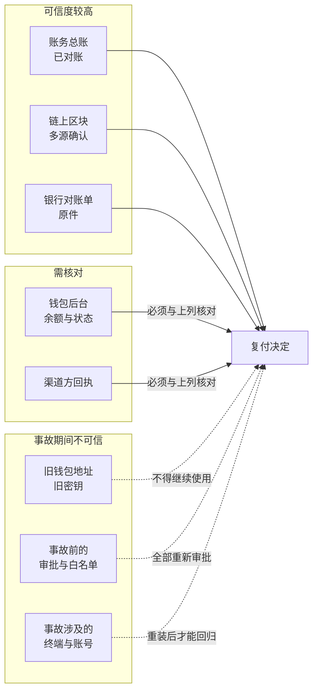
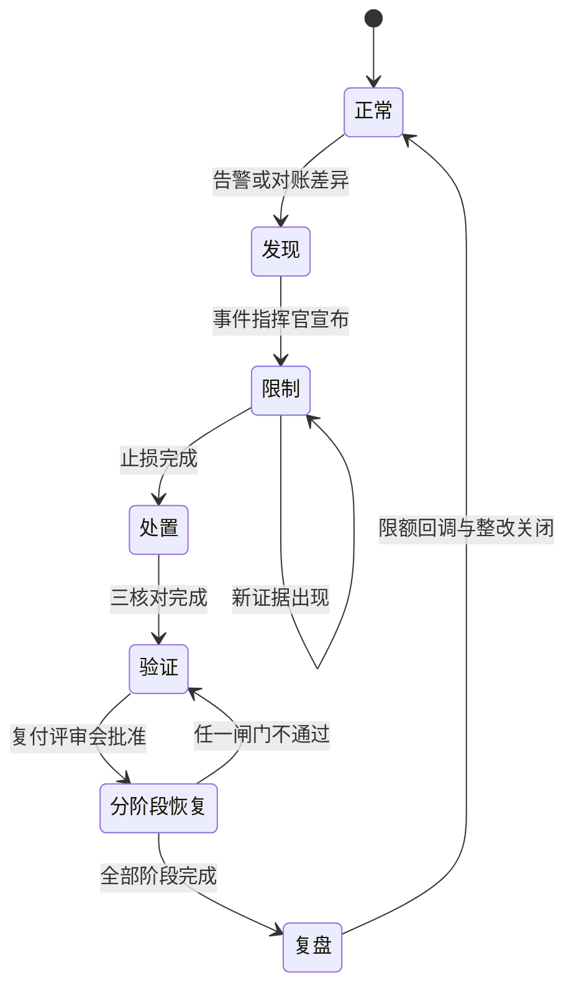
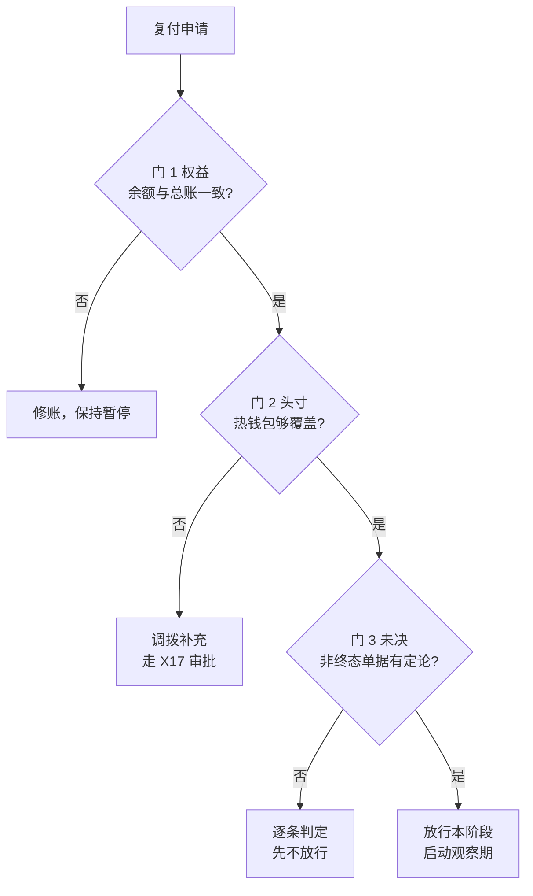
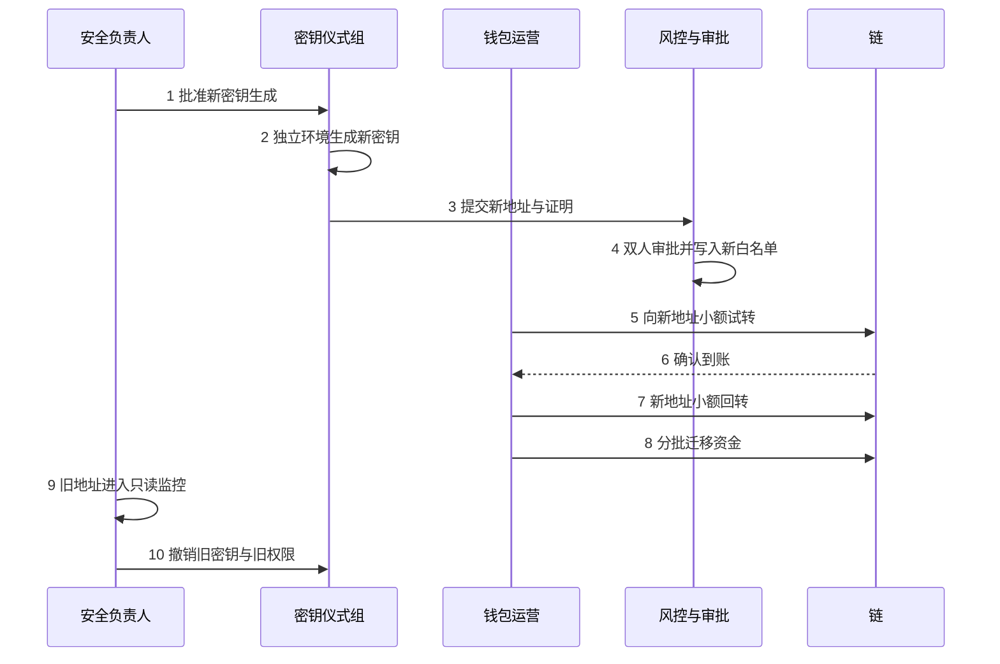

# X19 钱包、财资与支付·运营与恢复：复付、迁移、轮换与渠道恢复

> 学习目标：读完本章，你能——
> 1. 画出钱包或渠道事故后的恢复状态机，并说清每个状态的进入条件、退出条件和有权推动的人。
> 2. 在恢复提币（复付）之前，核对用户权益、渠道头寸和未决款项三样东西，并写出分阶段放量的闸门。
> 3. 设计资金迁移与密钥轮换的演练剧本，并写出对用户、监管和合作方的公告。
>
> 适用角色：交易所钱包与财资运营、安全工程师、事件指挥官、客服与合规负责人。
> 前置章节：X17-cex-wallet-treasury-payment.md、X18-cex-treasury-verification.md、X26-cex-ledger-wallet-handoff.md、[23 托管、充提与合规安全](../23-custody-exchange-ops.md)、[A09 事件响应](../assessment/A09-incident-response.md)
> 交互实验 / 模板：[T09 事件手册与值班](../templates/T09-incident-runbook-oncall.md)、[T10 桌面推演剧本与评分](../templates/T10-tabletop-script-scorecard.md)、[确认深度实验](../interactive/confirmation-depth-lab.html)
> 最后核对：2026-11-23

> 💡 注意：分工。[X17](X17-cex-wallet-treasury-payment.md) 第 6.7 节给出事故"前 60 分钟"清单。[X18](X18-cex-treasury-verification.md) 证明控制有效。[X26](X26-cex-ledger-wallet-handoff.md) 讲账务与钱包之间的单据状态。[X36](X36-payment-otc-fiat-security.md) 第 6.7 节讲渠道方事故的连续性设计。本章只回答事故被控制住之后的问题：**什么时候可以重新付款，先付谁，怎样付，付完怎样证明没有错。** 控制项写作 `TSR-Cxx`，检查项写作 `TSR-n`。

---

## 开场：提币页面重新开放的那个早晨

一家交易所的热钱包被盗，全平台暂停提币。三天后，管理层想在周一早上重开。

运营部门说：热钱包已经补了币，可以开。安全部门说：攻击入口已关闭。客服部门说：用户在排队等。

钱包工程师多问了一句：用户这三天提交的 1.2 万笔提币申请，哪些已经预留额度，哪些已经签了名，哪些在被盗那一小时里处于"已广播、未确认"？没有人答得出来。

（本场景为虚构，用来说明复付前缺少核对的风险。）

<details class="predict"><summary>🤔 先猜再看：热钱包补满、攻击入口关闭之后，还缺什么才能重开提币？</summary>

至少缺三样。（1）权益核对：每个用户的可提余额与账务一致，没有被盗期间的记错账。（2）头寸核对：每条链、每个币种的热钱包能覆盖开闸后的第一波提币，并且新地址与新密钥已经验证可用。（3）未决核对：每一笔"已签未确认""已广播未入账"的单据都有定论，否则开闸后会重复付款，或者多付给攻击者。重开的是一个会放大任何遗漏的闸门，所以要先核对再开。

</details>

---

## 1. 一句话理解

**恢复不是"把开关拨回去"，而是按证据分阶段放出资金，每一阶段都能被撤回。**

> 🎯 打个比方：水库决堤后修好缺口，不会一次性开闸放水。管理者先小流量试放，看下游水位和堤坝渗漏，再逐级加大。
>
> 比喻的局限：水位有传感器，连续、实时、不会撒谎。钱包与渠道的"水位"来自对账，有延迟，还可能被攻击者污染。所以放量闸门要用独立来源的数据，并留出观察期。

本章的核心主张有三条：

1. **先权益，后头寸，再放行。** 用户权益决定"应该付多少"，头寸决定"能付多少"，未决款项决定"已经付了多少"。
2. **复付从小到大。** 先小额、单链、受监控，再批量，再恢复限额。
3. **迁移和轮换只做演练过的步骤。** 事故中现场发明的流程，错误率最高。

---

## 2. 保护目标与信任边界

### 2.1 保护目标

| 目标 | 含义 | 违反时的后果 |
|---|---|---|
| 不多付 | 同一笔权益只付一次，不付给攻击者 | 二次损失，偿付缺口扩大 |
| 不漏付 | 每个有权益的用户最终都能收到 | 投诉、监管问询、挤兑 |
| 不扩大 | 恢复动作不重新打开攻击面 | 同一入口再次失陷 |
| 可证明 | 每一步有证据，可被审计复核 | 无法对监管和用户解释 |

### 2.2 信任边界



**读图要点：**

- 复付决定只依赖实线上的三类来源：已对账的总账、多源确认的链上数据、银行原件。
- 钱包后台和渠道回执是声明，要和第一类来源核对，不能直接当依据。
- 事故前的审批、白名单、旧密钥、涉事终端一律视为被污染。恢复时要重新审批、重新生成、重新装机。
- 局限：如果总账本身被篡改，这张图不成立。总账完整性由 [X20](X20-cex-production-data.md) 保证。

> ⚠️ 警告：事故期间最容易犯的错，是为了尽快开闸而"沿用"旧白名单、旧审批或旧签名人。攻击者可能已经在其中留下了东西。

---

## 3. 参考做法

### 3.1 恢复状态机



下表给出每个状态的进入条件、退出条件和有权推动的人。

| 状态 | 进入条件 | 退出条件 | 有权推动 | 钱和业务在哪 |
|---|---|---|---|---|
| 正常 | 无未关闭事件 | 告警成立 | 值班 | 全部按日常限额 |
| 发现 | 对账差异或小额试探告警成立 | 确认是事故或误报 | 值班安全工程师 | 日常运行，加强观察 |
| 限制 | 确认事故，且影响范围未知 | 攻击路径关闭，范围确定 | 事件指挥官（安全负责人可单人宣布） | 提币暂停，充值视情况 |
| 处置 | 止损动作已执行 | 资金已迁到干净地址，旧权限已撤销 | 钱包负责人 + 安全负责人 | 剩余资金在新地址 |
| 验证 | 三核对启动 | 三核对差异清零或逐条登记 | 财资负责人 + 账务负责人 | 仍不放量 |
| 分阶段恢复 | 复付评审会批准 | 最后一阶段稳定一个完整周期 | 评审会（至少 3 人：钱包、安全、风控） | 按阶段放量 |
| 复盘 | 恢复完成 | 限额回调、整改项关闭 | 事件指挥官 | 回到日常 |

> 💡 注意：只有"限制"状态可以由一个人单方宣布，因为暂停的代价小于遗漏的代价。每一个向"更宽松"方向的转换，都要两人以上批准。这条不对称规则要写进事件手册。

### 3.2 复付三道门



**读图要点：**

- 三道门是串联的，任何一道不通过都回到暂停。顺序不能换：权益错了，补多少头寸都没有意义。
- 门 3 的"定论"来自 [X26](X26-cex-ledger-wallet-handoff.md) 第 3.5 节的证据表：多源确认、nonce 与区块、银行回执。
- 局限：三道门只证明"现在没问题"，不证明"放量后没问题"。所以每阶段之后还有观察期。

### 3.3 迁移与轮换时序



**读图要点：**

- 新密钥必须在与事故无关的环境里生成（步骤 2），生成者与批准者分离。
- 步骤 5 到 7 是"能进也能出"的验证：只有进出都成功，才迁移大额。
- 旧地址不会马上消失：攻击者可能保留旧授权或委托。旧地址要长期只读监控（步骤 9）。
- 局限：多链、多币种时，这条时序要按链重复，不能跨链复用结论。

### 3.4 分阶段放量的参数

下面的数值全部为示例，需按自身资金规模和风险承受度调整。

| 阶段 | 范围 | 单笔上限（示例） | 总量上限（示例） | 观察期（示例） | 进入下一阶段的条件 |
|---|---|---|---|---|---|
| P0 | 仅内部测试账户 | 极小额 | 极小额 | 1 个区块周期 | 到账与对账一致 |
| P1 | 一条链、一种币，老用户 | 日常的 5% | 热钱包的 5% | 4 小时 | 差异为 0，无新告警 |
| P2 | 主要币种、主要链 | 日常的 25% | 热钱包的 25% | 24 小时 | 差异为 0，水位可控 |
| P3 | 全部币种、法币与 P2P | 日常的 50–100% | 按水位 | 1 个完整周期 | 复付评审会确认 |
| P4 | 限额回调到日常 | 日常 | 日常 | 7–30 天 | 无新增异常 |

---

## 4. 控制清单

控制 ID 写作 `TSR-Cxx`。X17 的 `TRS-Cxx` 是设计控制，本章控制是"事故之后"才用的。

| ID | 控制项 | 要防什么 | 优先级 | 怎么验证 |
|---|---|---|---|---|
| TSR-C01 | 暂停与恢复权限不对称：一人可暂停，恢复需 ≥ 2 人 | 为抢时间单人开闸 | P0 | 查手册与系统权限；演练中尝试单人恢复，应被拒 |
| TSR-C02 | 复付前强制三核对（权益、头寸、未决），生成报告 | 开闸后多付、漏付 | P0 | 抽查最近一次演练或事故的报告 |
| TSR-C03 | 复付评审会：钱包、安全、风控各一人签字，记入事件单 | 单部门决定 | P0 | 看签字记录与时间戳 |
| TSR-C04 | 分阶段放量，阶段参数写成配置，有自动熔断 | 一次放全量 | P0 | 在测试环境超限，确认熔断触发 |
| TSR-C05 | 事故前的审批、白名单、授权一律作废并重新审批 | 沿用被污染的审批 | P0 | 恢复前导出白名单，核对"重新审批"标记 |
| TSR-C06 | 新密钥在独立环境生成，生成者与批准者分离，留仪式记录 | 新密钥继承旧风险 | P0 | 看仪式记录与见证人名单 |
| TSR-C07 | 迁移先小额进出验证，再分批迁移 | 迁错地址 | P0 | 看迁移单的试转交易哈希 |
| TSR-C08 | 旧地址只读监控 ≥ 90 天（示例），并撤销授权与委托 | 旧授权被延迟使用 | P0 | 链上读取旧地址的代码、nonce、授权 |
| TSR-C09 | 未决单据逐条判定，有定论前不重发、不重付 | 重复付款 | P0 | 抽 20 条未决单据，看证据 |
| TSR-C10 | 渠道恢复清单：账户重新验证、回拨确认、额度重新授权 | 恢复时被钓鱼或账户替换 | P1 | 抽查渠道恢复单 |
| TSR-C11 | 限额回调表：每次上调有观察数据与审批 | 限额一次回到事故前 | P1 | 看限额变更记录 |
| TSR-C12 | 事后对账：恢复后 7 天内每日三方对账，之后每周 | 恢复遗留差异 | P0 | 看对账报告与差异登记 |
| TSR-C13 | 公告与通报模板预先批准，事实以对账为准 | 对外口径错误 | P1 | 看模板与批准记录 |
| TSR-C14 | 每季度一次恢复演练，每年一次含渠道方的联合演练 | 手册没人会用 | P1 | 看演练记录与改进项 |

---

## 5. 分级落地

| 档位 | 做什么 | 人和时间（示例） |
|---|---|---|
| 最小可行 | 写一页恢复手册：暂停权限、三核对表、阶段参数；每个币种预先生成一个"干净"备用地址；做一次桌面推演 | 1 名钱包工程师 + 1 名安全工程师，2–3 周 |
| 标准 | 加状态机与评审会；三核对脚本化；迁移与轮换在测试网演练；渠道恢复清单；每季度演练 | 3–4 人，2–3 个月 |
| 成熟 | 恢复流程进入事件平台；放量由配置驱动并自动熔断；与渠道方联合演练；恢复指标进入季度汇报 | 5 人以上，6–12 个月 |

---

## 6. 落地做法

### 6.1 第一步：写一页"恢复手册"

手册只回答六个问题：

1. 谁能宣布暂停？谁能批准恢复？（TSR-C01）
2. 三核对分别由谁做、用什么脚本？
3. 阶段参数在哪里配置？
4. 干净的备用地址在哪里？谁持有生成记录？
5. 对外公告由谁起草、谁批准？
6. 事故中的联系人名单（渠道方、托管方、执法协助窗口、法务）。

### 6.2 复付闸门配置（示例）

```yaml
# 示例：复付闸门配置。字段名为示意，数值为示例。
incident_id: INC-2026-0001
stages:
  - name: P1
    scope: { chains: [btc], assets: [BTC], users: "tenure_days>=365" }
    per_tx_limit_pct_of_normal: 5
    total_limit_pct_of_hot: 5
    observe_hours: 4
    gates:
      entitlement_diff_count: 0     # 门 1
      hot_cover_ratio_min: 1.5      # 门 2：热钱包 / 本阶段上限
      unresolved_unknown_count: 0   # 门 3
    auto_halt_on:
      - ledger_wallet_diff_nonzero
      - new_destination_small_probe
      - net_outflow_pct_of_hot_gt: 30
    approvers_required: [wallet, security, risk]
```

### 6.3 三核对查询（示例）

数据结构为示意。`ledger_balance` 是账务可提余额，`withdraw_order` 是提币单，`wallet_chain_balance` 是链上读取的热钱包余额。

```sql
-- 示例：门 1 权益。可提余额必须等于"期初 + 充值 - 已完成提币 - 在途预留"。
SELECT l.user_id, l.available AS ledger_avail,
       (s.opening + s.deposits - s.withdrawn_done - s.reserved_open) AS expected
FROM ledger_balance l JOIN snapshot_pre_incident s USING (user_id, asset)
WHERE l.available <> (s.opening + s.deposits - s.withdrawn_done - s.reserved_open);

-- 示例：门 2 头寸。热钱包余额能否覆盖本阶段上限与在途预留。
SELECT w.chain, w.asset, w.onchain_balance,
       COALESCE(SUM(o.amount),0) AS reserved_open,
       w.onchain_balance / NULLIF(:stage_cap,0) AS cover_ratio
FROM wallet_chain_balance w
LEFT JOIN withdraw_order o ON o.chain=w.chain AND o.asset=w.asset
     AND o.state IN ('RESERVED','APPROVED','SIGNED','BROADCAST')
WHERE w.wallet_id = :new_hot_wallet
GROUP BY w.chain, w.asset, w.onchain_balance;

-- 示例：门 3 未决。非终态单据必须有定论字段，结果为空才通过。
SELECT order_id, state, updated_at
FROM withdraw_order
WHERE state IN ('SIGNED','BROADCAST','UNKNOWN') AND verdict IS NULL;
```

### 6.4 放量与熔断（Python 示例）

```python
# 示例：阶段放量的闸门检查。输入为示意结构，不是真实系统接口。
def stage_allowed(stage, metrics):
    g = stage["gates"]
    checks = {
        "entitlement": metrics["entitlement_diff_count"] <= g["entitlement_diff_count"],
        "cover":       metrics["hot_cover_ratio"] >= g["hot_cover_ratio_min"],
        "unresolved":  metrics["unresolved_unknown_count"] <= g["unresolved_unknown_count"],
    }
    return all(checks.values()), checks

def should_halt(stage, live):
    if live["ledger_wallet_diff"] != 0:
        return True, "账务与钱包出现差异"
    if live["net_outflow_pct_of_hot"] > 30:   # 示例阈值
        return True, "净流出超过热钱包 30%"
    return False, ""
```

### 6.5 复付的顺序

1. **先付已经定论的。** 门 3 通过的、已验证的提币单。
2. **再付新申请。** 新申请要重新跑风控，因为事故期间的规则可能已经调整。
3. **最后处理有争议的。** 未决、被冻结、疑似与攻击者有关的单据，走 [X25](X25-cex-fraud-recovery-ops.md) 的案件流程。

### 6.6 迁移与轮换要点

- **只迁一次，不要来回。** 每次迁移都是一次暴露窗口。迁移计划按链列出顺序、批次和上限。
- **新地址先进白名单，再迁资金。** 白名单走 [X17](X17-cex-wallet-treasury-payment.md) 第 6.3 节的双人审批和冷却期。事故模式下可以缩短冷却期，但缩短要记录并由安全负责人批准。
- **MPC 与多签的轮换不同。** MPC 要重新分片或重新生成密钥；多签要换签名人并更新所有者集合。两者都只做演练过的步骤。
- **别忘了链上权限。** 旧地址的授权、代理管理员、EIP-7702 委托都要逐条撤销。见 [X17](X17-cex-wallet-treasury-payment.md) 第 6.4 节。
- **终端重装才能回归。** 涉事终端和账号一律重装、换凭证；"清理过"不算。

### 6.7 渠道方事故的恢复

渠道包括银行、支付商、稳定币发行方、托管方。恢复分四步。

1. **确认事实。** 看渠道方的状态公告、对账单，联系人电话用预先登记的，不用邮件里新给的。
2. **重算头寸。** 滞留在渠道的资金、在途款项、可用的替代通道。
3. **重新验证。** 恢复后的收款账户、API 密钥、回调地址一律走变更单与回拨确认（TSR-C10）。
4. **分阶段恢复入金与出金。** 入金先恢复（风险较低），出金后恢复，并设更低的单笔上限。

对稳定币，恢复前还要检查：发行方公告、链上赎回是否正常、二级市场价格是否回到锚定区间。任一项不满足，保持限制。

### 6.8 恢复后的限额回调

按 TSR-C11 写一张回调表：每次上调写明依据的观察数据（对账差异为 0 的天数、熔断触发次数、投诉量）和批准人。回调不要一次回到事故前，至少分 3 步。

### 6.9 常见坑

1. 为赶时间跳过门 3，开闸后发现一批"已签未确认"的单据被重发。
2. 新热钱包补了币，但白名单没更新，用户提币大面积失败，客服被淹没。
3. 迁移后忘了撤销旧地址的链上授权。
4. 公告里写了"已全部恢复"，但法币与 P2P 通道还没恢复，造成误导。
5. 复付后没有每日对账，差异在一周后才被发现。

---

## 7. 运营：指标、告警、演练

### 7.1 指标

| 指标 | 含义 | 目标（示例） |
|---|---|---|
| 暂停到全量恢复的小时数 | 业务影响 | 随事故，不设硬目标 |
| 三核对完成时间 | 能否快速评审 | 4 小时内 |
| 阶段熔断次数 | 闸门是否有效 | 不为 0 才说明在工作，但要逐次复盘 |
| 复付后 7 天内对账差异数 | 恢复质量 | 0 |
| 恢复演练覆盖链数 | 手册是否可用 | 100% 主要链 |

### 7.2 告警（恢复期间）

- 恢复阶段内任一账务与钱包差异非零：自动暂停当前阶段。
- 新目标地址的极小额转账：提高关注级别（参见 TRS-C13）。
- 旧地址出现任何出账：最高优先级告警（TSR-C08）。
- 单币种净流出超过阈值：暂停并通知评审会。

值班与升级路径见 [X05](X05-detection-response-engineering.md)；演练与度量见 [X06](X06-resilience-validation.md)。

### 7.3 演练节奏

| 节奏 | 做什么 |
|---|---|
| 每季度 | 测试网全流程：暂停、迁移、轮换、三核对、P1–P3 放量 |
| 每半年 | 桌面推演（见第 8 节），换场景 |
| 每年 | 与渠道方联合演练；检查干净备用地址仍可用 |

---

## 8. 演练剧本（桌面推演，各 30–45 分钟）

### 8.1 剧本 A：热钱包被盗后的复付

**背景：** 某交易所 02:10 对账发现 ETH 热钱包少了约 2 万 ETH（示例）。值班按 X17 的前 60 分钟清单，已暂停全平台提币并停了签名集群入口。现在是第 3 天上午，涉事终端已隔离，攻击入口已确认关闭。

| 时间 | 注入 | 参与者要回答 | 评分点 |
|---|---|---|---|
| 0–10 分钟 | 管理层要求"今天下午重开"。账务发现 3 笔提币单状态为 `SIGNED`，没有区块记录。 | 这三笔怎么处理？谁判定？ | 不重发、多源核对、记录证据（TSR-C09） |
| 10–20 分钟 | 钱包团队要用旧白名单加快恢复。 | 能用吗？ | 拒绝；全部重新审批（TSR-C05） |
| 20–30 分钟 | 新热钱包地址由一名工程师"临时生成"。 | 有什么问题？ | 要独立环境、仪式记录、生成与批准分离（TSR-C06） |
| 30–40 分钟 | P1 放量 1 小时后，对账出现 1 笔差异，同时一个新地址向平台打入极小额。 | 怎么办？ | 自动熔断、回到验证状态、查差异来源（TSR-C04、C12） |

评分（每项 0–2 分，满分 10）：三核对完成；阶段参数合理；权限不对称；证据留存；公告口径。

### 8.2 剧本 B：银行渠道与稳定币同时异常

**背景：** 某交易所的法币入金银行通知冻结账户审查。同一天，平台上主要稳定币的二级市场价格偏离锚定 3%（示例）。

| 时间 | 注入 | 要回答 | 评分点 |
|---|---|---|---|
| 0–10 分钟 | 邮件称"账户信息已更新，请向新账户付款"。 | 如何处理？ | 不信邮件，用登记电话回拨（TSR-C10） |
| 10–20 分钟 | 财资发现 40% 的法币头寸在该银行。 | 下一步？ | 重算头寸、启用替代通道、降低单笔上限 |
| 20–30 分钟 | 稳定币仍可链上赎回，但价格偏离。用户大量提币。 | 是否限制？ | 按币种限制、观察赎回是否正常 |
| 30–40 分钟 | 客服收到大量"账户被冻结"的投诉。 | 口径是什么？ | 只讲已核实事实，不承诺时间（TSR-C13） |

评分：不被钓鱼；头寸重算；分币种限制；公告一致；渠道恢复清单完整。

---

## 9. 决策、清单与对外沟通

### 9.1 决策矩阵

| 影响范围 | 恢复条件 | 授权人 | 时间窗（示例） |
|---|---|---|---|
| 单链单币种 | 三核对通过 + 观察期通过 | 钱包负责人 + 安全负责人 | 4–24 小时 |
| 多链主要币种 | 三核对 + 评审会 | 评审会（钱包、安全、风控） | 1–3 天 |
| 全平台提币 | 三核对 + 评审会 + 管理层知情 | 评审会 + 管理层 | 3 天以上，按事故 |
| 渠道（银行、支付） | 渠道方书面确认 + 账户重新验证 | 财资负责人 + 合规负责人 | 视渠道方 |
| 稳定币 | 发行方公告 + 赎回正常 + 价格回到区间 | 财资负责人 + 风控负责人 | 观察至少一个完整周期 |

### 9.2 恢复前清单

- [ ] 证据已保全：镜像、日志、签名请求记录已做哈希并封存（见 [X22](X22-cex-production-recovery-ops.md)）。
- [ ] 攻击入口已确认关闭，涉事终端已重装，涉事凭证已更换。
- [ ] 三核对报告已生成，差异清零或逐条登记。
- [ ] 新地址已完成小额进出验证。
- [ ] 旧地址的授权、代理管理员、委托已撤销，并进入只读监控。
- [ ] 白名单、审批、签名人名单已重新审批。
- [ ] 阶段参数和熔断已写入配置，并在测试环境触发过一次。
- [ ] 风险复评完成：规则、阈值、新目标地址监控。
- [ ] 对外公告、监管通报、合作方通知已批准，口径与对账一致。
- [ ] 客服话术与账务状态一致，升级路径已通知。
- [ ] 复付评审会签字记录已入事件单。

### 9.3 用户公告模板

```text
标题：关于提币服务分阶段恢复的公告
时间：<日期时间，UTC>
1. 已核实事实：<日期>，我们发现 <范围> 的异常转出，已暂停提币。用户账户余额与总账一致。
2. 当前状态：提币将分阶段恢复。第一阶段：<日期时间>，<币种/网络>。后续阶段另行公告。
3. 你需要做什么：请只使用官方应用与官方域名。我们不会要求你提供私钥、助记词或验证码。
4. 我们不能确认的事：损失最终金额、攻击来源仍在调查，以后续公告为准。
5. 联系方式：<官方渠道>
```

### 9.4 监管与合作方通报模板

```text
收件人：<监管机构联系人 / 渠道方 / 托管方>
事件编号：INC-<编号>      通报时间：<UTC>
1. 事件类型与发现时间：<对账差异 / 渠道不可用>
2. 影响范围：<链、币种、用户数的已核实部分；未核实部分写"调查中">
3. 已采取措施：暂停提币；迁移资金至新地址；旧权限已撤销
4. 恢复计划：分 <n> 个阶段；每阶段闸门为权益、头寸、未决三核对
5. 需要对方配合：<冻结协助 / 账户重新验证 / 联系人确认>
6. 下一次更新时间：<UTC>      联系人：<姓名与登记电话>
```

> 💡 注意：法定通报时限与格式随辖区变化。以所在辖区监管机构的最新要求为准，本章不给出具体时限。

---

## 10. 失效案例

> 💡 注意：以下只写摘要和教训。金额为约数、事发时估值。来源类型：媒体报道、项目方公告、官方通报。各案细节可能继续变化。

### 10.1 Binance：热钱包被盗后一周重开（2019 年 5 月，比特币）

- **事实：** 2019 年 5 月 7 日，约 7,000 个 BTC（事发时约 4,100 万美元）从热钱包被转出。Binance 暂停充提，称将用 SAFU 基金承担损失。The Block 报道，Binance 约一周后重新开放充提，并称对 API、2FA 和提币校验做了重大改动；公开报道对重开具体日期的写法略有差异（5 月 14 日或 15 日）。来源：[The Block](https://www.theblock.co/news/markets/2019-05-15-binance-reopens-withdrawals-and-deposits-a-week-after-41-million-hack-bitcoin-23501)、[CoinDesk](https://coindesk.com/markets/2019/05/15/crypto-exchange-binance-restarting-services-after-post-hack-upgrade/)。
- **映射：** TSR-C03（评审后重开）、TSR-C05（被打穿的环节在重开前改造）。
- **教训：** 重开前要先改掉攻击者用过的那一类环节，而不是只补币。

### 10.2 KuCoin：新热钱包与分币种恢复（2020 年 9 月）

- **事实：** KuCoin 称攻击者取得了热钱包私钥。报道称，发现异常转出后，剩余资金被迁入新热钱包，旧钱包弃用。KuCoin 的初始损失估计约 1.5 亿美元，Chainalysis 估算约 2.75 亿美元。KuCoin 在 10 月先恢复 BTC、ETH 与 ERC-20 USDT 的充提，之后逐步恢复其他币种。追回与赔付的比例，各来源口径不同。来源：[Cointelegraph](https://cointelegraph.com/news/kucoin-inches-closer-to-recovery-by-reopening-deposits-and-withdrawals)、[The Block](https://www.theblock.co/news/markets/2020-11-11-kucoin-280m-stolen-recovered-84248)。
- **映射：** TSR-C07（迁移）、TSR-C04（分阶段、分币种）。
- **教训：** 先放最主要、最容易核对的币种；把"追回与赔付"和"恢复服务"拆成两条线推进。

### 10.3 Bybit：被盗后补足储备并保持提币（2025 年 2 月）

- **事实：** 2025 年 2 月 21 日，Bybit 一笔冷钱包转账被盗，公开报道金额约 14 亿至 15 亿美元，FBI 归因于朝鲜 TraderTraitor。Bybit 的事件时间线称，次日充提回到正常水平，期间处理了约 40 亿美元提币；以太坊储备缺口通过桥接贷款、机构存入和场外购买共约 12.3 亿美元补足。Hacken 对储备做了审计，称储备覆盖客户资产，审计范围是储备与负债，不含被盗资金本身。来源：[Bybit 事件时间线](https://www.bybit.com/en/learn/this-week-in-bybit/bybit-security-incident-timeline)、[The Block](https://www.theblock.co/news/markets/2025-02-24-bybit-ceo-says-exchange-has-closed-shortfall-in-eth-reserves-plans-to-release-audited-por-report-342896)、[FBI IC3](https://ic3.gov/psa/2025/psa250226)。
- **映射：** TSR-C02（头寸核对）与 [X27](X27-cex-reserves-solvency.md) 的储备证明。
- **教训：** 不暂停提币也能恢复，前提是头寸能立刻覆盖。缺口先补，再对外说"已覆盖"，并让独立第三方核对。

### 10.4 Bitget：分阶段重开与净流出（2026 年 9 月）

- **事实：** Bitget 于 2026 年 9 月被盗并暂停提币（原因与损失口径见 [X18](X18-cex-treasury-verification.md) 第 8.4 节）。The Block 报道，Bitget 要求每条链通过一系列安全检查后才重开，并按计划分阶段：9 月 28 日 BTC（比特币与 BSC 网络），9 月 29 日 ETH 及部分二层网络，9 月 30 日多条链上的 USDT，10 月 2 日其余资产、法币与 P2P。Bitget 称用户保护基金（5,500 BTC）覆盖全部损失，这是公司自己的说法。Bloomberg Government 报道，重开后出现约 4.63 亿美元的客户净流出。来源：[The Block](https://theblock.co/news/business/2026-09-28-bitget-starts-phased-withdrawal-resumption-416965)、[Bloomberg Government](https://news.bgov.com/crypto/crypto-hack-spurs-463-million-in-customer-outflows-at-bitget)。
- **映射：** TSR-C04（阶段与顺序）、TSR-C11 与 [X27](X27-cex-reserves-solvency.md)（头寸要为开闸后的净流出做准备）。
- **教训：** 重开本身就是一次压力测试。阶段计划要预先估算净流出，并让熔断与头寸联动。

### 10.5 Circle 与 SVB：渠道头寸与稳定币脱锚（2023 年 3 月）

- **事实：** 2023 年 3 月 10 日，Circle 披露其 USDC 约 400 亿美元储备中有 33 亿美元存放在失败的硅谷银行（约占 8%）；USDC 随后一度跌至约 0.88 美元。3 月 13 日，Circle 称在美国政府处置后，该笔存款将在银行开门时全部可用。美联储 2025 年 12 月的研究笔记认为，这次银行挤兑是 USDC 脱锚的触发因素。来源：[Fortune](https://fortune.com/crypto/2023/03/10/circle-reveals-3-3-billion-stuck-silicon-valley-bank-usdc-wobbles-against-peg)、[Circle 公告](https://www.circle.com/fr/pressroom/3-3-billion-of-usdc-reserve-risk-removed-dollar-de-peg-closes)、[美联储](https://www.federalreserve.gov/econres/notes/feds-notes/in-the-shadow-of-bank-run-lessons-from-the-silicon-valley-bank-failure-and-its-impact-on-stablecoins-20251217.html)。
- **映射：** TSR-C10（渠道恢复）与第 6.7 节的稳定币检查。
- **教训：** 渠道方事故会同时影响法币通道与稳定币。恢复时看发行方公告、赎回通道和价格，不看单一信号。

---

## 11. 评估检查点

- [ ] **TSR-1** 有书面恢复手册，写明暂停与恢复的权限不对称。
- [ ] **TSR-2** 每个币种、每条链都有预先生成并验证过的"干净"备用地址。
- [ ] **TSR-3** 三核对（权益、头寸、未决）有脚本和报告模板。
- [ ] **TSR-4** 复付评审会有固定成员与签字记录。
- [ ] **TSR-5** 阶段放量参数写成配置，并能自动熔断。
- [ ] **TSR-6** 事故前的审批、白名单、授权可一键标记作废。
- [ ] **TSR-7** 新密钥生成有独立环境、见证人与仪式记录。
- [ ] **TSR-8** 迁移前有小额进出验证规程。
- [ ] **TSR-9** 旧地址有只读监控与链上授权、委托清理清单。
- [ ] **TSR-10** 未决单据有逐条判定表和证据要求。
- [ ] **TSR-11** 涉事终端有重装与凭证更换流程。
- [ ] **TSR-12** 渠道恢复清单含回拨确认与账户重新验证。
- [ ] **TSR-13** 稳定币恢复前有发行方、赎回、价格三项检查。
- [ ] **TSR-14** 限额回调表分步骤，每步有数据与批准人。
- [ ] **TSR-15** 恢复后 7 天每日三方对账。
- [ ] **TSR-16** 用户公告、监管通报、合作方通知模板已批准。
- [ ] **TSR-17** 每季度测试网恢复演练，每年含渠道方的联合演练。
- [ ] **TSR-18** 复盘后，漏掉的控制补回 X17 清单和 X18 用例。

**把检查结果写进报告：**

| 检查项 | 对应控制 | 证据 | 结果 | 责任人 | 期限 |
|---|---|---|---|---|---|
| TSR-1、4 | TSR-C01、C03 | 手册、签字记录 |  |  |  |
| TSR-3、5、10 | TSR-C02、C04、C09 | 脚本、配置、判定表 |  |  |  |
| TSR-6、7、8 | TSR-C05、C06、C07 | 仪式记录、试转哈希 |  |  |  |
| TSR-9、11 | TSR-C08 | 链上读取、重装记录 |  |  |  |
| TSR-12、13 | TSR-C10 | 渠道恢复单 |  |  |  |
| TSR-14、15 | TSR-C11、C12 | 回调表、对账报告 |  |  |  |
| TSR-16、17、18 | TSR-C13、C14 | 模板、演练记录 |  |  |  |

---

## 12. 上手路径

- **第一周：** 读 X17 第 6.7 节与 X26 第 3.5 节；列出所有链、币种、渠道；找出每个币种当前是否有备用干净地址；起草一页恢复手册。
- **第一个月：** 把三核对写成 SQL 与报告；定阶段参数；在测试网做一次迁移与轮换；做剧本 A 的桌面推演。
- **第一个季度：** 把放量与熔断做成配置；做剧本 B；与一家渠道方做联合演练；把恢复指标放进季度汇报。

---

## 13. 常见误区

1. **补满热钱包就等于恢复。** 没有权益与未决核对，只是把风险放大。
2. **沿用旧白名单和审批以节省时间。** 它们可能已被污染。
3. **为了公告好看，写"已全部恢复"。** 恢复是分阶段的，公告要写清每阶段。
4. **新密钥由事故中的原班人马在原环境生成。** 新密钥继承旧风险。
5. **旧地址不再监控。** 攻击者可能延迟使用旧授权。
6. **重开后不做每日对账。** 差异会被后续交易掩盖。
7. **只演练技术，不演练沟通。** 公告错了，损害不亚于技术错误。

---

## 14. 术语表

| 术语 | 英文 | 解释 |
|---|---|---|
| 复付 | Resumption of payout | 事故后重新开始对用户付款 |
| 三核对 | Three-way check | 权益、头寸、未决款项三项核对 |
| 头寸 | Position | 某链某币种可用的资金量 |
| 未决款项 | Pending items | 已申请或已签名，但未到终态的单据 |
| 干净地址 | Clean address | 由独立流程新生成、未接触事故的地址 |
| 密钥轮换 | Key rotation | 用新密钥替换旧密钥，并撤销旧权限 |
| 分阶段恢复 | Phased resumption | 按范围与额度分步放量 |
| 熔断 | Circuit breaker | 指标超限时自动暂停 |
| 限额回调 | Limit restoration | 事故后逐步恢复日常限额 |
| 保管链 | Chain of custody | 证据交接与保管的完整记录 |

---

## 15. 动手练习与思考题

**练习 1：画你的状态机（30 分钟）。** 在笔记本上画出你所在机构的恢复状态机，标出每个状态的进入、退出条件和有权人。找出哪一个转换现在可以由单人完成而不应该。

**练习 2：写阶段表（30 分钟）。** 选一条主要链，写出 P1 到 P4 的范围、上限、观察期和进入条件。写出两个会触发自动熔断的指标。

**练习 3：填三核对（30 分钟）。** 用一个虚构的 20 笔提币单样本，手工判定哪些通过门 1、2、3。故意放入 3 笔 `SIGNED` 无区块记录的单据，写出你的判定证据。

**练习 4：写公告（30 分钟）。** 为剧本 A 的第 3 天写一份用户公告，只用已核实事实。再删去所有"可能""预计"一类的词，看看还剩什么。

**建议配套：** [B64 托管运营与事件响应练习](../bootcamp/B64-custody-ops-ir-practice.md)、[B74 签名策略练习](../bootcamp/B74-signing-policy-practice.md)、[B76 桌面推演与复盘练习](../bootcamp/B76-tabletop-postmortem-practice.md)；后续 B81（钱包与渠道三方对账与未决状态）会与本章配套。账务与钱包的交接见 X26-cex-ledger-wallet-handoff.md，储备与偿付见 X27-cex-reserves-solvency.md。

**思考题：**

1. 恢复评审会要求钱包、安全、风控三方签字。当管理层要求"今天必须重开"，你怎样用数据而不是职位说服他们？
2. 如果门 3 有 5 笔单据无法判定，是等到全部判定后再放行，还是先放行其余单据？你的决定依据是什么？
3. 渠道方在事故中不回应电话和邮件，你的头寸与用户公告怎样写？

> 🪞 反思：你的机构里，上一次有人宣布"已恢复"，依据的是哪份对账报告？那份报告的数据来源是否独立于被事故影响的系统？

---

## 附：来源与时效说明

- 事故案例来自公开媒体报道、项目方公告和官方通报，已在各案内给出链接。金额均为约数。Bitget 事件的原因与损失口径在各报道间不一致，且为公司自己的说法，以后续报告为准。
- 阶段参数、限额、观察期、时限均为示例，需按自身资金规模、链特性和监管要求调整。
- 模板中的监管通报时限与格式因辖区而异，本章不给出具体要求。
