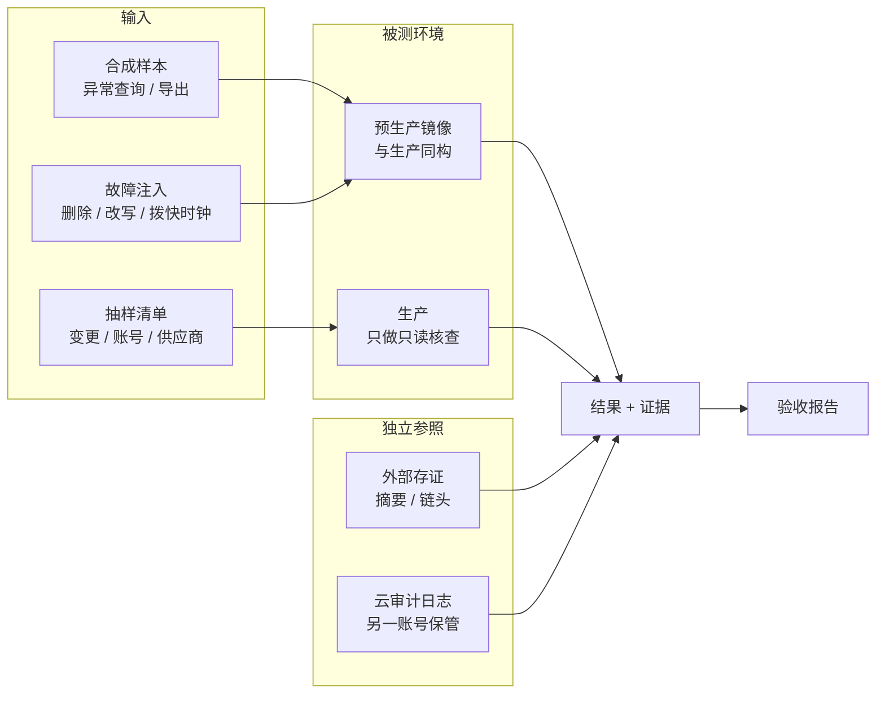
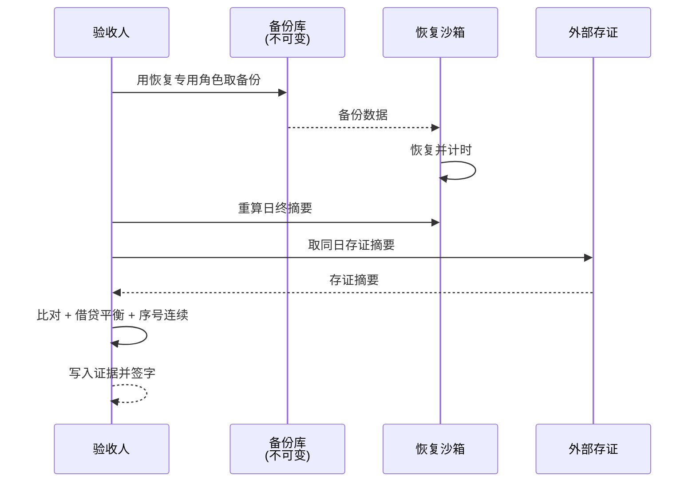
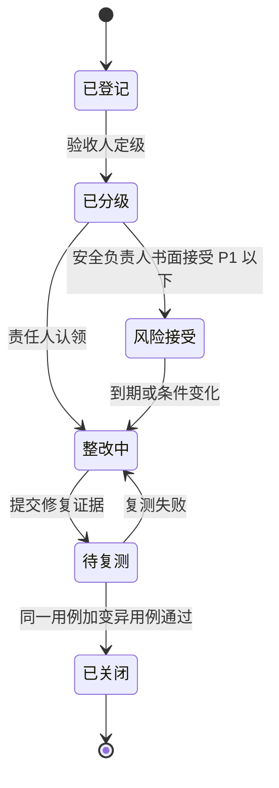

# X21 生产环境与数据·工程验收：权限、证据与备份怎么证明可信

> 学习目标：读完本章，你能——
> 1. 为核心系统隔离、特权访问、变更控制、数据导出、日志、备份和第三方访问写出可重复执行的验收用例，并说清每条要留什么证据。
> 2. 用"标准答案"回放外流检测规则，算出召回与误报；用抽样、查询和哈希校验证明日志没被改、备份能恢复且恢复出来的数据可信。
> 3. 写出一份验收报告，给不符合项分级，并判断哪些未通过的用例要阻断上线。
>
> 适用角色：交易所安全工程师、平台与 SRE 测试人员、内部审计与 GRC。
> 前置章节：[X20 交易所生产环境与数据](X20-cex-production-data.md)、[X03 生产基础设施安全](X03-production-infra-security.md)、[X06 韧性与验证](X06-resilience-validation.md)、[24 数据与隐私](../24-data-privacy.md)
> 交互实验 / 模板：[上线门禁模板](../templates/T04-go-live-gate.md)、[安全架构评审模板](../templates/T12-security-architecture-review.md)
> 最后核对：2026-11-23

> 💡 注意：分工。[X20](X20-cex-production-data.md) 讲核心系统怎么分区、数据怎么分级、证据怎么设计。本章不重复设计，只回答：**你凭什么说这些控制在生产里真的有效？** 控制项编号 `XDT-Cxx` 指向 X20 第 4 节；本章自己的检查项写作 `XPV-n`，验收用例写作 `XPV-Txx`。证据保全、恢复与可用性事件见 X22，交易系统的复市见 X16。

---

## 开场：备份"成功"了整整一年

一家交易所的运维一年来每天收到一封"备份成功"的邮件。审计员来抽样，要求在隔离环境里恢复上个月的账务库。恢复很顺利。审计员接着问：恢复出来的库，日终余额摘要和外部存证对得上吗？借贷平衡吗？

没人回答得上。当晚有人去查：备份任务确实每天成功，但备份账号和生产管理员账号是同一个；备份桶没有开对象锁；账务库的日终摘要从来没有发到外部。也就是说，攻击者拿到生产管理员权限后，可以删掉备份，或者悄悄改一份再放回去，而"备份成功"的邮件照发不误。（本场景为虚构，用来说明验收的盲区。）

<details class="predict"><summary>🤔 先猜再看："备份任务成功"和"能恢复"，离"可信"还差什么？</summary>

差三步：（1）**能恢复**，要真恢复一次并记录用时；（2）**恢复出来的数据可信**，要和一个攻击者碰不到的独立记录比对，比如外部存证的日终摘要、借贷平衡、链上余额；（3）**攻击者删不掉也改不了**，要用生产最高权限的账号真去试一次删除和改写，看是否失败并告警。验收的对象是"在最坏假设下仍成立的结论"，不是"流程跑完了"。

</details>

---

## 1. 一句话理解

**生产验收是在受控条件下，用有权账号和已知答案的数据去"测试"每一条隔离、权限、日志和备份控制，记录实际反应，让另一个人能复现。**

> 🎯 打个比方：银行金库验收不是看图纸上有几道门，而是由第三方拿着授权单，真的去试每道门锁不锁、监控拍不拍、报警响不响，再把一份从金库里取出的账本和外部副本对一遍。
>
> 比喻的局限：金库的物理结构很少变。云账号、K8s 策略、备份任务每周都在变，验收必须随变更重做，并且要自动化到能每周抽样；同时有些测试（删除备份、改日志）不能在生产里真做，要放到影子环境或用"只读证明"代替。

**验收与日常监控的区别**：监控回答"现在有没有异常"，验收回答"如果发生异常，控制是否会起作用"。两者互补，但不能互相替代。一条规则在生产里半年没有告警，既可能是没有攻击，也可能是规则早已失效；只有用已知答案的样本去触发它，才能区分这两种情况。

**谁来做验收**：执行验收的人应当独立于建设和运维该控制的团队。小团队做不到时，至少让写控制的人和跑测试的人分开，并由第三个人评审报告。

验收做五件事：

1. **隔离真实**：不该通的网络路径、不该有的身份，实测不通、查无此人。
2. **权限受控**：特权访问有期限、有审批、有录像；变更全部走流水线，作者不是批准人。
3. **数据出得去才危险**：批量读取、导出和出站流量都有限额，规则能命中。
4. **证据不可改**：日志写入后改不了、删不了，时间对得上。
5. **备份可恢复且可信**：恢复出来的数据与独立记录一致。

---

## 2. 验收范围与信任边界



读图要点：
- 破坏性测试（删备份、改日志、拨时钟）只在预生产或影子环境做；生产只做只读核查、抽样和"用最小权限测试账号尝试被拒"。
- 结论要靠"独立参照"：外部存证和另一账号保管的云审计日志，是攻击者在生产里碰不到的东西。
- 抽样清单由验收人自己抽，不由被测团队提供。

**哪些东西不能被信任**：被测团队自己出具的截图、同一账号体系保管的日志、备份系统自己报告的"成功"。

---

## 3. 验收环境与数据

### 3.1 环境应该长什么样

| 环境 | 用途 | 要求 |
|---|---|---|
| 预生产镜像 | 做破坏性测试 | 与生产同构：同样的账号结构、网络策略、对象锁配置、K8s 准入策略；数据为合成或脱敏 |
| 恢复沙箱 | 从备份恢复 | 独立网络、无出站；用"恢复专用角色"读备份，不用生产管理员 |
| 生产（只读核查） | 抽样与配置核对 | 验收账号只读；操作全部被审计日志记录；不执行写入、删除 |

### 3.2 怎样不碰生产

1. 预生产与生产使用不同云账号、不同密钥、不同令牌。预生产账号**没有**访问生产备份桶和日志桶的权限。
2. 所有破坏性脚本在启动时先做"生产哨兵"检查：账号 ID、集群名、数据库主机名不在预生产白名单里就退出。
3. 在生产里做的"尝试被拒"测试，只用专门建的测试账号，权限小、有标记、事先通知值班。

```bash
# 示例：生产哨兵。账号 ID 与集群名为示意，按自己的环境填写
set -euo pipefail
ALLOWED_ACCT="111122223333"          # 预生产账号 ID（示例）
ALLOWED_CTX="staging-cluster"        # 预生产 kube context（示例）
ACCT=$(aws sts get-caller-identity --query Account --output text)
CTX=$(kubectl config current-context)
[ "$ACCT" = "$ALLOWED_ACCT" ] || { echo "拒绝：当前账号不是预生产"; exit 1; }
[ "$CTX"  = "$ALLOWED_CTX"  ] || { echo "拒绝：当前集群不是预生产"; exit 1; }
```

### 3.3 怎样造数据

- **账务库**：用生成器造 10 万个账户、100 万条分录，每种资产借贷和为 0，生成后固定一份"日终余额摘要"作标准答案。
- **查询日志**：造三类——正常客服查询、正常风控批量查询、已知异常（无工单批量读取、一次导出 1 万行、凌晨大量出站）。每条带"应命中 / 不应命中"标签。
- **日志样本**：造一段带序号和哈希链的日志；准备 3 份篡改版本（改一行、删一行、调换两行）。
- **备份样本**：准备一份干净备份，和一份"被污染备份"（改了某账户余额、删了一天的分录）。

---

## 4. 验收用例库

用例 ID 写作 `XPV-Txx`。"控制项"列指向 X20 的 `XDT-Cxx`。"证据"列是评审时必须能拿出来的材料。除标明"生产只读"外，操作只在预生产执行。

### 4.1 隔离与网络（A 组）

| 用例 ID | 控制项 | 前置条件 | 操作 | 预期结果 | 证据 |
|---|---|---|---|---|---|
| XPV-T01 | XDT-C01 | 账户区一台测试主机 | 对签名区地址与端口做连通探测 | 全部超时或被拒 | 探测输出、安全组与路由截图 |
| XPV-T02 | XDT-C01 | 账户区测试 Pod | 在 K8s 里访问签名区 Service 的 DNS 与 ClusterIP | 无法解析或无法连接 | `kubectl` 输出、NetworkPolicy 清单 |
| XPV-T03 | XDT-C01 | 业务区身份 | 用业务区角色尝试调用签名区的云 API（读密钥元数据） | 拒绝（AccessDenied） | 云审计日志条目 |
| XPV-T04 | XDT-C04 | 办公网测试账号，有数据库账号权限 | 绕过数据网关，直连生产库端口 | 连接失败 | 防火墙日志、探测输出 |
| XPV-T05 | XDT-C22 | 未登记的个人设备 | 尝试接入生产跳板或 VPN | 被设备合规检查拒绝 | 接入日志 |

### 4.2 特权访问与变更（B 组）

| 用例 ID | 控制项 | 前置条件 | 操作 | 预期结果 | 证据 |
|---|---|---|---|---|---|
| XPV-T06 | XDT-C02 | 近 90 天变更清单 | 随机抽 10 条，核对提交人、批准人、部署人 | 作者不是批准人；无审批的为 0 | 抽样表、变更系统导出 |
| XPV-T07 | XDT-C02 | 预生产流水线 | 作者本人尝试批准自己的变更 | 系统拒绝 | 流水线日志 |
| XPV-T08 | XDT-C03 | 冻结期已配置 | 冻结期内提交普通变更 | 被阻止或进入升级审批 | 审批记录 |
| XPV-T09 | XDT-C02 | 一台生产节点（只读） | 查近 30 天是否有绕过流水线的人工登录改配置（配置漂移） | 漂移为 0，或每条有 break-glass 记录 | 漂移报告、会话录像 |
| XPV-T10 | XDT-C21 | 特权角色清单（只读） | 列出所有长期有效的特权授权 | 无无期限授权；到期的已自动失效 | 角色清单、到期记录 |
| XPV-T11 | XDT-C21 | 最近 10 名离职或调岗者 | 核对账号停用时间与离职时间 | 当日内停用 | 人事表与身份系统对照 |

### 4.3 数据访问与导出（C 组）

| 用例 ID | 控制项 | 前置条件 | 操作 | 预期结果 | 证据 |
|---|---|---|---|---|---|
| XPV-T12 | XDT-C05 | 测试客服账号，当前工单对应用户 U1 | 用客服工具搜索不在工单里的用户 U2 | 拒绝，且产生告警 | 工具日志、告警 |
| XPV-T13 | XDT-C06 | 测试分析账号 | 通过数据网关导出 1000 行 | 被拒或进入审批；放行的带水印 | 网关日志、导出文件水印 |
| XPV-T14 | XDT-C06 | 同上 | 导出到未登记的外部存储桶 | 失败 | 出站日志 |
| XPV-T15 | XDT-C08 | 一份库快照（预生产） | 读取 D3 列 | 密文；密钥不在同一账号 | 快照读取结果、密钥账号清单 |
| XPV-T16 | XDT-C09 | 测试与分析库 | 用样式匹配搜证件号、手机号、邮箱 | 无真实 D3 数据 | 扫描报告 |
| XPV-T17 | XDT-C10、C11 | 合成日志含 3 类异常 | 回放外流检测规则 | 全部命中；命中后降权用时在目标内 | 回放报告、降权时间戳 |

### 4.4 日志与时间（D 组）

| 用例 ID | 控制项 | 前置条件 | 操作 | 预期结果 | 证据 |
|---|---|---|---|---|---|
| XPV-T18 | XDT-C12 | 预生产日志桶开启对象锁 | 用管理员账号删除一个已写入的日志对象版本 | 失败并告警 | 拒绝响应、告警 |
| XPV-T19 | XDT-C12 | 同上 | 用写入账号尝试覆盖已有日志 | 失败 | 同上 |
| XPV-T20 | XDT-C13 | 哈希链日志样本 | 分别验证改一行、删一行、调换两行的样本 | 三份都被验证脚本报错并指出位置 | 脚本输出 |
| XPV-T21 | XDT-C13 | 外部存证 | 取最近 7 天链头，与内部日志重算结果比对 | 一致 | 对照表 |
| XPV-T22 | XDT-C14 | 一台预生产主机 | 把时钟拨快 5 分钟 | 偏差告警在目标内触发 | 告警记录 |
| XPV-T23 | XDT-C15 | 角色矩阵 | 存储管理员尝试读日志内容；日志读者尝试写入 | 都被拒绝 | 访问日志 |

### 4.5 备份与恢复（E 组）

| 用例 ID | 控制项 | 前置条件 | 操作 | 预期结果 | 证据 |
|---|---|---|---|---|---|
| XPV-T24 | XDT-C16 | 备份桶，预生产 | 用生产同级管理员尝试删除备份对象版本 | 失败 | 拒绝响应、云审计 |
| XPV-T25 | XDT-C16 | 同上 | 尝试缩短保留期或关闭对象锁 | 失败（合规模式）或需另一账号审批 | 同上 |
| XPV-T26 | XDT-C16 | 备份账号清单 | 核对备份账号与生产账号是否同一身份体系 | 不同账号、不同管理员 | 账号与角色清单 |
| XPV-T27 | XDT-C17 | 最近一份备份 | 在恢复沙箱恢复到新实例，记录用时 | 在 RTO 内完成，且能启动并读取 | 恢复日志、用时记录 |
| XPV-T28 | XDT-C17 | 恢复出来的账务库 | 核对：日终余额摘要与外部存证一致 | 一致 | 摘要比对 |
| XPV-T29 | XDT-C17 | 同上 | 核对：每种资产借贷之和为 0；与链上余额对账 | 为 0；差异在容忍范围内 | 查询结果 |
| XPV-T30 | XDT-C17 | 污染备份样本 | 对污染样本跑 T28、T29 的校验 | 校验失败并指出差异 | 校验输出 |

### 4.6 第三方访问（F 组）

| 用例 ID | 控制项 | 前置条件 | 操作 | 预期结果 | 证据 |
|---|---|---|---|---|---|
| XPV-T31 | XDT-C18 | 采购、SSO 应用、出站域名三份清单 | 三方对账 | 清单一致；差异项有说明 | 对账表 |
| XPV-T32 | XDT-C19 | 抽 3 家供应商 | 对比实际接收字段与合同数据范围 | 实际不超出合同范围 | 字段对照表 |
| XPV-T33 | XDT-C18 | 已授权的第三方应用（如 OAuth 集成） | 列出其令牌范围、最后使用时间与到期时间 | 范围最小；长期未用的已撤销 | 授权清单 |

共 33 条，覆盖正常放行、边界、越权、重放（T19）、并发（改写与删除同时）和故障注入（T22、T30）。

---

## 5. 回放验收方法

### 5.1 思路

外流检测规则的好坏要看两个数：**召回**（真异常里被命中的比例）和**误报率**（正常行为里被误命中的比例）。做法：

1. 取最近 90 天的查询日志，脱敏。
2. 由数据管理员和客服主管**人工标注**一批"已知正常的批量操作"（风控月度批量查询、合规抽查）。
3. 注入合成异常：无工单批量读取、大批量导出、凌晨出站流量。
4. 回放规则，对照标签算召回与误报率。
5. 记录"命中到降权"用时。

P0 类异常（无工单批量读取、大批量导出）召回率不是 100%，验收不通过。

### 5.2 Python 回放脚本（示例）

```python
# 示例：外流检测规则回放，数据结构为示意。每条事件带 label（attack / normal）。
import json
from collections import defaultdict

def hit(win):
    bulk = len(win["users"]) >= 50 and not win["ticket"]      # 10 分钟读 50 人且无工单
    big = any(e["type"] == "export" and e["rows"] >= 1000 for e in win["ev"])
    return bulk or big

wins = defaultdict(lambda: {"users": set(), "ticket": False, "labels": set(), "ev": []})
for line in open("query_log.jsonl"):
    e = json.loads(line)
    w = wins[(e["account"], e["ts"] // 600)]
    w["users"].add(e["user_id"]); w["ev"].append(e)
    w["ticket"] |= bool(e.get("ticket")); w["labels"].add(e["label"])

tp = fn = fp = tn = 0
for w in wins.values():
    atk, h = "attack" in w["labels"], hit(w)
    tp += atk and h; fn += atk and not h; fp += (not atk) and h; tn += (not atk) and not h
print(f"召回 {tp/max(tp+fn,1):.2%}  误报率 {fp/max(fp+tn,1):.2%}  漏报 {fn}")
assert fn == 0, "P0 召回率不是 100%，验收不通过"
```

### 5.3 SQL：变更审批与日志连续性抽查（示例）

```sql
-- 示例：表结构为示意。1) 作者与批准人相同，或没有批准人的生产变更
SELECT change_id, author, approver, deployed_at
FROM prod_changes
WHERE deployed_at >= now() - interval '90 days'
  AND (approver IS NULL OR approver = author);

-- 2) 日志序号断档：序号不连续说明有行被删或被丢
SELECT seq + 1 AS gap_start, next_seq - 1 AS gap_end
FROM (SELECT seq, LEAD(seq) OVER (ORDER BY seq) AS next_seq FROM audit_log) t
WHERE next_seq IS NOT NULL AND next_seq <> seq + 1;
```

### 5.4 恢复数据可信校验（示例）

```bash
# 示例：在恢复沙箱对恢复出的账务库做校验。库名、表名、存证地址为示意
set -euo pipefail
DAY="$1"; DB="restore_ledger"
LOCAL=$(psql -At -d "$DB" -c "SELECT encode(digest(string_agg(acct||asset||bal, ',' ORDER BY acct,asset),'sha256'),'hex') FROM eod_balance WHERE day='$DAY'")
[ "$LOCAL" = "$(curl -s https://attest.example.internal/eod/$DAY)" ] || { echo "摘要不一致"; exit 1; }
BAD=$(psql -At -d "$DB" -c "SELECT count(*) FROM (SELECT 1 FROM journal GROUP BY asset HAVING sum(delta)<>0) t")
GAP=$(psql -At -d "$DB" -c "SELECT count(*) FROM (SELECT seq, lead(seq) OVER (ORDER BY seq) n FROM journal) t WHERE n<>seq+1")
[ "$BAD$GAP" = "00" ] || { echo "借贷不平衡或序号断档"; exit 1; }
echo "恢复数据校验通过"
```

### 5.5 恢复验证时序



读图要点：
- 取备份的角色与生产管理员不同，这一步本身就是 XPV-T26 的实测。
- 参照值来自外部存证，不来自备份库自己。
- 三项校验任一失败，该备份标记为"不可信"，并触发 X22 的证据保全。

**把验收结论讲给非技术读者**：管理层和审计员关心三句话。第一，最坏情况下（生产管理员被盗），攻击者能不能删掉备份和日志？第二，真实恢复一次需要多久，恢复出来的数据凭什么可信？第三，上次验收之后，哪些东西变了、重测了没有？报告首页就写这三句，每句后面指向对应用例和证据。若某一句答不上来，就是下一个季度的第一优先事项。

**不能在生产里做的测试怎么办**：删除备份、改写日志、拨快时钟都只在预生产做；对生产只能做"配置核对 + 权限模拟 + 最小权限测试账号被拒"。报告里要把这一差别写明，因为预生产通过只能证明配置模板正确，不能证明生产没有被人手工改过。因此要用配置漂移检查（XPV-T09）把两边连起来：生产配置与流水线声明一致，预生产的结论才能延伸到生产。

### 5.6 抽样与证据怎么留

抽样要回答"凭什么相信这几条能代表全部"。建议做法：

1. **分层抽样**。变更按风险分层（核心区、业务区、办公区），核心区的变更全量检查，其余按固定比例抽；账号按"特权、普通、第三方"分层，特权账号全量。
2. **验收人自己抽**。让被测团队导出清单，验收人用自己的随机种子抽，并把种子和清单哈希写进报告，别人可以复现同一批样本。
3. **先定标准再看数据**。每条用例的预期结果在测试前写好。事后根据结果改标准，是最常见的"通过"来源。
4. **证据要能独立复核**。截图只是辅助，原始导出文件、命令输出、云审计日志条目编号才是证据。每份证据记录：谁取的、什么时候、从哪个系统、哈希是多少。
5. **只读核查也留痕**。验收账号的每次访问都进审计日志，报告附上这些日志的范围，既证明做过，也防止验收本身成为数据泄露通道。

---

## 6. 现场核查命令（示例）

下列命令用于**只读核查**。资源名、账号 ID 为示意，请替换；输出要保存为证据。

```bash
# 云：对象锁与保留配置（备份桶）
aws s3api get-object-lock-configuration --bucket backup-ledger-prod
aws s3api get-bucket-versioning --bucket backup-ledger-prod
# 云：日志文件完整性（CloudTrail 提供日志文件校验）
aws cloudtrail validate-logs --trail-arn "$TRAIL_ARN" \
  --start-time 2026-11-01T00:00:00Z --end-time 2026-11-22T00:00:00Z
# 云：模拟某角色能否删除备份对象（只做模拟，不实际删除）
aws iam simulate-principal-policy --policy-source-arn "$ADMIN_ROLE_ARN" \
  --action-names s3:DeleteObjectVersion s3:PutBucketObjectLockConfiguration \
  --resource-arns arn:aws:s3:::backup-ledger-prod/*

# K8s：命名空间是否启用 Pod 安全级别、是否有 NetworkPolicy
kubectl get ns -L pod-security.kubernetes.io/enforce
kubectl get networkpolicy -A
# K8s：某个服务账号在签名区能做什么
kubectl auth can-i --list --as=system:serviceaccount:acct:web -n signing

# 主机：时间同步状态
chronyc tracking
# 数据库：物理备份完整性（PostgreSQL 13 及以上）
pg_verifybackup /restore/base_backup
```

使用提示：
- `aws cloudtrail validate-logs` 能证明 CloudTrail 日志文件自交付后没被改，但前提是摘要文件和日志桶本身也受保护。
- 对象锁的"合规模式"下，任何账号（包括根用户）在保留期内都不能删除对象版本；"治理模式"下有 `s3:BypassGovernanceRetention` 权限的主体可以绕过。验收时要查是哪种模式，以及谁有这个权限。具体行为以云厂商官方文档为准。
- `simulate-principal-policy` 只看身份策略，不能代替真实尝试；SCP、资源策略要另查。

---

## 7. 验收报告模板与不符合项分级

### 7.1 报告结构

报告按七节写：范围与未覆盖项、用例结果表（用例 ID、结果、证据链接）、回放指标、恢复演练记录、不符合项清单、结论与上线门禁对照、复测记录。其中"未覆盖项"必须写清哪些测试因不能在生产执行而改用预生产或只读证明，让读者知道结论的边界。

### 7.2 不符合项分级

| 级别 | 定义 | 例子 | 处理 |
|---|---|---|---|
| P0 | 攻击者可借此删除证据或备份，或业务区可直达核心签名区，或可无审批批量取走数据 | XPV-T01、T24、T26、T12、T13 失败 | 阻断上线；修复后全量重测 |
| P1 | 控制存在但可被绕过，或检测明显延迟 | 命中后超过 1 小时才降权 | 上线前修复，或经安全负责人书面接受并限额运行 |
| P2 | 记录不全、清单不一致 | 供应商清单漏 1 家低风险工具 | 下一个迭代修复 |
| 观察项 | 不违反控制，但建议改进 | 日志命名不统一 | 记录，季度复核 |

不符合项的生命周期：



读图要点：
- 只有复测通过才能关闭，"已修复"的声明不算。
- 风险接受要有书面、期限和限额，到期自动回到整改。
- P0 不允许走风险接受，只能整改后重测。

闭环要求：每个不符合项有责任人和期限；修复后用**同一条用例**加**一条相邻变异用例**复测；复测结果写进报告第 7 节。

---

## 8. 上线门禁与检查项

### 8.1 上线门禁（P0）

下列任一条未通过，不得上线新的核心系统、新的生产账号结构、新的备份方案或新的数据平台：

1. XPV-T01 至 T04 通过（核心区隔离）。
2. XPV-T06、T07、T09 通过（变更不能单人改生产）。
3. XPV-T12、T13、T17 通过（无工单取数与批量导出被拒或命中）。
4. XPV-T18、T24、T25、T26 通过（日志和备份不能被生产管理员删除）。
5. XPV-T27 至 T30 通过（能恢复，且校验能抓出污染）。
6. 验收报告由执行人以外的人评审，并保存证据。

### 8.2 本章检查项

- [ ] **XPV-1** 破坏性测试只在预生产或恢复沙箱执行，并有"生产哨兵"。怎么验证：在预生产脚本里把账号 ID 改成生产的，应立即退出。
- [ ] **XPV-2** 用例库覆盖隔离、特权与变更、数据、日志与时间、备份与恢复、第三方六类，每条有预期结果与证据。怎么验证：抽查 5 条用例的证据。
- [ ] **XPV-3** 验收抽样由验收人自己抽取，不由被测团队提供。怎么验证：查抽样记录的来源。
- [ ] **XPV-4** 外流检测规则每次变更都做回放，记录召回、误报率与降权用时。怎么验证：查最近三次规则变更单。
- [ ] **XPV-5** 回放"正常集"由业务主管标注并评审。怎么验证：查标注记录。
- [ ] **XPV-6** 每月执行第 5.3 节两条查询，结果为空或有处理记录。怎么验证：查月度记录。
- [ ] **XPV-7** 日志验证脚本每日运行，并与外部存证比对。怎么验证：查最近 7 天比对结果。
- [ ] **XPV-8** 每次恢复演练都包含余额摘要、借贷平衡与序号连续三项校验。怎么验证：查最近一次演练报告。
- [ ] **XPV-9** 污染备份样本每季度更新一次，校验脚本必须能抓出。怎么验证：用样本跑一遍。
- [ ] **XPV-10** 备份账号、日志账号与生产账号分属不同管理员，并有清单。怎么验证：对照账号清单。
- [ ] **XPV-11** 采购、SSO、出站流量三方对账每季度做一次。怎么验证：查对账表。
- [ ] **XPV-12** 不符合项有分级、责任人、期限和复测记录。怎么验证：抽查最近 5 个不符合项。

**把结果写进报告：**

| 检查项 | 结果（是 / 否 / 部分） | 证据位置 | 整改人与期限 |
|---|---|---|---|
| XPV-1 … XPV-12 | | | |

---

## 9. 失效案例

以下为公开资料可查的事故。归因写"公开报道归因于"。这里选的是"备份与证据没能兜住"的案例；数据泄露类案例（Coinbase 2025、Kroll、Trezor 等）见 [X20 第 8 节](X20-cex-production-data.md)，不重复。

### 9.1 GitLab.com：五种备份机制，没有一种可用（2017 年 1 月 31 日）

- **事实**：GitLab 在 2017 年 2 月 10 日发布的事后分析中说，一名工程师在处理数据库复制问题时，误删了主数据库服务器的数据目录，约 300 GB 数据被删除。恢复耗时约 18 小时。当日约 17:20 至 23:30（UTC）之间的数据库变更丢失，涉及约 5,000 个项目、5,000 条评论和约 700 个用户账号；代码仓库与 wiki 存储在别处，没有被删。分析列出的备份问题：每日的 pg_dump 因版本不匹配而失败，失败通知邮件因没有开启 DMARC 被拒收，没人知道；存放备份的桶是空的；每日 LVM 快照是为给预发布环境复制数据建的，不是灾备方案，最终靠一份约 6 小时前手工做的快照恢复，因预发布环境的磁盘被限速，拷回花了约 18 小时；Azure 磁盘快照没有覆盖数据库服务器；复制副本因没有开启 WAL 归档而落后后被清空。
- **绕过的控制**：XDT-C17（恢复演练）。验收用例 XPV-T27 至 T30 就是为抓这类问题设计的。
- **教训**：备份系统报告的"成功"不是证据，恢复演练才是。失败通知必须送达真人，并有人负责测试备份。复制不是备份。
- **来源类型**：GitLab 官方事后分析（公司自述）。

### 9.2 Code Spaces：备份与生产挂在同一个控制面板下（2014 年 6 月）

- **事实**：代码托管商 Code Spaces 在 2014 年 6 月中旬遭遇 DDoS，并发现攻击者进入了其 Amazon EC2 控制面板、留下勒索信息。公司称改了密码后，发现攻击者已创建备用登录；之后攻击者开始删除资源。公司声明称，EBS 快照、S3 桶、AMI 以及部分实例被删除，异地备份也受到影响，因为它们都能从同一个控制面板触达。公司因此宣布无法继续经营。攻击者如何取得控制面板访问，公司没有公开说明。
- **绕过的控制**：XDT-C16（备份与生产账号隔离、不可变）。对应 XPV-T24、T25、T26。
- **教训**：备份如果能被日常管理凭证删除，就不是备份。要验证的是"最高权限账号尝试删除时是否失败"，不是"备份文件存在"。
- **来源类型**：公司声明经媒体转述（InfoWorld、Dark Reading、CSO 等）。根因未经证实，本章不做推断。

### 9.3 Salesloft Drift：第三方集成的令牌被当作"受信任的访问"（2025 年 8 月）

- **事实**：Google 威胁情报团队在 2025 年 8 月 26 日公开分析称，一个编号为 UNC6395 的行动者，自 2025 年 8 月 8 日起至少到 8 月 18 日，使用与 Salesloft Drift 应用关联的 OAuth 令牌访问客户的 Salesforce 实例，并批量查询案件、账户、用户和商机等对象。Google 后续更新称，涉及 Drift Email 集成的令牌也被入侵，并建议受影响机构视为数据已暴露。公开分析还称，行动者在取得的数据中搜索 AWS 访问密钥、Snowflake 令牌等机密。Salesloft 与 Salesforce 在 8 月下旬撤销了相关令牌。
- **绕过的控制**：XDT-C18、C19。对应 XPV-T31、T32、T33。
- **教训**：第三方应用的令牌，是"合法身份访问你的数据"。验收要看每个授权的范围、最后使用时间，并验证长期不用的会被撤销；客服工单里不要存机密。
- **来源类型**：安全厂商与公司公告（Google Cloud 威胁情报博客；Salesloft 与 Salesforce 公告）。与具体交易所的关联不在本章范围内。

### 9.4 案例与控制映射

| 案例 | 保护域 | 关键控制 | 对应用例 |
|---|---|---|---|
| GitLab 2017 | 备份与恢复 | XDT-C17 | XPV-T27 至 T30 |
| Code Spaces 2014 | 备份隔离 | XDT-C16 | XPV-T24 至 T26 |
| Salesloft Drift 2025 | 第三方访问 | XDT-C18、C19 | XPV-T31 至 T33 |

---

## 10. 运营：把验收变成常态

| 节奏 | 做什么 | 产出 |
|---|---|---|
| 每次变更 | 外流规则回放；隔离与变更自动用例（A、B 组） | 回放报告；失败即阻断发布 |
| 每周 | 第 5.3 节两条查询；日志与外部存证比对 | 空结果或不符合项 |
| 每月 | 特权授权清单核对；离职停用抽样；第三方授权清单 | 清单与抽样表 |
| 每季度 | 恢复演练（E 组，含数据校验）；备份删除测试；三方对账 | 演练记录；校验输出 |
| 每年 | 第三方对隔离、备份与日志控制做独立验收 | 外部报告 |

建议的指标：召回、误报率、命中到降权用时、恢复用时与 RTO 的比值、恢复校验通过率、无期限特权授权数、窗口外变更数、日志验证失败次数、不符合项平均闭环天数。对应的值班告警参见 X05-detection-response-engineering.md。

---

## 11. 上手路径

- **第一周：** 读 X20 第 4 节控制清单；列出所有备份和日志存放的账号、谁能删；从第 4 节挑 10 条用例在预生产手工跑一遍；先做 XPV-T24（备份删除）和 XPV-T01（隔离）；记录无法执行的用例。
- **第一个月：** 搭好预生产与恢复沙箱；做"生产哨兵"；把 33 条用例排优先级，自动化隔离与变更类；做第一次带数据校验的恢复演练；产出第一份验收报告。
- **第一季度：** 回放外流规则并接入变更流水线；做污染备份样本；做三方对账；与审计、财务、运维一起评审报告模板；开始跟踪第 10 节指标。

---

## 12. 常见误区

1. **把"备份任务成功"当作"能恢复"。** 没有恢复演练，就没有结论。
2. **恢复后只看服务能不能启动。** 数据可信要和独立记录比对。
3. **备份与生产共用管理员。** 一个被盗的管理员凭证就能同时毁掉两者。
4. **抽样由被测团队提供。** 被测团队会（无意地）挑好的。
5. **只在设计评审里讨论删除与改写。** 必须真试一次，看是否失败并告警。
6. **验收一次就结束。** 账号、策略、备份任务每变一次，都要重新验收。
7. **不符合项没有复测。** 修复声明不是证据，复测记录才是。

---

## 13. 术语表

| 术语 | 英文 | 解释 |
|---|---|---|
| 对象锁 | Object Lock | 对象存储中禁止在保留期内删除或覆盖对象的机制 |
| 哈希链 | Hash chain | 每条记录包含上一条的哈希，改动任何一条后面全部失效 |
| 外部存证 | External attestation | 把摘要或链头保存到攻击者碰不到的地方 |
| 恢复沙箱 | Restore sandbox | 与生产隔离、专用于验证恢复的环境 |
| 配置漂移 | Configuration drift | 实际配置与流水线声明的配置不一致 |
| 污染备份 | Poisoned backup | 被改写过的备份，恢复后数据不可信 |
| 保管链 | Chain of custody | 记录证据从获取到使用全过程谁持有的记录（见 X22） |

---

## 14. 动手练习与思考题

**练习 1：补用例（30 分钟）。** 为"日志写入账号被盗后尝试关闭日志投递"新增 5 条 D 组用例，写出前置条件、操作、预期结果和证据。

**练习 2：写回放标签（40 分钟）。** 造 30 条正常查询和 20 条异常查询（含"有工单的大批量查询"这种易误报样本），自己标注标签，用第 5.2 节的结构跑一遍，观察哪条规则会误报，写出调优建议。

**练习 3：写查询（30 分钟）。** 根据第 5.3 节，写一条 SQL 找出"同一人在 24 小时内既提交又批准又部署"的变更，并说明它与"作者不是批准人"的区别。

**练习 4：桌面推演（30 分钟）。** 场景：恢复演练中，恢复出的账务库日终摘要与外部存证不一致，但借贷平衡、序号连续。写出：第一个动作是什么、谁能决定宣布"备份不可信"、需要保全什么、这条失败属于哪一级不符合项。

**建议配套：** [B64 托管与运营事件响应练习](../bootcamp/B64-custody-ops-ir-practice.md)；后续 B80（复市与恢复演练）会与本章配套。证据保全与恢复见 X22-cex-production-recovery-ops.md，交易系统复市见 X16-cex-trading-recovery-ops.md。

**思考题：**

1. 外部存证只存了日终余额摘要。如果攻击者在日中改了数据、日终前又改回去，这个控制能发现吗？你还需要什么？
2. 对象锁的"治理模式"允许有特定权限的主体绕过。你怎样论证在你们的环境里它是否足够？
3. 有些测试（比如在生产里真删备份）不能做。你怎样用其他证据让审计员接受"控制有效"的结论？

> 🪞 反思：你的机构里，上一次有人"证明"备份可信，用的是什么证据？那份证据来自攻击者够不到的地方吗？
