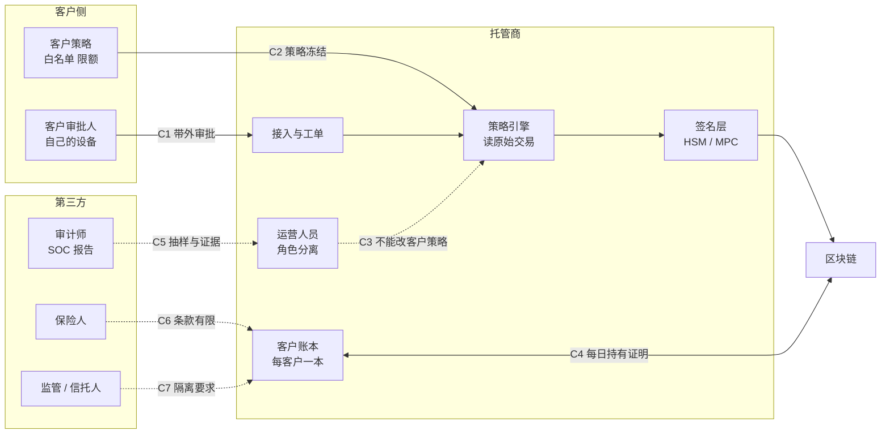
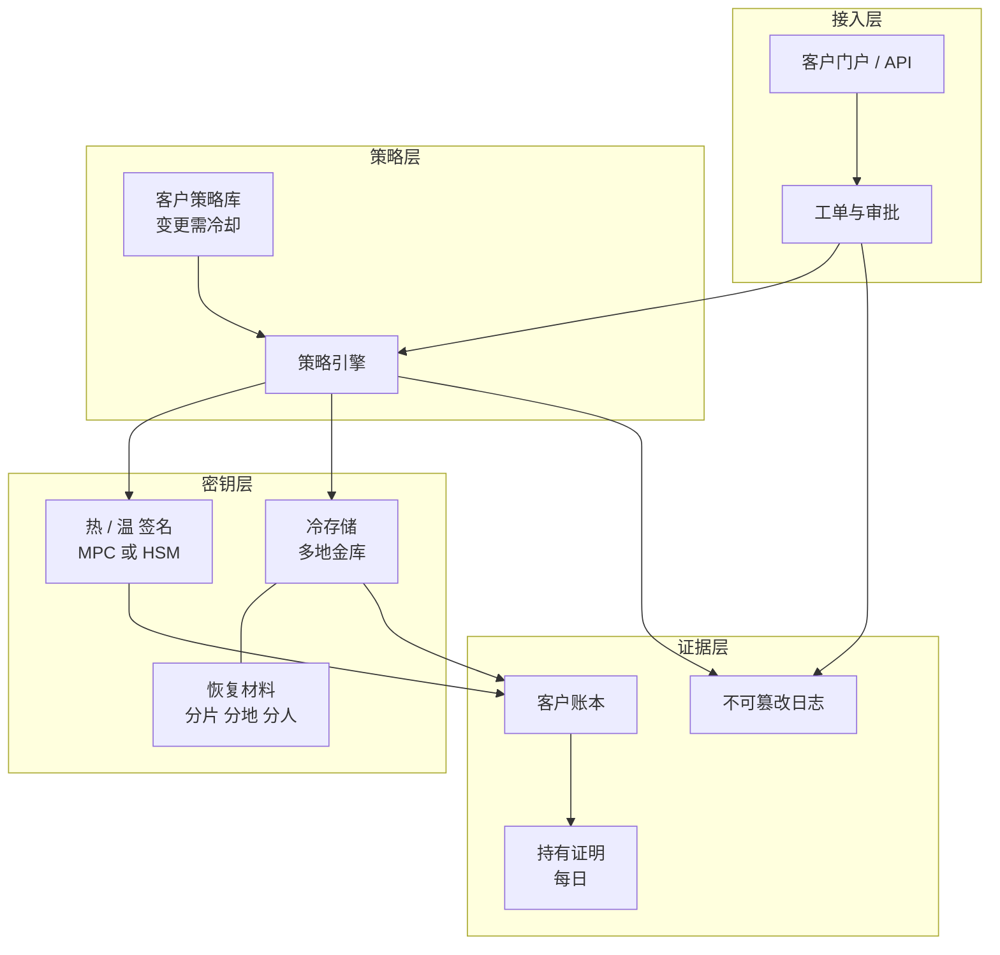
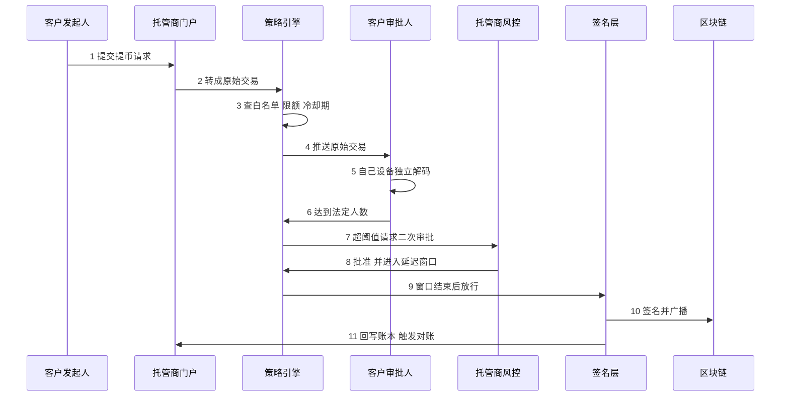

# X21 托管机构安全：隔离、保险、审计与机构客户

> 学习目标：读完本章，你能——
> 1. 为一家托管机构画出"客户资产隔离"的参考架构，并写出隔离、密钥仪式、客户策略三类控制的验收方法。
> 2. 写出一份"每日持有证明"对账查询和一份机构客户策略，让托管商的承诺可以被每天验证。
> 3. 站在机构客户的角度，用一份清单和评分表评估一家托管商：读懂 SOC 报告、保险条款、隔离模型和退出条款。
>
> 适用角色：托管机构的安全负责人与运营负责人；机构客户（基金、交易所、项目方、财务部门）的安全与尽调人员。
> 前置章节：[18 钱包与密钥管理](../18-wallet-key-management.md)、[23 托管、充提与合规安全](../23-custody-exchange-ops.md)、[29 2026 专题：签名路径](../29-signing-path-2026.md)、X01-security-program-controls.md、X02-standards-compliance-map.md、X11-cex-wallet-treasury-payment.md
> 交互实验：[多签签前复核](../interactive/multisig-review-lab.html)、[热钱包应急演练](../interactive/incident-response-sim.html)
> 模板：[T06 运营安全自查](../templates/T06-ops-security-self-check.md)
> 最后核对：2026-11-23

> 💡 注意：分工。[18 章](../18-wallet-key-management.md)讲密钥的生成、保管与销毁。[29 章](../29-signing-path-2026.md)讲签名路径被控的原理与签名服务防御层。[X11](X11-cex-wallet-treasury-payment.md)讲交易所自己的钱包分层、调拨和对账。本章只写**托管机构特有**的部分：替别人保管资产时，怎样证明资产是隔离的、怎样让客户控制自己的资金、怎样让第三方验证你说的话，以及客户怎样评估你。通用的签名服务与对账，链接过去，不重复。

---

## 开场：钱还在账上，钥匙已经找不到

2023 年 6 月，美国内华达州金融机构管理局向法院申请，把持牌信托公司 Prime Trust 置于接管之下。公开报道引述申请文件称：2021 年 12 月前后，Prime Trust 发现自己无法访问一批旧钱包（legacy wallets）里的加密资产。Prime Trust 随后用客户的法币资金买入加密资产，来满足客户的提币。报道估算的资金缺口约为 8,200 万至 8,300 万美元。Prime Trust 在 2023 年 8 月申请破产保护。

这个案例没有黑客，也没有恶意合约。出事的是托管机构最基础的两件事：知道每把钥匙在哪里，以及不动用一类客户的资金去补另一类客户的窟窿。

<details class="predict"><summary>🤔 先猜再看：你是一家基金的运营负责人，托管商发来一份"资产证明"，上面写着"您的资产全部安全"。你最先要问的是什么？</summary>

先问三件事。第一，这些资产在链上哪些地址？第二，这些地址的密钥由谁控制、谁能单独动用？第三，托管商破产时，这些资产是否不属于托管商的破产财产？"全部安全"这四个字不回答任何一件。本章第 6.7 节的清单把这三问展开成可核对的证据。

</details>

---

## 1. 一句话理解

**托管机构的安全，是把"你的钱在这里、别人动不了、我也不能私自动"变成每天可以被客户和第三方验证的事实。**

托管（Custody）：由专门机构替客户保管加密资产的密钥，并按客户的授权执行转移。

> 🎯 打个比方：托管商像银行的保管箱业务。银行替你保管箱子，箱子里的东西属于你，不属于银行。银行破产时，债权人不能拿你的箱子抵债。每次开箱要登记，银行员工单独不能开。
>
> 比喻的局限：保管箱里的东西可以用肉眼看到。链上资产只是一条余额记录，真正保管的是密钥。密钥丢了，箱子"还在"，但没有人能打开。另外，保管箱不会因为一条被篡改的指令，在几分钟内被整体搬空。

---

## 2. 保护目标与信任边界

### 2.1 保护目标

| 目标 | 一句话 | 失守的后果 |
|---|---|---|
| 资产隔离 | 客户资产与托管商自有资产、客户与客户之间可区分 | 托管商破产或挪用时客户拿不回 |
| 密钥可用 | 任何单点故障、人员离职、灾难后，密钥仍能恢复 | 资产永久锁死 |
| 密钥不被单人动用 | 没有一个人、一台设备、一个供应商能单独转走资产 | 内部作恶或单点被控即损失 |
| 客户控制 | 客户的规则（白名单、限额、审批人）托管商不能绕过 | 托管商成为单点信任 |
| 可验证 | 客户和第三方可独立确认持有、控制和控制措施的运行 | "信我"代替证据 |
| 可退出 | 客户能在合理时间内取回资产或迁移到别的托管商 | 被托管商锁定 |

### 2.2 信任边界



**读图要点：**

- 资金只走实线：客户审批、托管商接入、策略引擎、签名层、链。运营人员（虚线）可以处理工单，但不能修改客户的策略（C3）。
- C4 是本章的核心：客户账本与链上余额每天对一次，结果客户可见。
- 审计师、保险人、监管（虚线）都不碰资金。它们只看证据，各自覆盖的范围有限（C5–C7）。
- 局限：图没有画子托管商、MPC 软件供应商、云服务商。它们是托管商的上游依赖，见第 3.5 节。

> ⚠️ 警告：以下东西**不能被信任**。
> 1. 托管商发来的"资产证明"PDF 或截图。要用链上数据和你自己的账本核对。
> 2. 托管商门户上显示的待签交易内容。要在你自己的设备上独立解码。
> 3. "我们有保险"这句话。要看保单的被保险人、限额和免责条款。
> 4. 一份没有写明范围的 SOC 报告。范围可以不含签名系统。
> 5. 托管商员工打来的电话、发来的邮件里的"紧急变更"请求。

---

## 3. 参考架构

### 3.1 客户资产隔离：四种模型

隔离不是一个开关，而是一个光谱。下表按"隔离程度"从低到高排列（通用做法）。

| 模型 | 链上形态 | 账本形态 | 优点 | 缺点与风险 |
|---|---|---|---|---|
| 综合账户（Omnibus） | 所有客户共用一批地址 | 托管商内部账本分摊 | 成本低、转账快 | 链上无法证明每个客户的份额；托管商记账错误或挪用难发现 |
| 按客户独立地址 | 每个客户独立地址或子账户，密钥仍由托管商统一管理 | 每客户一本账 | 能按客户做链上持有证明 | 管理的地址多；密钥管理的集中度仍高 |
| 按客户独立密钥或金库 | 每个客户独立的密钥分片或金库，策略独立 | 每客户一本账 | 一个客户的密钥问题不波及别人；便于客户参与签名 | 成本高；恢复流程更复杂 |
| 客户参与签名（多方控制） | 客户持有一个密钥分片或审批密钥，托管商持有另一个 | 每客户一本账 | 托管商不能单独转移；客户控制权最大 | 客户自己的密钥安全成为新风险；找回流程复杂 |

> 💡 注意：隔离分两层，不要混淆。**法律隔离**回答"托管商破产时，这些资产是否属于破产财产"，由合同、信托结构和牌照决定。**技术隔离**回答"链上和密钥上能否区分"，由上表的模型决定。技术隔离是法律隔离的证据，不是替代。两者都要有。

### 3.2 托管系统总图



**读图要点：**

- 客户策略库在策略层，而不在接入层。客户的限额与白名单，由策略引擎在签名前强制执行，而不是由门户页面提示。
- 恢复材料（ESC）与冷存储分开存放。冷存储坏了，要靠恢复材料恢复，所以两者不能同址、同人。
- 证据层独立于运营层：持有证明和日志由单独的系统生成，运营人员没有改写权限。
- 局限：图没有画热钱包的限额与分层。那部分与交易所相同，见 [X11 第 3.1 节](X11-cex-wallet-treasury-payment.md)。

**组件职责：**

| 组件 | 职责 | 不负责什么 |
|---|---|---|
| 客户门户 / API | 接收客户请求，验证客户身份与设备 | 不决定是否放行 |
| 工单与审批 | 记录请求、路由给客户审批人和托管商审批人 | 不直接触发签名 |
| 客户策略库 | 存放每个客户的白名单、限额、审批法定人数、冷却期 | 托管商运营人员无写权限 |
| 策略引擎 | 签名前读原始交易，按客户策略和托管商全局策略放行或拒绝 | 不依赖门户显示 |
| 签名层 | 按放行结果产生签名 | 不接受策略引擎之外的请求 |
| 冷存储与金库 | 保管大部分资产的密钥 | 不联网，不由单人进入 |
| 恢复材料 | 灾难后重建密钥 | 日常不使用 |
| 客户账本与持有证明 | 记录每个客户的权利，并与链上对照 | 不由签名层的操作员维护 |

### 3.3 一笔客户提币的完整路径



**读图要点：**

- 步骤 3 到 8 都在策略引擎控制下。任何一步被拒绝，请求终止。门户只是入口，不是决策者。
- 步骤 5 的"独立解码"是针对门户被污染的控制。门户显示的内容不作为审批依据。
- 步骤 8 的延迟窗口给客户和监控留出介入时间。窗口内客户可以冻结。
- 局限：图没有画紧急通道。紧急提币如果绕过这条路径，它自己就是最大的后门，必须按同样的规则审批。

### 3.4 牌照与监管对隔离的要求（截至 2026 年公开资料）

> 💡 注意：这里只写与"客户资产隔离"和"托管安全"直接相关的公开要求。条款细节以官方文本为准。标准与监管的完整映射见 [X02](X02-standards-compliance-map.md)。**牌照不等于安全，只说明你受到了一套监管。**

| 辖区 | 与托管直接相关的公开要求 | 来源类型 |
|---|---|---|
| 欧盟（MiCA） | 第 75 条：托管服务商要制定托管政策，降低因欺诈、网络威胁或疏忽造成的丢失风险；为每个客户登记持仓，至少每 3 个月提供一次持仓报表；客户资产与自有资产分开，并在法律上隔离，使服务商的债权人无权追索，包括破产时；链上客户资产与自有资产分开存放；因可归因于服务商的事件而丢失客户资产，服务商承担赔偿责任，上限为丢失时的市场价值；损失若独立于其服务发生，则不属可归因事件；使用其他服务商做托管，要告知客户。2026-07-01 起，没有 MiCA 授权的服务商在欧盟不能继续运营（过渡期结束） | [ESMA 单一规则手册 MiCA 第 75 条](https://www.esma.europa.eu/publications-and-data/interactive-single-rulebook/mica/article-75-providing-custody-and)；[ESMA 关于过渡期结束的声明](https://www.esma.europa.eu/sites/default/files/2026-04/ESMA75-113276571-1679_Statement_on_the_end_of_transitional_periods_under_MiCA.pdf) |
| 香港（SFC） | SFC 2025 年 8 月 15 日的通函（编号 25EC44）列出持牌虚拟资产交易平台及其关联实体保管客户虚拟资产的预期标准：高管责任、冷钱包基础设施与运营、第三方钱包方案、实时威胁监控等；立即生效，并通过年度外部评估核查；种子与私钥的生成与保管应在气隙冷钱包设备上进行。SFC 表示这些标准也将成为虚拟资产托管服务提供者的核心预期。冷存储比例与补偿安排的数字见 [X02 第 3 节](X02-standards-compliance-map.md) | [SFC 通函 25EC44](https://apps.sfc.hk/edistributionWeb/gateway/EN/circular/intermediaries/supervision/doc?refNo=25EC44)；[SFC 新闻稿](https://apps.sfc.hk/edistributionWeb/api/news/list-content?lang=EN&refNo=25PR124) |
| 新加坡（MAS） | 数字支付代币服务商的客户资产保护规则，2024 年 10 月 4 日生效：客户资产与自有资产分开，并以信托方式为客户持有；链上使用与自有资产不同的地址；保存每个客户的准确持仓记录，并有防止未授权访问和丢失的系统。信托账户可由服务商自己持有，也可委托第三方（据律所摘要） | [MAS 新闻稿（2023）](https://www.mas.gov.sg/news/media-releases/2023/mas-publishes-investor-protection-measures-for-digital-payment-token-services)；[Clyde & Co 摘要](https://www.clydeco.com/en/insights/2024/04/singapore-payment-services-act-to-now-cover-token) |
| 美国（SEC 层面） | 2025-01-23 SEC 发布 SAB 122，撤销 SAB 121 关于托管方在资产负债表上确认保管负债的要求。2025-09-30 SEC 工作人员发出不采取行动函，在条件下允许注册投资顾问和基金把某些州特许信托公司视作"银行"托管加密资产；公开摘要提到的条件包括审计财报、SOC 1 或同等报告、防止未授权再质押的合同保护。这是工作人员意见，不是规则 | [Deloitte 对 SAB 122 的说明](https://dart.deloitte.com/USDART/home/news/all-news/2025/jan/sec-rescinds-guidance-safeguarding-crypto-assets)；[Sidley 对不采取行动函的摘要](https://www.sidley.com/en/insights/newsupdates/2025/10/sec-staff-issues-no-action-relief-permitting-use-of-state-chartered-trust-companies) |

**怎样使用这张表：**

1. 托管商：把每条要求映射到第 4 节的控制 ID，写进 X02 的控制矩阵。
2. 机构客户：问清楚你的资产放在哪个辖区、哪个法律主体名下。同一品牌下，不同实体的牌照与隔离安排可能不同。
3. 都要：不要把"持牌"当成"客户资产已被隔离"。要看合同和信托文件。

### 3.5 托管商的上游依赖

托管商自己也依赖别人。下表是评估时必须问的对象。

| 依赖 | 例子 | 失效后的影响 | 要问的问题 |
|---|---|---|---|
| MPC / HSM 软件与硬件供应商 | 密钥协议实现、固件 | 协议或固件漏洞可以泄露密钥 | 协议实现是否独立审计？有无漏洞披露与修复流程？ |
| 子托管商 | 某链或某类资产由另一家保管 | 客户资产实际在另一家手里 | 是否告知客户？子托管商的隔离与保险是否另行披露？ |
| 云与基础设施 | 接入层、日志、备份 | 可用性或日志证据丢失 | 密钥材料是否在云上？日志能否被运营人员改写？ |
| 保险人与经纪人 | 保单的承保与理赔 | 保障比宣传小 | 见第 6.6 节 |
| 审计师 | SOC 报告出具方 | 范围不含关键系统 | 见第 6.6 节 |

---

## 4. 控制清单

| ID | 控制项 | 要防什么 | 优先级 | 怎么验证 |
|---|---|---|---|---|
| CST-C01 | 客户资产与自有资产在法律上和链上分开：独立实体或信托结构，独立地址 | 破产或挪用时客户拿不回 | P0 | 阅读托管协议与信托文件；对照链上地址清单，确认无共用地址 |
| CST-C02 | 每个客户独立账本，每日对账链上持有，结果客户可见 | 记账错误、挪用、一类客户资金补另一类 | P0 | 抽取 3 个客户，用第 6.4 节的查询复算 |
| CST-C03 | 任何单个人、设备或供应商不能单独转出资产 | 内部作恶、单点被控 | P0 | 列出每个签名路径的最少参与方；演示单人请求被拒 |
| CST-C04 | 密钥仪式有脚本、见证人、录像、独立设备，产出记录归档 | 密钥生成时泄露或留后门 | P0 | 抽查最近一次仪式的记录与见证人名单 |
| CST-C05 | 恢复材料分片、分地、分人保管，每年做一次完整恢复演练 | 密钥丢失、灾难、关键人离职 | P0 | 演练报告；用测试密钥做一次从零恢复 |
| CST-C06 | 冷存储至少两个地理位置，运营人员不能单独进入 | 单地灾难、单人进入 | P1 | 访问日志、双人进入记录、场地清单 |
| CST-C07 | 签名前策略引擎读原始交易，默认拒绝未知类型 | 伪造请求、盲签、恶意授权 | P0 | 见 [X11 TRS-C02](X11-cex-wallet-treasury-payment.md) 的回放测试 |
| CST-C08 | 客户策略（白名单、限额、审批人、延迟）由策略引擎强制执行，托管商运营人员无写权限 | 托管商人员绕过客户规则 | P0 | 用运营账号尝试改策略，确认被拒；查看策略变更日志 |
| CST-C09 | 客户策略变更有冷却期和带外确认；放宽比收紧更严 | 账户被接管后先放宽规则 | P0 | 在测试客户上放宽限额，确认冷却期生效 |
| CST-C10 | 提币白名单地址新增后延迟生效，并通知客户所有审批人 | 地址被替换 | P0 | 新增地址后立即提币，确认被延迟 |
| CST-C11 | 客户审批在客户自己的设备上独立解码，托管商门户显示不作为依据 | 门户被污染 | P1 | 比较门户显示与独立解码结果 |
| CST-C12 | 运营角色分离：请求处理、审批、签名操作、账本维护、日志管理由不同人担任 | 一人串通全链路 | P0 | 角色—人员矩阵；抽查权限导出 |
| CST-C13 | 员工背景调查、定期复核、关键岗位轮换与强制休假 | 内部人员作恶或被收买 | P1 | 人事记录抽查；轮换计划 |
| CST-C14 | 客服与支持工具对客户数据与账户操作的权限最小化，操作留痕 | 支持人员被收买后泄露数据或协助接管 | P0 | 权限导出；抽查支持工具导出日志 |
| CST-C15 | MPC / HSM 软件的协议实现经独立审计，有漏洞披露与修复流程 | 协议实现漏洞导致密钥泄露 | P1 | 审计报告；漏洞公告与升级记录 |
| CST-C16 | 独立审计与认证：SOC 2（含签名系统范围）、SOC 1（如需）、ISO 27001、年度渗透测试 | 控制声明没有证据 | P1 | 阅读报告的范围、期间、例外项 |
| CST-C17 | 保险：被保险人、限额、免责条款对客户披露，并每年复核 | 把保险当成隔离 | P1 | 阅读保单摘要或承保确认 |
| CST-C18 | 事件通报与客户沟通：约定通报时限、联系人、冻结与恢复流程 | 客户最后一个知道 | P0 | 桌面推演；检查合同里的通报条款 |
| CST-C19 | 退出与迁移：约定取回时限、格式、费用，并演练一次迁移 | 客户被锁定 | P1 | 迁移演练记录；合同条款 |
| CST-C20 | 破产隔离的"返还计划"：托管商破产或被接管时，谁、怎样、多长时间把资产返还客户 | 破产时客户长期被冻结 | P1 | 阅读计划；做一次桌面推演 |

---

## 5. 分级落地

| 档次 | 做什么 | 人和时间（示例） |
|---|---|---|
| 最小可行（小型托管或自托管财务团队） | 客户与自有资产分地址；每客户一本账、每日对账；双人审批；恢复材料分片分地；一次完整恢复演练；起草托管协议里的隔离与退出条款 | 1 名安全工程师 + 1 名运营；6–10 周 |
| 标准（受监管托管商） | 加：独立实体或信托结构；按客户独立地址或金库；客户策略引擎；密钥仪式脚本与录像；冷存储双地；SOC 2 Type II；年度渗透测试；保险披露 | 4–6 人（安全、密钥运营、合规、GRC）；9–15 个月 |
| 成熟（机构级） | 加：客户参与签名；独立的持有证明服务；协议实现的独立审计；背景调查与轮岗；季度桌面推演与年度迁移演练；SOC 1 与 ISO 27001；监管年度评估 | 10 人以上，跨团队；18–24 个月 |

> 💡 注意：以上人数和时间是示例，用来估算规模。实际取决于托管的资产种类、客户数量和辖区。

---

## 6. 落地做法

### 6.1 写一份"客户资产保管政策"

这份政策是托管商对客户、审计师和监管的承诺。它应当短，并且每句话都能被验证。下面是一份可以改写的示例（YAML，示例）。

```yaml
# custody-policy.yaml  —— 示例，数值为示例
entity:
  legal_name: "Example Custody Trust Co."      # 持有客户资产的法律主体
  holds_own_funds: false                        # 该主体不持有自有运营资金
segregation:
  model: per_client_address                     # omnibus / per_client_address / per_client_vault / co_signing
  client_vs_own: legally_segregated             # 信托或独立实体
  on_chain_separation: required                 # 客户地址与自有地址不共用
  rehypothecation: prohibited                   # 禁止再质押、出借、抵押
ledger:
  per_client: true
  reconciliation: daily                         # 链上持有与账本每日对账
  client_visible: true                          # 对账结果客户可见
  discrepancy_sla:
    notify_client_within: "24h"
    escalate_to_cro_within: "4h"
keys:
  generation: ceremony_scripted                 # 脚本化仪式，见证人与录像
  signing_min_parties: 3                        # 至少 3 个独立方参与才能产生有效签名
  recovery_shares: {total: 5, threshold: 3, geographies: 3}
  recovery_drill: annual
governance:
  roles_separated: [request_handling, approval, signing_ops, ledger_admin, log_admin]
  background_checks: before_hire_and_every_2y
  rotation_for_key_roles: annual
assurance:
  soc2_scope_includes_signing_system: true
  pentest: annual
  insurance_disclosed_to_clients: true
exit:
  return_assets_within: "5 business days"       # 示例
  migration_drill: annual
```

> ⚠️ 警告：`rehypothecation: prohibited` 之类的字段必须在合同里也有对应条款。YAML 是内部可验证的表达，不是法律文件。

### 6.2 密钥仪式与恢复演练

密钥仪式（Key Ceremony）：在受控环境下，按预定脚本生成、分片、备份密钥，并留下可审计记录的流程。原理见 [18 章第 3.2 节](../18-wallet-key-management.md)。这里给出托管商的运营清单。

**仪式前（T-14 天到 T-1 天）：**

1. 写脚本：每一步、每个角色、每个设备。
2. 选见证人：至少 1 名不属于密钥运营团队的人（例如内审或外部审计师）。
3. 采购设备：全新设备，核对序列号，离线保存，不接入任何业务网络。
4. 演练一次：用测试密钥完整走一遍，并记录时间。
5. 确认场地：门禁日志启用，除指定录像外无其他录制与通信设备。

**仪式中：**

1. 见证人核对每台设备的序列号与封条。
2. 在离线设备上生成密钥，或由 HSM 生成并分片。
3. 按脚本把分片分别写入不同介质，当场封存。
4. 记录每个分片的保管人、编号、封条号，不记录分片内容。
5. 所有人在记录上签字，录像全程保留。

**仪式后：**

1. 把介质送往不同地点，运送记录双人签字。
2. 用测试交易验证新密钥可以签名。
3. 清理一次性设备。
4. 归档：脚本、签字页、录像、设备清单、封条编号。
5. 30 天内做一次"从分片恢复"的测试，用测试密钥或可忽略金额。

**恢复演练的验收标准（示例）：**

| 指标 | 目标（示例） | 失败时的动作 |
|---|---|---|
| 从恢复材料重建签名能力的总用时 | 不超过 72 小时 | 优化流程，下一季度重做 |
| 参与恢复的人员 | 满足阈值，且没有人需要"远程口述分片" | 立即改流程 |
| 演练使用的密钥 | 同构的测试密钥，不用真实生产密钥 | 如使用真实密钥，视为事故 |

> 💡 注意：恢复演练最常见的失败不是技术，而是"知道某个分片在某人手里，但这个人已经离职或联系不上"。分片保管人名单要和人事系统联动。

### 6.3 机构客户的策略与审批

托管商给客户的最大价值之一，是让客户的规则在托管商的系统里**强制生效**。下面是一份客户策略（示例）。

```yaml
# client-policy.yaml  —— 示例
client_id: "FUND-0042"
vaults:
  - name: "treasury"
    withdrawal_whitelist_only: true
    whitelist:
      - {address: "0xAAAA...示例", label: "Exchange-A deposit", added_at: "2026-10-01"}
    new_address_cooling_off: "48h"            # 新地址 48 小时后才可用
    limits:
      per_tx_usd: 250000
      per_day_usd: 1000000
    approvals:
      quorum: "2 of 3"                        # 客户审批人
      approvers: ["cfo", "head_ops", "head_risk"]
      require_independent_decode: true
    custodian_side:
      second_approval_required_over_usd: 500000
      delay_over_usd: {amount: 500000, hours: 24}
policy_change_rules:
  loosening:                                  # 放宽限制
    cooling_off: "72h"
    notify: ["all_approvers", "security_contact"]
    require_out_of_band_confirmation: true
  tightening:                                 # 收紧限制
    cooling_off: "0h"                         # 立即生效
    require_single_approver: true
freeze:
  who_can_freeze: ["security_contact", "any_approver"]
  who_can_unfreeze: ["quorum"]
```

**设计要点：**

1. 放宽与收紧不对称：收紧立即生效，放宽有冷却期。账户被接管后，攻击者首先会放宽规则。
2. 任何一名审批人都可以冻结，但解冻需要法定人数。这给客户"快刹车、慢启动"。
3. 托管商那一侧也有自己的二次审批和延迟。两侧各自独立，任何一侧被攻破，另一侧仍能拦截。

### 6.4 每日持有证明对账

持有证明（Proof of Holdings）：用链上数据证明托管商控制着客户账本上记载的资产。核心做法是：**按客户地址汇总链上余额，与客户账本对比，差异必须有解释**。下面是一段示例 SQL（假设已有链上余额快照表和客户账本表）。

```sql
-- daily_holdings_check.sql —— 示例
-- 链上快照与客户账本逐客户逐资产对比
WITH chain AS (
  SELECT c.client_id, b.asset, SUM(b.balance) AS chain_balance
  FROM chain_balance_snapshot b
  JOIN client_address_map c ON c.address = b.address
  WHERE b.snapshot_date = CURRENT_DATE
  GROUP BY c.client_id, b.asset
),
ledger AS (
  SELECT client_id, asset, SUM(amount) AS ledger_balance
  FROM client_ledger
  WHERE posted_at < CURRENT_DATE + INTERVAL '1 day'
  GROUP BY client_id, asset
)
SELECT COALESCE(c.client_id, l.client_id) AS client_id,
       COALESCE(c.asset,      l.asset)     AS asset,
       COALESCE(c.chain_balance, 0)  AS chain_balance,
       COALESCE(l.ledger_balance, 0) AS ledger_balance,
       COALESCE(c.chain_balance, 0) - COALESCE(l.ledger_balance, 0) AS diff
FROM chain c
FULL OUTER JOIN ledger l USING (client_id, asset)
WHERE COALESCE(c.chain_balance, 0) <> COALESCE(l.ledger_balance, 0);

-- 另需一条检查：链上存在不属于任何客户、也不在自有地址清单里的托管地址，视为未解释资产
-- 注意：在途转账、手续费、归集要单独成列，否则会出现假差异
```

**怎么用：**

1. 差异为 0 才算通过。有在途交易时，在报表中单列"在途"，并在 24 小时内结清。
2. 差异为负（链上少于账本）是 P1 事件：可能被盗、记账错误或挪用。立即升级。
3. 差异为正（链上多于账本）也要查：可能是入账未记，也可能是别的客户的资金记在了自有账户下。
4. 结果以只读方式推给客户，并留存哈希，客户可以对照自己的记录。

> 💡 注意：持有证明只证明"托管商控制这些地址"。它不证明托管商没有对同一笔资产向多方重复承诺。所以它要和第 3.1 节的"按客户独立地址"结合，才有意义。

### 6.5 角色分离矩阵

下表（示例）列出托管商关键动作需要的角色。任意两个角色不能由同一人担任。

| 动作 | 发起 | 审批 | 执行 | 复核 | 日志管理 |
|---|---|---|---|---|---|
| 客户提币 | 客户 | 客户审批人 + 托管商风控 | 策略引擎触发签名层 | 事后抽查（独立运营） | 日志团队 |
| 客户策略放宽 | 客户 | 客户审批人 + 带外确认 | 策略引擎（冷却期后） | 安全团队 | 日志团队 |
| 新增白名单地址 | 客户 | 客户审批人 | 策略引擎（冷却期后） | 安全团队 | 日志团队 |
| 密钥仪式 | 密钥运营 | 安全负责人 | 密钥运营 + 见证人 | 内审或外部审计 | 日志团队 |
| 冷存储开启 | 运营 | 双人审批 | 持钥人 | 内审 | 日志团队 |
| 账本修正 | 运营 | 财务负责人 | 账本管理员 | 独立复核人 | 日志团队 |

**检测"角色重叠"的示例规则（Sigma 风格，示例）：**

```yaml
title: 同一人在同一工单中担任两个角色
logsource: {product: custody_workflow, service: ticket_audit}
detection:
  selection:
    event: withdrawal_ticket_completed
  overlap:
    - requester == approver
    - approver == executor
    - requester == executor
  condition: selection and overlap
falsepositives:
  - 服务账号作为 executor：单独标注为服务账号，不计入人员
level: high
```

### 6.6 怎样读 SOC 报告、保险条款与认证

**SOC 报告（通用做法）：**

SOC（System and Organization Controls）：由注册会计师出具的服务机构控制报告。SOC 1 面向财务报告相关控制。SOC 2 面向安全、可用性、保密性等信任服务准则。Type I 看某一时点控制的设计。Type II 看一段期间控制的运行。详见 [X02 第 7.5 节](X02-standards-compliance-map.md)。读报告时按下面顺序看，不要只看封面上的"无保留意见"。

| 顺序 | 看什么 | 不通过的信号 |
|---|---|---|
| 1 | 报告类型与期间 | 只有 Type I；期间不足 6 个月；距今超过 12 个月 |
| 2 | 系统范围描述 | 范围不含签名系统、密钥管理、客户门户 |
| 3 | 适用的信任服务准则 | 只选了"安全"，而客户关心可用性或保密性 |
| 4 | 例外项（exceptions） | 例外项集中在访问控制、变更管理或密钥相关 |
| 5 | 对客户的配套控制要求（CUEC） | 托管商把关键控制推给客户，而客户没有做 |
| 6 | 分包服务机构（子服务商） | 关键子服务商被"剔除法"排除在范围外，且没有补充报告 |

**保险（只写通用事实）：**

- 公开资料显示，托管类保险常见两类：针对冷存储的"特种财产险"（specie，第一方财产保险），以及针对热钱包的犯罪险。冷、热存储常有各自的限额。限额常为保单期内的总额，而不是每次事件单独计算。大型托管商常把多家保险人分层组合，形成保险塔。来源：[Lockton，托管商加密保险的最佳实践](https://global.lockton.com/us/en/news-insights/cryptocurrency-insurance-best-practices-for-custodians)（经纪人文章）；[The Block，BitGo 超额保险](https://www.theblock.co/amp/post/59083/crypto-custodian-bitgo-is-now-offering-excess-insurance-on-top-of-its-100m-policy)（媒体报道）。
- 常见免责或限制包括：价格波动、战争或国家行为、监管没收、未披露的钱包，以及托管商自身未遵守约定的安全程序。免责条款因保单而异，以保单文本为准。
- 保险不是隔离。保险是**事后补偿的一个资金来源**，赔付取决于保单条件，往往小于托管资产总额，且由所有客户共享。

问保险时，要问下面六件事（通用清单）：

| 问题 | 为什么问 |
|---|---|
| 被保险人是托管商还是客户？ | 如果是托管商，赔付先进托管商账户，客户靠托管商转交 |
| 总限额和单次事件限额各是多少？ | 限额常小于总托管资产 |
| 限额是否由所有客户共享？ | 一次大事故可能耗尽限额 |
| 冷、热存储各自的限额与免赔额？ | 热钱包常限额更低 |
| 哪些原因明确不赔？ | 内部人员作恶、社会工程学、协议漏洞是否被排除 |
| 理赔历史与承保人评级？ | 判断保障的可兑现性 |

> ⚠️ 警告：不要把"托管商有 X 亿美元保险"写进你们的风险评估结论。结论应写成"保险限额 X，被保险人 Y，免责条款 Z，客户可得补偿的上限估算为 W"。

### 6.7 机构客户评估托管商：清单与评分表

这是站在客户一侧的清单。它分六个部分。每一项要求**证据**，而不是回答"是"或"否"。

**A. 法律与隔离**

| 编号 | 问题 | 要求的证据 |
|---|---|---|
| A1 | 持有我方资产的是哪一个法律主体？牌照类型与辖区？ | 牌照证书、监管登记页 |
| A2 | 托管协议是否写明资产属于客户、不属于托管商的破产财产？ | 协议条款与法律意见 |
| A3 | 是否使用综合账户？链上能否区分我方资产？ | 隔离模型说明；链上地址清单 |
| A4 | 是否禁止再质押、出借、抵押？ | 合同条款 |
| A5 | 是否使用子托管商？客户是否被告知？ | 子托管商清单与披露 |
| A6 | 破产或被接管时的资产返还计划？ | 书面计划与时限 |

**B. 密钥与签名**

| 编号 | 问题 | 要求的证据 |
|---|---|---|
| B1 | 任何单个人或设备能否单独转出资产？ | 签名路径图与最少参与方 |
| B2 | 签名前是否读取原始交易并执行策略？ | 架构说明、测试结果 |
| B3 | 密钥仪式是否有脚本、见证人、录像？ | 最近一次仪式摘要 |
| B4 | 恢复材料怎样保存？最近一次恢复演练的时间与用时？ | 演练报告 |
| B5 | MPC 或 HSM 的协议实现是否经独立审计？ | 审计报告摘要、漏洞披露政策 |
| B6 | 冷存储在几个地点？谁能进入？ | 场地与访问控制说明 |

**C. 客户控制**

| 编号 | 问题 | 要求的证据 |
|---|---|---|
| C1 | 能否配置白名单、限额、审批人、延迟？这些在哪一层强制执行？ | 策略引擎文档与演示 |
| C2 | 托管商运营人员能否改我方策略？ | 权限说明、运营账号实测 |
| C3 | 放宽策略有无冷却期和带外确认？ | 演示 |
| C4 | 审批能否在我方设备上独立解码？ | 演示 |
| C5 | 我方能否随时冻结？谁能解冻？ | 流程说明 |

**D. 审计、认证与保险**

| 编号 | 问题 | 要求的证据 |
|---|---|---|
| D1 | SOC 2 Type II 的期间、范围、例外项？范围是否含签名系统？ | 报告全文（NDA 下） |
| D2 | 最近一次独立渗透测试的时间与范围？ | 摘要与整改状态 |
| D3 | 保险的被保险人、限额、免责？ | 保单摘要 |
| D4 | 年度外部评估或监管检查结果？ | 摘要，或监管公开信息 |

**E. 运营与人员**

| 编号 | 问题 | 要求的证据 |
|---|---|---|
| E1 | 员工背景调查与复核频率？ | 政策与抽样证明 |
| E2 | 角色分离与轮岗？ | 角色矩阵 |
| E3 | 客服与支持人员能看到哪些我方数据？ | 权限说明 |
| E4 | 事件通报时限与联系人？ | 合同条款 |

**F. 退出**

| 编号 | 问题 | 要求的证据 |
|---|---|---|
| F1 | 提取全部资产的时限、费用、格式？ | 合同条款 |
| F2 | 是否做过迁移演练？ | 演练记录 |
| F3 | 终止服务后，托管商保留我方哪些数据？多久？ | 数据保留政策 |

**评分方法（示例）：**

每项按 0（无证据）、1（口头声明）、2（文件证据）、3（文件证据加我方亲自验证）打分。

| 部分 | 权重（示例） | 红线条件（任一触发，不通过） |
|---|---|---|
| A 法律与隔离 | 25% | 综合账户且无法律隔离；合同不禁止再质押 |
| B 密钥与签名 | 25% | 存在单人可转出路径；无恢复演练记录 |
| C 客户控制 | 15% | 运营人员可单独改客户策略 |
| D 审计与保险 | 15% | SOC 2 范围不含签名系统；保险被保险人仅为托管商且无披露 |
| E 运营与人员 | 10% | 无事件通报条款 |
| F 退出 | 10% | 无取回时限 |

> 💡 注意：红线比总分重要。总分高、红线触发，仍然不通过。

---

## 7. 运营：指标、告警、值班、演练、季度节奏

### 7.1 指标

| 指标 | 含义 | 目标（示例） |
|---|---|---|
| 持有证明差异为 0 的天数占比 | 每日对账通过率 | 100%，在途单列 |
| 差异从发现到升级的时间 | 对账的响应 | 少于 4 小时 |
| 客户策略放宽的冷却期违规次数 | 控制是否被绕过 | 0 |
| 单人转出路径数量 | CST-C03 的覆盖 | 0 |
| 恢复演练的最近一次间隔与用时 | CST-C05 的覆盖 | 少于 12 个月；少于 72 小时 |
| 保管人名单与人事系统的一致率 | 恢复可行性 | 100% |
| SOC 报告例外项的关闭率 | 审计后的整改 | 90 天内关闭 |
| 客户通报的平均到达时间 | CST-C18 的实际表现 | 少于合同约定时限 |

### 7.2 告警（示例）

| 告警 | 触发条件 | 级别 |
|---|---|---|
| 持有证明出现负差异 | 链上少于账本 | P1 |
| 未归属托管地址 | 出现不属于任何客户或自有清单的托管地址 | P1 |
| 客户策略放宽后 24 小时内大额提币 | 放宽与大额提币在同一时间窗 | P1 |
| 新白名单地址在冷却期内被请求使用 | 绕过尝试 | P2 |
| 运营账号尝试写客户策略 | 被拒绝的越权尝试 | P2 |
| 同一人兼任两个角色的工单 | 见第 6.5 节规则 | P1 |
| 冷存储非计划开启 | 无对应工单 | P1 |
| 支持工具批量导出客户数据 | 超过阈值或非工作时间 | P1 |

值班与升级沿用 [X05](X05-detection-response-engineering.md) 的 P1–P4 体系。托管商额外要有一个"客户通报联系人"值班位：P1 事件发生后，由他在合同约定时限内联系客户。

### 7.3 季度节奏

| 时间 | 动作 |
|---|---|
| 每月 | 复核客户策略例外；对账差异趋势；保管人名单与人事联动检查 |
| 每季度 | 桌面推演（见第 13 节）；角色矩阵与权限抽查；客户通报演练 |
| 每半年 | 保险条款与限额复核；子托管商与关键供应商复核 |
| 每年 | 完整恢复演练；迁移演练；SOC 2 Type II 审计；渗透测试；密钥仪式复盘；监管评估 |

---

## 8. 失效案例

> 💡 注意：以下只写摘要和教训。金额为约数、事发时估值。归因写"公开报道归因于"。来源类型：监管或法院文件的媒体报道、安全公司披露、公司公告的媒体转述。各案状态可能继续变化。

### 8.1 Prime Trust：旧钱包失联与客户资金被挪用（2021–2023 年，美国）

- **事实：** 公开报道引述内华达州金融机构管理局 2023 年 6 月的法院申请称，Prime Trust 在 2021 年 12 月前后发现无法访问一批旧钱包。Prime Trust 用综合账户中的客户法币资金买入加密资产，满足提币。报道估算缺口约 8,200 万至 8,300 万美元。申请文件没有解释失去访问的原因。Fireblocks 对媒体称，这些旧钱包由 Prime Trust 自己控制。BitGo 于 2023 年 6 月 22 日放弃收购 Prime Trust。Prime Trust 于 2023 年 8 月申请第 11 章破产保护。来源（媒体报道与官方新闻稿）：[The Block](https://www.theblock.co/news/business/2023-06-27-nevada-regulator-files-petition-to-place-prime-trust-in-receivership-236762)、[CoinDesk](https://www.coindesk.com/policy/2023/06/27/nevada-places-crypto-custodian-prime-trust-into-receivership)、[内华达州政府新闻稿](https://www.business.nv.gov/news-media/press-releases/2023/financial-institutions/nevada-financial-institutions-division-files-court-petition-to-place-prime-trust-llc-in-receivership)、[Business Wire（破产申请）](https://www.businesswire.com/news/home/20230814192136/en/Prime-Trust-LLC-Files-Voluntary-Chapter-11-Petitions)。
- **映射：** 打穿 CST-C02（逐客户每日对账应更早发现缺口）、CST-C01（客户资金之间被互相挪用，说明隔离失效）、CST-C05（密钥与钱包清单）。
- **教训：** 钱包清单必须完整，每把钥匙都有人负责、都有恢复演练。一类客户的资金不能用来补另一类客户的缺口。

### 8.2 StakeHound 与 Fireblocks：被删除的密钥与备份责任的争议（2021 年）

- **事实：** 质押服务商 StakeHound 于 2021 年 6 月 22 日在特拉维夫地区法院起诉 Fireblocks，称涉及 38,178 个 ETH（报道估值约 7,000 万至 7,700 万美元）的密钥丢失。StakeHound 称，在一次灾难恢复演练中，发现原本存放密钥的电脑里已没有这些密钥，并称有员工没有做好备份。Fireblocks 称这些密钥在其平台之外，自己没有为 StakeHound 备份这些密钥的合同义务，并称要求客户自行备份或委托第三方灾备。我们没有查到判决或和解结果。来源（媒体报道）：[The Block](https://www.theblock.co/news/regulation/2021-06-23-staking-company-serves-fireblocks-with-a-lawsuit-over-private-keys-to-over-75-million-in-eth-109277)、[CoinDesk](https://www.coindesk.com/markets/2021/06/22/fireblocks-being-sued-for-allegedly-losing-over-70m-of-ether-report/)、[Decrypt](https://decrypt.co/74183/fireblocks-faces-lawsuit-alleged-loss-71-million-ethereum)。
- **映射：** CST-C05（恢复演练能暴露"密钥不见了"）、CST-C19（合同对"谁负责备份"要写清）。
- **教训：** 双方对"谁负责备份"的理解不同，损失就没有人兜底。客户要在合同里写明备份责任，并要求看到恢复演练的证据。本案是双方说法不同的争议，本章不判断对错。

### 8.3 BitForge：MPC 协议实现的漏洞（2023 年 8 月）

- **事实：** Fireblocks 研究团队于 2023 年 8 月 9 日公布 BitForge，涉及 GG18、GG20 和 Lindell17 三类 MPC 协议实现中的零日漏洞。其中一个漏洞源于缺少一项零知识证明，可能让攻击者提取完整私钥，编号 CVE-2023-33241。披露遵循 90 天的负责任披露流程。Coinbase 的钱包即服务（WaaS）与 Zengo 在披露后修复；Coinbase 称客户与资金未受威胁。Fireblocks 称其自身的 MPC-CMP 实现不受影响（厂商自述）。来源：[Fireblocks 新闻稿](https://www.fireblocks.com/press/fireblocks-researchers-uncover-vulnerabilities-impacting-dozens-of-major-wallet-providers)（厂商）、[BleepingComputer](https://www.bleepingcomputer.com/news/cryptocurrency/new-bitforge-cryptocurrency-wallet-flaws-lets-hackers-steal-crypto/amp/)（媒体）。披露内容大多来自 Fireblocks 自己，各提供方的修复状态没有独立核实。
- **映射：** CST-C15（协议实现的独立审计与漏洞响应）、CST-C03（MPC 不能是唯一的一道防线）。
- **教训：** "我们用 MPC"不回答"协议实现是否正确"。协议实现错误可以直接泄露密钥。客户要问：协议实现是否被独立审计，托管商有没有漏洞披露与热修复流程，被披露后多久完成升级。

### 8.4 Coinbase：支持人员被收买与客户数据外泄（2024 年 12 月至 2025 年 5 月）

- **事实：** Coinbase 在 2025 年 5 月 15 日的 8-K 披露（经媒体转述）：不法分子向海外支持人员行贿，复制了客户支持工具里的数据，涉及不到 1% 的月交易用户。攻击者随后冒充 Coinbase 员工，诱骗客户转出资产。媒体报道，约 69,461 名用户收到通知；Coinbase 估算的处置与补偿成本为 1.8 亿至 4 亿美元；Coinbase 拒付 2,000 万美元的勒索，并悬赏 2,000 万美元征集线索。报道称登录凭证、私钥与客户资金没有被直接访问。来源（媒体报道）：[Insurance Journal](https://amp.insurancejournal.com/news/national/2025/05/15/823862.htm)、[The Register](https://www.theregister.com/2025/05/21/coinbase_confirms_insider_breach_affects/)、[The Record](https://therecord.media/coinbase-extortion-attempt-company-offers-20million-reward)。我们没有直接核对 8-K 原文。
- **映射：** CST-C14（支持工具权限最小化与留痕）、CST-C13（人员复核）、CST-C18（客户通报）。
- **教训：** 托管系统再强，只要支持人员能看到足够多的客户数据，攻击者就可以绕过技术控制，通过客户本人下手。支持工具要最小权限，批量导出要告警，客户要被反复告知"托管商不会主动要求你转账"。

> 💡 注意：本章没有把 Bybit 等事件再写一遍。这些事件的签名路径细节在 [29 章](../29-signing-path-2026.md)与 [X11](X11-cex-wallet-treasury-payment.md)。它们对托管商的意义相同：签名界面与调拨流程要独立解码。

---

## 9. 评估检查点

这一节同时服务两类读者：托管商做自查，机构客户做尽调。每项要有证据。

- [ ] **CST-1** 持有客户资产的法律主体已写明，客户资产在合同上属于客户，托管商破产时不属于破产财产（有法律意见）。
- [ ] **CST-2** 客户资产与自有资产在链上不共用地址，并有地址清单。
- [ ] **CST-3** 每个客户有独立账本，每日与链上持有对账，结果客户可见。
- [ ] **CST-4** 注入一笔测试差异，能在目标时间内升级并通知客户。
- [ ] **CST-5** 没有任何单个人、设备或供应商能单独转出资产，有签名路径图。
- [ ] **CST-6** 密钥仪式有脚本、见证人、录像、独立设备，并归档。
- [ ] **CST-7** 恢复材料分片、分地、分人保管，保管人名单与人事系统联动。
- [ ] **CST-8** 过去 12 个月内做过完整恢复演练，并有用时记录。
- [ ] **CST-9** 冷存储在两个以上地点，开启需双人。
- [ ] **CST-10** 签名前策略引擎读原始交易，默认拒绝未知类型。
- [ ] **CST-11** 客户策略由策略引擎强制执行，托管商运营人员无写权限，用运营账号实测被拒。
- [ ] **CST-12** 客户策略放宽有冷却期与带外确认，收紧立即生效。
- [ ] **CST-13** 新增白名单地址有冷却期，并通知全部审批人。
- [ ] **CST-14** 客户审批在客户设备上独立解码。
- [ ] **CST-15** 运营角色矩阵已书面化，权限导出与矩阵一致。
- [ ] **CST-16** 关键岗位有背景调查、复核和轮岗。
- [ ] **CST-17** 支持工具权限最小化，批量导出有告警，抽查过日志。
- [ ] **CST-18** MPC 或 HSM 的协议实现有独立审计报告和漏洞披露流程。
- [ ] **CST-19** SOC 2 Type II 报告覆盖签名系统，期间不少于 6 个月，例外项有整改。
- [ ] **CST-20** 年度渗透测试范围包含签名系统和客户门户。
- [ ] **CST-21** 保险的被保险人、限额、免责条款已对客户披露。
- [ ] **CST-22** 合同约定事件通报时限和联系人，并做过一次桌面推演。
- [ ] **CST-23** 合同约定取回资产的时限、费用与格式，并做过一次迁移演练。
- [ ] **CST-24** 托管商破产或被接管时的资产返还计划已书面化。
- [ ] **CST-25** 子托管商和关键供应商已披露，并评估过它们的隔离与保险。

**把检查结果写进报告：**

| 检查项范围 | 对应控制 | 证据 | 状态（通过 / 部分 / 未通过） | 负责人 | 到期日 |
|---|---|---|---|---|---|
| CST-1–4 | CST-C01、C02、C20 | 合同、地址清单、对账报告 |  |  |  |
| CST-5–9 | CST-C03–C06 | 签名路径图、仪式记录、演练报告 |  |  |  |
| CST-10–14 | CST-C07–C11 | 策略引擎测试、权限实测 |  |  |  |
| CST-15–17 | CST-C12–C14 | 角色矩阵、人事记录、支持工具日志 |  |  |  |
| CST-18–21 | CST-C15–C17 | 审计报告、保单摘要 |  |  |  |
| CST-22–25 | CST-C18–C20 | 合同条款、推演与迁移记录 |  |  |  |

---

## 10. 上手路径

**第一周：**

1. 画出你们托管（或你们使用的托管商）的资产地图：每个法律主体、每个地址、每个密钥的保管人。
2. 画一张"签名路径图"：每笔转出需要哪些人、哪些设备、哪些系统参与，找出任何"一个人就够"的位置。
3. 读你们最近一份 SOC 报告的范围与例外项。
4. 读托管协议里的"隔离""破产""退出""通报"四个条款。

**第一个月：**

1. 写出第 6.1 节的保管政策和第 6.3 节的客户策略模板。
2. 实现（或要求托管商提供）每日持有证明，并注入一次测试差异。
3. 把角色分离矩阵与实际权限导出比对，列出重叠。
4. 如果你是机构客户：用第 6.7 节的清单评估一家托管商，写出红线与整改建议。

**第一个季度：**

1. 组织一次桌面推演（第 13 节练习 3）。
2. 做一次恢复演练，使用测试密钥。
3. 与保险经纪人或托管商复核保险条款，并写出"客户可得补偿的上限估算"。
4. 把本章控制映射到 X02 的控制矩阵，补齐合规证据。

---

## 11. 常见误区

| 误区 | 实际情况 |
|---|---|
| "托管商持牌，所以资产是隔离的" | 牌照是监管框架。隔离要看合同、信托结构和链上地址。 |
| "有保险就安全" | 保险是事后补偿来源之一，限额与免责决定实际保障，且常由客户共享。 |
| "用了 MPC，就没有单点" | MPC 只改变了密钥的持有方式。协议实现的漏洞与策略缺失仍然可以导致损失。 |
| "SOC 2 报告有无保留意见，就足够" | 要看范围、期间、例外项与 CUEC。 |
| "冷存储就是离线，所以绝对安全" | 冷存储的开启流程、人员与恢复材料同样可被攻击。 |
| "合同里写了责任就够了" | 托管商没有偿付能力时，责任条款无法兑现。要看隔离与保险。 |
| "每日对账成本高，月度就够" | 缺口发现越晚，被覆盖和挪用的空间越大。 |
| "客户策略写在门户页面就算生效" | 门户可以被绕过。策略要在签名前由策略引擎强制执行。 |

---

## 12. 术语表

| 术语 | 英文 | 定义 |
|---|---|---|
| 托管 | Custody | 由专门机构替客户保管密钥并按授权转移资产 |
| 综合账户 | Omnibus Account | 多个客户共用同一批地址，由内部账本区分 |
| 法律隔离 | Legal Segregation | 通过合同、信托或独立实体，使客户资产不属于托管商破产财产 |
| 技术隔离 | Technical Segregation | 通过独立地址、密钥或金库，使客户资产在链上和密钥上可区分 |
| 密钥仪式 | Key Ceremony | 在受控环境下按脚本生成、分片、备份密钥并留存审计记录的流程 |
| 持有证明 | Proof of Holdings | 用链上数据证明托管商控制客户账本上记载的资产 |
| 再质押 | Rehypothecation | 把客户资产再次抵押、出借或重复使用 |
| 子托管商 | Sub-custodian | 托管商委托的、实际保管部分资产的另一家机构 |
| SOC 报告 | System and Organization Controls Report | 注册会计师出具的服务机构控制报告 |
| CUEC | Complementary User Entity Controls | SOC 报告中要求客户自己落实的配套控制 |
| 特种财产险 | Specie Insurance | 针对贵重物品或离线存储资产的第一方财产保险 |
| 冷却期 | Cooling-off Period | 变更提出后到生效前的等待时间 |
| 破产隔离 | Bankruptcy Remoteness | 托管商破产时，客户资产不被纳入其破产财产 |

---

## 13. 动手练习与思考题

**练习 1：画资产与密钥地图（30 分钟）。** 虚构一家托管商：2 个法律主体、3 条链、5 个客户。画出资产、地址、密钥保管人的关系图，标出"一个人就够"的位置。

**练习 2：写客户策略（30 分钟）。** 为一家基金写一份第 6.3 节格式的策略：2 个金库，白名单，限额，审批法定人数，放宽与收紧的冷却期。再写出 3 个你会拒绝的请求，说明理由。

**练习 3：桌面推演（30 分钟）。** 场景：每日持有证明显示，某客户的 BTC 链上持有比账本少 12 个，在途交易为 0。写出前 30 分钟的 6 个动作、谁来做、谁有权冻结全部提币、什么时候通知客户。再加一条注入：两小时后，另一名客户的 ETH 也出现差异。

**练习 4：读一份虚构的 SOC 摘要。** 假设摘要写着：Type II，期间 4 个月，范围"客户门户与工单系统"，例外项 3 条（均为访问复核滞后），签名系统由子服务商运营并被"剔除法"排除。用第 6.6 节表格，写出 4 条你会向托管商追问的问题。

**练习 5：评估打分（45 分钟）。** 用第 6.7 节的清单，对一家你熟悉的托管商（或虚构的）打分，找出触发的红线，写一页给投资委员会的结论。

**建议配套（后续在 L3 训练营实现）：** 一个"每日持有证明"对账脚本与回放数据集；一个客户策略强制执行的模拟器。

**思考题：**

1. 综合账户成本更低、转账更快。你怎样向一家高频交易客户解释，为什么他仍然应该选择按客户独立地址？
2. 客户参与签名可以让托管商"不能单独转走"。它给客户带来了哪些新的风险？客户的密钥丢了，谁来负责？
3. 保险限额远小于托管资产总额。机构客户应该怎样把这一点写进自己的风险评估，并设定"单一托管商的最大敞口"？

> 🪞 反思：回到你的机构。如果托管商（或你自己的托管团队）明天宣布破产，你能在 72 小时内说出：你的资产在哪些地址、谁能动用、合同怎样规定它们的归属吗？写下来，再对照第 9 节的检查项，看看有几项你只能回答"不知道"。
