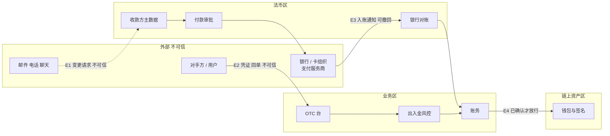
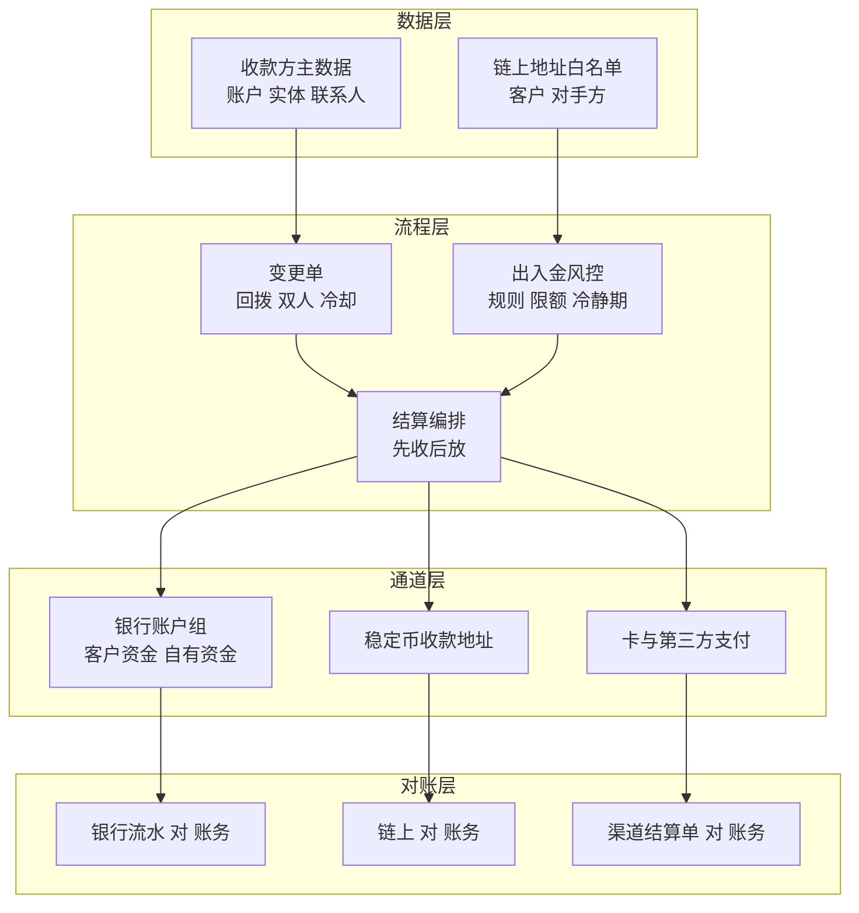
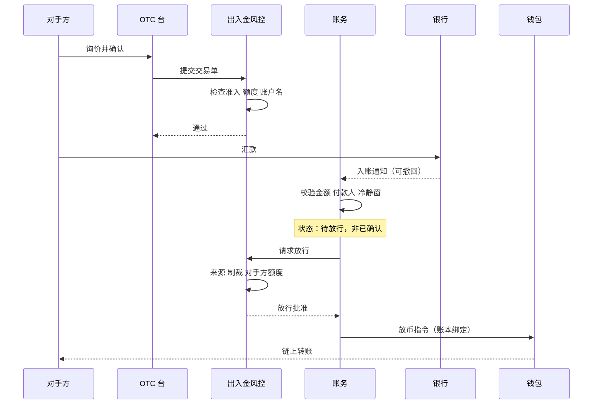

# X22 支付、OTC 与法币出入金安全

> 学习目标：读完本章，你能——
> 1. 画出一家机构的法币通道结构（银行转账、卡支付、第三方支付、稳定币收款），并标出每条通道上"钱可以被撤回"的时间窗。
> 2. 写出收款账户变更、OTC 结算顺序、出入金风控三份可执行的规则或流程，并能用笔记本回放测试。
> 3. 做一次"渠道方出事"的桌面推演，算出资金滞留量和连续性方案。
>
> 适用角色：支付与出入金安全负责人、OTC 业务风控、财资与财务、交易所或项目方的安全工程师。
> 前置章节：[X11 钱包、财资与支付渠道](X11-cex-wallet-treasury-payment.md)、[23 托管、充提与合规安全](../23-custody-exchange-ops.md)、[19 用户侧骗局与社会工程](../19-user-scams.md)、[X13 反欺诈、合规与安全运营](X13-cex-fraud-compliance-secops.md)
> 交互实验：[地址投毒实验](../interactive/address-poisoning-lab.html)
> 最后核对：2026-11-23

> 💡 注意：分工。[X11](X11-cex-wallet-treasury-payment.md) 第 6.6 节已给出法币渠道的六条通用做法（账户变更走变更单、回拨确认、双人控制、渠道隔离、延迟生效、对账召回）。本章不重复它们，而是回答三个新问题：**法币这一侧"可撤回"与"不可撤回"的错配怎样被利用；OTC 与卡支付怎样把风险放进业务流程；稳定币收款怎样在链上做检查。** 反欺诈模型、制裁筛查和处置权限见 [X13](X13-cex-fraud-compliance-secops.md)，本章只写它们在支付与 OTC 流程里的接口。

> ⚠️ 警告：银行、卡组织和第三方支付产品的规则、时限与费用差异大，且会变化。本章只写通用事实，不描述任何具体银行或支付产品的内部做法。具体时限以合同和渠道最新文档为准。

---

## 开场：一封"换账户"的邮件

2013 年至 2015 年，一名立陶宛人冒充台湾供应商 Quanta，给 Facebook 和 Google 的员工发假发票，让他们把货款汇到自己控制的账户。他于 2019 年认罪并被判 5 年。媒体报道的涉案金额合计超过 1 亿美元，两家公司称已追回大部分资金。

这个骗局没有攻破任何系统。它只做了一件事：让付款流程相信"收款方换了账户"。

<details class="predict"><summary>🤔 先猜再看：两家公司都有财务审批流程。哪一步最可能被绕过？</summary>

不是审批本身，而是"审批的对象"。审批人审的是发票上的金额与业务是否匹配。收款账户是否属于真实供应商，往往没有人独立核对。本章第 3 节的"收款方主数据"就是把这一步变成受控资产。

</details>

---

## 1. 一句话理解

**法币通道的安全，是管住两个错配：一是"收款方信息"与"真实收款方"的错配，二是"入账已确认"与"钱不可撤回"的错配。**

出入金（On/Off-ramp）：用户把法币换成链上资产（入金），或把链上资产换成法币（出金）的通道。OTC（Over-the-Counter，场外交易）：大额买卖不在公开订单簿成交，由交易双方或撮合方线下报价、结算。

> 🎯 打个比方：你在一家店里收支票。顾客拿走货时，支票只是"看起来有效"。几天后银行才告诉你它是否兑现。如果你先交货，风险在你。
>
> 比喻的局限：支票有统一的退票规则。法币与稳定币通道的撤回规则因渠道、国家、产品而异，有的几乎不可撤回，有的几个月内都可以争议。你必须逐条通道查清，不能用一个比喻代替。

---

## 2. 保护目标与信任边界

### 2.1 保护目标

| 目标 | 一句话 | 失守的后果 |
|---|---|---|
| 付款只到真实收款方 | 收款账户与业务实体绑定 | 货款被诈骗者收走 |
| 先确认到账，再放币 | 放出链上资产的时点晚于法币不可撤回的时点 | 币已出，钱被撤回 |
| 客户资金与自有资金分开 | 账户、权限、对账分开 | 渠道失陷时客户资金受损 |
| 来源与去向可说明 | 出入金的资金有来源，有身份匹配 | 被用于洗钱，被冻结或处罚 |
| 渠道故障可撑过去 | 单一银行或支付方失败，业务能降级 | 资金滞留，用户无法提现 |

### 2.2 信任边界



**读图要点：**

- 邮件、电话、聊天、对手方回单（E1、E2）都是不可信输入。它们不能直接改主数据，也不能直接触发放币。
- 银行"入账通知"（E3）只说明"现在看到了这笔钱"，不说明"以后不会被撤回"。
- 账务到钱包的箭头（E4）是最关键的一道门：放币条件由账务状态决定，不由人工口头确认决定。
- 局限：图没有画 KYC 与制裁筛查，它们在第 6.5 节接入。

> ⚠️ 警告：以下东西**不能被信任**。
> 1. 对手方发来的转账截图、回单 PDF、网银"成功"页面。
> 2. 邮件里留的"新银行账户"和"新联系电话"。
> 3. 内部群里"财务已确认到账"这句话，没有账务系统状态作证。
> 4. 支付服务商的单个回调通知。它要用查询接口二次确认。
> 5. 钱包里"最近收款"列表里长得像的地址。

---

## 3. 参考架构

### 3.1 法币通道结构与"撤回窗口"

| 通道 | 典型用途 | 对机构的主要风险 | 撤回窗口（通用事实） |
|---|---|---|---|
| 银行转账 | 大额出入金、OTC 结算、供应商付款 | 账户替换、错付、BEC、入账后被召回 | 取决于银行与国家；错付可申请召回，但不保证成功 |
| 卡支付 | 小额入金买币 | 盗卡、拒付（Chargeback：持卡人向发卡行争议扣款）、友好欺诈 | 卡组织规则允许较长争议期，时长按卡组织与争议原因而异 |
| 第三方支付 | 本地钱包、即时支付 | 渠道方风控、冻结、回调伪造 | 取决于产品与合同 |
| 稳定币收款 | 跨境、OTC、商户收款 | 假充值、地址投毒、被制裁地址、发行方冻结 | 链上转账一经确认通常不可撤回；发行方可冻结地址 |

> 💡 注意：最危险的是"法币可撤回，链上资产不可撤回"这对组合。机构把币放出去，就把撤回风险全部留给自己。这是 OTC、卡入金和假入账类事故的共同结构。

### 3.2 分层与数据流



**读图要点：**

- 主数据层是"收款方是谁"的唯一来源。付款、结算、风控都读它，没有人手工在付款单上写账号。
- 结算编排层强制"先收后放"。通道不同，"收"的定义不同（见 6.2 节）。
- 对账层独立于流程层。它读的是银行、链和渠道方自己给出的记录。
- 局限：主数据本身被攻击者改写时，图会失效。所以主数据变更只走变更单。

### 3.3 组件职责

| 组件 | 负责 | 不能做 |
|---|---|---|
| 收款方主数据 | 保存实体、账户、验证记录 | 不接受付款单上的临时账号 |
| 变更单 | 记录谁、为什么、用什么证据、谁回拨 | 发起人不能自己回拨、自己批准 |
| 结算编排 | 按通道规则判断"可以放币" | 不接受人工绕过标记 |
| 出入金风控 | 限额、冷静期、来源与身份匹配 | 不改账务 |
| 对账 | 多方比对，生成差异 | 不能由记账人员单独关闭差异 |

---

## 4. 控制清单

| ID | 控制项 | 要防什么 | 优先级 | 怎么验证 |
|---|---|---|---|---|
| PAY-C01 | 收款方主数据：付款只能选主数据里的账户，禁止手填 | 发票诈骗、账户替换 | P0 | 抽查 10 笔付款，字段来源均为主数据 |
| PAY-C02 | 账户变更走变更单：已登记渠道回拨、双人审批、冷却期 | BEC | P0 | 抽查近 3 个月变更，回拨记录齐全 |
| PAY-C03 | 变更后首笔付款限额与延迟 | 变更后立即被洗走 | P1 | 新增账户后发起大额付款，确认被限 |
| PAY-C04 | 邮件与域名防护：SPF、DKIM、DMARC，相似域名监测 | 冒充供应商、高管 | P1 | DNS 记录核对；注册相似域名告警 |
| PAY-C05 | OTC 结算顺序：按通道的"不可撤回点"后放币 | 假凭证、入账后撤回 | P0 | 用测试单走通全流程，检查放币触发条件 |
| PAY-C06 | OTC 对手方：准入、身份与账户名一致、限额分级 | 冒名、洗钱、第三方代付 | P0 | 抽查 5 个对手方档案 |
| PAY-C07 | 入金风控：账户名与 KYC 姓名一致，第三方付款拒绝或复核 | 盗用账户、洗钱 | P0 | 回放第三方付款样本，确认被拦 |
| PAY-C08 | 卡入金：新用户限额、冷静期、拒付监控与证据保留 | 盗卡、友好欺诈 | P1 | 拒付率仪表盘；证据包样本 |
| PAY-C09 | 稳定币收款：确认数、地址白名单、代币合约校验 | 假充值、假代币 | P0 | 构造假代币转账，确认不入账 |
| PAY-C10 | 稳定币付款：地址投毒防护，新地址冷却，首次小额验证 | 地址投毒 | P0 | 构造相似地址，确认告警 |
| PAY-C11 | 发行方冻结与制裁地址筛查：入账前与出账前各一次 | 资金被冻结、制裁违规 | P0 | 用测试名单回放 |
| PAY-C12 | 客户资金与自有资金账户隔离，操作员与审批人名单隔离 | 渠道失陷两边受损 | P1 | 比对名单，交集为零 |
| PAY-C13 | 多方对账：银行 / 渠道结算单 / 链上 / 账务，差异分级与时限 | 长期未发现的错账或盗用 | P0 | 注入 1 笔差异，测告警延迟 |
| PAY-C14 | 渠道连续性：至少两个可用通道，降级开关与滞留资金预案 | 单点渠道故障 | P1 | 季度桌面推演，记录结论 |

---

## 5. 分级落地

| 档次 | 做什么 | 人和时间（示例） |
|---|---|---|
| 最小可行 | 收款方主数据与变更单；回拨确认；OTC"先收后放"；账户名一致规则；每日对账表 | 安全 + 财务各 1 名；4–6 周 |
| 标准 | 加：邮件域名防护与相似域名监测；对手方分级；卡拒付监控；稳定币收款链上检查；自动对账；客户 / 自有资金隔离 | 3–4 人（安全、风控、财务、合规）；3–6 个月 |
| 成熟 | 加：多通道冗余与降级演练；对手方实时筛查；拒付证据自动化；渠道方安全评估与退出预案；季度红队含 BEC 演练 | 5 人以上，跨团队；12 个月以上 |

> 💡 注意：人数和时间是示例。顺序比规模重要：先管住"收款方是谁"和"何时放币"，再做自动化。

---

## 6. 落地做法

### 6.1 收款方主数据与变更单

1. 建一张收款方主数据表：实体名、国家、账户、开户行、验证日期、验证方式、验证人。
2. 付款系统只允许选择主数据里的账户。
3. 任何变更都开变更单，字段至少包含请求来源、理由、证据、回拨人、审批人。
4. 回拨用主数据里**原有**的联系方式，不用本次请求里附带的。
5. 变更生效有冷却期。冷却期内首笔付款有限额，并要求再次回拨。
6. 每月抽查变更单，验证回拨记录是否真实。

```sql
-- 示例：账户变更后 7 天内的大额付款（需复核）
SELECT p.payee_id, p.amount_usd, p.created_at, c.changed_at, c.requested_by
FROM payments p
JOIN payee_account_changes c ON c.payee_id = p.payee_id
WHERE p.created_at BETWEEN c.changed_at AND c.changed_at + INTERVAL '7 days'
  AND p.amount_usd >= 50000          -- 示例阈值
  AND c.callback_verified = FALSE;   -- 没有回拨记录的变更
-- 假阳性：供应商真实搬迁账户。调优：按变更来源（邮件 / 工单）分层。
```

常见坑：

1. 回拨用了邮件签名里的电话。攻击者控制邮箱，也能控制签名。
2. 变更单由发起人自己"补"回拨记录。
3. 紧急付款免冷却。攻击者会制造紧急。

### 6.2 OTC：先确认"不可撤回"，再放币

OTC 的核心规则只有一条：**放出链上资产的时点，必须晚于法币到账变得不可撤回的时点。**

| 方向 | 对手方给 | 机构给 | 安全顺序 |
|---|---|---|---|
| 机构卖币 | 法币 | 链上资产 | 法币到账且过冷静窗，再放币；或使用第三方托管 / 分批结算 |
| 机构买币 | 链上资产 | 法币 | 先收足确认数，再付款；大额分批 |
| 币换币 | 链上资产 | 链上资产 | 先收足确认数，再付；或使用原子结算 |



**读图要点：**

- 对手方回单（截图）不在图里：它不是放币条件。
- "待放行"状态由账务设置，OTC 台不能改。
- 风控在放行前再检查一次，因为入金期间名单和对手方状态可能变化。
- 局限：对大额、高频对手方，等待冷静窗会损失竞争力。这是业务取舍，应写进对手方分级，而不是由交易员临时决定。

```yaml
# 示例：OTC 放行策略（数值为示例，需按通道与合同调整）
otc_release_policy:
  tier_new_counterparty:
    pay_in_channel: bank_wire
    release_after: "funds_settled_and_cooling_window"   # 冷静窗长度按通道不可撤回点定
    max_single_usd: 100000
    third_party_payer: reject
  tier_established:
    release_after: "funds_settled"
    max_single_usd: 2000000
    staged_release: true          # 分批放币
  any:
    proof_screenshot_as_condition: false   # 回单截图不能触发放行
    manual_override: forbidden             # 无人工绕过；例外走变更单
```

### 6.3 卡入金与拒付

1. 新用户卡入金设低额度和较长冷静期，再逐步放开。
2. 用设备、地址、支付信息等信号做风险评分，高风险转人工复核。
3. 对已入金买入的资产，在冷静期内限制提币到外部地址。
4. 为每笔入金保留证据：用户同意条款、设备与登录记录、KYC 记录、交付记录。
5. 拒付发生后，冻结相关账户的提币，评估是否关联盗卡团伙，按需要上报。
6. 持续监控拒付率，并留出对卡组织监控计划的缓冲。具体阈值与争议期限以卡组织与收单方的最新规则为准。

> 💡 注意：友好欺诈（Friendly Fraud）：持卡人本人完成了购买，之后却发起争议。行业观察认为行情下跌后，买币类业务的这类争议会增加；这没有统一公开口径，本章不引用具体比例。

```sql
-- 示例：卡入金后 24 小时内提币到新外部地址（高风险组合）
SELECT d.user_id, d.deposit_id, d.amount_usd, w.withdrawal_id, w.to_address
FROM card_deposits d
JOIN withdrawals w ON w.user_id = d.user_id
WHERE w.created_at <= d.settled_at + INTERVAL '24 hours'
  AND w.to_address NOT IN (SELECT address FROM user_whitelist WHERE user_id = d.user_id)
  AND d.amount_usd >= 1000;           -- 示例阈值
-- 假阳性：正常新用户首次提币。调优：叠加账户年龄、设备新旧、KYC 等级。
```

### 6.4 稳定币收款与付款的链上检查

收款侧：

1. 只认白名单的代币合约地址。同名假代币、不同链同名代币都要拒绝。
2. 确认数达到阈值才入账。阈值按链配置，假充值的原理见 [23 章](../23-custody-exchange-ops.md)。
3. 入账前后各做一次制裁与风险评分。
4. 监控发行方冻结事件。被冻结的资金不能当可用余额。

付款侧：

1. 新地址首次付款先发小额，由收款方独立确认地址。
2. 用地址白名单与冷却期，禁止从"最近交易"里复制地址。
3. 付款前比对完整地址，不只比对前后几位。

```python
# 示例：相似地址检测（只读，用于风控告警；阈值为示例）
def lookalike(addr_a: str, addr_b: str, head: int = 4, tail: int = 4) -> bool:
    a, b = addr_a.lower(), addr_b.lower()
    return a != b and a[:2 + head] == b[:2 + head] and a[-tail:] == b[-tail:]

def check_payout(payout_addr, known_addrs):
    hits = [k for k in known_addrs if lookalike(payout_addr, k)]
    return {"block": bool(hits), "similar_to": hits}   # 命中则阻断并要求人工确认
```

### 6.5 出入金风控规则

1. 入金：付款人账户名必须与已验证的客户姓名一致。第三方付款默认拒绝或人工复核。
2. 来源资金：高额度账户要求资金来源说明，并与交易画像对照。
3. 限额：按客户等级、渠道、时间窗配置，新账户与新渠道更严。
4. 冷静期：改手机、改密码、新增提币地址后，出金有延迟。参见 [X08](X08-cex-identity-account-access.md)。
5. 制裁与风险地址：入金前后各筛查，名单更新触发重筛历史账户。
6. 异常：快进快出、拆分金额接近限额、多账户同一付款来源，进入 [X13](X13-cex-fraud-compliance-secops.md) 的规则与复核闭环。

```yaml
# 示例：出入金规则片段（数值为示例）
rules:
  - id: PAY-R1
    when: deposit.payer_name != kyc.legal_name
    then: hold_and_review          # 第三方付款
  - id: PAY-R2
    when: sum(deposit.amount, window="24h") >= 0.9 * tier.daily_limit and count(deposit) >= 4
    then: review                   # 拆分接近限额
  - id: PAY-R3
    when: account.changed(["phone","password","2fa"], within="72h") and withdrawal.fiat_out
    then: delay("24h")             # 找回或改绑后冷静
```

### 6.6 多方对账与差异处理

对账对象：银行流水、渠道结算单、链上记录、账务。

1. 每天自动对账，差异落表，不由记账人员单独关闭。
2. 差异分级：金额、账龄、方向。大额和账龄超过阈值升级到财务负责人与安全。
3. 对账用渠道方给出的原始报表，并校验报表本身的完整性（行数、签名或哈希）。
4. 每季度注入一笔测试差异，测发现用时。
5. 发现错付，立即联系银行申请召回，并向执法渠道报案（FBI 的公告给出同样的建议）。

### 6.7 渠道方事故与连续性

1. 登记所有渠道：用途、资金滞留上限、替代通道、联系人。
2. 设资金滞留上限：任一银行或支付方的余额不能超过"能承受其不可用若干天"的额度（示例）。
3. 准备降级开关：暂停某通道入金、改走备用通道、限制出金。开关权限见 [X13](X13-cex-fraud-compliance-secops.md) 的处置权限设计。
4. 对渠道方做安全与稳健性评估：牌照、审计报告、资金隔离方式、事故通知条款、退出条款。
5. 事故时每日向管理层汇报：滞留金额、可用通道、客户影响、对外口径。

---

## 7. 运营：指标、告警、值班、演练、季度节奏

### 7.1 指标

| 指标 | 说明 | 目标（示例） |
|---|---|---|
| 变更单回拨完成率 | 有回拨记录的账户变更占比 | 100% |
| 付款来源合规率 | 付款来自主数据的占比 | 100% |
| 对账差异平均关闭时长 | 从发现到关闭 | 小于 2 个工作日 |
| 大额差异发现延迟 | 差异产生到告警 | 小于 1 小时 |
| 拒付率与拒付证据提交率 | 按渠道与用户群 | 随卡组织规则 |
| 第三方付款拦截数 | 被拦与复核结果 | 趋势监控 |
| 渠道余额 / 上限比 | 单渠道滞留比 | 小于 100% |

### 7.2 告警

| 告警 | 触发 | 级别 |
|---|---|---|
| 收款账户变更无回拨 | 变更单状态异常 | P2 |
| 变更后大额付款 | 见 6.1 SQL | P1 |
| 放币条件未满足却有放币指令 | 账务与钱包不一致 | P1 |
| 相似地址付款 | 见 6.4 | P2 |
| 卡入金后短时提币 | 见 6.3 SQL | P2 |
| 渠道对账差异超阈值 | 对账层 | P1 |
| 相似域名新注册 | 域名监测 | P3 |

### 7.3 季度节奏

| 周期 | 事务 |
|---|---|
| 每月 | 抽查变更单与回拨记录；复核主数据；差异账龄复盘 |
| 每季度 | BEC 桌面推演（见练习）；渠道滞留上限复核；规则回放；对手方分级复核 |
| 每半年 | 渠道方评估；外部演练（含钓鱼） |
| 每年 | 渠道连续性演练；与监管 / 合规对齐 |

---

## 8. 失效案例

> 💡 注意：以下只写摘要与教训。金额为约数；事发时估值或媒体口径各异。归因写"公开报道"。来源类型已标明。本章没有找到与"OTC 假凭证"或"交易所卡拒付"直接对应、来源可靠的公开事故，所以不写这两类具体案例，只写通用机制。

### 8.1 发票诈骗：冒充供应商（2013–2015，美国）

- **事实：** 媒体报道：一名立陶宛人注册了与台湾供应商 Quanta 相似的域名，发假发票、合同和信件，让 Facebook 与 Google 的员工把货款汇到他控制的账户。他于 2019 年认罪，被判 60 个月，并同意没收约 4,970 万美元；两家公司称已追回大部分资金。涉案总额的口径不一（约 1 亿至 1.2 亿美元）。来源类型：媒体报道（转述美国司法部公开信息；司法部新闻稿页面本次无法抓取）。来源：[NPR](https://www.npr.org/2019/03/25/706715377)、[CyberScoop](https://cyberscoop.com/facebook-google-scam-man-sentenced/)、[Sophos](https://www.sophos.com/en-us/blog/man-jailed-for-122-million-scam-that-fooled-google-and-facebook)。
- **映射：** 失守的是 PAY-C01、PAY-C02：收款账户来自发票，没有主数据和回拨。PAY-C04 能降低相似域名的成功率。
- **教训：** 大公司也会被"换账户"打穿。关键是账户来源，而不是审批层级数。

### 8.2 BEC 的整体数据（FBI IC3）

- **事实：** FBI 的 2023 年公告称，2013 年 10 月至 2022 年 12 月，BEC 的暴露损失约 509 亿美元（金融机构报告口径）；公告把"通过第二渠道核实付款或账户变更请求"列为基本缓解措施，并建议发现错付后立即联系银行申请召回、向 IC3 报案。媒体转述 FBI 2024 年度报告：BEC 当年报告损失约 27.7 亿美元、约 2.1 万件投诉。来源类型：官方公告、媒体转述。来源：[FBI IC3 PSA230609](https://www.ic3.gov/PSA/2023/PSA230609)、[Infosecurity Magazine](https://www.infosecurity-magazine.com/news/fbi-staggering-lost-cybercrime-2024/)。
- **映射：** PAY-C02（回拨）、PAY-C13（对账发现）、第 6.6 节的召回流程。
- **教训：** 发现越早，可挽回的越多。召回流程应预先写好，并列在对账告警的处置步骤里。

### 8.3 渠道方事故：SVB、Silvergate 与 Signature（2023 年 3 月，美国）

- **事实：** Circle 披露约 33 亿美元 USDC 储备存放在 Silicon Valley Bank，约占储备的 8%；媒体报道 USDC 当时短暂跌至约 0.88 美元。Circle 于 2023 年 3 月 12 日称，这笔存款将在次日银行开门时可用，并称没有 USDC 现金储备存放在 Signature Bank。同月，Silvergate 宣布有序清盘，其面向加密客户的即时法币网络已关闭；Signature 被纽约州金融服务部接管。来源类型：项目方声明、媒体报道。来源：[Circle 声明](https://www.circle.com/pressroom/3-3-billion-of-usdc-reserve-risk-removed-dollar-de-peg-closes)、[Fortune](https://fortune.com/crypto/2023/03/10/circle-reveals-3-3-billion-stuck-silicon-valley-bank-usdc-wobbles-against-peg)、[Fortune（Silvergate）](https://fortune.com/crypto/2023/03/08/cryptos-favorite-bank-falls-as-silvergate-announces-plans-to-wind-down-operations/)。
- **映射：** PAY-C14（渠道连续性与滞留上限）、PAY-C12（资金隔离）。
- **教训：** 资金是否安全，不只取决于自己的密钥，还取决于存放它的渠道。滞留上限、替代通道和对外口径要在事故前写好。发行方侧的储备管理见 [X17](X17-stablecoin-rwa-issuer-ops.md)。

### 8.4 地址投毒：近 5,000 万美元 USDT（2025 年 12 月，以太坊）

- **事实：** The Block 报道：一名用户从交易所提出资金，先向目标地址发 50 USDT 做测试；攻击者用脚本生成与目标地址前 5 位和后 4 位相同的相似地址，并向受害者发小额交易污染历史。受害者之后从历史里复制了相似地址，转出 49,999,950 USDT（距测试约 26 分钟）。攻击者随后换成 DAI，再换成约 16,690 ETH，并把绝大部分存入 Tornado Cash。受害者发出链上留言，提出 100 万美元赏金。来源类型：媒体报道（转述链上分析公司）。来源：[The Block](https://www.theblock.co/news/ecosystems/2025-12-20-crypto-trader-loses-50-million-in-address-poisoning-attack-offers-1-million-bounty-for-return-383423)。
- **映射：** PAY-C10。本案里"先发测试单"没有失效，失效的是后一步从历史复制地址。
- **教训：** 测试转账只验证"那个地址"，不验证"下一次复制的地址"。必须用白名单与完整地址比对。

### 8.5 对手方风险：Garantex（2025 年 3 月）

- **事实：** 美国司法部于 2025 年 3 月 7 日公布：美国特勤局查封 Garantex 的三个域名，德国与芬兰当局查封托管服务器；司法部称该平台自 2019 年 4 月以来处理至少 960 亿美元加密交易，两名管理员被指控洗钱共谋等罪名；平台已在 2022 年 4 月被 OFAC 制裁，司法部称其运营方此后仍与美国实体交易，并每天更换运营钱包以躲避封锁；当局冻结了超过 2,600 万美元。来源类型：官方公告。来源：[美国司法部](https://www.justice.gov/opa/pr/garantex-cryptocurrency-exchange-disrupted-international-operation)。
- **映射：** PAY-C06、PAY-C11：对手方准入与制裁筛查。机构视角：如果你的 OTC 或入金与此类平台有资金往来，你的风控会被连带审查。
- **教训：** 对手方风险是双向的。名单更新要触发重筛，并回查历史资金往来。

### 案例与控制映射

| 案例 | 失守或起作用的控制 |
|---|---|
| 8.1 发票诈骗 | PAY-C01、C02、C04 |
| 8.2 BEC 数据 | PAY-C02、C13 |
| 8.3 渠道事故 | PAY-C12、C14 |
| 8.4 地址投毒 | PAY-C10 |
| 8.5 Garantex | PAY-C06、C11 |

---

## 9. 评估检查点

- [ ] **PAY-1** 付款系统只能选择主数据里的收款账户，没有手填入口。
- [ ] **PAY-2** 收款账户变更走变更单，回拨使用登记渠道，由发起人以外的人完成。
- [ ] **PAY-3** 变更后有冷却期和首笔限额。
- [ ] **PAY-4** SPF、DKIM、DMARC 已配置，相似域名监测在运行。
- [ ] **PAY-5** OTC 放币条件由账务状态决定，回单截图不能触发放币。
- [ ] **PAY-6** 每个通道的"不可撤回点"已登记，OTC 放行规则与之对应。
- [ ] **PAY-7** OTC 对手方有准入、分级与额度，账户名与实体一致。
- [ ] **PAY-8** 第三方付款被拒绝或复核，有回放测试结果。
- [ ] **PAY-9** 卡入金有新用户限额、冷静期、提币限制，并监控拒付率。
- [ ] **PAY-10** 每笔卡入金保留可提交的证据。
- [ ] **PAY-11** 稳定币收款只认白名单合约，确认数按链配置，假代币测试通过。
- [ ] **PAY-12** 稳定币付款有地址白名单、冷却期和相似地址阻断。
- [ ] **PAY-13** 入账与出账前各做一次制裁与风险筛查，名单更新会重筛。
- [ ] **PAY-14** 客户资金与自有资金账户隔离，操作员与审批人名单不重叠。
- [ ] **PAY-15** 多方对账自动化，差异分级，关闭需要独立人员。
- [ ] **PAY-16** 注入测试差异，告警延迟在目标内。
- [ ] **PAY-17** 每个渠道有滞留上限、替代通道和降级开关。
- [ ] **PAY-18** 有错付召回手册，写明联系人与时限。
- [ ] **PAY-19** 每季度做一次 BEC 或渠道故障桌面推演，并跟踪行动项。
- [ ] **PAY-20** 渠道方有定期评估记录与退出预案。

**把检查结果写进报告：**

| 检查项范围 | 对应控制 | 证据 | 状态（通过 / 部分 / 未通过） | 负责人 | 到期日 |
|---|---|---|---|---|---|
| PAY-1–4 | PAY-C01–C04 | 主数据导出、变更单抽样 |  |  |  |
| PAY-5–8 | PAY-C05–C07 | 测试单、回放结果 |  |  |  |
| PAY-9–10 | PAY-C08 | 拒付报表、证据样本 |  |  |  |
| PAY-11–13 | PAY-C09–C11 | 测试记录 |  |  |  |
| PAY-14–16、18 | PAY-C12–C13 | 名单比对、对账注入、召回手册 |  |  |  |
| PAY-17、19–20 | PAY-C14 | 渠道登记表、推演记录 |  |  |  |

---

## 10. 上手路径

**第一周**

1. 列出所有法币与支付渠道、所有收款账户、所有有权发起或审批付款的人。
2. 抽查最近 10 笔大额付款：收款账户来自哪里，有没有回拨记录。
3. 查看 OTC 的放币条件：由谁、凭什么触发。
4. 画出本章 2.2 节的图，用你们机构的真实组件替换节点。

**第一个月**

1. 建收款方主数据与变更单模板，并回填现有账户的验证记录。
2. 写 OTC 放行策略的第一版，标出各通道的不可撤回点。
3. 上线第三方付款、变更后大额付款两条告警。
4. 配置邮件域名防护，注册监测相似域名。

**第一个季度**

1. 自动化多方对账，并注入测试差异。
2. 建对手方分级与额度，把制裁筛查接到入账与出账前。
3. 完成一次 BEC 桌面推演和一次渠道故障桌面推演。
4. 为每个渠道设滞留上限，与财务和管理层确认。

---

## 11. 常见误区

| 误区 | 实际情况 |
|---|---|
| "有多级审批就不会被骗" | 审批只审金额与业务。如果收款账户来自假发票，多级审批也会放行 |
| "入账了就是收到了" | 入账通知通常可撤回。放币要晚于不可撤回点 |
| "客户给了回单，应该是真的" | 回单可伪造。放币条件看账务状态 |
| "稳定币链上转账不会被撤回，所以没风险" | 假充值、假代币、地址投毒、发行方冻结都是风险 |
| "测试转账通过，后面就安全" | 测试只验证那一个地址，下一次复制的地址可能已被替换 |
| "卡入金是小额，不用管" | 小额大量叠加，拒付率超标会影响收单关系 |
| "银行是大机构，资金放那里最安全" | 渠道方也会出事。要有滞留上限和替代通道 |
| "合规是合规部的事" | 出入金规则落在支付流程里，安全与合规要一起验证 |

---

## 12. 术语表

| 术语 | 英文 | 定义 |
|---|---|---|
| 出入金 | On/Off-ramp | 法币与链上资产互换的通道 |
| OTC | Over-the-Counter | 大额场外交易，线下报价与结算 |
| BEC | Business Email Compromise | 冒充供应商或高管，诱导变更收款账户或付款 |
| 拒付 | Chargeback | 持卡人向发卡行争议，款项被撤回 |
| 友好欺诈 | Friendly Fraud | 持卡人完成购买后又发起不实争议 |
| 不可撤回点 | Point of Finality | 某笔资金不能再被对方撤回的时点 |
| 主数据 | Master Data | 一个业务对象（如收款方）唯一可信的记录 |
| 回拨确认 | Callback Verification | 用已登记的联系方式向对方核实变更 |
| 地址投毒 | Address Poisoning | 用相似地址污染交易历史，诱导用户误转 |
| 滞留上限 | Exposure Cap | 单一渠道可存放资金的最大额度 |

---

## 13. 动手练习与思考题

### 练习 1：30 分钟 BEC 桌面推演

场景：周五 17:30，采购收到邮件："供应商已更换开户行，请在下周一前付 80 万美元。"附件是盖章的新账户通知。

1. 画出这封邮件从收到到付款的所有环节，标出谁能改账户。
2. 找出本章哪些控制会在哪一步介入。
3. 注入变化：邮件来自真实被入侵的供应商邮箱，域名完全正确。哪些控制仍然有效，哪些失效？
4. 写出三条行动项，指定负责人和期限。

### 练习 2：写并回放一条 OTC 放行规则

1. 选一个通道，写出"不可撤回点"的假设（示例即可）。
2. 用 6.2 节的 YAML 改写成你的规则。
3. 构造 5 个测试单：正常、第三方付款、截图冒充、金额超限、名单命中。
4. 手工推演每个单的结果，记录规则是否按预期放行或拦截。

### 练习 3：渠道故障推演

假设一家主力银行明天不可用。已知你在这家银行的客户资金为总额的 20%（示例）。

1. 算出入金、出金、OTC 三类业务受到的影响。
2. 写出降级开关的触发条件、权限人和恢复条件。
3. 写出向用户与监管的第一次沟通要点。

### 思考题

1. OTC 为了竞争力要缩短等待时间。哪些场景可以安全缩短，哪些绝不能？写出你的判据。
2. 地址投毒案里，受害者做了测试转账仍然失败。机构怎样把"白名单"做成默认路径，而不是依赖人记得？
3. 如果收款账户主数据本身被内部人改写，本章哪些控制会发现？还缺什么？

> 建议配套（后续在 L3 训练营实现）：一个对账与规则回放脚本，输入银行流水、账务、链上记录三份 CSV，输出差异与告警。

---

## 附：来源与时效说明

- 第 8 节的事实来自 2026-11-23 当天的公开来源查询：美国司法部（Garantex）、FBI IC3（BEC）、Circle 声明、媒体报道（发票诈骗案、Silvergate、地址投毒）。
- 未能直接核对到原文的：美国司法部关于发票诈骗案的新闻稿（页面无法抓取，改用媒体转述）；卡组织与收单方的拒付阈值和争议期限（只有二手来源，正文未写具体数字）；FBI 2024 年度报告原文（使用媒体转述）。
- 法币与支付渠道的规则因国家与产品而异。正文只写通用事实，上线前请以合同、渠道最新文档和法务意见为准。
