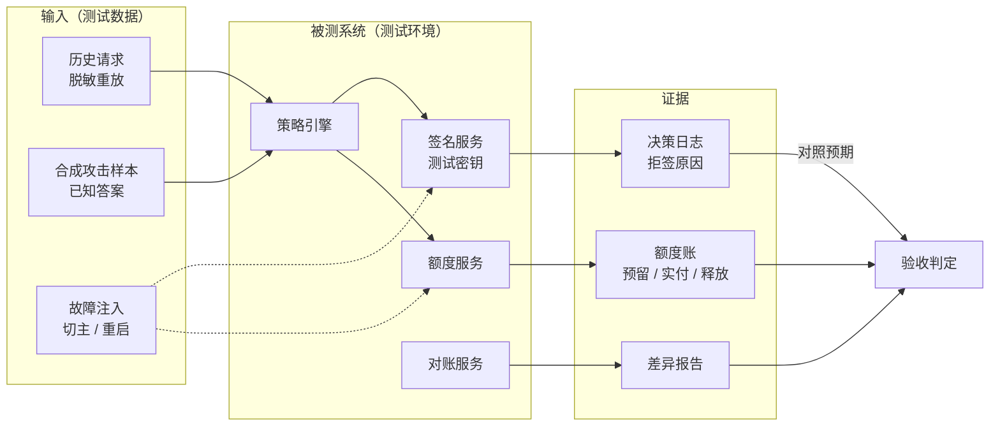
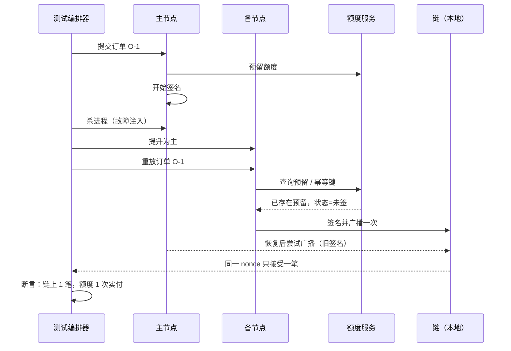
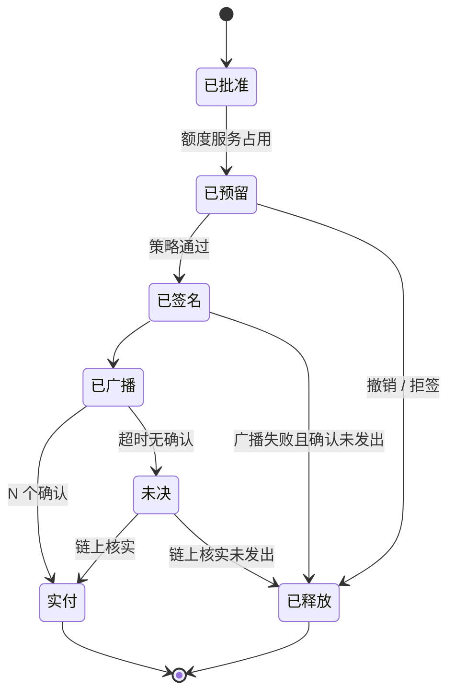

# X23 钱包、财资与支付·工程验收：越权签名、假回执、拒签与额度占用

> 学习目标：读完本章，你能——
> 1. 为签名服务、额度占用、调拨和渠道回执写出一套可重复执行的验收用例，并说清每条用例要留什么证据。
> 2. 用历史交易加合成攻击样本回放策略引擎，算出召回率与误拒率，并把结果写进验收报告。
> 3. 在切主、重启、重放、并发等故障下，证明"同一笔单据不会被签两次、额度不会被占两次"。
>
> 适用角色：交易所安全工程师、钱包与财资测试（QA）、风控与审计人员。
> 前置章节：X14-cex-wallet-treasury-payment.md、[29 2026 专题：签名路径](../29-signing-path-2026.md)、[23 托管、充提与合规安全](../23-custody-exchange-ops.md)、X06-resilience-validation.md
> 交互实验 / 模板：[签名策略实验](../interactive/signing-policy-lab.html)、[多签签前复核](../interactive/multisig-review-lab.html)、[上线门禁模板](../templates/T04-go-live-gate.md)
> 最后核对：2026-11-23

> 💡 注意：分工。[X14](X14-cex-wallet-treasury-payment.md) 讲钱包怎样分层、签名服务怎样设计、调拨怎样审批。本章不重复设计，只回答一个问题：**你凭什么说这些控制真的有效？** 控制项编号 `TRS-Cxx` 指向 X14 第 4 节；本章自己的检查项写作 `TSV-n`，验收用例写作 `TSV-Txx`。恢复与复付见 X24，账务与钱包的交接状态见 X29。

---

## 开场：一份"全部通过"的报告

一家交易所的钱包团队写了签名策略：无审批单不签，地址不在白名单不签，单笔超限不签。上线前的测试报告写着"全部通过"。

测试人员用的是什么？九条用例，都是"构造一个明显错误的请求，看它被拒"。

三个月后做首次回放，安全工程师把半年的真实签名请求加上 60 条合成攻击样本放进测试环境。结果：明显错误的请求全被拒；"审批单号真实存在，但金额被改小一位后又拆成两笔"的样本被放行了；主备切换演练中，同一张单据被两个节点各签了一次。（本场景为虚构，用来说明验收的盲区。）

<details class="predict"><summary>🤔 先猜再看：九条用例全部通过，为什么不能说明签名服务可靠？</summary>

因为它们只验证了"错误请求会被拒"，没有验证三件事：（1）正确请求是否被正确放行（误拒率）；（2）攻击者会构造"看上去正确"的请求；（3）故障、并发、切主时，控制是否仍然成立。验收的对象是**控制在压力下的行为**，不是控制在理想情况下的行为。本章的用例库按这三类展开。

</details>

---

## 1. 一句话理解

**工程验收是在测试环境里，用已知答案的输入去"攻击"每一条控制，记录控制的实际反应，并让别人能复现这些记录。**

> 🎯 打个比方：消防验收不是看图纸画了几个喷头，而是在楼里点一把火，看喷头是否在规定时间内动作、有没有水、报警有没有响。
>
> 比喻的局限：消防验收一年一次，测试火灾也不会改变大楼。钱包控制随策略、代码、渠道变化而变，验收必须随每次变更重做，并且测试环境必须和生产严格隔离，防止测试请求真的动了钱。

验收做三件事：

1. 拒签：不该签的请求，签名服务必须拒绝，并留下拒绝原因。
2. 额度占用：钱在"批准"到"实付"之间要被占住，并且一定会释放，不多占，不漏占。
3. 回执核对：任何"已到账""已付款"的说法，都要和链上或银行的独立记录对上。

---

## 2. 验收范围与信任边界



**读图要点：**

- 输入分三种：脱敏的历史请求（检验误拒）、合成攻击样本（检验漏放）、故障注入（检验在压力下是否仍然正确）。
- 被测系统全部在测试环境，使用测试密钥和测试网（或本地链）。测试环境没有任何生产密钥、生产银行账号和生产 API 令牌。
- 判定只看证据：决策日志、额度账、差异报告。"开发人员说正确"不算证据。
- 局限：测试环境无法完全复现生产的延迟、节点数量和真实链上拥堵。第 4 节给出"哪些用例必须在预生产环境小额再验一次"。

> ⚠️ 警告：**以下东西不能被信任**，验收时要单独验证。
> 1. 钱包后台或调拨平台页面上显示的地址与金额。它们必须和签名前的原始交易字节比对。
> 2. 渠道方返回的"成功"回执。回执必须和链上区块或银行流水独立核对。
> 3. 自己写的测试用例的"预期结果"。预期结果要由第二个人评审，防止测试和实现一起错。

---

## 3. 验收环境与数据

### 3.1 环境应该长什么样

| 组件 | 测试环境做法 | 为什么 |
|---|---|---|
| 链 | 本地链（Anvil / Hardhat）、公共测试网、比特币 regtest | 区块可回滚、可制造分叉，不碰真资产 |
| 签名密钥 | 测试专用 MPC / HSM 实例，密钥只在测试网有效 | 防止测试请求签出可在主网使用的签名 |
| 账务与额度 | 独立数据库，从生产脱敏快照初始化 | 复现真实数据分布，不含客户信息 |
| 银行与支付渠道 | 渠道方沙箱，或自建模拟器 | 能制造"假回执""延迟回执""重复回执" |
| 网络 | 与生产网络隔离，出口白名单只允许测试网 RPC | 防止测试流量到达生产 |
| 审批人 | 测试账号与测试设备，不用真人生产令牌 | 防止生产令牌泄漏进测试脚本 |

### 3.2 怎样不碰生产

1. 测试环境的配置里，链 ID 与地址前缀不同于主网。启动时校验，不一致则退出。
2. 测试代码里加一道"生产哨兵"：每次调用签名接口前检查目标链是否在测试链列表内。
3. 测试账号没有生产网络的路由，也没有生产密钥库的访问权限。
4. 脱敏：地址、用户 ID、订单号一对一替换，保持格式与分布，不保留可反查的原值。
5. 回放脚本只读历史数据，写入只发生在测试库。

```python
# 示例：生产哨兵。链 ID 列表为示意，按自己的测试网填写。
TEST_CHAIN_IDS = {31337, 11155111}      # 本地链、Sepolia

def guard(req):
    if req["chain_id"] not in TEST_CHAIN_IDS:
        raise SystemExit(f"拒绝：链 {req['chain_id']} 不在测试链列表内")
```

### 3.3 怎样造数据

| 数据类型 | 做法 | 用途 |
|---|---|---|
| 正常样本 | 从历史已成功的提币、调拨中抽样脱敏 | 算误拒率 |
| 变异样本 | 对正常样本改一个字段：金额、地址、链 ID、nonce、订单号 | 逐字段验证拒签 |
| 组合样本 | 拆分、并发、重放、乱序 | 验证额度与幂等 |
| 对抗样本 | 参考已公开事故的机制（见第 8 节）构造：委托调用、合约升级、相似地址 | 验证策略覆盖新型请求 |
| 故障样本 | 在请求中途杀进程、断网、切主 | 验证"不重复签、不漏释放" |

每条样本带一个 `expected` 字段（`allow` 或 `deny:<原因码>`）。这是"标准答案"。

> 💡 注意：对抗样本只写"请求长什么样、策略应该怎么反应"，不写针对真实系统的利用步骤。样本只对测试合约、测试地址有效。

---

## 4. 验收用例库

用例 ID 写作 `TSV-Txx`。"控制项"列指向 X14 的控制 ID。"证据"列列出评审时必须能拿出来的材料。所有"操作"只在测试环境执行。

### 4.1 签名服务拒签（A 组）

| 用例 ID | 控制项 | 前置条件 | 操作 | 预期结果 | 证据 |
|---|---|---|---|---|---|
| TSV-T01 | TRS-C03 | 无对应提币单 | 提交请求，订单号为不存在的值 | 拒签，原因码 `NO_ORDER` | 决策日志、请求哈希 |
| TSV-T02 | TRS-C03 | 提币单已被签过一次 | 用同一订单号再提交一次 | 拒签，原因码 `ORDER_USED`；额度不变 | 决策日志、额度账 |
| TSV-T03 | TRS-C02 | 订单存在，地址为 A | 请求中收款地址改为 B | 拒签，原因码 `ADDR_MISMATCH` | 原始交易字节、订单快照 |
| TSV-T04 | TRS-C02 | 订单金额为 X | 请求金额改为 10X 和 0.1X | 两次都拒签，原因码 `AMOUNT_MISMATCH` | 同上 |
| TSV-T05 | TRS-C01 | 单笔限额 L | 订单金额分别为 L 与 L+1 个最小单位 | L 放行，L+1 拒签 | 边界值日志 |
| TSV-T06 | TRS-C01 | 单日限额 D，已用 D−1 | 再提交一笔金额为 2 | 拒签，原因码 `DAILY_LIMIT` | 额度账快照 |
| TSV-T07 | TRS-C03 | 调用方白名单含 S1 | 用未登记的调用方身份调用签名接口 | 拒绝，且不返回任何签名材料 | 访问日志 |
| TSV-T08 | TRS-C02 | 以太坊热钱包 | 提交含 `delegatecall` 的合约调用（测试合约） | 拒签，原因码 `FORBIDDEN_OP` | 原始交易字节 |
| TSV-T09 | TRS-C02 | 同上 | 提交 EIP-7702 授权类型交易（测试网） | 拒签，原因码 `FORBIDDEN_TYPE` | 同上 |
| TSV-T10 | TRS-C02 | 同上 | 请求签名一段任意消息（`personal_sign` 或原始哈希） | 拒签，原因码 `RAW_SIGN` | 同上 |
| TSV-T11 | TRS-C02 | 订单为 ETH 转账 | 请求实为 ERC-20 `approve`，目标地址相同 | 拒签，原因码 `TYPE_MISMATCH` | 同上 |
| TSV-T12 | TRS-C03 | 订单链为 A | 把链 ID 改为另一条链 | 拒签，原因码 `CHAIN_MISMATCH` | 同上 |
| TSV-T13 | TRS-C03 | 订单已过期 | 提交过期订单对应的请求 | 拒签，原因码 `EXPIRED` | 决策日志 |
| TSV-T14 | TRS-C03 | 订单被风控标记为"暂停" | 提交对应请求 | 拒签，原因码 `RISK_HOLD` | 风控状态记录 |

### 4.2 额度占用与释放（B 组）

| 用例 ID | 控制项 | 前置条件 | 操作 | 预期结果 | 证据 |
|---|---|---|---|---|---|
| TSV-T15 | TRS-C01 | 日额度 D，空闲 | 批准一笔订单 | 额度账出现一条"预留"，可用额度减少该金额 | 额度账 |
| TSV-T16 | TRS-C01 | 已预留 | 订单链上确认 | 预留转为"实付"，同一金额不再被占第二次 | 额度账、链上记录 |
| TSV-T17 | TRS-C01 | 已预留 | 订单被撤销或广播失败 | 预留在规定时间内释放，可用额度恢复 | 额度账、时间戳 |
| TSV-T18 | TRS-C01 | 可用额度仅够一笔 | 并发提交 20 个同金额请求 | 恰好一笔放行，其余拒签；预留合计不超过额度 | 并发测试日志 |
| TSV-T19 | TRS-C01 | 已预留 | 用相同幂等键重复提交 | 不产生第二条预留 | 额度账 |
| TSV-T20 | TRS-C01 | 预留 24 小时仍无结果 | 运行预留超时任务 | 预留被标记"未决"并告警，不静默释放也不静默保留 | 告警记录 |
| TSV-T21 | TRS-C01 | 额度服务与签名服务时钟差 5 分钟 | 请求在日界线附近提交 | 按服务端统一时间窗口计算，不重复也不漏计 | 日志、时钟配置 |

### 4.3 假回执与外部流水（C 组）

| 用例 ID | 控制项 | 前置条件 | 操作 | 预期结果 | 证据 |
|---|---|---|---|---|---|
| TSV-T22 | TRS-C06 | 渠道模拟器可返回成功回执 | 模拟器返回"已转出"，但链上无对应交易 | 订单保持"待确认"，30 分钟内告警，不标记完成 | 对账日志 |
| TSV-T23 | TRS-C06 | 链上交易在区块 N | 在本地链回滚区块 N 后不再重放该交易 | 订单退回"待确认"，账务不记完成 | 链状态、账务记录 |
| TSV-T24 | TRS-C06 | 链上交易金额与订单不一致 | 模拟器返回成功回执，链上金额少 1 个最小单位 | 判定"金额不符"，升级为 P1 | 差异报告 |
| TSV-T25 | TRS-C06 | 同一回执重复到达 | 向对账服务重复发送同一回执 | 只记账一次 | 账务记录 |
| TSV-T26 | TRS-C06 | 链上存在无订单流出 | 用测试密钥向外转出一笔（模拟被盗） | 15 分钟内告警；金额超阈值时触发测试熔断 | 告警记录、熔断日志 |
| TSV-T27 | TRS-C06 | 银行沙箱流水 | 沙箱返回与订单不符的收款方名称 | 对账差异，不自动放行 | 差异报告 |
| TSV-T28 | TRS-C10 | 法币收款账户 A | 提交账户变更请求 | 回拨确认前不生效；生效延迟符合策略 | 变更单、回拨记录 |

### 4.4 调拨与切主（D 组）

| 用例 ID | 控制项 | 前置条件 | 操作 | 预期结果 | 证据 |
|---|---|---|---|---|---|
| TSV-T29 | TRS-C04 | 冷 → 温调拨单 | 只有 1 名审批人批准 | 不进入签名队列 | 平台状态 |
| TSV-T30 | TRS-C04 | 发起人有审批权限 | 发起人自己审批 | 拒绝（发起人不得审批） | 审批日志 |
| TSV-T31 | TRS-C04 | 大额调拨，延迟 N 小时 | 在延迟期内催促签名 | 签名请求被拒，原因码 `TIME_LOCK` | 决策日志 |
| TSV-T32 | TRS-C04 | 调拨单目标为登记地址 | 签名请求目标改为未登记地址 | 拒签，原因码 `DEST_NOT_REGISTERED` | 原始交易字节 |
| TSV-T33 | TRS-C04 | 两名审批人独立解码 | 测试环境的平台页面展示的地址与原始字节不一致 | 审批人解码后发现并拒绝；页面不一致被记录 | 解码记录 |
| TSV-T34 | TRS-C05 | 双节点主备 | 签名中途杀主节点，备节点接管 | 同一订单只出现一个签名 | 两节点日志、链上记录 |
| TSV-T35 | TRS-C05 | 双节点，网络分区 | 制造"脑裂"：两个节点都认为自己是主 | 至多一个节点能拿到签名份额；另一个拒绝 | 份额日志 |
| TSV-T36 | TRS-C05 | 触发分链熔断 | 在熔断后提交新请求 | 广播层与签名层都拒绝；解除需双人 | 熔断日志 |

共 36 条，覆盖正常、边界、越权、重放、并发和故障注入。预生产小额复验建议覆盖：TSV-T16、T22、T34、T36。

> 💡 注意：用例是起点。每次新增一类交易类型（新链、新币、新合约调用），先在用例库里补一组 A 组变异样本，再允许上线。

### 4.5 切主与重放的时序



**读图要点：**

- 故障注入点在"预留之后、广播之前"。这是最容易出现"重复签"或"额度悬挂"的位置。
- 备节点必须先查幂等键和预留状态，再决定是否签。只靠自己的本地状态会重复。
- 断言有两条：链上只有一笔；额度账只有一次实付。缺任何一条都不算通过。
- 局限：本地链的 nonce 规则保证了去重，其他链（例如比特币 UTXO 模型）规则不同。验收报告要写清每条链的去重机制。

### 4.6 额度占用状态



**读图要点：**

- 每个状态都要有退出路径。"未决"状态不能静默变成"已释放"，必须有链上核实。
- TSV-T15 至 T21 就是逐条验证这些转移。
- "已签名"之后释放额度是高风险转移：签名可能已经被广播。验收要特别测这一条。
- 局限：图没有画渠道方的状态（银行在途）。法币的在途状态见 X24、X29。

---

## 5. 回放验收方法

### 5.1 思路

1. 取过去 N 个月的签名请求，脱敏，作为"正常集"。标准答案：放行。
2. 对正常集的每一条，按第 3.3 节生成变异样本，作为"攻击集"。标准答案：拒签，并带原因码。
3. 把两个集合依次送入策略引擎（测试环境）。
4. 比较实际决策和标准答案，计算指标。

| 指标 | 定义 | 建议目标（示例） |
|---|---|---|
| 召回率（Recall） | 攻击集中被正确拒签的比例 | P0 类型 100%，其余 ≥ 99% |
| 误拒率 | 正常集中被误拒的比例 | ≤ 0.5%（超出会逼运营绕过控制） |
| 原因码一致率 | 拒签原因与标准答案一致的比例 | ≥ 95% |
| 决策延迟 P99 | 99% 请求的决策时间 | 低于业务可接受值（示例 500 ms） |

### 5.2 Python 回放脚本（示例）

```python
# 示例：策略回放，数据结构为示意。replay_cases.jsonl 每行一个请求和标准答案。
import json, collections

def load(path):
    with open(path, encoding="utf-8") as f:
        return [json.loads(line) for line in f]

def replay(policy, cases):
    stat = collections.Counter()
    misses, false_denies = [], []        # 漏放（应拒却放）、误拒（应放却拒）
    for c in cases:
        got = policy.evaluate(c["request"])   # 返回 {"decision": "allow"|"deny", "reason": "..."}
        exp_dec, _, exp_reason = c["expected"].partition(":")   # "allow" 或 "deny:ADDR_MISMATCH"
        if exp_dec == "deny":
            stat["attack"] += 1
            if got["decision"] == "deny":
                stat["attack_denied"] += 1
                if got["reason"] == exp_reason:
                    stat["reason_ok"] += 1
            else:
                misses.append(c["id"])
        else:
            stat["normal"] += 1
            if got["decision"] == "deny":
                false_denies.append(c["id"])
    recall = stat["attack_denied"] / max(stat["attack"], 1)
    fdr = len(false_denies) / max(stat["normal"], 1)
    reason = stat["reason_ok"] / max(stat["attack_denied"], 1)
    print(f"召回率={recall:.4f} 误拒率={fdr:.4f} 原因码一致率={reason:.4f}")
    print("漏放样本:", misses[:20])
    print("误拒样本:", false_denies[:20])
    return recall, fdr

# 用法（示例）：recall, fdr = replay(policy_under_test, load("replay_cases.jsonl"))
# P0 类型的召回率不是 1.0，验收不通过
```

> ⚠️ 警告：回放数据里的"正常集"可能已经包含被利用过的请求。回放前先用链上数据和事故记录剔除已知异常，否则标准答案本身就是错的。

### 5.3 SQL：额度账与链上流水的核对（示例）

```sql
-- 示例：表结构为示意。quota_ledger 记录预留、实付、释放；chain_outflows 记录链上流出。
-- 1) 预留悬挂：预留超过 2 小时，既没有实付也没有释放
SELECT r.order_id, r.amount_usd, r.created_at
FROM quota_ledger r
WHERE r.kind = 'reserve'
  AND r.created_at < now() - interval '2 hours'
  AND NOT EXISTS (SELECT 1 FROM quota_ledger x
                  WHERE x.order_id = r.order_id AND x.kind IN ('paid','release'));

-- 2) 重复占用：同一订单有多于一条实付
SELECT order_id, count(*) AS n, sum(amount_usd) AS total
FROM quota_ledger WHERE kind = 'paid'
GROUP BY order_id HAVING count(*) > 1;

-- 3) 假回执：渠道标记已付，但链上没有足够确认的对应交易
SELECT o.order_id, o.chain, o.channel_receipt_id
FROM payout_orders o
LEFT JOIN chain_outflows t
  ON t.chain = o.chain AND t.tx_hash = o.tx_hash
 AND t.confirmations >= o.required_confirmations
WHERE o.channel_status = 'paid' AND t.tx_hash IS NULL
  AND o.updated_at < now() - interval '30 minutes';
-- 三条查询的结果都应该为空。非空即不符合项，按第 6 节分级。
```

---

## 6. 验收报告模板与不符合项分级

### 6.1 报告结构

```markdown
# 钱包与财资控制验收报告
- 被测版本：签名服务 vX.Y、策略 pol-… v7、额度服务 vX.Y
- 环境：测试网 / 本地链 / 沙箱渠道；数据集版本与哈希
- 日期、执行人、评审人（执行人与评审人不同）
## 1 范围与未覆盖项
## 2 用例结果表（用例 ID | 结果 | 证据链接 | 备注）
## 3 回放指标（召回、误拒、原因码一致率、延迟 P99）
## 4 不符合项清单（编号 | 分级 | 用例 | 描述 | 责任人 | 期限）
## 5 结论：通过 / 有条件通过 / 不通过；上线门禁对照
## 6 复测记录
```

### 6.2 不符合项分级

| 级别 | 定义 | 例子 | 处理 |
|---|---|---|---|
| P0 | 钱可以在无授权、无单据或重复的情况下流出 | TSV-T01、T02、T03、T34 失败 | 阻断上线；修复后全量重测 |
| P1 | 控制存在但可被绕过，或检测明显延迟 | 回执核对超过 30 分钟才告警 | 上线前修复，或经安全负责人书面接受并限额运行 |
| P2 | 记录不全、原因码错误、误拒率偏高 | 原因码不一致 | 下一个迭代修复 |
| 观察项 | 不违反控制，但建议改进 | 日志格式不统一 | 记录，季度复核 |

闭环要求：每个不符合项有责任人和期限；修复后用**同一条用例**加**一条相邻变异用例**复测；复测结果写进报告第 6 节。

---

## 7. 上线门禁与检查项

### 7.1 上线门禁（P0）

下列任一条未通过，不得上线新的签名策略、新链、新币或新渠道：

1. TSV-T01 至 T04、T08 至 T12 全部通过（无单据、改地址、改金额、危险调用类型必须被拒）。
2. TSV-T02、T18、T19、T34、T35 通过（重复、并发、切主不重复签、不重复占额度）。
3. 回放：P0 类型样本召回率 100%；误拒率未超过目标。
4. TSV-T22、T26 通过（假回执和无单据流出被发现）。
5. 验收报告由执行人以外的人评审，并保存证据。

### 7.2 本章检查项

- [ ] **TSV-1** 测试环境与生产在网络、密钥、令牌上隔离，并有"生产哨兵"。怎么验证：尝试从测试环境访问生产签名接口，应不可达。
- [ ] **TSV-2** 用例库覆盖拒签、额度、回执、调拨、切主五类，且每条有预期结果与证据。怎么验证：抽查 5 条用例的证据。
- [ ] **TSV-3** 每次策略变更都跑回放，并记录召回率与误拒率。怎么验证：查最近三次变更单附带的回放报告。
- [ ] **TSV-4** 攻击样本库每季度根据公开事故更新。怎么验证：对比样本库变更记录。
- [ ] **TSV-5** 额度账有预留、实付、释放三种记录，并有定时核对查询。怎么验证：执行第 5.3 节查询，结果为空。
- [ ] **TSV-6** 并发与幂等测试在每个版本运行。怎么验证：查看 CI 记录。
- [ ] **TSV-7** 切主演练覆盖"预留后、广播前"的故障点。怎么验证：查看演练日志中的故障注入点。
- [ ] **TSV-8** 渠道回执必须与链上或银行流水独立核对后才标记完成。怎么验证：TSV-T22 通过。
- [ ] **TSV-9** 回放数据的"正常集"经过异常剔除并有评审。怎么验证：查看数据集说明。
- [ ] **TSV-10** 拒签原因码稳定，且被告警与值班手册引用。怎么验证：对照原因码表与告警规则。
- [ ] **TSV-11** 不符合项有分级、责任人、期限，并有复测记录。怎么验证：抽查最近 5 个不符合项。
- [ ] **TSV-12** 预生产小额复验覆盖 TSV-T16、T22、T34、T36。怎么验证：查看复验记录。

**把结果写进报告：**

| 检查项 | 结果（是 / 否 / 部分） | 证据位置 | 整改人与期限 |
|---|---|---|---|
| TSV-1 … TSV-12 | | | |

---

## 8. 失效案例

> 💡 注意：以下只写摘要和教训。金额为约数、事发时估值。归因写"公开报道归因于"。来源类型：官方公告、媒体报道。各案根因可能随调查更新。

### 8.1 Bybit：签名人看到的内容与实际交易不同（2025 年 2 月，以太坊）

- **事实：** FBI 公告（官方公告，2025-02-26）称约 15 亿美元虚拟资产被盗，归因于朝鲜"TraderTraitor"。SecurityWeek 转述 Sygnia 与 Verichains 的分析：Safe{Wallet} 开发者终端失陷，托管的 JavaScript 被替换，恶意代码在 Bybit 的下一笔以太坊冷钱包交易时触发，交易在签名过程中被改写。来源：[FBI IC3](https://ic3.gov/psa/2025/psa250226)、[SecurityWeek](https://www.securityweek.com/fbi-says-north-korea-hacked-bybit-as-details-of-1-5b-heist-emerge/)。
- **映射：** 对应 TSV-T08（危险调用类型拒签）与 TSV-T33（独立解码发现页面与原始字节不一致）。
- **教训：** 验收要包含"界面显示与原始字节不一致"这一类用例，并检查签名策略是否直接读取原始字节。

### 8.2 DMM Bitcoin：转账请求在途中被改写（2024 年 5 月，比特币）

- **事实：** SecurityWeek 报道：FBI 与日本警察厅等公开归因于朝鲜"TraderTraitor"，约 4,502.9 个 BTC（事发时约 3.08 亿美元）被盗。公开报道称，攻击者冒充招聘人员，使 Ginco（为 DMM 提供钱包软件）的一名员工运行恶意脚本，之后用被盗的会话 Cookie 冒充该员工，修改 DMM 员工提交的合法转账请求，把比特币转向攻击者地址。来源：[SecurityWeek](https://www.securityweek.com/fbi-blames-north-korea-for-308m-cryptocurrency-hack-as-losses-surge-in-2024/)、[Security Affairs](https://securityaffairs.com/172290/hacking/dmm-bitcoin-308m-theft-linked-north-korea.html)。
- **映射：** 对应 TSV-T03、T32（请求中的收款地址与订单、登记地址不一致必须拒签）和 TSV-T26（无单据的流出被发现）。
- **教训：** 签名前要把"最终字节"与"业务单据"重新比对一次，这一步要被验收；不能只相信上游传来的请求。

### 8.3 WazirX：多签批准的内容与界面显示不一致（2024 年 7 月，以太坊等）

- **事实：** WazirX 的公告称，约 2.3 亿美元资产被盗，原因是"界面显示的数据与交易实际内容不一致"。托管合作方 Liminal 公开否认其平台有责任，称 WazirX 的三台设备被入侵。双方说法不同，后续取证报告的解读也不同，根因没有定论。公开报道（含维基百科条目）归因于朝鲜 Lazarus。来源：[CoinDesk](https://coindesk.com/business/2024/07/19/wazirx-liminal-custody-blame-each-other-as-230m-crypto-exploit-leaves-customers-stranded)、[Cointelegraph](https://cointelegraph.com/news/liminal-blames-compromised-wazirx-devices-hack-claims-ui-not-responsible)。
- **映射：** 对应 TSV-T33、T29：审批人是否在独立设备上解码；单个界面不能成为唯一信息源。
- **教训：** 根因有争议时，验收要同时覆盖两种可能：界面被改写，和签名设备被控。不要为了某一种叙事只测一半。

### 8.4 Bitget：伪造的转账数据触发了授权流程（2026 年 9 月）

- **事实：** Bitget 公开称，攻击者利用第三方安全产品的零日漏洞，进入后端钱包系统，伪造转账数据，触发内部授权流程，从热钱包和温钱包转出资产；Bitget 称私钥未被盗取。各报道的损失口径不同（约 3.52 亿至 3.88 亿美元），对转账持续时间的描述也不一致。Bitget 暂停全部提币，随后分币种逐步恢复。公开报道称朝鲜相关黑客为疑似归因，未确认。来源：[BleepingComputer](https://bleepingcomputer.com/news/security/bitget-hacked-via-zero-day-in-third-party-security-products)、[The Block](https://theblock.co/news/markets/2026-09-24-more-than-170-million-in-crypto-moves-from-bitget-wallets-unidentified-address-416345)。
- **映射：** 对应 TSV-T01、T02（无单据、重复单据拒签）与 TSV-T26（无单据流出的检测和熔断）。
- **教训：** 签名服务必须把"订单是否在独立账务里存在且未用"作为必要条件，而不是只信后端的授权结果。验收要用"后端被控后发来的合法格式请求"做测试。

> 💡 注意：以上案例的共同点是"上游系统的输出不可信"。这一条正是第 4 节 A 组用例的出发点。

---

## 9. 运营：把验收变成常态

| 节奏 | 做什么 | 产出 |
|---|---|---|
| 每次变更 | 跑回放和 A、B 组自动用例 | 回放报告；失败即阻断发布 |
| 每周 | 额度账与链上流水核对查询（第 5.3 节） | 空结果或不符合项 |
| 每月 | 渠道沙箱假回执用例（C 组） | 用例结果 |
| 每季度 | 切主演练（D 组）；攻击样本库更新；预生产小额复验 | 演练记录；新样本 |
| 每年 | 第三方对签名与对账控制的独立验收 | 外部报告 |

建议的指标：回放召回率、误拒率、原因码一致率、预留悬挂数、重复实付数、假回执发现延迟、不符合项平均闭环天数。对应的值班告警参见 X05-detection-response-engineering.md。

---

## 10. 上手路径

- **第一周：** 读 X14 第 4 节控制清单；列出所有签名入口；从第 4.1 节挑 10 条 A 组用例在测试环境手工跑一遍；记录哪些用例无法执行（缺测试环境、缺原因码）。
- **第一个月：** 搭好测试环境与"生产哨兵"；把 36 条用例做成自动化；导出半年请求并脱敏，做第一版回放集；产出第一份验收报告。
- **第一季度：** 做完切主演练和预生产小额复验；把回放接入变更流水线；与财务、风控一起评审报告模板；开始跟踪第 9 节的指标。

---

## 11. 常见误区

1. **只测"错误请求被拒"。** 没有误拒率，运营会绕过控制。
2. **测试环境与生产共用令牌或网络。** 一次测试可能真的动钱。
3. **预期结果由开发写、也由开发评审。** 测试会和实现一起错。
4. **把渠道回执当证据。** 回执是声明，链上或银行流水才是证据。
5. **并发和切主只在设计评审里讨论。** 它们必须被注入故障地测试。
6. **验收一次就结束。** 策略、代码、渠道每变一次，都要重新验收。
7. **不符合项没有复测。** 修复声明不是证据，复测记录才是。

---

## 12. 术语表

| 术语 | 英文 | 解释 |
|---|---|---|
| 验收 | Acceptance testing | 用已知答案的输入证明控制有效的活动 |
| 拒签 | Signing denial | 签名服务因不满足策略而拒绝签名 |
| 额度占用 | Quota reservation | 批准后、实付前，先占住额度 |
| 回执 | Receipt | 渠道方对"已付款 / 已转出"的声明 |
| 回放 | Replay | 用历史或合成数据重新送入系统并比对结果 |
| 召回率 | Recall | 应拒绝的请求中被拒绝的比例 |
| 误拒率 | False deny rate | 应放行的请求中被拒绝的比例 |
| 幂等键 | Idempotency key | 同一业务动作重复提交时用来去重的键 |
| 脑裂 | Split brain | 两个节点同时认为自己是主节点 |
| 生产哨兵 | Production guard | 测试代码里防止触达生产环境的检查 |

---

## 13. 动手练习与思考题

**练习 1：补用例（30 分钟）。** 为"提币到合约地址"新增 5 条 A 组用例，写出前置条件、操作、预期结果和证据。

**练习 2：跑回放（40 分钟）。** 用第 5.2 节脚本的结构，自己造 20 条正常样本和 30 条变异样本（地址、金额、链 ID、订单号各改一次），写一个简单的策略函数，算召回率与误拒率。故意放过 2 条变异，观察报告怎么暴露它们。

**练习 3：写查询（30 分钟）。** 根据第 5.3 节，为"同一订单被两次预留"再写一条 SQL，并说明它与"重复实付"的区别。

**练习 4：桌面推演（30 分钟）。** 场景：切主演练中，备节点把一张已预留订单当成新订单签了名。写出：第一个动作是什么、谁能决定暂停签名、需要保全哪些日志、这条失败属于哪一级不符合项。

**建议配套：** [B74 签名策略练习](../bootcamp/B74-signing-policy-practice.md)、[B72 提币风控规则练习](../bootcamp/B72-withdrawal-risk-rules-practice.md)；后续 B81（钱包与渠道三方对账与未决状态）会与本章配套。恢复与复付见 X24-cex-treasury-recovery-ops.md，账务与钱包的交接状态见 X29-cex-ledger-wallet-handoff.md。

**思考题：**

1. 回放集的"正常集"来自历史请求。如果历史里已经有未被发现的异常，会怎样影响召回率的结论？你怎样发现它？
2. 误拒率目标定得很低，运营仍会要求放宽策略。你怎样用数据与他们讨论这个取舍？
3. 渠道沙箱无法制造某些真实故障（例如银行延迟三天回执）。这类场景你怎样验收？

> 🪞 反思：你的机构里，上一次有人"证明"签名控制有效，用的是什么证据？那份证据能被另一个人在今天复现吗？
