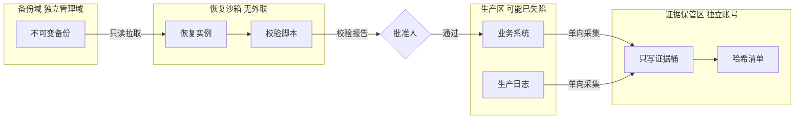
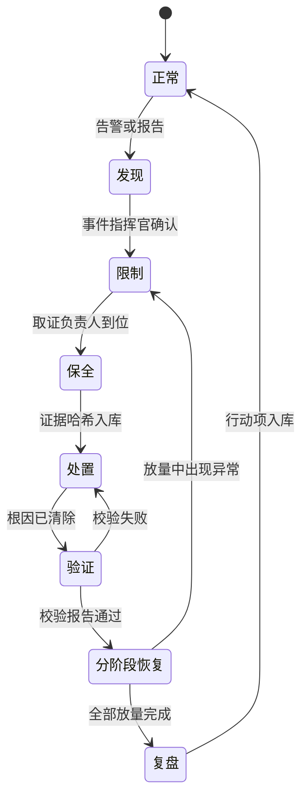
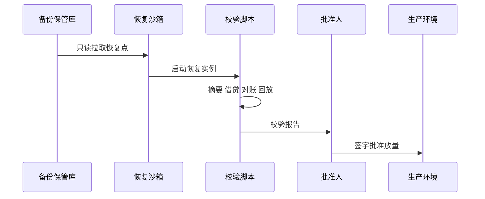

# X26 生产环境与数据·运营与恢复：证据保全、数据恢复与可用性演练

> 学习目标：读完本章，你能——
> 1. 在事件发生后的第一小时内，按"先保全后处置"的顺序保存证据，并写出保管链记录。
> 2. 从备份恢复数据，并用"摘要、借贷平衡、链上与银行对账、增量回放"四步证明恢复出的数据可信，再决定分阶段放量。
> 3. 为数据库故障、云区域故障和 DDoS 写出降级与恢复剧本，并用 XPR-1 至 XPR-20 做自查。
>
> 适用角色：交易所安全工程师、SRE / 平台工程师、事件指挥官、数据保护官。
> 前置章节：[X15 交易所生产环境与数据](X15-cex-production-data.md)（设计）；[X25 生产环境与数据·工程验收](X25-cex-production-verification.md)；[X05 检测与响应工程](X05-detection-response-engineering.md)；[X06 韧性与验证](X06-resilience-validation.md)；[25 资金追踪与应急响应](../25-fund-tracing-response.md)
> 衔接章节：交易侧的复市与切主见 [X22 交易、结算与信用·运营与恢复](X22-cex-trading-recovery-ops.md)。
> 最后核对：2026-11-23

> 💡 注意：本章检查项前缀是 **XPR**，控制项前缀是 **XPR-C**。本章不重复 X15 的设计，也不重复 X25 的验收用例。

---

## 开场：备份在，数据却回不来

2024 年 5 月，澳大利亚养老基金 UniSuper 的 Google Cloud 私有云订阅被意外删除。UniSuper 把环境复制在两个地理区域，以防单点故障。订阅一删，两个区域的资源一起消失。基金成员有一周以上无法使用服务。公开资料显示，UniSuper 在另一家服务商那里留有备份，这些备份减少了数据损失，并加快了恢复。

<details class="predict"><summary>🤔 先猜再看：两个区域都有副本，为什么还要靠第三方备份？</summary>

两个副本受同一个控制面管理。控制面上的一个动作，能同时删除两份。副本解决的是"机器坏了"，不解决"管理动作错了"或"账号被控"。备份必须在另一个管理域里，并且生产账号删不掉它。本章第 4 节把这一点写成控制 XPR-C03。

</details>

---

## 1. 一句话理解

**运营与恢复要回答三个问题：出事时留下了什么证据，恢复出来的数据能不能信，服务以什么顺序、由谁批准回到用户手里。**

> 🎯 打个比方：交易所出事后，像一栋楼发生了火灾。消防员要灭火（处置），但调查员要保住起火点的痕迹（证据）。灭完火以后，不能直接让住户搬回去，要先验房、通电、逐层放行（分阶段恢复）。
>
> 比喻的局限：火灾现场不会被人在背后继续改动，而攻击者在系统里可能还在行动。所以"保全"和"处置"要并行设计，不能只排先后。

与相邻章节的分工：

| 内容 | 在哪里 |
|---|---|
| 日志哈希链、不可变备份、恢复演练的设计 | [X15](X15-cex-production-data.md) 第 6.6、6.7 节 |
| 这些控制是否真的有效 | [X25](X25-cex-production-verification.md) |
| 事件分级、指挥、通信、SOAR 边界 | [X05](X05-detection-response-engineering.md) |
| RTO / RPO、灾备、桌面推演方法 | [X06](X06-resilience-validation.md) |
| 撮合过载、切主验停写停发、分阶段复市 | [X22](X22-cex-trading-recovery-ops.md) |
| 本章 | 证据保全、数据可信恢复、可用性事件降级与恢复 |

---

## 2. 保护目标与信任边界

保护目标有四个：

1. **证据完整**：事后能还原谁在何时做了什么。
2. **数据可信**：恢复出的账务、账户数据与事故前一致，或差异可解释。
3. **服务有序恢复**：每一步放量都有条件和批准人。
4. **恢复动作不扩大损失**：恢复本身不能重新引入攻击者或旧漏洞。



读图要点：

- 生产区里的任何东西都可能被攻击者改过，所以证据和备份必须放在生产管理员无法写、无法删的区域。
- 数据只能先进沙箱，通过校验后才能回到生产。
- 校验报告由批准人签字。批准人不能是执行恢复的人。
- 局限：沙箱校验只能证明"数据自洽"，不能证明"数据与真实世界一致"，后者靠链上和银行对账。

**哪些东西不能被信任：** 事故期间生产主机上的时间、日志文件、"最近一次备份"（可能已含篡改）、攻击者碰过的账号发出的任何工单。

---

## 3. 参考架构：恢复状态机与决策矩阵

### 3.1 恢复状态机



读图要点：

- "保全"在"处置"之前，但"限制"（隔离、收权、暂停高风险动作）可以先做，因为限制不销毁证据。
- "验证"失败退回"处置"，不能带着疑点放量。
- 放量中的异常退回"限制"，用户侧的状态由 X22 的复市阶段承接。

| 状态 | 进入条件 | 退出条件 | 谁有权推动 |
|---|---|---|---|
| 发现 | 告警、员工或外部报告 | 事件指挥官定级 | 值班安全工程师 |
| 限制 | 定级 P1 / P2 | 影响范围冻结，无新增扩散 | 事件指挥官 |
| 保全 | 取证负责人到位 | 易失证据已采集，哈希已入库 | 取证负责人 |
| 处置 | 证据已保全 | 根因清除，凭据已轮换 | 事件指挥官 + 系统负责人 |
| 验证 | 处置完成 | 校验报告全项通过 | 独立批准人（非执行人） |
| 分阶段恢复 | 校验通过 | 每阶段观察期满且指标正常 | 事件指挥官；涉及资金需风控与财务共同批准 |
| 复盘 | 服务恢复 | 行动项有负责人和期限 | 安全负责人 |

### 3.2 决策矩阵（示例，数值按自己的 RTO / RPO 调整）

| 影响范围 | 恢复前必须满足 | 授权人 | 时间窗（示例） |
|---|---|---|---|
| 单个服务账号被滥用 | 凭据轮换，该账号 7 天日志已保全 | 系统负责人 | 4 小时内 |
| 单库数据被改 / 删，范围可界定 | 证据保全；用备份恢复到沙箱并校验 | 事件指挥官 | 8 小时内 |
| 账务或钱包库受影响 | 上述条件加链上、银行对账；风控与财务批准 | 安全负责人 + 财务负责人 | 24 小时内 |
| 全站不可用（云区域、勒索） | 备份可信校验；干净环境重建；分阶段放量 | 管理层事件委员会 | 按 RTO，逐阶段批准 |
| 疑似内部人作案 | 先通知法务与 HR，取证不通知当事人 | 安全负责人 + 法务 | 同日 |

---

## 4. 控制清单

| ID | 控制项 | 要防什么 | 优先级 | 怎么验证 |
|---|---|---|---|---|
| XPR-C01 | 事件手册规定"先保全后处置"，并列出易失证据清单 | 重启与重装销毁证据 | P0 | 推演中检查：处置前是否有哈希入库记录 |
| XPR-C02 | 证据只写桶：采集账号只能写，不能读或删，开启对象锁 | 攻击者或管理员删证据 | P0 | 用采集账号尝试删除，必须失败 |
| XPR-C03 | 备份在独立管理域，生产账号无删除权限 | 一个账号同时毁掉生产与备份 | P0 | 用生产管理员尝试删除备份，必须失败 |
| XPR-C04 | 每份证据有 SHA-256 与保管链记录 | 证据不可采信 | P0 | 抽 3 份证据，核对哈希与记录 |
| XPR-C05 | 取证用只读方式获取镜像，原件不动 | 取证污染原件 | P1 | 流程文档与演练录像 |
| XPR-C06 | 恢复先进无外联沙箱，通过校验才进生产 | 把被污染数据放回生产 | P0 | 恢复演练报告含沙箱校验项 |
| XPR-C07 | 校验含摘要、借贷平衡、链上与银行对账、增量回放四步 | 数据"自洽但不真实" | P0 | 抽一次演练，复跑全部四步 |
| XPR-C08 | 批准人与恢复执行人分离 | 自批自放 | P0 | 抽记录，两个签名人不同 |
| XPR-C09 | 恢复点选择规则：取"最后一个已验证干净点"，不取"最近点" | 恢复到已被篡改的点 | P0 | 检查选点记录与依据 |
| XPR-C10 | 恢复使用干净构建的镜像和轮换后的凭据 | 把攻击者带回来 | P0 | 检查恢复实例的镜像摘要与凭据版本 |
| XPR-C11 | 分阶段放量，每阶段有准入条件和观察期 | 一次放开引发二次事故 | P0 | 检查放量记录 |
| XPR-C12 | 数据泄露事件的通知时限矩阵，法务参与 | 逾期通知 | P1 | 推演检查通知时间线 |
| XPR-C13 | 降级预案：只读、只撤单、关闭高成本接口 | 过载拖垮核心 | P1 | 压测或故障注入验证 |
| XPR-C14 | DDoS 预案：上游清洗、限流、静态降级页 | 入口被打满 | P1 | 与服务商联合演练 |
| XPR-C15 | 云区域故障预案：数据库切换需验停写 | 脑裂、双写 | P0 | 演练记录含停写验证 |
| XPR-C16 | 对外沟通模板预先批准，有授权发布人 | 沟通失控或延误 | P1 | 抽查模板与发布名单 |
| XPR-C17 | 复盘 5 个工作日内完成，行动项入跟踪系统 | 同类事故重复 | P1 | 检查近两次复盘 |
| XPR-C18 | 证据保留期与法务要求一致，诉讼保留可延长 | 过早销毁 | P1 | 核对保留策略 |
| XPR-C19 | 恢复演练每季度一次，轮换场景 | 预案过期 | P0 | 演练报告 |
| XPR-C20 | 关键供应商（云、清洗、KYC）有事故联系人与 SLA | 求助无门 | P1 | 抽查联系人是否可达 |

---

## 5. 分级落地

| 档位 | 做什么 | 人力与周期（示例） |
|---|---|---|
| 最小可行 | 证据只写桶加哈希清单；备份放独立账号；一页恢复清单；每半年一次恢复演练 | 1 名安全 + 1 名 SRE，约 4 周 |
| 标准 | 加恢复沙箱与四步校验脚本；分阶段放量；降级与 DDoS 预案；季度演练；公告模板 | 2–3 人，约 3 个月 |
| 成熟 | 加自动化取证采集；恢复点持续验证；跨云或跨区域重建演练；与执法、监管通报联动演练 | 专职小组，约 6–9 个月 |

---

## 6. 落地做法

### 6.1 证据保全：第一小时

原则：**限制可以先做，销毁证据的动作必须等保全**。重启、重装、删账号、覆盖日志都会销毁证据。

步骤：

1. 事件指挥官指定一名取证负责人。
2. 取证负责人建立证据登记表，每份证据一行。
3. 按易失顺序采集：内存与进程、网络连接、云审计日志、应用与数据库日志、磁盘快照、配置。
4. 云上优先取快照，用只读方式挂载分析，不在原机器上操作。
5. 每份证据计算 SHA-256，登记采集人、时间（UTC）、来源、存放位置。
6. 证据写入只写桶，开启对象锁。每次转手都在保管链上签名。
7. 保全完成后，才执行重启、隔离重建、凭据轮换。

```bash
#!/usr/bin/env bash
# 示例：证据入库脚本框架。账号、桶名、路径按自己环境调整
set -euo pipefail
CASE="$1"; SRC="$2"          # 案件号、证据文件路径
HASH=$(sha256sum "$SRC" | cut -d' ' -f1)
TS=$(date -u +%Y-%m-%dT%H:%M:%SZ)
# 上传到只写桶，采集账号没有读和删权限
aws s3 cp "$SRC" "s3://evidence-vault/${CASE}/$(basename "$SRC")" \
  --object-lock-mode COMPLIANCE \
  --object-lock-retain-until-date "$(date -u -d '+365 days' +%Y-%m-%dT%H:%M:%SZ)"
# 登记：时间、案件、文件、哈希、采集人
echo "${TS},${CASE},$(basename "$SRC"),${HASH},${USER}" >> "${CASE}.manifest.csv"
# 清单本身的哈希发给外部系统，例如工单或另一云账号
sha256sum "${CASE}.manifest.csv"
```

> 💡 注意：COMPLIANCE 模式的对象在保留期内，连账号 root 也无法删除（AWS 官方文档）。保留期设错会造成成本和合规问题，先用 GOVERNANCE 模式测试。若你使用其他云，请用该云的等价功能。

保管链记录（示例）：

| 证据 ID | 内容 | 来源 | 采集人 | 采集时间 UTC | SHA-256 | 转手记录 |
|---|---|---|---|---|---|---|
| E-001 | 云审计日志 | 组织级日志桶 | 王 | 示例 | 示例 | 王 → 李（分析） |
| E-002 | 数据库主机磁盘快照 | 云快照 | 王 | 示例 | 示例 | 无 |

保全时易犯的错：只拷日志，不记哈希；在原机器上"顺手"查；采集人用自己的个人账号；让当事人参与取证（疑似内部人时）。

RFC 3161 描述了"时间戳令牌"：由第三方时间戳机构签发，证明某个摘要在某个时刻之前已存在。清单摘要可以请时间戳机构签发令牌，作为外部存证的一种。

### 6.2 恢复出来的数据怎么证明可信



读图要点：数据不直接进生产；校验是脚本，批准是人；报告与恢复点编号一起存档。

**第一步，摘要。** 恢复点的日终余额摘要，要与当日外部存证的摘要一致。不一致说明备份已被改，或存证与备份不是同一时点。

**第二步，借贷平衡。**

```sql
-- 示例：每种资产的分录借贷之和必须为 0。表名为示意
SELECT asset, SUM(CASE side WHEN 'D' THEN amount ELSE -amount END) AS diff
FROM ledger_entries
WHERE booked_at <= :restore_point
GROUP BY asset
HAVING SUM(CASE side WHEN 'D' THEN amount ELSE -amount END) <> 0;
-- 预期：0 行
```

**第三步，链上与银行对账。** 用户负债总额与热、温、冷钱包链上余额，以及银行账户余额，在恢复点时刻对账。差异按 [X13](X13-cex-trading-settlement-credit.md) 的方法分类。

**第四步，增量回放。** 恢复点之后到事故时刻的订单、充值、提币请求，从上游日志（接入层日志、链上事件、银行流水）回放。回放要幂等：用请求 ID 去重，已在链上广播的提币只补记账，不重发。

```python
# 示例：增量回放的幂等骨架。数据结构为示意
def replay(events, ledger, chain):
    for ev in sorted(events, key=lambda e: e["seq"]):
        if ledger.has(ev["req_id"]):
            continue                     # 已入账，跳过
        if ev["type"] == "withdraw":
            tx = chain.lookup(ev["req_id"])
            if tx and tx.confirmed:
                ledger.book_withdraw(ev, tx.hash)   # 只补记账
            elif tx:
                ledger.mark_pending(ev, tx.hash)    # 未确认，进未决
            else:
                ledger.mark_unresolved(ev)          # 链上无记录，人工确认后才重发
        else:
            ledger.apply(ev)
```

> ⚠️ 警告：恢复后绝不能让提币队列自动重发。链上无记录不等于没发送，先查签名服务的签发日志和节点内存池，再由人工确认。这与 [X22](X22-cex-trading-recovery-ops.md) 的"停写停发"同一条原则。

**恢复点怎么选。** 取"最后一个已验证干净的点"。依据是证据：攻击者最早的恶意动作时间。恢复点早于这个时间，才可信。恢复点越早，需回放的增量越多，所以要在"干净"与"少回放"之间权衡，由事件指挥官记录理由。

### 6.3 数据泄露与篡改的恢复

| 场景 | 先做 | 再做 | 恢复完成的标志 |
|---|---|---|---|
| 数据被拖走（泄露） | 收权、封出口、保全访问日志 | 定范围、通知、用户保护（强制登出、提币延迟） | 受影响用户已通知，受影响凭据已重置 |
| 数据被改（篡改） | 保全、定篡改时间窗 | 用外部存证与备份比对，逐条修复 | 篡改记录与修复记录一一对应 |
| 数据被删或加密（勒索） | 隔离网络、保全加密样本和勒索信 | 干净环境重建，从可信备份恢复 | 校验四步通过，凭据全轮换 |

勒索事件的付款决定属于管理层与法务，并要先核对制裁风险。本章不给付款建议。

### 6.4 可用性事件：降级与恢复

```yaml
# 示例：分级降级策略。名称与阈值为示意，按自己系统调整
levels:
  L1:  # 延迟升高
    trigger: "p99 下单延迟 > 示例 500ms 持续 3 分钟"
    actions: [限制行情订阅频率, 暂停非核心报表任务]
  L2:  # 核心压力
    trigger: "撮合队列积压 > 示例 10 秒"
    actions: [历史查询接口降级, 撤单优先于下单, 新开户限流]
  L3:  # 保护账务
    trigger: "数据库复制延迟 > 示例 30 秒 或 疑似脑裂"
    actions: [暂停提币, 只保留撤单与平仓]
approval:
  L1: 值班SRE
  L2: 事件指挥官
  L3: 事件指挥官 + 交易与账务负责人
```

三类事件：

**DDoS：** 入口前置上游清洗和限流；API 与网页分开限速；准备静态降级页；保证"撤单和平仓"通道有独立容量。恢复时逐步放宽限流，监控误伤。

**云区域或云服务故障：** 提前定义哪些服务多区域运行，哪些接受停机。切换数据库时，先验停写（旧主不再接受写入），再升主。序号和未确认订单的处理见 [X22](X22-cex-trading-recovery-ops.md)。恢复后，核对两边写入是否有交叉。

**数据库故障：** 先判断是故障、误操作还是攻击。三者的恢复路径不同：故障用副本，误操作用时间点恢复，攻击走本章 6.1 与 6.2。

### 6.5 恢复清单（可勾选）

- [ ] 事件指挥官已确认影响范围，已指定取证负责人。
- [ ] 易失证据已采集，哈希已入库，保管链已登记。
- [ ] 根因已清除，受影响凭据与密钥已轮换。
- [ ] 恢复点已选定，选点理由已记录。
- [ ] 恢复在沙箱完成，镜像为干净构建。
- [ ] 四步校验报告已存档，差异均已解释。
- [ ] 批准人不是执行人，已签字。
- [ ] 风控复评：登录、提币、API 的风险阈值已提高并有回调计划。
- [ ] 对账：用户负债与链上、银行余额一致，未决项已列清单。
- [ ] 对外沟通：用户公告、监管通报、合作方通知已按模板准备。
- [ ] 分阶段放量方案已批准：只读 → 登录与撤单 → 交易 → 小额提币 → 全量提币。
- [ ] 值班加强：放量期间指挥官、SRE、风控在线。

### 6.6 与 X22 的衔接，以及疑似内部人事件

数据恢复和交易复市是两条线，要在三个点上对齐：

1. **数据线先于交易线。** 四步校验没有通过，X22 的复市不能进入"只撤单"之后的任何阶段。
2. **序号与未决项交接。** 数据线把恢复点、增量回放后的最大订单序号、未决提币清单交给交易线。交易线从这个序号接续，不自己猜。
3. **放量节奏共用一份计划。** 登录、撤单、交易、小额提币、全量提币的顺序只写一份，由事件指挥官统一发布，避免两个团队各自放开。

疑似内部人事件要换一套做法。第一，取证不通知当事人，由法务和 HR 决定何时通知。第二，先在不惊动当事人的前提下收窄权限，例如把权限改成只读。第三，保全该账号及其设备的全部日志。第四，参与取证的人要排除当事人的直属同事。第五，对外只说"正在调查"，不说"员工作案"，因为结论属于法务与司法机关。

### 6.7 对外沟通模板

**用户公告（示例）：**

> 【标题】关于 X 月 X 日服务异常的说明
> 我们在 X 月 X 日 UTC XX:XX 发现 XXX 异常，已暂停 XXX 功能。
> 目前确认：用户资产 [已核对 / 核对中]。受影响范围：[描述]。
> 我们正在做的事：[保全证据、恢复数据、对账]。
> 你现在需要做的事：[如：核对近期登录；不要点击声称来自我们的链接]。
> 下次更新时间：UTC XX:XX。官方渠道：[域名、账号]。

**监管通报（示例）：**

> 事件编号：……　发现时间：……　报告时间：……
> 事件类型：[数据泄露 / 可用性 / 完整性]　影响：用户数 [示例]、数据类型 [字段名]、资金影响 [有 / 无 / 评估中]
> 已采取措施：……　计划措施与时间表：……
> 联系人：……　后续更新节奏：……

**合作方通知（示例）：** 说明受影响的接口与时间窗，需要对方配合的动作（暂停调用、轮换密钥、提高审核），以及联系方式。

> 💡 注意：通知时限因地区、牌照和事件类型而异。GDPR、SEC 8-K、NYDFS 等常见时限请由法务以最新条文核对，本章不列具体数字。

---

## 7. 运营：指标、告警、值班、演练、季度节奏

| 指标 | 说明 | 目标（示例） |
|---|---|---|
| 保全用时 | 从定级到第一份证据哈希入库 | P1 ≤ 60 分钟 |
| 恢复演练通过率 | 四步校验一次通过的比例 | 100%，不通过要整改 |
| 恢复点验证新鲜度 | 最近一次已验证可恢复的备份距今 | ≤ 7 天 |
| 实际 RTO / RPO | 演练测得值与目标之比 | 不超过目标 |
| 批准分离合规率 | 批准人不同于执行人的恢复记录比例 | 100% |
| 行动项按期关闭率 | 复盘行动项 | ≥ 90% |

告警（示例）：证据桶出现删除或策略修改请求；备份保管库出现来自生产账号的删除请求；最近一次恢复校验失败；备份任务连续失败；时间同步偏差超阈值。

值班要求：每个班次有一名可以做"限制"决定的人，有一名熟悉保全流程的人。两人都要能在 15 分钟内上线。值班交接时，交接单要写明当前处于状态机的哪个状态、等待谁的批准、下一次放量的时间。事件结束后，值班人员要在两天内补齐保管链和时间线，因为记忆会随时间变形，记录越晚越不可靠。

演练要点：演练不要只做"读文档"。至少一次演练要真的在沙箱里恢复并跑校验脚本，至少一次要真的尝试用生产账号删除备份与证据桶。演练中发现的问题，按 [A02](../assessment/A02-risk-rating-reporting.md) 定级并登记，同样要有负责人和期限。

季度节奏：第 1 个月做一次备份恢复演练（含沙箱四步校验）；第 2 个月做可用性事件演练（降级与切换）；第 3 个月做一次取证与保管链演练和公告演练；每次演练后更新手册。

---

## 8. 失效案例

### 8.1 UniSuper：两个区域的副本一起消失（2024 年 5 月）

- **来源类型：** 当事方联合声明、Google Cloud 官方事件说明。
- **摘要：** 联合声明称，一次配置失误导致私有云订阅被删。据 Google 的说明，运维人员部署时有一个参数留空，系统按默认设置了一年期限，到期后自动删除。UniSuper 的两个区域一起受影响。公开资料称，UniSuper 在另一家服务商处的备份帮助其完成恢复，Google 说明恢复历时数日。
- **教训：** 副本不是备份。备份要在另一个管理域。映射：XPR-C03、XPR-C19。

### 8.2 OVHcloud 斯特拉斯堡机房火灾（2021 年 3 月）

- **来源类型：** 行业媒体报道（Data Center Dynamics、The Register 等）。
- **摘要：** 公开报道称，2021 年 3 月 SBG2 机房发生火灾，部分客户的备份与主数据在同一机房或同一区域，一同受损。公司创始人向客户建议启用灾备方案，并表示未来服务会包含免费备份。媒体报道称，法国法院后来判令其向其中两家客户赔偿。
- **教训：** "有备份"要确认备份的物理与管理位置。恢复演练要包含"整个站点不可用"。映射：XPR-C03、XPR-C15、XPR-C19。

### 8.3 AWS us-east-1 故障与 Coinbase（2025 年 10 月）

- **来源类型：** AWS 官方事后说明；Coinbase 状态页与媒体报道。
- **摘要：** AWS 说明，2025 年 10 月 19 日 11:48 PM PDT 到 10 月 20 日 2:20 PM PDT，us-east-1 因 DynamoDB 的 DNS 管理系统中的竞态条件，出现空 DNS 记录。随后 EC2 与负载均衡器依次受影响。AWS 恢复时需要人工介入，限流并分批重启。主要服务恢复后仍有积压要处理。公开报道称，Coinbase 等平台的登录与交易受影响（Coinbase 状态页与媒体）。
- **教训：** 云区域故障的恢复是"阶梯式"的，不是一次回到正常。恢复后会有积压和重复请求，要有幂等与限流。映射：XPR-C11、XPR-C13、XPR-C15。

### 8.4 Bybit：攻击者清理现场（2025 年 2 月）

- **来源类型：** Sygnia 与 Verichains 的初步取证结论（经媒体报道）；Bybit 官方发布。
- **摘要：** 公开报道称，取证结论指向 Safe{Wallet} 在 AWS S3 上的前端资源被注入恶意 JavaScript，目标是 Bybit 的以太坊多签冷钱包。据报道，在恶意交易执行后约两分钟，这些文件被替换为不含恶意代码的版本。取证人员借助签名人机器的调查结果和 Wayback Archive 里缓存的恶意载荷完成还原。Bybit 自身基础设施未发现被入侵。损失约 14 亿至 15 亿美元（事发时估值）。
- **教训：** 攻击者会清理现场。外部缓存、签名人终端和对象版本是重要的证据来源。你要提前把"能还原某一天的前端文件"设计成能力。映射：XPR-C01、XPR-C02、XPR-C04。

> 💡 注意：第 8.4 条依据的是初步结论。最终归因与细节以官方最新报告为准。

### 8.5 案例与控制映射

| 案例 | 暴露的问题 | 控制 ID |
|---|---|---|
| UniSuper 2024 | 副本与备份不在不同管理域 | XPR-C03、C19 |
| OVH 2021 | 备份位置与主数据相同 | XPR-C03、C15、C19 |
| AWS 2025 | 阶梯式恢复、积压 | XPR-C11、C13、C15 |
| Bybit 2025 | 证据被攻击者覆盖 | XPR-C01、C02、C04 |

---

## 9. 评估检查点

- [ ] **XPR-1** 事件手册写明"先保全后处置"，列出易失证据与采集顺序。
- [ ] **XPR-2** 证据桶只写：采集账号删除测试失败，开启对象锁。
- [ ] **XPR-3** 备份在独立管理域，生产管理员删除测试失败。
- [ ] **XPR-4** 抽 3 份历史证据，哈希与保管链记录一致。
- [ ] **XPR-5** 取证只读，不在原机器上操作，有流程与演练记录。
- [ ] **XPR-6** 恢复先进沙箱，沙箱无外联，演练记录可查。
- [ ] **XPR-7** 四步校验脚本存在，并在最近一次演练中全部通过。
- [ ] **XPR-8** 批准人与执行人不同，抽 5 次记录。
- [ ] **XPR-9** 恢复点选择有依据，取"最后一个已验证干净点"。
- [ ] **XPR-10** 恢复用干净镜像与轮换后的凭据。
- [ ] **XPR-11** 放量分阶段，每阶段有准入条件、观察期、批准人。
- [ ] **XPR-12** 恢复后提币队列不自动重发，重发需人工确认。
- [ ] **XPR-13** 降级预案有三级，触发条件与批准人明确，已验证。
- [ ] **XPR-14** DDoS 预案与服务商联合演练过，撤单通道有独立容量。
- [ ] **XPR-15** 云区域切换演练含停写验证。
- [ ] **XPR-16** 三种公告模板已批准，发布人名单有效。
- [ ] **XPR-17** 通知时限矩阵由法务维护，每年复核。
- [ ] **XPR-18** 最近两次复盘有行动项，按期关闭。
- [ ] **XPR-19** 每季度完成一次恢复演练，场景轮换。
- [ ] **XPR-20** 关键供应商事故联系人可达，已联系测试。

**把检查结果写进报告：**

| 检查项 | 证据 | 常见定级（用 [A02](../assessment/A02-risk-rating-reporting.md) 复核） |
|---|---|---|
| XPR-1 至 XPR-5 | 手册、删除测试截图、哈希核对记录 | High |
| XPR-6 至 XPR-12 | 演练报告、校验脚本输出、批准记录 | High（无校验即放量为 Critical） |
| XPR-13 至 XPR-15 | 降级策略、演练记录 | Medium / High |
| XPR-16 至 XPR-18 | 模板、复盘记录 | Medium |
| XPR-19、XPR-20 | 演练台账、联系测试记录 | Medium |

发现按 [T03 报告模板](../templates/T03-finding-report.md) 记录。

---

## 10. 上手路径

- **第一周：** 读事件手册，核对有没有"先保全后处置"；用测试账号验证证据桶与备份能不能被生产账号删除；列出现有备份所在的账号和区域。
- **第一个月：** 建证据只写桶和入库脚本；写一页恢复清单；在沙箱做一次最小恢复，跑摘要与借贷平衡两步校验。
- **第一个季度：** 补齐链上与银行对账、增量回放；做一次含停写验证的切换演练；批准三种公告模板；完成第一次桌面推演。

---

## 11. 常见误区

下面五条误区，每一条都在真实事件里让团队多花了数小时甚至数天。

1. **"备份在就行。"** 没有恢复演练的备份，只是一堆不知能否使用的文件。
2. **"先重启，恢复业务要紧。"** 重启销毁内存证据。限制可以先做，销毁性动作要等保全。
3. **"取最近的备份最省事。"** 最近的备份可能已含篡改。
4. **"校验通过就放全量。"** 自洽不等于真实，且放量本身会引发新问题。
5. **"自己人取证，不用记保管链。"** 没有保管链的证据，在监管和司法中很难被采信。

---

## 12. 术语表

| 术语 | 英文 | 定义 |
|---|---|---|
| 保管链 | Chain of Custody | 记录证据每一次转手的人、时间和原因 |
| 易失证据 | Volatile Evidence | 重启或关机后消失的证据，如内存和连接 |
| 恢复点 | Restore Point | 备份对应的数据时刻 |
| 恢复沙箱 | Recovery Sandbox | 无外联的隔离环境，用于恢复与校验 |
| 对象锁 | Object Lock | 存储对象在保留期内不能被删除或覆盖 |
| 脑裂 | Split Brain | 两个主节点同时接受写入 |
| 时间戳令牌 | Time-Stamp Token | 第三方签发的、证明摘要在某时刻前已存在的记录 |
| 降级 | Degradation | 主动关闭次要功能，保住核心功能 |

---

## 13. 动手练习与思考题

### 13.1 动手练习（笔记本完成）

**练习 A：保管链表（20 分钟）。** 场景：一台账务库主机疑似被入侵。列出你要采集的 6 类证据、采集顺序、每类的存放位置，并填写一张保管链表。

**练习 B：恢复点选择（20 分钟）。** 已知：每日凌晨 2 点备份；攻击者最早的恶意动作为周三 09:40；周四 15:00 发现。写出你要比较的三个恢复点，每个点要回放多少增量，选哪一个，理由是什么。

**练习 C：桌面推演 1，账务库被篡改（40 分钟）。**

- 背景：周六凌晨，对账告警显示 17 个账户的 BTC 余额比分录之和多出一笔。
- 注入：T+10 分钟，发现一个运维账号 3 天前被新设备登录；T+25 分钟，最近两份备份无法确认干净；T+35 分钟，运营问能否先开提币。
- 任务：写出前 5 个动作、取证负责人、恢复点选择、放量方案、对外沟通时点。
- 评分：先保全（20 分）；恢复点有依据（20 分）；批准分离（15 分）；提币未自动开放（20 分）；沟通与法务介入（15 分）；记录完整（10 分）。

**练习 D：桌面推演 2，云区域故障加 DDoS（30 分钟）。**

- 背景：主云区域网络故障，同时入口遭受流量攻击。
- 注入：T+5 分钟，数据库副本延迟 40 秒；T+15 分钟，运维提出强制切主；T+25 分钟，区域恢复，旧主重新上线。
- 任务：写出降级级别、切主前的验证、旧主上线的处理、复市顺序。
- 评分：降级级别正确（20 分）；验停写（25 分）；旧主隔离重放（20 分）；撤单优先（15 分）；沟通（10 分）；与 X22 衔接（10 分）。

**练习 E：写公告（15 分钟）。** 用 6.7 节模板，为练习 C 写一份 200 字以内的用户公告，不能出现未经核实的断言。

建议配套（后续在 L3 训练营实现）：B80 复市与恢复演练（对账差异与分阶段恢复），与 [X22](X22-cex-trading-recovery-ops.md) 共用；一个恢复四步校验的小工具。

### 13.2 思考题

1. 你的备份账号与生产账号共用同一个身份提供商。攻击者拿到一个超级管理员的单点登录会话时，备份还安全吗？怎样改？
2. 证据桶开启 COMPLIANCE 对象锁，可以防删除。它带来了哪两个新的运营问题？
3. 恢复后四步校验全部通过，但一位用户称他的提币记录消失了。你接下来查什么？

下一章：[X27 反欺诈、合规与安全运营·工程验收](X27-cex-fraud-verification.md)。

---

来源（独立查证，截至 2026-11-23）：

- UniSuper 与 Google Cloud 联合声明（2024-05-08）；Google Cloud 官方博客关于 GCVE 事件的说明（2024-05-25）。
- OVHcloud 2021 年火灾：Data Center Dynamics、The Register、Data Center Knowledge 报道。
- AWS 官方事后说明（us-east-1，2025-10-19 至 10-20）；Coinbase 状态页与 Fortune、Decrypt 等媒体报道。
- Bybit 2025 年事件：BleepingComputer、The Block、Cointelegraph 对 Sygnia 与 Verichains 初步报告的报道。
- AWS S3 Object Lock 官方文档；RFC 3161（时间戳协议）。
