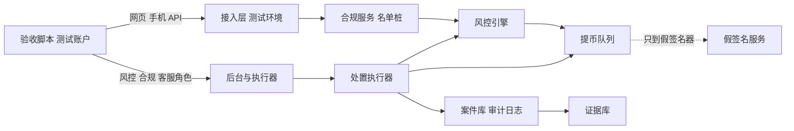
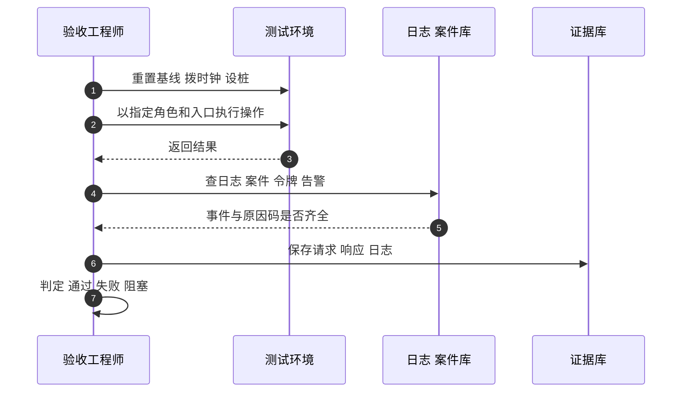
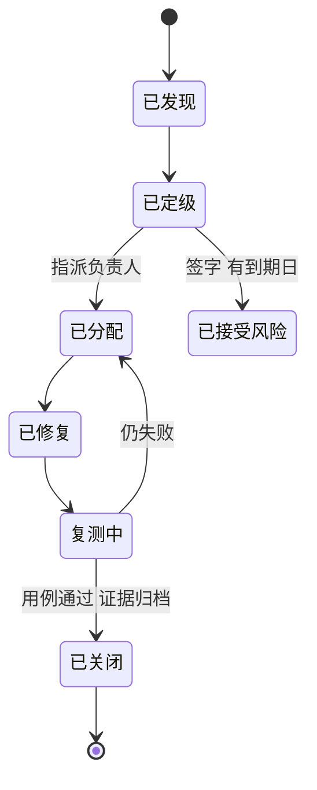

# X27 反欺诈、合规与安全运营·工程验收：规则回放、处置授权与限制落地

> 学习目标：读完本章，你能——
> 1. 为反欺诈、合规筛查、处置授权和限制措施写出一套可重复的验收用例，并说清每条的前置条件、预期结果和证据。
> 2. 用历史或合成数据回放风控规则，算出召回与精确，并用同一套回放挡住"随手改阈值"。
> 3. 写出验收报告和上线门禁：哪些用例失败时必须拦住发布。
>
> 适用角色：交易所风控与反欺诈工程师、合规工程师、安全工程师、QA、内审人员
> 前置章节：[X16 反欺诈、合规与安全运营](X16-cex-fraud-compliance-secops.md)、[X05 检测与响应工程](X05-detection-response-engineering.md)、[X17 客户身份与访问·工程验收](X17-cex-identity-verification.md)
> 交互实验 / 模板：第 5 节回放脚本与第 8 节报告模板可直接改写；[T03 发现报告模板](../templates/T03-finding-report.md)
> 最后核对：2026-11-23

---

## 开场：权限表写了"只有风控主管能冻结"

一家虚构的交易所（示例）在处置权限表里写明：冻结账户（A3）只有风控主管能执行，且合规官批准。评审全票通过。

季度抽查时，内审做了三件事。第一，用客服角色调用内部"改账户状态"接口，直接成功了。第二，冻结一个测试账户后，用旧版手机 App 提币，成功了。第三，在冻结生效的同一秒发起提币，请求已进入签名队列，仍然被签出。

权限表没有错。错在三处：执行器不校验角色，限制只挂在网页提币接口上，冻结与提币之间没有"在途请求"的处理。

<details class="predict"><summary>🤔 先猜再看：要在上线前发现"冻结了仍能提币"，用例至少要覆盖哪一项？A. 网页端冻结后提币被拒　B. 冻结后，所有入口和所有在途请求都被拒　C. 冻结记录里有原因码</summary>

答案是 B。A 只证明一个入口，C 只证明留痕。限制要沿着"账户能动用资金的所有路径"逐条试，包括提币、交易、内部转账、API Key 和已在队列里的请求。第 4 节用例 FRV-T17 到 FRV-T21 专门做这件事。

</details>

---

## 1. 一句话理解

**X16 回答"处置怎样设计"，本章回答"凭什么说规则会命中、授权会生效、限制会落地"：每条控制配一条可重复的用例、一份留得住的证据和一个明确的通过标准。**

验收（Verification）：在受控环境里用预写用例检查控制是否按设计工作，并留下证据。
回放（Replay）：把历史或合成事件按时间顺序喂给规则，对照标准答案看命中与漏报。
限制落地（Restriction Enforcement）：冻结、暂停、拒绝等决定在所有入口真正阻止了动作。
上线门禁（Release Gate）：发布前必须通过的检查。P0 用例失败，发布停止。

> 🎯 打个比方：权限表像机场的应急预案，写着"塔台能关闭哪个登机口"。验收像一次真实的关闭演习：塔台按下按钮，看每个登机口的闸机是否真的锁住，已经走在廊桥里的旅客怎么处理。
>
> 比喻的局限：演习一次看到结果。风控规则每周调参、系统每周发版，今天锁住的闸机下周可能被重构打开，所以用例必须能自动重复跑。

本章不重复设计。控制来源见 [X16](X16-cex-fraud-compliance-secops.md) 第 5 节的 `FRD-Cnn`，处置动作 A1–A9 见其第 4 节。事故发生后的调查与恢复见 [X28](X28-cex-fraud-recovery-ops.md)。

---

## 2. 验收对象与信任边界

| 对象 | 验收重点 | 对应 X16 控制 |
|---|---|---|
| 合规筛查 | 名单命中即拒、名单更新延迟、名单失效时的行为 | FRD-C01、C02 |
| 地域限制 | 注册、登录、交易、提币各入口是否都按地理位置拦截 | FRD-C01 |
| Travel Rule 与自托管地址 | 对方未确认不进签名；归属评估留痕 | FRD-C09、C10 |
| 风控规则与阈值 | 召回、精确、变更前回放 | FRD-C06、C07、C08 |
| 处置授权 | 执行器是否校验角色、双人、时限、追认 | FRD-C03、C04、C05、C15 |
| 限制落地 | 冻结后所有路径被拒，在途请求被拦，解冻不过度恢复 | FRD-C05、C11 |
| 案件与证据 | 原因码、证据引用、哈希、日志不可改 | FRD-C05、C12 |



**读图要点：**

- 验收脚本模拟外部用户，三个后台角色模拟内部人员。两条测试面都要走。
- 名单、评分、Travel Rule 对手方都用桩，桩能返回命中、未命中、超时、拒绝。
- 提币只到假签名器，验收永远不触发真实链上转账。
- 日志与案件库也是被验收对象。局限：测试环境与生产配置不同步时，结果不能替代生产抽查（FRV-12）。

---

## 3. 验收环境与数据

### 3.1 环境

| 要求 | 做法 | 为什么 |
|---|---|---|
| 与生产同配置 | 规则、阈值、权限表从同一仓库部署，只换密钥与端点 | 否则"通过"没有意义 |
| 不碰生产 | 独立账号体系与数据库；出站只到桩和假签名器 | 防止触发真实通知与资金动作 |
| 假的外部依赖 | 名单、链上评分、Travel Rule 对手方、IP 地理库都用桩，可注入命中、超时、拒绝 | 能做故障注入 |
| 时钟可注入 | 服务从时钟接口取时间 | 决策时限、追认 15 分钟、申诉时限不可能真等 |
| 可重置 | 每次验收前恢复到基线快照 | 用例互不污染 |

### 3.2 测试账户与名单

| 标签 | 特征 | 用来验收 |
|---|---|---|
| R-NORMAL | 已 KYC，有余额与已生效地址 | 基线 |
| R-FROZEN | 已冻结 | 限制落地各入口 |
| R-ORG | 机构客户，有子账户与 API Key | 冻结穿透子账户 |
| R-REGION | 注册地合法，登录 IP 桩设为受限地区 | 地域限制 |
| 角色 | 风控分析员、风控主管、合规官、客服、值班、指挥官 | 授权用例 |
| 测试名单 | 一个"制裁"地址、一个"被盗资金"地址、一个"混币 2 跳"地址 | L0 与规则 |

名单与评分一律用**测试条目**，不使用真实制裁名单中的地址。

### 3.3 执行流程



**读图要点：**

- 每条用例同时看三件事：操作结果、日志与案件记录、告警。"拒绝了但没留痕"也算失败。
- 用例失败时保留现场，再提缺陷。
- 角色是用例的输入。用管理员账号测一遍，测不出任何授权问题。

---

## 4. 验收用例库

约定：用例 ID 为 `FRV-Txx`；"操作"只写在测试环境怎么做；每条默认还要核对日志与案件记录。入口指"网页、手机各支持版本、开放 API、后台"。

### 4.1 筛查与地域

| 用例 ID | 控制项 | 前置条件 | 操作 | 预期结果 | 证据 |
|---|---|---|---|---|---|
| FRV-T01 | FRD-C01 | R-NORMAL，风险评分桩返回最低分 | 向测试制裁地址提币 | 被拒；评分低也不放行；记录命中名单版本 | 请求响应、日志 |
| FRV-T02 | FRD-C01 | 充值来源桩标为制裁 | 模拟一笔入账 | 资金停在待处理，不入可用余额，不自动退回；合规工单生成 | 账务与工单 |
| FRV-T03 | FRD-C02 | 名单桩可发布新版本 | 发布一个新条目，计时到各入口生效 | 延迟不超过目标；版本号与时间戳入审计 | 时间线 |
| FRV-T04 | FRD-C02 | 名单源桩返回超时 | 持续超时超过阈值后提币 | 告警；按"失败关闭"策略处理；不静默放行 | 告警、策略配置 |
| FRV-T05 | FRD-C01 | R-REGION | 在注册、登录、交易、提币、API 五个入口各发一次请求 | 受限地区全部按策略拦截；无遗漏入口 | 入口矩阵 |
| FRV-T06 | FRD-C01 | 账户在允许地区开立，之后 IP 桩切到受限地区 | 登录后交易与提币 | 交易与提币均被拦，不只在开户时检查 | 请求与日志 |
| FRV-T07 | FRD-C09 | 对手方桩不回应 | 向其他服务商地址提币 | 请求停在队列，不进入签名；超时后转人工 | 队列状态 |
| FRV-T08 | FRD-C09 | 对手方桩返回拒绝 | 同上 | 请求被拒并通知用户；签名服务无调用记录 | 签名日志 |
| FRV-T09 | FRD-C10 | 适用辖区，目标为自托管地址，金额超阈值 | 发起提币 | 无归属评估记录时不放行；有记录时放行 | 评估记录 |

### 4.2 处置授权

| 用例 ID | 控制项 | 前置条件 | 操作 | 预期结果 | 证据 |
|---|---|---|---|---|---|
| FRV-T10 | FRD-C03 | 客服与风控分析员角色 | 各自对执行器发 A3 冻结令 | 均被拒；记录越权尝试并告警 | 响应、告警 |
| FRV-T11 | FRD-C05 | 客服后台测试角色 | 通过后台、数据库工具或"改账户状态"接口直接改状态 | 全部被拒或不可达；状态只能经执行器变更 | 请求、DB 权限清单 |
| FRV-T12 | FRD-C03、C15 | 风控主管发起 A3 | 同一人同时作为批准人 | 被拒；批准人必须是另一人 | 响应 |
| FRV-T13 | FRD-C03 | A3 待批，时钟拨过决策时限 | 观察 | 升级给顺位人；不自动通过 | 状态与升级记录 |
| FRV-T14 | FRD-C04 | 值班预授权 A4 | 值班执行单链暂停；时钟拨 16 分钟，无追认 | 暂停立即生效；超时告警指挥官 | 时间线、告警 |
| FRV-T15 | FRD-C03 | A5 全站暂停 | 只有指挥官一人批准 | 不生效；需要高管第二人；顺位人可替补 | 响应 |
| FRV-T16 | FRD-C05 | 执行器 | 提交缺原因码或证据引用的冻结令 | 被拒 | 响应 |

### 4.3 限制落地

| 用例 ID | 控制项 | 前置条件 | 操作 | 预期结果 | 证据 |
|---|---|---|---|---|---|
| FRV-T17 | FRD-C05 | R-FROZEN | 在网页、手机各版本、API 提币 | 全部被拒；返回统一状态，不泄露内部原因 | 入口矩阵 |
| FRV-T18 | FRD-C05 | R-FROZEN | 新下单、转内部账户、转子账户、币币兑换、理财赎回 | 按策略全部拦截；已挂订单按策略撤销或冻结 | 订单与账务 |
| FRV-T19 | FRD-C05 | R-ORG 含子账户与三类 API Key | 冻结主账户后用子账户与各 Key 操作 | 子账户与 Key 同样受限 | 请求与响应 |
| FRV-T20 | FRD-C05 | 一笔提币已在审批队列，一笔已进签名队列 | 此时下 A3 冻结令 | 队列内请求被挂起；已签名未广播的请求被撤回；无遗漏 | 队列与签名日志 |
| FRV-T21 | FRD-C05 | 并发 | 冻结令与提币请求同时发出，重复 200 次 | 没有一笔在冻结生效后被签出 | 统计 |
| FRV-T22 | FRD-C11 | R-FROZEN | 执行解冻 | 需批准人；只恢复到冻结前状态；被撤销的 API Key 不自动恢复 | 状态对比 |
| FRV-T23 | FRD-C11 | 用户提交申诉 | 时钟拨过申诉时限 | 工单超时升级；用户可查进度 | 工单记录 |

### 4.4 规则、变更与证据

| 用例 ID | 控制项 | 前置条件 | 操作 | 预期结果 | 证据 |
|---|---|---|---|---|---|
| FRV-T24 | FRD-C07 | 规则仓库与流水线 | 提交只改阈值的变更，不附回放报告 | 流水线失败；有回放且达标才可合并 | 流水线记录 |
| FRV-T25 | FRD-C08 | 新地址、金额超阈值、客服关键词标记 | 发起提币 | 延迟、弹出警示、生成回访任务 | 提币状态、任务 |
| FRV-T26 | FRD-C06 | 复核队列 | 积压一条挂起提币超过 SLA | 升级并告警；不自动放行 | 队列时间线 |
| FRV-T27 | FRD-C12 | 一个测试案件 | 导出证据包 | 有清单、哈希、保管链；改一个文件后校验失败 | 校验输出 |
| FRV-T28 | FRD-C05 | 案件库 | 尝试修改或删除已有冻结记录 | 被拒；只能追加更正记录 | 响应、存储策略 |

**怎样读用例库：**

- 每条用例都要回答三个问题：谁在操作（角色）、从哪个入口、系统此刻处于什么状态。三者缺一，用例就测不出真实缺陷。
- 故障类用例（T04、T07、T08、T13、T14）比正常类用例更重要。名单源、对手方、审批人在事故当天最可能失联，控制在"依赖失效"时怎样表现，决定了它是否可靠。
- 边界类用例（T20、T21）需要自动化。人工点击测不出竞态，只有重复上百次的脚本才能给出统计结果。
- 用例不写攻击步骤，只写"系统应当怎样拒绝"。需要对抗式思路时，交给 [X06](X06-resilience-validation.md) 的红队。

> 💡 注意：每条 P0 的 X16 控制至少对应一条用例，缺的补上（FRV-1）。X16 的 C13（分阶段恢复）、C14（联系人表）属于恢复与运营，验收见 [X28](X28-cex-fraud-recovery-ops.md)。

---

## 5. 回放验收：规则到底能不能抓到

### 5.1 方法

1. 准备事件集：脱敏历史数据加合成数据。真实案例少，就用合成事件补充并标明。
2. 准备标准答案：每个账户标"洗钱""诈骗受害""正常"。标签来自人工复核与申诉结论，不能来自规则自己的输出。
3. 按时间顺序喂给规则，规则只能看到事件当时的数据。
4. 算召回（抓到的真案例 ÷ 全部真案例）与精确（真案例命中 ÷ 全部命中）。
5. 逐个看漏报：写明"为什么没被看到"，回灌给 X16 的规则设计。
6. 把目标值写进验收标准（示例：P1 规则精确 ≥ 80%；已知路径整体召回 ≥ 70%）。

> 💡 注意：召回与精确互相牵制。阈值调低，告警多到复核台处理不完。验收的任务是让团队清楚"哪些路径有效，哪些无效"，不是追求完美。

### 5.2 脚本：阈值扫描与变更门禁（Python，示例）

对应 X16 第 6.2 节的"快进快出"规则。数据为合成，Python 3.8 以上，只用标准库。

```python
# 示例：快进快出规则回放与阈值变更门禁。数据合成，字段示意。
cases = [  # (账户, 24h入金USD, 24h出金USD, 目的地址数, 标准答案)
    ("a1", 30000, 29500, 4, "洗钱"),
    ("a2", 25000, 24800, 1, "洗钱"),
    ("a3", 50000, 49000, 1, "正常"),   # 做市商
    ("a4", 22000, 21000, 3, "洗钱"),
    ("a5", 40000, 20000, 2, "正常"),
    ("a6", 8000, 7900, 5, "洗钱"),     # 低于入金阈值，规则看不到
    ("a7", 60000, 58000, 1, "正常"),
]
truth = {c[0] for c in cases if c[4] == "洗钱"}

def run(min_in, ratio, min_dst):
    hits = {a for a, i, o, d, _ in cases
            if i >= min_in and o >= ratio * i and d >= min_dst}
    tp = len(hits & truth)
    rec = tp / len(truth)
    pre = tp / len(hits) if hits else 0
    print(f"入金>={min_in} 比例>={ratio} 地址>={min_dst} "
          f"命中={sorted(hits)} 召回={rec:.2f} 精确={pre:.2f} 漏报={sorted(truth-hits)}")
    return rec, pre

base = run(20000, 0.9, 3)   # 当前线上阈值
new = run(20000, 0.9, 1)    # 待审批的变更
print("门禁:", "通过" if new[0] >= base[0] and new[1] >= 0.8 else "不通过，需重新审批")
```

示例输出：

```text
入金>=20000 比例>=0.9 地址>=3 命中=['a1', 'a4'] 召回=0.50 精确=1.00 漏报=['a2', 'a6']
入金>=20000 比例>=0.9 地址>=1 命中=['a1', 'a2', 'a3', 'a4', 'a7'] 召回=0.75 精确=0.60 漏报=['a6']
门禁: 不通过，需重新审批
```

读法：

- 把"地址数"从 3 放到 1，召回由 0.50 升到 0.75，但精确掉到 0.60，误伤了做市商 a3 与 a7。变更要么附"机构画像例外"，要么不合并。
- a6 的金额低于入金阈值，两个版本都看不到。这是验收的产出：写缺陷单，"小额多地址"路径无规则覆盖。
- 7 个账户不能说明任何比例。真实回放至少用几千个账户，并按规则分别统计。

### 5.3 查询：对照标准答案（SQL，示例）

表结构为示意：`rule_hits(user_id, rule_id, hit_at)`，`truth(user_id, label)`。

```sql
-- 示例：每条规则在回放窗口内的召回与误报
SELECT h.rule_id,
       count(DISTINCT CASE WHEN t.label = 'laundering' THEN h.user_id END) AS true_hit,
       count(DISTINCT CASE WHEN t.label <> 'laundering' THEN h.user_id END) AS false_hit,
       (SELECT count(*) FROM truth WHERE label = 'laundering') AS truth_total
FROM rule_hits h JOIN truth t USING (user_id)
WHERE h.hit_at >= timestamp '2026-01-01' AND h.hit_at < timestamp '2026-04-01'
GROUP BY h.rule_id;
```

### 5.4 三个陷阱

- **时间泄漏**：用"最终状态"（例如账户后来被冻结）做特征，规则看似完美。特征只能用事件当时已知的信息。
- **标签偏差**：标签只来自规则命中后的复核，没命中的案例永远没标签。要加入申诉、受害者报告和随机抽样的标签。
- **只回放一次**：模型和阈值会漂移。每次变更、每季度都要重放，并留存结果。

### 5.5 阈值变更控制：让回放成为合并条件

规则和阈值放在代码仓库里，每次变更走同一条流水线。流水线做三件事：读变更清单，对相关规则重放，把结果与目标值比较。

```yaml
# rule-change-gate.yaml（示例，非任何真实机构配置）
gate:
  replay_dataset: "replay/2026Q4-masked-v3"   # 带标签的数据集，有版本
  checks:
    - id: precision_floor
      rule_level: L1
      require: "precision >= 0.80"
    - id: recall_not_worse
      require: "recall >= baseline.recall"    # 不得比线上版本更差
    - id: queue_load
      require: "daily_alerts <= reviewer_capacity * 0.8"   # 复核台容量
    - id: l0_untouched
      require: "no_change_to: [sanctions_hard_deny]"       # L0 变更走合规批准
  on_fail: block_merge
  override:
    approver: [risk_lead, compliance_officer]  # 双人
    require: [reason, expiry_date]
```

要点：

1. L0 硬规则不能由风控单方调整。改动 L0 要合规批准，门禁里单独检查（FRD-C01）。
2. 复核台容量是门禁条件。阈值放宽带来的告警量，要在合并前估出来，否则复核台会积压。
3. 例外要有双人、原因和到期日，并记入审计。到期不续则自动回到基线。
4. 紧急收紧（例如发现新诈骗模式）可以先上线后补回放，但补回放的时限写进制度，通常以天计。

---

## 6. 控制清单（本章自己的检查项）

| ID | 控制项 | 要防什么 | 优先级 | 怎么验证 |
|---|---|---|---|---|
| FRV-1 | X16 每条 P0 控制至少一条用例，有对照表 | 控制存在却从没被测 | P0 | 对照表无空行 |
| FRV-2 | 限制类用例在所有入口各执行一遍 | 多入口不一致（开场故事） | P0 | T05、T17–T19 的入口矩阵有证据 |
| FRV-3 | 验收环境与生产同源配置，差异经审批 | 测试通过生产失效 | P0 | 配置哈希对比 |
| FRV-4 | 验收环境隔离生产，出站只到桩与假签名器 | 测试触发真实动作 | P0 | 出站规则与密钥范围 |
| FRV-5 | 时钟可注入，决策时限与追认用例可自动运行 | 时间类控制无人测 | P1 | T13、T14、T23 能自动跑 |
| FRV-6 | 授权用例用真实角色账户，含越权与自批 | 用管理员测不出授权问题 | P0 | T10–T12 的请求证据 |
| FRV-7 | 冻结并发与在途请求用例有统计结果 | 竞态下仍出款 | P0 | T20、T21 报告 |
| FRV-8 | 回放有标准答案、数据切分、目标值，标签来源不依赖规则 | 规则上线后才发现没用 | P0 | 回放报告 |
| FRV-9 | 阈值与规则变更必须重新回放，流水线强制 | 阈值随手改 | P0 | T24 与最近 3 次变更 |
| FRV-10 | 门禁用例自动化并绑定发布流水线 | 重构后控制失效 | P0 | 流水线配置 |
| FRV-11 | 报告用统一模板，不符合项分级并闭环复测 | 缺陷无人跟进 | P1 | 抽查最近一份 |
| FRV-12 | 证据与测试名单不含真实用户信息与真实制裁条目；每季度对生产做只读抽查 | 验收变成泄露源；测试与生产漂移 | P1 | 抽查证据库与抽查记录 |

---

## 7. 分级落地

人数与时间为建议值。

| 档位 | 做什么 | 人和时间 |
|---|---|---|
| 最小可行 | 预发布环境手工跑 P0 门禁用例；入口矩阵；一次规则回放；证据放共享目录 | 风控、合规、测试各一人兼职，约 4–6 周 |
| 标准 | 用例入库；门禁自动化进流水线；阈值变更强制回放；时钟与名单桩；验收报告；生产季度抽查 | 专职 2–3 人加研发配合，约 3–6 个月 |
| 成熟 | 回放平台化，规则变更自动回放；与红队联合做绕过测试；结果接入发布看板；外部评审 | 专职验收小组 3–5 人 |

> 💡 注意：最小档里最值钱的是入口矩阵（FRV-2）与自批、越权用例（FRV-6）。很多机构的授权表是对的，执行器不校验。

---

## 8. 落地做法

### 8.1 步骤

1. 把 X16 第 5 节 15 条控制抄成表，逐条写"一句话预期行为"。
2. 建入口矩阵：行是网页、手机各版本、API、后台，列是提币、交易、内部转账、子账户、兑换、理财赎回。
3. 与研发要三样东西：可注入时钟、名单与对手方桩、假签名器。
4. 用第 4 节用例手工跑一遍 P0，出第一份报告。
5. 把门禁用例自动化，接入流水线。

### 8.2 自动化骨架（pytest，示例）

```python
# 示例：fixture 与接口名均为示意。
import pytest

ENTRIES = ["web", "app_latest", "app_min_supported", "api", "admin"]

@pytest.mark.parametrize("entry", ENTRIES)
def test_frozen_account_cannot_withdraw(env, entry):          # FRV-T17
    acct = env.account("R-FROZEN")
    r = env.withdraw(acct, entry=entry, usd=100, addr=env.safe_addr)
    assert r.rejected and r.reason_public == "ACCOUNT_RESTRICTED"
    assert env.audit.exists(kind="withdraw_blocked", account=acct.id, entry=entry)
    assert env.signer.calls == []                             # 假签名器无调用

def test_self_approval_denied(env):                           # FRV-T12
    lead = env.user("risk_lead")
    order = env.executor.submit("A3", target="R-NORMAL", by=lead,
                                reason="R-ATO-01", evidence="CASE-1")
    r = env.executor.approve(order, by=lead)
    assert r.denied and r.reason == "SAME_PERSON"

def test_freeze_race_no_late_signature(env):                  # FRV-T21
    leaked = env.race_freeze_and_withdraw(rounds=200)         # 并发重复
    assert leaked == 0
```

### 8.3 缺陷生命周期



**读图要点：**

- 只有"复测通过并归档证据"才能关闭，研发说"已修"不算。
- "已接受风险"要有签字人和到期日，并写入 [X01](X01-security-program-controls.md) 风险登记。P0 缺陷不能带着上线。
- 复测用同一条用例、同一个测试账户标签。局限：图没有画"修复引入新缺陷"，那类由自动化回归发现。

### 8.4 验收报告模板

```markdown
# 反欺诈与合规工程验收报告
- 版本 / 构建号：      - 环境与配置哈希：
- 验收日期与执行人：   - 范围：筛查 / 地域 / 规则 / 授权 / 限制 / 证据

## 1 结论
- 通过标准：P0 用例 100% 通过；P1 ≥ 90% 且余下有计划；回放达目标值
- 结论：通过 / 带条件通过 / 不通过
## 2 用例执行汇总（分组 | 用例数 | 通过 | 失败 | 阻塞 | 未执行及原因）
## 3 不符合项（编号 | 用例 | 控制 | 描述 | 等级 | 负责人 | 到期 | 状态）
## 4 回放结果（规则 | 数据与标签来源 | 召回 | 精确 | 漏报路径 | 达标）
## 5 与上次的差异
## 6 证据索引（路径，不含真实个人信息）
## 7 签字：验收人 / 风控负责人 / 合规官 / 安全负责人
```

不符合项分级（与 [A02](../assessment/A02-risk-rating-reporting.md) 保持一致，示例）：

| 等级 | 判据 | 例子 | 处理 |
|---|---|---|---|
| Critical | 限制或 L0 在某入口失效，可直接出款 | 冻结后旧版 App 仍可提币 | 停发布，修复并复测 |
| High | 授权不被强制，但另有缓冲 | 客服可改状态，但提币仍有人工复核 | 本版本修复 |
| Medium | 规则漏报已知路径；P1 控制失效 | 小额多地址无规则覆盖 | 下版本修复，回灌规则 |
| Low | 文档与行为不一致 | 文档写 4 小时时限，系统为 6 小时 | 排期 |

### 8.5 上线门禁

- P0（任一失败，不得发布）：FRV-T01、T02、T04、T05、T06、T07、T10、T11、T12、T14、T15、T16、T17、T18、T19、T20、T21、T24、T27、T28。
- P1（失败需风险负责人书面放行并设到期日）：T03、T08、T09、T13、T22、T23、T25、T26。
- 规则门禁：上线或修改 L1 规则、阈值前，回放必须达标，或有书面理由。
- 触发条件：改动筛查、规则、权限表、执行器、冻结相关入口的发布，重跑相关组。新增入口先补用例再上线。

### 8.6 常见坑

- 只测网页点击路径，不直接调接口。攻击者与旧版客户端不点按钮。
- 授权用例用管理员账号，永远通过。
- 名单桩只测"命中"，不测"超时"和"版本回退"。
- 冻结用例只测提币，漏掉内部转账、子账户、理财赎回和在途请求。
- 回放用最终状态做特征，或把规则命中后的复核当作全部标签。
- 测试数据混入真实制裁地址，或把真实用户数据导入测试环境。

---

## 9. 运营：指标、告警、值班、演练、季度节奏

### 9.1 指标

| 指标 | 定义 | 用法 |
|---|---|---|
| P0 控制用例覆盖率 | 有用例的 P0 控制 ÷ P0 控制总数 | 目标 100% |
| 门禁自动化率 | 自动化门禁用例 ÷ 门禁用例 | 趋势上升 |
| 入口一致性 | 限制类用例各入口结果一致的比例 | 目标 100% |
| 在途请求泄漏数 | T20、T21 中冻结后仍被签出的请求 | 目标 0 |
| 变更回放覆盖率 | 有回放记录的阈值变更 ÷ 全部变更 | 目标 100% |
| 规则召回与精确 | 每次回放、每条规则 | 与目标值比较 |
| 不符合项关闭时间 | 按等级统计 | 向管理层汇报 |
| 生产抽查差异数 | 测试与生产配置不一致项 | 趋近于零 |

### 9.2 告警与值班

| 触发 | 级别 | 响应 |
|---|---|---|
| 流水线 P0 用例失败 | 发布阻断 | 研发当天处理，安全参与定级 |
| 生产抽查发现配置或权限漂移 | P2 | 两个工作日内恢复并复测 |
| 生产出现"状态未经执行器变更"的记录 | P1 | 按 X16 处置，并补用例 |

### 9.3 季度节奏（建议）

- 每次发布：门禁用例自动运行。
- 每月：评审新增入口、接口、规则，补用例。
- 每季度：全部规则回放；生产只读抽查；一次绕过测试工作坊（想"哪个入口还没测"）；对照名单更新来源核对 T03 目标延迟。
- 每年：外部渗透测试复核用例遗漏。

### 9.4 与 X05、X06、X16、X28 的分工

X05 讲规则怎么写与调优，X16 讲怎么设计，本章讲上线前怎么证明。X06 的红队找未知绕过，发现后回灌成新用例。事件之后的调查、证据链、恢复与解除限制见 [X28](X28-cex-fraud-recovery-ops.md)。

---

## 10. 失效案例

> 💡 注意：以下案例均在 2026-11-23 重新查找公开来源。金额写"约"；监管认定写"监管文件称"，不是本章的判断。

### 案例 1：Kraken 的地理位置拦截（OFAC，2022 年 11 月公布）

- **事实：** 美国财政部 OFAC 于 2022 年 11 月 28 日公布与 Payward（Kraken）的和解：支付 362,158.70 美元，并另投入 100,000 美元用于制裁合规控制。OFAC 称原因是未及时实施地理位置工具，包括自动 IP 地址拦截；Kraken 处理了 826 笔、合计约 168 万美元、来自疑似伊朗地区用户的交易，时间跨度为 2015 年 10 月至 2019 年 6 月。
- **对应控制：** FRD-C01；用例 FRV-T05、T06。
- **教训：** 地域限制只在开户时检查不够，交易与提币环节也要检查。验收要沿所有入口发请求。
- 来源（OFAC 官方页面与律所解读）：[OFAC 公告页](https://ofac.treasury.gov/recent-actions/20221128)、[Paul Weiss](https://www.paulweiss.com/insights/client-memos/ofac-enforcement-action-targets-us-incorporated-cryptocurrency-exchange-for-apparent-violations-of-us-sanctions)。官方页面未说明拦截缺口在登录还是开户，开户与交易的区分来自律所与媒体转述。

### 案例 2：BitGo 有 IP 数据却没用于筛查（OFAC，2020 年 12 月）

- **事实：** 2020 年 12 月 30 日，BitGo 同意支付 98,830 美元。公开解读称：BitGo 为登录安全记录用户 IP，但未用于制裁筛查；2015 年 3 月至 2019 年 12 月间处理了 183 笔来自受制裁地区 IP 的交易，合计约 9,128 美元；整改包括 IP 拦截与指定合规负责人。
- **对应控制：** FRD-C01、C02；用例 FRV-T05。
- **教训：** 数据存在不等于被规则使用。验收要证明"信号真的进入了决策"。
- 来源（OFAC 文件与律所解读）：[OFAC 文件](https://ofac.treasury.gov/media/50266/download)、[Arnold & Porter](https://arnoldporter.com/en/perspectives/blogs/enforcement-edge/2021/01/bits-too-far-company-settles-ofac-violations)。本次未能打开 OFAC 文件原文，细节以律所解读为准。

### 案例 3：Coinbase 的告警积压（NYDFS，2023 年 1 月）

- **事实：** 纽约州金融服务厅（NYDFS）于 2023 年 1 月 4 日公布：Coinbase 支付 5,000 万美元罚款，并在两年内另投入 5,000 万美元用于合规。DFS 称截至 2021 年底，未复核的交易监测告警超过 10 万条，不少已积压数月；还发现可疑活动报告在知悉数月后才提交；客户身份核查流于形式。
- **对应控制：** FRD-C06、C07；用例 FRV-T26；指标"变更回放覆盖率"。
- **教训：** 规则命中多少不重要，复核台处理得完才重要。调阈值前要估算告警量，并用回放看对队列的影响。
- 来源（监管机构新闻稿）：[NYDFS 新闻稿](https://www.dfs.ny.gov/reports_and_publications/press_releases/pr202301041)；同意令原文有 [CCH 托管文件](https://business.cch.com/BFLD/NYDFS-Coinbase-Consent-Order-01042023.pdf)，本次只核对了新闻稿与检索摘要。

### 案例 4：Binance 的合规认罪（2023 年 11 月）

- **事实：** 2023 年 11 月 21 日，Binance 在美国认罪。公开资料称刑事部分约 43 亿美元；FinCEN 另处约 34 亿美元民事罚款并设五年监督；OFAC 另有约 9.69 亿美元和解，涵盖 1,667,153 项疑似违规；司法部称其从未向 FinCEN 提交过可疑活动报告。各机构数字有抵免，不能简单相加。
- **对应控制：** FRD-C01、C06；用例 FRV-T01、T05、T26。
- **教训：** 合规控制失效会被监管当作独立违法。上报、筛查、地域限制都要有可重复执行的验证。
- 来源（官方发布页与律所解读）：[美国司法部](https://www.justice.gov/opa/pr/binance-and-ceo-plead-guilty-federal-charges-4b-resolution)、[Reed Smith](https://www.reedsmith.com/our-insights/blogs/viewpoints/102ita1/binance-and-founder-changpeng-zhao-plead-guilty-and-pay-more-than-4-billion-in-p/)。

### 案例 5：OKX 的认罪（2025 年 2 月）

- **事实：** OKX 运营方 Aux Cayes FinTech 于 2025 年 2 月就经营无牌资金传输业务认罪，罚没约 4.2 亿美元、罚金约 8,440 万美元，合计超过 5.04 亿美元。美国检方称其直到 2023 年初仍允许已有账户不做 KYC 交易，2018 年至 2024 年初违反自身政策向美国用户提供服务。协议要求聘用合规顾问至 2027 年。OKX 称这是"遗留合规缺口"。
- **对应控制：** FRD-C01、C06；用例 FRV-T05、T06。
- **教训：** 存量账户和历史账户是验收盲区。新规则上线时，用例要覆盖"老账户"标签。
- 来源（官方页面与媒体）：[美国司法部（OKX）](https://www.justice.gov/usao-sdny/pr/okx-pleads-guilty-violating-us-anti-money-laundering-laws-and-agrees-pay-penalties)、[Cointelegraph](https://cointelegraph.com/news/okx-settle-us-doj-anti-money-laundering-probe)。司法部页面本次抓取为空，细节以检索摘要与媒体为准。

### 案例与用例映射

| 案例 | 打穿的控制 | 本章用例 |
|---|---|---|
| Kraken 2022 | 交易环节地理拦截 | FRV-T05、T06 |
| BitGo 2020 | 信号未进入筛查 | FRV-T05 |
| Coinbase 2023 | 复核容量与规则调优 | FRV-T26、T24 |
| Binance 2023 | 上报、筛查、地域 | FRV-T01、T05 |
| OKX 2025 | 存量账户 KYC 与地域 | FRV-T05、T06 |

本章没有收入"冻结后仍能出款"的公开事故，因为没有找到足够可靠的来源；开场是虚构示例。更多事故见 [28 事故案例库](../28-incident-casebook.md)。

---

## 11. 评估检查点

- [ ] **FRV-1** X16 每条 P0 控制至少有一条验收用例，且有对照表。
- [ ] **FRV-2** 冻结、地域限制在网页、手机各版本、API、后台各有验收证据。
- [ ] **FRV-3** 验收环境与生产同源配置，差异清单经审批。
- [ ] **FRV-4** 验收环境与生产隔离，出站只到桩与假签名器。
- [ ] **FRV-5** 时钟可注入，决策时限、追认、申诉时限可自动运行。
- [ ] **FRV-6** 授权用例使用真实角色账户，含越权与自批。
- [ ] **FRV-7** 冻结并发与在途请求有统计结果，泄漏数为 0。
- [ ] **FRV-8** 回放有标准答案、数据切分与目标值，标签不只来自规则命中。
- [ ] **FRV-9** 阈值与规则变更由流水线强制回放，有留存。
- [ ] **FRV-10** 门禁用例自动化并绑定发布流水线。
- [ ] **FRV-11** 验收报告使用统一模板，不符合项闭环复测。
- [ ] **FRV-12** 证据与测试名单不含真实个人信息与真实制裁条目；季度对生产做只读抽查。

**把检查结果写进报告：**

| 检查项 | 发现时的证据 | 常见定级（用 [A02](../assessment/A02-risk-rating-reporting.md) 复核） | 练习位置 |
|---|---|---|---|
| FRV-1、FRV-2 | 对照表；入口矩阵 | High / Critical | 本章练习 1、2 |
| FRV-6、FRV-7 | 授权请求；并发统计 | Critical / High | 本章练习 4 |
| FRV-8、FRV-9 | 回放报告；变更记录 | Medium / High | 本章练习 3、[B72](../bootcamp/B72-withdrawal-risk-rules-practice.md) |
| FRV-10、FRV-11 | 流水线配置；验收报告 | High / Medium | 本章练习 5 |

发现按 [T03 报告模板](../templates/T03-finding-report.md) 记录。

---

## 12. 上手路径

**第一周：**
1. 读 X16 第 4–5 节，抄出 15 条控制和 A1–A9 动作。
2. 建入口矩阵，手工跑 FRV-T10、T11、T17、T20 四条，记录结果。
3. 问研发三个问题：测试环境配置是否与生产同源？时钟能否注入？名单与对手方是否有桩？

**第一个月：**
1. 完成 P0 用例手工执行与第一份验收报告。
2. 补齐可拨时钟、名单桩、假签名器。
3. 对"快进快出"与"来源污染"两条规则做第一次回放。

**第一个季度：**
1. 门禁用例自动化并绑定流水线。
2. 让阈值变更必须附回放报告（T24）。
3. 做一次生产只读抽查，对照 X16 权限表与执行器配置。
4. 把一次桌面推演中发现的未覆盖路径回灌成用例。

---

## 13. 常见误区

| 误区 | 为什么错 | 正确做法 |
|---|---|---|
| "权限表评审过就等于有效" | 评审看文档，不看执行器行为 | 用真实角色发令，测越权与自批 |
| "冻结后提币被拒就够了" | 交易、内部转账、子账户、在途请求还开着 | 按入口矩阵与资金路径逐条测 |
| "回放精确 100% 说明规则很好" | 多半是时间泄漏或标签偏差 | 先查标签来源与特征时间 |
| "名单每周更新就行" | 制裁在公告日生效 | 测量更新延迟并设目标 |
| "验收是上线前一次的事" | 规则和系统每周变 | 自动化并绑定流水线 |
| "测试用真实制裁地址更真" | 引入合规与数据风险 | 用测试条目 |

---

## 14. 术语表

| 术语 | 英文 | 定义 |
|---|---|---|
| 验收 | Verification | 用预写用例在受控环境检查控制 |
| 回放 | Replay | 按时间顺序重放事件，对照标准答案 |
| 标准答案 | Ground Truth | 经确认的案例标签 |
| 召回率 | Recall | 抓到的真案例 ÷ 全部真案例 |
| 精确率 | Precision | 真案例命中 ÷ 全部命中 |
| 限制落地 | Restriction Enforcement | 限制在所有入口真正生效 |
| 在途请求 | In-flight Request | 已提交但尚未完成的请求 |
| 失败关闭 | Fail Closed | 依赖故障时默认拒绝而非放行 |
| 桩 | Stub | 测试中替代外部依赖的假实现 |
| 上线门禁 | Release Gate | 失败则停止发布的检查 |

---

## 15. 动手练习与思考题

### 练习 1：补全对照表（30 分钟）

把 X16 的 FRD-C01 到 C15 列在左列，右列填本章用例 ID。找出没有用例或只有间接覆盖的控制（提示：C13、C14 在 X28）。为其中一条写一条新用例，用六列格式。

### 练习 2：入口矩阵（30 分钟）

行是"网页、手机最新版、手机最低支持版、开放 API、后台"，列是"提币、下单、内部转账、子账户转账、理财赎回"。对你熟悉的系统或虚构系统，填"冻结后是否受同一限制"。找出最可能不一致的两格并写理由。

### 练习 3：手算回放（30 分钟）

规则：24 小时入金 ≥ 2 万美元，出金 ≥ 90%，地址 ≥ 2。用第 5.2 节的 7 个账户算命中、召回、精确。再回答：把"地址 ≥ 2"改为"地址 ≥ 1"，召回与精确怎样变？门禁应放行吗？

### 练习 4：写一条用例（45 分钟）

按 8.2 骨架，为 FRV-T19（冻结穿透子账户与 API Key）写 pytest 用例：前置、操作、三项断言（请求被拒、日志有记录、签名器无调用）。说明夹具还缺什么。

### 练习 5：30 分钟桌面推演——"验收全绿，生产仍出款"

1. 旁白：一个已冻结账户在冻结后 4 分钟提走 6 万美元（示例）。
2. 注入：调查发现该请求来自一个新上线的"快速提币"接口。
3. 讨论：这个接口为什么没有用例？门禁规则里哪一条应该拦住它？谁来补？

> 建议配套：训练营 B83《反欺诈规则验收与调查取证》（配 X27、X28），用 MiniEx 数据做规则回放与证据整理。

### 思考题

1. 并发冻结用例通过率 100%，是否说明没有竞态？还需要什么证据？
2. 名单源超时时选择"失败关闭"，会让所有提币停摆。谁有权在什么条件下改成"失败放行"？
3. 回放标签几乎全部来自人工复核结论，会让规则偏向已知路径。你怎样补充标签？

> 🪞 反思：在你的机构里，下一次新增一个资金出口（新接口、新币种、新渠道），谁负责让"冻结与名单"同时覆盖它？这件事现在写在哪里？

---

## 附：来源与时效说明

- 第 10 节事实来自 2026-11-23 的公开来源查询：OFAC（Kraken 公告页）、NYDFS 新闻稿、美国司法部与律所、媒体转述。
- 未能直接核对到原文的：OFAC BitGo 文件、NYDFS 同意令全文、司法部 OKX 页面、司法部 Binance 新闻稿（抓取为空或未打开），正文已标明依据。
- 规则阈值、时限、门禁数值均为示例，按本机构风险与告警处理能力调整。监管要求随辖区变化，以官方最新文本和法务意见为准。
