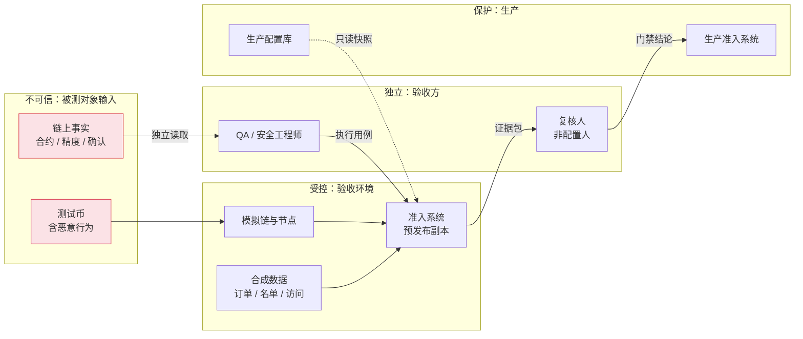
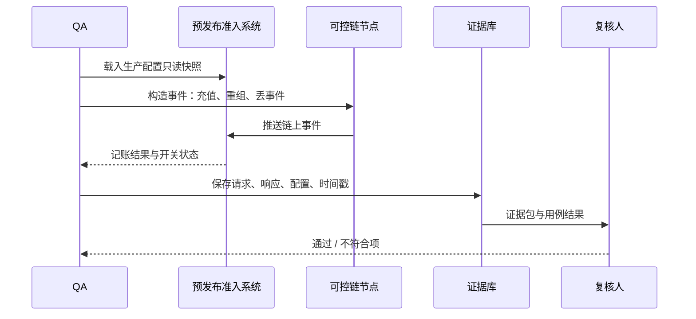
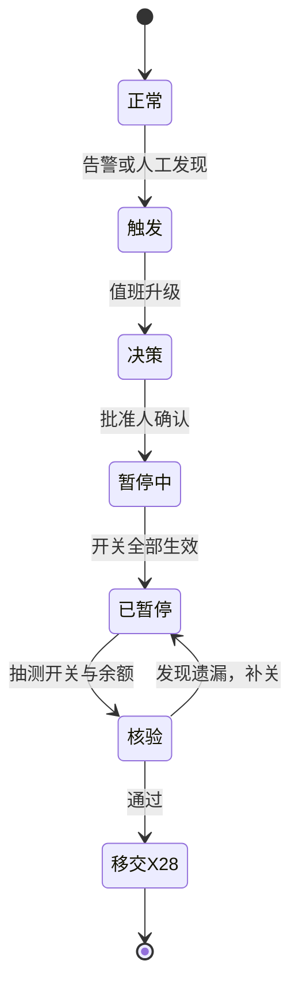

# X27 资产与市场准入·工程验收：准入开关、参数核对与下架演练

> 学习目标：读完本章，你能——
> 1. 为"展示 / 现货 / 充值 / 提币 / 杠杆 / 抵押"六个开关写出独立性验收用例，并说明每条用例的证据。
> 2. 把一个币的上币配置逐项与链上事实、批准记录核对，写出能自动跑的比对查询。
> 3. 用合成数据回放上币内幕交易规则，算出召回与误报；并设计一次"暂停一座桥、下架一批币"的演练。
>
> 适用角色：交易所安全工程师、上币与风控 QA、资产运营、合规官、内部审计。
> 前置章节：[X09 资产与市场准入](X09-cex-asset-listing-market-access.md)、[A05 上币与合作项目尽调](../assessment/A05-listing-due-diligence.md)、[X05 检测与响应工程](X05-detection-response-engineering.md)、[X06 韧性与验证](X06-resilience-validation.md)
> 交互实验 / 模板：[上币评分卡](../interactive/listing-scorecard.html) ｜ [确认深度实验](../interactive/confirmation-depth-lab.html) ｜ [T05 上币尽调问卷](../templates/T05-listing-dd-questionnaire.md)
> 最后核对：2026-11-23

---

## 开场：配置页上的"已关闭"

2025 年 4 月 20 日，一个周日的清晨，Bitget 的 VOXEL 永续合约成交量突然飙升。The Block 报道称，该市场的成交量一度超过比特币的 24 小时成交量，而 VOXEL 当时在 CoinMarketCap 上只排第 723 位。有用户称，自己用不到 100 美元赚到了六位数利润，并猜测交易所的做市机器人有缺陷。Bitget 公开表示，部分账户"可能参与了市场操纵"，并触发了风控系统；交易所随后宣布回滚异常交易，并为受损用户制定补偿方案。

这个故事里，没有人说过"杠杆开关是坏的"。Bitget 没有公开解释过根因，本章也不推测。但它提出了一个验收问题：一个小市值币的永续合约，开放前有没有人证明过——深度够不够、价格源有没有独立、异常时能不能在几分钟内只关这一个开关、关了之后已成交的单怎么办？

<details class="predict"><summary>🤔 先猜再看：配置页上写着"杠杆：已关闭"。要证明它真的关了，至少要做几件事？</summary>

至少四件。第一，在测试环境用真实下单接口提交一张杠杆单，看撮合是否拒绝，而不是只看页面。第二，换一条路径再试：API、App、批量接口、做市账户专用通道。第三，核对"关闭"之后已存在的持仓、挂单和强平队列怎么处理。第四，检查有没有留痕：谁关的、什么时候、生效用了多久。页面显示的是"配置值"，验收要证明的是"系统行为"。本章 §3 和 §6 把这四件事做成用例。

</details>

---

## 1. 一句话理解

**X09 回答"准入应该怎么设计"。本章回答"你怎么知道它真的这样工作"：用一套可重复的用例，证明每个开关独立、每个参数与链上事实一致、每个名单真有保密、每个紧急动作在规定时间内生效。**

> 🎯 打个比方：X09 是机场的《航班准入规程》。本章是消防验收：不是看规程写得好不好，而是拉一次警报，看每扇防火门是否在 60 秒内关上、广播是否响起、人员能否按路线撤离。验收单上必须有时间、证据和签字。
>
> 比喻的局限：消防验收一年一两次，建筑本身不变。上币配置每周都在变，链上的合约也在变。所以验收不能只做一次，要拆成"上线前门禁、变更时回归、季度演练"三种节奏（见 §7）。

本章与相邻章节的分工：

| 章节 | 回答的问题 |
|---|---|
| [A05](../assessment/A05-listing-due-diligence.md) | 这个项目该不该上：怎么评估合约、团队与流动性 |
| [X09](X09-cex-asset-listing-market-access.md) | 机构里谁能批、怎么分级、怎么保密、怎么退出 |
| **X27（本章）** | 控制是否真有效：用例、证据、回放、演练、门禁 |
| [X28](X28-cex-listing-recovery-ops.md) | 异常资产发生后怎样处置、迁移、复牌 |

本章不重复 X09 的设计内容。需要引用控制项时，直接写 X09 的控制 ID（`LST-C01` 到 `LST-C16`）。

---

## 2. 保护目标与信任边界

### 2.1 验收要证明什么

验收对象不是"人"，而是五类可观察的事实：

| 事实类别 | 要证明 | 对应 X09 控制 |
|---|---|---|
| 开关独立性 | 六个能力开关各自可开可关，互不连带 | LST-C03、LST-C04 |
| 配置真实性 | 配置值与链上事实、批准记录一致 | LST-C04、LST-C05 |
| 输入准确性 | 风险评分、价格源、限额的输入数据未过期、未错位 | LST-C09、LST-C11 |
| 保密有效性 | 公告前的信息只有名单内的人看过，异常交易能被发现 | LST-C06、LST-C07 |
| 应急可达性 | 暂停、下架、按桥暂停在规定时间内生效 | LST-C10、LST-C12、LST-C14 |

### 2.2 验收的信任边界



**读图要点：**

- 链上事实和测试币都放在不可信区：验收方自己读链，不抄项目方给的参数表。
- 生产配置只以"只读快照"进入验收环境。验收环境永远不写回生产。
- 配置人和复核人必须不是同一个人，否则"双人复核"（LST-C04）在验收中就失去意义。
- 局限：模拟链不能复现所有真实网络行为（例如真实节点的重组频率）。6.3 节说明哪些结论需要真实网络小额验证。

---

## 3. 参考架构：验收环境、数据与证据

### 3.1 验收环境应该长什么样

1. **预发布副本**：与生产同版本的准入服务、配置库、撮合与风控参数服务。数据库结构一致，数据是合成的。
2. **可控链环境**：每条上线链配一个本地或测试网节点，能主动制造重组、延迟事件、丢失事件和非标准代币行为。
3. **测试币合约库**：一组故意"不规范"的 ERC-20 / SPL / TRC-20 等合约，用于充值监听测试（6.2 节列出行为清单）。这些合约只部署在测试环境。
4. **合成数据集**：合成账户、订单、上币保密名单、访问日志、做市商报价。不使用生产客户数据。
5. **证据收集器**：每条用例自动保存请求、响应、配置快照、日志片段、时间戳和执行人。
6. **生产旁路**：验收环境没有生产凭证，网络上不能访问生产数据库或签名服务。

> ⚠️ 警告：不要在生产环境"顺手"验证开关。在生产里关一个真实币的充值，用户会立刻受影响。生产里只允许做"只读快照比对"和事先批准的小额金丝雀测试（见 6.3）。

### 3.2 验收数据流



**读图要点：**

- 证据由收集器写入，不由 QA 手填。手填的截图容易漏掉失败的那一次。
- 链节点由验收方控制，所以能造出"生产里很少见"的情形，比如 3 个区块的重组。
- 复核人看到的是证据包，而不是 QA 的口头结论。
- 局限：这张图没有画"准入系统调用哪些下游"。下游（撮合、钱包、风控）的联动在 [X37 域间交接](X37-cex-ledger-wallet-handoff.md) 讲，这里只验收准入系统自己的开关。

### 3.3 六个开关的依赖关系（验收先要搞清楚）

X09 把准入分成六层。验收之前先画出开关依赖表，明确"允许的依赖"和"不应有的依赖"：

| 开关 | 允许依赖 | 不应有的连带 |
|---|---|---|
| 展示 | 无 | 展示关闭不应影响已有持仓的提币 |
| 现货交易 | 展示 | 关闭现货不应自动关闭提币 |
| 充值 | 链路已验证 | 关闭充值不应取消已入账的余额 |
| 提币 | 充值链路已验证、热钱包余额上限 | 关闭提币不应影响现货撮合 |
| 杠杆 | 现货、深度、价格源 | 关闭杠杆不应强制平掉其他资产仓位 |
| 抵押 | 杠杆、折价率、集中度限额 | 关闭抵押应触发保证金重新计算，但不应静默平仓 |

> 💡 注意：这张表是示例。有的交易所规定"关闭现货必须同时关闭杠杆"，这是业务选择。验收要核对的是：实际行为与你们自己写下的依赖表一致。

---

## 4. 验收范围与控制映射

本章的检查项前缀是 `LSV`。用例 ID 是 `LSV-T01` 起，指向 X09 的控制 ID。

| 验收域 | 说明 | 对应 X09 控制 | 门禁级别 |
|---|---|---|---|
| A 开关独立性 | 六个开关独立开关、越权不可改、绕路不可用 | LST-C02、LST-C03、LST-C04 | P0 |
| B 参数与链上事实 | 地址、精度、确认数、最小充值、手续费 | LST-C05、LST-C09 | P0 |
| C 充值监听鲁棒性 | 假充值、重组、事件缺失、非标准返回 | X09 §6.1 | P0 |
| D 风险输入 | 评分输入新鲜度、价格源、折价率 | LST-C11 | P1 |
| E 保密与内幕检测 | 名单、访问留痕、回放召回 | LST-C06、LST-C07 | P0 |
| F 持续监控触发 | 权限变更、增发、集中度变化告警 | LST-C10 | P0 |
| G 应急动作 | 暂停、下架、按桥暂停 | LST-C12、LST-C14 | P0 |
| H 做市商控制 | 单边抛售告警、冻结与清退 | LST-C08 | P1 |

---

## 5. 分级落地

| 档位 | 做什么 | 人力（示例） | 时间（示例） |
|---|---|---|---|
| 最小可行 | 开关独立性用例（A 域）；配置与链上事实比对脚本（B 域）；一次下架演练 | 1 名安全工程师 + 1 名资产运营配合 | 3–4 周 |
| 标准 | 加上充值监听测试币库（C 域）；内幕检测回放（E 域）；变更回归；上线门禁与证据包 | 2 名 QA / 安全，1 名数据工程师 | 2–4 个月 |
| 成熟 | 全部域自动化，每次上币工单触发回归；季度按桥暂停演练；验收报告自动出具，供审计使用 | 3–5 名，含专职验收岗 | 6–9 个月，并持续运营 |

> 💡 注意：人力与时间是示例。最小一步是：挑一个已上线的小币，在预发布环境里把它的"杠杆"从开改成关，用真实下单接口各试一次，把结果写进表。这一步一天内可以做完。

---

## 6. 落地做法

### 6.1 验收用例库

表格列：用例 ID | 控制项 | 前置条件 | 操作（只在验收环境）| 预期结果 | 证据。

**A 域：开关独立性与越权**

| 用例 ID | 控制项 | 前置条件 | 操作 | 预期结果 | 证据 |
|---|---|---|---|---|---|
| LSV-T01 | LST-C03 | 资产 X 仅开现货 | 通过 REST、WebSocket、App 三条路径提交杠杆单 | 三条路径都被拒绝，错误码一致 | 三份请求响应 |
| LSV-T02 | LST-C03 | 资产 X 现货、充值、提币全开 | 只关提币，再提交现货单和充值 | 现货与充值不受影响，提币被拒 | 开关快照加三次调用 |
| LSV-T03 | LST-C04 | 批准记录：现货，日限额 200 万 USD（示例） | 配置人把限额填成 2000 万 | 系统阻断，提示与批准记录不符 | 阻断日志 |
| LSV-T04 | LST-C04 | 批准记录仅 L1 | 配置人把资产配成 L4 | 阻断，并产生告警 | 阻断日志、告警 ID |
| LSV-T05 | LST-C04 | 一人账号同时有"配置"和"复核"角色 | 同一人先配置后复核 | 复核被拒（职责分离） | 权限矩阵截图 |
| LSV-T06 | LST-C02 | 商务账号 | 尝试批准上币、修改配置、改限额 | 全部被拒，且留痕 | 审计日志 |
| LSV-T07 | LST-C03 | 做市账户有专用通道 | 在杠杆关闭的资产上，用做市通道下杠杆单 | 被拒；专用通道不绕过开关 | 请求响应 |
| LSV-T08 | LST-C14 | 资产 X 有未成交挂单 | 关闭现货开关 | 挂单按预设处理（撤销或保留），行为与依赖表一致 | 订单状态前后快照 |
| LSV-T09 | LST-C03 | 配置变更并发 | 两名运营同时改同一资产不同开关 | 无丢失更新；最终状态包含两处修改，或后者被明确拒绝 | 版本号与最终配置 |

**B 域：参数与链上事实**

| 用例 ID | 控制项 | 前置条件 | 操作 | 预期结果 | 证据 |
|---|---|---|---|---|---|
| LSV-T10 | LST-C05 | 资产配置的合约地址 | 独立读链，比对地址、`decimals()`、字节码哈希 | 与配置一致；不一致即阻断上线 | 比对报告 |
| LSV-T11 | LST-C05 | 配置精度 6，链上精度 18（人造错配） | 触发一次充值 | 系统拒绝入账或阻断上线，不得按错误精度入账 | 入账试验日志 |
| LSV-T12 | LST-C05 | 合约地址填成同名假币 | 运行地址一致性检查 | 与批准记录不符，阻断 | 检查输出 |
| LSV-T13 | LST-C09 | 最小充值额配置 | 充值低于最小额、等于最小额、高于最小额 | 低于：不入账并留痕；其余入账 | 三次入账记录 |
| LSV-T14 | LST-C05 | 提币手续费配置 | 在预发布环境提币，核对手续费与热钱包实际 gas 成本 | 手续费不低于成本的配置下限（阈值为示例） | 费用比对表 |
| LSV-T15 | LST-C05 | 提币地址校验规则 | 提交格式错误、跨链地址、合约地址 | 按资产规则拒绝或提示 | 响应 |

**C 域：充值监听鲁棒性**

| 用例 ID | 控制项 | 前置条件 | 操作 | 预期结果 | 证据 |
|---|---|---|---|---|---|
| LSV-T16 | X09 §6.1 | 测试币：`transfer` 失败时返回 `false` 而不回滚 | 向测试充值地址发起这笔"失败"转账 | 不入账（以交易回执与余额变化为准，而不是只看事件） | 回执与账本 |
| LSV-T17 | X09 §6.1 | 链环境可造重组 | 充值达到 N 个确认前，重组掉含充值的区块 | 入账不发生；已达确认数后才入账 | 重组日志 |
| LSV-T18 | LST-C09 | 已达确认数并入账 | 再造一次深度大于确认数的重组（极端场景） | 触发"链异常"告警与该链充提暂停，不静默放过 | 告警与暂停记录 |
| LSV-T19 | X09 §6.1 | 链节点丢失一个事件 | 事件缺失的区块 | 对账任务发现缺口并补记，或告警 | 对账输出 |
| LSV-T20 | X09 §6.1 | 一笔交易含批量转账：大额失败，小额成功 | 对测试地址发起批量交易 | 只入账成功的转账；不以整笔交易状态入账 | 逐笔入账明细 |
| LSV-T21 | X09 §6.1 | 同名假币（名称、符号与目标币相同） | 向充值地址转入假币 | 按合约地址匹配，不按符号入账 | 入账日志 |
| LSV-T22 | LST-C09 | 同一交易重复推送两次 | 重复事件 | 幂等：只入账一次 | 账本分录数 |

**D–H 域：输入、保密、监控、应急、做市**

| 用例 ID | 控制项 | 前置条件 | 操作 | 预期结果 | 证据 |
|---|---|---|---|---|---|
| LSV-T23 | LST-C11 | 资产 X 的指数价格有三个来源 | 让一个来源偏离 20%（示例） | 指数使用剔除异常的结果，并告警 | 价格序列 |
| LSV-T24 | LST-C11 | 评分输入含"持币集中度" | 把输入数据时间戳改成 45 天前 | 评分标记过期，禁止升级层级 | 评分结果 |
| LSV-T25 | LST-C06 | 保密名单有效期内 | 名单内账号的关联交易账户买入该币 | 系统拦截或立即告警 | 拦截日志 |
| LSV-T26 | LST-C07 | 合成历史上币，注入 5 个异常账户 | 运行内幕检测回放（6.4 节） | 召回率与误报率达到门槛（门槛见 7.1，示例） | 回放报告 |
| LSV-T27 | LST-C10 | 测试合约 owner 可改 | 修改 owner | 告警 ≤ 15 分钟（示例目标）；自动降级触发器生效 | 告警时间戳 |
| LSV-T28 | LST-C10 | 测试币有增发事件 | 增发超过总量 1%（示例） | 告警并触发自动降级 | 降级记录 |
| LSV-T29 | LST-C14 | 资产 X 已上线 | 执行单币紧急暂停（6.5 节） | 在目标时间内生效；公告模板可发出 | 计时表 |
| LSV-T30 | LST-C12 | 一座桥下 12 个资产 | 执行"按桥暂停" | 12 个资产的充提同时关闭；其他桥资产不受影响 | 开关前后快照 |
| LSV-T31 | LST-C08 | 做市账户 | 持续单边卖出，买单很少 | 在目标时间内告警（示例 10 分钟）；可冻结账户 | 告警与冻结记录 |
| LSV-T32 | LST-C14 | 批量下架 30 个币 | 一次提交批量下架 | 逐项生效，部分失败要列出，不静默吞掉 | 批量结果表 |

共 32 条，覆盖正常、边界、越权、重放、并发和故障注入。每条用例由"验收方"执行，由"复核人"确认证据。

### 6.2 测试币库：该有哪些"坏"行为

充值监听最容易出错，因为代币合约是外部写的。建议至少维护以下测试合约行为（只部署在验收环境）：

1. `transfer` 失败返回 `false` 而不回滚。
2. `transfer` 不返回值（非标准 ERC-20）。
3. 转账收取手续费，实收小于标称金额。
4. 余额可被合约方重基（rebasing），账户余额无转账也会变。
5. 代币名称、符号与目标币相同。
6. 可暂停、可黑名单：对交易所地址的转账会失败。
7. 合约可升级，且升级后改变 `decimals`（极端场景）。
8. 一笔交易里含多次转账，部分失败。

每个行为配一条"期望的系统反应"：入账、不入账、告警。这张表就是充值监听的验收基线。代币标准的细节见 [07 外部调用与代币](../07-external-calls-tokens.md)。

### 6.3 哪些结论要在真实网络上验证

模拟环境能证明"逻辑对不对"，不能证明"参数对不对"。下面三类结论要在真实网络上做小额金丝雀测试，并在事前获得批准：

- 充值确认数是否足够：真实链的重组分布不同于模拟（见[确认深度实验](../interactive/confirmation-depth-lab.html)）。
- 提币手续费是否覆盖真实 gas。
- 热钱包到链的签名与广播路径是否通畅（钱包侧的验收见 [X11 钱包、财资与支付渠道](X11-cex-wallet-treasury-payment.md)）。

金丝雀测试规则（建议）：用专用测试账户；单笔额度写入批准单；测试后记录真实确认时间与成本；不在大行情或链拥堵时做。

### 6.4 内幕检测回放：召回与误报怎么算

用合成数据回放上币公告前的交易，检查 X09 的规则（LST-C07）。**标准答案**是自己注入的"异常账户"，验收的问题是：规则能找出多少，又误伤多少。

示意数据表（示例）：

```text
trades(ts, account_id, asset, side, usd_notional)
roster(account_id, linked_account_id)      -- 名单人员与关联账户
announce(asset, announce_ts)               -- 公告时间
truth(account_id, is_insider)              -- 合成的标准答案
```

```sql
-- 示例：公告前 72 小时，关联账户或新账户的异常买入（示意，非任何真实系统）
WITH win AS (
  SELECT t.account_id, t.asset, SUM(t.usd_notional) AS buy_usd
  FROM trades t JOIN announce a ON a.asset = t.asset
  WHERE t.side = 'buy'
    AND t.ts BETWEEN a.announce_ts - INTERVAL '72 hours' AND a.announce_ts
  GROUP BY t.account_id, t.asset
),
base AS (
  SELECT account_id, AVG(usd_notional) AS avg_trade
  FROM trades WHERE ts < NOW() - INTERVAL '30 days' GROUP BY account_id
)
SELECT w.account_id, w.asset, w.buy_usd,
       (r.linked_account_id IS NOT NULL) AS linked_to_roster
FROM win w
LEFT JOIN base b ON b.account_id = w.account_id
LEFT JOIN roster r ON r.linked_account_id = w.account_id
WHERE w.buy_usd > 10 * COALESCE(b.avg_trade, 0) + 5000   -- 阈值为示例
   OR r.linked_account_id IS NOT NULL;
```

```python
# 示例：回放评分。flagged 是规则输出，insiders 是合成标准答案（示意）
def evaluate(flagged: set, insiders: set, all_accounts: set):
    tp = len(flagged & insiders)
    fp = len(flagged - insiders)
    fn = len(insiders - flagged)
    tn = len(all_accounts - flagged - insiders)
    recall = tp / (tp + fn) if tp + fn else 0.0
    fpr = fp / (fp + tn) if fp + tn else 0.0
    precision = tp / (tp + fp) if tp + fp else 0.0
    return {"recall": recall, "false_positive_rate": fpr, "precision": precision}

# 5 个注入账户，规则标出 4 个，另误标 20 个，总账户 10000：
print(evaluate(
    flagged={f"i{k}" for k in range(4)} | {f"n{k}" for k in range(20)},
    insiders={f"i{k}" for k in range(5)},
    all_accounts={f"i{k}" for k in range(5)} | {f"n{k}" for k in range(9995)},
))
# 召回 0.8；误报率约 0.2%；精确率约 0.17
```

读结果时注意：内幕账户在总体里极少，所以精确率天然偏低。门槛要同时看"召回"和"每次上币的告警条数"。调查人员一次上币只能处理有限条告警，这个上限（例如 20 条，示例）才是真正的约束。回放时变换注入手法（拆小单、分散多账户、延迟到公告前 10 分钟）各做一组，看召回怎么掉。更完整的检测工程方法见 [X05](X05-detection-response-engineering.md)。

### 6.5 紧急暂停与下架演练

演练目标是量出"从决定到生效"的分钟数，并找出哪一步慢。



**读图要点：**

- 每个箭头都要记时间戳。"触发到决策"与"决策到生效"分开量，前者是人，后者是系统。
- "核验"回到"已暂停"表示不是点一下就算完成，要抽测：能不能下单、能不能充值、能不能提币。
- 局限：本章的演练只到"已暂停并核验"。之后的迁移、下架、复牌在 [X28](X28-cex-listing-recovery-ops.md) 讲。

演练步骤（单币）：

1. 在预发布环境选一个有挂单、有持仓、有未完成充值的资产。
2. 演练主持人发出"该币合约被报告存在严重漏洞"的注入（只需一段文字）。
3. 值班工程师按手册升级。计时从注入开始。
4. 批准人批准暂停。系统关闭现货、充值、提币、杠杆、抵押。
5. QA 抽测：每个入口各试一次；检查挂单、持仓、强平队列状态。
6. 公告人员用模板发出用户通知（预发布环境里只发到测试频道）。
7. 记录各阶段耗时，写进演练报告。

按桥暂停演练（LSV-T30）把第 4 步换成"对一座桥下的全部资产同时关闭充提"。对 12 个资产，建议用"桥"作为配置维度的一个标签，演练重点是：有没有资产没带标签，漏关了。桥的机制见 [12 跨链桥安全](../12-cross-chain-bridges.md)。

### 6.6 配置与批准记录的自动比对

上线前，用一条查询把生产配置快照与批准工单逐项比对。示意表（示例）：

```sql
-- 示例：配置与批准记录比对（示意）
SELECT c.asset, c.tier AS cfg_tier, a.approved_tier,
       c.daily_withdraw_limit_usd AS cfg_wd_limit,
       a.approved_wd_limit_usd,
       c.confirmations AS cfg_conf,
       a.approved_confirmations
FROM asset_config_snapshot c
JOIN listing_approval a ON a.asset = c.asset
WHERE c.tier <> a.approved_tier
   OR c.daily_withdraw_limit_usd > a.approved_wd_limit_usd
   OR c.confirmations < a.approved_confirmations
   OR (c.leverage_enabled AND NOT a.approved_leverage)
   OR (c.collateral_enabled AND NOT a.approved_collateral);
```

预期结果是空集。查询结果非空，每一行都是一个不符合项。把这条查询放进"每日任务 + 每次变更"两个触发点。

> 💡 注意：比对的方向很重要。上面的条件只抓"配置比批准更宽松"的情形。配置比批准更严格（例如更高的确认数），通常是可接受的，但要有人确认原因，避免长期漂移。

---

## 7. 运营：验收怎样变成持续动作

### 7.1 验收门槛（建议，示例）

| 指标 | 门槛（示例） | 说明 |
|---|---|---|
| A 域用例通过率 | 100% | 开关独立性不容许例外 |
| B 域不符合项 | 0 | 配置与链上事实必须一致 |
| C 域测试币行为 | 8 类行为全部有期望反应并通过 | 缺一类不得上线新链 |
| 内幕回放召回 | ≥ 80%，每次上币告警 ≤ 20 条 | 门槛按自己的数据校准 |
| 紧急暂停（单币） | 决策到生效 ≤ 5 分钟 | 目标值按业务确定 |
| 按桥暂停 | 全部资产 ≤ 10 分钟，无遗漏 | 遗漏数必须为 0 |
| 持续监控告警 | owner 变更 ≤ 15 分钟 | 与 LST-C10 一致 |

### 7.2 三种验收节奏

| 节奏 | 触发 | 做什么 |
|---|---|---|
| 上线前门禁 | 每个新币、每条新链 | A、B、C、F 域用例全量；E 域按上币回放一次 |
| 变更回归 | 准入系统版本变更、配置模型变更、新增开关 | A 域全量；与变更相关的其他域 |
| 季度演练 | 每季度 | 单币暂停、按桥暂停、批量下架轮换；内幕回放换注入手法 |

### 7.3 指标

- 验收覆盖率：已上线资产里，过去 90 天做过配置比对的占比。
- 不符合项平均关闭天数，按 P0 / P1 / P2 分别统计。
- 演练耗时的趋势（单币暂停、按桥暂停）。
- 测试币行为库的覆盖：已知代币怪癖里，有测试合约的占比。

### 7.4 验收报告模板

```markdown
# 资产准入验收报告
- 对象：资产 / 链 / 版本：…        日期：…
- 验收方：…   复核人：…   配置人（不得与前两者相同）：…
## 范围
- 已执行用例：LSV-T01…LSV-Txx；未执行及原因：…
## 结果摘要
| 域 | 用例数 | 通过 | 不符合 | 备注 |
## 不符合项
| 编号 | 用例 | 严重度 | 描述 | 负责人 | 整改期限 | 复测 |
## 上线门禁结论
- [ ] 通过   - [ ] 有条件通过（条件、期限）   - [ ] 不通过
## 附：证据包位置、配置快照哈希
```

不符合项分级（建议）：

| 级别 | 定义 | 处理 |
|---|---|---|
| P0 | 开关可绕过；配置比批准宽松；假充值可入账；应急动作无法生效 | 不得上线，已上线则立即降级 |
| P1 | 告警延迟超标；评分输入过期；回放召回不足 | 限期整改，期间保持观察期限额 |
| P2 | 记录不全；文档与实现不一致 | 下一版本修复 |

整改闭环：开立单据 → 修复 → 复测同一用例 → 复核人关闭。复测必须使用与原用例相同的操作，不接受"已修复"的口头说明。

### 7.5 上线门禁

以下任一项未通过，不得上线（P0 门禁）：

- LSV-T01、T03、T04、T05、T06、T07：开关独立性与配置阻断。
- LSV-T10、T11、T12：链上事实一致。
- LSV-T16、T20、T21、T22：充值监听的假充值与幂等。
- LSV-T25：保密名单拦截。
- LSV-T29：单币紧急暂停可达。
- 新链或新桥资产：还需 LSV-T17、T18、T30。

### 7.6 演练剧本（桌面，30 分钟）

**剧本一：做市商单边抛售。**

- 背景：一个小市值币上线第 3 天，仅开现货，有一家做市商。
- 注入 1（0 分钟）：监控显示该做市账户连续卖出，买单深度下降。
- 注入 2（10 分钟）：社区开始质疑"内部人砸盘"。
- 注入 3（20 分钟）：做市商联系运营，说是"库存对冲"。
- 评分点：是否按协议要求核对做市义务；谁有权冻结；是否记录证据；对外说法是否有依据。
- 对应用例：LSV-T31。

**剧本二：一座桥出现异常。**

- 背景：交易所有 12 个资产来自同一座桥。桥项目方发出安全提示。
- 注入 1（0 分钟）：安全团队收到提示，价格尚未异常。
- 注入 2（8 分钟）：桥资产对原生资产出现折价。
- 注入 3（15 分钟）：有用户大量充值该桥资产。
- 评分点：谁批准"按桥暂停"；有没有资产漏关；已充值未确认的怎么处理（交给 X28）。
- 对应用例：LSV-T30。

---

## 8. 失效案例

> 以下案例都来自独立查证的公开来源。事发时美元估值、归因均以来源为准，只写摘要与教训。完整复盘见《Web3 行业安全资损 101》。

### 8.1 假充值：从 2020 年研究到 2026 年 Bybit 披露

- **来源类型：** 学术论文 arXiv:2006.06419（2020 年 6 月）；Bybit 官方新闻稿（2026 年 4 月 9 日）。
- **事实：** 论文作者对 17.6 万个 ERC-20 合约做了扫描，报告了 7000 多个可能受假充值攻击影响的合约。Bybit 的新闻稿称，其风控团队检测并拦截了跨多条链的一系列协同假充值尝试，并称没有资金被错误入账、没有用户受影响。Bybit 描述了两类手法：把多笔转账打包，大额失败、小额成功，只看整笔状态会误判；以及多步交易加所有权变更，让资金"看起来到账"而净余额没有增加。新闻稿以"可能超过 10 亿枚 DOT 的损失"来表述潜在风险，这是 Bybit 自己的估算。
- **打穿的控制：** 本案例没有公开的"被打穿"，是拦截成功的案例。对应控制：X09 §6.1 第 3 步的充值监听测试、LST-C05。
- **映射用例：** LSV-T16、T20、T21、T22。
- **教训：** 入账依据要用"逐笔转账结果与余额变化"，不是事件、不是整笔交易状态、不是符号。测试币库要覆盖这些怪癖，并随新手法扩充。
- **未确认：** Bybit 新闻稿没有说明具体链与具体资产，本章不推测。

### 8.2 Coinbase 与 Ethereum Classic 深度重组（2019 年 1 月）

- **来源类型：** Coinbase 官方博客（2019 年 1 月）；媒体报道（TechCrunch、The Block 等）。
- **事实：** Coinbase 称，2019 年 1 月 5 日检测到 ETC 链的深度重组，含双花，并暂停了与该链的收发。初次披露的双花约 88,500 枚 ETC，后续更新累计为约 219,500 枚（约 110 万美元，事发时估值）。博客中列出了一次深度 69、长度 86 的重组，其中一笔 5,000 枚 ETC 被双花。Coinbase 称自己不是目标，没有损失资金。
- **打穿的控制：** 没有打穿，是控制生效的案例。对应控制：确认数配置（LST-C09）与按链暂停（LST-C10 的告警加 LST-C14 的暂停）。
- **映射用例：** LSV-T17、T18。
- **教训：** 确认数是"链的安全假设"的函数，不是一个通用数字。算力较低的链需要更高确认数或额外保护。验收要同时证明两件事：重组发生时不入账；极端深度重组出现时，系统会按链暂停，而不是继续入账。
- **未确认：** 本章没有找到 Coinbase 当时具体的确认数配置，不写。

### 8.3 Bitget VOXEL 永续合约异常交易（2025 年 4 月）

- **来源类型：** The Block 报道（2025 年 4 月 20 日），转述 Bitget 官方说明。
- **事实：** VOXEL 永续合约成交量激增，据报道一度超过比特币 24 小时成交量；有用户在社交媒体称小额本金获利六位数。Bitget 称部分账户可能涉及市场操纵并触发风控，决定在 24 小时内回滚异常交易，并为受损用户制定补偿方案。
- **涉及的控制：** 杠杆准入的深度与价格源（LST-C11）、紧急暂停与回滚能力（LST-C14）、做市控制（LST-C08）。
- **映射用例：** LSV-T01、T23、T29、T31、T32。
- **教训：** 低流动性币开放衍生品后，价格与成交可以脱离现货基本面。验收要覆盖三件事：杠杆开关真的受准入层级约束；价格源异常时指数不随之漂移；回滚与补偿能力事先演练过。交易侧的回放验收见 [X29](X29-cex-trading-verification.md)。
- **未确认：** Bitget 没有公开说明根因。社交媒体上"做市机器人有缺陷"的说法只是用户猜测，本章不采信。补偿的最终金额，本章未核对。

### 8.4 Mantra OM 价格暴跌与交易所风险提示（2025 年 4 月）

- **来源类型：** Cointelegraph 综述；Binance 与 OKX 的公开表述（经媒体转述）；Mantra 方的公开回应。
- **事实：** 据报道，2025 年 4 月 13 日，OM 在低流动性时段从 6 美元以上跌到 0.5 美元以下，跌幅超过 90%，市值蒸发超过 50 亿美元。Binance 称初步结论是主要由跨交易所清算造成；OKX 称发现自 2024 年 10 月以来的代币经济学重大变化，以及自 2025 年 3 月起多个链上地址协同大额充提。据媒体转述，Binance 还表示自 2025 年 1 月起已对 OM 现货交易展示风险提示。Mantra 方否认项目方抛售，并称团队份额仍被锁定。各方对根因的说法不一致。
- **涉及的控制：** 风险评分输入准确性与持续监控的降级触发（LST-C10、LST-C16）。
- **映射用例：** LSV-T24、T27、T28。
- **教训：** 对验收而言，值得问的是：代币经济学变化、集中度变化和异常充提这类输入，是否真的能触发降级、限额收紧或风险提示，而且触发时间足够早。提示展示出来不等于限额同步收紧，这两件事要分别验证。
- **未确认：** 本事件的根因没有公开定论。本章不认定谁对谁错，也不评论任何一家交易所的处置是否恰当。

### 8.5 案例与用例的映射

| 案例 | 保护域 ② 的环节 | 相关用例 |
|---|---|---|
| 假充值（2020 论文、2026 Bybit） | 充值监听 | LSV-T16、T20、T21、T22 |
| Coinbase 与 ETC 重组（2019） | 确认数、按链暂停 | LSV-T17、T18 |
| Bitget VOXEL（2025） | 杠杆准入、回滚、做市 | LSV-T01、T23、T29、T31 |
| Mantra OM（2025） | 评分输入、降级触发 | LSV-T24、T27、T28 |

> 💡 注意：本章没有收入"某交易所上币配置错误导致资损"的案例。没有查到足够可靠、可核对的公开来源，传闻不写。

---

## 9. 评估检查点

- [ ] **LSV-1** 每个开关（展示、现货、充值、提币、杠杆、抵押）都有独立性用例，且最近一次通过时间在 90 天内。
- [ ] **LSV-2** 开关依赖表已书面化，实际行为与依赖表一致。
- [ ] **LSV-3** REST、WebSocket、App、批量接口和做市专用通道，都在杠杆关闭用例中测过。
- [ ] **LSV-4** 配置与批准记录的自动比对每天运行，且每次变更也触发；结果为空集或有关闭单据。
- [ ] **LSV-5** 配置人、复核人、验收方是三个不同的人，权限矩阵已核对。
- [ ] **LSV-6** 每个新币上线前，合约地址、精度、字节码哈希都由验收方独立读链核对。
- [ ] **LSV-7** 充值监听有测试币库，覆盖至少 8 类"坏"行为，每类有期望反应。
- [ ] **LSV-8** 每条新链上线前，做过重组和事件缺失的测试，并验证过"极端重组触发按链暂停"。
- [ ] **LSV-9** 内幕检测规则有回放报告，含召回、误报率、每次上币告警条数，且用不同手法回放过。
- [ ] **LSV-10** 保密名单的访问留痕与关联账户拦截，有一次成功的拦截测试记录。
- [ ] **LSV-11** 单币紧急暂停做过演练，有计时表，决策到生效在目标时间内。
- [ ] **LSV-12** 按桥暂停做过演练，漏关资产数为 0；资产有"桥"标签且标签有定期核对。
- [ ] **LSV-13** 批量下架演练过，部分失败的资产会被明确列出。
- [ ] **LSV-14** 风险评分输入有新鲜度检查，过期输入会阻止层级升级。
- [ ] **LSV-15** 降级触发器（owner 变更、增发、集中度变化、桥暂停）每个都有对应用例并通过。
- [ ] **LSV-16** 做市账户的单边抛售告警有测试记录，冻结权限有演练记录。
- [ ] **LSV-17** 验收报告使用统一模板，P0 不符合项有整改与复测记录。
- [ ] **LSV-18** 上线门禁（7.5 节）已写入上币流程，未通过时系统不允许把层级升到对应级别。

**把结果写进报告：**

| 检查项 | 状态（通过 / 部分 / 未做） | 证据位置 | 负责人 | 复测日期 |
|---|---|---|---|---|
| LSV-1 至 LSV-18 | | | | |

---

## 10. 上手路径

**第一周**

1. 画出自己交易所的六个开关依赖表，找资产运营确认。
2. 在预发布环境选一个小币，做 LSV-T01、T02：关杠杆、关提币，各用三条路径试。
3. 导出一份配置快照，用 6.6 节的查询与批准工单比对，数一下不符合项。

**第一个月**

1. 写 A、B 两个域的全部用例，并把证据收集器接起来。
2. 建测试币库的前 4 类行为合约（返回 false、无返回值、手续费、同名假币）。
3. 做一次单币紧急暂停演练，量出各阶段耗时。

**第一个季度**

1. 补齐 C 域和 E 域，做内幕检测回放，算出召回与误报。
2. 做一次按桥暂停和批量下架演练。
3. 把门禁写入上币工单：门禁不通过则不能提交"升级层级"。
4. 出第一份验收报告，请内部审计或合规复核。

---

## 11. 常见误区

| 误区 | 为什么错 | 改正 |
|---|---|---|
| 看配置页就算验过 | 页面是配置值，不是系统行为 | 用真实接口试一次，保存响应 |
| 只测一条下单路径 | 做市通道、批量接口、旧版 API 常有例外 | 路径清单化，每条都测 |
| 验收只做一次 | 配置每周变，合约会升级 | 门禁加回归加演练三种节奏 |
| 相信项目方给的参数表 | 参数表是不可信输入 | 独立读链核对 |
| 用生产环境"试一下" | 会直接影响用户 | 预发布加小额金丝雀 |
| 回放只看召回 | 误报太多调查人员处理不了 | 同时看每次上币告警条数 |
| 演练只测"能不能关" | 关了以后挂单、持仓怎么办没人知道 | 检查挂单、强平队列和未完成充值 |
| 验收方就是配置人 | 自己验自己，证明力不足 | 三方分离 |

---

## 12. 术语表

- **验收用例（Acceptance Test Case）：** 一条可重复的检查，包含前置条件、操作、预期结果和证据。
- **金丝雀测试（Canary Test）：** 在真实环境用小额、受控的操作验证参数是否正确。
- **回放（Replay）：** 用历史或合成数据重新运行一条规则，核对输出。
- **召回率（Recall）：** 真正异常里被规则找出的比例。
- **误报率（False Positive Rate）：** 正常对象里被误标的比例。
- **假充值（Fake Deposit）：** 让交易所误以为收到了币，实际没有真实入账价值的攻击手法。
- **重组（Reorg）：** 链上已出现的区块被另一条更长的链替换。
- **按桥暂停：** 一次动作关闭某座桥相关的全部资产的充值与提币。
- **门禁（Gate）：** 未通过就不能进入下一阶段的检查。
- **证据包：** 一次验收的请求、响应、配置快照、日志与时间戳的集合。
- **观察期：** 新币上线后限额较低的一段时间。

---

## 13. 动手练习与思考题

> 🧪 动手验证：打开[上币评分卡](../interactive/listing-scorecard.html)，选一个虚构的币，把"持币集中度"调到阈值边缘。记录评分在多少时由"允许杠杆"变成"不允许"，并写出对应的验收用例（前置条件、操作、预期）。再打开[确认深度实验](../interactive/confirmation-depth-lab.html)，记录把确认数从 6 改到 12 后，被重组打破的概率如何变化，并写出一条 LSV-T17 风格的用例。

**练习 1：画依赖表。** 在纸上画出六个开关的依赖表。对每一格，写"允许"或"不应有的连带"，并为每个"不应有的连带"写一条用例。

**练习 2：写一条回放规则。** 用 6.4 节的数据表，写一条与示例不同的规则，例如"公告前 24 小时内，新开户 7 天内的账户买入该币"。手算：假设 5 个注入账户、规则标出 3 个、误标 12 个、总账户 2000 个，召回、误报率与精确率分别是多少？

**练习 3：桌面推演。** 做 7.6 节的剧本二。写出每一步的决策人、动作、预期耗时，并标出你认为最可能漏关的资产类型。

> 🪞 反思：你们现在的"已关闭"开关，最近一次有人用真实请求验证是什么时候？如果答案是"没有"，哪一个开关会让你最担心？

**思考题**

1. 配置比批准"更严格"（例如确认数更高、限额更低），为什么也要有人确认原因？可能掩盖了什么问题？
2. 内幕检测的召回很高，但每次上币产生 80 条告警，调查人员只能处理 20 条。这时应该调规则、增加人手，还是改变上币流程？各自的代价是什么？
3. 一座桥下有 12 个资产，其中 3 个同时是独立发行的原生资产。"按桥暂停"该不该包含它们？验收用例要怎样写才不会误伤？

**建议配套（后续在 L3 训练营实现）：** 一个"准入开关回归套件"（预发布环境，含测试币库与重组注入），以及与 [X28](X28-cex-listing-recovery-ops.md) 联用的"单币暂停到复牌"演练工单模板。交易与账务回放见 B79，与 [X10 交易、结算与信用](X10-cex-trading-settlement-credit.md)、[X29](X29-cex-trading-verification.md) 配合。
