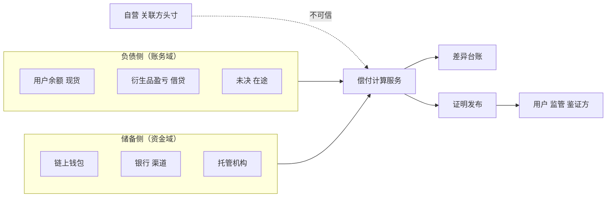
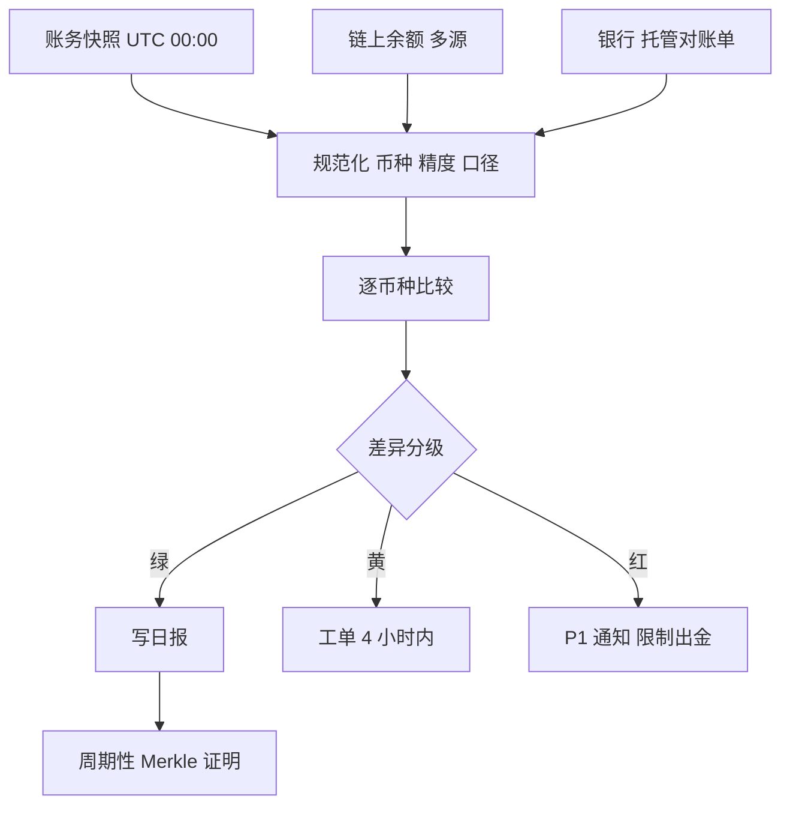
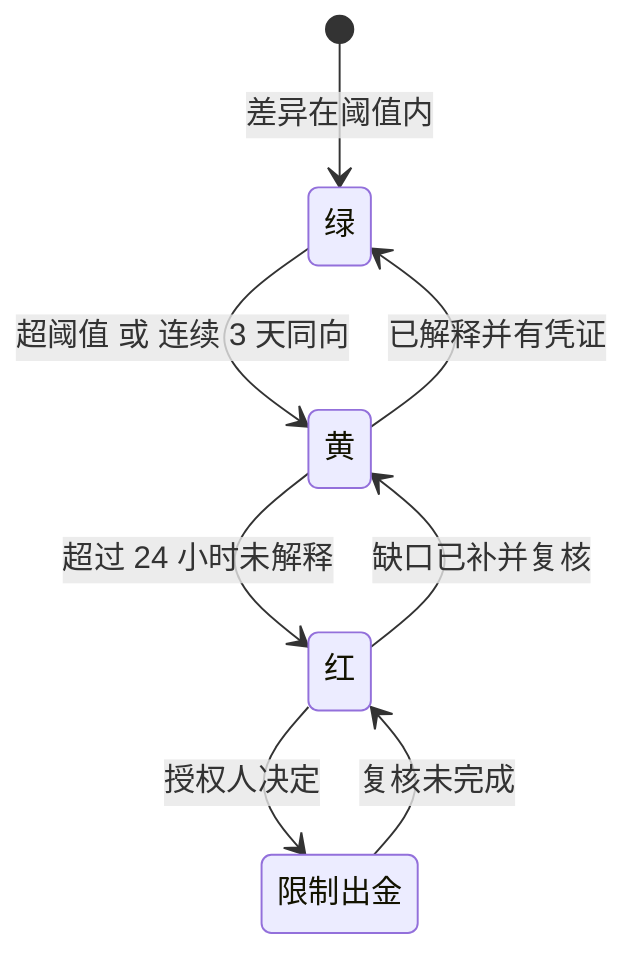

# X27 储备与偿付能力：负债、储备、对账与证明

> 学习目标：读完本章，你能——
> 1. 写出一张"负债口径表"和一张"储备口径表"，并说清哪些科目计入、哪些不计入、谁对口径负责。
> 2. 搭一套每日对账：用 SQL 比较负债与储备，给差异分级，规定每一级谁来处置、多久处置。
> 3. 讲清 Merkle 树负债证明、地址签名证明与第三方鉴证各证明了什么、没证明什么，并用 14 条用例验收一次证明发布。
>
> 适用角色：交易所安全工程师、财务与财资负责人、风控与合规、内审与外部鉴证对接人。
> 前置章节：X14-cex-trading-settlement-credit.md、X17-cex-wallet-treasury-payment.md、X26-cex-ledger-wallet-handoff.md、[23 托管、充提与合规安全](../23-custody-exchange-ops.md)
> 相关章节：X31-stablecoin-rwa-issuer-ops.md（发行方的储备）、X35-custodian-security.md（托管机构的隔离）
> 交互实验：[Merkle 树实验](../interactive/audit-merkle.html)、[RPC 多源核对实验](../interactive/rpc-quorum-lab.html)
> 模板：[T09 事件手册与值班](../templates/T09-incident-runbook-oncall.md)
> 最后核对：2026-11-23

> 💡 注意：分工。X17 讲钱包分层与三方对账，X26 讲单笔提币与充值的交接。本章讲**整个平台**在某一时刻"欠用户多少、手里有多少"，以及怎样向内部、监管和用户证明。不讲稳定币发行方的储备（见 X31）。

---

## 开场：账上有钱，不等于钱还在

假设一家交易所在周一早上收到一份内部报告：用户余额合计 12.4 亿美元，链上与银行里能查到的资产合计 12.9 亿美元（示例数字）。看起来多出 5000 万美元。财资主管很满意。

然后风控补了三行：

1. 12.9 亿里有 2.1 亿是平台自己发行的代币，市价取的是自家盘口的最后成交价。
2. 有 1.5 亿美元的资产，已经借给了一家关联做市商，对方的还款日是下周。
3. 负债里没有计入衍生品账户的未实现亏损，也没有计入还在途中的 3 笔大额法币提现。

<details class="predict"><summary>🤔 先猜再看：重新算一遍，平台是否还有 5000 万美元的盈余？</summary>

按保守口径，扣掉自发代币（2.1 亿）和已借出的资产（1.5 亿），储备只剩 9.3 亿美元，已经低于 12.4 亿的负债。再加上漏记的负债，缺口更大。**偿付能力不是一个数字，而是一组口径。** 口径定得宽，平台永远"有盈余"。本章要做的是：把口径写成文件，让写口径的人和算数字的人分开，让外部人能独立复算。

</details>

---

## 1. 一句话理解

**偿付能力 = 每一类用户资产，都有同类、可立即动用、不被他人主张的储备覆盖；证明它，就是让第三方在同一时刻，独立核对"负债清单完整"和"储备真实归你"两件事。**

> 🎯 打个比方：像银行金库的盘点。盘点员要核两样东西：存折总账（用户欠款清单）和金库实物（你手里的钱）。只给他看金库，他不知道存折有多少；只给他看存折，他不知道金库是不是空的。还有一种老把戏：盘点当天，从隔壁借一批现金摆进金库，盘完再还回去。
>
> 比喻的局限：银行有央行和存款保险，交易所没有。链上资产还多一个银行没有的问题：同一把私钥控制的资产，可以在几分钟内转给别人，也可以在盘点日从别人那里借来。

---

## 2. 保护目标与信任边界

### 2.1 保护目标

| 目标 | 一句话 | 失守的后果 |
|---|---|---|
| 负债完整 | 每一个用户的每一类权益，都在负债清单里 | 少算负债，"偿付"是假的 |
| 储备真实 | 储备资产确实归平台控制，且没有被抵押或出借 | 同一笔钱被计算两次 |
| 同类覆盖 | 用户的 BTC 由 BTC 覆盖，而不是由平台币覆盖 | 价格一跌，覆盖消失 |
| 差异可见 | 差异按日产生、分级、有人负责 | 小缺口累积成大窟窿 |
| 证明可复算 | 外部人用公开材料能复现结论 | 证明变成公关材料 |
| 挤兑可承受 | 用户同时提币时，流动性与秩序都能撑住 | 偿付能力足，也因流动性断裂而停提 |

### 2.2 信任边界



读图要点：
- 偿付计算服务只读账务与资金域的快照，不能改任何一侧的数据。
- 自营、关联方、做市商的头寸，不能作为"确认储备"流入计算，只能作为单独披露项。
- 局限：计算服务本身要防篡改（见 POR-2），否则"独立"只是名义上的。

> ⚠️ 警告：谁写口径，谁就不该是出数字的人。口径文件由财务、风控、合规共同批准；数字由偿付计算服务按口径自动产出；任何口径修改走变更单（见 X20 的变更控制）。

---

## 3. 参考架构

### 3.1 负债口径

负债是平台对用户的全部义务，以"同一时点、同一币种"汇总。建议口径如下（示例，各平台以自己的产品与监管要求为准）：

| 科目 | 计入 | 说明 |
|---|---|---|
| 现货可用与冻结 | 是 | 包括挂单冻结与提币预留（与 X26 的预留一致） |
| 借贷与保证金账户的净权益 | 是 | 权益 = 抵押品价值 − 已借 − 应计利息；净权益为负的账户另列"穿仓"科目 |
| 衍生品账户权益 | 是 | 含已实现与未实现盈亏，按标记价估值 |
| 理财、质押、锁仓 | 是 | 与产品条款一致，注明可赎回期限 |
| 在途充值与提币 | 是 | 已入账未确认的、已预留未确认的，都按未决项列出 |
| 应付手续费、返佣、赔付 | 视合同 | 已确认的应付，计入"其他应付" |
| 负余额账户 | 单列 | 不得与正余额互抵，否则会掩盖缺口 |

三条硬规则：
1. 负余额不与正余额互抵。
2. 一个用户在多个产品里的余额，各自计入，不做净额抵销（除非合同与风控明确允许）。
3. 内部账户（手续费收入、做市账户、测试账户）单独成类，不进入"用户负债"，但必须可列出。

### 3.2 储备口径

储备只计入平台**能立即动用、归平台所有、没有被他人主张**的资产。

| 储备分类 | 例子 | 计入"确认储备"的条件 |
|---|---|---|
| A 类 | 同币种的链上资产、同币种银行存款 | 能签名证明控制权；没有出借或抵押 |
| B 类 | 托管机构里的资产 | 有托管机构对账函；赎回时间不超过约定小时数 |
| C 类 | 已出借、已质押、放在其他平台的资产 | 不计入确认储备，单列"有条件储备" |
| D 类 | 平台自发代币、关联方发行的代币 | 不计入确认储备，单列披露 |
| E 类 | 他人对平台的应收款 | 不计入确认储备 |

> 💡 注意：同币种原则。用户存的是 BTC，就用 BTC 覆盖，不要用"总价值"覆盖。总价值口径会让价格波动藏起缺口：BTC 涨时有盈余，BTC 跌时有缺口，而你不知道缺口在哪个币种。

### 3.3 一天的数据流



读图要点：
- 三份快照要对齐到同一时点（建议在 UTC 零点取，并记录取数时间和区块高度）。
- 链上余额至少用两个独立来源（见 [RPC 多源核对实验](../interactive/rpc-quorum-lab.html)）。
- 局限：快照之间的盘中波动不可见，所以要有盘中预警阈值（见 7.1）。

### 3.4 差异分级与处置



读图要点：
- "已解释"必须附凭证：单据、链上哈希、对账单，不接受口头。
- 红级会触发出金限制，这是业务决定，授权人必须事先定好（见 5.2 授权表）。
- 局限：阈值太宽会漏，太窄会天天告警。第一版阈值宁可窄，用两周数据再放宽。

---

## 4. 控制清单

| ID | 控制项 | 要防什么 | 优先级 | 怎么验证 |
|---|---|---|---|---|
| POR-1 | 口径文件与变更单：负债、储备分类写成文件，改动要三方批准 | 口径被悄悄放宽 | P0 | 抽查近 12 个月的变更，每条有批准人与原因 |
| POR-2 | 偿付计算服务只读快照，服务账号无写权限，输出带哈希 | 计算过程被篡改 | P0 | 检查账号权限；改一条输入看哈希是否变 |
| POR-3 | 负债按币种逐一汇总，负余额不互抵 | 缺口被正余额掩盖 | P0 | 构造一个负余额账户，看汇总是否单列 |
| POR-4 | 储备分类 A–E 自动打标，C/D/E 不进入确认储备 | 借出或自发资产被当成储备 | P0 | 把一个钱包标成"已出借"，看确认储备是否减少 |
| POR-5 | 链上余额多源取数，来源冲突时告警 | 单一数据源被污染 | P1 | 让一个来源返回错值，看是否告警 |
| POR-6 | 每日对账与差异分级；红级触发 P1 | 差异不被看见 | P0 | 回放 30 天差异数据，核对分级与工单 |
| POR-7 | 钱包与托管的地址清单有台账，新增与移除有审批 | 盘点遗漏真实钱包，或把别人的钱包算进来 | P0 | 链上随机抽地址，对照台账 |
| POR-8 | 关联方与做市商的借款、质押、担保单列披露 | 同一资产被两次使用 | P0 | 抽查借出台账与储备清单是否冲突 |
| POR-9 | 盘点日窗口监控：证明日前后大额调入调出告警 | 借款充数 | P1 | 查证明日前后 7 天大额进出 |
| POR-10 | 证明发布前有双人复核与演练，发布稿写明范围与局限 | 证明被当作"全面偿付" | P0 | 查发布稿与检查表 |
| POR-11 | 用户可自助核对其负债叶子，保留各版本证明文件 | 个别用户被排除 | P1 | 注册测试账号，核对是否可验证 |
| POR-12 | 流动性与挤兑预案：分级限额、排队规则、沟通稿 | 偿付足而流动性断 | P1 | 桌面推演（见 13 节练习） |
| POR-13 | 外部鉴证的范围、程序与时点书面确认，保留工作底稿 | 鉴证范围被误读 | P1 | 查委托书与报告范围段 |
| POR-14 | 红线指标写进管理层月报：覆盖率、差异天数、未解释差异金额 | 管理层不知情 | P1 | 抽查最近 3 份月报 |

---

## 5. 分级落地

### 5.1 三档

| 档位 | 做什么 | 人力与时间（建议） |
|---|---|---|
| 最小可行 | 写口径文件；每日一张对账表（负债、确认储备、差异）；钱包地址台账；红级的人工处置流程 | 1 名财资 + 1 名工程，约 4–6 周 |
| 标准 | 自动化计算服务；多源链上取数；分类 A–E 自动打标；周期性 Merkle 负债证明；外部鉴证 | 2–3 名工程，约 3–4 个月 |
| 成熟 | 零知识证明（保证非负与总和）；高频快照；与监管系统直连；实时偿付看板；挤兑演练常态化 | 4–6 名，持续运营 |

### 5.2 授权表（建议）

| 事项 | 提议人 | 批准人 | 时间窗 |
|---|---|---|---|
| 修改口径 | 财资 | 财务负责人 + 风控 + 合规 | 变更窗口，提前 5 个工作日 |
| 黄级差异关闭 | 财资 | 风控 | 24 小时内 |
| 红级触发出金限制 | 值班安全 | 指定高管（如 CRO 或 COO） | 30 分钟内 |
| 证明对外发布 | 财资 | CFO + 合规 + 法务 | 发布前 3 个工作日复核 |
| 恢复出金 | 财资 | 指定高管 + 风控 | 对账通过后 |

---

## 6. 落地做法

### 6.1 第一步：写口径文件

```yaml
# 示例：口径文件（字段为示意）
version: 2026-11-01
snapshot_time: "00:00 UTC"
liabilities:
  include: [spot_available, spot_frozen, margin_net_equity,
            derivatives_equity, earn_locked, pending_deposit, pending_withdrawal]
  separate: [negative_balance, internal_accounts]
  netting: forbidden
reserves:
  confirmed: [A, B]
  conditional: [C]
  excluded: [D, E]
price_source: index_price   # 只用于披露总值；覆盖率按币种数量计算
thresholds:   # 示例值
  green_pct: 0.01
  yellow_pct: 0.05
  yellow_abs_usd: 50000
```

### 6.2 第二步：每日对账查询（示例）

```sql
-- 示例：逐币种比较负债与确认储备（表名与字段为示意）
WITH liab AS (
  SELECT asset, SUM(amount) AS liability
  FROM ledger_snapshot
  WHERE snap_date = :d AND amount > 0
    AND bucket IN ('available','frozen','margin_net','deriv_equity',
                   'earn','pending_in','pending_out')
  GROUP BY asset
), neg AS (
  SELECT asset, SUM(-amount) AS shortfall_accounts
  FROM ledger_snapshot
  WHERE snap_date = :d AND amount < 0 GROUP BY asset
), res AS (
  SELECT asset, SUM(amount) AS reserve
  FROM reserve_snapshot
  WHERE snap_date = :d AND class IN ('A','B') GROUP BY asset
)
SELECT l.asset, l.liability, COALESCE(n.shortfall_accounts,0) AS neg_accounts,
       COALESCE(r.reserve,0) AS reserve,
       COALESCE(r.reserve,0) - l.liability AS diff,
       CASE WHEN COALESCE(r.reserve,0) >= l.liability THEN 'GREEN'
            WHEN COALESCE(r.reserve,0) >= l.liability * 0.95 THEN 'YELLOW'
            ELSE 'RED' END AS level
FROM liab l LEFT JOIN res r USING (asset) LEFT JOIN neg n USING (asset);
```

常见坑：
- 负债只汇总 `amount > 0` 的行，负余额另列在 `neg_accounts`，没有互抵。
- 精度要用整数最小单位（wei、satoshi、分），不要用浮点数。
- 链上余额要取固定区块高度，不要取"最新"。

### 6.3 第三步：Merkle 求和树负债证明（示例）

做法：每个用户一个叶子，叶子里放"加盐的用户标识哈希"与"余额"；父节点的余额等于两个子节点余额之和，哈希覆盖两个子节点的内容。根节点给出总负债。每个用户拿到自己叶子到根的路径，就能验证自己被计入。

```python
# 示例：Merkle 求和树的叶子与父节点（教学用，未做生产级安全加固）
import hashlib

def h(*parts: bytes) -> bytes:
    return hashlib.sha256(b"|".join(parts)).digest()

def leaf(user_id: str, salt: bytes, balance: int):
    assert balance >= 0, "负余额必须在建树之前被单独处理"
    return (h(b"leaf", user_id.encode(), salt, str(balance).encode()), balance)

def parent(left, right):
    (lh, lb), (rh, rb) = left, right
    return (h(b"node", lh, str(lb).encode(), rh, str(rb).encode()), lb + rb)

def build(leaves):
    level = leaves
    while len(level) > 1:
        if len(level) % 2:                # 奇数个叶子，补一个零余额叶子
            level = level + [(h(b"pad"), 0)]
        level = [parent(level[i], level[i + 1]) for i in range(0, len(level), 2)]
    return level[0]                       # (根哈希, 总余额)
```

这段代码说明结构，不是生产实现。生产版本还要处理：每个币种一棵树、盐的保管、叶子顺序的随机化、可验证的树更新、大规模账户的内存与时间（原理演示见 [Merkle 树实验](../interactive/audit-merkle.html)）。

> ⚠️ 警告：Merkle 求和树不能保证"所有用户都在树里"。平台可以不把某些用户放进树，效果等于吞掉他们的余额，而从树的结构上看不出来。公开的技术分析（见第 9 节来源）明确指出了这一点。要防它，只能靠用户抽样验证的规模、外部鉴证中对负债完整性的程序，以及把树与账务系统绑定的核对。

### 6.4 第四步：储备证明——证明地址归你

做法（通用做法）：
1. 公布储备地址清单与快照高度。
2. 用这些地址的私钥，对一段"发布日期 + 随机数"的消息签名，验证者用公钥核对。
3. 或者，从这些地址转出一笔固定小额交易，作为控制权的链上证据。
4. 对冷存储地址，每次签名都有操作风险。可以选用少量长期地址，或抽样签名，在成本与证明强度之间权衡。

局限：
- 签名只证明"此刻持有私钥"，不证明"这些币没有被抵押、借出，或同时被另一家平台拿去证明"。
- 法币只能靠银行或托管方的确认函，链上证明不了。
- 同一批资产可以在不同平台之间"轮流"出现在证明里。降低这种风险，需要统一快照时间或实时证明，这要行业协调。

### 6.5 第五步：零知识证明（成熟档）

在 Merkle 树之上加一层零知识证明，证明所有叶子余额非负，且和等于公布的总数。这样平台不能再用"负余额账户"把总数压低。Binance 在 2022 年 11 月公布 Merkle 树证明，此后又公布了在其上叠加 zk-SNARK 的做法并开源代码（项目方文档，见第 9 节）。零知识证明仍然不能证明"负债清单完整"和"储备真实"，它只缩小了其中一类作弊空间。

### 6.6 常见坑

1. 用美元总值比较，不按币种比较，价格波动掩盖缺口。
2. 把用户抵押品和平台自有资产混在同一个钱包，既做储备又做保证金。
3. 储备快照取"最新余额"，负债快照取"昨日零点"，两个时点相差几小时。
4. 证明发布稿写成"100% 储备"，没有写明币种、范围、时点与不含的科目。
5. 外部鉴证做的是"商定程序"，对外说成"审计"。两者范围与保证程度不同。

---

## 7. 运营：指标、告警、值班、演练、季度节奏

### 7.1 指标与告警

| 指标 | 说明 | 告警（示例阈值） |
|---|---|---|
| 逐币种覆盖率 | 确认储备 ÷ 负债 | 低于 100% 黄；低于 95% 红 |
| 差异持续天数 | 连续同向差异天数 | 3 天黄；7 天红 |
| 未解释差异金额 | 超过 24 小时未关闭的差异合计 | 超过阈值红 |
| 热钱包可提比 | 热钱包余额 ÷ 当日平均提币量 | 低于 2 倍黄 |
| 大额出金速率 | 1 小时提币占总负债的比例 | 高于基线 3 倍黄（挤兑预警） |
| C/D 类占比 | 有条件与排除储备占总资产比例 | 持续上升黄 |
| 证明日异常进出 | 盘点日前后 7 天大额流水 | 任一超阈值黄 |

### 7.2 值班与升级

- 黄级：财资值班在 4 小时内处理，写明解释与凭证。
- 红级：值班安全拉起 P1，通知指定高管。参考 [T09 事件手册与值班](../templates/T09-incident-runbook-oncall.md)。
- 与 X23 的反欺诈与合规、X05 的检测响应共用 P1 通道，不单开一套。

### 7.3 季度节奏（建议）

| 周次 | 事项 |
|---|---|
| 第 1–2 周 | 复核口径文件；清点钱包地址台账；修正分类 |
| 第 3–4 周 | 回放上季度差异，调阈值 |
| 第 5–8 周 | 做一次挤兑桌面推演 |
| 第 9–12 周 | 证明发布演练；外部鉴证对接；管理层月报汇总 |

### 7.4 对用户与监管的披露

- 披露内容建议：证明时点、币种范围、负债与储备合计、不含科目、已出借或质押的资产、鉴证类型与范围、验证方法。
- 披露不是一次性的。周期证明要承诺频率，错过时要说明原因。
- 监管对储备与客户资产保护的具体要求因地区与许可而异，以所在辖区最新法规与监管指引为准。

### 7.5 挤兑的运营准备

挤兑（用户集中提币）不一定说明平台资不抵债，但会把流动性缺口放大。运营上要提前做四件事：

1. **分级限额。** 事先定好三档：正常、预警、受限。预警档可以降低单笔与单日限额，受限档只放行小额。切换条件写进授权表，不要在事发当天临时讨论。
2. **排队规则。** 受限时按"申请时间先后"处理，不按金额或客户等级处理。例外（例如机构客户、做市商）要在规则里写明，并由风控与合规批准，避免被指为"偏袒"。
3. **流动性来源。** 列出可在 24 小时内动用的资金：热钱包余额、托管方可赎回额度、银行授信。每项写明动用审批人。冷钱包调拨走 X17 的审批流程，不为救急绕过。
4. **沟通稿。** 提前准备"提币延迟说明""限额调整公告""储备情况说明"三份稿。稿件只写事实：时间、原因、影响范围、预计恢复时间、下次更新时间。

> 💡 注意：公告里不要写"资金安全、一切正常"这类无法被核对的话。写你能出示证据的事，例如"截至某时点，BTC 的确认储备为负债的 X%，数据见附件"。证据不足时，写"正在核对，将于某时更新"。

### 7.6 三种鉴证方式的区别

| 方式 | 做什么 | 保证程度 | 常见局限 |
|---|---|---|---|
| 商定程序（AUP） | 鉴证方只执行与平台商定的程序，报告结果 | 不出具"整体意见" | 范围由委托方决定，可能只含单一币种与单一时点 |
| 鉴证业务 | 在明确的标准下，对某项主张出具意见 | 有限或合理保证（视业务类型） | 费用高，对口径与内控要求高，鉴证方需承担声誉风险 |
| 监管检查 | 监管机构依法检查客户资产保护 | 取决于许可制度 | 频率与披露程度因辖区而异 |

选择时先问三个问题：证明要给谁看（用户、监管、合作方）？要覆盖哪些币种和科目？时点是单点还是持续？答案决定采购什么，而不是反过来。无论选哪种，委托书都要写明范围、时点、依据的口径文件版本，并约定平台有权在发布稿中完整引用报告的范围段。

### 7.7 偿付能力指标怎么读

覆盖率只是一个指标。建议管理层同时看四个：

- **逐币种确认覆盖率**：确认储备 ÷ 负债，按币种，不按总值。
- **有条件储备占比**：C 类占总储备的比例。上升说明可立即动用的资金在减少。
- **流动性覆盖天数**：可立即动用资金 ÷ 近 30 天日均净流出。数字越小，越需要预警。
- **关联方敞口**：对关联方与做市商的借出与担保总额 ÷ 确认储备。

四个指标任一越线，都写进 POR-14 的月报，并写明负责人与整改日期。

---

## 8. 验收与恢复（精简版）

### 8.1 验收用例精选

| ID | 控制项 | 前置条件 | 操作（测试环境） | 预期结果 | 证据 |
|---|---|---|---|---|---|
| POR-T01 | POR-3 | 建一个负余额账户 | 跑负债汇总 | 负余额单列，不抵正余额 | 汇总表 |
| POR-T02 | POR-4 | 钱包标为"已出借" | 重算确认储备 | 该钱包不再计入 | 重算对比 |
| POR-T03 | POR-4 | 加入自发代币钱包 | 重算 | 归入 D 类，不进确认储备 | 分类日志 |
| POR-T04 | POR-5 | 一个数据源返回错余额 | 取数 | 来源冲突告警 | 告警记录 |
| POR-T05 | POR-6 | 注入 6% 缺口 | 运行对账 | 判为红，触发 P1 | 工单 |
| POR-T06 | POR-6 | 注入 2% 缺口并附凭证 | 运行 | 黄，凭证关闭后转绿 | 工单 |
| POR-T07 | POR-7 | 新增一个钱包但不登记 | 链上抽查 | 抽查发现未登记地址 | 抽查报告 |
| POR-T08 | POR-9 | 在证明日前一日调入大额 | 跑窗口监控 | 告警 | 告警记录 |
| POR-T09 | POR-2 | 改一条快照输入 | 重算 | 输出哈希变化，差异可追踪 | 哈希对比 |
| POR-T10 | POR-11 | 测试账号 | 核对叶子 | 验证通过；改余额后失败 | 验证记录 |
| POR-T11 | POR-11 | 从树中剔除一个测试用户 | 用该用户验证 | 失败，并能被抽样发现 | 验证记录 |
| POR-T12 | POR-10 | 证明稿草稿 | 双人复核 | 含范围、时点、不含科目与局限 | 复核单 |
| POR-T13 | POR-12 | 注入 1 小时提币速率 5 倍基线 | 运行预警 | 触发挤兑预警 | 告警 |
| POR-T14 | POR-1 | 改一个口径阈值 | 提交变更 | 无三方批准则被拒 | 变更记录 |

### 8.2 回放验收（示例）

```python
# 示例：回放 90 天历史快照，数红黄绿天数，并对比人工标注
# 1. 取 90 天的 liab / reserve 快照（测试库复制）
# 2. 注入 10 个已知缺口（币种、金额、天数各异），记录 injected
# 3. 运行 6.2 节查询，得到 found（level != GREEN 的币种日）
# 4. recall = |found ∩ injected| / |injected|
#    false_alarm = |found - injected| / 90
# 5. 通过标准（建议）：注入缺口召回率 100%；误报每月不超过 3 次
```

### 8.3 事故后的恢复清单

发现缺口并确认后，不要先对外说话，先核对：

- [ ] 冻结与相关出金限制是否已按授权表执行
- [ ] 保全证据：快照、链上高度、对账单、变更记录，计算哈希并登记
- [ ] 确认缺口币种、金额、起始日期与原因（盗取、错账、挪用、估值）
- [ ] 核对关联方、做市商、出借台账有无冲突
- [ ] 评估补足来源：自有资金、保险、增资，补足需审批
- [ ] 补足后重新取数，由风控独立复核
- [ ] 与监管、托管方、鉴证方沟通的时间与负责人
- [ ] 用户公告：事实、范围、影响、下一步、更新时间
- [ ] 分阶段恢复：先查询，再充值，再小额出金，再全面出金
- [ ] 复盘：口径、阈值、权限哪里要改，写进下个季度计划

---

## 9. 失效案例

> 说明：以下均为公开资料摘要。金额为约数，按各来源表述。归因按公开报道。查不到可靠来源的案例不写。

### 9.1 FTX（2022 年 11 月破产）：对应 POR-4、POR-7、POR-8

- **事实：** FTX 在 2022 年 11 月申请破产。2023 年 3 月，接管团队在提交法院的报告中称，其资产高度混同，账簿记录不完整，在许多情况下完全缺失。报告称客户资产放在没有按客户隔离的归集钱包里，Alameda Research 从 FTX.com 的钱包与账户借出约 93 亿美元（接管团队报告，经 [The Block](https://www.theblock.co/post/216725/ftx-stakeholder-report-shows-massive-shortfall-of-assets) 报道；各期报告的缺口数字因口径不同而不同）。
- **打穿的控制：** 储备与自营混同，关联方借出没有披露与限额，没有独立的负债清单与储备台账。对应 POR-4、POR-8、POR-7。
- **教训：** 偿付能力的第一道防线不是"证明"，而是资金隔离与关联方限额。客户资产能被关联方随意动用，对账再漂亮也没有意义。

### 9.2 QuadrigaCX（2019 年破产，2020 年监管报告）：对应 POR-3、POR-7、POR-13

- **事实：** 加拿大安大略省证券委员会（OSC）工作人员于 2020 年 6 月公布调查报告。报告称平台在创始人去世前就已资不抵债：客户被欠约 2.15 亿加元，破产管理人追回约 4600 万加元。缺口主要来自创始人的欺诈性交易、未经授权在外部平台交易，以及挪用客户资金。报告认为平台"本质上是庞氏骗局"（监管报告，经 [Investment Executive](https://www.investmentexecutive.com/news/regulation/quadrigacx-was-a-ponzi-scheme-osc-investigation-finds/) 与多家媒体报道；这些结论未经法院或纪律听证确认）。
- **打穿的控制：** 储备地址不对外核对，没有独立人员核对钱包与负债，客户无法验证资产存放。对应 POR-7、POR-13、POR-3。
- **教训：** 单人掌握密钥与账簿，是偿付能力最大的单点。独立盘点和多人参与，比事后"找回密钥"更有效。

### 9.3 Mt. Gox（2014 年）：对应 POR-5、POR-7

- **事实：** Mt. Gox 在 2014 年 2 月 7 日暂停提币，2 月 28 日在东京申请民事再生。公开资料显示，最初报告约 85 万个比特币丢失，其中约 75 万个属于客户；3 月 20 日称在一个旧钱包中发现约 20 万个，数字降至约 65 万。此后偿付期限多次延长（公开资料汇编，见 [Wikipedia](https://en.wikipedia.org/wiki/Mt._Gox)；损失机制的说法并不统一，本章不判断）。
- **本章怎样用这个案例：** 钱包清单不完整时，平台自己也不知道资产在哪里。"发现了旧钱包"这件事本身，就是储备台账缺位的信号。
- **教训：** 地址台账要覆盖历史钱包，停用钱包也要登记与清算。

### 9.4 储备证明的范围争议：Mazars 与 Armanino（2022 年 12 月）：对应 POR-10、POR-13

- **事实：** FTX 事件后，多家交易所发布储备证明。Binance 在 2022 年 11 月公布了 Merkle 树，并公布了 Mazars 对其比特币储备的报告，时点是 2022 年 11 月 22 日 23:59 UTC。公开报道称该报告只覆盖了业务的一小部分，也没有清楚说明用户资产与平台自有资产的隔离。2022 年 12 月 16 日，Mazars 称暂停为加密行业客户出具储备证明，并下线了相关网站（[TechCrunch](https://techcrunch.com/2022/12/16/audit-firm-mazars-ceases-proof-of-reserves-work-for-binance-and-others)）。媒体同期还报道 Armanino 退出加密业务，该公司此前为 Kraken 做过储备证明（[Kraken 公告](https://www.kraken.com/press/releases/kraken-launches-proof-of-reserves-audits-allowing-clients-to-verify-crypto-balances)；退出一事见 [Blockworks](https://blockworks.co/news/crypto-auditors-call-it-quits)）。
- **打穿的控制：** 不是技术失效，而是"证明被读者当成全面偿付的结论"。对应 POR-10、POR-13。
- **教训：** 发布稿写明范围、时点和不含的科目；不要把商定程序称为审计；鉴证方退出的风险也要写进预案。技术上，Merkle 树只覆盖负债的一部分。Vitalik Buterin 在 2022 年 11 月的文章里分析了它的局限与零知识证明的改进（[文章](https://vitalik.eth.limo/general/2022/11/19/proof_of_solvency.html)）。

### 9.5 案例映射

| 案例 | 缺口 | 本章控制 |
|---|---|---|
| FTX 2022 | 储备与自营混同，关联方借出 | POR-4、POR-7、POR-8 |
| QuadrigaCX 2019 | 单人掌握，无独立盘点 | POR-3、POR-7、POR-13 |
| Mt. Gox 2014 | 钱包台账不全 | POR-5、POR-7 |
| 储备证明争议 2022 | 范围被误读 | POR-10、POR-13 |

---

## 10. 评估检查点

- [ ] **POR-1** 口径文件存在，近 12 个月的变更都有三方批准。
- [ ] **POR-2** 偿付计算服务只读，输出带哈希。
- [ ] **POR-3** 负债逐币种汇总，负余额单列。
- [ ] **POR-4** 储备分类 A–E 自动打标，C/D/E 不计入确认储备。
- [ ] **POR-5** 链上余额多源取数，冲突告警。
- [ ] **POR-6** 每日对账分级，红级触发 P1。
- [ ] **POR-7** 钱包与托管地址台账完整，抽查通过。
- [ ] **POR-8** 关联方与做市商头寸单列披露。
- [ ] **POR-9** 盘点日窗口监控在运行。
- [ ] **POR-10** 证明发布有复核与局限说明。
- [ ] **POR-11** 用户可自助验证负债叶子。
- [ ] **POR-12** 挤兑预案做过一次推演。
- [ ] **POR-13** 外部鉴证范围书面确认。
- [ ] **POR-14** 红线指标进入管理层月报。

| 结果 | 报告写法 |
|---|---|
| 全部通过 | "偿付计算与证明流程通过自评；范围见口径文件版本号" |
| 有 P0 未通过 | "不得对外发布储备证明，直至整改并复测" |
| 仅 P1/P2 未通过 | "可发布，但在发布稿注明已知局限，并附整改计划" |

---

## 11. 上手路径

**第一周：**
1. 要来负债汇总报表和所有钱包与银行账户清单。
2. 手工算一次逐币种的负债与储备，记下差异与你不确定的科目。
3. 问财务一句："哪些储备已经借出或质押？"

**第一个月：**
1. 写出口径文件初稿，找财务、风控、合规评审。
2. 搭每日对账表（用 6.2 节查询），跑两周。
3. 做钱包地址台账，与链上抽查核对。

**第一季度：**
1. 上线自动化计算与分级告警。
2. 做一次盘点日窗口的回放与一次挤兑推演。
3. 与外部鉴证方谈范围；起草证明发布稿，评审"局限"一节。

---

## 12. 常见误区

1. "有 Merkle 树就是证明了偿付"：树只证明你的余额在总数里，不证明总数完整，也不证明储备真实。
2. "审计报告 = 全面偿付"：先看范围段，常见范围是单一币种、单一时点。
3. "储备大于负债就安全"：流动性、币种匹配、出借状态都会让它失效。
4. "证明频率越低越好"：低频给了盘点日调资金的空间。
5. "负余额互抵是正常会计"：在用户权益口径下，互抵会掩盖缺口。
6. "出事再补口径"：口径应在出事前写好并受变更控制。

---

## 13. 术语表与练习

### 术语表

| 术语 | 英文 | 一句话定义 |
|---|---|---|
| 偿付能力 | Solvency | 资产足以覆盖对用户的负债 |
| 储备证明 | Proof of Reserves（PoR） | 平台证明自己控制某些资产的做法 |
| 负债证明 | Proof of Liabilities | 平台证明用户余额总额的做法 |
| Merkle 求和树 | Merkle Sum Tree | 节点除哈希外还携带余额之和的树 |
| 零知识证明 | Zero-Knowledge Proof | 不泄露具体数据而证明某命题成立 |
| 商定程序 | Agreed-Upon Procedures（AUP） | 鉴证方只执行与委托方商定的程序并报告结果 |
| 归集钱包 | Sweep Wallet | 把多个用户充值地址的资金汇集到一起的钱包 |
| 穿仓 | Bankruptcy Shortfall | 账户亏损超过其抵押品 |
| 挤兑 | Bank Run | 大量用户同时要求取回资产 |

### 动手练习与思考题

> 🧪 动手验证：打开 [Merkle 树实验](../interactive/audit-merkle.html)，改一个叶子的值，观察根哈希怎样变化。再想：如果平台直接不把某个叶子放进树，用户和验证者能看到什么？

**练习（均可在笔记本上完成）：**

1. 填表：用你熟悉的交易所（或虚拟的），填一张负债口径表和一张储备分类表，标出你不确定的 3 个科目。
2. 写规则：为 7.1 的指标各写一条告警规则（伪代码），并写出一种假阳性。
3. 推演（30–45 分钟）：脚本是"周二 10:00，对账发现 BTC 缺口 1.2%，持续第 4 天；10:30，社交媒体出现'提不出币'传言，提币速率升到基线 6 倍；11:00，托管方通知一笔 B 类资产赎回需要 48 小时"。回答：谁先被叫醒？红级由谁定？是否限制出金，限制到什么程度？对外怎么说？评分看 4 点：授权顺序、证据保全、口径一致、沟通不隐瞒。
4. 审发布稿：找一份公开的储备证明公告，列出它没有写明的 3 项（范围、时点、不含科目、鉴证类型中任选）。

**建议配套（B82 练习章，后续实现）：** 配套 B82"储备与偿付对账"，用示例的储备快照与账务数据练习逐币种对账与差异分类。

> 🪞 反思：你们的"储备"里，有没有一笔钱同时出现在两个地方？

### 思考题

1. 一家平台只证明 BTC 与 ETH 的储备，其余币种没有证明。用户可以从这份证明里得出什么结论？不能得出什么？
2. 平台用"零知识证明保证非负"后，为什么仍然需要外部鉴证？列出它仍然没证明的两件事。
3. 如果你是风控，红级触发出金限制，业务方强烈反对。你需要提前准备哪些材料，才能让授权人在 30 分钟内做决定？
