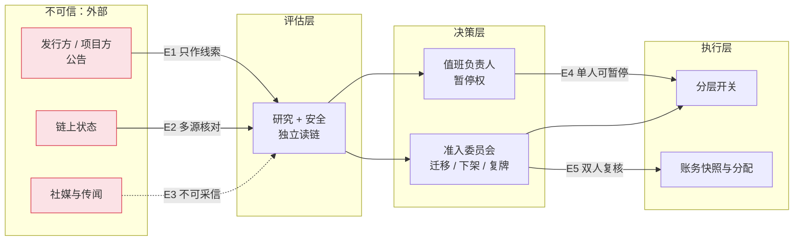
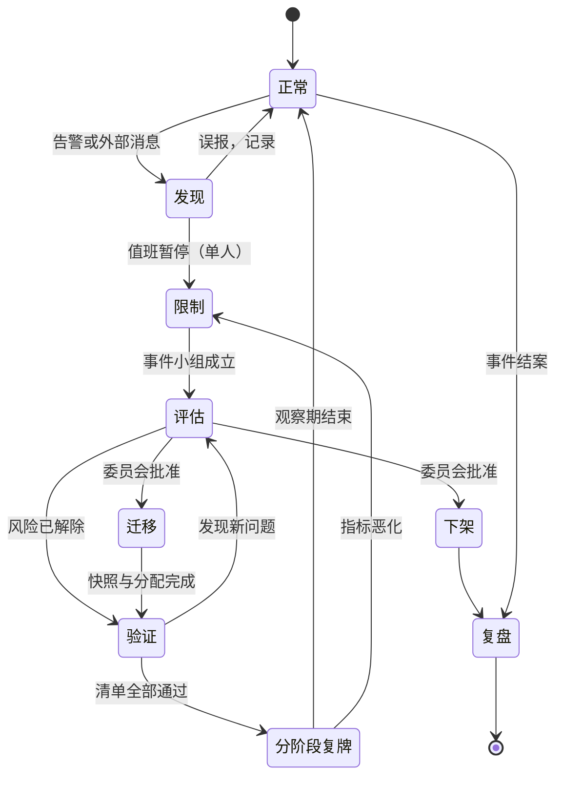
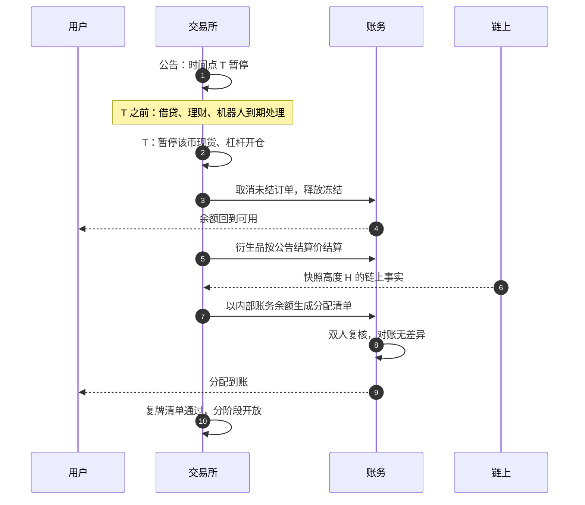

# X28 资产与市场准入·运营与恢复：异常资产处置、分叉迁移与复牌

> 学习目标：读完本章，你能——
> 1. 画出"正常 → 暂停 → 评估 → 迁移 / 下架 / 复牌"的状态机，并为每次转换写出进入条件、退出条件和授权人。
> 2. 对合约被攻击、分叉空投、合约迁移、发行方冻结、桥资产脱锚等八类异常，各写出第一小时的动作表和复牌清单。
> 3. 设计分叉与迁移的快照口径，写出未结订单、衍生品头寸和借贷头寸的处理规则，并用两个桌面推演检验。
>
> 适用角色：交易所安全工程师、上币与市场运营、风控与财务、合规与客服负责人。
> 前置章节：[X09 资产与市场准入](X09-cex-asset-listing-market-access.md)、[X27 资产与市场准入·工程验收](X27-cex-listing-verification.md)、[A05 上币与合作项目尽调](../assessment/A05-listing-due-diligence.md)、[X05 检测与响应工程](X05-detection-response-engineering.md)、[X06 韧性与验证](X06-resilience-validation.md)
> 交互实验 / 模板：[T09 事件手册与值班](../templates/T09-incident-runbook-oncall.md) ｜ [T10 桌面推演剧本与评分表](../templates/T10-tabletop-script-scorecard.md) ｜ [事件响应模拟](../interactive/incident-response-sim.html)
> 最后核对：2026-11-23

---

## 开场：一个周五晚上的 USDC

2023 年 3 月 10 日（周五）晚，Circle 披露，约 400 亿美元 USDC 储备中，有约 33 亿美元滞留在刚倒闭的硅谷银行（SVB）。The Block 报道，Coinbase 随即宣布暂停美元与 USDC 之间的转换，理由是银行周末不营业，转换依赖银行转账。公开报道称，当晚 USDC 市价跌到约 0.93 美元（CoinGecko 数据）。Binance 同时暂停 USDC 到 BUSD 的自动转换，公告称原因是流入量大、转换负担加重。

这两家交易所没有下架 USDC，也没有停掉现货交易。它们只关掉了一条"转换通道"。

<details class="predict"><summary>🤔 先猜再看：周五晚上，交易所的值班人员手里应该有几个开关？只有一个"下架 USDC"够不够？</summary>

不够。"下架"太重：它要取消订单、强平头寸、通知用户，还不可逆。当晚的问题只是"转换通道的对手方暂时不可用"。值班人员需要的是一排可以独立关闭的开关：转换、充值、提币、现货、杠杆、抵押。每个开关都要事先定好谁能关、什么条件下重开。本章 3 到 6 节就是这套开关和它背后的规则。

</details>

---

## 1. 一句话理解

**异常资产处置的目标，是在信息不全的前几个小时里，用最小、可逆的限制挡住新增损失；然后用证据换取权限，一级一级把业务开回来。**

> 🎯 打个比方：像地铁线路出了故障。先停一条线（暂停），再查原因（评估），然后选择：修好重开（复牌）、改走新线（迁移）或关闭线路（下架）。重开时先放空车试跑，再放少量乘客，最后全面运营。没有人会在故障刚发生时就宣布"线路永久关闭"。
>
> 比喻的局限：地铁线路归运营方所有。代币的合约、桥和发行方都在交易所之外，交易所无法修理，只能决定接不接。

与相邻章节的分工：

| 章节 | 回答的问题 |
|---|---|
| [X09](X09-cex-asset-listing-market-access.md) | 怎样准入、分级、监控；给出暂停与下架的基本权限（LST-C13、LST-C14）。 |
| [X27](X27-cex-listing-verification.md) | 开关是否真能独立生效；怎样验收。 |
| **X28（本章）** | 事件发生后，怎样一步步处置、迁移、分配、复牌，以及怎样对外沟通。 |
| [A05](../assessment/A05-listing-due-diligence.md) | 复评时怎样重新给项目打分。 |

---

## 2. 保护目标与信任边界

| 保护对象 | 事件中的主要威胁 |
|---|---|
| 用户资产与权益 | 误记账、重复分配、漏分配分叉币 |
| 交易所自有资产 | 接收假币、被迫以失真价格兑付 |
| 市场公正 | 暂停与复牌的时间被内部人利用；公告前泄露 |
| 证据 | 事后无法证明"当时为什么这样做" |



**读图要点：**

- 发行方公告是线索，不是事实（E1）。迁移合约地址、快照高度、兑换比例要与链上数据核对。公告可能被盗号发布。
- 值班负责人只有"暂停"权；迁移、下架、复牌、分配口径必须经过委员会。
- 分配动作（账务快照）是资金动作，必须走双人复核（E5）。
- 局限：图没有画监管与法务。需要冻结用户或通报监管时，合规团队要加入决策层。

---

## 3. 参考架构

### 3.1 八类异常与第一小时动作

下表是"事件分类表"。值班人员拿到事件后，先对号入座，再动手。

| 类型 | 典型信号 | 第一小时动作（建议） | 常见处置终点 |
|---|---|---|---|
| A 合约被攻击 | 异常增发、大额流出、安全公司预警 | 暂停该币充值、提币；对杠杆与抵押关闭新开仓；保留现货撤单 | 复牌或下架 |
| B 可升级合约被改 | 代理合约实现地址变化；owner 变更 | 暂停充提；比对新实现的字节码与权限 | 复评后复牌或下架 |
| C 精度或规则变更 | decimals 变化；转账带税；rebase | 暂停充提；核对账务精度与手续费规则 | 调整配置后复牌 |
| D 分叉与空投 | 共识分叉；快照公告 | 在分叉高度前暂停充提；确定快照口径 | 分配后复牌；不支持则公告 |
| E 改名与迁移 | 项目宣布 1:1 换币 | 冻结旧币新增能力；映射新旧标识 | 迁移后以新合约复牌 |
| F 发行方冻结 | 地址被列入黑名单；发行方暂停转账 | 隔离受影响充值；法务确认来源 | 个案处理 |
| G 桥资产脱锚 | 桥被盗；桥暂停；价格偏离 | 按"桥"暂停该桥全部资产（LST-C12） | 迁移到原生资产或下架 |
| H 稳定币脱锚 | 价格长时间偏离 1 美元；储备事件 | 关闭自动转换与抵押；调高折价率 | 恢复锚定后分阶段复牌 |

> 💡 注意：第一小时的原则是"只关闭新增风险的入口，不动已有头寸"。撤单与平仓通道尽量保持开放，用户需要退出的权利。

### 3.2 恢复状态机



| 状态 | 进入条件 | 退出条件 | 谁有权推动 |
|---|---|---|---|
| 发现 | 告警、外部消息、用户反馈 | 值班确认真假 | 值班工程师 |
| 限制 | 命中 3.1 表中任一类 | 事件小组成立 | 值班负责人（单人可暂停，30 分钟内补记录） |
| 评估 | 小组成立，开始读链 | 形成评估结论与证据包 | 安全 + 研究 |
| 迁移 / 下架 | 评估认为无法原样复牌 | 迁移完成，或下架流程完成 | 准入委员会 |
| 验证 | 风险已解除或迁移完成 | 清单全部通过 | 安全、财务、风控三方签 |
| 分阶段复牌 | 验证通过 | 观察期结束 | 委员会批准；每一阶段值班负责人执行 |
| 复盘 | 事件结案或下架完成 | 复盘报告与档案更新 | 安全负责人 |

**读图要点：**

- "限制"是单人可进入的状态，"复牌"需要多人确认。这是刻意的不对称：暂停容易，开启难。
- 验证失败会退回"评估"，不会直接回到"限制"。状态机要求每次退回都带新证据。
- 分阶段复牌中指标恶化，直接回到"限制"，不需要重开委员会。
- 局限：状态机针对单个资产。一座桥出事要批量处理几十个资产，见 6.1 的批量开关。

### 3.3 决策矩阵

| 影响范围 | 恢复条件 | 授权人 | 时间窗（示例目标） |
|---|---|---|---|
| 单个币，只影响充提 | 链上权限与总供应核对一致；入账测试通过 | 值班负责人 + 研究 | 暂停：15 分钟；复牌：24 小时内决定 |
| 单个币，影响交易 | 价格源恢复；深度达标；公告已发 | 委员会 | 暂停交易：30 分钟；复牌：视评估 |
| 整座桥或整条链 | 桥方公告 + 链上锁定资产与总供应一致 | 委员会 + 安全负责人 | 暂停：30 分钟；复牌：以天计 |
| 涉及杠杆或抵押 | 折价率与集中度重估；持仓分布核对 | 委员会 + 风控负责人 | 先关新开仓，再评估 |
| 涉及分配（分叉、迁移） | 快照口径批准；双人复核；对账无差异 | 委员会 + 财务负责人 | 计划事件提前 ≥ 24 小时定口径 |
| 涉及执法冻结或制裁 | 法务书面意见 | 合规负责人 + 法务 | 按法定时限 |

### 3.4 用户资产与未结订单



**读图要点：**

- 先处理"有时间属性的产品"（借贷、理财、机器人、期货），再暂停现货。公开的 MATIC 迁移公告就是这样排期（见 8.4）。
- 分配以账务账本的净余额为准，不以钱包地址余额为准。交易所钱包里的币属于所有用户的混合头寸。
- 局限：用户在暂停窗口内转入的币，需要"待定池"收口，见 LSR-C05。

### 3.5 三类难处置事件的做法

**合约被攻击（A 类）。** 先判断攻击是否影响"交易所收到的币"。如果攻击者能无限增发，所有新充值都可能是假币，充值必须先停。如果只是项目方金库被盗，用户持有的币可能仍有价值，交易所可以只停充提、保留现货。评估要回答三个问题：总供应有没有异常；攻击者的地址有没有向交易所充值；修复方案是否需要用户换币。第三个问题的答案决定后面走"复牌"还是"迁移"。

**发行方冻结（F 类）。** 发行方冻结某个地址，不等于交易所可以冻结用户。交易所要先确认：这笔币是否来自被冻结的地址；充值是否已经入账；用户是否有违规证据。这三项里任何一项不清楚，先把这笔充值放进待定池，交给合规与法务，不要由客服或值班人员自行决定。冻结用户是对客户的限制，权限归合规，不归运营。

**桥资产脱锚（G 类）。** 桥资产的价值来自桥背后的锁定资产。桥一旦出事，同一座桥下所有资产同时失效。值班人员不要逐币判断，按桥整体暂停（LST-C12）。复牌条件不是"价格回升"，而是"锁定资产与总供应一致"这一链上事实。价格只是结果，不是证据。

---

## 4. 控制清单

优先级：P0 = 缺它会直接造成资损或无法对外自证；P1 = 显著降低风险；P2 = 成熟度提升。

| ID | 控制项 | 要防什么 | 优先级 | 怎么验证 |
|---|---|---|---|---|
| LSR-C01 | 异常资产分类表与第一小时动作表（3.1），值班可查 | 现场临时判断、动作不一致 | P0 | 抽一个类型，值班人员 5 分钟内说出前三步 |
| LSR-C02 | 分层开关：按资产、按链、按桥、按合约地址分别关闭充值、提币、现货、杠杆、抵押、转换 | 只能"全停"或"全开" | P0 | 测试环境逐项关闭，其他能力不受影响 |
| LSR-C03 | 暂停权与解除权不对称：单人可暂停，解除需多人签 | 暂停被拖延；或被一个人擅自开启 | P0 | 检查权限表；演练计时 |
| LSR-C04 | 评估必须独立读链：合约字节码哈希、owner、总供应、桥锁定、发行方公告至少三源核对 | 轻信公告或传闻 | P0 | 抽事件档案，检查证据包 |
| LSR-C05 | 暂停期间到账的充值进入"待定池"，不自动入账，不自动退回 | 假币入账；重复记账 | P0 | 测试环境暂停后模拟充值，检查状态 |
| LSR-C06 | 未结订单、衍生品和借贷头寸的处理规则事先批准：撤单、结算价来源、强平是否暂停 | 事发时临时决定引发争议 | P0 | 桌面推演；规则文档 |
| LSR-C07 | 分叉、空投、迁移的快照口径：账户范围、净余额、借入与借出、衍生品、排除名单 | 漏分、重复分、分给不该分的人 | P0 | 回放一次历史分叉，对比分配与账本 |
| LSR-C08 | 迁移期标识管理：新旧合约地址白名单；ticker 复用时旧合约充值的处理规则 | 旧合约币被当新币入账 | P0 | 构造旧合约充值，检查拒收 |
| LSR-C09 | 发行方冻结与黑名单事件流程：隔离、法务确认、用户沟通 | 把被冻结的币当正常资产对待 | P1 | 推演：一笔充值来自被冻结地址 |
| LSR-C10 | 分阶段复牌：只提币 → 只充值 → 只撤单与平仓 → 限价 → 全面；每阶段有退出指标 | 一次性放开全部能力 | P0 | 检查复牌记录有阶段、有指标 |
| LSR-C11 | 复牌前清单：对账、证据保全、风险复评、公告准备、客服话术 | 带着未解问题复牌 | P0 | 抽事件，核对清单签字 |
| LSR-C12 | 对外沟通：公告模板、审批链、监管通报时限 | 沟通延迟、前后不一致、泄露 | P1 | 演练中计时；模板库检查 |
| LSR-C13 | 事件时间线与证据保全：每个操作记录人、时间、依据 | 无法自证尽职 | P0 | 抽事件重建时间线 |
| LSR-C14 | 演练：开关每季度测试；至少两个剧本每半年演练 | 手册从未试过 | P1 | 演练报告 |
| LSR-C15 | 复盘与准入档案更新：评分、层级、限额随之调整 | 事件后风险仍按旧评分处理 | P1 | 抽事件，检查档案修订 |

---

## 5. 分级落地

| 档位 | 做什么 | 人力（示例） | 时间（示例） |
|---|---|---|---|
| 最小可行 | 分类表（C01）；按资产暂停充提（C02 子集）；暂停权与解除权分开（C03）；待定池（C05）；公告模板 2 份（C12 子集） | 1 名安全 + 运营兼职 | 3–4 周 |
| 标准 | 加上分层开关（含按桥）；独立读链清单（C04）；未结订单与衍生品规则（C06）；快照口径（C07）；分阶段复牌（C10）；复牌清单（C11）；季度演练 | 2–3 名，含财务与风控兼职 | 2–4 个月 |
| 成熟 | 全部控制；批量开关；分配清单自动生成与对账；演练评分入度量 | 3–5 名 + 季度演练 | 6–9 个月，并持续运营 |

> 💡 注意：先修"谁能暂停"。如果暂停需要找三个人签字，周五晚上它就不会发生。

---

## 6. 落地做法

### 6.1 分层开关配置（示例）

```yaml
# 示例：资产能力开关与授权（字段为示意，不对应任何真实产品）
asset: XYZ
switches:
  spot:        { state: on, pause_by: [duty_lead],  resume_by: [committee] }
  deposit:     { state: on, pause_by: [duty_lead, secops], resume_by: [duty_lead, research, security] }
  withdraw:    { state: on, pause_by: [duty_lead, secops], resume_by: [committee, finance] }
  leverage:    { state: on, pause_by: [duty_lead, risk],   resume_by: [committee, risk_lead] }
  convert:     { state: on, pause_by: [duty_lead],  resume_by: [duty_lead, risk] }
groups:                       # 批量：按桥暂停
  bridge_ABC: [XYZ, XYZ2, XYZ3]
rules:
  pause_requires_record_within_minutes: 30
  resume_requires_checklist: LSR-checklist-v1
```

要点：每个开关有独立的暂停权与解除权；`groups` 让一次操作关闭一座桥下的所有资产。

### 6.2 分叉与迁移的快照口径（SQL 示例）

下面查询按净余额生成分配清单。表结构为示例。

```sql
-- 示例：快照时刻 T 的净余额（账务账本，不是钱包地址余额）
WITH bal AS (
  SELECT user_id, SUM(amount) AS gross
  FROM ledger_entries
  WHERE asset = 'XYZ' AND booked_at <= :snapshot_ts
    AND account_type IN ('spot','funding','margin','savings','staking','futures_coin')
  GROUP BY user_id
), debt AS (
  SELECT user_id, SUM(principal + accrued) AS owed
  FROM loans WHERE asset = 'XYZ' AND open_at <= :snapshot_ts
  GROUP BY user_id
)
SELECT b.user_id,
       GREATEST(b.gross - COALESCE(d.owed, 0), 0) AS eligible
FROM bal b
LEFT JOIN debt d USING (user_id)
LEFT JOIN excluded_users e USING (user_id)   -- 制裁、受限地区、受限账户
WHERE e.user_id IS NULL;
```

做法要点：

1. 口径文件先由委员会批准：包含哪些账户类型、借入怎样扣减、衍生品账户是否计入、排除名单。
2. 快照时刻用统一时钟，并记录区块高度或时间。
3. 清单总额与"可分配总量"对账，差异必须为 0 或有书面解释。
4. 双人复核后再入账；入账用幂等键，防止重跑。

> 💡 注意：口径要在快照之前定好。公开的 ETHW 与 Terra 公告都在快照前写明了账户范围与排除项（见 8.1、8.2）。

### 6.3 复牌门禁脚本（Python 示例）

```python
# 示例：复牌前自动核对硬条件。数据结构为示意。
from decimal import Decimal

def resume_gate(asset, ledger_liability, wallet_balance, onchain_supply,
                allowed_gap=Decimal("0")):
    checks = {
        "对账: 钱包 >= 账务负债": wallet_balance >= ledger_liability - allowed_gap,
        "总供应与预期一致": onchain_supply == asset["expected_supply"],
        "合约哈希在白名单": asset["code_hash"] in asset["approved_hashes"],
        "owner 为批准的多签": asset["owner"] in asset["approved_owners"],
        "待定池已清空或已处置": asset["pending_pool_count"] == 0,
    }
    failed = [k for k, v in checks.items() if not v]
    return (len(failed) == 0, failed)

# 调用示例：待定池还有 3 笔时，返回 (False, ["待定池已清空或已处置"])
```

脚本只做"必要条件"。通过不代表可以复牌：还要有委员会批准与公告。

### 6.4 恢复清单（可勾选）

**A. 对账与资金**

- [ ] 钱包余额 ≥ 账务负债（逐链、逐地址）
- [ ] 待定池的每一笔已处置并有记录
- [ ] 已入账的充值与链上流水逐笔核对
- [ ] 分配清单总额与快照一致

**B. 证据保全**

- [ ] 事件时间线（谁、何时、依据）
- [ ] 评估证据包：合约代码哈希、链上截图、发行方公告存档
- [ ] 所有暂停与解除操作的审批记录

**C. 风险复评**

- [ ] 重新评分（[A05](../assessment/A05-listing-due-diligence.md)），层级与限额已调整
- [ ] 观察期限额低于标准值
- [ ] 价格源与深度恢复；杠杆与抵押的折价率已重估

**D. 对外沟通**

- [ ] 复牌公告已审批，时间与阶段明确
- [ ] 客服话术与常见问题已发给一线
- [ ] 需要通报监管的，已通报

### 6.5 对外沟通模板

**模板 1：暂停公告**

```
【公告】关于暂停 XYZ 充值与提币的通知
时间：{UTC 时间}
我们发现 {事实，一句话}。为保护用户资产，自 {时间} 起暂停 XYZ 的充值与提币。
现货交易 {保持 / 暂停}。已有订单 {保留 / 取消}。
暂停期间转入的 XYZ 不会自动入账，恢复后我们将逐笔核对。
我们将在 {时间} 前更新进展。恢复时间待评估后公布。
```

**模板 2：迁移或分叉公告**

```
【公告】关于 XYZ 合约迁移的安排
旧合约：{地址}；新合约：{地址}（以我们公告为准，请勿向其他地址转账）
快照时间：{UTC 时间}（区块高度 {H}）
计入范围：{账户类型}；不计入：{借入、受限地区等}
暂停与复牌：{时间表}；未结订单：{处理方式}
我们保留在风险事件下调整或取消本安排的权利。
```

**模板 3：监管与合作方通知**（简报格式）

```
事件类型 / 影响资产 / 影响用户数（估计）/ 已采取措施 / 下一步与时间 / 联系人
```

规则：公告只写已核实的事实；不写原因推测；不承诺具体复牌时间，除非清单已通过。

### 6.6 常见坑

1. 只写"暂停"，不写"订单怎么办"。用户会在客服渠道争吵。
2. 分叉快照以钱包地址余额为准，漏掉了交易所内部转账。
3. 迁移期间旧合约充值被自动入账为新币。
4. 复牌与公告不同步，内部人先交易。
5. 暂停开关没有记录，事后无法回答"是谁关的"。

### 6.7 沟通与信息保护的规则

事件期间的信息有两个风险：说错，和说早。说错会让用户做出错误决定，说早会让内部人先于公众交易。规则如下。

1. 公告只由一个人发出，审批链固定：事件负责人、合规、公关。
2. 暂停与复牌的时间，在公告发出前只限事件小组知道，并登记名单。名单内人员及关联账户，在事件期间不得交易该币。这与 [X09](X09-cex-asset-listing-market-access.md) 的保密名单是同一套机制。
3. 客服只使用公告里的话术。用户问到公告没有的内容，回答"我们会在公告中更新"。
4. 发现假公告、假迁移地址时，在官方渠道置顶提醒，并向用户说明"我们不会通过私信提供迁移地址"。

暂停权本身也要有监控。每次暂停与解除写入审计日志，并每周抽查一次：暂停的理由是否与分类表一致，暂停与市场波动、持仓变化之间有没有可疑的时间关系。

---

## 7. 运营：指标、告警、值班、演练、季度节奏

**指标（示例）**

| 指标 | 目标（示例） |
|---|---|
| 从告警到暂停生效的分钟数 | 充提 ≤ 15；交易 ≤ 30 |
| 暂停操作有记录的比例 | 100% |
| 待定池平均处置时长 | ≤ 7 天 |
| 复牌清单一次通过率 | 观察趋势，不设红线 |

**告警（示例）**：合约 owner 或实现地址变化；总供应异常变化；桥锁定资产与总供应偏离；价格偏离指数；发行方公告关键词；暂停开关被操作。详见 [X05](X05-detection-response-engineering.md)。

**值班**：事件小组 = 值班负责人、安全、研究、财务、风控、客服、公关。周末与节假日要有备份名单。

**季度节奏**：第 1 月测开关与权限；第 2 月演练一个剧本；第 3 月复评低分资产并更新分类表。

### 7.1 演练剧本一：周五晚上的稳定币（35 分钟）

- **背景：** 周五 20:00。你们交易所有 USDC，且它是主要抵押品。
- **注入 1（0 分钟）：** 发行方公告称部分储备滞留在一家倒闭的银行。市价跌到 0.93。
- **注入 2（10 分钟）：** 用户大量把 USDC 转换为 USDT，转换池库存快速下降。
- **注入 3（20 分钟）：** 杠杆账户里有 15% 的抵押品是 USDC，强平引擎开始触发。
- **注入 4（30 分钟）：** 媒体问你们是否会下架 USDC。

**评分（共 10 分）：** 说出可关闭的开关并做出选择（2）；转换是否先关（2）；抵押折价率是否调整（2）；公告 30 分钟内发出（2）；是否避免承诺复牌时间（1）；是否指定下一次评估时点（1）。

### 7.2 演练剧本二：合约迁移与旧币充值（45 分钟）

- **背景：** 一个持仓用户较多的币宣布合约迁移，1:1 换新币，换币窗口 3 天。
- **注入 1：** 你们收到发行方公告（来自官方账号）。
- **注入 2：** 同一时间，有人在社媒发布"另一个迁移地址"。
- **注入 3：** 窗口开始后，两个用户把旧币充值进来，工单要求你们入账。
- **注入 4：** 借贷团队发现有用户用该币借了 USDT。

**评分（共 10 分）：** 独立读链核对迁移地址（3）；暂停与时间表（2）；借贷头寸处理（2）；旧币充值的规则（2）；公告（1）。

### 7.3 复盘怎样写

复盘报告用同一个结构：时间线、决策点、证据、偏差、改进项。决策点要写"当时知道什么、不知道什么"，避免用事后信息评价当时的人。每个改进项要有负责人和截止日期，并回写到对应的控制项（LSR-C01 到 C15）。复盘不追究个人责任，除非发现违规或内部人行为；这类情况转交合规与人事流程。

复盘还要回答三个运营问题。第一，暂停的速度是否达到目标；如果没有，是权限、工具还是信息的问题。第二，公告是否与实际操作一致；不一致就是信任风险。第三，用户端的实际影响：订单被取消的数量、客服工单量、投诉主题。这三类数据会进入季度度量，也是下一次演练的素材。

---

## 8. 失效案例

> 以下均为公开来源可核对的运营事件。它们不是"交易所失职"的案例，而是"异常处置怎样展开"的参照。金额与时间以来源为准。

### 8.1 Terra LUNA 与 UST 崩溃（2022 年 5 月）

- **来源类型：** Binance 公告；The Block、Decrypt 报道。
- **事实：** 2022 年 5 月 10 日，Binance 公告暂停 LUNA 与 UST 提币，理由是待处理提币交易积压造成网络拥堵（The Block）。公开报道称提币在数小时后恢复。5 月 13 日约 00:40 UTC，Binance 下架两币的现货与保证金交易对，约 14:00 UTC 以 BUSD 交易对恢复（Decrypt）。5 月 26 日，Binance 公告将 Terra 网络更名为 Terra Classic，旧币更名为 LUNC 与 USTC，并支持 Terra 2.0 新 LUNA 的空投：14:00 UTC 暂停旧币充提，15:00 UTC 暂停 BUSD 交易对并取消未结订单；5 月 30 日 09:30 与 09:45 UTC 恢复交易与充提。快照分"攻击前"（5 月 7 日 14:59 UTC，区块高度 7,544,910）与"攻击后"（区块高度 7,790,000）。借入的币与 USDT 本位合约账户不计入。
- **对应控制：** LSR-C02、C06、C07、C10。
- **教训：** 同一事件里，处置经历了暂停、交易对调整、更名与分配。每一步都是独立的状态转换，需要独立的授权与公告。口径在快照前写明。
- **未确认：** 提币恢复的精确时长在各来源间不一致（报道称数小时）。Binance 内部决策过程未公开，本章不推测。

### 8.2 以太坊合并与 ETHW 分叉（2022 年 9 月）

- **来源类型：** Binance 公告（2022-08-25、2022-09-15）；Decrypt 对 Coinbase 表态的报道。
- **事实：** Binance 提前公告暂停 ETH 与 ERC-20 充提，并预先写明两种情景：没有分叉币则尽快恢复；出现分叉则按快照分配。9 月 15 日 06:42:42 UTC 合并完成（区块高度 15,537,393）后，Binance 恢复充提，并公告：若 ETHW 分叉成功，按 1 ETH = 1 ETHW 分配，以该时刻的净 ETH 余额为准，计入现货、资金、保证金、储蓄、质押与合约账户；借入的 ETH 不计入；保证金负债要归还 ETHW，借贷负债按等量 ETHW 计入；美国人士与受制裁地区不适用；并称分配不保证上线交易。Coinbase 在 8 月表示会像对待其他资产一样审慎评估合并后出现的分叉币，不承诺上线（Decrypt）。
- **对应控制：** LSR-C07、C10、C12。
- **教训：** 计划性事件的最大价值在于提前写好"口径"和"两种情景"。分配不等于上线，两个决策要分开。
- **未确认：** 各来源对 Binance 暂停充提的起始时刻说法不一，本章不下具体时刻结论。

### 8.3 USDC 与硅谷银行事件（2023 年 3 月）

- **来源类型：** The Block、Fortune、Yahoo Finance 报道。
- **事实：** 见开场。Coinbase 暂停美元与 USDC 的转换，预期银行恢复营业后重启；Binance 暂停 USDC 到 BUSD 的自动转换。两者都没有下架 USDC。
- **对应控制：** LSR-C02（独立的"转换"开关）、C10。
- **教训：** 关"通道"而不是关"资产"。解除条件挂在可核对的外部事实上：银行是否营业、储备是否到账。
- **未确认：** 本章没有核对后续恢复的细节，也不评论各家的恢复节奏。

### 8.4 Polygon MATIC 到 POL 迁移（2024 年 9 月）

- **来源类型：** Binance 官方支持文章。
- **事实：** Binance 的公告按时间表逐项关闭或切换产品：9 月 2 日保证金借入暂停；9 月 4 日借贷平仓、期货结算；9 月 5 日保证金下架并取消挂单；9 月 9 日理财自动赎回；9 月 10 日 03:00 UTC 现货交易对下架并取消订单，03:30 UTC 暂停 MATIC 充提；9 月 13 日 10:00 UTC 开放 POL 交易对。兑换比例 1:1。公告提醒用户提前平仓、还款、取消机器人。
- **对应控制：** LSR-C06、C08、C10。
- **教训：** 计划迁移要按产品逐个排期，有时间属性的产品先处理。用户提醒写在公告里。
- **未确认：** 不同交易所的时间表不同（OKX 更早暂停 Polygon PoS 上的 MATIC），本章只引用 Binance 公告。

### 8.5 案例与控制的映射

| 案例 | 打到的状态 | 对应控制 |
|---|---|---|
| Terra | 限制、迁移、分配、复牌 | C02、C06、C07、C10 |
| 以太坊合并 | 计划暂停、分叉分配 | C07、C10、C12 |
| USDC | 通道级限制 | C02、C10 |
| MATIC 迁移 | 迁移、产品逐项处理 | C06、C08、C10 |

> 💡 注意：没有收入"某交易所处置失误导致用户损失"的案例，因为没有找到足够可靠且可核对的公开来源。

---

## 9. 评估检查点

- [ ] **LSR-1** 有八类异常的分类表与第一小时动作表，值班可查。
- [ ] **LSR-2** 开关可按资产、链、桥、合约地址分别关闭，并已测试其他能力不受影响。
- [ ] **LSR-3** 暂停权与解除权分开；暂停有 30 分钟内补记录的要求。
- [ ] **LSR-4** 评估有独立读链清单，至少三源核对。
- [ ] **LSR-5** 暂停期间的充值进入待定池，并已测试。
- [ ] **LSR-6** 未结订单、衍生品、借贷头寸的处理规则已批准。
- [ ] **LSR-7** 分叉与迁移有快照口径文件，并回放过一次。
- [ ] **LSR-8** 迁移期新旧合约地址白名单与旧币充值规则已测试。
- [ ] **LSR-9** 发行方冻结事件有流程。
- [ ] **LSR-10** 复牌分阶段，每阶段有退出指标。
- [ ] **LSR-11** 复牌清单存在，且每次复牌有签字。
- [ ] **LSR-12** 公告模板与审批链已书面化，演练中计过时。
- [ ] **LSR-13** 事件时间线与证据可在 30 分钟内重建。
- [ ] **LSR-14** 近半年做过至少两个剧本演练。
- [ ] **LSR-15** 事件后档案、评分与层级已更新。

把检查结果写进报告：

| 结果 | 报告写法 | 动作 |
|---|---|---|
| 不满足且是 P0 | 红线项，写明影响与负责人 | 90 天内整改 |
| 不满足且是 P1 / P2 | 写入风险登记表 | 排入季度计划 |
| 满足但无证据 | 视为不满足 | 补证据 |
| 满足且有证据 | 记录证据位置与复核日期 | 季度复核 |

---

## 10. 上手路径

**第一周**

1. 列出现有每个资产的充值、提币、交易、杠杆开关，写下"谁能关、谁能开"。
2. 把 3.1 的分类表改成你们的版本。
3. 问客服："用户问某币为什么停了，你们看哪里？"

**第一个月**

1. 补齐暂停权与解除权的分离；建立待定池。
2. 写两份公告模板，找法务和公关审阅。
3. 做一次开关测试，记录分钟数。

**第一个季度**

1. 回放一次历史分叉或迁移，对比账本与分配清单。
2. 做剧本一或剧本二，输出评分。
3. 把复牌清单接入工单，让它成为复牌的必经步骤。

---

## 11. 常见误区

| 误区 | 事实 |
|---|---|
| "出了事先下架最安全" | 下架不可逆，会取消订单、触发连锁强平。先关入口，保留退出通道。 |
| "发行方公告就是事实" | 公告可能被盗号，也可能不准。以链上为准。 |
| "分叉币有就发" | 分配与上线是两个决策。口径要先批准。 |
| "复牌越快越好" | 复牌要有清单与阶段。快的代价是二次事故。 |
| "暂停只是运营的事" | 暂停是安全控制，权限、记录、证据都归安全治理。 |

---

## 12. 术语表

- **待定池（Pending Pool）**：暂停期间到账、尚未决定怎样处理的充值。
- **快照（Snapshot）**：在某一时刻或区块高度，记录每位用户余额的操作。
- **净余额（Net Balance）**：总余额减去借入。
- **分阶段复牌（Phased Resumption）**：按"只提币 → 只充值 → 只撤单 → 限价 → 全面"逐级开放。
- **分叉（Fork）**：链分裂，产生新的链与代币。
- **空投（Airdrop）**：项目方向持有者免费分发代币。
- **迁移（Migration）**：旧代币按比例换成新合约上的代币。
- **脱锚（Depeg）**：稳定币或桥资产价格长时间偏离其锚定价值。

---

## 13. 动手练习与思考题

- 画图：选一个你熟悉的币，画出它的"桥、合约、发行方"依赖图，标出每个依赖失效时你第一个关的开关。
- 写规则：为"分叉快照口径"写一页文件，包含账户类型、借入处理、衍生品、排除名单。
- 推演：用 [T10](../templates/T10-tabletop-script-scorecard.md) 的评分表，跑 7.1 或 7.2，并写出三条改进项。

思考题：

1. 分阶段复牌的第三阶段"只撤单与平仓"，对市场公正有什么好处？
2. 发行方冻结了一个地址，你们的用户钱包里正好有它转来的币。你们怎样决定是否冻结该用户？
3. 暂停开关本身是高权限动作。怎样防止它被内部人用来"为了利益暂停某币"？

> 🪞 反思：你们机构现在有几个人能在 15 分钟内合法地暂停一个币的提币？如果答案是"不确定"，先从 LSR-C03 开始。

建议配套（后续在 L3 训练营实现）：快照口径回放脚本；复牌门禁自动检查脚本。
