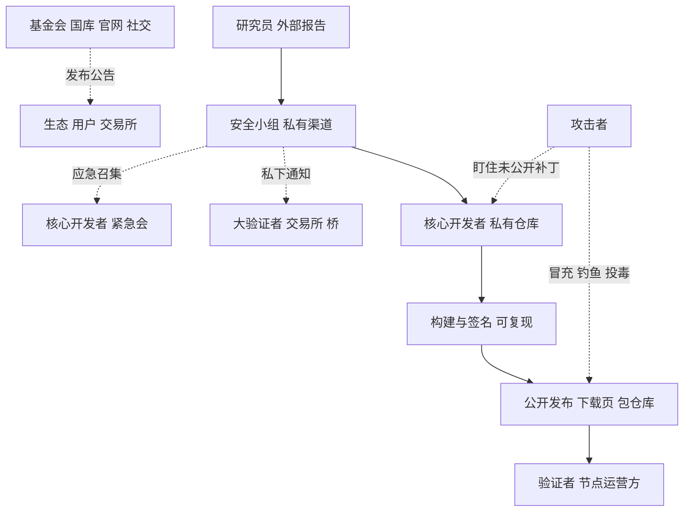
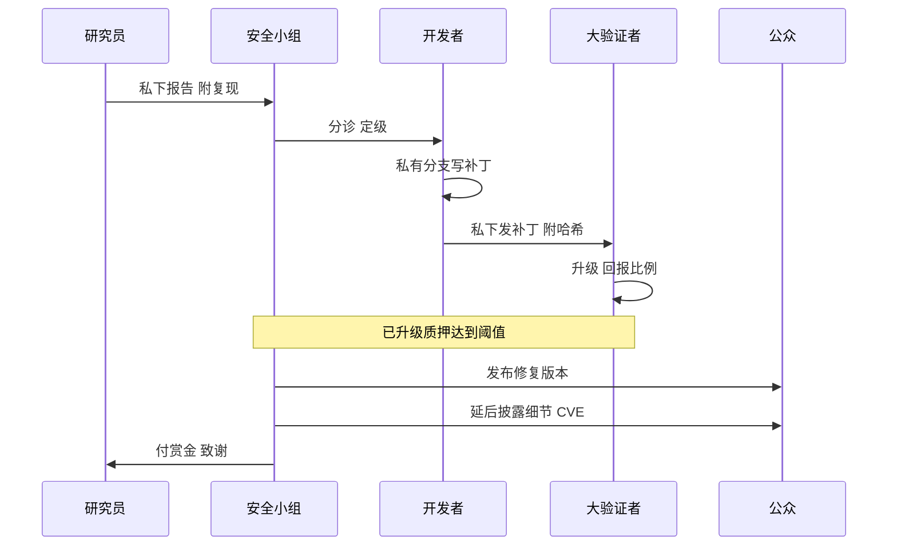
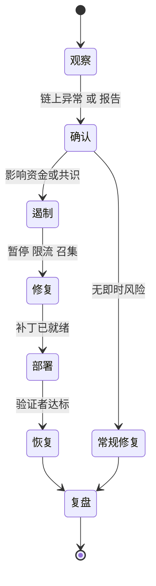
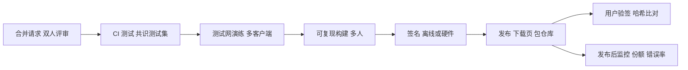

# X31 公链基金会与客户端团队：漏洞披露、客户端发布与紧急响应

> 学习目标：读完本章，你能——
> 1. 为一条公链或一个客户端团队写出漏洞披露政策、严重度分级和修复时间线，并设计"静默补丁 → 验证者升级 → 公开披露"的协调流程。
> 2. 画出客户端发布流水线（评审、多客户端测试、签名、可复现构建、测试网演练），并给每个关口配一条可验证的控制。
> 3. 为"共识 bug / 链停摆 / 经济攻击"准备一份决策手册：谁能召集、谁能决定、什么情况下才考虑紧急硬分叉或冻结地址。
>
> 适用角色：公链基金会与核心开发团队的安全负责人、客户端团队工程师、验证者社区协调人、交易所与桥的链上游对接人
> 前置章节：[16 共识层与链级安全](../16-consensus-chain-security.md)、[17 节点、RPC 与验证者基础设施](../17-node-rpc-infrastructure.md)、[C00 以太坊](../chains/C00-ethereum.md)、[X01 安全体系怎么搭](X01-security-program-controls.md)、[X05 检测与响应工程](X05-detection-response-engineering.md)
> 交互实验 / 模板：本章第 6 节的披露政策模板、严重度分级表、紧急决策单可直接复制；[confirmation-depth-lab.html](../interactive/confirmation-depth-lab.html)
> 最后核对：2026-11-23

> 💡 注意：本章只写公链核心团队与客户端团队特有的部分。日志、SIEM、值班、事件指挥等通用方法见 X05；资产分级、控制矩阵、RACI 见 X01；发布流水线的通用加固见 [X04](X04-delivery-supply-chain.md)；漏洞赏金平台的通用运营见 [X36](X36-disclosure-bounty-ops.md)。第 16、17 章已写过的链级事故不再复盘，只在需要时引用。

---

## 开场：一个只有 67% 的升级

2024 年 8 月 5 日 23:00（UTC），Solana 客户端团队 Anza 的核心工程师得知，一位外部研究员发现了验证者软件的一个严重漏洞。攻击者可以部署一个构造过的程序，让领导者节点逐个崩溃，最终可能让全网停止出块。

团队不能直接发补丁。补丁的代码差异本身会泄露漏洞位置。

团队的做法是：先私下联系大质押量的验证者运营方，告诉他们"稍后会有一个紧急更新"，并在公开渠道发布这条消息的哈希，让收件人能核对真伪。8 月 8 日 14:00 补丁私下分发。当天 20:00，据 Anza 事后分析，超过 67% 的网络已打上补丁。直到 8 月 15 日，团队才公开根因分析。

<details class="predict"><summary>🤔 先猜再看：为什么团队要等 67% 的验证者升级完，才公开细节？为什么是 67% 而不是 51%？</summary>

因为公开细节后，攻击者会立刻攻击没升级的节点。要让攻击"打不垮网络"，未升级的部分必须低于共识容错线。这类 BFT 共识在超过 1/3 质押离线时无法继续达成共识（第 16 章 5.2 节记录了 Solana 逼近 33.34% 阈值的险情）。"已升级质押 ≥ 2/3"意味着未升级部分不足 1/3，即使全部被打垮，网络也能继续出块。51% 是"多数"，不是"容错线"。

</details>

这个场景说明：公链和客户端团队的安全工作，核心是在**信息不对称**的窗口里，协调成百上千个独立运营方，赶在攻击者之前完成升级。你无法像交易所那样"一键部署"。你只能通知、说服、等待。

---

## 1. 一句话理解

**公链与客户端团队的安全工作，是在没有中央控制的网络里，管理"谁先知道漏洞、谁先拿到补丁、谁能按下紧急按钮"这三个时间差。**

客户端（Client）：实现链协议的节点软件，例如以太坊的 Geth（执行层）、Lighthouse（共识层）。
基金会（Foundation）：为一条公链提供资助、协调和公共品服务的非营利机构，通常不拥有链。
协调披露（Coordinated Disclosure）：研究员、开发者、下游运营方约定一个时间表，先修复，后公开。
静默补丁（Silent Patch）：不在发布说明里写明安全修复，等多数节点升级后再披露。

> 🎯 打个比方：公链的客户端团队像一座城市的自来水厂。厂里发现水管有一处会让全城停水的裂缝。厂长不能在广播里喊"某处有裂缝"，否则捣乱的人会先去砸。他会先给大小区的物业打电话，让他们悄悄换阀门，换够了再公告。
>
> 比喻的局限：自来水厂对每个小区有管理权，可以命令换阀门。公链团队没有这种权力。验证者是独立的，团队只能发布软件、通知和说服。这决定了本章所有机制的设计方向：靠信任关系、可验证的信息和事先约定的流程，而不是命令。

---

## 2. 保护目标与信任边界

### 2.1 六类需要保护的东西

| 类别 | 例子 | 失陷后果 |
|---|---|---|
| 协议正确性 | 共识规则、状态转换、密码学原语 | 通胀、双花、链分叉 |
| 客户端代码与发布物 | 源码仓库、构建服务器、发布签名密钥、下载页 | 恶意版本被验证者和用户安装 |
| 漏洞信息 | 未公开的漏洞报告、补丁、复现代码 | 补丁发布前被利用 |
| 升级与应急权限 | 升级多签、紧急暂停、验证者协调渠道 | 被滥用或被盗用，链被劫持 |
| 基金会资金与账号 | 国库钱包、资助款、官网、社交账号 | 资金被盗，假公告误导生态 |
| 生态协调关系 | 验证者联系人、交易所与桥的紧急渠道 | 紧急时联系不上、被假冒 |

### 2.2 信任边界图



读图要点：
- 实线是软件从报告到运营方的路径，虚线是"信息与权限"的路径。攻击者要么抢在补丁前利用漏洞，要么污染发布物。
- 最敏感的节点是"私有仓库 + 构建签名"。补丁在这里是明文，签名密钥在这里生效。
- 发布物到达验证者之前，没有集中的审核人。验证者只能靠签名和哈希自己验证。
- 局限：不同链的结构差别很大。比特币核心团队没有基金会；Cosmos 的各应用链各自有团队。你要按自己链的真实结构重画。

> 💡 注意：公链团队常见的错误假设是"开源，所以公开"。代码公开不等于漏洞可以公开讨论。一条安全修复的 PR 在合并时就可能泄露漏洞，所以安全修复要走私有流程。

---

## 3. 参考架构

### 3.1 五条流水线

一个成熟的公链核心团队同时运行五条流水线。

| 流水线 | 职责 | 主要产出 | 负责方（建议） |
|---|---|---|---|
| 漏洞披露 | 收报告、分诊、修复、披露 | 补丁、公告、CVE | 安全小组 |
| 客户端发布 | 评审、构建、签名、发布 | 带签名的版本 | 各客户端团队 |
| 升级协调 | 硬分叉排期、测试网演练、多客户端对齐 | 升级时间表与测试报告 | 核心开发者协调人 |
| 紧急响应 | 链停摆、共识 bug、经济攻击的处置 | 决策单、紧急补丁 | 响应指挥官 + 安全小组 |
| 基金会运营安全 | 国库、账号、官网、终端 | 控制与演练记录 | 基金会安全负责人 |

### 3.2 为什么要拆成多个客户端

多客户端是协议层的"独立校验"。一个客户端的共识 bug，会被其他客户端拒绝，网络不会跟着出错。

- 以太坊同时有多个执行层客户端（Besu、Erigon、ethrex、Geth、Nethermind、Reth）和多个共识层客户端（Grandine、Lighthouse、Lodestar、Nimbus、Prysm、Teku）。来源：ethereum.org 漏洞赏金页面（2026-11 核对）。
- 好处：一个客户端的 bug 通常只影响其份额。如果份额低于 1/3，终局性不受影响。
- 代价：多客户端也意味着更多团队、更多发布流程、更多披露协调。每增加一个客户端，协调成本上升。
- 单一客户端占比过高会失去这个好处。第 16 章 5.4 节记录了 2023 年和 2025 年的以太坊客户端事故，以及份额数据的差异。

> 💡 注意：Solana 2024 年 2 月停机时，超过 95% 的质押运行同一版本客户端（第 16 章 5.2 节）。这说明单一实现是系统性风险。Anza 2026 年 1 月的补丁摘要提到 Firedancer 与 Jito 参与协调，说明 Solana 已有多个客户端实现；本章不评估它们的份额。

### 3.3 协调披露的时序



读图要点：
- "回报比例"是关键反馈：安全小组要知道已升级质押占多少，才能决定何时公开。
- 阈值取决于链。Solana 2024 年案例用了 67%；Cosmos 2022 年案例把 1/3 视为"攻击会被看见"的第一个里程碑。
- 局限：这个流程假设泄露风险可控。如果漏洞已被他人发现或正在被利用，就要立即转为紧急响应（第 3.4 节）。

### 3.4 紧急响应状态机



读图要点：
- 从"确认"开始有两条路。分流依据是"是否正在发生资金或共识损害"。
- "遏制"在公链上不是"关掉服务"，而是"让验证者协调暂停出块、限流、冻结某些地址或停用某个模块"，这些都需要事先约定权限（第 3.5 节）。
- 局限：状态机只画了顺序。真实事故里"修复"与"部署"常常交叠，且需要在多个客户端上并行。

### 3.5 治理与权限：谁能按哪个按钮

| 按钮 | 典型持有者 | 风险 | 建议控制 |
|---|---|---|---|
| 发布新版本 | 各客户端团队的维护者 | 恶意版本被安装 | 多人批准；签名密钥分离 |
| 召集紧急会 | 响应指挥官；安全小组 | 滥用造成恐慌 | 写明触发条件和召集名单 |
| 升级合约 / 协议参数 | 多签；治理投票 | 被盗或被收买 | 时间锁；公开提案；硬件密钥 |
| 暂停链 / 暂停出块 | 验证者协调，或预设的紧急权限 | 审查与中心化争议 | 事先公开规则和退出方式 |
| 冻结地址 | 验证者多数，或链上治理 | 被指责中心化 | 事先写入政策；多数决；事后公开 |
| 紧急硬分叉 | 核心开发者 + 验证者 + 生态社会共识 | 链分裂；信任受损 | 最后手段；需要独立复核 |

> 💡 注意：这些权限在"去中心化叙事"和"应急现实"之间有张力。本章不替你判断哪种选择正确，只要求你**在危机之前**把规则写下来并公开。危机中才讨论规则，几乎一定会引发争议。ethereum.org 的 PoS 攻防文档也把社会层（社区协调选择哪条分叉）称为最终的兜底，并建议提前演练应对。

---

## 4. 控制清单

| ID | 控制项 | 要防什么 | 优先级 | 怎么验证 |
|---|---|---|---|---|
| CHN-1 | 公开的安全联系入口：官方披露页、报告表单或邮箱、加密方式、响应承诺 | 研究员找不到渠道，只好公开 | P0 | 用匿名邮箱发一份测试报告，查确认时间 |
| CHN-2 | 成文的披露政策：分级、时限、静默补丁规则、安全港 | 各方对"何时公开"预期不一致 | P0 | 政策页可访问，含更新日期与版本 |
| CHN-3 | 安全修复使用私有仓库或私有分支，合并前不暴露漏洞特征 | 修复 PR 泄露漏洞 | P0 | 抽查近 5 个安全修复的提交时间线 |
| CHN-4 | 紧急通知名单：大验证者、交易所、桥、节点服务商联系人，每季度核对 | 紧急时联系不上 | P0 | 发测试通知，统计 24 小时内确认率 |
| CHN-5 | 已升级质押比例的回报机制，用于决定何时公开 | 过早或过晚公开 | P1 | 演练中统计回报延迟 |
| CHN-6 | 发布物签名，签名密钥离线或硬件保管，多人批准 | 恶意版本冒充官方 | P0 | 随机下载一个版本，按文档验签 |
| CHN-7 | 可复现构建：多人独立构建并发布一致的哈希 | 构建服务器被入侵后无人发现 | P1 | 两名维护者独立构建，对比哈希 |
| CHN-8 | 硬分叉前的多客户端测试网演练，通过标准写明 | 升级在主网才暴露 bug | P0 | 查看升级清单与测试网报告 |
| CHN-9 | 客户端份额监控，设上限预警 | 单一客户端占比过高 | P1 | 看仪表盘与季度报告 |
| CHN-10 | 紧急响应手册：触发条件、指挥官、决策单、通信模板 | 危机中无人拍板 | P0 | 桌面推演计时 |
| CHN-11 | 升级 / 紧急权限的多签与时间锁，签名人轮换，独立解码 | 权限被盗或误用 | P0 | 读多签配置与签名日志 |
| CHN-12 | 基金会国库、账号、官网、包仓库账号分级保护，使用硬件密钥与单独终端 | 资金被盗，假公告，发布账号被钓鱼 | P0 | 账号盘点与登录策略审计 |
| CHN-13 | 事故后公开复盘，含时间线、根因、行动项 | 信任流失，重复犯错 | P1 | 近 12 个月事故都有复盘链接 |

---

## 5. 分级落地

人数和周期为"建议"，不是统计数字。

| 档位 | 适用 | 做什么 | 需要的人 | 时间 |
|---|---|---|---|---|
| 最小可行 | 新链、单客户端、核心团队 < 20 人 | 披露页与邮箱；一页政策；私有仓库；发布签名；一份紧急联系表；每年一次推演 | 1 名安全负责人（可兼职）+ 外部审计 | 4–8 周 |
| 标准 | 主流 L1 的客户端团队、有基金会 | 完整披露政策与赏金；私有修复分支；可复现构建；多客户端测试网演练；份额监控；紧急手册；国库与账号分级 | 3–6 人安全小组 | 3–6 个月 |
| 成熟 | 价值极高的链，多客户端、多团队 | 独立协议安全团队；审计竞赛；紧急召集渠道；定期桌面推演；对生态运营方有正式的安全通告机制 | 6–15 人，跨团队 | 持续迭代 |

> 💡 注意：最小可行档的关键是两件事：研究员有渠道可报，团队有一份写好的"谁拍板"。以太坊的漏洞赏金页要求通过表单提交，并把"未经同意公开披露"列为失去资格的条件，这是 CHN-1、CHN-2 的一种真实写法。

---

## 6. 落地做法

做法分七步：建披露入口与政策；定严重度与时限；搭私有修复流程；建紧急通知名单；固化发布与签名；排演升级与紧急响应；保护基金会自身。

### 6.1 披露政策模板（示例，可改写）

```markdown
# 安全披露政策（示例，版本 v1，更新于 YYYY-MM-DD）

## 报告方式
- 表单：https://example.org/security/report
- 邮箱：security@example.org（PGP 指纹：XXXX XXXX ...）
- 请勿在公开 Issue 或社交媒体上披露。

## 我们承诺
- 24 小时内确认收到（工作日）。
- 5 个工作日内给出初步严重度。
- 修复期间每 7 天同步一次进度。

## 披露时间线
- 默认：修复版本发布且 ≥ 2/3 的验证者升级后，才公开细节。
- 低风险：随版本发布说明一并公开。
- 正在被利用：立即转为紧急响应，通知与公开同步进行。

## 范围
- 在范围内：共识规则、P2P 协议、客户端 RPC、密码学库、发布物。
- 不在范围内：测试网、第三方应用合约、官网静态文案错误。

## 安全港
善意、遵守本政策的研究不会引发法律追究。请不要访问他人数据，不要攻击主网。
```

Geth 官方文档公开写明，团队保留静默修复共识类和拒绝服务类漏洞的权利。自 2020 年 11 月起的流程是：先在某个版本静默修复；4–8 周后披露该版本含安全修复；再过 4–8 周发布漏洞细节。理由是运营者升级慢，提前公布会让攻击者抢先。这是一种业界做法，不是唯一做法。来源：Geth 官方文档"disclosures"页（2026-11 核对）。

以太坊基金会赏金页（2026-11 核对）的范围包含两层客户端、规范、Solidity 与 Vyper 编译器、信标链存款合约和 KZG 依赖；官网、DNS 等基础设施不在范围内。各级奖金上限为：低 2,000 美元、中 10,000 美元、高 50,000 美元、严重 1,000,000 美元（以 ETH 支付，以官方页面为准）。

### 6.2 严重度分级与时限（建议，可改写）

| 级别 | 判据（示例） | 初步响应 | 修复目标 | 披露方式 |
|---|---|---|---|---|
| 紧急 | 可造成通胀、共识分叉、全网停摆，或已被利用 | 1 小时内指挥官确认 | 24–72 小时补丁就绪 | 先私下通知，达标后公开 |
| 高 | 可让大比例节点崩溃或被远程控制 | 1 个工作日 | 下一个紧急版本 | 静默补丁，延后披露 |
| 中 | 可让单节点崩溃、拒绝服务，需要特殊条件 | 3 个工作日 | 下一个常规版本 | 版本发布后 2–8 周披露 |
| 低 | 信息泄露、轻微行为偏差 | 5 个工作日 | 随常规版本 | 版本发布时披露 |

比特币核心给出了更保守的政策：低严重度在修复主版本发布 2 周后披露；中、高严重度在最后一个受影响版本停止维护后 2 周披露，约为修复版本首发后一年；紧急漏洞不适用标准政策，走临时流程。来源：Bitcoin Core 安全公告页（2026-11 核对）。

### 6.3 私有修复流程

1. 报告到达，安全小组 24 小时内确认。
2. 安全小组指定 2–3 名开发者，在私有仓库或私有 fork 工作。
3. 测试用例只写"行为不符"，不写利用细节。
4. 私有构建流水线输出补丁，只发给名单里的验证者。
5. 发给验证者的补丁带哈希，并在公开渠道发布该哈希，供收件人核对真伪（Anza 2024 年的做法）。
6. 公开版本的提交说明写"稳定性改进"，不写漏洞特征。
7. 达到披露阈值后，更新公告并申请 CVE。

> ⚠️ 警告：静默补丁不等于隐瞒。事后必须披露，让运营方明白自己为什么要升级。长期不披露，交易所和运营方无法评估是否要紧急响应。

### 6.4 紧急通知名单（YAML 示例）

```yaml
# emergency-notify.yaml（示例，字段可改）
review_cycle_days: 90
tiers:
  - name: tier1_validators
    criteria: "质押占比前 30 名或合计覆盖 ≥ 50% 质押"
    channel: [signal_group, phone]
    ack_deadline_min: 60
  - name: tier2_infra
    criteria: "节点服务商、RPC 提供商、质押服务商"
    channel: [email_pgp, private_chat]
    ack_deadline_min: 240
  - name: tier3_ecosystem
    criteria: "托管交易所、桥运营方、稳定币发行方"
    channel: [email_pgp, private_chat]
    ack_deadline_min: 240
verification:
  hash_publish_url: "https://example.org/security/hashes"   # 补丁哈希的公开渠道
  impersonation_check: "新联系人需用已知联系人二次确认"
```

常见坑：
- 名单只有"人名"，没有备用联系人。
- 名单从不测试。一年后一半电话已失效。
- 渠道是公开群，漏洞信息泄露。

### 6.5 发布流水线与可验证的发布物



读图要点：
- 每个关口只负责一件事：评审看代码，CI 看正确性，测试网看多客户端一致性，构建与签名保证发布物可信。
- 可复现构建的价值：多个维护者独立构建，得到相同哈希，就能发现某台构建服务器被篡改。Bitcoin Core 使用 Guix 做这件事，并公开多人的构建证明（通用做法；细节以其仓库文档为准，本次核对未能抓取）。
- 局限：可复现构建不能证明代码没有漏洞。它只证明"发布物与源码一致"。

用户端验证发布物的脚本示例：

```bash
# 示例：验证客户端发布物（以 PGP 签名为例，密钥指纹请取自官方文档）
set -euo pipefail
ARCHIVE="client-linux-amd64-v1.2.3.tar.gz"
SIG="${ARCHIVE}.asc"

# 1. 导入官方公钥并核对指纹
gpg --recv-keys "<官方公布的指纹>"
gpg --fingerprint "<官方公布的指纹>"

# 2. 验证签名
gpg --verify "$SIG" "$ARCHIVE"

# 3. 与官方发布说明中的哈希比对
sha256sum "$ARCHIVE"
```

Geth 下载页为每个发布物提供 PGP 分离签名，并列出构建服务器密钥和开发者密钥；页面说明 MD5 只用来发现下载错误，不是安全保证。来源：Geth 下载页（2026-11 核对）。

> 💡 注意：包仓库（npm、PyPI、crates.io）是另一条发布线。SDK 的发布账号被钓鱼，后果和客户端被换一样严重。见第 8.6 节。

### 6.6 升级协调：从提案到主网

通用做法如下。

1. 提案阶段：写规范，写参考测试，列出所有客户端的实现负责人。
2. 开发网（devnet）：多客户端互联，跑多轮。
3. 公共测试网：先在一个测试网激活，再在另一个测试网激活。
4. 审计与赏金：对新增代码做专项审计或竞赛。
5. 主网排期：公告日期与区块高度；给运营方、交易所、桥足够的升级窗口。
6. 升级后 24–72 小时：加强监控，保持值班。

2025 年 9 月 15 日至 10 月 13 日，以太坊基金会与 Sherlock 对 Fusaka 升级办了一次审计竞赛，奖池上限 200 万美元，Gnosis 与 Lido 共同赞助，基金会的协议安全团队参与评判。来源：以太坊基金会公告、The Block 报道。

测试不是万能的。第 16 章 5.4 节记录：Fusaka 上线约 5 小时后，Prysm 的一个 bug 在主网触发，参与率跌到约 75%。第 16 章 5.7 节记录：2026 年 10 月，Glamsterdam 在 Hoodi 测试网的激活被推迟，原因是继续调查 EIP-8037 与主网合约的交互。推迟是"测试网关口在起作用"的证据，不是失败。

### 6.7 紧急决策单模板（示例）

```markdown
# 紧急决策单（示例，事件开始时由指挥官填写）

事件编号：          发现时间（UTC）：          指挥官：
## 1. 事实（仅写已确认的）
- 现象：
- 影响范围（%质押 / %节点 / 已知资金损失）：
- 是否正在被利用：是 / 否 / 未知
## 2. 选项（至少 3 个，含"什么都不做"）
| 选项 | 好处 | 风险 | 需要谁同意 | 可逆吗 |
|---|---|---|---|---|
| A 发紧急补丁并私下通知 | | | | |
| B 请验证者暂停出块 | | | | |
| C 冻结指定地址（需多数验证者） | | | | |
| D 紧急硬分叉 | | | | |
## 3. 决定
- 选择：          理由：          决定人：          时间（UTC）：
## 4. 通信
- 通知谁、用什么渠道、何时：
## 5. 复核
- 24 小时内由谁独立复核本决定：
```

> ⚠️ 警告：紧急硬分叉、冻结地址、暂停出块是"可能违反链中立性承诺"的操作。事先没有公开规则的链，用这些手段会引发持久争议。写决策单时，要把"可逆吗"和"谁同意"写清。

### 6.8 基金会运营安全：最小做法

基金会常被当作"没有用户资产的非营利机构"，但它持有国库、官网、社交账号和大量资助关系。通用做法如下。

- 国库：冷热分层；大额支出多签加时间锁；签名人使用硬件密钥与专用设备。细节见 [29 签名路径 2026](../29-signing-path-2026.md)。
- 账号：官网域名、DNS、注册商、社交账号、包仓库账号、GitHub 组织，各设恢复邮箱和硬件密钥；关闭短信验证。
- 官方公告渠道：只设一个"权威来源"（官网或签名消息），所有公告可在此核对。
- 开发者终端：与国库签名设备分离；见 [21 社会工程与内部人员](../21-social-engineering-insiders.md)、[X03](X03-production-infra-security.md)。
- 对外资助与捐赠：资助地址变更要二次确认，防止商务邮件诈骗。

### 6.9 生态协调：交易所、桥与节点服务商怎样被通知

链上游团队要清楚：下游不是"用户"，而是需要提前预警的运营方。

- 交易所：被通知后，通常需要暂停该链的充提或提高确认数。它们的策略见 [16 章第 4 节](../16-consensus-chain-security.md)。
- 桥与 L2：被通知后，需要评估是否暂停消息传递。运营方设计见 [X32](X32-l2-bridge-oracle-ops.md)。
- 节点服务商与质押服务商：需要尽快升级，见 [17 章](../17-node-rpc-infrastructure.md) 与 [X35](X35-staking-validator-ops.md)。
- 通知内容：影响范围、建议动作、时间点、核实消息真伪的方法。不写利用细节。

---

## 7. 运营：指标、告警、值班、演练、季度节奏

### 7.1 指标

| 指标 | 含义 | 参考（建议） |
|---|---|---|
| 首次确认时间 | 报告到确认 | ≤ 24 小时 |
| 分级时间 | 报告到严重度决定 | ≤ 5 个工作日 |
| 修复时长 | 确认到补丁就绪（按级别） | 紧急 ≤ 72 小时 |
| 升级达标时间 | 补丁分发到已升级质押达阈值 | 记录，不设统一值 |
| 通知确认率 | 紧急名单 24 小时确认比例 | ≥ 90% |
| 客户端份额最大值 | 单一客户端占比 | 设预警线（建议低于 1/3） |
| 复盘闭环率 | 复盘行动项按期完成比例 | ≥ 80% |

### 7.2 监控告警示例（Prometheus 风格，示例）

```yaml
# 示例：客户端份额与最终性监控。指标名为假设，需对接真实数据源。
groups:
- name: chain-ops
  rules:
  - alert: ClientShareTooHigh
    expr: max(client_share_ratio) > 0.40
    for: 1h
    labels: {severity: P3}
    annotations: {summary: "单一客户端份额超过 40%，通知该团队与社区"}
  - alert: FinalityDelayed
    expr: (time() - chain_last_finalized_timestamp) > 900
    for: 5m
    labels: {severity: P1}
    annotations: {summary: "最终性停滞超过 15 分钟，启动紧急响应评估"}
  - alert: ParticipationLow
    expr: chain_attestation_participation_ratio < 0.80
    for: 10m
    labels: {severity: P2}
    annotations: {summary: "参与率低于 80%，查最近升级与客户端版本分布"}
```

> 💡 注意：0.40、900 秒、0.80 都是"示例"。要对照自己链的共识规则设阈值。以太坊的最终性在投票参与率低于 2/3 时停止（见第 16 章开场）。

### 7.3 值班与升级路径

- 安全小组：24 小时内有人确认收到报告；周末至少有 1 名备用。
- 紧急召集：触发条件写成清单（例如"最终性停滞 > 15 分钟"或"已确认资金被盗"）。
- 通用方法见 [X05 第 7 节](X05-detection-response-engineering.md)。

### 7.4 演练

- 每季度一次通知演练：向紧急名单发一条测试通知，统计确认率。
- 每年两次桌面推演：见第 13 节练习 3，推演方法取自 [X06](X06-resilience-validation.md)。
- 硬分叉前一次回退演练：在测试网故意触发一个客户端 bug，演练降级与回退。

### 7.5 季度节奏

| 月 | 做什么 |
|---|---|
| 第 1 月 | 核对紧急名单、发布密钥与权限、多签签名人 |
| 第 2 月 | 复盘本季度升级与事故；更新披露政策；审核客户端份额报告 |
| 第 3 月 | 通知演练；桌面推演；向管理层和社区发季度安全报告 |

---

## 8. 失效案例

> 以下案例每个都单独核对了公开来源，只写摘要和教训。金额写"约 / 事发时美元估值"。完整复盘见《Web3 行业安全资损 101》与 [28 事故案例库](../28-incident-casebook.md)。映射到本章 CHN 控制 ID。本章案例以"披露与应急协调"为主，不重复第 16、17 章已写的事故。

### 8.1 比特币 CVE-2018-17144：补丁、披露与矿工通知（2018-09，比特币）

- 公开事实：Bitcoin Core 的官方公告写明，2018 年 9 月 17 日有匿名报告者报告了一个崩溃漏洞。同日 Matt Corallo 发现它还能造成通胀：矿工可以重复花费同一输出，增加比特币总量。团队先发布只描述拒绝服务的修复（0.16.3 与 0.17.0rc4），保留通胀细节，并联系矿工和商家。9 月 18 日出现升级提示，9 月 20 日完整影响被披露。公告称，据团队判断超过一半算力已升级，团队不知道有人利用。
- 值得注意：团队把漏洞拆成"先披露轻的、后披露重的"，给升级留时间。9 月 20 日一篇论坛帖子曾提前泄露完整影响（很快被撤回，但消息已扩散），说明信息窗口很脆弱。
- 映射控制：CHN-3、CHN-4、CHN-5。
- 来源类型：项目方公告（Bitcoin Core）。
- 教训：分阶段披露有效但不绝对。要假设信息会提前泄露，并据此设计时间线。

### 8.2 Polygon PoS 创世合约漏洞与静默硬分叉（2021-12，Polygon PoS）

- 公开事实：The Block 报道，白帽研究员 Leon Spacewalker 通过 Immunefi 报告了 Polygon 创世合约中的一个严重漏洞，可能被用来任意铸造 MATIC，约 92 亿枚（总量 100 亿）处于风险中。团队先修补 Mumbai 测试网，随后在 12 月 5 日用硬分叉做紧急主网升级，没有提前公告。补丁上线前，有攻击者窃取了 801,601 MATIC（约 200 万美元，事发时估值）。另一位匿名白帽随后提交了同一漏洞。12 月中旬社区注意到无预警硬分叉，团队才确认漏洞存在，12 月 29 日公布细节。两位白帽共获约 346 万美元赏金。Polygon 称将承担被盗损失，并在事后解释延迟披露参考了 Geth 的"静默补丁"做法。
- 映射控制：CHN-2、CHN-3、CHN-13。
- 来源类型：媒体报道（The Block、Cointelegraph 等）。Polygon 官方原文本次核对时未能取得，使用时请以官方公告为准。
- 教训：静默补丁的窗口里，漏洞可能已被他人发现。报告渠道、修复速度和事后透明度，要事先写进政策。

### 8.3 Cosmos Dragonberry：一周内协调数百个验证者（2022-10，Cosmos / IBC）

- 公开事实：Cosmos 论坛的事后回顾写道，2022 年 10 月 7 日 BSC 桥被利用后，工程师在 10 月 8 日开始审查 ICS-23 实现；10 月 9 日 Dev Ojha 发现 Dragonberry（可伪造 IBC 证明，进而双花 ICS-20 转账）；10 月 10 日各链验证者开始部署补丁，当天多数 SDK 链已有超过 1/3 投票权完成缓解；10 月 11 日另一个 Authz 漏洞（Elderflower）被报告；10 月 14 日两个修复一起发布。回顾称没有资金损失，称协调是"临时的"（ad hoc），并宣布成立技术顾问委员会（TAB）来建设安全开发流程与事故响应。论坛评论估算约 60 个链团队和 300 个验证者打了补丁，这是估算，不是官方统计。
- 值得注意：团队把"1/3 投票权已打补丁"当作早期里程碑：此后任何利用尝试都会让网络因结果不一致而停机，从"悄悄偷钱"变成"会被看见"。
- 映射控制：CHN-4、CHN-5、CHN-10。回顾承认协调渠道是临时的，说明 CHN-4 缺少"事先建好的名单"。
- 来源类型：生态官方论坛回顾（Cosmos 论坛）、安全公司披露（Verichains）。
- 教训：多团队生态必须事先建好通知名单与响应机制，不能临时拉群。

### 8.4 Solana 两次协调补丁（2024-08 与 2026-01，Solana）

- 公开事实（2024-08）：见开场。Anza 的根因分析称，外部研究员报告了虚拟机 CALL_REG 指令的对齐问题，可让领导者节点逐个崩溃。补丁 8 月 8 日私下分发，当天 20:00 超过 67% 的网络已打补丁，8 月 15 日公开分析。文章没有说它被利用。
- 公开事实（2026-01）：Anza 的补丁摘要称，2025 年 12 月，两个严重问题经 GitHub 安全公告私下报告（gossip 缓冲区越界读；投票处理未校验投票授权签名），与 Firedancer、Jito 和 Solana 基金会协调修复，运营方升级到 Agave/Jito v3.0.14 或 Frankendancer 0.808.30014。摘要称没有已知攻击。
- 映射控制：CHN-1、CHN-3、CHN-4、CHN-5。
- 来源类型：客户端团队官方分析（Anza 博客）。
- 教训：两次都是"外部报告 → 私下协调多个客户端和大验证者 → 达标后公开"。流程在重复中成熟，但公开细节有限，运营方要自己评估风险。

### 8.5 Sui Cetus：用验证者共识冻结被盗资金（2025-05，Sui）

- 公开事实：2025 年 5 月，Cetus 协议被盗，媒体报道总额约 2.2 亿美元（事发时估值）。媒体报道称，Sui 基金会声明大量验证者识别出相关地址并忽略与这些地址有关的交易，约 1.62 亿美元被冻结。5 月 27 日，Cetus 请求社区投票回收冻结资金。基金会博客称，它排除本方质押以保持中立，并称"没有人能单方面决定"（媒体引述）。投票按质押权重，要求总质押超过 50% 参与且"赞成"多于"反对"。基金会博客称，代表 90.9% 质押的验证者投了赞成，投票提前结束。资金经协议升级转入一个 4-of-6 多签信托钱包（Cetus 2 个、Sui 基金会 2 个、审计方 OtterSec 2 个），待 Cetus 按补偿方案归还用户。升级只允许指定地址为两笔预定的回收交易代行黑客地址的身份，不能用于其他目的。
- 值得注意：这是一次"链级干预"的公开决策样本。结果有争议：有评论把它与以太坊 2016 年的 DAO 分叉相比，称验证者"选择了务实"；也有人认为这损害中立性。本章不下结论。
- 映射控制：CHN-10、CHN-11。公开材料没有显示冻结规则在事发前已公开，规则是事后临时公布的。
- 来源类型：基金会官方博客（Sui 基金会）、媒体报道（The Block、Cointelegraph）。
- 教训：如果你可能冻结资金，规则要在危机之前公开；如果你不想拥有这个权力，也要事先写明，并想清楚后果。

### 8.6 @solana/web3.js 发布账号被钓鱼（2024-12，Solana 生态）

- 公开事实：维护者的发布说明称，一个发布账号被入侵，1.95.6 与 1.95.7 两个恶意版本在约 5 小时内可下载。恶意代码盗取私钥并发送到固定地址，修复版本是 1.95.8，事件被分配 CVE-2024-54134。研究者认为账号通过钓鱼或社会工程被入侵。Helius 首席执行官估算损失约 13 万美元（媒体转述，不是官方统计）。维护者称问题不在 Solana 协议，而在这个 JavaScript 库，且主要影响直接处理私钥的项目。
- 映射控制：CHN-6、CHN-12；通用部分见 [X04](X04-delivery-supply-chain.md)。
- 来源类型：安全公司分析与媒体综述（Socket、Cyfrin、Infosecurity Magazine 等，经检索结果转述）。维护者的原始公告本次核对时未能抓取。
- 教训：SDK 的发布账号与客户端发布密钥同等重要。发布要用硬件密钥、短期令牌、两人批准。

> 💡 注意：**基金会自身国库或官方账号被盗**的公开案例，本次核对没有找到可靠来源，本章没有写，也不用传闻代替。另有 Zcash 2018–2019 年的一个旁证：Electric Coin Company 称，2018 年 3 月发现一个可无限造币的密码学缺陷，用 10 月 28 日激活的 Sapling 升级悄悄修复，2019 年 2 月 5 日才公开（CVE-2019-7167），并称未发现被利用的证据。这个案例说明"悄悄修复进升级"的做法，也说明窗口可以长达数月；本章不展开。

---

## 9. 评估检查点

- [ ] **CHN-1** 官方安全联系入口公开，测试报告能在 24 小时内收到确认。
- [ ] **CHN-2** 披露政策成文，含分级、时限、静默补丁规则与安全港，并有版本与更新日期。
- [ ] **CHN-3** 近 5 个安全修复使用私有分支，公开提交不泄露漏洞特征。
- [ ] **CHN-4** 紧急通知名单覆盖大验证者、节点服务商、交易所与桥，每季度测试一次，确认率达标。
- [ ] **CHN-5** 有"已升级质押比例"的回报机制，并在演练中用过。
- [ ] **CHN-6** 发布物有签名，密钥离线或硬件保管，发布需多人批准；用户文档有验签步骤。
- [ ] **CHN-7** 至少 2 名维护者能独立构建出相同哈希，并发布证明。
- [ ] **CHN-8** 硬分叉前有多客户端测试网演练和通过标准；有一份被推迟或失败的记录，证明标准在起作用。
- [ ] **CHN-9** 客户端份额有公开仪表盘和预警线，每季度向社区报告。
- [ ] **CHN-10** 紧急响应手册与决策单存在，指挥官有权召集，推演过一次并计时。
- [ ] **CHN-11** 升级与紧急权限由多签持有，有时间锁与轮换记录，签名人使用独立解码。
- [ ] **CHN-12** 国库、官网、DNS、社交账号、包仓库账号均有盘点，使用硬件密钥并关闭短信验证。
- [ ] **CHN-13** 近 12 个月每次事故或险情都有公开复盘，行动项有负责人和日期。

**把结果写进报告**：

| 检查项 | 状态（通过 / 部分 / 缺失） | 证据（链接 / 截图 / 日志） | 负责人 | 补齐日期 |
|---|---|---|---|---|
| CHN-1 | | | | |
| CHN-2 | | | | |
| CHN-3 至 CHN-13 | | | | |

---

## 10. 上手路径

### 第一周
1. 查你的项目是否有公开安全入口。没有就先建一个表单或邮箱，并发一条测试报告。
2. 找到现有的披露习惯：过去的补丁是怎么发的？有没有写过"静默"？
3. 列出你知道的验证者、交易所、桥的联系人，建一张草稿名单。
4. 盘点发布密钥、仓库管理员、官网与社交账号的持有人和 MFA 状态。

### 第一个月
1. 发布披露政策 v1（用第 6.1 节模板），并写分级表（第 6.2 节）。
2. 建立私有修复分支流程，演练一次"从报告到补丁"。
3. 做第一次通知演练，统计确认率。
4. 把紧急响应手册与决策单（第 6.7 节）交给指挥官签字。

### 第一个季度
1. 做一次桌面推演：已升级质押比例不足时，有人提前公开漏洞。
2. 落地发布签名与验签文档，推进可复现构建。
3. 建立客户端份额监控与最终性监控（第 7.2 节）。
4. 发布第一份季度安全报告，含事故、险情、行动项。

---

## 11. 常见误区

| 误区 | 为什么错 | 正确做法 |
|---|---|---|
| "代码开源，所以修复也该公开讨论" | 公开的修复 PR 会泄露漏洞 | 走私有分支，达标后公开 |
| "静默补丁就是不告诉别人" | 运营方不知道为何要升级 | 事后必须披露，并事先写进政策 |
| "多客户端就一定安全" | 份额高度集中时，起不到分散作用 | 监控份额，设预警 |
| "有赏金就不会有人公开" | 赏金不是安全港，规则不清也会引发争议 | 明确范围、时限、安全港、争议处理 |
| "紧急时再开会决定规则" | 事发时讨论规则会引发争议和拖延 | 事先公开冻结、暂停、硬分叉的原则 |
| "基金会没有用户资产，所以不用防" | 国库、官网、账号和资助关系都是目标 | 按 X01 把基金会的资产也分级保护 |
| "发布了安全版本就结束了" | 升级可能很慢，攻击者盯着旧版本 | 追踪已升级比例，主动联系大运营方 |

---

## 12. 术语表

| 术语 | 英文 | 定义 |
|---|---|---|
| 客户端 | Client | 实现链协议的节点软件 |
| 基金会 | Foundation | 为公链提供资助和协调服务的机构，通常不控制链 |
| 协调披露 | Coordinated Disclosure | 报告方与开发者约定时间表，先修复后公开 |
| 静默补丁 | Silent Patch | 不在发布说明中写安全修复，延后披露 |
| 共识 bug | Consensus Bug | 让节点对同一区块产生不同判断的缺陷 |
| 可复现构建 | Reproducible Build | 不同人构建同一源码得到相同二进制 |
| 终局性 | Finality | 区块不可逆转的状态；以太坊 PoS 的最终性在投票参与率低于 2/3 时停止 |
| 紧急硬分叉 | Emergency Hard Fork | 为应对事故而紧急发布的、不兼容旧规则的升级 |
| 技术顾问委员会 | Technical Advisory Board | 为生态提供安全方法的专家组，例如 Interchain 基金会的 TAB |
| 安全港 | Safe Harbor | 对善意研究者不追究法律责任的承诺 |
| 紧急通知名单 | Emergency Notify List | 紧急时优先联系的运营方清单 |
| 社会层 | Social Layer | 社区对"哪条链合法"做最终判断的协调层 |

---

## 13. 动手练习与思考题

### 练习 1：写一份披露政策（45 分钟）

为一条虚构的新链写 1 页披露政策。用第 6.1 节模板，要回答：谁来收报告？多久确认？什么情况下可以静默补丁？什么时候公开？写完后对照 CHN-1、CHN-2 自评。

### 练习 2：设计通知名单与演练（60 分钟）

假设该链有 120 个验证者，质押前 20 名占 52%（示例）。按第 6.4 节写一份 YAML 名单，并设计一次测试：你如何证明 24 小时内 ≥ 90% 的前 20 名收到了通知？写出统计表格。

### 练习 3：30 分钟桌面推演

场景（示例）："一位研究员报告执行层客户端 A 有可远程崩溃的漏洞，客户端 A 占 45% 份额。你们发了私下补丁，当天已升级质押达到 55%，但有人在社交媒体上发布了模糊的暗示。"两人一组，一人当主持人，一人当指挥官。回答：现在要不要提前公开？谁决定？通知谁？用第 6.7 节决策单记录。

### 建议配套（后续在 L3 训练营实现）

- 客户端份额与最终性监控的回放脚本：读一段历史指标，验证告警规则。
- 通知名单覆盖率检查小工具：读 YAML，输出前 N 名质押覆盖率与过期联系人。

### 思考题

1. 如果你的链只有一个客户端，披露流程和发布流程分别要增加哪些独立校验？
2. Sui 的案例里，基金会把自己排除在投票之外。如果你的基金会持有 30% 质押，你在写紧急决策规则时要先回答哪三个问题？
3. 公开披露时间要不要和"已升级质押比例"挂钩？如果一个漏洞已经在社交媒体上流传，你的规则怎么变？
