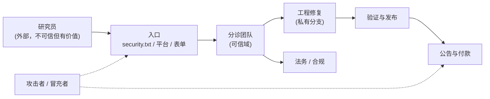
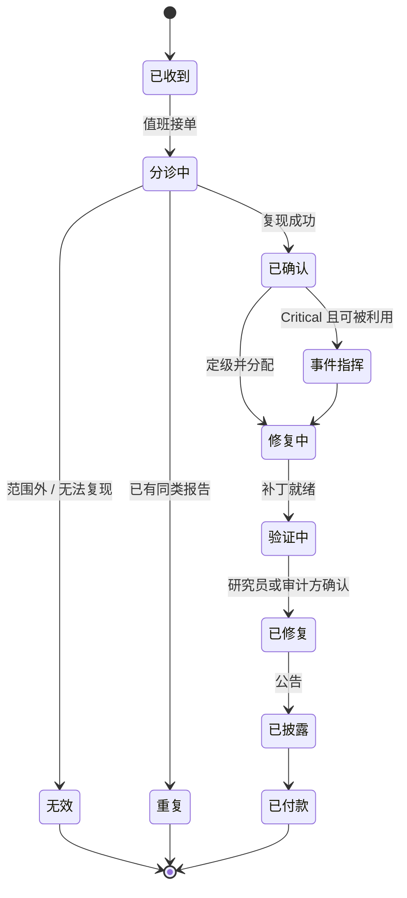
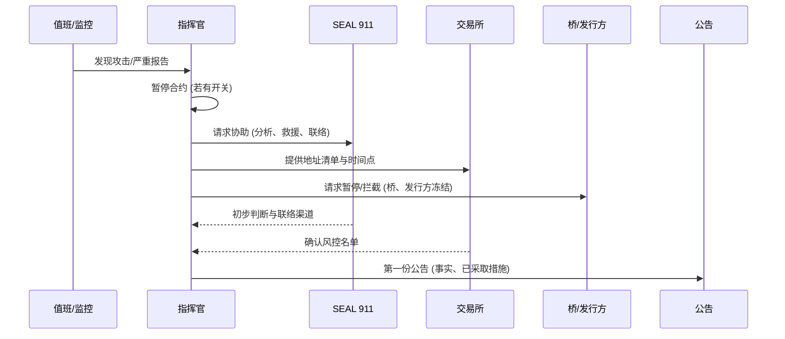

# X33 漏洞披露、赏金与安全社区协作：从收报告到修复公告

> 学习目标：读完本章，你能——
> 1. 为一个项目搭起完整的漏洞披露入口：写出 `security.txt`、披露政策（VDP）和赏金范围，并说明为什么要写安全港条款。
> 2. 把"收报告 → 分诊 → 复现 → 修复 → 验证 → 披露 → 付款"做成有 SLA 的流程，并处理重复报告、敲诈式报告和严重度争议。
> 3. 在活跃攻击中判断何时联系 SEAL 911、交易所、桥和稳定币发行方，并写出事后公告与赏金修订。
>
> 适用角色：项目方 / 交易所 / 公链团队的安全负责人、赏金计划运营者、值班工程师
> 前置章节：[A07 外部审计与漏洞赏金管理](../assessment/A07-external-audit-bounty.md)、[25 资金追踪、冻结与事后处置](../25-fund-tracing-response.md)、[X05 检测与响应工程](X05-detection-response-engineering.md)、[X06 韧性与验证](X06-resilience-validation.md)
> 交互实验 / 模板：[incident-response-sim.html](../interactive/incident-response-sim.html)；本章给出 `security.txt`、披露政策、分诊 SLA 表、严重度映射和公告模板
> 最后核对：2026-11-23（平台规则与 SEAL 条款只写通用事实，以官方最新页面为准）

---

## 开场：一个真实场景

某交易所的安全邮箱在周五晚上收到一封邮件。标题是"你们的充值入账逻辑有问题"。正文只有一句话，没有附件。

邮箱由市场部的同事兼管。周一上午她才看到邮件，转给了安全团队。安全团队回信时，研究员已经在社交媒体上发了一条模糊的暗示。

<details class="predict"><summary>🤔 先猜再看：这封邮件的主要问题是什么？</summary>

主要问题是**入口没有负责人和时限**。报告内容可能是真的，也可能是假的。但这个流程里没有"谁在几小时内确认收到"的规则。研究员得不到回应，就会换渠道：公开暗示、找媒体，或者把漏洞留给别人。

本章的主线是：**披露流程是一条有 SLA 的生产流水线，和提币流程一样需要负责人、值班和演练。**

</details>

公开案例里有同类混乱。2024 年 6 月，Kraken 与 CertiK 就一份漏洞报告公开争吵，双方对事实的描述不同（见第 8 节）。2024 年 11 月，Trust Security 与 Immunefi 因为一份被判定为范围外的报告公开冲突。两起事件的共同点是：范围、规则和沟通方式没有在事前写清楚。

---

## 1. 一句话理解

**漏洞披露与赏金运营，是给"外部好人"一条安全、快速、有规则的路，让他们把漏洞交给你，而不是交给别人。**

漏洞披露政策（Vulnerability Disclosure Policy，VDP）：说明如何报告漏洞、你会怎样回应、研究员在什么条件下受保护的公开文件。
漏洞赏金（Bug Bounty）：对符合范围的有效漏洞付费的计划。它建立在 VDP 之上。
协调披露（Coordinated Disclosure）：报告方与受影响方约定一个窗口，修复后再公开细节。
安全港（Safe Harbor）：项目方承诺：在规则内行事的善意研究员，不会因此被追究法律责任。

> 🎯 打个比方：VDP 像一栋楼的"消防报警电话"。楼里的人发现烟味，有一个写在墙上的号码，接线员 24 小时接听，并承诺不追究报警人的责任。赏金像"举报奖金"，是额外的激励。
>
> 比喻的局限：消防电话的接线员是公共机构，法律地位清楚。项目方的安全邮箱没有这种背书；安全港条款的法律效力因司法辖区而异（见第 6.6 节）。

三个概念的关系：没有 VDP 的赏金像一则只有奖金的广告；没有赏金的 VDP 仍然有价值，因为它给出了入口和法律预期。

---

## 2. 保护目标与信任边界

要保护的有三样东西：用户资金、漏洞细节的保密性、研究员的善意。



**读图要点：**

- 入口是不可信边界。任何内容（附件、链接、PoC）都当作不可信数据处理，在隔离环境中打开。
- 漏洞细节只在"可信域"内流动。修复在私有分支里做，发布前不公开。
- 付款是另一个攻击面：冒充研究员改收款地址、伪造"已被他人先报告"等。
- 局限：图没有画出"研究员把细节同时发给多家"的情况。多方并行时，窗口与保密性更难保证。

> ⚠️ 警告：不要把报告附件直接在生产办公电脑里运行。PoC 可能包含恶意代码，或者本身会触碰真实合约。

---

## 3. 参考架构

### 3.1 披露体系的五个层

| 层 | 内容 | 负责人 | 为什么这样分 |
|---|---|---|---|
| 入口层 | `security.txt`、官网披露页、PGP 密钥、平台页面、表单 | 安全负责人 | 研究员 5 分钟内必须找到入口 |
| 政策层 | VDP、赏金范围、严重度、规则、安全港 | 安全负责人 + 法务 | 规则写清楚，才能减少争议 |
| 分诊层 | 收件箱、工单、值班、重复检测、复现环境 | 分诊工程师 | 速度决定研究员是否继续合作 |
| 修复层 | 私有分支、评审、测试、发布、升级 | 工程负责人 | 修复流程要避免泄露 |
| 沟通层 | 研究员沟通、联盟通知、公告、复盘 | 安全负责人 + 公关 | 一个人对外说话，口径一致 |

### 3.2 渠道选择：通用事实

| 渠道 | 通用特点 | 适合 | 要注意 |
|---|---|---|---|
| 自建 VDP（邮箱 + 页面） | 不付钱或手工付；完全自控 | 小团队、早期项目、公共产品 | 没有托管分诊和仲裁；SLA 全靠自己 |
| 托管赏金平台（如 Immunefi、HackerOne、HackenProof、Cantina） | 提供研究员社区、分级标准、提交流程；部分平台提供调解或仲裁 | 已有真实资金的协议、交易所 | 每家平台的规则、费用、KYC 和调解机制不同；范围写法要符合平台规则 |
| 审计竞赛（如 Code4rena、Sherlock 等） | 上线前、限定时间、众多研究员并行；按发现分奖 | 新代码上线前 | 是一次性活动，不能替代持续赏金 |
| 邀请制 / 私有赏金 | 只对选定研究员开放 | 敏感组件（共识、签名服务） | 覆盖面小 |

> 💡 注意：平台条款（费用、KYC、仲裁、付款时限、范围规则）会变化。写进合同或政策之前，读平台**官方最新页面**。本章只写通用事实。

### 3.3 严重度分级：口径要一致

多数 Web3 赏金平台使用 4 级：Critical、High、Medium、Low。以 Immunefi 的分级系统（截至 2026 年公开资料，v2.3）为例：它主要按"成功利用的后果"分级。智能合约类的 Critical 包括直接盗取用户资金、永久冻结资金、治理投票被操纵、协议资不抵债。如果利用需要特权或不常见的用户交互，等级可能被下调，或报告被拒。平台默认排除钓鱼 / 社工、需要泄露密钥的攻击、已被研究员自己利用的攻击，以及没有展示影响的自动扫描报告。项目可以在此基础上添加自己的排除项。

另一个常见概念是"范围优先"与"影响优先"：项目选择以规则列出的资产为准，还是只要产生足够的影响，项目自有的其他资产也算在范围内。各平台与各项目写法不同，以其官方页面为准。

建议：把你的严重度表和平台标准对齐，并写出你自己的例外。口径漂移是争议的第一来源。

---

## 4. 控制清单

| ID | 控制项 | 要防什么 | 优先级 | 怎么验证 |
|---|---|---|---|---|
| VDP-1 | 官网有披露页，`/.well-known/security.txt` 可访问，`Expires` 未过期 | 研究员找不到入口 | P0 | `curl -I` 检查状态码与 `Content-Type`；日历提醒到期日 |
| VDP-2 | 入口邮箱有 3 名以上接收人，不由市场 / 客服单独管理 | 周末无人看 | P0 | 周五晚发送测试邮件，记录确认时间 |
| VDP-3 | 有书面 VDP：范围、规则、响应时限、安全港 | 范围与权利不清 | P0 | 法务签字；官网可见 |
| VDP-4 | 赏金范围列出链上地址、域名、仓库、版本；排除项明确 | 范围争议 | P0 | 抽 5 个资产，与资产清单对账 |
| VDP-5 | 严重度表和平台标准映射成文，奖金区间明确 | 奖金争议 | P0 | 用 3 个历史案例做"盲评"，结果一致 |
| VDP-6 | 分诊 SLA：确认收到、初判、复现、修复计划、付款均有时限 | 研究员失去耐心 | P0 | 月度报告含各阶段耗时 |
| VDP-7 | 严重级报告 15 分钟内升级为事件（对接 X05 的 P1） | 严重漏洞被当作普通工单 | P0 | 演练：模拟 Critical 报告，计时 |
| VDP-8 | 复现在隔离环境（分叉链 / 测试网），不触碰生产 | 复现过程造成损失 | P0 | 检查复现手册；演练 |
| VDP-9 | 修复在私有分支，评审人名单最小化；发布前不公开 | 修复前泄露 | P1 | 抽查仓库权限与 PR 可见性 |
| VDP-10 | 付款流程：KYC / 制裁筛查（如适用）、收款地址回拨确认、双人审批 | 付款欺诈、违规付款 | P1 | 审阅最近 3 笔付款记录 |
| VDP-11 | 重复报告、争议和撤回有书面规则；有升级到调解的路径 | 争议升级为公开冲突 | P1 | 检查政策文本 |
| VDP-12 | 活跃攻击联络清单：SEAL 911、交易所、桥、稳定币发行方、链基金会 | 窗口丢失 | P0 | 清单每季度测试一次联络 |
| VDP-13 | 修复后 14 天内公告与复盘；复盘含赏金规则修订 | 经验不回流 | P1 | 检查最近 3 份公告 |
| VDP-14 | 度量：报告量、有效率、各阶段耗时、重复率、争议数、未修复积压 | 看不见运营质量 | P2 | 月报 |

---

## 5. 分级落地

| 档位 | 入口与政策 | 分诊与修复 | 联动与合规 | 人力与时间（示例） |
|---|---|---|---|---|
| 最小可行 | `security.txt`、披露页、3 人共享邮箱、一页 VDP；暂不设奖金，或小额感谢金 | 工单表 + 一页分诊手册；值班兼任 | 一份联络清单（SEAL 911 等）；法务审阅一次 | 1 名安全工程师 + 1 名法务，约 1–2 周 |
| 标准 | 托管赏金平台；严重度映射；奖池托管；PGP / 表单；安全港条款 | 分诊 SLA 与升级；隔离复现环境；私有修复分支；公告模板 | SEAL Safe Harbor 评估与采纳；付款合规；季度联络演练 | 2–3 名安全工程师兼职，约 1–2 个月 |
| 成熟 | 多平台 + 竞赛 + 邀请制；对敏感组件设专项赏金；赏金与上线门禁联动 | 7×24 分诊；重复检测；自动复现脚本；与审计方协作验证修复 | 与交易所 / 桥 / 发行方的预先协议；仲裁条款；对外透明度报告 | 专职 3–6 人，持续建设 |

---

## 6. 落地做法

### 6.1 `security.txt`：5 分钟能做完

`security.txt` 是 RFC 9116 定义的文件。它让研究员知道把报告发到哪里。按该 RFC：

- `Contact` 必须有；`Expires` 必须有且只出现一次，RFC 建议其值距今不到一年。
- 文件放在 `https://你的域名/.well-known/security.txt`，类型为 `text/plain`，编码 UTF-8。
- 可选字段有 `Encryption`、`Acknowledgments`、`Preferred-Languages`、`Canonical`、`Policy`、`Hiring`。
- RFC 建议用 OpenPGP 明文签名；签名时同时写 `Canonical`。

```text
# 示例：example.com 的 security.txt（把域名、邮箱改成你自己的）
Contact: mailto:security@example.com
Contact: https://example.com/security/report
Expires: 2027-05-31T00:00:00.000Z
Encryption: https://example.com/.well-known/pgp-key.txt
Acknowledgments: https://example.com/security/hall-of-fame
Preferred-Languages: en, zh
Canonical: https://example.com/.well-known/security.txt
Policy: https://example.com/security/policy
```

验证命令：

```bash
curl -sI https://example.com/.well-known/security.txt | grep -i -E "^(HTTP|content-type)"
curl -s  https://example.com/.well-known/security.txt | grep -E "^(Contact|Expires):"
```

> 💡 注意：`Expires` 是最常见的坑。文件过期后，自动化工具会认为它不可信。在日历里给"到期前 30 天"设提醒。

### 6.2 披露政策（VDP）模板

下面是可改写的骨架。时限与数值为示例，请按你的实际能力填写。

```markdown
# 漏洞披露政策（示例）

## 1. 范围
- 在范围内：合约地址（见附表）、域名 *.example.com、仓库 github.com/example/*（main 分支）
- 范围外：第三方依赖本身的漏洞（请报告给其维护者）、社工与钓鱼、DoS 压力测试、
  已公开或已知的问题、测试网（除非另有说明）、需要用户泄露私钥才能成立的攻击

## 2. 如何报告
- 发送到 security@example.com（可用 PGP 加密），或使用页面表单
- 请包含：受影响资产、复现步骤、影响说明、最小 PoC
- 请在分叉链或测试网上验证；不要在主网上利用

## 3. 我们的承诺（示例时限）
- 1 个工作日内确认收到（Critical：4 小时内）
- 5 个工作日内给出初步判断
- 严重度判定后 5 个工作日内给出修复计划
- 修复验证后 14 天内付款，并在征得你同意后公开致谢

## 4. 研究员的承诺
- 只做证明漏洞所需的最小测试；不读取、不修改、不外传用户数据
- 不在主网上转出或冻结任何资金
- 在我们确认修复前不公开细节；如超过 90 天无进展，可联系我们协商公开时间（示例）
- 不以公开漏洞相威胁，向我们或第三方索取报酬之外的任何东西

## 5. 安全港
如果你善意、遵守本政策，我们不会提起或支持针对你的民事或刑事追诉，
并会在第三方对你提起主张时说明你的行为属于本政策授权范围。
本条不适用于违反第 4 条的行为。
（本条对第三方和执法机关没有约束力；请由法务按当地法律审阅。）

## 6. 奖金与争议
- 奖金区间见严重度表；最终金额由安全委员会按影响与报告质量确定
- 重复报告：奖金给第一个提交完整报告的人
- 对严重度或金额有异议：先联系 security@example.com；仍有分歧时，按平台调解流程处理
```

> ⚠️ 警告：不要在政策里写"我们保证不起诉所有人"。要写"善意并遵守本政策的人"。没有这个限定，攻击者会用你的政策当挡箭牌。

### 6.3 分诊 SLA 与流程



**读图要点：**

- 每个状态都有进入时间戳。月度报告靠这些时间戳算各阶段耗时。
- "事件指挥"是特殊出口：Critical 且可被利用的报告，立即进入 [X05](X05-detection-response-engineering.md) 的 P1 流程。
- "验证中"必须有第二个人（研究员或审计方）确认补丁，否则会反复出现"修复没修干净"。
- 局限：图没有画"研究员撤回"和"争议"两种状态；它们在第 6.5 节处理。

分诊 SLA 示例（示例数值）：

| 严重度 | 确认收到 | 初判 | 复现 | 修复计划 | 修复上线 | 付款 |
|---|---|---|---|---|---|---|
| Critical | 4 小时 | 12 小时 | 24 小时 | 48 小时 | 尽快；按事件处理 | 修复验证后 14 天 |
| High | 1 个工作日 | 3 个工作日 | 5 个工作日 | 10 个工作日 | 30 天内 | 14 天 |
| Medium | 2 个工作日 | 5 个工作日 | 10 个工作日 | 30 天内 | 90 天内 | 30 天 |
| Low | 3 个工作日 | 10 个工作日 | 按需 | 按需 | 排期 | 30 天 |

分诊手册 10 步：

1. 值班在隔离环境打开报告；不运行附件。
2. 查范围：资产在清单里吗？版本对吗？
3. 查重复：搜索工单与审计报告的"已知问题"。
4. 在分叉链或测试网复现；记录命令和环境版本。
5. 判断影响：谁受损？多少资金？需要什么前提？
6. 对照严重度表定级；Critical 立即升级。
7. 回复研究员：确认收到、定级、预期时间；不要承诺金额。
8. 开私有修复分支；评审人名单最小化。
9. 补丁验证：让研究员或审计方在同一环境复测。
10. 决定披露方式与时间；准备公告与付款。

### 6.4 严重度映射与奖金表（示例）

```yaml
# 示例：把平台标准映射到自己的资产。字段为本章约定，金额为示例。
severity_map:
  critical:
    impact: ["直接盗取用户资金", "永久冻结资金", "治理被操纵并改变结果", "协议资不抵债"]
    reward: "按可证明的风险资金比例，设下限与上限"   # 示例：下限 5 万美元，上限由奖池决定
    note: "需有可运行 PoC，或能证明的在分叉链上的复现"
  high:
    impact: ["盗取未领取收益", "临时冻结资金", "关键权限被绕过但需要特权前提"]
    reward: "区间"
  medium:
    impact: ["合约无法运行", "区块填塞", "Gas 被盗", "无限 Gas 消耗"]
    reward: "区间"
  low:
    impact: ["未按承诺发放收益但不丢失价值"]
    reward: "小额或感谢金"
exclusions:
  - "钓鱼与社会工程"
  - "需要泄露私钥或凭证"
  - "已公开的问题与审计报告已确认风险"
  - "没有展示影响的自动扫描结果"
  - "第三方依赖自身问题（转报其维护者）"
downgrade_rules:
  - "需要特权地址或不常见用户交互：下调一级或拒绝"
  - "仅在测试网：不适用于主网奖金"
```

奖金大小的原则（通用做法）：

- Critical 奖金要有吸引力。如果奖金低于攻击者利用漏洞的收益，理性的研究员可能不会上报。具体比例由项目的风险资金与奖池规模决定；多个托管平台的分级标准用"风险资金的一定比例并设上限"来表达。
- 奖池要先存入，或有可证明的付款承诺。研究员看到"奖池为空"会不信任。

### 6.5 与研究员沟通

| 情景 | 做法 | 不要做 |
|---|---|---|
| 报告信息太少 | 24 小时内回复，列出缺什么：资产、步骤、PoC | 直接关闭工单 |
| 重复报告 | 说明"已有人先报告"，给出日期，不披露对方身份和细节 | 编造"重复"来省奖金 |
| 范围外但有价值 | 认真看；写明为什么范围外；考虑感谢金；并修订范围 | 拒绝后悄悄修复且不致谢 |
| 严重度分歧 | 书面写出判定依据（对照严重度表）；允许研究员补充证据；升级到调解 | 在公开渠道争论 |
| 敲诈式报告（"先付钱，否则公开"） | 停止讨论细节；记录全部交流；通知法务；必要时报警；不要为封口付款 | 在未见到 PoC 前承诺金额；在压力下答应 NDA |
| 研究员已在主网利用 | 作为事件处理（X05）；联系 SEAL 911 / 执法；评估安全港是否适用 | 在没有证据时指控对方 |
| 研究员要求匿名 | 允许；付款前按平台和法律做必要合规 | 用"必须实名"拒绝所有人 |

> 💡 注意：沟通的原则是**可预测**。研究员最怕的不是"被拒绝"，而是"没有人回应"。

### 6.6 安全港、法律与付款合规（通用事实，请以法务意见为准）

- **项目方的安全港条款**：是项目方对研究员的承诺。它约束项目方，不约束执法机关和第三方。
- **美国司法部政策**：2022 年 5 月，美国司法部修订了《计算机欺诈和滥用法》（CFAA）的起诉政策：对善意的安全研究，检察官应不起诉。该政策只约束联邦层面的起诉决定，不影响州和其他国家；并且明确"声称做研究"不能掩盖恶意（例如借漏洞索要报酬）。
- **SEAL 安全港协议（SEAL Whitehat Safe Harbor）**：由 Security Alliance（SEAL）发布的框架。项目通过链上声明预先授权：在活跃攻击中，善意研究员可以介入救援资金。截至 2026 年公开资料，SEAL 官方页面描述的核心条款是：救援的资金须在 72 小时内归还；赏金为救回资产的 10%，设上限（该页面写为 100 万美元）。各项目采纳时可以修改参数。例如 Lido 的采纳页面写的是 10%，单个研究员上限 200 万美元，付款经 DAO 投票，且要求救援者不是项目关联人、不在受制裁地区。该协议是民事合同，不免除刑事责任、监管责任或第三方索赔，在各司法辖区是否可执行未必一致。
- **每家的参数不同**：采纳前先读 SEAL 官方的自查清单、范围条款和链上采纳指南；采纳后在官网与 `security.txt` 里链接。
- **付款合规**：付款前通常做制裁筛查，有的平台和项目要求 KYC。涉及税务和申报，各国规则不同，请咨询税务顾问。向未经验证的地址付款前，先回拨确认（见 [X36](X36-payment-otc-fiat-security.md)）。

> ⚠️ 警告：安全港不是"免死金牌"，也不是写给攻击者的。如果某人已经把资金转走并索要更多，按事件处理，不按赏金处理。

### 6.7 紧急情况：活跃攻击中的协调

当报告变成"正在发生的攻击"，或你在链上监控里看到攻击，流程要切换到应急（[X05](X05-detection-response-engineering.md)、[A09](../assessment/A09-incident-response.md)）。



**读图要点：**

- 第一步总是你自己的开关。联盟和外部方帮不了没有开关的合约。
- 给外部方的东西要具体：地址、交易哈希、时间戳、资产类型。含糊的"我们被盗了"没有用。
- 追回路径与时效见 [25 资金追踪、冻结与事后处置](../25-fund-tracing-response.md)。本章只写披露与联动的流程，不重复追踪方法。
- 局限：图假设你有联络清单。第一次联系就在事故里发生，通常来不及。

SEAL 911 是 SEAL 官方描述的免费、全天候的应急热线，连接正在遭遇或即将遭遇安全事件的人与经过筛选的安全研究员（截至 2026 年公开资料）。联系方式请在 SEAL 官方网站的 SEAL 911 页面查找，不要使用来源不明的"紧急联系人"。

联络清单模板（每季度测试一次）：

```markdown
| 对象 | 用途 | 联系渠道 | 负责人 | 最近测试日期 |
|---|---|---|---|---|
| SEAL 911 | 分析、救援、联络 | （官网渠道） | | |
| 主要交易所风控 / 安全 | 冻结入账地址 | （预先建立的联系人） | | |
| 稳定币发行方 | 冻结请求 | （官方合规渠道） | | |
| 桥与跨链兑换服务 | 拦截 | （运营方安全联系人） | | |
| 链基金会 / 验证者协调组 | 链级协调 | | | |
| 执法机关 | 报案、证据 | | | |
| 保险与法务 | 通报与授权 | | | |
```

### 6.8 修复后：公告与复盘

公告时机的通用原则：

1. 补丁已发布并验证，用户有时间升级。
2. 影响范围已确认：多少资金、多少用户、哪些链。
3. 如有下游分叉或依赖方，先通知它们，再公开。
4. 征得研究员同意后致谢。

公告模板：

```markdown
# 安全公告：<名称>（<日期>）

## 摘要
<一句话：发生了什么，影响是什么，当前状态>

## 影响
- 受影响组件与版本：
- 用户资金是否受影响：（是 / 否；如是，金额约 X，事发时估值）
- 需要用户采取的动作：（无 / 升级 / 撤销授权）

## 时间线（UTC）
- HH:MM 收到报告
- HH:MM 确认并定级
- HH:MM 补丁发布
- HH:MM 验证完成

## 根因（高层）
<不包含可被直接复制的利用细节；细节在补丁被广泛采用后再补充>

## 修复与验证
<补丁版本、审计 / 复测方>

## 致谢
<研究员，如其同意>

## 后续
<我们修改了哪些流程、监控、赏金范围>
```

### 6.9 常见坑

- 入口邮箱满了或被垃圾邮件过滤；每月发一封测试邮件。
- 范围写的是"所有合约"，但没有地址表。研究员会提交旧版本或测试合约。
- 奖金上限写得很高，但从未付过。研究员会看历史付款记录。
- 修复在公开仓库里提交，提交信息写了"fix reentrancy in X"。攻击者读代码差异。
- 没有人负责"联络清单"，到事故时才发现联系人已离职。

---

## 7. 运营：指标、告警、值班、演练、季度节奏

### 7.1 指标

| 指标 | 定义 | 参考目标（示例） | 用途 |
|---|---|---|---|
| 报告量 | 每月收到的报告数 | 看趋势，不设目标 | 观察吸引力与噪音 |
| 有效率 | 有效报告 / 总报告 | 记录基线 | 范围与研究员质量 |
| 重复率 | 重复报告 / 有效报告 | 记录基线 | 范围、审计覆盖 |
| 确认时间 | 收到 → 首次人工回复 | 达标率 ≥ 95% | 研究员体验 |
| 修复时间 | 确认 → 补丁上线（按严重度） | 对照 6.3 的 SLA | 工程能力 |
| 付款时间 | 修复验证 → 付款 | ≤ 14 天 | 信任 |
| 争议数 | 严重度或金额争议数量 | 越少越好 | 规则质量 |
| 未修复积压 | 超过 SLA 的有效报告数 | 0 | 红线项 |

红线项：任何 Critical 超过 SLA 未处理；任何付款超期 30 天；入口不可达。这些进入月报（见 [X06](X06-resilience-validation.md) 的月报模板）。

### 7.2 值班与演练

- 分诊值班与 X05 的安全值班共用升级链，但要明确"谁负责回复研究员"。
- 每季度做一次 30 分钟"报告演练"：同事扮研究员发一封 Critical 报告，计时确认、初判和升级。
- 每季度做一次联络清单测试：给每个对象发一封测试消息，确认联系人有效。
- 每年更新一次 `security.txt`，并检查 PGP 密钥有效期。

### 7.3 季度节奏（示例）

| 月份 | 动作 |
|---|---|
| 第 1 月 | 复盘上季度报告；更新范围与资产地址表；对照最新平台标准修订严重度表 |
| 第 2 月 | 联络清单测试；报告演练；法务检查政策与安全港 |
| 第 3 月 | 赏金金额与上线风险对比；是否需要专项赏金；度量汇报 |

---

## 8. 失效案例

以下案例来自公开报道与官方页面。金额写"约"，归因与指控写"公开报道称"。

### 案例 1：Kraken 与 CertiK（2024 年 6 月，中心化交易所）——报告变成了公开争吵

- **经过**：Kraken 称，它通过赏金渠道收到一份关于入账缺陷的报告。该缺陷允许账户在充值完成前被记入余额。Kraken 称，研究员与同事利用该缺陷，从 Kraken 的资金里转出约 300 万美元（据 Kraken 称是公司资金，不是客户资产），并且不愿给出完整说明、PoC 或归还资金，Kraken 称此为"勒索"。CertiK 否认勒索指控，称它愿意归还资金，并称 Kraken 在争执中有威胁其员工的行为。Kraken 的首席安全官后来称资金已归还，少量因手续费损失。双方对金额与沟通过程的叙述仍有分歧，本章不判断谁对谁错。
- **对应控制**：VDP-3（规则写清"最小测试、不转出资金"）、VDP-11（争议规则）、VDP-7/8（严重报告按事件处理，在隔离环境复现）。
- **教训**：规则必须在报告之前写好，并写明"证明漏洞只需最小动作，不得转出资金"。事后争吵时，没有书面规则的一方更被动。
- **来源类型**：项目方博客与负责人公开声明、媒体报道（The Register、CoinDesk、Blockworks 等）。

### 案例 2：Trust Security 与 Immunefi（2024 年 11 月，赏金平台）——范围争议公开化

- **经过**：2024 年 11 月 12 日，Trust Security 在社交媒体上称，其团队在某未具名项目的分叉主网上发现了盗取资金的严重漏洞，并把 PoC 交给了 Immunefi。公开报道称，项目方认为该问题在范围外，Immunefi 同意。Trust 称，对方只提出很小的"善意奖金"，接受它会限制公开细节的权利，因此拒绝。Immunefi 的发言人称，该问题"明显在范围外"，且不是有效漏洞（利用需要用户无意中给出无限授权），并以"歪曲事实"为由对 Trust 实施 90 天暂停。报道称，社区里有人质疑平台为什么选择封禁而不是对话。
- **对应控制**：VDP-4（范围）、VDP-5（严重度与前提说明）、VDP-11（争议升级路径）。
- **教训**：范围、前提（"需要用户授权"）和"善意奖金"附带的保密条款，都要在争议发生前向研究员说清楚。任何一个模糊点都会被放大。事实以双方公开陈述为准，本章不判断对错。
- **来源类型**：媒体报道（Cointelegraph 等，转述双方公开声明）。

### 案例 3：Optimism geth 无限铸币漏洞（2022 年 2 月，L2）——做对的示范

- **经过**：2022 年 2 月 2 日，研究员 Jay Freeman（saurik）报告了 Optimism 的 geth 分叉中的严重缺陷。公开资料称，该缺陷涉及反复触发 `SELFDESTRUCT`，可导致凭空创造 ETH。Optimism 迅速发布修复，并通过赏金渠道支付了约 200 万美元的最高奖金。项目方还通知了受影响的下游分叉（公开资料提到 Metis 等）。2 月 10 日，Optimism 发布了披露文章。
- **对应控制**：VDP-6/7（快速确认与升级）、VDP-9（私有修复）、VDP-13（修复后公告）；联动下游对应 6.8 的"先通知依赖方，再公开"。
- **教训**：赏金金额、修复速度和披露时序可以同时做对。尤其是"先通知下游，再公开"，保护了生态里的其他团队。
- **来源类型**：项目方披露文章、Immunefi 的修复回顾（Bugfix Review）、媒体报道。

### 案例 4：Wormhole 未初始化代理（2022 年 2 月，跨链桥）——同日修复与高额赏金

- **经过**：公开资料称，研究员 satya0x 于 2022 年 2 月 24 日，通过 Immunefi 上的 Wormhole 赏金计划，报告了以太坊上核心桥实现合约未初始化的问题。该问题可让攻击者设置自己的守护者集合并推送恶意升级。Wormhole 在同一天验证并修复，报道称没有用户资金受损。Wormhole 支付了 1,000 万美元，是当时公开报道中最高的赏金之一。Immunefi 的修复回顾发布于 2022 年 5 月 20 日，包含 PoC。
- **对应控制**：VDP-6/7/8、VDP-10（付款）、VDP-13。
- **教训**：同日修复依赖提前建好的升级路径和值班；高额赏金是对研究员的信号。细节要等修复上线、用户有时间升级后再公开。
- **来源类型**：Immunefi 修复回顾、媒体报道（The Block、Daily Swig 等）。

**本章没有写的内容**：没有找到足够可靠的公开来源来写"某赏金项目长期违反 SLA"的案例。查到的只有研究员的单方公开指控，项目方回应未查到，所以不写。

---

## 9. 评估检查点

- [ ] **VDP-1** 官网披露页和 `/.well-known/security.txt` 可访问；`Expires` 未过期；有到期提醒。
- [ ] **VDP-2** 安全邮箱有 3 名以上接收人；周五晚测试邮件的确认时间在 SLA 内。
- [ ] **VDP-3** 有书面 VDP，含范围、规则、时限、安全港，法务审阅过。
- [ ] **VDP-4** 范围包含链上地址、域名、仓库与版本；排除项明确。
- [ ] **VDP-5** 严重度表与平台标准映射成文，盲评一致。
- [ ] **VDP-6** 分诊 SLA 成文，月报含各阶段耗时。
- [ ] **VDP-7** Critical 报告 15 分钟内升级为事件；演练过。
- [ ] **VDP-8** 复现在隔离环境；复现手册存在。
- [ ] **VDP-9** 修复在私有分支，评审人最小化；提交信息不泄露细节。
- [ ] **VDP-10** 付款含制裁筛查 / KYC（如适用）、回拨确认、双人审批。
- [ ] **VDP-11** 重复、撤回、争议有书面规则与调解路径。
- [ ] **VDP-12** 活跃攻击联络清单存在并每季度测试。
- [ ] **VDP-13** 修复后 14 天内公告与复盘；复盘含赏金规则修订。
- [ ] **VDP-14** 度量表含报告量、有效率、重复率、耗时、争议数、积压。

**把结果写进报告**：

| 检查项 | 状态（通过 / 部分 / 缺失） | 证据（链接 / 截图 / 日志） | 负责人 | 补齐日期 |
|---|---|---|---|---|
| VDP-1 | | | | |
| VDP-2 | | | | |
| VDP-3 至 VDP-14 | | | | |

---

## 10. 上手路径

**第一周**

1. 查 `security.txt` 是否存在；没有就按 6.1 创建并上线。
2. 找出现在安全邮箱的接收人；加到 3 人以上。
3. 把官网上现有的"联系我们"改成"安全披露"页面的入口。
4. 写出联络清单草稿（SEAL 911 的官网渠道、主要交易所、发行方）。

**第一个月**

1. 与法务一起写 VDP（6.2 的模板），确定安全港措辞。
2. 列出范围清单：地址、域名、仓库。
3. 建立严重度映射表，找 3 个历史问题做盲评。
4. 建工单流程、隔离复现环境，写 10 步分诊手册。
5. 做第一次"报告演练"。

**第一个季度**

1. 决定是否上托管赏金平台；读官方最新规则后再签约。
2. 评估采纳 SEAL Safe Harbor；与法务、治理一起走流程。
3. 建立度量并写第一份月报。
4. 做一次联络清单测试；发现并补上失效联系人。
5. 写公告模板，演练一次"修复后公告"。

---

## 11. 常见误区

| 误区 | 为什么错 | 正确做法 |
|---|---|---|
| "有赏金就不用审计" | 赏金是被动的；A07 已说明它不是第一道防线 | 审计与赏金组合 |
| "奖金越低越省钱" | 低奖金会让严重漏洞流向别处 | 对 Critical 设有竞争力的奖金，按风险资金设计 |
| "范围越小越安全" | 范围外的资产出事也是你的责任 | 范围写大，用排除项控制 |
| "收到报告就先发律师函" | 把善意研究员推向公开 | 先确认，法务只处理明确的恶意 |
| "安全港能保护所有人" | 它只对善意并遵守规则的人有意义，且不约束第三方 | 条款写限定条件，并请法务审阅 |
| "修复后立即公开全部细节" | 用户和下游还没升级 | 先通知依赖方，再分阶段公开 |
| "平台规则是固定的" | 平台条款会变化 | 每季度读官方最新页面 |

---

## 12. 术语表

| 术语 | 英文 | 含义 |
|---|---|---|
| 漏洞披露政策 | Vulnerability Disclosure Policy (VDP) | 说明如何报告漏洞及你会怎样回应的公开文件 |
| 漏洞赏金 | Bug Bounty | 对有效漏洞付费的计划 |
| 协调披露 | Coordinated Disclosure | 与报告方约定窗口，修复后公开 |
| 安全港 | Safe Harbor | 对善意研究员的法律承诺 |
| `security.txt` | security.txt | RFC 9116 定义的安全联系文件 |
| 分诊 | Triage | 收到报告后判断范围、有效性、严重度 |
| 严重度 | Severity | 漏洞成功利用的后果等级 |
| 范围优先 / 影响优先 | Primacy of Rules / Primacy of Impact | 判断资产是否在范围内的两种写法（以平台官方说明为准） |
| SEAL 911 | SEAL 911 | Security Alliance 提供的应急热线 |
| 白帽救援 | Whitehat Rescue | 善意研究员在攻击中介入保护资金 |
| 重复报告 | Duplicate | 与已有报告相同的问题 |
| 仲裁 / 调解 | Arbitration / Mediation | 平台提供的争议解决方式；是否提供及费用以官方为准 |

---

## 13. 动手练习与思考题

**练习 1：写你的 `security.txt`。** 为一个虚构项目（域名 `example.org`）写 `security.txt`，包含 `Contact`、`Expires`、`Encryption`、`Policy`、`Canonical`。检查：`Expires` 是否在一年内？`Contact` 是否至少有两种渠道？

**练习 2：写一页 VDP。** 用 6.2 的模板，为一个借贷协议写 VDP。至少写出：5 项范围内资产、5 项排除项、你愿意承诺的 3 个时限。把"安全港"一条写成带限定条件的形式。

**练习 3：做一次分诊。** 读下面这份示例报告，用 10 步手册走一遍。

```text
收件时间：周六 02:14
标题：vault 合约有问题
正文：我发现 vault 在某种情况下会多给人发份额。附件：poc.zip（未检查）
```

回答：第 1 步你怎么处理附件？第 2 步要问研究员哪三个信息？这份报告的初始等级是多少？为什么？

**练习 4：30 分钟严重度盲评。** 找两位同事。各自用 6.4 的严重度表给 3 份历史问题定级，对比结果。分歧最大的一条，是表里哪句话不清楚？改写它。

**练习 5：写一份联络清单。** 填写 6.7 的表格。每一行至少写出"谁来联系"和"联系前要准备哪些信息"。

**思考题**

1. 一位研究员报告了 Critical，要求你"3 天内付款，否则公开"。你的 VDP 里没有付款时限。第一步做什么？这件事暴露了哪条控制缺失？
2. Kraken 的例子里，双方对"最小测试"的理解不同。你会在政策里怎样写，让"证明漏洞"与"利用漏洞"的边界无法被误读？
3. Trust Security 的例子里，"需要用户无意中授权"是争议点。你的严重度表对"需要用户交互"的漏洞怎么处理？这样写会鼓励还是打击研究员？

> 🪞 反思：想一想你自己的项目。如果明天有人发现一个 Critical 漏洞，他能在 5 分钟内找到你的入口吗？你在 4 小时内会回复吗？

建议配套（后续在 L3 训练营实现）：一个"披露流程模拟器"，输入一份报告，让学员按 SLA 完成分诊、定级、回复与公告，系统按时间与规则评分。
