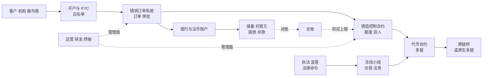
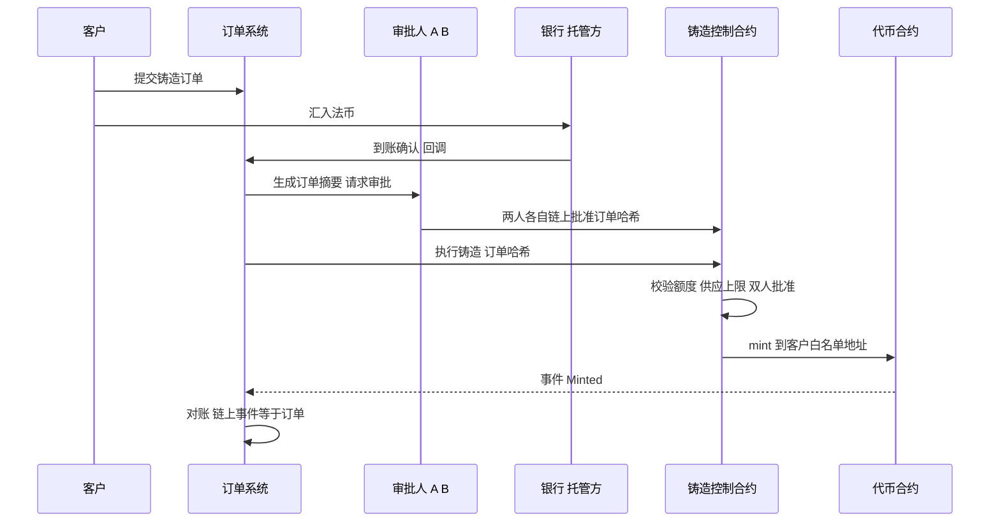
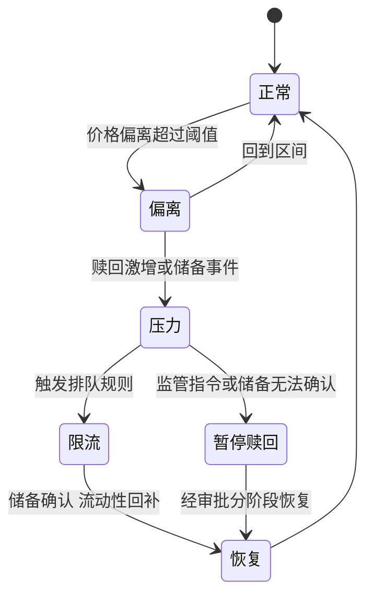

# X34 稳定币与 RWA 发行方：铸销控制、储备、冻结与赎回

> 学习目标：读完本章，你能——
> 1. 画出稳定币或 RWA 发行方的铸造、销毁、储备、赎回和冻结五条流程，并标出每条流程上的权限和双人控制点。
> 2. 写出一套"铸造不能超过储备"的链上与链下联合控制：额度、审批、供应上限、对账和熔断。
> 3. 设计冻结权限的分离与记录流程，并为"脱锚、储备事件、合约漏洞"各写一页应急剧本。
>
> 适用角色：稳定币与 RWA 发行方的安全负责人、安全工程师、合规与财资负责人；接入稳定币的交易所与协议的评估人员（站在对手方角度读）
> 前置章节：[11 DeFi 与经济安全（第 6 节）](../11-defi-economic-security.md)、[23 托管、充提与合规安全](../23-custody-exchange-ops.md)、[X01 安全体系怎么搭](X01-security-program-controls.md)、[X06 韧性与验证](X06-resilience-validation.md)
> 交互实验 / 模板：本章第 6 节的铸造控制合约、铸造订单策略、对账查询、冻结请求单可直接改写；[T04 上线门禁](../templates/T04-go-live-gate.md)
> 最后核对：2026-11-23

> 💡 注意：本章只写发行方特有的部分。控制矩阵、风险登记见 X01。暂停开关、灾备、桌面推演的通用方法见 X06。签名服务与冷热钱包的通用做法见 [29 签名路径](../29-signing-path-2026.md) 与 X14。本章不构成法律意见。监管条款以官方最新文本和本地律师意见为准。

---

## 开场：一次 22 分钟的"多铸了 300 万亿"

2025 年 10 月 15 日，Paxos 在一次内部转账中，把约 300 万亿枚 PYUSD 铸到了以太坊上。Paxos 说这是内部技术错误，没有安全事件，客户资金安全。公开链上记录显示，这些代币约 22 分钟后被销毁。期间 Aave 临时冻结了 PYUSD 市场，PYUSD 价格短暂偏离 1 美元。

这次没有人损失资金。但有三个问题值得发行方认真回答。

- 一个账户为什么能一笔交易铸出远超供应量的代币？
- 22 分钟里，哪条告警在响？谁有权停掉？
- 如果铸造的是攻击者，而不是内部错误，这 22 分钟够他做什么？

<details class="predict"><summary>🤔 先猜再看：发行方最该优先加固的是哪一个？A. 合约代码审计　B. 铸造权限与额度　C. 官网与客服　D. 储备披露</summary>

答案是 B 与 A 的组合，且 B 在前。公开事故里，铸造类事故多数不是合约有"经典漏洞"，而是铸造权限太集中、没有额度、没有和储备挂钩。审计能发现代码缺陷，但发现不了"一个密钥就能铸无限量"这个设计。D 同样重要，但它回答的是"出事后能不能自证"，不是"能不能阻止"。

</details>

---

## 1. 一句话理解

**发行方的核心安全目标只有一句：链上流通的每一枚代币，都要有链下的一份储备或资产对应，并且持有人在规定时间内能兑回。**

稳定币（Stablecoin）：价值锚定法币或一篮子资产的代币。
RWA（Real-World Asset，现实资产代币化）：把债券、基金份额、应收款等链下资产的权益做成链上凭证。
发行方（Issuer）：有权铸造、销毁代币，并持有或指挥储备的机构。
铸造（Mint）：增加代币供应量。销毁（Burn）：减少代币供应量。
赎回（Redemption）：持有人把代币还给发行方，换回法币或底层资产。

> 🎯 打个比方：发行方像一家会印"提货单"的仓库。提货单印多少，要看仓库里有多少货。印单机、仓库钥匙、验货记录、挤兑时的出货口，是四个不同的岗位。如果印单机的钥匙在一个人手里，仓库里的货再多也没用。
>
> 比喻的局限：提货单只对应一个仓库。真实的发行方还要处理多条链、多个托管方、监管命令和冻结，这些在比喻里没有对应物。

稳定币发行方和普通 DeFi 项目方（见 X33）的差别，只有三点。

1. 价值来自链下。合约代码正确不等于代币值钱。
2. 铸造权就是"印钞权"。它的风险等级高于任何普通管理员权限。
3. 发行方通常有冻结权，且受法律命令约束。冻结权既是执法工具，也是新的攻击面。

---

## 2. 保护目标与信任边界

### 2.1 五个保护目标

| 目标 | 一句话 | 失效的后果 |
|---|---|---|
| 无抵押铸造不发生 | 铸造量不超过已收到的资产 | 代币稀释、脱锚、协议坏账 |
| 储备足额且可取 | 储备在、分离、可在赎回窗口内变现 | 赎回失败、挤兑 |
| 赎回持续可用 | 持有人在承诺时间内换回资产 | 信心崩溃，二级市场折价 |
| 冻结权只按流程使用 | 不被盗用、不被滥用 | 用户资产被误冻或被攻击者冻 / 烧 |
| 多链一致 | 各链供应之和等于总账 | 跨链不一致、桥风险外溢 |

### 2.2 信任边界图



**读图要点：**

- 实线是资金与代币流，虚线是对账和管理面。攻击者往往走管理面：运营终端、云账号、服务密钥。
- 铸造控制合约是"印钞权"的关口。订单系统在它之前，代币合约在它之后。三者的权限必须分开。
- 总账通过"供应上限"回控铸造合约。这条虚线是本章的核心：链下对账结果要能在链上起作用。
- 冻结小组来自法务与合规，不在运营和研发里。冻结命令只通过一条窄通道到达代币合约。
- 局限：图没有画多个托管方、多个银行和多条链。第 3 节再展开。

### 2.3 必须假设不可信的东西

- 单个服务密钥。Resolv 事件里的铸币权与一个链下服务角色有关（见第 8 节）。
- 1-of-N 多签。它在效果上等于单签。
- 单一订单簿或单一价格源。它不能证明储备。
- 运营人员的终端。它能触达订单系统，但不应触达储备账户。

---

## 3. 参考架构

### 3.1 五条流程与权限分离

发行方的系统可以拆成五条流程。每条流程有独立的角色，没有任何一个人或服务同时拥有两条以上。

| 流程 | 谁发起 | 谁审批 | 谁执行 | 谁独立校验 |
|---|---|---|---|---|
| 铸造 | 客户订单（法币或资产到账后） | 财资 + 风控，双人 | 铸造服务（受额度约束） | 对账服务、链上监控 |
| 销毁 | 客户赎回申请 | 运营 + 财资，双人 | 销毁服务 | 对账服务 |
| 储备管理 | 财资 | 财资负责人 + 风险负责人 | 托管方 / 银行 | 外部会计师、托管方对账单 |
| 冻结 / 没收 | 法务收到法律命令 | 合规负责人 + 法务，双人 | 冻结小组的专用密钥 | 审计日志、公开记录 |
| 合约升级与参数 | 研发 | 安全委员会多签 + 时间锁 | 多签 | 变更对账、第三方监控 |

> ⚠️ 警告：铸造审批人不能是铸造执行人，也不能是储备账户的操作人。三者合一，就是"一个人能印钞并取走现金"。

### 3.2 铸造流程时序



**读图要点：**

- 到账确认来自银行或托管方的独立通道，不来自客户，也不来自订单系统自己。
- 审批人批准的是"订单哈希"，哈希绑定收款地址、金额、链和银行到账号。审批人看到的就是将要执行的内容。
- 合约在链上校验，而不是只靠订单系统校验。订单系统失陷时，合约仍能挡住超额铸造。
- 最后一步是反向对账：每个链上 Minted 事件必须能对应一个已批准订单。对不上就是告警。
- 局限：银行回调可以被伪造或延迟。对高额订单，建议加一步人工查看银行账户余额。

### 3.3 储备与托管

储备分层是通用做法：一部分放在可当日取用的账户，一部分放在短期国债或同类资产。比例由监管规则和流动性压力测试决定。

| 层 | 内容（示例） | 目的 | 主要风险 |
|---|---|---|---|
| 即时层 | 银行活期存款、央行准备金账户 | 当日赎回 | 银行集中度（SVB 案例） |
| 短期层 | 短期国债、隔夜回购 | 数日内赎回 | 回购对手方、估值 |
| 管理层 | 货币市场基金份额 | 收益与流动性 | 基金暂停赎回 |

三条设计原则：

1. 多个银行和托管方，设单一对手方上限。
2. 储备账户与自有资金账户法律上分离，并在账户命名上可辨认。
3. 储备账户的操作权限与铸造权限分离，且至少两人审批大额调拨。

### 3.4 监管对安全的直接要求（截至 2026 年公开资料）

监管条款会变化。下表只列和本章控制直接相关的条款，用于对照，不是合规清单。

| 法规 | 与本章相关的要求 | 对应控制 | 官方来源 |
|---|---|---|---|
| 欧盟 MiCA（Regulation (EU) 2023/1114）电子货币代币（EMT） | 只有持牌信贷机构或电子货币机构可向公众发行（第 48 条）；按面值、随时赎回（第 49 条）；不得付息（第 50 条）；所收资金至少 30% 存放在信贷机构的独立账户，其余投资于同币种的安全、低风险、高流动资产（第 54 条）；要有恢复与赎回计划（第 55 条） | ISS-C09 至 C13 | [EUR-Lex 法规文本](https://eur-lex.europa.eu/legal-content/EN/TXT/HTML/?uri=CELEX:32023R1114) |
| 欧盟 MiCA 资产参照代币（ART） | 持有储备并与自有资产分离、不得设押（第 37 条）；储备投资限于高流动、低风险工具，损益由发行方承担（第 38 条）；持有人可随时赎回，且免手续费（第 39 条） | ISS-C09 至 C13 | 同上 |
| 美国 GENIUS 法案（Public Law 119-27，2025 年 7 月） | 至少 1:1 的可识别储备；储备只能是法案列出的资产（如 93 天以内国债、受保存款）；不得质押或再抵押，少数例外；每月在官网披露储备总量与构成，并由注册会计师事务所审阅，CEO 与 CFO 向监管者证明其准确；发行方必须有技术能力遵守并将遵守合法命令（冻结、没收、销毁）；破产时持有人对储备的求偿权优先；不得向持有人付息 | ISS-C09、C13 至 C16 | [法律原文](https://www.congress.gov/119/plaws/publ27/PLAW-119publ27.htm) |
| 美国 OCC 实施细则 | OCC 于 2026 年 2 月 25 日提出规则草案，2026 年 10 月 21 日发布最终规则；规则与法案同于 2027 年 1 月 18 日生效；"及时赎回"定义为请求后不晚于两个工作日；24 小时内赎回请求超过流通量 10% 要报告 OCC；储备的至少 5% 放在活期存款、受保份额或联邦储备账户；单一对手方持有不超过 40%（单一托管方有额外条件）。反洗钱与制裁规则另行制定 | ISS-C09 至 C12 | [OCC 草案公告](https://occ.gov/news-issuances/news-releases/2026/nr-occ-2026-9.html)、[Morrison Foerster 对最终规则的解读](https://www.mofo.com/resources/insights/261028-occ-finalizes-rule-implementing) |

> 💡 注意：GENIUS 法案的生效日是"法案颁布后 18 个月"与"监管者发布最终规则后 120 天"两者中较早的一个（第 20 条）。OCC 最终规则只覆盖 OCC 监管下的发行方，其数字来自律所的解读，未逐条核对 OCC 规则全文。其他联邦与州监管者的规则、反洗钱规则，本章核对时未全部看到定稿。读者要按自己的发行主体，去查对应监管者的最新文本。

> 💡 注意：MiCA 的 EMT 与 ART 是两类不同的代币。锚定单一官方货币、由信贷机构或电子货币机构发行的，属于 EMT。锚定多种资产的属于 ART。具体归类要由持牌律师判断。

### 3.5 合约权限与多链一致性

发行方的代币合约至少有四类特权。把它们拆开，各给不同的持有者。

| 权限 | 能做什么 | 建议持有者 | 建议约束 |
|---|---|---|---|
| 铸造（minter） | 增发 | 铸造控制合约（不是 EOA） | 单笔与日额度、双人批准、供应上限 |
| 销毁 / 没收 | 烧毁指定地址余额 | 冻结小组的专用合约 | 只在法律命令流程内使用，事件公开 |
| 冻结 / 黑名单 | 阻止地址转账 | 冻结小组的专用合约 | 双人批准、记录、可申诉 |
| 升级 / 暂停 | 换实现、全局暂停 | 安全委员会多签 + 时间锁 | 暂停可立即，升级有延迟；见 [10 可升级代理](../10-upgradeable-proxy.md) |

多链发行要加两条规则。

1. 每条链有独立的铸造额度。一条链的失陷，只能影响这条链的额度。
2. 总账是真相来源。每日对账：各链供应之和，加上桥中锁定量，必须等于总账记录的流通量。跨链桥风险见 [12 跨链桥](../12-cross-chain-bridges.md) 与 X32。

> ⚠️ 警告：不要把"铸造权"授予一条桥。桥的验证者集合失陷，就会变成无限铸造。若必须用桥发行，为桥设独立额度并监控。

---

## 4. 控制清单

优先级：P0 = 缺失会让"无抵押铸造"或"储备丢失"成为可能，必须先做；P1 = 降低事故影响，应在 90 天内做；P2 = 成熟度项。

| ID | 控制项 | 要防什么 | 优先级 | 怎么验证 |
|---|---|---|---|---|
| ISS-C01 | 铸造权授予合约，不授予 EOA 或服务密钥 | 单密钥无限增发 | P0 | 读取合约 `minter` 角色持有者，应为合约地址；列出所有可铸造地址 |
| ISS-C02 | 单笔额度与滚动 24 小时额度写在链上 | 密钥失陷后的损失上限 | P0 | 在测试网尝试超额铸造，应回滚 |
| ISS-C03 | 铸造需要两个不同审批人批准订单哈希 | 内部作恶、单人被钓鱼 | P0 | 在测试网尝试同一人两次批准，应回滚 |
| ISS-C04 | 供应上限：铸造后总供应不得超过链下对账得到的"已批准上限" | 订单系统被控后无抵押铸造 | P0 | 把上限调低后尝试铸造，应回滚 |
| ISS-C05 | 链上 Minted 事件与订单一一对账，每小时一次 | 绕过订单系统的铸造、重复铸造 | P0 | 在测试环境制造一笔无订单铸造，应在一小时内告警 |
| ISS-C06 | 铸造角色与储备账户操作权限分离，人员不重叠 | 一人既印钞又取现 | P0 | 人员与角色矩阵逐人核对 |
| ISS-C07 | 多签门限至少 M-of-N（M 不小于 3，且 N 大于 M），签名人分散在不同设备与地域 | 1-of-N 被攻破一个人即失陷 | P0 | 读链上多签配置；检查 owner 变更事件是否有告警 |
| ISS-C08 | 多签 owner 与门限变更需要时间锁并告警 | 攻击者替换全部 owner | P0 | 在测试网改 owner，应触发告警并排队 |
| ISS-C09 | 储备账户在至少两家银行或托管方，单一对手方设上限 | 银行倒闭引发脱锚 | P0 | 储备分布表与监管上限逐项比对 |
| ISS-C10 | 储备与流通量每日对账，差异超阈值升级 | 储备缺口被掩盖 | P0 | 抽查一周对账记录与异常处理 |
| ISS-C11 | 赎回流程有书面政策、两人审批、日容量上限与压力下的排队规则 | 挤兑时无序处理 | P1 | 桌面推演一次挤兑剧本 |
| ISS-C12 | 即时层储备覆盖设定天数的赎回（示例：压力情景下的 N 日赎回量） | 无法按时兑付 | P1 | 流动性压力测试报告 |
| ISS-C13 | 储备披露与第三方审阅按监管频率发布，披露口径与对账口径一致 | 披露与现实不符 | P1 | 抽取一期披露与总账、托管对账单比对 |
| ISS-C14 | 冻结 / 没收权限独立于铸造与升级，双人批准，请求单留痕 | 冻结被滥用或被攻击者利用 | P0 | 检查权限矩阵；抽查最近 5 次冻结的请求单 |
| ISS-C15 | 冻结事件和依据类别公开记录（保护受法律保密要求的细节） | 不透明引发信任危机 | P1 | 公开记录与链上事件一致 |
| ISS-C16 | 提供申诉与解冻流程，并有时限 | 误冻长期无救济 | P1 | 申诉工单的处理时长统计 |
| ISS-C17 | 多链铸造额度独立，桥不持有铸造权 | 一条链失陷蔓延 | P1 | 读各链 minter 配置 |
| ISS-C18 | 暂停开关分级（暂停铸造、暂停转账、暂停赎回），谁能按有书面规定 | 事故时反应过慢或过度 | P0 | 演练：5 分钟内暂停铸造（见 X06） |
| ISS-C19 | 脱锚、储备事件、合约漏洞三份应急剧本，每年至少演练一次 | 事故时临场决策 | P1 | 演练记录与行动项 |
| ISS-C20 | 白名单投资者、转让限制在合约或转让代理层强制执行（RWA） | 受限资产流向不合格持有人 | P1 | 测试网从非白名单地址转账，应失败 |
| ISS-C21 | RWA 的链上凭证与链下资产登记一一对应，每月对账 | 凭证多于资产 | P0 | 登记簿与链上持仓逐笔比对 |
| ISS-C22 | RWA 估值与预言机有来源说明、更新频率与偏离告警 | 估值失真导致错误赎回或清算 | P1 | 检查估值来源文档与告警规则 |
| ISS-C23 | 发行主体、托管主体、资产出让方的法律关系与破产隔离有法务意见 | 发行方失败时持有人无权 | P1 | 法律意见书存档并按年复核 |

---

## 5. 分级落地

| 档位 | 做什么 | 人员与时间（估计，示例） |
|---|---|---|
| 最小可行 | ISS-C01 至 C10、C14、C18：铸造权交给合约；链上额度；双人批准；订单与事件对账；储备双银行；冻结权分离；分级暂停 | 1 名安全工程师、1 名合约工程师、财资与合规各兼职参与；约 6–8 周 |
| 标准 | 加上 C11 至 C19：赎回政策与排队规则、压力测试、披露对账、冻结公开记录与申诉、多链额度、三份剧本演练 | 增加 1 名 GRC、1 名链上监控工程师；约 3–6 个月 |
| 成熟 | 加上 C20 至 C23，并做外部红队、年度独立审计、与交易所和桥的联合演练、对冻结流程的第三方评审 | 小型发行安全团队 4–6 人；持续运营 |

> 💡 注意：RWA 发行方的 C20 至 C23 通常在"标准"档就要做，因为它们是 RWA 的核心。表中把它们放在"成熟"档，是按"稳定币发行方"的默认顺序排的。

---

## 6. 落地做法

### 6.1 步骤总览

1. 列出代币合约、各链部署、所有特权角色及持有者。
2. 把铸造权转给铸造控制合约，并撤销所有 EOA 的铸造权。
3. 设定额度，并写入合约。
4. 建立订单系统与对账服务。
5. 配置供应上限的更新流程：对账服务每日产出，由两名财资人员批准后写入。
6. 建立冻结请求单流程与公开记录。
7. 演练暂停与应急剧本。

### 6.2 示例：铸造控制合约（精简示意）

下面的合约只演示"额度 + 双人批准 + 供应上限"三件事。它不是生产代码，没有升级与恢复逻辑，也未审计。

```solidity
// SPDX-License-Identifier: MIT
pragma solidity ^0.8.20;

interface IMintable {
    function mint(address to, uint256 amount) external;
    function totalSupply() external view returns (uint256);
}

/// @notice 示例：铸造控制。代币合约只授权本合约铸造。
contract MintController {
    IMintable public immutable token;
    address public immutable guardian;         // 可以暂停铸造的应急角色
    uint256 public perTxCap;                   // 单笔上限
    uint256 public dailyCap;                   // 滚动 24 小时上限
    uint256 public supplyCeiling;              // 对账服务产出，由财资批准写入

    mapping(address => bool) public approver;
    mapping(address => bool) public executor;
    mapping(address => bool) public treasurer; // 负责更新供应上限
    mapping(bytes32 => mapping(address => bool)) public approvedBy;
    mapping(bytes32 => uint8) public approvals;
    mapping(bytes32 => bool) public executed;

    uint256 public windowStart;
    uint256 public windowMinted;
    bool public paused;

    event OrderApproved(bytes32 indexed orderHash, address indexed who);
    event Minted(bytes32 indexed orderHash, address indexed to, uint256 amount);

    constructor(IMintable t, address g, uint256 txCap, uint256 dCap) {
        token = t; guardian = g; perTxCap = txCap; dailyCap = dCap;
    }

    function approve(bytes32 orderHash) external {
        require(approver[msg.sender], "not approver");
        require(!approvedBy[orderHash][msg.sender], "already approved");
        approvedBy[orderHash][msg.sender] = true;      // ✅ 同一人不能批准两次
        approvals[orderHash] += 1;
        emit OrderApproved(orderHash, msg.sender);
    }

    // orderHash = keccak256(abi.encode(chainId, to, amount, bankRef))
    function execute(address to, uint256 amount, bytes32 bankRef) external {
        require(executor[msg.sender] && !paused, "denied");
        bytes32 h = keccak256(abi.encode(block.chainid, to, amount, bankRef));
        require(!executed[h], "replay");                 // ✅ 订单只能执行一次
        require(approvals[h] >= 2, "need 2 approvals");  // ✅ 双人批准
        require(amount <= perTxCap, "per-tx cap");       // ✅ 单笔额度
        if (block.timestamp >= windowStart + 1 days) {
            windowStart = block.timestamp; windowMinted = 0;
        }
        require(windowMinted + amount <= dailyCap, "daily cap");
        require(token.totalSupply() + amount <= supplyCeiling, "ceiling"); // ✅ 供应上限
        executed[h] = true;
        windowMinted += amount;
        token.mint(to, amount);
        emit Minted(h, to, amount);
    }

    function pause() external { require(msg.sender == guardian, "guardian"); paused = true; }
    // 恢复、角色管理、额度变更：放在时间锁多签之后（此处省略）
    function setCeiling(uint256 c) external { require(treasurer[msg.sender], "treasurer"); supplyCeiling = c; }
}
```

读代码要点：

- 审批人只能批准哈希，执行人不能自己批准。两个角色分开，要靠人员分离来落实。
- `supplyCeiling` 让"订单系统失陷"也铸不出超过对账上限的量。把上限更新频率设为每天，可缩小攻击窗口。
- 这个合约没有解决"两个审批人都被钓鱼"。那要靠独立解码和签名人分散（见 X33、X14）。
- 额度怎么定：用"事故里你能接受的最大损失"和"正常最大日铸造量的倍数"两个数字，取较小者（示例思路）。

### 6.3 示例：铸造订单策略（链下，示意）

```yaml
# 示例：订单系统的铸造策略，由风控维护，变更走评审
mint_policy:
  per_order_cap_usd: 5000000        # 示例
  daily_cap_usd: 20000000           # 示例
  require:
    bank_confirmation: independent_channel   # 银行回调与自有账户查询双确认
    kyc_status: approved
    destination: whitelisted_address         # 白名单地址，新增后冷静期 24 小时
    approvals: 2                             # 不同部门
  hold:
    - when: order_usd > 1000000
      action: manual_bank_balance_check
    - when: destination_age_hours < 24
      action: hold_for_review
  forbid:
    - same_person_creates_and_approves
    - approver_in_reserve_account_operators
```

### 6.4 示例：对账查询（链上事件 vs 订单）

```sql
-- 示例：找出没有已批准订单的铸造事件。每小时跑一次，结果非空即告警。
SELECT e.tx_hash, e.chain_id, e.to_address, e.amount, e.block_time
FROM onchain_mint_events e
LEFT JOIN mint_orders o
  ON o.order_hash = e.order_hash
 AND o.status = 'APPROVED'
 AND o.amount = e.amount
 AND lower(o.destination) = lower(e.to_address)
WHERE e.block_time > now() - interval '2 hours'
  AND o.order_hash IS NULL;

-- 示例：供应一致性。各链供应加桥锁定量，应等于总账流通量。
SELECT l.as_of, l.ledger_circulating,
       s.chain_supply_sum + s.bridge_locked AS onchain_total,
       (s.chain_supply_sum + s.bridge_locked) - l.ledger_circulating AS diff
FROM ledger_snapshot l
JOIN onchain_snapshot s USING (as_of)
WHERE abs((s.chain_supply_sum + s.bridge_locked) - l.ledger_circulating) > :threshold;
```

> 💡 注意：第一条查询要同时检查"没有订单"和"订单金额不一致"。Paxos 事件里，铸造金额与预期相差了几个数量级。金额比对能抓到这一类错误。

### 6.5 示例：检测规则清单

| 规则 | 触发条件 | 假阳性与调优 | 动作 |
|---|---|---|---|
| R1 无订单铸造 | Minted 事件找不到已批准订单 | 对账延迟：给 15 分钟宽限；事件顺序错位 | P1 告警；超过宽限自动暂停铸造 |
| R2 额度接近 | 滚动 24 小时铸造量超过日额度 80% | 大客户集中申购；调阈值 | P2 通知财资 |
| R3 权限变更 | 代币或铸造合约的 owner、minter、guardian、门限变更事件 | 计划内变更：需要与变更单关联 | P1 告警；无变更单则暂停 |
| R4 单地址大额持有 | 新铸币在一个新地址中短时间内转入 DEX 池或借贷市场 | 做市商调仓 | P2 复核 |
| R5 价格偏离 | 主要交易所或链上池价格偏离 1 美元超过阈值（示例：0.5%）并持续 | 单所薄订单簿噪声（见 11 章 USDe 案例）；用多源中位数 | P1 通知；偏离扩大进入脱锚剧本 |
| R6 赎回激增 | 24 小时赎回量超过流通量某比例（示例：5%） | 季末或计划内赎回 | P1 通知财资；对照监管报告阈值 |
| R7 冻结 / 没收事件 | 任何冻结或销毁事件 | 计划内执法命令：需要对应请求单 | 没有请求单则 P1 告警 |

### 6.6 冻结流程：谁能按、怎么记录

冻结（Freeze / Blacklist）：合约阻止某地址发送或接收代币。没收（Seize / Burn-and-reissue）：销毁某地址的余额，并在别处重新发行或交给执法方。两者的风险不同。没收是资产所有权转移，风险更高。

冻结请求单（示例字段）：

```yaml
freeze_request:
  id: FRZ-2026-0007
  source: law_enforcement | sanctions_list | court_order | internal_security_incident | partner_request
  evidence_ref: legal-vault/xxxx           # 命令原件的存放位置，不写进公开记录
  addresses: [ "0x...", "0x..." ]
  chains: [ ethereum, tron ]
  action: freeze | burn_and_reissue
  requested_by: legal_officer
  approved_by: [ compliance_head, general_counsel ]   # 两人，不得包含铸造审批人
  executed_by: freeze_team_key                        # 专用密钥，不能铸造、不能升级
  deadline: "命令规定的期限"
  appeal_contact: appeals@issuer.example
  public_record: "类别 + 链 + 地址 + 时间；不含案情细节"
```

操作规则：

1. 冻结小组的密钥只持有冻结权。它没有铸造权，也没有升级权。
2. 来自第三方的"紧急冻结请求"（例如其他项目方、研究员），先核实来源与证据，再按"内部安全事件"类别处理。不接受只来自聊天消息的请求。
3. 冻结后 24 小时内通知相关方，并开放申诉通道。
4. 没收只在有明确法律命令时执行，并走比冻结更严格的审批：法务、合规与高管三人。
5. 冻结权本身被攻击者控制的后果：攻击者可以冻结做市商、烧毁赎回钱包。StablR 事件里，攻击者用管理员权限拉黑并销毁了约 270 万 EURR（第 8 节）。因此冻结密钥要和铸造密钥一样保护。

> 🧪 动手验证：把 6.6 的请求单字段填成一份"虚构的执法冻结请求"，再列出这份请求单被伪造时（例如伪造的邮件），哪一步会发现。至少找出两个核验点。

### 6.7 赎回与挤兑韧性

赎回的安全问题不是"代码"，而是"流程在压力下还能不能走"。

1. 写赎回政策：谁可以赎回（直接赎回人范围）、最小金额、手续费、处理时限。
2. 给每个时限一个数字，并和监管要求对照。例如 OCC 最终规则把"及时"定义为请求后不晚于两个工作日。MiCA 对 EMT 要求持有人可随时按面值赎回。
3. 设日容量。压力下按先到先得或按比例排队，并提前写进政策，不要临场发明。
4. 保证银行通道可用：至少两家银行，其中一家支持非工作时间的即时到账或稳定币结算通道（示例）。
5. 把赎回激增作为告警（规则 R6），并让财资每天看即时层余额。
6. 每年一次桌面推演：挤兑 + 一家银行不可用。



**读图要点：**

- 状态转换要写成可检查的条件，例如"价格偏离超过 X 并持续 Y 分钟"。条件由发行方自己设定，示例阈值不是业界标准。
- "暂停赎回"是最后手段，并且在多数监管下需要通知或批准。事先和监管沟通。
- "恢复"要分阶段：先小额，再放大。每一阶段要有对账确认。
- 局限：状态图假设发行方对储备有完整信息。银行倒闭当天，发行方可能暂时不知道储备在哪里（SVB 案例）。

### 6.8 RWA 特有控制

RWA 比稳定币多一层：链上凭证对应的是一份有法律权利的资产。

| 问题 | 控制 |
|---|---|
| 凭证与资产是否一一对应 | 每月对账：链上持仓 vs 链下登记簿（转让代理或托管方记录）；差异走工单（ISS-C21） |
| 谁是法律上的发行方、托管方 | 在白皮书或募集文件中写明；发行方破产时的隔离结构取得法律意见（ISS-C23） |
| 谁能持有 | 白名单；转让限制写入合约或转让代理（ISS-C20）；定期复核 KYC |
| 估值如何更新 | 估值来源文档、更新频率、偏离告警（ISS-C22）；估值预言机的权限要独立于铸造 |
| 链下资产违约怎么办 | 违约与减记的披露流程；暂停申购；与持有人沟通；对账 |
| 管理员权限 | 可升级合约的管理员密钥走多签与时间锁；见 [10 可升级代理](../10-upgradeable-proxy.md) |

> 💡 注意：RWA 的"链上透明"只对链上部分成立。Goldfinch 的多笔链下贷款违约与减记，说明链上记录不能代替对底层资产的尽调（见 [11 章 6.2 节](../11-defi-economic-security.md)）。本章不重复这些案例。

### 6.9 常见坑

- 把铸造权给了"能用 API 调用的服务密钥"。服务密钥容易泄露，也不受人员离职流程管理。
- 额度写在后端数据库里，不写在合约里。后端失陷，额度就没有了。
- 多签门限 1-of-N，或者 owner 变更没有告警和时间锁。
- 储备披露只写"总额"，不写托管方和对手方集中度。
- 冻结密钥与升级密钥是同一个多签。
- 对账服务和订单系统是同一个团队、同一个账号。对账要有独立性。
- 演练只做"合约漏洞"，不做"银行倒闭"和"监管要求立即冻结"。

---

## 7. 运营：指标、告警、值班、演练、季度节奏

### 7.1 指标

| 指标 | 定义 | 目标（示例） |
|---|---|---|
| 无订单铸造数 | 对账发现的无订单 Minted 事件 | 0 |
| 对账延迟 | 链上事件到对账完成的时间 | 小于 1 小时 |
| 储备覆盖率 | 储备市值 / 流通量（按监管口径） | 不低于监管下限，并有内部缓冲 |
| 即时层覆盖天数 | 即时层储备可覆盖的压力情景赎回天数 | 不低于政策设定值 |
| 单一对手方占比 | 最大银行或托管方占储备比例 | 低于内部上限和监管上限 |
| 赎回处理时长 | 请求到兑付的中位数与 P95 | 小于政策承诺时限 |
| 冻结请求处理时长 | 收到到执行或拒绝 | 示例：紧急 4 小时内 |
| 暂停演练耗时 | 从决定到暂停铸造生效 | 小于 5 分钟 |

### 7.2 值班与升级

- 铸造相关的 P1 告警（无订单铸造、权限变更）要有 7×24 值班，并在 15 分钟内有人确认（示例）。
- 值班手册里写清：谁能按下"暂停铸造"。建议值班工程师和安全负责人各自都有权，因为暂停可以事后恢复，而超额铸造不能。
- 冻结请求在工作时间之外也可能到来。指定一名合规或法务值班人员。

### 7.3 季度节奏（示例）

| 周 | 事项 |
|---|---|
| 第 1–2 周 | 特权角色与持有者复核；多签签名人确认设备与地域；额度复核 |
| 第 3–4 周 | 储备分布、对手方集中度、压力测试复核 |
| 第 5–8 周 | 一次桌面推演（脱锚 / 铸造异常 / 冻结争议轮换）；链上对账回放 |
| 第 9–12 周 | 披露与总账比对抽查；外部审计或红队的跟进；复盘行动项关闭 |

通用的演练、度量、月报做法见 [X06](X06-resilience-validation.md)。

### 7.4 三份应急剧本（摘要）

**剧本 A：脱锚**

1. 确认：多源价格（至少三个来源）是否都偏离，还是单一交易所问题。
2. 判断原因：储备事件（银行、托管方）、铸造异常、合约漏洞、市场挤兑。
3. 先保护赎回通道：确认即时层余额与银行可用。
4. 对外沟通：发布事实、已采取的行动、下一次更新时间。不猜测原因。
5. 通知主要对手方：交易所、借贷协议、做市商。
6. 监管通知：按所在辖区的要求与时限。

**剧本 B：储备事件（银行或托管方出问题）**

1. 冻结向该机构的新增存款与调拨。
2. 确认受影响金额与可恢复路径（监管公告、保险、法律主张）。
3. 启用备用银行与托管方；更新披露。
4. 按赎回政策决定是否限流。
5. 公布受影响比例与时间表。

**剧本 C：合约漏洞或铸造异常**

1. 暂停铸造（必要时暂停转账）。
2. 保全证据：交易、日志、控制台操作记录。
3. 判断是否需要冻结攻击者地址。联系交易所与其他发行方（见 X36 的协调渠道）。
4. 对账：被铸造量、被卖出量、被冻结量。
5. 销毁无抵押部分（可行时），并公布处理结果。
6. 复盘并更新额度与告警。

---

## 8. 失效案例

> 💡 注意：金额为事发时估值，写"约"。以下只写摘要和教训，并映射到本章控制。

### 案例 1：USDC 与硅谷银行（2023 年 3 月，美国）

- **经过**：Circle 在 2023 年 3 月 12 日的声明中说，约 33 亿美元的 USDC 储备（约占总储备的 8%）存放在硅谷银行。监管者宣布将保障该行与 Signature Bank 的储户后，Circle 表示 USDC 仍可 1:1 赎回，并公布了新的银行合作方。公开报道显示 USDC 当时跌到约 0.87 美元，以 USDC 为主要抵押的 DAI 也一起下跌。
- **失效的控制**：储备对手方集中度（ISS-C09）、赎回通道的银行可用性（ISS-C11、C12）。
- **教训**：托管银行本身就是脱锚风险。发行方要事先知道每一家银行的敞口，并有备用银行与周末通道。
- **来源**：[Circle 声明（官方）](https://www.circle.com/pressroom/3-3-billion-of-usdc-reserve-risk-removed-dollar-de-peg-closes)、[The Block（媒体报道）](https://www.theblock.co/post/218993/usdc-and-dai-remain-at-about-0-90-following-circles-disclosure-of-funds-at-svb)。

### 案例 2：Circle 冻结 Tornado Cash 相关 USDC（2022 年 8 月，以太坊）

- **经过**：美国财政部 OFAC 在 2022 年 8 月 8 日制裁 Tornado Cash 并公布地址。公开报道称，Circle 随后封锁了相关地址，被冻结的 USDC 约 7.5 万枚（据 Dune 数据，各媒体口径略有差异）。Circle 首席执行官当时表示公司遵守制裁，并承诺就隐私问题加强沟通。同期有报道称 Tether 未跟进冻结，并称没有收到 OFAC 对此的指引。
- **对应的控制**：冻结流程与权限（ISS-C14 至 C16）。
- **教训**：冻结权会被法律命令直接触发，发行方没有"不处理"的选项，也会受到用户的批评。事先写好依据类别、审批人、公开记录和申诉流程，能让决策可解释。Tornado Cash 的后续法律进展见 [23 章 5.3 节](../23-custody-exchange-ops.md)。
- **来源**：[The Block（媒体报道）](https://www.theblock.co/post/162172/circle-freezes-usdc-funds-in-tornado-cashs-us-treasury-sanctioned-wallets)、[Fortune（媒体报道）](https://www.fortune.com/2022/08/24/tether-ignores-treasurys-sanction-tornado-cash-says-freezing-accounts-reckless)。

### 案例 3：Paxos 误铸 PYUSD（2025 年 10 月，以太坊）

- **经过**：见开场。公开报道称这次误铸约 300 万亿枚，约 22 分钟后销毁；Paxos 称是内部技术错误，没有安全事件。一份学术分析推测金额偏差与代币的 6 位小数有关，是单位换算类错误。这一推测不是 Paxos 的官方说法。
- **失效的控制**：单笔额度与供应上限（ISS-C02、C04）；订单与事件对账（ISS-C05）；金额比对。
- **教训**：铸造错误和铸造攻击的防线是同一套：额度、上限和对账。暂停时间应以分钟计。
- **来源**：[The Block（媒体报道）](https://www.theblock.co/post/374870/paxos-mistakenly-mints-300-trillion)、[American Banker（媒体报道）](https://www.americanbanker.com/news/paxos-mints-burns-300-trillion-in-paypal-stablecoin-error)、[Wharton 加密洞察（学术分析）](https://finance-pillar.wharton.upenn.edu/wharton-crypto-insights/three-trillion-pyusd-minted/)。

### 案例 4：StablR 铸币多签被攻破（2026 年 5 月，以太坊）

- **经过**：The Block 报道，StablR 的铸币多签使用 1-of-3 门限。Blockaid 归因于一个签名人的私钥被盗。攻击者把自己加为管理员，替换了原有 owner，铸出 835 万 USDR 与 450 万 EURR（合计约 1,350 万美元），并换成 ETH。攻击者还用管理员权限拉黑并销毁了部分对手方持有的代币，包括约 270 万 EURR。StablR 持有马耳他金融服务管理局的电子货币机构牌照，自称遵守 MiCA。StablR 在链上活动停止约 8 小时后才在 X 上承认事件。
- **失效的控制**：多签门限（ISS-C07）；owner 变更告警与时间锁（ISS-C08）；冻结 / 销毁权限与铸造权限分离（ISS-C14）；铸造额度（ISS-C02）。
- **教训**：1-of-N 多签等于单签。持牌不等于密钥治理合格。攻击者拿到管理员权限后，也会用冻结和销毁权限去伤害对手方，所以这些权限必须分开保管。
- **来源**：[The Block（媒体报道）](https://www.theblock.co/news/regulation/2026-05-24-stablrs-eurr-and-usdr-depeg-after-attacker-mints-13-5-million-in-unbacked-tokens-through-multisig-exploit-402429)。截至核对日，本手册未取得 StablR 的完整官方复盘，以上数字依据该媒体对安全公司分析的转述。

### 案例 5：Resolv USR 无抵押铸造（2026 年 3 月）

- **经过**：公开报道称，2026 年 3 月 22 日，攻击者铸出约 8,000 万枚无抵押的 USR，套现约 2,500 万美元，USR 价格大幅下跌。安全公司的分析把原因归结到一个有铸币权限的链下服务密钥被控制，并指出合约未校验铸币量与存入资产的比例。各家分析的表述并不完全一致，Blockaid 的页面还把它描述为铸造合约的漏洞。本手册未取得项目方复盘原文。
- **失效的控制**：铸造权交给合约而不是服务密钥（ISS-C01）；供应上限与存入资产比对（ISS-C04）；无订单铸造的对账与自动暂停（ISS-C05、规则 R1）。
- **教训**：铸币函数必须在链上校验"铸出量与收到的资产"之间的关系，不能只信任调用者的身份。
- **来源**：[Blockaid（安全公司分析）](https://blockaid.io/blog/how-a-compromised-key-minted-80m-in-resolvs-usr-stablecoin-and-triggered-a-depeg)、[The Block（媒体报道）](https://www.theblock.co/post/394582/resolvs-usr-stablecoin-depegs-after-attacker-mints-80-million-unbacked-tokens-extracts-roughly-25-million)；更多链接见 [11 章 6.2 节](../11-defi-economic-security.md)。

---

## 9. 评估检查点

- [ ] **ISS-1** 代币合约的 minter 角色只由铸造控制合约持有，没有 EOA 或服务密钥可直接铸造。（ISS-C01）
- [ ] **ISS-2** 单笔与滚动 24 小时铸造额度写在链上，并在测试网验证过超额会回滚。（ISS-C02）
- [ ] **ISS-3** 铸造需要两个不同审批人批准同一订单哈希，哈希绑定地址、金额、链和银行参考号。（ISS-C03）
- [ ] **ISS-4** 供应上限由对账结果产生，更新需要双人批准，且频率有书面规定。（ISS-C04）
- [ ] **ISS-5** 每小时把链上 Minted 事件和已批准订单比对，差异会告警并可自动暂停铸造。（ISS-C05）
- [ ] **ISS-6** 铸造审批、执行和储备账户操作的人员互不重叠，有人员角色矩阵。（ISS-C06）
- [ ] **ISS-7** 多签门限不低于 3，签名人分散在不同设备和地域，owner 变更有时间锁和告警。（ISS-C07、C08）
- [ ] **ISS-8** 各链铸造额度独立，桥不持有铸造权；每日多链供应对账。（ISS-C17）
- [ ] **ISS-9** 储备账户与自有资金账户分离，在至少两家银行或托管方，并设单一对手方上限。（ISS-C09）
- [ ] **ISS-10** 储备组成符合所在辖区允许的资产类型，即时层覆盖设定的压力赎回天数。（ISS-C12）
- [ ] **ISS-11** 储备与流通量每日对账，差异有阈值、有升级路径、有记录。（ISS-C10）
- [ ] **ISS-12** 赎回政策已书面发布，含时限、费用、日容量与压力下的排队规则，并与监管要求对照。（ISS-C11）
- [ ] **ISS-13** 储备披露的口径与总账、托管对账单一致，披露频率与第三方审阅符合监管要求。（ISS-C13）
- [ ] **ISS-14** 冻结 / 没收权限使用独立密钥，与铸造和升级分离，双人批准，请求单留痕。（ISS-C14）
- [ ] **ISS-15** 冻结事件有公开记录，且有申诉与解冻流程及时限。（ISS-C15、C16）
- [ ] **ISS-16** 冻结密钥与铸造密钥有同等级别的保护，并在 owner 变更告警范围内。（ISS-C14）
- [ ] **ISS-17** 暂停开关分级，谁能按有书面规定，并在近 12 个月内演练过。（ISS-C18）
- [ ] **ISS-18** 脱锚、储备事件、合约漏洞三份剧本存在，近 12 个月内至少演练过一次。（ISS-C19）
- [ ] **ISS-19** （RWA）白名单与转让限制在合约或转让代理层强制执行，并定期复核。（ISS-C20）
- [ ] **ISS-20** （RWA）链上凭证与链下登记簿每月对账，差异有工单。（ISS-C21）
- [ ] **ISS-21** （RWA）估值与预言机有来源说明、更新频率与偏离告警，且权限独立于铸造。（ISS-C22）
- [ ] **ISS-22** （RWA）发行主体、托管方、资产出让方的法律关系有法务意见并按年复核。（ISS-C23）
- [ ] **ISS-23** 合约升级通过多签加时间锁，各链实现版本一致，升级前后有对账。（第 3.5 节）
- [ ] **ISS-24** 发行方的办公、云与研发环境按 X03、X04 加固，铸造与储备相关人员的终端受到额外保护。

把结果写进报告（示例对照表）：

| 检查项 | 结论（通过 / 部分 / 不通过） | 证据（链接、截图、日志） | 责任人 | 到期日 |
|---|---|---|---|---|
| ISS-1 | | 合约角色读取结果 | | |
| ISS-5 | | 对账查询运行记录 | | |
| ISS-14 | | 最近 5 份冻结请求单 | | |

---

## 10. 上手路径

**第一周**

1. 列出所有代币合约、所有链、所有特权角色和持有者，画出本章 2.2 节的图并填入真实系统名。
2. 读每个特权角色的链上持有者。找出 EOA 和 1-of-N 多签。把它们列为 P0。
3. 问财资：储备在哪些银行和托管方？各占多少？最近一次对账是什么时候？
4. 问合规：最近一次冻结请求是怎么处理的？请求单在哪里？

**第一个月**

1. 把铸造权迁移到有额度和双人批准的合约（在测试网先演练）。
2. 上线 R1、R3、R7 三条检测规则，并把告警接到值班。
3. 起草赎回政策、冻结请求单模板，让法务与合规评审。
4. 做一次 30 分钟桌面推演：铸造异常（用案例 3 或 5 的情景）。

**第一个季度**

1. 上线供应上限和每日多链对账。
2. 完成三份应急剧本，并轮换演练。
3. 对储备分布做压力测试，并与监管要求逐条对照。
4. 如果做 RWA：建立链上与链下登记簿的月度对账。
5. 把本章的评估检查点写进季度安全月报（见 X06 的月报模板）。

---

## 11. 常见误区

| 误区 | 实际情况 |
|---|---|
| "合约审计过了，就不会有铸造事故。" | 铸造事故多数来自权限与流程。审计看不到链下服务密钥和人员分工。 |
| "我们持牌，所以密钥治理没问题。" | StablR 持有牌照，铸币多签仍是 1-of-3。牌照不能替代技术控制。 |
| "冻结权越大越安全。" | 冻结权大了，被盗用或被滥用的后果也大。要双人、分离、可申诉。 |
| "储备披露了，就是安全的。" | 披露证明过去某一天的状态。对账、额度和赎回通道才决定现在是否安全。 |
| "多链部署是业务问题，不是安全问题。" | 每多一条链，就多一份铸造权和一个桥风险。 |
| "RWA 在链上，所以透明。" | 链上只透明链上的部分。链下资产的真实性要靠登记簿、托管和审计。 |
| "暂停开关会引发恐慌，所以不按。" | 无抵押代币在市场上多停留一分钟，就多一分钟被卖出。要事先约定触发条件。 |

---

## 12. 术语表

| 术语 | 英文 | 定义 |
|---|---|---|
| 稳定币 | Stablecoin | 价值锚定法币或资产的代币 |
| RWA | Real-World Asset | 现实资产的链上凭证 |
| 铸造 / 销毁 | Mint / Burn | 增加 / 减少代币供应量 |
| 赎回 | Redemption | 持有人把代币换回法币或底层资产 |
| 储备 | Reserve | 对应代币的链下资产 |
| 供应上限 | Supply ceiling | 本章用语：合约允许的最大总供应，由对账结果产生 |
| 冻结 / 黑名单 | Freeze / Blacklist | 合约阻止某地址转账 |
| 没收 | Seize | 销毁某地址余额并另行发行或交付 |
| EMT | E-money Token | MiCA 中锚定单一官方货币的代币 |
| ART | Asset-referenced Token | MiCA 中锚定多种资产的代币 |
| PPSI | Permitted Payment Stablecoin Issuer | GENIUS 法案中的获准支付稳定币发行方 |
| 转让代理 | Transfer agent | 维护持有人登记簿并处理转让的机构 |
| 脱锚 | Depeg | 市场价格显著偏离锚定值 |

---

## 13. 动手练习与思考题

### 练习（笔记本即可完成）

1. **画图与填表**：以一家虚构的发行方为对象，画出 2.2 节的信任边界图，并标出哪些角色持有铸造、冻结和升级权。检查是否有人同时拥有两项。
2. **读合约找缺口**：把 6.2 节的示例合约读一遍，写出三个它没有覆盖的风险（提示：审批人被钓鱼、`setCeiling` 的频率、桥铸造）。
3. **写规则**：为"owner 变更"写一条 Sigma 风格的检测规则，写清触发条件、假阳性与调优。
4. **30 分钟桌面推演**：用案例 4 的情景。注入点：第 0 分钟收到链上告警，第 10 分钟发现冻结权被滥用，第 20 分钟交易所询问是否要下架。写出每个时间点的决策人与动作。
5. **审一份示例政策**：把 6.3 节的 YAML 补上"新增白名单地址的冷静期""银行回调失败的处理"，并写出每条的绕过方式。

建议配套（后续在 L3 训练营实现）：一个"铸造订单对账回放"脚本，输入链上 Minted 事件 CSV 和订单 CSV，输出差异与告警。

### 思考题

1. 供应上限由对账服务生成，如果对账服务本身被攻破，上限就失效了。你会怎样让上限的来源独立于订单系统？
2. 冻结权是执法工具，也是攻击面。你会怎样设计，让发行方在不放弃冻结能力的同时，不被"伪造的法律命令"利用？
3. 多链发行里，一条链的铸造密钥失陷，其他链的持有人是否应当受到影响？你会如何设计额度与披露？

> 🪞 反思：如果你所在机构明天收到"某个主要银行出问题"的消息，你们能在多久之内回答"我们的储备有多少在这家银行"？这个时间，就是你们对账与披露能力的真实水平。
