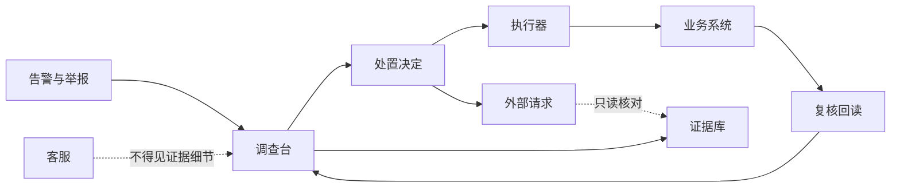
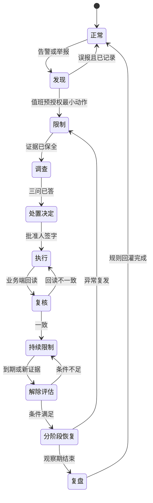
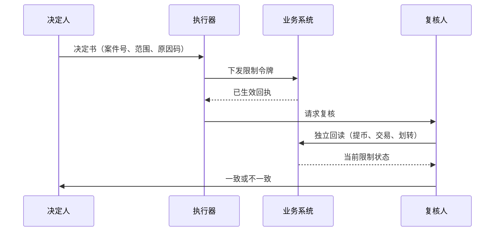

# X36 反欺诈、合规与安全运营·运营与恢复：调查取证、执行复核与解除限制

> 学习目标：读完本章，你能——
> 1. 画出案件从"发现"到"复盘"的状态机，写清每个状态的进入条件、退出条件和有权推动的人。
> 2. 为"调查、处置授权、执行复核、解除限制与申诉"写出决策矩阵、证据包清单和恢复清单。
> 3. 带团队跑两场 30–45 分钟的桌面推演，并写出用户通知、执法回复和冻结请求模板。
>
> 适用角色：交易所反欺诈与风控负责人、合规官、安全运营（SecOps）、事件指挥官、客服与法务对接人。
> 前置章节：[X13 反欺诈、合规与安全运营](X13-cex-fraud-compliance-secops.md)（设计）、[X35 工程验收](X35-cex-fraud-verification.md)、[X05 检测与响应工程](X05-detection-response-engineering.md)、[X06 韧性与验证](X06-resilience-validation.md)、[25 资金追踪、冻结与事后处置](../25-fund-tracing-response.md)
> 相关章节：[X26 客户身份·运营与恢复](X26-cex-identity-recovery-ops.md)、[X34 生产环境·运营与恢复](X34-cex-production-recovery-ops.md)（证据保全细节）
> 交互实验 / 模板：[事故响应手册与值班模板](../templates/T09-incident-runbook-oncall.md)、[桌面推演脚本与评分表](../templates/T10-tabletop-script-scorecard.md)
> 建议配套（后续在 L3 训练营实现）：B83 反欺诈规则验收与调查取证
> 最后核对：2026-11-23

> 💡 注意：X13 讲"处置权限怎样设计"，X35 讲"怎样证明限制真的落地"。本章只讲事发之后：怎样调查、怎样执行与复核、怎样在证据充分时解除限制。通用的取证清单见 X05，证据保全细节见 X34，本章不重复。

---

## 开场：一次"冻对了，但解不了"的周一

周一 09:30，反欺诈系统在周末累计挂起 37 个账户。原因是它们都收到了同一个新地址的小额充值，再把资金快速转出。风控值班把它们全部冻结。

周一 14:00，客服收到 6 条投诉。其中 2 人是同一家做市商的子账户，1 人是某诈骗案受害者的亲属。

没有人记得冻结依据的是哪条规则。冻结的原因码填的是"其他"。合规官想解冻，但没有证据说明这些账户是否清白。法务想保持冻结，但冻结没有时限。

<details class="predict"><summary>🤔 先猜再看：这 37 个账户里，最该先问的一个问题是什么？</summary>

是"每个账户的冻结，对应哪条证据？"。如果每个冻结都有原因码、规则版本、证据引用和复核到期时间，值班可以在 1 小时内把 37 个分成三类：证据充分（维持）、证据不足（解除并补观察）、证据缺失（升级调查）。没有这些，冻结就成了一个不能解释也不能撤销的动作，错冻与滥用都无法发现。

</details>

---

## 1. 一句话理解

**限制是一个有主人、有证据、有到期时间的动作；解除限制是同样严肃的另一个动作。**

> 🎯 打个比方：冻结像医院的隔离病房。进去要有诊断，出来要有复检，每天要有人查房。没有查房记录的病房，最后会变成没人管的储藏室。
>
> 比喻的局限：病人不会转移资产，也不会冒充医生。交易所的"患者"可能是攻击者，也可能是被攻击者，调查要在证据不全时先控制，再分辨。

三类常见误解：

1. "冻结了就安全了。" 不是。冻结只阻止新动作，不证明历史交易是否可疑。
2. "解冻只是撤销冻结。" 不是。解冻要核对证据、风险复评和用户身份，相当于一次小型准入审批。
3. "执法机关要求，就无需复核。" 不是。要核对请求的真实性、范围和法律依据，再执行（见第 6 节）。

---

## 2. 保护目标与恢复边界

### 2.1 运营要保护什么

| 保护目标 | 含义 | 运营中的典型威胁 |
|---|---|---|
| 证据可用 | 证据完整、有哈希和保管链，能交给执法与法务 | 先处置后保全；日志被覆盖 |
| 处置有据 | 每个限制有原因码、规则版本、证据引用 | 事后无法解释冻结原因 |
| 处置有权 | 动作由有权人执行，并有批准人 | 越权冻结、滥用冻结权 |
| 执行真实 | 业务端回报"限制已生效"，并有回读验证 | 管理端显示冻结，提币链路仍放行 |
| 用户公平 | 申诉有通道、时限与复核人 | 错冻无人处理；偏袒熟人 |
| 保密合规 | 举报信息不向当事人泄露 | 客服向用户透露"已提交可疑报告" |

### 2.2 案件运营的信任边界



**读图要点：**

- 执行器是唯一能改业务系统限制状态的入口；调查台只提出决定，不直接改库。
- 复核回读指复核人从业务系统读取"限制是否生效"，而不是执行器自己宣布成功。
- 客服只看到"案件状态"与"可对用户说的话"，看不到举报来源和证据细节。
- 局限：图没有表示跨机构协同（发行方、其他交易所），见第 6.3 节。

---

## 3. 案件生命周期

### 3.1 状态图



**读图要点：**

- "限制"先于"调查"，但进入"调查"必须先保全证据。
- "复核"失败回到"执行"，不能直接结案。
- "解除评估"是独立状态，不是"持续限制"的自然结束。
- 局限：图只表示单个案件。批量案件先建主案件，子案件各自走状态。

### 3.2 每个状态的条件与授权

| 状态 | 进入条件 | 退出条件 | 有权推动的人 |
|---|---|---|---|
| 发现 | 告警、举报、外部通知 | 值班判定真或误 | 一线值班 |
| 限制 | 命中最小动作预授权（X13 的 A1、A2、A4） | 限制已落地 | 值班（事后追认） |
| 调查 | 证据已哈希、案件编号已建 | 三问已答（第 4 节） | 调查员 |
| 处置决定 | 调查结论与证据齐全 | 决定书已签 | 风控批止付，合规裁定法定限制 |
| 执行 | 决定书已签 | 执行器日志有令牌与原因码 | 执行器操作员 |
| 复核 | 执行完成 | 业务端回读与决定一致 | 第二人（非执行人） |
| 持续限制 | 复核通过 | 到期日或新证据 | 案件负责人 |
| 解除评估 | 到期日或申诉受理 | 评估结论书已签 | 合规官；高风险加法务 |
| 分阶段恢复 | 评估通过 | 观察期无异常 | 风控负责人 |
| 复盘 | 观察期结束 | 行动项有负责人与到期日 | 安全负责人 |

> ⚠️ 警告：执行人与复核人必须是两个人。一个人既执行又复核，等于没有复核。

---

## 4. 调查流程：三问与证据链

调查不回答"这个用户是不是坏人"，只回答三个可核对的问题。

1. **身份问：这个账户背后是谁？** 核对 KYC 材料、设备与登录指纹、关联账户，以及近 30 天是否换过邮箱或手机。
2. **成交问：发生了哪些成交与资金动作？** 重建时间线：充值、成交、划转、提币。每一步引用日志编号。
3. **资金归属问：钱现在在哪、属于谁？** 链上追踪到下一跳；区分"用户自有""受害者""平台"三类资金。

三问的证据不同，错误也不同。身份问出错，会错冻好用户；成交问出错，会漏掉洗钱路径；资金归属问出错，会把受害者的钱当作攻击者的钱。三问各由一个人签字。

### 4.1 案件记录最小字段

```yaml
# case-record.yaml（示例，非任何真实机构配置）
case_id: FRR-2026-0042
opened_by: risk_analyst_03
trigger: {type: rule, rule_id: R-QuickInOut, rule_version: 7}
subjects: [uid_1001, uid_1002]
actions:
  - {id: A2, at: "2026-11-21T09:31:00Z", executor: secops_oncall, reason_code: R07, evidence_ref: [EV-0001]}
review_due: "2026-11-24T09:31:00Z"   # 到期提醒，不自动解除
evidence_manifest_sha256: "<封存时填写>"
legal_hold: false
disclosure_rule: "不得向当事人透露举报来源"
status: investigation
```

---

## 5. 处置授权与执行复核

### 5.1 授权矩阵（在 X13 的 A1–A9 基础上补"执行与复核"）

```yaml
# disposition-ops.yaml（示例）
decision_types:
  risk_hold:                # 风控止付：提币挂起、交易限制
    decide: [risk_lead]
    execute: [secops_oncall]
    review: [risk_analyst_other]
    max_duration: 72h
  statutory_restriction:    # 法定限制：制裁命中、法院或监管指令
    decide: [compliance_officer]
    execute: [secops_oncall]
    review: [compliance_analyst]
    require: [legal_basis_ref, source_document_hash]
  external_freeze_request:  # 向发行方或其他交易所提请求
    decide: [incident_commander]
    execute: [liaison]
    review: [general_counsel]
    require: [address_list_version]
```

### 5.2 执行与复核时序



**读图要点：**

- 复核人不信执行器的回执，自己去业务系统回读。
- 回读覆盖三条路径：提币、交易、内部划转。X35 证明这三条在验收时有效；本章是每个案件的运营复核。
- 局限：回读只证明"当时"生效。限制可能被后来的变更覆盖，所以要有到期日和每日检查。

```sql
-- 示例：每日检查"案件中的限制是否仍然生效"（表结构为示意，应无结果）
SELECT c.case_id, c.uid, c.review_due
FROM case_restrictions c
JOIN account_state s ON s.uid = c.uid
WHERE c.status = 'active'
  AND (s.withdraw_enabled OR s.transfer_enabled);
```

---

## 6. 证据链与执法协助

### 6.1 证据包与保管链

先保全后处置。证据清单、哈希命令见 [X13 第 6.6 节](X13-cex-fraud-compliance-secops.md)，保全细节见 X34。案件运营再补两件事：

1. **法律保留（Legal Hold）**：案件进入诉讼或执法协助后，相关日志与记录暂停自动清理。清理策略的例外由法务书面确认。
2. **访问记录**：谁、何时、为何查看证据。证据库的访问日志本身也是证据。

### 6.2 执法请求的接收与核对

1. 单一入口接收，客服和业务人员不直接响应。
2. 核对来源：用已登记的联系方式回拨，不用请求里留的号码。
3. 核对范围：账户、时间段、数据类型。范围外的数据不提供。
4. 法务审核法律依据与辖区。
5. 记录提供内容、日期与接收人。
6. 美国示例：执法机关可依 18 U.S.C. § 2703(f) 要求保全记录，保全期 90 天，可续 90 天。你的机构是否适用，由法务判断。

> ⚠️ 警告：假冒执法机关的"紧急"数据请求是社工手法。紧急请求同样要回拨核实。

### 6.3 对外冻结请求

向发行方、其他交易所提冻结请求时，地址清单要有版本号，每次更新留痕。收到的请求同理：核对来源、范围与证据，再执行。第 15 节有案例。

### 6.4 保密与报告义务（美国示例）

- 美国货币服务业务（MSB）依 31 CFR 1022.320，应在首次发现相关事实后 30 个日历日内提交可疑活动报告；规则禁止披露报告或其存在。
- 被阻止的财产依 OFAC 规则（31 CFR 501.603）应在 10 个工作日内报告。

其他辖区的时限与门槛不同，以法务和当地规则为准。客服话术写成"我们正在审核，需要更多材料"，不写"已报告"。

---

## 7. 解除限制与申诉

### 7.1 解除评估的四个条件

1. **证据条件**：触发限制的疑点已被解释或排除，评估结论书有签字。
2. **身份条件**：账户持有人已重验身份。
3. **风险条件**：风险评分复评通过，无新增告警。
4. **法律条件**：没有执法保留、监管指令或制裁命中。

任何一个条件未满足，都不能解除。

### 7.2 解除决策矩阵

| 限制原因 | 解除条件 | 决定人 | 时间窗（示例） |
|---|---|---|---|
| 规则误报 | 三问已答，无异常 | 风控负责人 | 申诉后 2 个工作日 |
| 账户接管嫌疑 | 身份重验与冷静期（见 [X26](X26-cex-identity-recovery-ops.md)） | 风控 + 客服主管 | 视冷静期 |
| 资金来源待证 | 用户提供来源材料，合规复核 | 合规官 | 5–10 个工作日 |
| 受害者资金 | 经法院或执法指引，或发行方同意 | 合规官 + 法务 | 以外部程序为准 |
| 制裁命中 | 名单移除，或获官方许可 | 合规官 + 法务 | 以官方程序为准 |
| 执法保留 | 书面撤销 | 法务 | 以书面为准 |

制裁类的官方程序示例：美国 OFAC 的除名申请依 31 CFR 501.807 提交；因误认或笔误被阻止的财产，可依 501.806 申请释放。交易所不能自己"判定移除"，必须以官方结果为准。

### 7.3 分阶段恢复

先放开收款与查看，再放开小额提币，再放开交易，最后恢复常规限额。每一阶段回读限制状态，观察期内出现告警就退回上一阶段。

```python
# release_gate.py：解除评估的门槛检查（示例骨架）
CHECKS = {
  "evidence_ok": lambda c: c["assessment_signed"],
  "identity_ok": lambda c: c["kyc_rechecked"],
  "risk_ok":     lambda c: c["risk_score"] <= c["release_threshold"],
  "legal_clear": lambda c: not c["legal_hold"] and not c["sanction_hit"],
  "two_person":  lambda c: len(set(c["approvers"])) >= 2,
}
def can_release(case: dict):
    failed = [k for k, f in CHECKS.items() if not f(case)]
    return len(failed) == 0, failed
```

### 7.4 申诉通道

1. 每个限制通知含申诉入口与处理时限。
2. 申诉由未参与原决定的人复核。
3. 结果书面通知；拒绝时说明可补充的材料（保密信息除外）。
4. 统计错冻率与申诉处理时长，每月回灌规则。

---

## 8. 决策矩阵：范围 × 条件 × 授权 × 时间窗

| 场景 | 影响范围 | 恢复条件 | 授权人 | 时间窗（示例） |
|---|---|---|---|---|
| 单账户风控止付 | 1 个账户 | 第 7.1 节四条件 | 风控负责人 | 最长 72 小时，到期必须决定 |
| 批量止付（同规则） | 10 个以上账户 | 抽样复核通过，分批解除 | 风控负责人 + 合规官 | 24 小时内分类 |
| 制裁命中 | 1 个账户或地址 | 官方名单变更或许可 | 合规官 + 法务 | 以官方为准 |
| 执法保留 | 指定账户 | 书面撤销 | 法务 | 以书面为准 |
| 疑似被诱导转账 | 1 个账户 | 回访与冷静期 | 风控 + 客服主管 | 24–72 小时 |
| 外部冻结请求 | 指定地址 | 证据与版本核对 | 事件指挥官 | 立即提出，每日更新 |
| 大面积误冻 | 多个账户 | 全量复核，公告更正 | 合规官 + CRO | 4 小时内启动 |

---

## 9. 恢复清单（可直接勾选）

**A. 恢复前核对**

- [ ] 案件有决定书、原因码、规则版本和证据引用。
- [ ] 证据包已封存，清单哈希已外部存证。
- [ ] 没有执法保留、监管指令或制裁命中。
- [ ] 账户持有人身份已重验。
- [ ] 资金归属已核：自有、受害者、平台三类已区分。
- [ ] 风险评分复评通过。

**B. 执行**

- [ ] 解除由执行器完成，令牌与原因码齐全。
- [ ] 执行人与复核人不是同一人。
- [ ] 业务端回读：提币、交易、划转三条路径状态与决定一致。
- [ ] 阶段计划已写：小额、限额、观察期、回退条件。

**C. 沟通与复盘**

- [ ] 用户通知已发，申诉结果已记录。
- [ ] 保密边界已确认：未泄露举报来源。
- [ ] 规则回灌：误报豁免有期限和负责人。
- [ ] 错冻或漏冻的案例已进入季度复盘。

---

## 10. 控制清单

| ID | 控制项 | 要防什么 | 优先级 | 怎么验证 |
|---|---|---|---|---|
| FRR-C01 | 每个限制有原因码、规则版本、证据引用、到期日 | 无法解释的冻结 | P0 | 抽 20 个限制，逐项查字段 |
| FRR-C02 | 限制只经执行器下发，执行人与复核人分离 | 越权与自证 | P0 | 查日志，同一人执行并复核的数量应为 0 |
| FRR-C03 | 复核人在业务系统独立回读三条路径 | 管理端显示冻结但仍可提币 | P0 | 演练中改动一条路径，看复核能否发现 |
| FRR-C04 | 证据先封存再清理，有哈希与保管链 | 证据被覆盖 | P0 | 演练后核对清单哈希 |
| FRR-C05 | 法律保留可暂停自动清理，例外有书面确认 | 保留期内日志被删 | P1 | 查保留策略与例外记录 |
| FRR-C06 | 执法请求单一入口，回拨核实，范围外不提供 | 假冒请求与数据过度披露 | P0 | 演练一份伪造请求，看是否被识别 |
| FRR-C07 | 客服话术不披露举报及其来源 | 泄露保密信息 | P0 | 抽查 10 条客服记录 |
| FRR-C08 | 对外冻结请求的地址清单有版本 | 请求与证据不符 | P1 | 抽查请求与当时清单版本 |
| FRR-C09 | 解除评估四条件有签字结论书 | 过早解冻 | P0 | 抽 10 个解冻，逐一查结论书 |
| FRR-C10 | 申诉有时限，由非原决定人复核 | 错冻无人处理 | P1 | 申诉处理时长报表 |
| FRR-C11 | 限制到期自动提醒，不自动解除 | 遗忘的冻结 | P1 | 查超期未决案件数 |
| FRR-C12 | 解除后分阶段恢复并回读 | 解冻即满额 | P1 | 抽 5 个解冻后的限额记录 |
| FRR-C13 | 制裁与法定限制的解除只依据官方结果 | 违规解除 | P0 | 抽查制裁类解除的官方依据 |
| FRR-C14 | 误报与漏报回灌规则调优 | 规则腐烂 | P2 | 季度复盘有规则变更记录 |

---

## 11. 分级落地

| 档位 | 做什么 | 人与时间（建议，示例） |
|---|---|---|
| 最小可行 | 案件表单（第 4.1 节字段）、原因码、到期日、执行与复核分离、证据包哈希 | 1 名反欺诈 + 1 名工程，3–4 周 |
| 标准 | 加执行器与回读、案件系统、法律保留、解除评估、申诉通道、季度演练 | 3–4 人，2–3 个月 |
| 成熟 | 加跨机构冻结协作、批量案件工具、规则回灌自动化、执法接口审计 | 5 人以上，持续 2 个季度 |

---

## 12. 运营：指标与节奏

| 指标 | 含义 | 目标（示例） |
|---|---|---|
| 限制字段完整率 | 原因码与证据引用齐全的限制占比 | 100% |
| 复核回读通过率 | 首次回读与决定一致的比例 | ≥ 99% |
| 到期未决案件 | 超过到期日未决定的案件数 | 0 |
| 申诉处理时长 | 受理到书面结果 | ≤ 5 个工作日 |
| 错冻率 | 解除时判定为误报的比例 | 趋势下降 |
| 请求核实率 | 执法请求经回拨核实的占比 | 100% |

**节奏（建议）：** 每周看到期案件与申诉；每月抽检冻结权使用与错冻；每季度演练一次含"解除与申诉"的剧本；每半年测试跨机构联系人表。

---

## 13. 演练剧本

### 剧本 A：批量止付后的申诉潮（35 分钟）

**背景：** 周日夜里，规则 R-QuickInOut 升级后，34 个账户被自动止付。周一 09:00，客服收到 12 条投诉。

| 时间 | 注入 |
|---|---|
| T+0 | 调查员发现规则版本 8 把"做市商子账户的周期性划转"也判为快进快出 |
| T+8 | 一名受害者亲属来电，称其家人被诈骗，资金进入其中一个账户 |
| T+15 | 客服问：能否告诉用户"我们已向监管提交报告"？ |
| T+22 | 做市商大客户要求 1 小时内解冻，威胁公开投诉 |
| T+30 | 合规官发现其中 1 个账户出现在最新制裁名单的变更里 |

**问题：**

1. 34 个账户怎样分三类？谁签分类结果？
2. 受害者资金所在的账户能否解冻？依据是什么？
3. 对 T+15 的问题，你给什么话术？
4. 制裁命中的账户怎样处理？能因客户压力提前解除吗？

**评分（满分 10）：** 三类分流 2；受害者资金保留并走外部程序 2；话术不披露报告 2；制裁账户只依官方结果处理 2；24 小时内给出用户通知草稿 2。

### 剧本 B：假冒执法的紧急请求（30 分钟）

**背景：** 周五 17:30，一封自称某地警方的邮件要求"1 小时内提供用户 uid_2077 的全部登录与充提记录"。

| 时间 | 注入 |
|---|---|
| T+0 | 邮件附盖章 PDF，联系电话是邮件里留的号码 |
| T+10 | 客服主管问：能否先给登录 IP？ |
| T+18 | 回拨已登记的联系方式，对方称未发出此请求 |
| T+25 | 该用户账户出现一笔大额提币申请 |

**问题：** 谁有权接收？怎样回拨？T+25 的提币怎样处理？
**评分（满分 10）：** 单一入口 2；回拨核实 2；拒绝范围外披露 2；提币进入风控复核 2；记录请求与处理 2。

---

## 14. 对外沟通模板

### 14.1 用户通知（限制已生效）

```text
【示例】关于您账户的临时限制通知
[时间，UTC] 为保护账户与资产安全，我们暂时限制了您账户的 [提币/交易]。
您的资产 [不受影响/正在核对]。
我们需要您 [补充身份验证/提供资金来源说明]。
处理时限：[X 个工作日]。申诉入口：[官方渠道]。
```

### 14.2 执法请求回复

```text
【示例】案号 [N]：已收到请求，登记编号 [R]。
我们将按适用法律与内部程序核对请求范围，并在 [时限] 内回复。
本回复不构成对任何账户信息的披露。联系人：[单一联络人]。
```

### 14.3 向发行方或其他交易所的冻结请求

```text
【示例】事件 [编号]：我们提请对以下地址关注或冻结（清单版本 [v3]，UTC [时间]）。
证据摘要：[交易哈希、时间线]。联系人：[姓名、官方邮箱、电话]。
如需补充材料，请经已登记渠道联系。清单更新将以新版本号发送。
```

监管通报只写已核实的事实、已采取的限制和下一次更新时间。措辞与时限由合规官和法务确定。

---

## 15. 失效案例

> 💡 注意：以下案例于 2026-11-23 重新查找公开来源。金额写"约"；归因写"公开报道归因于"。完整复盘见《Web3 行业安全资损 101》与 [28 事故案例库](../28-incident-casebook.md)。

### 案例 1：KuCoin 2020 年 9 月被盗后的追回与协作

- **事实：** 2020 年 9 月，KuCoin 被盗约 2.8 亿美元（含 ERC-20、Stellar 代币与比特币）。2020 年 11 月 11 日，联合创始人兼 CEO 称已追回 84%，方式包括链上追踪、合约升级与司法追回；The Block 报道称，数日内有协议项目通过分叉、重部署合约或封锁攻击者地址保护了资产。Elliptic 另报道，攻击者曾在发行方冻结前，于去中心化交易所卖出部分代币。
- **对应控制：** FRR-C08、FRR-C04。
- **教训：** 追回依赖多方协作，而协作依赖及时、准确、带版本的地址清单。已被兑换的部分无法冻结。
- 来源（媒体与安全公司）：[The Block](https://www.theblock.co/post/84248/kucoin-280m-stolen-recovered)、[Elliptic](https://www.elliptic.co/our-thinking/kucoin-thief-sells-out-millions-in-crypto-tokens-on-decentralized-exchanges)（Elliptic 仅核对到搜索摘要）。

### 案例 2：Bitfinex 2016 年被盗与 2022 年的执法查扣

- **事实：** 2016 年 Bitfinex 被盗 119,754 枚比特币。2022 年 2 月 8 日，美国司法部宣布逮捕两名嫌疑人，并查扣 94,000 多枚比特币（查扣时估值超过 36 亿美元）。IRS-CI 新闻稿称，调查人员沿区块链追踪资金，并凭法院授权的搜查令检查其在线账户，取得了对应钱包的私钥。两人被指控洗钱共谋等罪名；新闻稿说明这些是指控，当事人被推定无罪。
- **对应控制：** FRR-C04、FRR-C05、FRR-C06。
- **教训：** 追回发生在事发约 6 年后。长期保存的链上线索与记录，是执法行动的基础。
- 来源（官方发布）：[IRS-CI 新闻稿](https://www.irs.gov/node/105216)、[美国司法部](https://www.justice.gov/archives/opa/pr/two-arrested-alleged-conspiracy-launder-45-billion-stolen-cryptocurrency)（司法部页面本次抓取为空，细节以 IRS-CI 页面为准）。

### 案例 3：Kraken 2024 年 6 月的漏洞滥用与调查

- **事实：** 2024 年 6 月 9 日，Kraken 收到赏金渠道的严重漏洞提示。披露称，一处界面变更导致账户在充值完成前被入账。一个账户入账 4 美元作验证，另两个账户提走约 300 万美元。Kraken 称其要求完整说明并返还资金，并把事件视为刑事案件、与执法机关协调。CertiK 公开承认是其研究人员，并质疑 Kraken 的说法。2024 年 6 月 20 日，Kraken CSO 称资金已返还，少量损失于手续费。
- **对应控制：** FRR-C01、FRR-C04、FRR-C07。
- **教训：** 同一事件出现两套叙事，证据链是仲裁依据。对外口径要在事实核对后再发。
- 来源（媒体与披露）：[The Block](https://www.theblock.co/post/300888/kraken-discloses-bug-exploited-for-nearly-3-million)、[Blockworks](https://blockworks.co/news/krakens-cso-confirms-certik-returned-funds-with-a-small-amount-lost-to-fees)（Blockworks 仅核对到搜索摘要）。

### 案例 4：T3 金融犯罪小组与发行方冻结

- **事实：** T3 FCU 由 Tether、TRON 与 TRM Labs 发起，2024 年 9 月启动。TRM 说明称，流程是执法机关标记钱包，TRM 追踪资金，Tether 在发行方层面冻结。TRM 页面称截至 2026 年累计冻结超过 4.5 亿美元，数字来自合作方自己的公告，未经独立审计。该页同时指出，冻结只阻止转移，把价值退回受害者的重新发行步骤尚无完整立法框架。
- **对应控制：** FRR-C08、FRR-C13。
- **教训：** 发行方冻结是强工具，也要求请求方提供可核对的证据。解除与返还没有统一程序，要提前与法务设计。
- 来源（合作方博客）：[TRM Labs](https://www.trmlabs.com/resources/blog/t3-financial-crime-unit-a-model-for-public-private-disruption-in-the-age-of-stablecoins)。

### 案例 5：Upbit 2025 年 11 月热钱包事件的冻结与悬赏

- **事实：** 2025 年 11 月 27 日约 04:42（韩国时间），Upbit 发现 Solana 热钱包异常转出。Cointelegraph 报道损失约 3600 万美元；Upbit 暂停充提、把剩余资产转入冷存储、尝试链上冻结并向当局报告。公开报道称，运营方 Dunamu 之后更新了冻结数字，把地址加入黑名单提供给各交易所，并设立悬赏。各来源的损失与冻结数字不一致，本章未核对 Dunamu 原始公告。
- **对应控制：** FRR-C08、FRR-C04。
- **教训：** 当天暂停、转冷、冻结与对外黑名单，是事发后最先能做的动作。已冻结金额占损失的比例很小，要提前设定预期。
- 来源（媒体报道）：[Cointelegraph](https://cointelegraph.com/news/upbit-freezes-deposits-and-withdrawals-after-36m-hot-wallet-breach)、[Coingape](https://coingape.com/upbit-hack-team-freezes-1-77m-in-stolen-assets-amid-ongoing-investigation)（Coingape 仅核对到搜索摘要）。

### 案例与控制映射

| 案例 | 对应控制 |
|---|---|
| KuCoin 2020 | FRR-C08、C04 |
| Bitfinex 2016/2022 | FRR-C04、C05、C06 |
| Kraken 2024 | FRR-C01、C04、C07 |
| T3 FCU | FRR-C08、C13 |
| Upbit 2025 | FRR-C08、C04 |

> 本章没有收入"误冻用户的诉讼案例"，因为没有找到足够可靠的公开来源。

---

## 16. 评估检查点

- [ ] **FRR-1** 抽 20 个限制，100% 有原因码、规则版本、证据引用和到期日。
- [ ] **FRR-2** 同一人既执行又复核的限制数为 0。
- [ ] **FRR-3** 复核在业务系统独立回读提币、交易、划转三条路径，演练验证过。
- [ ] **FRR-4** 证据包有清单哈希与保管链，演练后核对过。
- [ ] **FRR-5** 法律保留能暂停自动清理，例外有书面确认。
- [ ] **FRR-6** 执法请求单一入口并回拨核实，伪造请求演练被识别。
- [ ] **FRR-7** 客服话术不披露举报，抽查 10 条无违规。
- [ ] **FRR-8** 对外冻结请求有清单版本，联系人表每半年验证。
- [ ] **FRR-9** 解除有四条件结论书，抽 10 个解冻无缺项。
- [ ] **FRR-10** 申诉有时限，由非原决定人复核，错冻率有统计。
- [ ] **FRR-11** 超期未决案件为 0，到期只提醒不自动解除。
- [ ] **FRR-12** 解除后分阶段恢复，抽查 5 个。
- [ ] **FRR-13** 制裁类解除只依据官方结果。
- [ ] **FRR-14** 每季度有误报与漏报回灌记录，并演练过解除与申诉。

| 检查项 | 结果（通过/不通过/不适用） | 证据 | 负责人 | 整改期限 |
|---|---|---|---|---|
| FRR-1 | | | | |
| FRR-2 | | | | |
| FRR-3 | | | | |

---

## 17. 上手路径

**第一周：** 导出现有全部"活跃限制"，统计缺原因码、缺证据、缺到期日的数量；起草案件表单（第 4.1 节）；确认谁是执行人、谁是复核人。

**第一个月：** 上线原因码与到期提醒；建立回读检查（第 5.2 节 SQL）；写执法请求接收流程与回拨表；与客服对齐话术；起草解除评估结论书模板。

**第一个季度：** 做一次剧本 A；建立申诉通道与统计；与法务确定法律保留的例外规则；测试跨机构联系人表；复盘错冻案例并回灌规则。

---

## 18. 常见误区

- 冻结有记录，解除没有记录。解除同样要有结论书。
- 用管理端的"已冻结"当作"已生效"，不回读业务系统。
- 把申诉交给原决定人，结果永远是维持。
- 客服为安抚用户，说出"已提交报告"。
- 把制裁命中的账户按"客户投诉"处理。
- 到期自动解除，无人复核。
- 证据库没有访问日志，谁看过什么无法追溯。

---

## 19. 术语表

- **法律保留（Legal Hold）：** 案件进入诉讼或执法协助后，暂停相关记录自动清理的措施。
- **保管链（Chain of Custody）：** 记录证据谁取得、谁保管、谁转交的链条。
- **回读（Readback）：** 复核人直接从业务系统读取限制状态，不依赖执行器回执。
- **可疑活动报告（SAR）：** 金融机构向监管提交的可疑交易报告。
- **除名申请（Delisting Petition）：** 向制裁机构申请从名单移除。
- **解除评估：** 限制到期或收到申诉时，核对证据、身份、风险与法律条件的独立流程。
- **泄密提示（Tipping Off）：** 向当事人透露其被举报或被调查的事实。

---

## 20. 动手练习与思考题

### 练习 1：写一份案件记录（30 分钟）
选 X13 开场的场景，按第 4.1 节字段填一份案件记录，写出三问各由谁答、谁签。

### 练习 2：画解除评估流程（20 分钟）
在纸上画出第 7.1 节四条件的判断流程图，标出每个条件的证据与签字人。

### 练习 3：做桌面推演（40 分钟）
找两位同事，用剧本 A 或 B 推演一遍，按评分表打分，写下 3 条整改项。

### 思考题
1. 一个账户同时是"受害者资金所在"和"疑似攻击者关联"，解除评估的四条件怎样处理？
2. 为什么复核人必须自己回读，而不信执行器的回执？
3. 你的系统里，哪个限制状态没有到期日？它会在什么时候被发现？

> 🪞 反思：你机构里最老的一个未结限制是什么时候建的？谁是它的负责人？

---

## 附：来源与时效说明

- 第 15 节事实来自 2026-11-23 的公开来源查询：The Block、Blockworks、IRS-CI、美国司法部、TRM Labs、Cointelegraph 等。
- 第 6.2、6.4、7.2 节的法规引用（31 CFR 1022.320、501.603、501.806、501.807，18 U.S.C. § 2703(f)）为美国示例，取自 eCFR 与 Cornell LII 页面的检索。SAR 的延期等未核对到的细节不写。
- 监管要求随辖区与时间变化，上线前以官方最新文本和法务意见为准。
