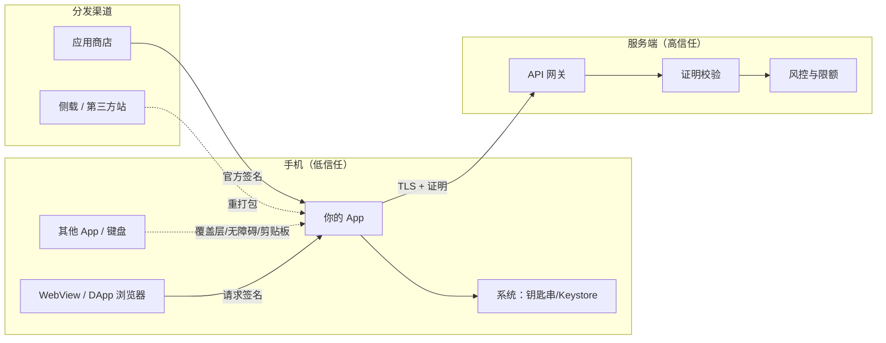
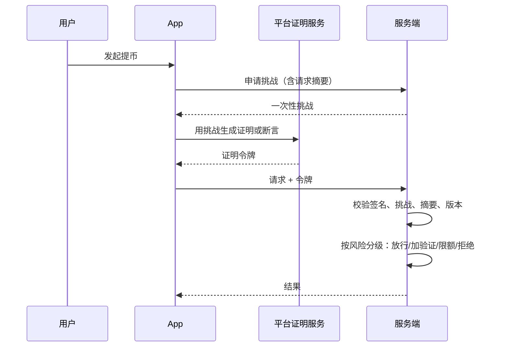
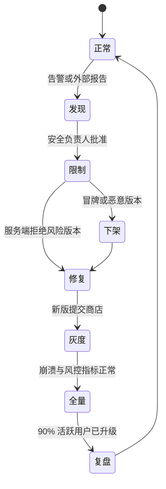

# X39 移动端与客户端 App 安全工程：加固、发布与运行时防护

> 学习目标：读完本章，你能——
> 1. 为一款 Web3 移动 App 画出威胁模型，区分"手机本身被攻陷"和"App 被篡改或冒牌"两类问题，并说明加固能防什么、不能防什么。
> 2. 按 OWASP MASVS 的八个控制组，写出一份移动端安全测试清单，并把"完整性校验结果"接到服务端的分级放行策略上。
> 3. 为 App 准备发布、强制升级、紧急下架和漏洞披露的剧本，并做一次 30 分钟桌面推演。
>
> 适用角色：钱包、交易所、DeFi 前端、支付类 App 的移动端负责人、AppSec 工程师、发布负责人。
> 前置章节：[18 钱包与密钥管理](../18-wallet-key-management.md)、[19 用户侧诈骗](../19-user-scams.md)、[24 数据隐私](../24-data-privacy.md)、[X04 软件交付与供应链安全](X04-delivery-supply-chain.md)、[X37 钱包厂商安全](X37-wallet-vendor-security.md)
> 交互实验 / 模板：[phishing-signature-lab.html](../interactive/phishing-signature-lab.html) ｜ 训练营：[B57 钱包与私钥实操](../bootcamp/B57-wallet-key-practice.md)
> 最后核对：2026-11-23

> 💡 注意：本章的配置、规则和数值是"示例"。系统接口、商店规则、MASVS 的条目会变化，落地前以 Apple、Google 与 OWASP 的官方最新文档为准。时效事实截至 2026 年公开资料。

**与 X37 的分工。** [X37](X37-wallet-vendor-security.md) 讲钱包厂商整体：发布凭证、签名界面、MPC 服务、硬件钱包。本章只讲移动端与客户端 App 这一个载体的安全工程：App 装在一台不可信的手机上，怎样保护密钥和会话，怎样证明"这个请求来自真实 App"，怎样发布和召回。X37 已讲的随机数、签名界面规则、发布凭证不再重复。

---

## 开场：一张截图

2025 年 2 月，卡巴斯基公开了一个名为 SparkCat 的木马。它藏在 Google Play 和苹果应用商店的应用里，其中一个是外卖应用。这些应用用 OCR（光学字符识别）扫描相册里的截图，找带有"助记词"关键字的图片，把图片传给攻击者的服务器。

用户做的事情是：为了"以后不丢"，给钱包的助记词页面截了一张图。

<details class="predict"><summary>🤔 先猜再看：这个钱包 App 本身没有漏洞，也没有被篡改。钱包团队能不能防住这次泄露？</summary>

能防一部分。钱包团队不能控制手机里别的 App，但能控制自己的界面：助记词页面开启防截屏（Android 的 `FLAG_SECURE`），引导用户用纸或硬件备份而不是截图。更重要的是，设计上让"明文助记词出现在屏幕上"成为稀有事件。本章的主线是：**你不能保证手机干净，但你决定敏感数据在手机上暴露多久、暴露给谁。**

</details>

---

## 1. 一句话理解

**移动端安全工程的目标是：假设手机和同机的其他 App 不可信，把 App 里的密钥、会话和敏感数据暴露面压到最小，并让服务端能分辨"真实 App"与"仿冒或被篡改的 App"。**

加固（Hardening）：用混淆、反调试、完整性校验等手段，提高逆向和篡改 App 的成本。加固只提高成本，不保证安全。
设备与应用证明（Attestation）：由系统或硬件出具的、可由服务端验证的"这个 App 和这台设备处于什么状态"的声明。
运行时防护（Runtime Protection）：App 在运行中检测调试、注入、覆盖层、无障碍滥用等风险，并降低能力或通知服务端。

> 🎯 打个比方：App 像一个放在陌生人家里的保险柜。你无法选择房子里住的是谁。你能做的是：保险柜只放必要的东西，开柜的时间越短越好，柜门上装传感器，有人撬动就通知总部，总部再决定要不要关闭这个柜子对应的账户。
>
> 比喻的局限：保险柜的厂商不需要和房客"协商"。App 还要考虑可用性：对老手机、越狱手机、使用无障碍辅助功能的残障用户，一刀切的封禁会误伤正常用户。

---

## 2. 保护目标与信任边界

### 2.1 威胁模型

先分清四类场景。它们的防御完全不同。

| 类别 | 场景 | 攻击者控制什么 | 主要防线 |
|---|---|---|---|
| A. 手机被攻陷 | 越狱 / root、恶意 App、恶意键盘、无障碍滥用、屏幕录制、剪贴板窃取 | 同机其他进程 | 安全存储、界面保护、服务端风控 |
| B. App 被替换 | 重打包后侧载、冒牌 App、第三方分发站、被投毒的 SDK | 你发给用户的二进制 | 商店与签名、渠道声明、证明与完整性、SDK 治理 |
| C. 链路与服务端 | 恶意 Wi-Fi、被入侵的 CDN、被滥用的接口 | 网络 | 传输安全、服务端鉴权、速率限制 |
| D. 用户被诱导 | 假客服、假弹窗要求"备份助记词" | 用户的操作 | 产品设计、提示文案，见 [19 章](../19-user-scams.md) |

> ⚠️ 警告：A 类场景下，客户端检测可以被绕过。把"检测到风险就在本地提示"当作防线，等于让攻击者自己决定是否收到提示。凡是涉及资金的判断，必须落在服务端，或落在用户的硬件签名设备上。



读图要点：
- 虚线是"不受你控制"的输入：重打包的 App、同机 App 的干扰。`WV → APP` 的签名请求同样不可信，规则见 [X37 的签名界面一节](X37-wallet-vendor-security.md)。
- 服务端校验证明后再决定放行等级，不要在 App 里做最终判断。
- 图没有画硬件钱包或 MPC，它们属于 [X37](X37-wallet-vendor-security.md)。

### 2.2 要保护的东西

按"丢了会怎样"排序：

1. 私钥与助记词（本机持有型钱包）：丢失即资金损失，不可撤销。
2. 会话与刷新令牌（交易所、托管类 App）：被盗可提币或改设置，可以撤销。
3. API Key、设备绑定凭证、本地 PIN 的派生材料。
4. 个人数据：身份证件照片、地址簿、交易记录，见 [24 章](../24-data-privacy.md)。
5. 品牌与渠道：用户安装的"官方 App"到底是不是你的。

---

## 3. 参考架构

### 3.1 五层防线

建议按下面五层设计，每层有独立的负责人和检查项。

| 层 | 目的 | 典型手段 | 失败后果 |
|---|---|---|---|
| 1 数据最小化 | 少存、少显示、少上传 | 不落盘明文、日志脱敏、防截屏 | 暴露面小，后面各层压力小 |
| 2 平台能力 | 借系统保护密钥与会话 | 钥匙串 / Keystore、生物识别绑定 | 密钥不可导出或需用户在场 |
| 3 传输与服务端 | 链路可信，接口不可滥用 | TLS、证书固定、服务端鉴权、限额 | 窃听、重放、批量滥用 |
| 4 完整性与证明 | 判断"App 与设备处于什么状态" | Play Integrity、App Attest、签名校验 | 分不出真假 App |
| 5 发布与运营 | 能发、能撤、能发现 | 商店分发、灰度、强制升级、监控 | 出事后无法止血 |

### 3.2 证明信号怎样接到服务端

证明（Attestation）的价值在服务端，不在 App 里。Google 的 Play Integrity API 官方文档说明：它返回应用完整性（`appIntegrity`）、设备完整性（`deviceIntegrity`）和账户（`accountDetails`）等判定，可选的还有 `appAccessRiskVerdict`（是否有应用可以截屏、叠加覆盖层或通过无障碍控制设备）、`playProtectVerdict`、`recentDeviceActivity` 等。文档同时强调：要与其他防滥用手段配合使用，不能作为唯一机制；不要缓存判定；用 `requestHash` 或 `nonce` 绑定请求内容；先在不执行拦截的情况下收集数据，再决定拦截策略；服务端按判定做分级响应，而不是只有放行和拒绝两种结果。

苹果的 App Attest（属于 DeviceCheck 框架）让 App 在 Secure Enclave 里生成密钥，向苹果取得证明对象，服务端验证后保存公钥，之后对敏感请求使用断言（assertion）签名，并检查计数器递增。该描述来自公开资料的概括，字段细节以苹果官方文档为准。



读图要点：
- 挑战由服务端生成并绑定本次请求内容，防止把一个"好设备"的令牌拿去给别的请求用。
- 服务端校验后输出的是"分级决定"，不是单一的真假。
- 平台服务不可用时要有预案：回退到更低额度或更强的人工验证，而不是全部放行或全部拒绝。
- 局限：证明说明"环境看起来怎样"，不说明"用户是否被诈骗"。

### 3.3 分级放行策略（示例）

| 信号组合 | 允许的操作（示例） | 理由 |
|---|---|---|
| 官方渠道 + 设备完整 + 无高危覆盖应用 | 全部功能 | 基线 |
| 官方渠道 + 设备完整 + 检测到可控屏幕的应用 | 浏览、小额；提币需二次验证 | 无障碍滥用风险 |
| 设备完整性弱或越狱 / root | 只读、小额、延迟到账 | 本机环境不可证明 |
| 应用未被商店识别（重打包嫌疑） | 只读，并提示重新安装官方版本 | 二进制不可信 |
| 证明服务不可用 | 沿用最近一次的低一级放行 | 避免全部失败导致业务中断 |

---

## 4. 控制清单

ID 前缀 `APP`，条目对应 MASVS 控制组（见第 4.1 节）。优先级 P0 为上线门禁。

| ID | 控制项 | 要防什么 | 优先级 | 怎么验证 | MASVS |
|---|---|---|---|---|---|
| APP-1 | 密钥与令牌只放系统安全存储，不写明文文件、偏好设置、日志 | 越狱 / 备份 / 取证读出密钥 | P0 | 静态扫描 + 在测试机上导出沙箱文件检查 | STORAGE-1, CRYPTO-2 |
| APP-2 | 敏感操作要求用户在场（生物识别或 PIN 绑定到密钥使用） | 手机解锁后被他人操作，恶意 App 调用 | P0 | 取消生物识别后密钥不可用的用例 | AUTH-2, AUTH-3 |
| APP-3 | 助记词、私钥页面开启防截屏、防录屏、任务切换遮挡 | 截屏窃取、OCR 木马 | P0 | 手工截屏与最近任务预览检查 | STORAGE-2, PLATFORM-3 |
| APP-4 | 日志、崩溃上报、分析 SDK 不含密钥、地址与令牌 | 第三方后台泄露 | P0 | 构造敏感数据后检索日志与上报样本 | STORAGE-2, PRIVACY-1 |
| APP-5 | 全部流量走 TLS，禁用明文；对自家域名做证书或公钥固定并有轮换预案 | 中间人、劫持 | P0 | 代理抓包用例；故障演练固定失效 | NETWORK-1, NETWORK-2 |
| APP-6 | 深度链接、自定义 URL Scheme 不直接触发资金操作，并校验来源与参数 | 被诱导的链接触发转账、授权 | P0 | 构造恶意链接用例，必须落到确认页 | PLATFORM-1, CODE-4 |
| APP-7 | WebView / DApp 浏览器限制来源、禁用不必要的桥接接口、不加载任意脚本 | 页面脚本调用原生能力 | P0 | 桥接接口清单与来源白名单审查 | PLATFORM-2 |
| APP-8 | 服务端校验平台证明，按风险分级放行，请求与挑战绑定 | 重打包 App、脚本批量调用 | P1 | 回放与篡改请求用例 | RESILIENCE-1, RESILIENCE-2 |
| APP-9 | 加固：混淆、反调试、完整性自检；明确只当作"提高成本" | 低成本逆向与改包 | P1 | 第三方对抗测试；见第 4.2 节 | RESILIENCE-2 至 4 |
| APP-10 | 依赖与 SDK 清单（SBOM）、版本锁定、漏洞扫描、SDK 权限审查 | 被投毒或带漏洞的组件 | P0 | 构建时生成清单并与白名单比对 | CODE-3 |
| APP-11 | 最低版本强制：服务端可拒绝旧版本，App 内能引导升级 | 已知漏洞版本长期存在 | P0 | 把测试版本号加入拒绝表，验证旧版本被拦截 | CODE-1, CODE-2 |
| APP-12 | 签名密钥与商店账号分级保护，使用商店托管签名，发布门禁 | 恶意版本被发布 | P0 | 见 [X04](X04-delivery-supply-chain.md)、[X37](X37-wallet-vendor-security.md) | CODE-2 |
| APP-13 | 官方渠道声明：官网只列官方商店链接，应用内显示版本与识别方式 | 冒牌 App | P1 | 每月检索商店仿冒与山寨站 | — |
| APP-14 | 紧急响应剧本：发布 → 灰度 → 暂停 → 强制升级 → 下架 → 公告 | 事故扩散 | P0 | 季度演练，计时 | — |
| APP-15 | 漏洞披露入口与 SLA（含移动端范围） | 研究员无处报告 | P1 | 见 [X36](X36-disclosure-bounty-ops.md) | — |
| APP-16 | 数据最小化与隐私：权限按需申请，不读相册、通讯录，除非功能必需 | 过度采集成为攻击面 | P1 | 清单审查权限声明 | PRIVACY-1 至 4 |

### 4.1 MASVS 核对说明

OWASP 的移动应用安全验证标准（MASVS，Mobile Application Security Verification Standard）是移动应用的基线要求，配套 MASTG（测试指南）和 MASWE（弱点枚举）。核对官方仓库：截至 2026 年 11 月，最新发布版本为 v2.1.0（2024 年 1 月发布），共 8 个控制组、24 条控制。

| 控制组 | 条目数 | 本章用到的要点（按英文官方表述意译） |
|---|---|---|
| STORAGE | 2 | 安全存储敏感数据；防止敏感数据泄露 |
| CRYPTO | 2 | 使用当前强密码并按最佳实践使用；按最佳实践管理密钥 |
| AUTH | 3 | 安全的认证与授权协议；按平台最佳实践做本地认证；敏感操作加验证 |
| NETWORK | 2 | 全部流量按最佳实践保护；对自家端点做身份固定（pinning） |
| PLATFORM | 3 | 安全使用进程间通信；安全使用 WebView；安全使用界面 |
| CODE | 4 | 要求较新的平台版本；有强制更新机制；只用无已知漏洞的组件；校验并清洗不可信输入 |
| RESILIENCE | 4 | 校验平台完整性；防篡改；防静态分析；防动态分析 |
| PRIVACY | 4 | 最小化访问；防止识别用户；对数据收集透明；用户可控 |

> 💡 注意：MASVS v1 的 L1、L2、R 等级在 v2.0.0 起从标准里移除，改由 MASTG 中的"测试配置（MAS Profiles）"表达，官方站点的部分检查表页面仍在迁移。该迁移细节来自二手资料的概括，引用时写明版本号，并以 mas.owasp.org 为准。RESILIENCE 组是纵深防御，不能代替前面各组。

### 4.2 加固的边界

- 能做到：让自动化改包工具失效，增加逆向分析时间，延缓大规模仿冒。
- 做不到：隐藏运行在设备上的密钥；阻止拥有设备完全控制权的攻击者；让客户端检测结果"可信"。
- 建议：把加固预算放在 P0 的数据最小化与服务端控制之后。加固带来的崩溃、兼容问题和审核风险要计入成本，上线前在主流机型上做回归。
- 通用做法：加固后仍然假设攻击者能还原逻辑，所以"客户端里的秘密"不当作秘密。

---

## 5. 分级落地

| 档位 | 做什么 | 人和时间（示例） |
|---|---|---|
| 最小可行 | APP-1、3、4、5、6、7、10、11；商店分发；日志脱敏；最低版本表；官方渠道声明 | 1 名移动端工程师 + 0.5 名 AppSec，4–6 周 |
| 标准 | 加上平台证明与服务端分级放行（APP-8）、依赖清单与扫描、灰度发布、季度演练、仿冒监控 | 2 名移动端 + 1 名 AppSec + 1 名后端风控，一个季度 |
| 成熟 | 加上加固与运行时检测、第三方对抗测试、自动化 MASTG 用例进 CI、设备信誉库、专职仿冒下架流程 | 专职移动端安全小组，半年到一年 |

---

## 6. 落地做法

### 6.1 安全存储与密钥

1. 区分"本机持有私钥"和"账户型 App"。本机持有私钥的 App，风险最高，设计也最复杂。
2. 先问：App 真的需要持有私钥吗？账户型 App（交易所、托管）只保存会话令牌，不保存资金私钥。
3. 令牌放在系统钥匙串（iOS Keychain）或 Android Keystore 保护的存储里。iOS 上选"仅本机、需设置设备密码"的可访问性级别；Android 上用 Keystore 生成的密钥加密本地数据。
4. 平台安全芯片的限制：公开文档表明，苹果 Secure Enclave 支持的是 NIST P-256 曲线，不支持以太坊使用的 secp256k1。所以多数本机钱包把 secp256k1 私钥用硬件密钥包裹后再存放。这样"私钥永不离开硬件"不成立，需要在威胁模型里明说，并依赖 APP-2 的"用户在场"控制。
5. 让密钥的使用绑定用户认证：Android 的密钥参数可要求用户认证，并配合 `BiometricPrompt` 的 `CryptoObject`，而不是只在界面里弹一个"通过 / 不通过"；iOS 用带访问控制的钥匙串项。目的是：恶意代码调用同一个密钥时，系统会要求认证。
6. 防备份泄露：Android 关闭或细化 `allowBackup` 与数据提取规则；iOS 对敏感项选"不迁移到其他设备"的可访问性级别。

Android 侧的最小配置（示例，字段以官方文档为准）：

```xml
<!-- AndroidManifest.xml 示例：不允许云备份带走敏感数据，禁用明文流量 -->
<application
    android:allowBackup="false"
    android:dataExtractionRules="@xml/data_extraction_rules"
    android:usesCleartextTraffic="false"
    android:networkSecurityConfig="@xml/network_security_config">
  <!-- 深度链接只落到确认页；其余 Activity 默认不导出 -->
  <activity android:name=".LinkEntryActivity" android:exported="true">
    <intent-filter android:autoVerify="true">
      <action android:name="android.intent.action.VIEW"/>
      <category android:name="android.intent.category.DEFAULT"/>
      <category android:name="android.intent.category.BROWSABLE"/>
      <data android:scheme="https" android:host="app.example.com" android:pathPrefix="/open"/>
    </intent-filter>
  </activity>
</application>
```

### 6.2 界面保护：截屏、覆盖层、无障碍

SparkCat 和 Crocodilus 都说明：屏幕上出现过的明文，就可能被读走。

1. 助记词、私钥、一次性码的页面，在 Android 上给窗口设置 `FLAG_SECURE`，禁止截屏和最近任务缩略图；在 iOS 上，退到后台时遮挡内容，并监听屏幕被录制或镜像的状态来隐藏敏感视图。
2. 敏感页面考虑 Android 14（API 34）起提供的"无障碍数据敏感"视图属性，限制非无障碍工具类服务读取。适配前确认对真实残障用户的影响，并保留替代方式。
3. 对敏感按钮开启"被覆盖时忽略触摸"（`filterTouchesWhenObscured`），减少点击劫持。
4. 展示助记词前，先全屏提示：官方不会要求你在弹窗里输入助记词，也不会限时备份。Crocodilus 的诱饵正是"12 小时内备份"。
5. 剪贴板：地址、助记词尽量不复制到系统剪贴板；必须复制时，设置短过期，并在粘贴后让用户核对地址的前后几位。恶意程序替换剪贴板里的地址是长期存在的做法。

6. 第三方键盘：第三方键盘可能记录输入。PIN、助记词输入框使用应用自带的输入组件，或在 iOS 上禁用第三方键盘扩展；Android 上对密码类输入框设置不记录的输入类型，并提示用户谨慎使用来源不明的输入法。
7. 越狱 / root 的策略要写成文字，由产品、安全和客服共同批准：是提示、降级，还是拒绝。建议降级而不是拒绝，因为有技术背景的用户常用已 root 的设备，一刀切会引来投诉，却挡不住真正的攻击者。
8. 通知与小组件：交易通知、锁屏小组件不显示完整地址、金额之外的敏感字段；验证码类通知在锁屏上隐藏内容。

### 6.3 传输安全与证书固定

1. 全部使用 TLS，关闭明文流量。ESET 2022 年分析的仿冒钱包里，一些样本用 HTTP 外传助记词。这提醒我们：自家 App 也要让明文流量在构建期失败。
2. 对自家域名做证书或公钥固定，固定至少两个公钥（当前和备用）。固定失败不应造成全体用户无法使用：准备"远程更新固定列表"的方法，或先在监控模式下运行。
3. 固定能防系统被装入恶意根证书的场景，不能防已获得设备完全控制的攻击者。服务端鉴权不能因此放松。

```xml
<!-- res/xml/network_security_config.xml 示例：固定两个公钥，设到期时间便于轮换 -->
<network-security-config>
  <base-config cleartextTrafficPermitted="false"/>
  <domain-config>
    <domain includeSubdomains="true">api.example.com</domain>
    <pin-set expiration="2027-06-30">
      <pin digest="SHA-256">AAAAAAAAAAAAAAAAAAAAAAAAAAAAAAAAAAAAAAAAAAA=</pin>
      <pin digest="SHA-256">BBBBBBBBBBBBBBBBBBBBBBBBBBBBBBBBBBBBBBBBBBB=</pin>
    </pin-set>
  </domain-config>
</network-security-config>
```

### 6.4 完整性与证明：服务端怎么写

1. 先观察再拦截：先接入证明，只记录判定结果，统计真实用户群的分布（有多少旧设备、定制系统、无障碍用户），再定拦截线。
2. 每次高价值操作（提币、改安全设置、绑定新设备）单独申请证明，不缓存。
3. 请求内容摘要写入 `requestHash` 或 nonce，服务端校验与实际请求一致。
4. 判定映射到动作表（见第 3.3 节），保留"加验证""限额""延迟"等中间档位。

```python
# 示例：服务端按证明结果分级放行（伪代码，字段名以官方文档为准）
def decide(att, req):
    if not att.valid or att.request_hash != sha256(req.body):
        return "deny"
    if att.platform == "android" and att.app_recognized != "PLAY_RECOGNIZED":
        return "read_only"            # 疑似重打包
    if att.version < MIN_VERSION[att.platform]:
        return "force_upgrade"
    tier = att.device_tier            # strong / device / basic / none
    risky = att.screen_capture_or_overlay_apps  # 有可控屏幕的应用
    if tier == "none":
        return "read_only"
    if risky or tier == "basic":
        return "limit_and_2fa"        # 小额 + 二次验证 + 延迟到账
    return "allow"
```

### 6.5 深度链接、WebView 与第三方 SDK

1. 深度链接（含钱包连接协议的自定义 Scheme）只能打开确认页。参数（地址、金额、合约）在确认页完整展示，由用户确认。链接绝不直接执行授权或转账。
2. Android 优先使用经域名验证的 App Links，iOS 使用 Universal Links。自定义 Scheme 可被其他 App 注册，不能当作身份证明。
3. WebView 里禁用不必要的文件访问，限制可导航域名；原生桥接接口只暴露必须的方法，并校验调用页的来源。DApp 浏览器按"每个站点一个权限域"处理。
4. 第三方 SDK 视为你的代码：登记清单与权限，锁定版本，审查它们读取的数据（相册、剪贴板、通讯录），在隐私披露里写明。SparkCat 的公开分析没有确认恶意代码怎样进入各个 App：可能是被投毒的第三方组件，也可能是开发者自己加入。对你来说两种可能的防御一样：清单、白名单、构建产物对比。
5. 脚本热更新（如跨平台框架的远程补丁）要与发布门禁一致：更新内容需要同样的签名与审批。商店对下载并执行代码有规则限制，以最新审核指南为准。

### 6.6 日志、崩溃上报与分析 SDK

1. 日志默认不记录地址、金额、令牌、请求体。需要排障时，在服务端用请求 ID 关联，不在客户端存敏感数据。
2. 崩溃上报栈里可能带有对象内容。上报前在客户端做过滤，并对第三方后台设置访问控制和保留期。
3. 构建期规则：禁止把敏感变量直接传给日志函数（用静态扫描规则）。

```yaml
# 示例：CI 里的日志泄露扫描规则（Semgrep 风格，示意，需按语言拆分）
rules:
  - id: no-sensitive-in-log
    message: "日志里不得出现助记词、私钥、令牌变量"
    languages: [kotlin, java]
    severity: ERROR
    patterns:
      - pattern: Log.$LEVEL(..., $X)
      - metavariable-regex:
          metavariable: $X
          regex: '(?i).*(mnemonic|seed|privkey|private_?key|token|secret).*'
```

### 6.7 应用商店、签名、更新与下架

通用方法见 [X04](X04-delivery-supply-chain.md)，凭证保护见 [X37](X37-wallet-vendor-security.md)。移动端特有的点：

1. 使用商店提供的托管签名与分发，不把签名密钥放在开发者笔记本上。商店账号开启硬件密钥登录，按角色分权，发布需两人确认。
2. 灰度发布：用商店的分阶段发布先放小比例，监控崩溃率和风控事件，再放量。
3. 强制升级：Google Play 提供应用内更新接口，可做"立即更新"；苹果没有等价的系统级强制更新，需要自建最低版本检查：服务端返回"必须升级"，App 显示全屏提示并跳转商店。
4. 紧急下架：商店可以停止发布或下架应用，但已安装的副本不会因此消失。所以下架要与"服务端拒绝旧版本"同时执行。
紧急响应的状态可以画成下面这样。每次状态变化都要记录时间与批准人。



读图要点：
- "限制"是服务端动作（降级放行、拒绝旧版本），分钟级生效，不等商店审核。
- "灰度"到"全量"要有指标门槛，否则修复版本可能放大问题。
- 谁有权推动"限制"和"下架"，要在事故前写进剧本；商店账号的操作权限只给少数人。
- 局限：商店审核时间不可控，所以服务端限制必须先行。

5. 冒牌应用下架：保留证据（截图、包名、开发者账号、分发链接），按商店的侵权与冒充渠道提交，同时在官方账号发布公告。
6. 侧载与第三方站：ESET 2022 年报告显示，仿冒钱包的分发网站甚至在页面放"从 Google Play 获取"样式的按钮，用户实际下载的是 APK；iOS 的受害者通过配置文件安装。因此官网只放官方商店链接，并在应用内展示"官方版本的识别方式"。

### 6.8 漏洞披露

在 [X36](X36-disclosure-bounty-ops.md) 的流程里补上移动端范围：测试范围写清楚（官方商店版本、测试环境）、允许的测试方法、不允许对真实用户账户做测试、修复与强制升级的时间线。移动端的修复需要等商店审核和用户升级，SLA 要把这段时间算进去。

### 6.9 测试方法与环境

1. 测试机：至少一台未越狱的主流机型、一台已 root 或越狱的测试机、一台低版本系统的旧机，各装测试构建。
2. 测试账号与测试链：只在测试网和测试账号上做，不碰真实用户资金，也不使用真实用户的助记词。
3. 工具：静态分析（扫描清单、权限、导出组件）、动态分析（代理抓包、运行时观察日志与文件）。MASTG 为每个控制组提供测试用例，建议按"P0 项每次发布前、其余每季度"的节奏执行。
4. 用例要覆盖三种状态：新安装、升级后、被强杀后重启。很多泄露出现在升级迁移和异常退出的路径上。
5. 结果写成可复测的记录：机型、系统版本、构建号、步骤、证据，方便整改后复测。

### 6.10 常见坑

- 只在 App 里判断越狱或调试，不把结果传给服务端。
- 证书固定没有备用公钥，轮换时全体用户无法联网。
- 以为商店审核等于安全：SparkCat 的应用进入过两大商店。
- 日志框架在调试级别输出请求体，发布版本没有关闭。
- 没有最低版本表，漏洞修复后旧版本仍可正常使用。

---

## 7. 运营：指标、告警、值班、演练、季度节奏

### 7.1 指标

| 指标 | 说明 | 目标（示例） |
|---|---|---|
| 最新版本占比 | 活跃用户中使用最近两个版本的比例 | 发布后 30 天内 ≥ 90% |
| 证明失败率 / 分级分布 | 各判定档位占比，突变即告警 | 基线 ±50% 报警 |
| 强制升级触达时间 | 从决定到 90% 活跃用户升级 | 记录并逐季缩短 |
| 仿冒发现到下架时间 | 商店与站点仿冒 | 先建基线 |
| 日志泄露扫描问题数 | CI 与抽检 | P0 为零 |
| 渗透测试发现修复时间 | 按等级 | P0 14 天内（示例） |

### 7.2 告警

- 同一设备或同一账号短时间多次证明失败。
- "应用未被商店识别"的请求量上升（可能是重打包版本扩散）。
- 某个版本的高危判定比例突升（可能是新木马在特定机型扩散）。
- 官方渠道外的下载站出现与你品牌相似的包名。
- 崩溃上报中出现敏感字段样式（规则命中）。

### 7.3 演练与季度节奏

- 每季度：强制升级演练（测试环境把旧版本加入拒绝表，计时）；证书固定轮换演练；仿冒下架演练。
- 每半年：第三方移动端渗透测试，按第 9 节清单执行。
- 每次发布前：MASTG 选定用例回归，P0 失败不发布。

---

## 8. 失效案例

下面的案例都经公开来源核对；完整事件复盘见《Web3 行业安全资损 101》。本节三个案例的共同点是：被攻击的是"人 + 手机 + 二进制"，不是链上合约。厂商自身发布流程失守的案例见 [X37](X37-wallet-vendor-security.md)。公开资料中，这三个案例都没有披露确切的总损失金额，本章不引用金额。

### 案例 1：仿冒与改包钱包（ESET，2022 年 3 月报告）——渠道与签名

- 事实：ESET 报告称，活动最早可追溯到 2021 年 5 月。攻击者做了 40 多个仿冒官网，向手机用户提供被改过的钱包，涉及 Coinbase Wallet、imToken、MetaMask、Trust Wallet、Bitpie、TokenPocket、OneKey 等品牌的应用。改动集中在生成或导入助记词的位置，把助记词发往攻击者的服务器，一些样本用 HTTP 明文发送。Android 版本通过 APK 直接下载；iOS 版本通过安装配置文件获得信任的签名证书。另有 13 个假冒 Jaxx Liberty 的应用在 2022 年 1 月前后从 Google Play 移除。
- 教训：被改的是用户拿到的二进制，不是你的服务器。防线是渠道声明、服务端对"应用未被商店识别"的分级放行，以及仿冒监控。
- 映射：APP-8、APP-12、APP-13。
- 来源类型：安全公司研究。[ESET 报告](https://welivesecurity.com/2022/03/24/crypto-malware-patched-wallets-targeting-android-ios-devices/)。

### 案例 2：SparkCat（卡巴斯基，2025 年 2 月）——截图与 SDK

- 事实：卡巴斯基称，该木马至少自 2024 年 3 月起在 App Store 与 Google Play 的应用中出现。它内置基于 Google ML Kit 的 OCR 模块，按设备语言选择识别模型（拉丁、韩、中、日文字），从服务器取回关键词规则，把含有"助记词"类文字的图片上传。卡巴斯基的博客列出 Google Play 上 10 个、App Store 上 11 个受感染应用；Google Play 上的受感染应用下载量超过 24.2 万次。卡巴斯基写明尚不清楚恶意组件如何进入这些应用：可能来自被感染的第三方组件，也可能是开发者有意加入。该博客发布时，这些应用均已从商店移除。后续报道还提到同类活动 SparkKitty 改为复制相册中的全部图片。
- 教训：商店审核不是安全边界；用户习惯（截图备份）会变成攻击面。
- 映射：APP-3、APP-10、APP-16，以及用户侧教育（不要截图或拍照存助记词）。
- 来源类型：安全公司研究。[卡巴斯基博客](https://www.kaspersky.com/blog/ios-android-ocr-stealer-sparkcat/)。

### 案例 3：Crocodilus（ThreatFabric，2025 年 3 月报告）——无障碍与社工

- 事实：媒体转述 ThreatFabric 的报告：该 Android 木马获得无障碍服务权限后，向用户显示"在 12 小时内备份钱包密钥，否则会失去访问"之类的假提示，引导用户打开助记词页面，再通过无障碍日志读取文字。它同时是远控木马，操作者可用黑屏遮盖动作，并可读取验证码。首批受影响的用户在西班牙与土耳其；ThreatFabric 后续在 2025 年 6 月称活动扩展到更多国家，并出现自动解析助记词和私钥的功能。分发方式包括恶意网站、社交媒体、短信和第三方商店，其投放器被报告可绕过 Android 13 及以上的限制。
- 教训：A 类场景下，屏幕内容、点击和验证码都可能被读取。要靠"少显示"、无障碍数据敏感属性、服务端识别"有可控屏幕的应用"、对高价值操作二次验证。
- 映射：APP-2、APP-3、APP-8。
- 来源类型：安全公司研究的媒体转述。[Decrypt 报道](https://decrypt.co/312378/crocodilus-malware-draining-crypto-wallets-android)、[The Hacker News](https://thehackernews.com/2025/06/android-trojan-crocodilus-now-active-in.html)。本章作者未能直接打开 ThreatFabric 原文，细节以原文为准。

### 案例映射

| 案例 | 被绕过的控制 | 应补的控制 |
|---|---|---|
| ESET 仿冒钱包 | 渠道声明、证明 | APP-8、APP-13 |
| SparkCat | 界面保护、SDK 治理 | APP-3、APP-10 |
| Crocodilus | 界面保护、二次验证 | APP-2、APP-3、APP-8 |

---

## 9. 评估检查点

按 MASVS 思路组织的移动端安全测试清单。每一项测试都在测试机、测试账号、测试环境上执行。

- [ ] **APP-1** 在已越狱 / root 的测试机上检查应用沙箱，找不到明文密钥、令牌和助记词。
- [ ] **APP-2** 取消生物识别或更换指纹 / 面容后，密钥使用需要重新认证。
- [ ] **APP-3** 助记词页截屏失败（Android），iOS 录屏时内容被遮挡，最近任务缩略图不显示明文。
- [ ] **APP-4** 构造含测试助记词、令牌的场景，日志、崩溃上报、分析事件里搜不到。
- [ ] **APP-5** 在测试代理下，TLS 被拒绝；固定失效有告警；备用公钥可用。
- [ ] **APP-6** 恶意构造的深度链接只打开确认页，不触发任何资金操作。
- [ ] **APP-7** WebView 只加载白名单域名，桥接接口清单与代码一致。
- [ ] **APP-8** 重打包的测试包在服务端被降级；篡改请求体后摘要校验失败；证明服务不可用时按预案降级。
- [ ] **APP-9** 第三方对抗测试报告里没有"一键改包"的路径；加固的崩溃回归通过。
- [ ] **APP-10** 每个版本有依赖清单；新增 SDK 经审批；漏洞扫描无高危未处理项。
- [ ] **APP-11** 把测试版本加入拒绝表，旧版本被拦截并引导升级。
- [ ] **APP-12** 商店账号启用硬件密钥，发布需两人确认，签名密钥不在个人设备上。
- [ ] **APP-13** 每月仿冒检索有记录；官网只列官方商店链接。
- [ ] **APP-14** 近 3 个月做过一次计时的紧急响应演练。
- [ ] **APP-15** 披露入口写明移动端范围与修复时间线。
- [ ] **APP-16** 权限清单里没有与功能无关的相册、通讯录、麦克风权限。

把检查结果写进报告：

| 检查项 | 结果 | 证据 | 风险等级 | 整改负责人 | 复测日期 |
|---|---|---|---|---|---|
| APP-3 | 通过 / 不通过 | 截图、测试机型与系统版本 | P0 | 移动端 | |

---

## 10. 上手路径

**第一周：**
1. 列出 App 在各商店的版本、签名方式、第三方 SDK 与权限。
2. 做一次 15 分钟的威胁建模：谁能读到助记词？谁能改包？
3. 在测试机上跑一遍 APP-1、3、4：找沙箱文件、截屏、搜日志。

**第一个月：**
1. 接入平台证明，只记录不拦截，统计分布。
2. 加上最低版本表与强制升级页面。
3. 写好深度链接与 WebView 的规则，补测试用例。
4. 在 CI 里加入日志泄露扫描和依赖清单。

**第一个季度：**
1. 按分级表启用服务端放行策略，灰度 5% 用户。
2. 做一次强制升级演练、一次证书固定轮换演练、一次仿冒下架演练。
3. 委托第三方做移动端渗透测试，把发现写入风险登记表。

---

## 11. 常见误区

| 误区 | 事实 |
|---|---|
| 加固了就安全 | 加固只提高成本；资金决策要在服务端或用户的签名设备上 |
| 通过商店审核就可信 | 公开报告显示恶意代码进入过两大商店 |
| 检测到 root 就在本地弹窗 | 客户端可被绕过，结果要传服务端并分级处理 |
| 证书固定能挡住一切 | 它不能挡住完全控制设备的攻击者；还要有轮换预案 |
| 安全芯片里存着私钥 | 常见的 secp256k1 需要包裹存储，"不可导出"要核对具体算法与平台 |
| 禁用所有无障碍 | 会伤害真实用户；用分级与二次验证 |

---

## 12. 术语表

| 术语 | 定义 |
|---|---|
| MASVS | OWASP 的移动应用安全验证标准 |
| MASTG | 与 MASVS 配套的移动应用安全测试指南 |
| 证明（Attestation） | 平台出具、服务端可验证的设备或应用状态声明 |
| 证书固定（Pinning） | 只信任指定的证书或公钥 |
| 深度链接（Deep Link） | 从外部直接打开 App 内页面的链接 |
| 重打包（Repackaging） | 反编译后修改并重新签名的 App |
| 无障碍服务（Accessibility Service） | 为辅助功能设计，能读取屏幕和模拟点击的系统能力 |
| 覆盖层（Overlay） | 绘制在别的 App 之上的窗口，可用于诱导输入 |
| 钥匙串 / Keystore | iOS 与 Android 的系统密钥与凭据存储 |

---

## 13. 动手练习与思考题

**练习 1（20 分钟，画图）：** 选一款你熟悉的钱包或交易所 App。画出第 2.1 节那样的信任边界图，标出：助记词（或令牌）在内存、屏幕、剪贴板、磁盘、日志里的所有位置。每个位置写"谁能读到"。

**练习 2（20 分钟，填表）：** 为你的 App 写一份第 3.3 节那样的分级放行表。至少 5 行，每行写清信号、允许的操作和你不允许的操作。

**练习 3（30 分钟，桌面推演）：** 背景：监控发现"应用未被商店识别"的请求在一天内翻了 5 倍，同时社群有人说下载站的"官方 App"会提示备份助记词。注入：①第 30 分钟，有用户报告损失；②第 40 分钟，商店下架申请未获回应。请写出：谁决定暂停提币？服务端怎样拒绝旧版本？公告写什么？哪些证据要保全？评分：是否在 30 分钟内做出"限制 + 通知 + 取证"三件事。

**思考题：**
1. 你的 App 为什么不能把"设备是否越狱"的最终判断放在客户端？如果服务端也没有这个信息，你可以用哪些别的信号？
2. 对依赖 secp256k1 的钱包，"用硬件密钥包裹私钥"带来哪些保护，哪些保护并不存在？
3. 如果一个第三方 SDK 想读取相册，你的审批流程怎样判断它是否必需？

建议配套（后续在 L3 训练营实现）：一个"移动端检查清单自动打分表"和一个"证明判定到放行等级的回放脚本"。现有练习可参考 [B57 钱包与私钥实操](../bootcamp/B57-wallet-key-practice.md)、[B58 签名与钓鱼实操](../bootcamp/B58-signing-phishing-practice.md)、[B62 前端与供应链实操](../bootcamp/B62-frontend-supply-chain-practice.md)、[B75 发布门禁实操](../bootcamp/B75-release-gate-practice.md)。
