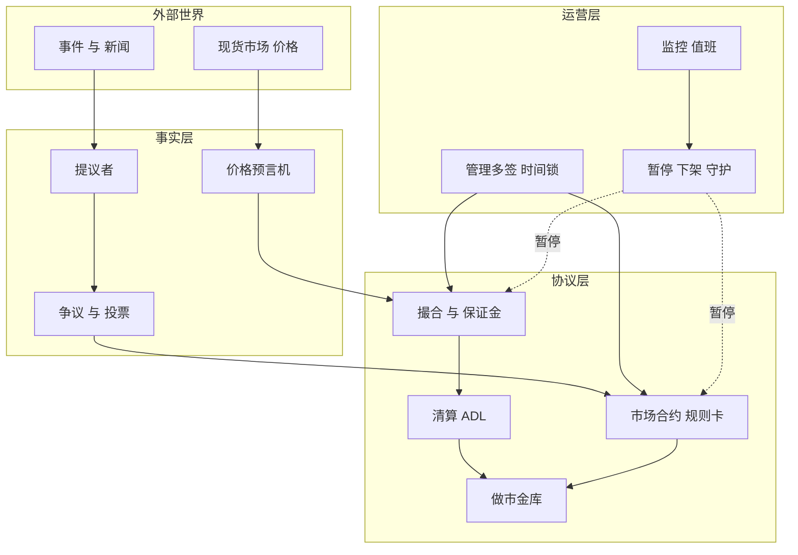
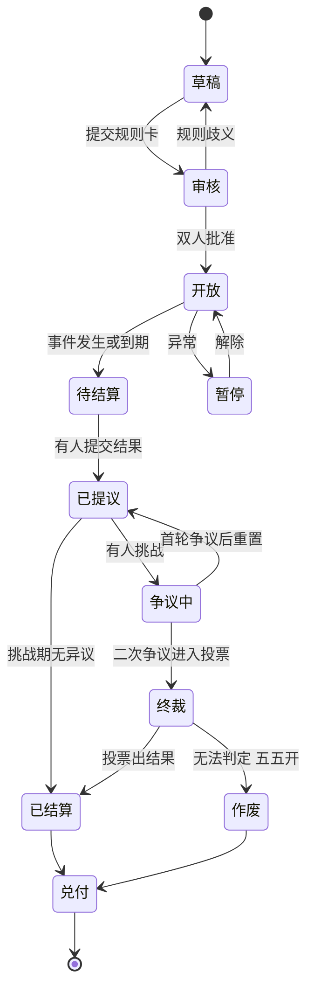
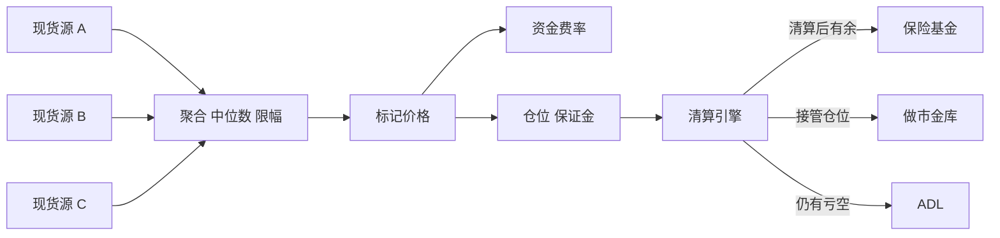

# X40 预测市场与链上衍生品协议：结算、预言机、争议与运营安全

> 学习目标：读完本章，你能——
> 1. 为一个预测市场写出"可裁决"的市场规则卡，并画出"提议 → 争议 → 终裁 → 兑付"的状态机，标出每一步谁有权推动。
> 2. 为链上永续合约协议列出价格、资金费率、清算、坏账与自动减仓（ADL）五类参数，并写出监控规则和"下架 / 暂停"的授权矩阵。
> 3. 主持一次 30 分钟的桌面推演：低流动性资产被推高，金库持有反向仓位，你要决定暂停什么、谁批准、怎样对外说。
>
> 适用角色：预测市场与链上衍生品协议的安全负责人、风控与市场运营、预言机与结算工程师、治理与社区运营
> 前置章节：[08 预言机与闪电贷](../08-oracle-flashloan.md)、[11 DeFi 经济安全](../11-defi-economic-security.md)、[B42 永续合约](../bootcamp/B42-perps.md)、[X30 DeFi 项目方安全运营](X30-defi-project-ops.md)、[X29 L2、跨链桥与预言机运营方](X29-l2-bridge-oracle-ops.md)
> 交互实验 / 模板：[永续合约实验](../interactive/perp-lab.html)、[预言机操纵实验](../interactive/oracle-manipulation-lab.html)、[T04 上线门禁清单](../templates/T04-go-live-gate.md)、[T09 事件手册与值班](../templates/T09-incident-runbook-oncall.md)
> 最后核对：2026-11-23

---

## 开场：一个真实场景

2025 年 3 月下旬，预测市场 Polymarket 上有一个约 700 万美元的市场：乌克兰是否会在 4 月前同意美方的矿产协议。公开报道称，3 月 24 日到 25 日，"是"的概率从约 9% 涨到 100%，而当时两国并没有签署协议。

市场按"是"兑付。多名用户称，一个持有大量 UMA 代币的账户在争议投票中起了决定作用。Polymarket 公开表示，这个结果与预期不符，市场结算得太早；它又称这不算市场故障，不退款。

<details class="predict"><summary>🤔 先猜再看：这个市场有规则、有预言机、有争议机制，还有投票。问题出在哪一层？</summary>

问题不在代码。合约按设计运行：有人提议结果，有人争议，代币持有人投票，合约按票数兑付。出问题的是"谁来判断真相"这一层：

- 裁决者（UMA 投票人）按代币数量加权，而不是按"对事实的判断力"加权。
- 被裁决的金额（约 700 万美元）可能超过操纵裁决所需的成本。
- 市场规则的措辞留有解释空间，投票人可以各说各话。

合约审计报告覆盖不到这三点。本章把它们做成清单。

</details>

同一个月，另一类协议也遇到类似结构的问题。链上永续合约平台 Hyperliquid 的做市金库（HLP）被卷入一个低流动性代币 JELLY 的仓位。公开报道称，价格被推高，金库的未实现亏损一度约 1200 万美元。验证者投票下架了该合约。

预测市场和永续合约看起来不同，安全问题却相通：**两者都是把"一个外部世界的事实"（事件结果或资产价格）翻译成链上资金流动的机器。事实的来源、翻译的规则、翻译出错后的处置，是运营安全的核心。**

---

## 1. 一句话理解

**预测市场与链上衍生品协议的安全运营，是管住三件事：谁有权宣布"事实是什么"，宣布错了谁来纠正，纠正期间钱怎样不被抽走。**

预测市场（Prediction Market）：用户买卖"事件结果份额"的市场。结果成立的份额兑付 1 美元，不成立的兑付 0。
永续合约（Perpetual Futures，简称永续）：没有到期日的衍生品。资金费率让合约价格贴近现货价格。
乐观式预言机（Optimistic Oracle）：先由某人提交结果，在挑战期内无人反对就生效；有人反对才进入裁决。
标记价格（Mark Price）：协议用于计算盈亏和清算的价格。它不一定等于最新成交价。
自动减仓（Auto-Deleveraging，ADL）：清算后仍有亏空时，协议强制平掉盈利的对手仓位来填补。
做市金库（Market-making Vault）：由用户存入资金、协议自动做市的池子，坏账由它的持有人承担。

> 🎯 打个比方：赛马场。赌注池是金库，终点裁判是预言机，赛后"复核录像"是争议机制。赛马场出事通常不是因为赌注池被偷，而是因为裁判被收买、规则没写清"并列怎么算"，或有人在终点线前动了赛道。
>
> 比喻的局限：赛马场的裁判是少数受监管的人，可以追责。链上的裁判可能是匿名的代币持有人，也可能是一段读取价格的代码，追责路径要靠合约和治理预先设计。

---

## 2. 保护目标与信任边界

要保护的东西有六样：用户资金、市场规则的确定性、结算结果的正确性、做市金库的本金、协议的偿付能力（没有坏账）、对外声誉。



读图要点：
- 左边两条输入线决定了协议能被"外部事实"欺骗到什么程度：事件线靠提议与争议，价格线靠预言机。
- 事实层的任何一点被控制，协议层的合约再正确也会按错误事实兑付。
- 运营层的暂停虚线只指向"协议层"，不应能改事实层的结果；否则运营方等于裁判。
- 局限：图没有画前端、做市商和跨链资产。它们的边界见 [X29](X29-l2-bridge-oracle-ops.md)、[X37](X37-market-maker-security.md)。

**不能被信任的东西：**
- **市场标题**。标题不是规则。规则卡里没写的情形，结果由争议者说了算。
- **最新成交价**。低流动性资产的成交价可以被少量资金推动（见案例 1、3）。
- **代币加权投票的"公平性"**。持币量大不等于判断准确，还可能与市场持仓利益冲突（见案例 2）。
- **"金库会自动兜底"的假设**。金库兜底的是其持有人的钱（见案例 3、5）。
- **"代码会报错"的假设**。重入类漏洞能让价格相关状态被改写，却不一定触发任何报错（见案例 4）。

---

## 3. 参考架构

### 3.1 预测市场的生命周期



读图要点：
- 状态机里有两个"没有人负责纠错"的缺口：已提议后的挑战期，以及终裁投票。前者靠有人盯着，后者靠投票人的独立性。
- "作废"（无法判定，按固定比例退还）是必须预先设计的出口。没有它，模糊市场只能被迫选一个答案。
- "暂停"只出现在"开放"之后。已进入争议的市场，暂停不能改变结算结果，只能冻结兑付。
- 局限：不同协议的状态名和轮次不同。以官方文档为准（Polymarket 文档写明，首次争议会重置提议，二次争议才进入 UMA 代币持有人投票；具体保证金和时间窗以其最新文档为准）。

### 3.2 永续合约的价格与清算链



读图要点：
- 标记价格是整条链的"总阀门"。它错了，资金费率、保证金、清算都会一起错。
- 清算的出口有三层：保险基金、金库、ADL。越往右，亏损越由无辜用户承担。
- 低流动性资产应当单独限仓、单独限杠杆，不应与主流资产共用同一套参数。
- 局限：图省略了订单簿和撮合。撮合与账务一致性见 [X10](X10-cex-trading-settlement-credit.md) 的思路，链上协议做法不同但验证目标相同。

### 3.3 组件职责表

| 组件 | 职责 | 不能做什么 | 变更方式 |
|---|---|---|---|
| 市场规则卡 | 写明结果判定来源、边界情形和作废条件 | 不能在开放后修改 | 只能新建市场 |
| 提议与争议模块 | 接收结果、保证金与挑战 | 不由运营方单方改结果 | 参数经时间锁 |
| 终裁投票 | 在争议无法解决时裁决 | 不应让持仓人参与同一市场的裁决 | 治理流程，见 [X42](X42-dao-governance-ops.md) |
| 价格聚合器 | 多源取中位数、限幅、新鲜度检查 | 不单独信任单一池子或单一交易所 | 新增数据源需评审 |
| 风控参数 | 杠杆、仓位上限、维持保证金、费率上下限 | 不能无延迟放宽 | 收紧立即生效，放宽走时间锁 |
| 清算与 ADL | 平仓、接管、减仓 | 不能由任意地址改参数 | 同上 |
| 暂停与下架守护 | 暂停开仓、暂停市场、受控下架 | 不能转走资金或改结果 | 见 6.5 节 |
| 监控与值班 | 发现价格偏离、集中度、金库亏损 | 不持有签名权 | 安全负责人管理 |

> 💡 注意：把"能暂停"和"能决定下架结算价"分成两个权限。暂停是刹车；下架结算价决定谁赔谁赚，是裁判权，必须有更高的授权和公开理由（见案例 3）。

---

## 4. 控制清单

优先级：P0 必须有；P1 应该有；P2 成熟后再做。

| ID | 控制项 | 要防什么 | 优先级 | 怎么验证 |
|---|---|---|---|---|
| PMK-1 | 每个市场有规则卡：判定来源、时区、边界情形、作废条件 | 结果靠解释 | P0 | 抽 10 个市场，请非作者按规则卡判定，结果一致 |
| PMK-2 | 市场创建双人审核，开放后规则不可改 | 事后改规则 | P0 | 看创建流程日志，尝试修改已开放市场 |
| PMK-3 | 提议保证金与挑战期设置与市场金额分级匹配 | 小保证金操纵大市场 | P0 | 对比保证金与最大市场规模 |
| PMK-4 | 高额市场的终裁有额外防护（例如持仓人回避、委员会复核、延长投票期） | 大户操纵裁决（案例 2） | P0 | 读治理参数，做一次桌面推演 |
| PMK-5 | "无法判定"出口存在且已演练 | 被迫选错答案 | P1 | 在测试网触发一次作废并兑付 |
| PMK-6 | 提议者与争议者的监控：谁在提议、谁在争议、保证金来源 | 串通与连续错误提议 | P1 | 检查看板与告警记录 |
| PMK-7 | 价格取自至少 3 个独立来源，取中位数并限幅 | 单一来源被推动（案例 1、3） | P0 | 重放历史异常行情，看标记价格是否被限制 |
| PMK-8 | 价格新鲜度与偏离检查，超限时停止新开仓 | 用过期或错误价格结算 | P0 | 在测试环境喂入陈旧价格，看开仓是否被拒 |
| PMK-9 | 按资产流动性分级：杠杆、单账户仓位、总持仓、对金库的最大暴露 | 低流动性资产拖垮金库（案例 3） | P0 | 读参数表，按"推动价格所需成本"估算上限 |
| PMK-10 | 资金费率与标记价格有上下限，且上下限被监控 | 费率被用作套取工具 | P1 | 查看参数与历史触顶记录 |
| PMK-11 | 清算引擎有压测：大仓位、连环清算、预言机延迟 | 清算失败产生坏账（案例 5） | P0 | 看压测报告，回放历史极端日 |
| PMK-12 | 坏账瀑布顺序已书面化：保险基金 → 金库 → ADL → 追加 | 临场拍脑袋 | P0 | 看文档与合约行为是否一致 |
| PMK-13 | ADL 排序规则公开，并有"事后回放"工具核对有无多减仓 | 无辜盈利用户被过度减仓 | P1 | 用事故数据回放，比较实际与最小必要减仓量 |
| PMK-14 | 金库有单资产暴露上限与亏损熔断，存取款可被暂停 | 金库被单一对手掏空 | P0 | 看合约参数，演练暂停存取 |
| PMK-15 | 暂停与下架权限分离，授权矩阵与公告模板已书面化 | 越权或迟迟不敢动 | P0 | 看授权矩阵，抽查最近一次暂停的审批记录 |
| PMK-16 | 下架结算价的确定方法事前公开 | 事后决定谁赔谁赚（案例 3） | P1 | 读文档，看是否有公式与公示期 |
| PMK-17 | 价格相关核心状态（平均价、AUM、份额净值）有不变量检查，偏离时拒绝交易 | 重入或配置错误改写状态（案例 4） | P0 | 对不变量写属性测试，部署前后各跑一次 |
| PMK-18 | 新市场、新资产默认低限额上线，按 [X30](X30-defi-project-ops.md) 的放宽阶段推进 | 空市场被操纵 | P0 | 看上线脚本与放宽计划 |
| PMK-19 | 市场操纵与内幕监控：集中度、关联账户、结算前异常建仓 | 内幕与自成交 | P1 | 回放历史样本，看规则命中 |
| PMK-20 | 合规边界：地域限制、受限事件类型、监管问询流程 | 法域风险 | P1 | 与法务核对清单，抽查执行 |
| PMK-21 | 事件手册覆盖五类场景（错误结算、价格操纵、金库亏损、合约漏洞、治理争议） | 事故时无人知道该做什么 | P0 | 看 [T09](../templates/T09-incident-runbook-oncall.md) 实例，演练一次 |
| PMK-22 | 对外沟通模板与事后复盘公开机制 | 信任崩塌 | P1 | 看模板和上次复盘 |

---

## 5. 分级落地

| 档位 | 做什么 | 人力 | 时间 |
|---|---|---|---|
| 最小可行 | PMK-1/2/3/7/8/9/14/15/18/21。规则卡、双人审核、三源价格、分级限额、金库熔断、暂停授权、事件手册 | 1 名安全负责人 + 1 名风控 + 兼职工程师 | 4–6 周 |
| 标准 | 加 PMK-4/5/6/10/11/12/13/17/19。终裁防护、作废出口、清算压测、坏账瀑布、不变量检查、操纵监控 | 2–3 名安全 / 风控工程师 + 1 名市场运营 | 3–4 个月 |
| 成熟 | 加 PMK-16/20/22，并每季度压测 + 公开复盘；对金库和 ADL 建立事后回放工具；对外披露参数变更 | 专职小组 4–6 人 | 持续运营 |

读法：预测市场与衍生品协议常常"先上线再补风控"。最小可行档的每一项都是用很小的成本换掉最大的尾部风险，不要跳过。

---

## 6. 落地做法

### 6.1 市场规则卡：让结果可裁决

一张规则卡要让一个没参与市场的人，在没有额外信息的情况下，得到同一个答案。

```yaml
# 示例：市场规则卡（字段为建议，非任何产品的真实格式）
market_id: m-2026-0142
question: "某项协议是否在 2026-12-31 23:59 UTC 前由双方签署？"
resolution_source:
  primary: "双方政府官网公告原文"
  fallback: "两家以上具名主流通讯社同日报道"
definitions:
  signed: "双方授权代表在同一文本上完成签署；框架声明、意向书、谈判进展不算"
edge_cases:
  - "仅一方宣布 -> 不算"
  - "签署后又撤销 -> 以截止时刻状态为准"
  - "公告时间与时区冲突 -> 以 UTC 为准"
void_conditions:
  - "官方来源互相矛盾且 72 小时内无更正"
  - "事件被法律或不可抗力阻止判定"
void_payout: "各份额按 0.5 兑付"
review:
  author: "ops-a"
  approver: "risk-b"          # 必须是不同人
  checked_with_outsider: true # 找一位未参与的人按卡判定
immutable_after_open: true
```

做法：
1. 起草后，找一位没参与的人，只给规则卡，要求他在 5 分钟内判定三个假想情形。结果不一致就重写。
2. 把"提前宣布 / 口头同意 / 文件未签"这类常见模糊点写进 `edge_cases`。
3. 规则卡的哈希写入市场合约。开放后修改只能新建市场。
4. 对高额市场（示例：预计成交额超过提议保证金 1000 倍），加上额外的终裁防护（见 6.2）。

常见坑：用"是否发生重大变化"这类主观词；把来源写成"权威媒体"；没写时区。

### 6.2 提议、争议与终裁的运营

乐观式预言机默认"没人反对就是对的"。这意味着**有人负责盯**才安全。

```text
# 示例：提议与争议监控规则（伪规则，按自己的数据源改写）
R1 提议结果与规则卡来源不符
   条件：提议值 != 自动抓取的主来源结果，且市场成交额 > 阈值
   动作：通知市场运营，要求 30 分钟内人工核对；必要时由具名账户发起争议
R2 提议者连续出错
   条件：同一地址 30 天内被成功争议 >= 2 次
   动作：列入观察名单，其后提议触发 R1 的核对
R3 终裁投票集中度
   条件：单一地址或关联地址群在某争议中票权占比 > 20%（示例）
   动作：升级到治理负责人，公示持仓与投票时间线
R4 持仓人参与裁决
   条件：投票地址在对应市场里有持仓（含关联地址）
   动作：公开标注，按治理规则申请无效或复核
```

终裁防护的选项和代价：

| 选项 | 好处 | 代价 |
|---|---|---|
| 高额市场委员会复核 | 引入具名责任 | 中心化、响应慢 |
| 持仓人回避 | 减少利益冲突 | 难以识别关联地址 |
| 延长投票期、公开理由 | 给社区纠错时间 | 兑付延后，用户资金被占用 |
| 提高大额市场保证金 | 增加操纵成本 | 小提议者门槛提高 |
| 对争议结果设"紧急复核" | 能修正明显错误 | 事后改判会伤害信任，需事前写明触发条件 |

> ⚠️ 警告：不要在事故发生时才决定"能不能改判"。改判权限本身就是最大的信任风险，必须事前公开触发条件与授权人（见案例 2）。

### 6.3 价格与风险参数

先写出一个回答：**推动这个资产的价格 10%，要花多少钱？** 这个数决定了仓位上限。

```python
# 示例：用现货深度粗估"推价成本"和单资产最大持仓上限
# 数值全部为示例，需用真实订单簿与历史数据替换
def push_cost(depth_levels, pct):
    """depth_levels: [(价格偏离百分比, 累计可成交金额)]，返回推到 pct 所需金额"""
    for dev, notional in depth_levels:
        if dev >= pct:
            return notional
    return float("inf")

depth = [(1, 40_000), (3, 150_000), (5, 400_000), (10, 1_200_000)]  # 示例
cost10 = push_cost(depth, 10)

# 原则：协议允许的单账户净持仓 * 目标价格移动 < 推价成本 * 安全系数
SAFETY = 0.25                                  # 示例
max_notional_per_account = cost10 * SAFETY / 0.10
print(cost10, max_notional_per_account)
```

参数表（示例，按资产分级）：

```yaml
tier_a:  # 主流资产
  max_leverage: 20
  oracle_sources_min: 3
  mark_price_band_pct: 5
tier_b:  # 中等流动性
  max_leverage: 5
  max_open_interest_usd: 20000000
  vault_exposure_cap_pct: 5
tier_c:  # 低流动性、新资产
  max_leverage: 3
  max_open_interest_usd: 1000000
  vault_exposure_cap_pct: 1
  mark_price_band_pct: 2
  allow_vault_takeover: false   # 低流动性资产不让金库接管清算
  delist_review_trigger: "OI/现货日成交额 > 阈值"
```

做法：
1. 每个新资产上线前，按上面的方法估推价成本，并写入上线评审记录。
2. 用"开仓名义额 / 现货日成交额"作为监控指标，超过阈值自动停止新开仓。
3. 收紧参数立即生效，放宽参数经时间锁，与 [X30](X30-defi-project-ops.md) 的参数变更一致。
4. 标记价格用多源中位数；对异常偏离的数据源自动剔除并告警。

常见坑：把"成交量大"当成"深度大"；让金库为所有上架资产兜底；在新闻驱动的行情里依旧用静态参数。

### 6.4 清算、坏账与 ADL

坏账瀑布要写成表，并与合约行为核对：

```text
层级   资金来源            触发条件               谁承担       对外披露
L1     被清算账户保证金     维持保证金不足          违约者       无需
L2     保险基金            清算后仍有亏空          协议储备     月报
L3     做市金库            清算引擎接管仓位        金库持有人   事件公告
L4     ADL                 保险基金与金库耗尽      盈利对手方   立即公告 + 事后回放
L5     追加 / 治理决议     以上均不足              待治理       公示
```

做法：
1. 对 ADL 的排序规则（按盈利排名、杠杆排名等）写成公开文档。
2. 每次触发 ADL 后，在 48 小时内发布回放：触发原因、被减仓账户数、最小必要减仓量与实际减仓量。
3. 给 L3 的金库设"亏损熔断"：单日亏损超过示例 3% 时，暂停新增接管，只允许平仓和撤单。
4. 压测场景：同方向单边行情、预言机延迟 60 秒、做市商撤单、抵押资产脱锚。

> 💡 注意：ADL 是"兜底的兜底"。它减少了协议坏账，却把亏损转移给了盈利者。是否过度减仓，是行业里的公开争议（见案例 5），所以要有回放工具和披露。

### 6.5 暂停、下架与授权

```yaml
# 示例：暂停与下架授权矩阵
actions:
  pause_new_positions:   # 暂停新开仓
    who: ["on-call-risk", "security-lead"]
    approvals: 1
    max_duration: 24h
    auto_expire: true
  pause_market_settlement:  # 冻结某市场兑付
    who: ["security-lead", "head-of-markets"]
    approvals: 2
    max_duration: 72h
  pause_vault_deposit_withdraw:
    who: ["security-lead"]
    approvals: 1
    max_duration: 24h
  delist_with_settlement_price:   # 下架并确定结算价
    who: ["admin-multisig"]
    approvals: "M-of-N + timelock-exception 记录"
    requires:
      - public_rationale
      - price_rule_published_in_advance
      - post_mortem_within_7d
  change_market_outcome:     # 改判
    who: "禁止由运营方单方执行；只能走治理或预先公示的复核流程"
```

做法：
1. 暂停动作必须"便宜、快、会过期"；下架与改判必须"贵、慢、有公开理由"。
2. 暂停期间继续允许"降低风险"的动作：撤单、平仓、减仓；禁止新增敞口。
3. 公告模板包含：时间线、已采取措施、用户资金状态、下一次更新时间。
4. 事后 7 天内发布复盘，写明按事前规则还是临时决定。

### 6.6 操纵与内幕监控

预测市场的特殊风险是"信息就是钱"：知道结果的人可以提前建仓。

```sql
-- 示例：结算前 24 小时的异常建仓（表名与字段为示意）
SELECT account, market_id,
       SUM(CASE WHEN ts > resolve_ts - INTERVAL '24 hours' THEN notional ELSE 0 END) AS late_notional,
       SUM(notional) AS total_notional
FROM fills
WHERE market_id = :m
GROUP BY account, market_id
HAVING SUM(CASE WHEN ts > resolve_ts - INTERVAL '24 hours' THEN notional ELSE 0 END) > :threshold
   AND AVG(price) < 0.15;   -- 低价买入、随后结果翻转
```

做法：
1. 对关联地址（同资金来源、同时间窗）合并统计集中度。
2. 对"买入后短期内由同一地址参与争议 / 投票"的模式单独告警。
3. 合规问询流程写清：谁对接、保留哪些记录、保留多久。
4. 只做检测与披露，不在文档里写"怎样规避检测"。

---

## 7. 运营：指标、告警、值班、演练、季度节奏

### 7.1 监控规则（示例）

| 编号 | 规则 | 触发 | 级别 |
|---|---|---|---|
| M1 | 标记价格与任一现货源偏离 > 示例 3% 持续 > 60 秒 | 价格异常 | P1 |
| M2 | 单资产开仓名义额 / 现货日成交额 > 阈值 | 低流动性风险 | P1 |
| M3 | 金库单日亏损 > 示例 3%，或对单一对手暴露 > 上限 | 金库风险 | P0 |
| M4 | 保险基金单日下降 > 示例 10% | 清算压力 | P1 |
| M5 | 单个争议票权集中度 > 20%（示例） | 治理风险 | P1 |
| M6 | 提议值与规则卡主来源不符 | 错误结算 | P0 |
| M7 | 价格相关不变量失败（如 AUM 与份额净值偏离 > 示例 0.5%） | 合约状态异常 | P0 |
| M8 | 管理多签 / 时间锁排队参数变更 | 权限变更 | P1 |
| M9 | 暂停动作触发 | 应急开关 | P1，同时通知业务 |

### 7.2 告警分级与响应时间（示例）

| 级别 | 含义 | 响应 | 谁处理 |
|---|---|---|---|
| P0 | 资金正在流出或结算可能错误 | 5 分钟内确认，15 分钟内决定暂停 | 值班 + 安全负责人 |
| P1 | 参数异常但暂无损失 | 30 分钟内评估 | 风控值班 |
| P2 | 趋势性风险 | 下一个工作日 | 风控 |

### 7.3 值班与演练

- 值班手册至少包含：暂停命令、授权矩阵、联系人、公告模板、"何时找外部帮助"（安全公司、预言机团队、交易所）。
- 每季度做 1 次桌面推演（见第 13 节），每半年做 1 次测试网"暂停 + 作废兑付"实操。
- 与 [X05](X05-detection-response-engineering.md)、[X06](X06-resilience-validation.md) 衔接：日志、告警、复盘与度量走同一套体系。

### 7.4 季度节奏（示例）

| 周 | 动作 |
|---|---|
| 第 1 周 | 对全部市场与资产重估推价成本，更新分级 |
| 第 3 周 | 清算压测与 ADL 回放 |
| 第 6 周 | 桌面推演 |
| 第 9 周 | 权限与暂停权限核对，对照 [X30](X30-defi-project-ops.md) |
| 第 12 周 | 季度复盘，更新规则卡模板和参数 |

### 7.5 指标

- 争议率（被争议市场 / 已结算市场）与改判率。
- 从告警到暂停的中位时间。
- 金库最大回撤与保险基金覆盖倍数。
- 规则卡"非作者判定一致率"。
- 事件发生后 7 天内复盘发布率。

---

## 8. 失效案例

所有案例只写摘要和教训。金额为"约"和"事发时美元估值"，不同来源数字有差异时写明。

### 案例 1：Mango Markets（2022 年 10 月，Solana）——低流动性代币既是抵押品又是价格来源

- **来源类型**：媒体报道（Cointelegraph、Blockworks）、法院裁决报道（The Block、Bloomberg）。
- **经过**：公开报道称，攻击者用两个账户在 MNGO 永续上对手交易，把 MNGO 价格从约 0.04 美元推到约 0.91 美元，再用被抬高的未实现盈利作抵押借出资产。各来源对总额的估计在约 1.1 亿到 1.17 亿美元之间。DAO 随后表决通过一份协议：攻击者保留约 4,700 万美元，归还约 6,700 万美元。2025 年 5 月，美国联邦法官撤销了对攻击者的两项欺诈定罪并判决另一项无罪，理由包括管辖地不当和缺乏足够的虚假陈述证据；媒体称其他民事程序仍在进行。
- **绕过了哪条控制**：价格来源与抵押品分级（PMK-7、PMK-9）。
- **教训**：协议的规则没有禁止这种借贷，法律结果也说明"链上能做到"与"能追责"是两回事。控制必须在协议里：限制低流动性代币的抵押价值和单账户仓位。

### 案例 2：Polymarket 乌克兰矿产协议市场（2025 年 3 月，Polygon）——争议投票被大户左右

- **来源类型**：媒体报道（The Block、Cointelegraph、CoinDesk）、Polymarket 官方文档（结算流程）。
- **经过**：见开场。公开报道称，约 700 万美元的市场从约 9% 的"是"概率变为按"是"结算；用户称大额 UMA 持币账户在投票中起了关键作用（票权占比的数字来自链上分析人士转述，未见独立确认）。Polymarket 称其为"前所未有"，称这不算市场故障，不退款。
- **绕过了哪条控制**：终裁防护与规则确定性（PMK-1、PMK-4、PMK-6）。
- **教训**：乐观式预言机的安全上限，是"操纵裁决的成本"与"被裁决金额"之比。要对高额市场设额外防护，并事前公开"何时可以复核、谁能复核"。

### 案例 3：Hyperliquid JELLY（2025 年 3 月）——金库接管低流动性仓位，下架结算价引发争议

- **来源类型**：媒体报道（The Block、CoinDesk、Cointelegraph）。
- **经过**：公开报道称，一个账户在平台上开出大额空头，同时有人在其他场所推高 JELLY 现货价格；价格推升后，做市金库 HLP 接管了亏损的空头，未实现亏损一度约 1200 万美元（来源之间有差异）。验证者投票下架该合约。基金会称将补偿非被标记地址的用户。下架结算价与外部价格之间的差异引发了关于"去中心化"的批评。
- **绕过了哪条控制**：资产分级与金库暴露上限（PMK-9、PMK-14）；下架结算价事前公开（PMK-16）。
- **教训**：低流动性资产不应让金库无限接管。下架是裁判权，要有预先公开的价格规则，否则任何处置都会被质疑为"事后决定输赢"。

### 案例 4：GMX V1（2025 年 7 月，Arbitrum）——重入改写价格相关状态

- **来源类型**：安全公司分析（BlockSec、Halborn、CertiK、Sherlock），媒体报道。
- **经过**：公开分析称，攻击者利用跨合约重入，在订单执行流程中绕过空头仓位平均价的更新，使 GLP 的资产管理规模与价格被人为抬高，随后赎回获利，损失约 4,000 万到 4,200 万美元。公开报道称，攻击者在项目方提出赏金后归还了大部分资金（各来源对归还数额有差异；Halborn 称赏金约 500 万美元）。项目方暂停了 V1 的交易与 GLP 铸赎。
- **绕过了哪条控制**：价格相关不变量检查（PMK-17）；暂停能力（PMK-15）。
- **教训**：衍生品协议的"份额净值"是资金安全的核心变量。要对它设不变量，并保证事故时能快速暂停铸赎。

### 案例 5：2025 年 10 月 10 日大规模清算日——清算、坏账与 ADL 的公开争议

- **来源类型**：媒体与研究报道（The Defiant、Protos）、学术预印本（arXiv）。
- **经过**：公开报道称，当日加密市场出现约 190 亿美元的清算，Hyperliquid 上有数千个钱包被清算，其跨保证金 ADL 按报道是两年多来首次触发。平台创始人称系统保持运行且无坏账。研究者对 ADL 是否造成过度减仓有分歧：一份 arXiv 预印本在公开数据回放模型下估算超额约 4,500 万到 5,170 万美元；也有媒体转述更高的数字，各方口径不同，应视为未定论。
- **绕过了哪条控制**：清算压测与 ADL 回放（PMK-11、PMK-13）。
- **教训**：极端行情下，清算与 ADL 的设计会决定"谁来承担损失"。要预先压测，公开排序规则，并在事后发布回放，让争议有证据可查。

---

## 9. 评估检查点

- [ ] **PMK-1** 抽 10 个市场，非作者按规则卡判定，一致率 ≥ 90%。
- [ ] **PMK-2** 市场创建有双人审核，已开放市场无法改规则。
- [ ] **PMK-3** 提议保证金与最大市场规模匹配，有书面依据。
- [ ] **PMK-4** 高额市场有额外终裁防护，已推演一次。
- [ ] **PMK-5** "作废"出口在测试网演练过。
- [ ] **PMK-6** 有提议者与争议者监控看板与告警。
- [ ] **PMK-7** 价格取自至少 3 个独立来源，中位数 + 限幅。
- [ ] **PMK-8** 价格陈旧或偏离时拒绝新开仓，已测试。
- [ ] **PMK-9** 按流动性分级设杠杆、仓位与金库暴露上限，有推价成本估算。
- [ ] **PMK-10** 资金费率与标记价格有上下限并被监控。
- [ ] **PMK-11** 清算压测覆盖单边行情、预言机延迟与做市商撤单。
- [ ] **PMK-12** 坏账瀑布书面化，与合约行为一致。
- [ ] **PMK-13** ADL 排序规则公开，有事后回放工具。
- [ ] **PMK-14** 金库有暴露上限、亏损熔断与存取暂停能力。
- [ ] **PMK-15** 暂停与下架权限分离，授权矩阵与最近一次审批记录一致。
- [ ] **PMK-16** 下架结算价规则事前公开。
- [ ] **PMK-17** 价格相关核心不变量有检查，部署前后都跑过。
- [ ] **PMK-18** 新市场与新资产低限额上线并有放宽计划。
- [ ] **PMK-19** 操纵与内幕监控规则已回放验证。
- [ ] **PMK-20** 地域限制与监管问询流程与法务核对过。
- [ ] **PMK-21** 事件手册覆盖五类场景，近 6 个月演练过。
- [ ] **PMK-22** 对外沟通模板与复盘发布机制存在。

把结果写进报告：

| 区域 | 检查项 | 通过 / 部分 / 未通过 | 证据位置 | 整改负责人与日期 |
|---|---|---|---|---|
| 市场规则 | PMK-1–3、5 | | | |
| 裁决与争议 | PMK-4、6 | | | |
| 价格与参数 | PMK-7–10、18 | | | |
| 清算与金库 | PMK-11–14、17 | | | |
| 应急与治理 | PMK-15、16、21、22 | | | |
| 监控与合规 | PMK-19、20 | | | |

---

## 10. 上手路径

**第一周**
1. 列出全部市场与资产，标出成交额、持仓量和现货日成交额。
2. 找出前 3 个"推价成本最低"的资产，查它们的杠杆与金库暴露。
3. 读暂停与下架权限：谁能按、按了会怎样、按完谁批准。
4. 在测试环境喂入一个陈旧价格，看开仓是否被拒。

**第一个月**
1. 为所有开放市场补规则卡，并找外人做一次判定测试。
2. 写出坏账瀑布与授权矩阵，与合约行为逐项核对。
3. 上线 M1–M9 监控规则，每条规则至少回放一个历史样本。
4. 做第一次桌面推演（第 13 节练习 3）。

**第一个季度**
1. 完成清算压测与 ADL 回放工具。
2. 建立争议与投票集中度看板，设计高额市场的终裁防护。
3. 公开参数变更与暂停复盘机制。
4. 与 [X30](X30-defi-project-ops.md)、[X29](X29-l2-bridge-oracle-ops.md) 对齐权限链与预言机依赖。

---

## 11. 常见误区

- **"有去中心化预言机就安全"**。预言机的安全取决于操纵成本与被裁决金额之比，而不是"有没有投票"。
- **"成交价就是价格"**。低流动性的成交价可以被少量资金推动。
- **"金库会自动兜底，所以风险可控"**。金库兜底的是持有人的钱，暴露过大会变成对用户的损失转移。
- **"合约审计过，所以结算不会错"**。规则歧义和裁决者行为不在合约审计范围内。
- **"事后改判能挽回信任"**。没有事前公开的改判规则，改判本身就是信任事故。
- **"暂停是中心化，所以不能做"**。更危险的是没有暂停开关，或暂停与改判权混在一起。
- **"ADL 是用户自己的风险"**。如果排序规则不透明且没有回放，用户无从判断它是否公平。

---

## 12. 术语表

| 术语 | 英文 | 定义 |
|---|---|---|
| 规则卡 | Market Rules Card | 写明判定来源、边界情形和作废条件的市场文档 |
| 乐观式预言机 | Optimistic Oracle | 先提议、挑战期无异议即生效的预言机 |
| 挑战期 | Liveness Period | 提议后允许他人争议的时间窗 |
| 终裁 | Final Arbitration | 争议无法解决时，由投票或委员会作出的裁决 |
| 标记价格 | Mark Price | 协议用于盈亏与清算的价格 |
| 资金费率 | Funding Rate | 多空之间周期性支付的费用，使永续价格贴近现货 |
| 清算 | Liquidation | 保证金不足时强制平仓 |
| 保险基金 | Insurance Fund | 用于覆盖清算后亏空的储备 |
| 自动减仓 | Auto-Deleveraging (ADL) | 亏空无法覆盖时，强制减少盈利对手方仓位 |
| 做市金库 | Market-making Vault | 用户出资、协议自动做市的资金池 |
| 坏账 | Bad Debt | 仓位亏损超过保证金且无人覆盖的部分 |
| 推价成本 | Price Push Cost | 把某资产价格推动给定幅度所需的资金 |

---

## 13. 动手练习与思考题

### 练习（笔记本即可完成）

**练习 1：写一张规则卡并找人"打"它（40 分钟）。** 选一个真实世界事件，用 6.1 节模板写规则卡。给同伴三个假想情形（提前宣布、口头同意、文件撤销），看他判定是否与你一致。把不一致处改进规则。

**练习 2：估推价成本（30 分钟）。** 找一个中小市值代币的公开订单簿截图或数据，用 6.3 节方法估推价 10% 所需资金，再写出你愿意给该资产的杠杆、单账户仓位与金库暴露上限，并说明理由。

**练习 3：30 分钟暂停推演。**
- 背景：周日凌晨，一个新上架的低流动性资产在 20 分钟内上涨 5 倍，金库持有反向仓位，未实现亏损已达金库净值的 8%。
- 注入：T+10 分钟，社交媒体出现"协议被攻击"帖子；T+20 分钟，一个大户要求撤出金库份额；T+25 分钟，另一场所上线了同资产的永续。
- 角色：值班风控、安全负责人、多签签名人、公关。
- 任务：决定暂停什么（新开仓 / 金库存取 / 市场）、谁批准、是否下架、结算价怎么定、公告写什么。
- 评分：10 分钟内是否先降风险；是否区分暂停与下架；是否引用事前规则；公告是否写明下次更新时间；是否记录决策依据。

**练习 4：画一张坏账瀑布与披露表。** 用 6.4 节模板，为一个虚构协议填写每层触发条件、承担者与披露方式，并标出"哪一层最容易引发争议"。

**练习 5：规则回放。** 构造 10 行 `fills` 数据，故意包含 1 个结算前低价大额买入的账户，手工运行 6.6 节规则，写出命中的行，并调整阈值使误报最小。

建议配套：一个读取规则卡并检查必填字段的小脚本；一个对历史价格回放"标记价格限幅"效果的脚本。

### 思考题

1. 如果一个市场的金额是提议保证金的 10,000 倍，你会怎样设计终裁防护？每种方案对小市场有什么副作用？
2. 下架并以某个价格结算，与"暂停并等待"相比，各自对用户信任和协议偿付的影响是什么？你会事前公开哪些规则？
3. 金库为所有资产接管清算，与只为主流资产接管，各自的风险是什么？你的协议最小的可接受暴露是多少？

> 🪞 反思：想一想你团队最近一次新资产上线。有没有人估过"推动它价格 10% 要花多少钱"？如果没有，现在就可以补上。
