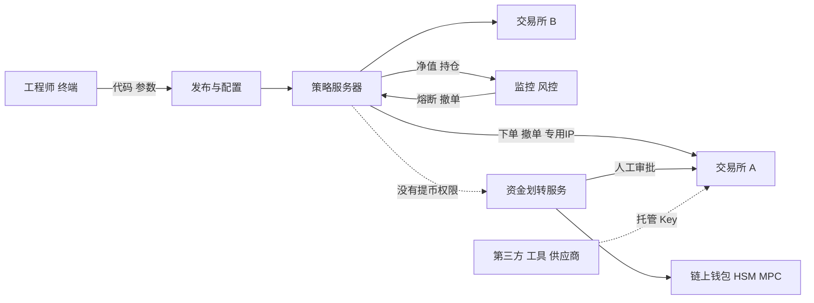
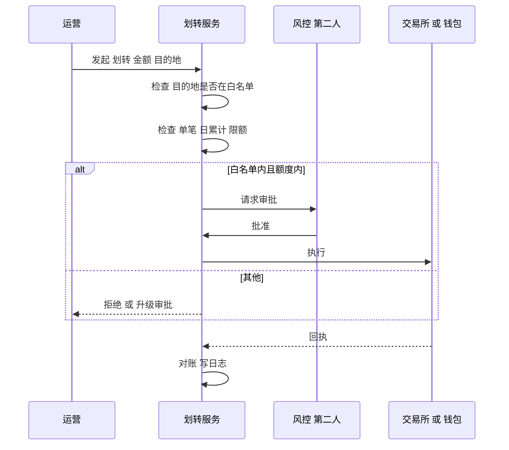
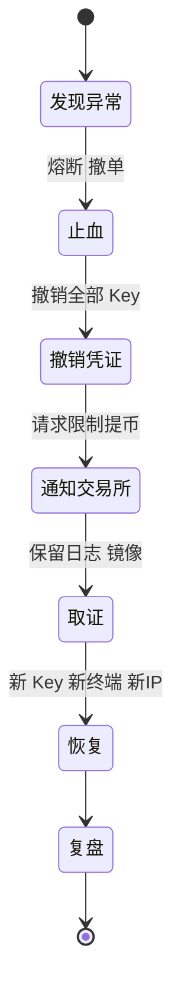

# X42 做市与量化团队安全：API Key、交易系统与资金划转

> 学习目标：读完本章，你能——
> 1. 画出一支做市 / 量化团队的信任边界图，指出"策略服务器、API Key、划转通道、链上热钱包"四个资产各自的失陷后果。
> 2. 为团队写出 API Key 台账、划转审批策略和下单风控参数，并说明每条防的是哪条失陷路径。
> 3. 写出 4 条检测规则或查询（Key 异常、净值偏离、划转异常、签名重用），并和交易所约定一份事故沟通清单。
>
> 适用角色：做市商 / 量化基金的安全负责人与基础设施工程师、交易系统开发、风控与运营；为机构客户做对接的交易所安全工程师
> 前置章节：[18 钱包与密钥管理](../18-wallet-key-management.md)、[09 MEV 与签名安全](../09-mev-signatures.md)、[21 社工与内部人员](../21-social-engineering-insiders.md)、[X11 客户身份、账户与访问](X11-cex-identity-account-access.md)、[X03 生产基础设施安全](X03-production-infra-security.md)、[X05 检测与响应工程](X05-detection-response-engineering.md)
> 交互实验 / 模板：本章第 6 节的台账、策略与规则可直接改写；[T06 运营安全自查表](../templates/T06-ops-security-self-check.md)
> 最后核对：2026-11-23

---

## 开场：一台没人盯的机器人

一家虚构的做市团队（示例）在周末照常运行。机器人同时在 5 家交易所挂单。周日凌晨，一位工程师的笔记本被装了木马。木马读到了本机上的交易所 API Key 配置文件。三个小时后，Binance 子账户里的稳定币被分批提走。策略没有出错，延迟没有变化，净值曲线的第一个异常点出现在资金已经离开之后。

<details class="predict"><summary>🤔 先猜再看：这支团队最该提前做的一件事是什么？A. 给策略代码加密　B. 给 API Key 绑定出口 IP 并关闭提币权限　C. 买更快的服务器</summary>

答案是 B。策略代码被偷是商业损失，Key 被用来提币是资金损失。做市团队几乎不需要用 API 提币，把提币权限关掉、把交易权限绑到固定出口 IP，攻击者拿到 Key 文件也只能从别处"看"，不能"动"。第 3.2 节和第 6.1 节展开。

</details>

---

## 1. 一句话理解

**做市与量化团队的安全，核心是一件事：让"能下单的东西"永远不能提走资金，让"能提走资金的东西"永远不能被机器自动触发。**

做市商（Market Maker）：在交易所持续挂出买卖单、赚取价差并提供流动性的机构。
量化团队（Quant Team）：用程序化策略交易的团队。本章把两者合称"做市团队"，因为它们的安全问题相同。
API Key：交易所发给程序的凭证，让程序不经过登录页与验证码就能下单、查询或提币。

> 🎯 打个比方：做市团队像一家 24 小时营业的外汇柜台。柜员（机器人）每秒钟做几百笔小交易，所以柜员必须拿到"能办业务"的授权。但柜员不应该拿到金库钥匙，金库钥匙在另一栋楼里，由两个人一起开。
>
> 比喻的局限：真实柜员会累、会犹豫、会察觉异常。机器人不会，它在被盗用的那一秒仍然"忠实"执行。所以检测要靠外部的限额与监控，不能靠机器人自己。

本章与已有章节的分工：

- API Key 的**交易所侧设计**（默认只读、IP 绑定、一键撤销）在 [X11 第 3.4 节](X11-cex-identity-account-access.md)。本章只写**使用方**怎么保管、轮换、监控。
- 私钥方案（HSM、MPC、多签）的原理在 [18 章](../18-wallet-key-management.md)。本章只写做市团队怎样在"低延迟"与"高隔离"之间取舍。
- 云、K8s、特权访问等通用做法在 [X03](X03-production-infra-security.md)，检测与响应方法在 [X05](X05-detection-response-engineering.md)。本章只写做市场景的差异。

---

## 2. 保护目标与信任边界

### 2.1 保护什么

| 目标 | 失陷后果 | 说明 |
|---|---|---|
| 交易所 API Key（交易权限） | 对手方诱导机器人亏损；撤单后留下敞口 | 即使没有提币权限，也能造成亏损（见案例 8.2 的说明） |
| 提币权限与提币白名单 | 资金直接被提走 | 最高优先级，应当尽量"不存在" |
| 策略服务器与代码、参数 | 策略被复制、被改参数引导亏损 | 同时是商业机密与资金风险 |
| 链上热钱包与路由合约权限 | 链上资金被转走 | 密钥生成与保管见 [18 章](../18-wallet-key-management.md) |
| 划转通道（交易所之间、交易所与钱包） | 资金被转到攻击者地址 | 做市团队最常见的"自建薄弱点" |
| 员工终端与账号 | 以上全部的入口 | 见案例 8.5 |

### 2.2 信任边界图



**读图要点：**

- 策略服务器只连接"下单"通道。划转服务是另一个系统，两者之间没有自动调用，只有人工审批。
- 监控与风控有权"熔断"策略服务器（撤单、停机），但没有权限提币。这样监控被攻破也只能停机，不能转钱。
- 虚线是最危险的两条：一是策略服务器反向拿到提币权限，二是把 Key 交给第三方工具托管。第三方一旦被攻破，Key 同时失陷。
- 局限：图没有画交易所内部和链上做市合约。链上部分见第 3.5 节。

---

## 3. 参考架构

### 3.1 四个平面

| 平面 | 职责 | 低延迟要求 | 隔离建议 |
|---|---|---|---|
| 交易平面 | 策略、行情、下单网关 | 高（毫秒级） | 独立账号和网络；出口固定 IP；无提币 Key |
| 资金平面 | 划转、链上签名、对账 | 低（分钟到小时） | 独立账号；人工审批；HSM / MPC |
| 管理平面 | 发布、配置、运维访问 | 低 | SSO + 硬件密钥；JIT 访问；变更留痕 |
| 观测平面 | 净值、持仓、API 日志、告警 | 中 | 只读；告警通道独立于交易系统 |

为什么这样分：交易平面追求速度，所以不能在下单路径上加人工审批。资金平面追求安全，所以可以慢。**把速度要求高的和安全要求高的放在不同系统里，是做市团队安全设计的基本动作。**

### 3.2 API Key 的使用方管理

| 设计点 | 建议 |
|---|---|
| 权限 | 交易 Key 只开"读取 + 交易"。通用做法是不使用 API 提币；确需自动提币时，只在资金平面、绑定 IP、有限额 |
| 子账户 | 一个策略一个子账户，资金上限独立；主账户不生成 Key |
| IP 绑定 | 交易 Key 绑定交易平面的出口 IP；换机房时先加后删 |
| 保管 | Key 存在 Vault / KMS 中，运行时注入内存；不写进代码仓库、聊天记录、笔记本配置文件 |
| 轮换 | 按周期（示例：90 天）和事件（人员离职、终端失陷）轮换 |
| 台账 | 每个 Key 有负责人、用途、权限、绑定 IP、创建日期、上次轮换日期 |
| 第三方工具 | 能不托管就不托管；必须托管时用专用子账户、最小权限、IP 绑定，并要求供应商提供撤销与泄露通知流程 |

> 💡 注意：交易所的具体规则会变化（例如是否要求提币必须绑定 IP）。截至 2026 年公开资料，各大交易所的帮助页都有 IP 限制与权限说明，具体以官方文档为准。

### 3.3 策略服务器与代码

- 代码仓库按策略分组，访问按"最小知道"授权。研究员可以看研究库，不一定能看生产参数。
- 生产参数（价差、仓位上限、熔断阈值）的变更走评审：提交人与批准人不是同一个人；变更自动写入审计日志。
- 服务器不允许登录后手改配置。变更只能通过发布系统，发布系统本身遵循 [X04](X04-delivery-supply-chain.md) 的门禁。
- 终端：开发机不放生产 Key；生产只能经跳板和 JIT 访问到达（见 [X03](X03-production-infra-security.md)）。

### 3.4 资金划转

划转是做市团队日常最频繁的"危险动作"：为了补保证金，要把资金在交易所之间、交易所与钱包之间移动。



**读图要点：**

- 白名单与限额是服务内的硬规则，不是靠人记。审批人看到的是"目的地标签 + 金额 + 当日累计"，不是一串地址。
- 发起人与审批人必须是不同的人、不同的设备。做不到时，用"发起设备 + 硬件密钥确认设备"补偿（四眼原则的小团队版本）。
- 新增白名单地址本身是高风险动作，要双人审批并延迟生效（建议 24 小时以上）。
- 局限：审批人如果被"紧急补保证金"的压力推着点确认，流程就形同虚设。练习 3 专门练这个。

### 3.5 链上做市与 MEV 机器人

链上做市和套利机器人的特点：**私钥必须在线**，每一笔交易都要自动签名。常见风险与对策：

| 风险 | 对策 |
|---|---|
| 热钱包私钥泄露或可被推算（弱随机数、不安全的地址生成工具） | 用审计过的生成方式；资金只放"当天够用"的量；超额部分自动扫回冷 / 多签地址 |
| 机器人合约的 `owner` 或 `withdraw` 权限就是热钱包本身 | 权限拆分：热钱包只能调用 `trade`，不能 `withdraw` 或改 `owner`（见 [05 访问控制](../05-access-control.md)） |
| 自研签名代码出错（例如随机数重用） | 不手写签名；用成熟库；定期用第 6.4 节的脚本检查自己的签名日志 |
| MEV 机器人被"诱饵交易"引导买入无流动性资产 | 每笔交易做模拟、检查预期收益与最小输出；不信任单一来源返回的数据（见 [09 章](../09-mev-signatures.md)与案例 8.3） |
| 路由合约被升级或被换成恶意版本 | 路由合约由多签 + 时间锁控制，机器人只调用白名单版本 |

---

## 4. 控制清单

优先级：P0 = 缺失即可能直接丢资金；P1 = 显著放大损失；P2 = 成熟度项。

| ID | 控制项 | 要防什么 | 优先级 | 怎么验证 |
|---|---|---|---|---|
| MC-01 | 交易 Key 无提币权限，且绑定固定出口 IP | Key 泄露后被提币 | P0 | 从台账导出全部 Key：提币权限数应为 0；用非白名单 IP 调用，应被拒绝 |
| MC-02 | 一个策略一个子账户，设资金上限 | 一个 Key 失陷影响全部资金 | P0 | 看子账户余额分布：最大子账户占总资金的比例 |
| MC-03 | Key 存放在 Vault / KMS，不出现在代码、日志、聊天 | 文件泄露 | P0 | 对仓库与日志做 secret 扫描；抽查开发机目录 |
| MC-04 | Key 台账完整，含负责人与轮换日期 | 失陷后不知道该撤哪个 | P1 | 台账与交易所后台 Key 列表逐条比对 |
| MC-05 | 人员离职 / 终端失陷时，24 小时内轮换其接触过的 Key | 遗留访问 | P0 | 抽查最近一次离职，核对轮换记录 |
| MC-06 | 划转走独立服务：白名单 + 单笔 / 日累计限额 + 双人审批 | 一人转走资金；被胁迫或被钓 | P0 | 演练：用测试金额尝试发往非白名单地址、超限额、自己批自己 |
| MC-07 | 新增白名单地址双人审批并延迟生效 | 攻击者先加地址再转走 | P0 | 在测试环境加地址，看是否立即可用 |
| MC-08 | 下单风控：单笔名义值、持仓、价格偏离、撤单率上限 | 机器人失控或被诱导 | P0 | 回放测试：注入异常价格，验证订单被拒或熔断 |
| MC-09 | 熔断开关：监控可一键撤单并停止策略，不依赖策略进程 | 策略被控后无法停机 | P0 | 演练：从监控侧触发熔断，记录从触发到撤完的秒数 |
| MC-10 | 参数与代码变更需第二人批准，写审计日志 | 内部人改参数、误操作 | P1 | 抽查最近 10 次生产变更，是否有批准人 |
| MC-11 | 开发机不存放生产 Key；生产经跳板与 JIT 访问 | 终端木马读到 Key | P0 | 抽查终端；检查 SSH / 访问日志 |
| MC-12 | 链上热钱包余额有上限，超额自动扫回 | 热钱包被盗的损失上限 | P0 | 链上查看余额曲线；检查扫回任务 |
| MC-13 | 机器人合约：热钱包无 `withdraw`、无 `owner` 权限 | 热钱包失陷即全损 | P0 | 读合约代码与权限表 |
| MC-14 | 签名代码使用成熟库，定期检查签名日志（r 值重复） | 随机数错误推算出密钥 | P1 | 运行第 6.4 节规则 4 脚本，结果为空 |
| MC-15 | 与每家交易所有安全联系人、事故沟通渠道与撤销流程 | 事故时找不到人 | P1 | 每季度发一次测试联系，记录回复时间 |
| MC-16 | 第三方工具不托管提币类 Key；托管 Key 绑定 IP 并有泄露通知条款 | 供应商失陷 | P1 | 合同与配置核对 |
| MC-17 | 净值、持仓、API 行为监控与告警（第 6.4 节） | 失陷后无人发现 | P0 | 回放历史事件，看是否触发 |
| MC-18 | 交易合规与客户委托审查：不接受"制造成交量"类委托 | 操纵责任 | P1 | 抽查委托合同与指令；合规负责人签字 |

---

## 5. 分级落地

人数与时间为建议值，不是统计数字。

| 档位 | 适用 | 做什么 | 人和时间 |
|---|---|---|---|
| 最小可行 | 3–10 人团队，资金来自自有或少数客户 | MC-01、02、03、05、06、07、08、09、12：关提币权限、绑 IP、分子账户、划转双人审批与限额、热钱包上限；Key 放 Vault | 1 名工程师兼安全，约 30–60 天 |
| 标准 | 管理机构资金、多家交易所、有合规要求 | 全部 P0 与 P1；独立划转服务；监控与熔断；变更评审；季度演练；与交易所建立联系人 | 1–2 名专职安全 + 基础设施工程师，约 90–180 天 |
| 成熟 | 大型做市商、链上与链下并行 | 签名走 HSM / MPC；红队演练覆盖终端与供应商；持续对账；事故演练与交易所联合 | 专职安全小组，持续迭代 |

> 💡 注意：最小可行档里，"关闭提币权限"和"划转与交易分离"成本最低、收益最高。其他控制都建立在这两条之上。

---

## 6. 落地做法

### 6.1 Key 台账与策略（示例）

台账用一份受版本控制的 YAML 管理，不含密钥本身，只含元数据。CI 里用脚本检查违反策略的条目。

```yaml
# 示例：api-key-register.yaml（不含任何密钥值）
keys:
  - id: mm-binance-spot-btc-01
    exchange: binance          # 示例
    subaccount: mm-btc-01
    permissions: [read, trade]
    ip_allowlist: [203.0.113.10, 203.0.113.11]
    owner: alice
    purpose: BTC 现货做市
    created: 2026-09-01
    rotate_by: 2026-11-30
  - id: mm-bybit-perp-eth-02
    exchange: bybit            # 示例
    subaccount: mm-eth-02
    permissions: [read, trade, withdraw]   # ❌ 违反 MC-01
    ip_allowlist: []                        # ❌ 未绑 IP
    owner: bob
    purpose: ETH 永续做市
    created: 2024-02-10
    rotate_by: 2024-05-10                   # ❌ 已过期
```

```python
# 示例：校验台账（可直接改写）
import sys, yaml, datetime as dt

today = dt.date(2026, 11, 23)
bad = []
for k in yaml.safe_load(open("api-key-register.yaml"))["keys"]:
    if "withdraw" in k["permissions"]:
        bad.append((k["id"], "MC-01 提币权限"))
    if not k["ip_allowlist"] and "trade" in k["permissions"]:
        bad.append((k["id"], "MC-01 未绑 IP"))
    if dt.date.fromisoformat(str(k["rotate_by"])) < today:
        bad.append((k["id"], "MC-04 超期未轮换"))
    if not k.get("owner"):
        bad.append((k["id"], "MC-04 无负责人"))
for b in bad:
    print(*b)
sys.exit(1 if bad else 0)
```

### 6.2 下单风控与熔断参数（示例）

下单风控放在交易网关里，位于策略和交易所之间。策略被控或出错时，这一层仍然起作用。数值全部为示例，需按自己的流动性和风险容忍度设定。

```yaml
# 示例：pre-trade-risk.yaml
global:
  max_open_notional_usd: 5000000      # 示例：总挂单名义值上限
  max_daily_loss_usd: 200000          # 示例：触发后停机并撤单
  kill_switch_reachable_from: [monitor, oncall]
per_strategy:
  mm-btc-01:
    max_order_notional_usd: 50000
    max_position_btc: 30
    price_band_vs_mid_pct: 1.0        # 偏离中间价超过 1% 的订单被拒
    max_cancel_ratio_1m: 0.95         # 撤单率异常时告警
    max_orders_per_sec: 50
on_breach:
  soft: [alert]
  hard: [cancel_all, halt_strategy, page_oncall]
```

要点：熔断指令来自**监控 / 值班通道**，不经过策略进程。策略进程被入侵时，攻击者无法关掉熔断。

### 6.3 划转策略与演练（示例）

```yaml
# 示例：transfer-policy.yaml
destinations:
  - label: binance-mm-btc-01-deposit
    address_type: exchange_deposit
    daily_limit_usd: 2000000
    approvers_required: 2
  - label: cold-multisig-main
    address_type: onchain_multisig
    daily_limit_usd: 10000000
    approvers_required: 2
rules:
  new_destination:
    approvers_required: 2
    activation_delay_hours: 24
  outside_business_hours:
    approvers_required: 2
    extra: callback_to_registered_phone
  requester_equals_approver: deny
```

演练方法：每季度用测试金额做 3 件事：向非白名单地址发起划转；用同一个人发起并审批；模拟"老板说急，先跳过审批"。记录每一步系统是否拒绝，以及人是否犹豫。

### 6.4 监控与检测规则

**规则 1：API Key 来自白名单外 IP（Sigma，示例）**

```yaml
title: Exchange API Call From Non-Allowlisted IP
id: 5e1a6b3c-9d24-4f7a-8c10-2b7d4e9a1f35
status: experimental
description: 示例规则。自有网关日志或交易所通知中，Key 被不在台账的 IP 调用。
logsource:
  product: trading_gateway
  service: exchange_api
detection:
  selection:
    event: api_call
  filter_known:
    source_ip|cidr: '%ALLOWLIST_FROM_REGISTER%'
  condition: selection and not filter_known
falsepositives:
  - 机房迁移时临时增加的 IP（应先更新台账）
level: high
```

- 调优：台账变更先于迁移；规则触发时同时检查该 Key 最近的提币与子账户划转事件。

**规则 2：净值偏离（SQL，示例）**

```sql
-- 示例：每分钟对比"交易所报告的权益"与"策略自己记录的权益"
SELECT strategy, ts,
       exch_equity_usd, internal_equity_usd,
       ABS(exch_equity_usd - internal_equity_usd) AS gap
FROM   equity_reconciliation
WHERE  ts > NOW() - INTERVAL '10 minutes'
  AND  ABS(exch_equity_usd - internal_equity_usd)
       > GREATEST(10000, 0.002 * internal_equity_usd);
```

- 含义：提币或内部划转会让交易所权益突然下降，而策略的内部账本不会同步变化。
- 假阳性：已批准的划转（把划转服务的审批记录加入排除表）。调优：阈值按策略资金规模设定。

**规则 3：没有审批单的资金动作（Sigma，示例）**

```yaml
title: Transfer Or Withdraw Without Approval Ticket
id: 8f3c1d27-6a45-4b90-b2e8-7c9a0d5e4b12
status: experimental
description: 示例规则。交易所账户出现提币或大额子账户划转，但划转服务没有对应审批单。
logsource:
  product: exchange
  service: account_activity
detection:
  selection:
    event_type:
      - withdraw
      - subaccount_transfer
  filter_approved:
    approval_ticket_id|exists: true
  condition: selection and not filter_approved
falsepositives:
  - 交易所自动结算产生的内部划转（按事件类型排除）
level: critical
```

- 这条规则是 MC-01 和 MC-06 的兜底：规则触发意味着有人绕过了划转服务。

**规则 4：检查自己的签名是否重用随机数（Python，示例）**

```python
# 示例：对自有签名日志做检查（只用于自己的密钥与日志）
from collections import defaultdict
seen = defaultdict(list)          # (pubkey, r) -> [签名编号]
for rec in load_signatures():     # 每条含 pubkey, r, s, msg_hash
    seen[(rec["pubkey"], rec["r"])].append(rec["id"])
dups = {k: v for k, v in seen.items() if len(v) > 1}
if dups:
    print("发现 r 值重复，立即轮换对应密钥并排查签名代码：", list(dups)[:5])
```

- 原理：同一个密钥用重复的随机数签两条不同消息，r 值会相同。攻击者可以据此计算出私钥。案例 8.4 的公开说明就指向这一类问题。
- 注意：该脚本只检查你自己的日志，不对外部系统运行。

**其他告警（通用做法，按 [X05](X05-detection-response-engineering.md) 的方法落地）**：撤单率或成交率突变；单一交易对持仓突然放大；API 报错率突增（可能是 Key 被限流或被撤销）；开发机访问生产 Vault 的异常时间；链上热钱包向新地址转出或授权新合约。

### 6.5 与交易所的安全协作

在事故发生之前，和每家交易所确认下面清单，并存入值班手册：

```text
[ ] 安全联系人（姓名 / 渠道 / 备用渠道）与 24 小时响应预期
[ ] 提币权限与提币白名单的启用方式；新增地址是否有延迟
[ ] 专用 IP 与 Key 的绑定规则；换 IP 的流程
[ ] 子账户上限；子账户之间的划转是否可限制
[ ] 事故时请求"冻结 / 撤销全部 Key / 限制提币"的流程与所需验证信息
[ ] 事故后请求日志（登录 IP、API 调用记录）的流程
```

> 💡 注意：交易所对机构客户的支持能力不同，上面是你应当去问的问题，不是所有交易所都能满足。回答不满意时，用资金分散与限额来补偿。

### 6.6 事故应急流程



**读图要点：**

- 顺序是"先止血，再查因"。先熔断和撤销 Key，因为每分钟都可能有资金在移动。
- 通知交易所越早越好。资金还在交易所体系内时，冻结有机会（见 [25 资金追踪与响应](../25-fund-tracing-response.md)）。
- 取证与恢复分开：不要在可能被入侵的终端上直接恢复新 Key。
- 局限：链上热钱包被盗时没有"冻结"，止血只能靠限额与扫回，所以 MC-12 要在事前做。

常见坑：

- 只撤销了主账户的 Key，没有撤销子账户的。
- 恢复交易时重用旧终端，Key 再次被读走。
- 没有联系人，白白浪费 1–2 小时。
- 熔断逻辑写在策略进程内，策略进程失陷后无法关停。

---

## 7. 运营：指标、告警、值班、演练、季度节奏

### 7.1 指标

| 指标 | 定义 | 目标 |
|---|---|---|
| 带提币权限的 Key 数 | 台账中含 `withdraw` 的条目数 | 0（红线项） |
| 未绑 IP 的交易 Key 数 | 台账中无 IP 的交易 Key | 0（红线项） |
| Key 超期轮换数 | 超过 `rotate_by` 的 Key | 0 |
| 熔断演练耗时 | 从触发到全部撤单的秒数 | 持续下降，建立基线 |
| 划转演练拒绝率 | 非法划转测试被系统拒绝的占比 | 100% |
| 交易所联系人回复时间 | 季度测试联系的响应时间 | 有基线，逐季改善 |

### 7.2 告警分级

| 级别 | 示例 | 响应 |
|---|---|---|
| P1 | 规则 3 命中；规则 1 命中且伴随提币；净值偏离 + 异常 IP | 值班 15 分钟内熔断并撤销相关 Key |
| P2 | 规则 1 单独命中；签名 r 值重复 | 当班处理；重复 r 值要当天轮换密钥 |
| P3 | 撤单率突变；Key 即将过期 | 工单跟进 |

自动化边界：熔断、撤单、暂停策略可以自动执行；撤销全部 Key、批量划转、向外部发通知需要人工确认。

### 7.3 季度节奏

- 每月：Key 台账与交易所后台比对；检测规则假阳性评审。
- 每季度：熔断演练；划转策略演练；交易所联系测试；桌面推演（练习 3）。
- 每半年：人员与终端访问盘点；第三方工具权限盘点。
- 每年：红队演练，目标含开发者终端与供应商入口。

---

## 8. 失效案例

以下案例只写摘要和教训，公开来源均已单独核对。完整复盘见《Web3 行业安全资损 101》与 [28 事故案例库](../28-incident-casebook.md)。金额为事发时美元估值。

> 💡 注意：做市商公开披露的内部事故很少。本章没有找到"策略服务器被入侵并泄露策略"的公开且可靠的案例，所以不写。下面六个案例覆盖 API Key、热钱包、MEV 机器人、签名代码、供应商入口与操纵责任，数量有限，不代表全部风险。3Commas 的 API Key 泄露案例已在 [X11 第 8.3 节](X11-cex-identity-account-access.md)讲过，这里不重复。

### 8.1 Wintermute 链上金库被盗（2022-09）

- 公开事实：2022 年 9 月，做市商 Wintermute 的链上 DeFi 金库被盗，公开报道损失约 1.6 亿美元（公司初始数字约 1.62 亿美元）。CEO Gaevoy 称，其 CeFi 与 OTC 业务未受影响。他表示该地址是为节省 Gas 而生成的"带前导零"地址，并把事件归因于发现 Profanity 漏洞之后的"内部（人为）错误"。公开报道称，1inch 数日前曾警告：用 Profanity 生成合约地址的所有者应更换所有者。
- 映射本章控制：MC-12（热钱包余额上限）、MC-13（权限拆分）、第 3.5 节（不使用不可信的地址生成方式）。
- 来源类型：企业说明（经 [The Block](https://www.theblock.co/news/defi/2022-09-20-wintermute-ceo-gaevoy-updates-on-hack-says-firm-will-continue-on-chain-trading-171559) 报道）、媒体与安全分析（[Blockworks](https://blockworks.co/news/wintermute-whacked-by-160m-hack-exploiting-known-vulnerability)）。"漏洞如何被利用"来自安全研究者分析，非公司确认。
- 教训：已知漏洞的公告要进入"受影响资产清单"流程，并限制链上热钱包的资金量。

### 8.2 Kronos Research API Key 被盗用（2023-11）

- 公开事实：2023 年 11 月 18 日，台湾做市与交易公司 Kronos Research 表示其 API 被未授权访问，随后确认损失约 2600 万美元。CertiK 的链上分析记录：攻击者先从 Binance 提出 72 USDT 作为测试，约 15 分钟后提出 240 万 USDT，约 3 小时内共提出约 2290 万 USDT。该公司暂停了全部交易。公开材料没有说明 API Key 如何泄露，也没有说明提币白名单是否被绕过。
- 映射本章控制：MC-01、MC-02、MC-03、MC-17、规则 3。
- 来源类型：安全公司分析（[CertiK](https://www.certik.com/blog/7elJn5O4i4jkLXFySlKwRY-kronos-research-incident-analysis)）、媒体报道（[The Block](https://www.theblock.co/amp/post/263638/taiwanese-trading-firm-kronos-research-hacked-for-estimated-25-million-zachxbt)）。
- 教训：根因不公开时，只能从结果倒推：一个有资金体量的 Key 足以在数小时内造成千万美元损失。"先测试小额再大额"是常见节奏，规则 3 要在第一笔就告警。CertiK 还指出，没有提币权限时，攻击者也可能用交易权限诱导账户亏损，所以交易 Key 也要有风控上限。

### 8.3 以太坊 MEV 机器人被诱饵交易引导亏损（2023-04）

- 公开事实：2023 年 4 月，三个 MEV 机器人在约 12 秒内损失约 2500 万美元。美国检方称，攻击者通过自己的验证者节点和中继软件的缺陷，发布"诱饵"交易，让机器人买入缺乏流动性的代币。2024 年 5 月，检方起诉 Peraire-Bueno 兄弟，罪名包括电信欺诈共谋；2025 年 11 月审判因陪审团僵持而宣告无效；据 The Block 2026-11-16 报道，法官裁定无罪（理由是该行为不构成所指控的欺诈罪名）。
- 映射本章控制：第 3.5 节（模拟交易与最小输出检查）、MC-08。
- 来源类型：检方指控经媒体转述（[Cointelegraph](https://cointelegraph.com/news/how-the-peraire-bueno-brothers-allegedly-drained-25m)、[Blockworks](https://blockworks.com/news/doj-charges-brothers-mev-bot-attack)）、媒体报道（[The Block，2026-11-16](https://theblock.co/news/regulation/2026-11-16-peraire-bueno-brothers-acquitted-ethereum-mev-wire-fraud-441425)）。判决结果仅见该来源，以法院文件为准。
- 教训：法律结果不改变工程事实：机器人缺少检查，资金才会被引导流失。不要把"对手方违法"当作防线，要靠预模拟与硬性输出下限。

### 8.4 Lighter 做市账户 API 私钥被推算（2026-11）

- 公开事实：2026 年 11 月 16 日，永续合约交易所 Lighter 暂停提币与建池，称协议与智能合约未受影响，原因是交易者账户的 API 密钥泄露。链上显示约 1039 万 USDC 被提走。据报道，Lighter 事后说明：受影响账户使用了官方 SDK 之外的签名代码，反复使用相同随机数，攻击者能从公开签名推算出私钥。其安全委员会用 Guardian 模式追回约 500 万 USDC 退还交易者，之后恢复提币。研究者 0xTria 估算两个做市账户合计损失约 1550 万美元，Lighter 未确认。Lighter 称将增加 IP 允许列表、可配置的 API Key 权限和随机数重用监控。
- 映射本章控制：MC-14、规则 4、MC-02。
- 来源类型：平台公告与事后说明（经 [Unchained](https://unchainedcrypto.com/lighter-pins-drain-on-traders-leaked-api-key-says-contracts-were-not-hit/)、[CryptoBriefing](https://cryptobriefing.com/lighter-api-key-security-exploit/)、[Blockhead](https://www.blockhead.co/2026/11/18/api-keys-are-the-new-hot-wallet-lighter-luxor-and-signalplus-show-how-credentials-beat-contracts/) 报道；本书未直接读取 Lighter 原文）。第三方签名软件的名称未公开。事件很新，数字和细节以官方最终报告为准。
- 教训：自研签名与"能用就行"的交易 SDK 是做市团队的隐性风险。把签名换成成熟库，并监控自己的签名输出，比事后追回便宜。

### 8.5 SignalPlus 工程师被假会议邀请入侵（2026-11）

- 公开事实：2026 年 11 月 5 日，Binance 与 Deribit 撤销了与衍生品工具公司 SignalPlus 关联的全部 API Key。SignalPlus 表示，一名工程师收到来自外部技术服务商联系人 Telegram 账号的假 Microsoft Teams 会议邀请，电脑因此被入侵。两家交易所称自己的系统未受影响。Binance 建议用户在 SignalPlus 确认问题解决前不要重新连接 Key，并开启 IP 白名单。Blockhead 称该公司没有强制要求 IP 白名单；少数媒体称损失低于 8.2 万美元并承诺全额赔付，这一数字来源较少，只作参考。
- 映射本章控制：MC-11（终端与生产隔离）、MC-16（第三方托管 Key）、MC-05（失陷后 24 小时内轮换）、MC-15（交易所协作）。
- 来源类型：媒体报道（[Cointelegraph](https://cointelegraph.com/news/binance-deribit-revoke-signalplus-api-fake-teams-attack)、[Blockhead](https://www.blockhead.co/2026/11/18/api-keys-are-the-new-hot-wallet-lighter-luxor-and-signalplus-show-how-credentials-beat-contracts/)）。事件仍在发展，以公司与交易所最新公告为准。
- 教训：社工入口常常是熟人账号：供应商、同行的聊天账号。凡是"请你点开链接开会"的请求，都要在另一条渠道核实（见 [21 章](../21-social-engineering-insiders.md)）。工具类公司同时持有很多客户的 Key，失陷会连带客户。

### 8.6 Gotbit 市场操纵案（2018–2024 经营，2025 判决）

- 公开事实：美国检方称，做市公司 Gotbit 及其创始人 Aleksei Andriunin 在 2018–2024 年间为客户做过洗售交易和价格操纵。2025 年 3 月他认罪，罪名含电信欺诈与市场操纵共谋；2025 年 6 月 13 日，公司被判五年缓刑并须停止经营，创始人被判 8 个月监禁，并同意没收约 2300 万美元稳定币。个别媒体后来更新为"已服刑期满"，各报道对刑期口径不一，以法院记录为准。
- 映射本章控制：MC-18、MC-10。
- 来源类型：检方新闻稿（[DOJ](https://www.justice.gov/usao-ma/pr/cryptocurrency-financial-services-firm-gotbit-and-founder-sentenced-market-manipulation)，本书经媒体核对其内容）、媒体报道（[The Block](https://www.theblock.co/news/regulation/2025-06-13-gotbit-founder-aleksei-andriunin-sentenced-to-8-months-following-wash-trading-scheme-358107)、[Decrypt](https://decrypt.co/325111/gotbit-founder-sentenced-prison-crypto-wash-trading)）。本书只引用公开指控与判决，不判断具体交易行为。
- 教训：做市团队的"内部风险"不只是被盗，还包括团队接受并执行违法的客户指令。委托审查、指令留痕和合规签字是控制，不是形式。

> 💡 注意：前五个案例的共同点：被打穿的是**凭证、终端或签名代码**，而不是交易所撮合引擎。做市团队最大的安全杠杆，是把凭证的权力缩小到"只能下单"。

---

## 9. 评估检查点

- [ ] **MMK-1** 已画出交易、资金、管理、观测四个平面，并写明每个平面的账号与网络隔离方式。
- [ ] **MMK-2** 交易 Key 都没有提币权限，且都绑定固定出口 IP；台账中提币权限数为 0。
- [ ] **MMK-3** 一个策略一个子账户，且每个子账户有资金上限。
- [ ] **MMK-4** Key 存放在 Vault / KMS；仓库、日志、聊天与开发机经过 secret 扫描，没有发现。
- [ ] **MMK-5** Key 台账完整（负责人、用途、权限、IP、轮换日期），并与交易所后台逐条比对。
- [ ] **MMK-6** 人员离职与终端失陷时，24 小时内完成相关 Key 的轮换，有记录。
- [ ] **MMK-7** 划转走独立服务，有白名单、限额与双人审批；已用测试金额演练被拒绝的场景。
- [ ] **MMK-8** 新增白名单地址需要双人审批并延迟生效。
- [ ] **MMK-9** 下单风控（单笔、持仓、价格偏离、撤单率、日亏损）已上线，并做过异常价格回放。
- [ ] **MMK-10** 熔断可由监控与值班触发，不依赖策略进程；已演练并记录耗时。
- [ ] **MMK-11** 生产参数与代码变更有第二人批准，审计日志不可被业务账号修改。
- [ ] **MMK-12** 开发机无生产 Key；生产访问经跳板与 JIT。
- [ ] **MMK-13** 链上热钱包有余额上限和自动扫回；热钱包没有 `withdraw` 与 `owner` 权限。
- [ ] **MMK-14** 签名使用成熟库；已对自己的签名日志做 r 值重复检查。
- [ ] **MMK-15** 每家交易所有安全联系人、撤销与限制提币流程，季度测试过。
- [ ] **MMK-16** 第三方工具没有托管提币类 Key；托管的交易 Key 绑定 IP，合同有泄露通知条款。
- [ ] **MMK-17** 本章规则 1–4 已上线或有等价检测，并按月评审假阳性。
- [ ] **MMK-18** 有客户委托审查与指令留痕；合规负责人定期抽查。

**把检查结果写进报告：**

| 检查项 | 发现时的证据 | 常见定级（用 [A02](../assessment/A02-risk-rating-reporting.md) 复核） | 练习位置 |
|---|---|---|---|
| MMK-2、MMK-3、MMK-4、MMK-5 | Key 台账；交易所后台截图；secret 扫描结果 | Critical / High | 本章练习 1 |
| MMK-7、MMK-8 | 划转策略配置；演练记录 | Critical / High | 本章练习 3 |
| MMK-9、MMK-10 | 风控配置；回放与熔断演练记录 | High | 本章练习 2 |
| MMK-12、MMK-13、MMK-14 | 终端抽查记录；合约权限表；脚本输出 | Critical / High | [A06](../assessment/A06-operational-key-security.md) |
| MMK-15、MMK-16 | 联系人表；合同条款 | Medium | [T06](../templates/T06-ops-security-self-check.md) |
| MMK-17、MMK-18 | 规则清单；回放结果；委托审查记录 | Medium | 本章练习 4 |

发现按 [T03 报告模板](../templates/T03-finding-report.md) 记录。证据中的 Key 只写前后各 4 位。

---

## 10. 上手路径

### 第一周

1. 读第 2 节，画出团队当前的信任边界图：谁有 Key，Key 在哪里，谁能划转。
2. 从每家交易所后台导出 Key 列表，写出第一版台账，标出带提币权限和未绑 IP 的 Key。
3. 对代码仓库、共享盘和聊天做一次 secret 扫描。

### 第一个月

1. 关闭所有不必要的提币权限；给交易 Key 绑 IP；拆分子账户并设上限。
2. 把 Key 迁入 Vault；轮换所有在第一周发现暴露过的 Key。
3. 搭建划转审批的最小版本（白名单 + 限额 + 双人）；做第一次熔断演练。
4. 与每家交易所确认联系人，填第 6.5 节清单。

### 第一个季度

1. 上线下单风控、净值对账与规则 1–4。
2. 把开发者终端从生产访问路径中拿掉；上线 JIT 访问。
3. 对链上机器人做权限拆分与热钱包余额上限。
4. 做一次桌面推演（练习 3），并整理复盘。

---

## 11. 常见误区

- **"只开交易权限就安全。"** 交易权限也能造成亏损（诱导买入、对敲、撤单后留下敞口）。交易 Key 也要有风控上限和子账户资金上限。
- **"延迟敏感，所以不能加任何控制。"** 速度要求只适用于下单路径。划转、发布、变更完全可以慢，也应该慢。
- **"Key 放在加密的配置文件里就够了。"** 终端被入侵时，配置文件和解密密钥通常在同一台机器上。要用 Vault 与运行时注入。
- **"第三方工具是大公司，应该安全。"** 工具商同时持有很多客户的 Key，是更大的目标。能不托管就不托管。
- **"监控有了，就不需要熔断。"** 告警只通知人，熔断才停止损失。MC-09 要求熔断可以被监控直接触发。
- **"内部人员都是自己人。"** 内部风险包括误操作、被钓鱼的员工和被要求做违规交易。控制要同时覆盖这三类。

---

## 12. 术语表

| 术语 | 英文 | 定义 |
|---|---|---|
| 做市商 | Market Maker | 持续挂出买卖单并赚取价差、提供流动性的机构 |
| 子账户 | Sub-account | 主账户下可独立设置权限与资金的账户 |
| IP 白名单 | IP Allowlist | 只允许来自指定 IP 的 API 调用 |
| 熔断 | Kill Switch | 一键撤销挂单并停止策略的开关 |
| 下单前风控 | Pre-trade Risk Check | 订单发往交易所前的限额与价格检查 |
| 四眼原则 | Four-eyes Principle | 关键操作必须由两个不同的人发起和批准 |
| 最大可提取价值 | MEV（Maximal Extractable Value） | 通过调整交易顺序或插入交易获得的额外收益 |
| 洗售交易 | Wash Trading | 自己与自己成交，制造虚假成交量 |
| ECDSA 随机数 | Nonce | 每次签名必须唯一的随机数；重用会泄露私钥 |
| 即时访问 | Just-in-Time Access（JIT） | 需要时临时授予、到期自动收回的访问权限 |

---

## 13. 动手练习与思考题

### 练习 1：审一份示例 Key 台账（30 分钟）

下面是 6 条示例（示例数据）。找出违反 MC-01、MC-04 的条目，写出整改动作。

```text
key_id  permissions          ip_allowlist     owner   rotate_by
k1      read                 (none)           alice   2027-01
k2      read,trade           203.0.113.10     alice   2026-12
k3      read,trade,withdraw  (none)           bob     2026-02
k4      trade                198.51.100.7     (none)  2026-11
k5      read,trade           (none)           carol   2025-09
k6      withdraw             203.0.113.10     dave    2026-12
```

提示：k3 同时违反多条；k4 没有负责人，失陷时无人可问；k6 是否有业务理由？写出每条的整改顺序（先关提币，再绑 IP，再轮换）。

### 练习 2：写一份下单风控（45 分钟）

为一个虚构的 ETH 现货做市策略（日均挂单名义值 100 万美元，示例）写出 `pre-trade-risk.yaml`，回答：单笔上限设多少，理由是什么？价格偏离带设多少？触发熔断的日亏损设多少？再用 10 行伪代码写出一个回放测试：注入"价格突然偏离 5%"的行情，验证订单被拒。

### 练习 3：30 分钟桌面推演——"周日凌晨的提币"

场景（示例）：周日 03:10，规则 3 报警：Bybit 子账户 `mm-eth-02` 有一笔提币，没有审批单。参与者：值班安全、策略负责人、运营、一名扮演交易所客服的人。

- 注入 1（03:12）：策略负责人说"可能是运营手工划转，先别停策略"。
- 注入 2（03:25）：交易所客服说"需要你们提供身份验证后才能限制提币"。
- 注入 3（03:40）：发现一名工程师的笔记本昨晚装过某个"面试工具"。

要求：写出前 30 分钟的动作清单与顺序；指出缺哪个联系人或哪份文档；改进 MC-15 的清单。

### 练习 4：写一条净值偏离规则（30 分钟）

用第 6.4 节规则 2 的思路，写出"交易所权益与内部账本偏离"的 SQL。回答：阈值怎么设才不会在大行情下刷屏？如何把"已批准划转"排除掉？列出 2 个会造成假阳性的场景。

建议配套（后续在 L3 训练营实现）：一个可回放的"API 日志 + 划转审批"小工具，用示例日志验证规则 1–3。

### 思考题

1. 你的团队有一个新策略需要在一家新交易所上线，交易所不支持 IP 绑定。你会接受哪些补偿控制，哪些情况下会拒绝上线？
2. 熔断要能独立于策略进程。如果熔断本身也被攻击者拿到，你的第二道防线是什么？
3. 做市团队的"低延迟"和"安全"总被说成对立。写出你团队里 3 个看似对立、其实可以通过分离系统解决的例子。

> 🪞 反思：打开你们的 Key 台账（没有的话，先建一份）。如果今天凌晨某个 Key 被盗，你能在 15 分钟内说出它的权限、绑定 IP 和负责人，并说出谁有权撤销它吗？
